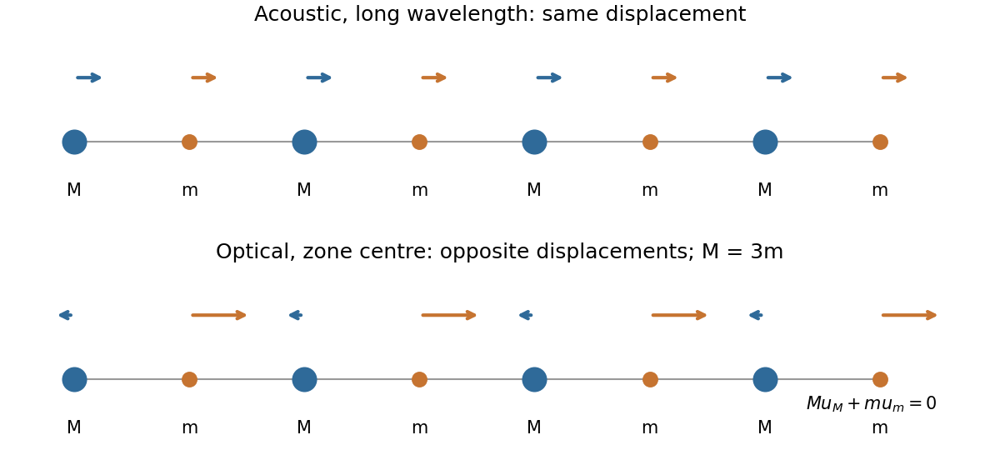

<h1 id="section-a/4/solution">Solution</h1>

↑ **Parent:** [4](../4.md)

At long [wavelength](../../../../../wavelength.md), the [acoustic phonon branch](../../../../../acoustic-phonon-branch.md) moves the two atoms in a cell nearly in phase: $u_M\simeq u_m$. In the $q\to0$ limit this is rigid translation and $\omega\to0$. The [optical phonon branch](../../../../../optical-phonon-branch.md) moves them oppositely, with stationary cell [centre of mass](../../../../../center-of-mass.md): $Mu_M+mu_m=0$. Its $q=0$ [frequency](../../../../../frequency.md) is finite because adjacent unlike atoms change their separation. For unequal masses the lighter atom has the larger optical displacement. Three-dimensional crystals have three acoustic branches and, with two atoms per primitive cell, three optical branches; longitudinal and transverse directions describe displacement relative to the [wavevector](../../../../../wavevector.md). The name optical does not mean that every [optical phonon branch](../../../../../optical-phonon-branch.md) is infrared-active: coupling also depends on effective charges and symmetry.

**[Figure 1](#section-a/4/image-original-long-wavelength-acoustic-and-optical-displacement-sketches-for-unequal-masses-with-optical-centre-of-mass-cancellation). Original long-wavelength acoustic and optical displacement sketches for unequal masses, with optical centre-of-mass cancellation**.

## ↑ Ancestors (14)

1. [4](../4.md)
2. [Section A](../../section-a.md)
3. [Paper 2](../../../paper-2-split.md)
4. [2012](../../../split.md)
5. [Past exam of the physics A course of the University of Cambridge](../../../../split.md)
6. [Physics A course of the University of Cambridge](../../../../../physics-a-course-of-the-university-of-cambridge.md)
7. [Physics course of the year 2 of the natural sciences course of the University of Cambridge](../../../../../physics-course-of-the-year-2-of-the-natural-sciences-course-of-the-university-of-cambridge.md)
8. [Year 2 of the natural sciences course of the University of Cambridge](../../../../../year-2-of-the-natural-sciences-course-of-the-university-of-cambridge.md)
9. [Year of the natural sciences course of the University of Cambridge](../../../../../year-of-the-natural-sciences-course-of-the-university-of-cambridge.md)
10. [Natural sciences course of the University of Cambridge](../../../../../natural-sciences-course-of-the-university-of-cambridge.md)
11. [Course of the University of Cambridge](../../../../../course-of-the-university-of-cambridge.md)
12. [University of Cambridge](../../../../../university-of-cambridge-split.md)
13. [List of universities](../../../../../list-of-universities.md)
14. [Codex Wiki](../../../../../split.md)
