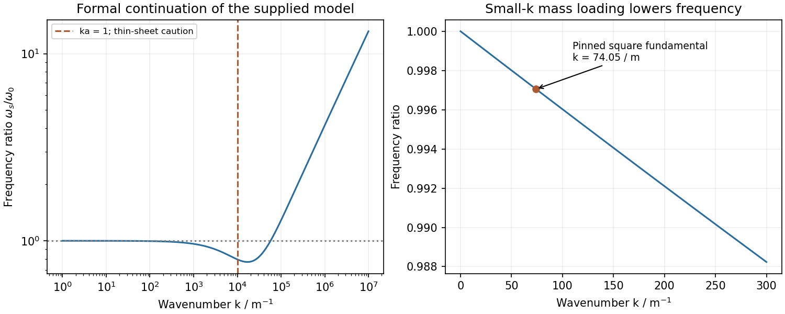

<h1 id="section-b/b6/solution">Solution</h1>

↑ **Parent:** [B6](../b6.md)

For a narrow packet, [phase velocity](../../../../../phase-velocity.md) is $u_p=\omega/k$ and [group velocity](../../../../../group-velocity.md) is $u_g=d\omega/dk$. Set $b=\sigma/\rho_1$. The uncovered surface has

$$
u_p^2=\frac gk+bk,\qquad
\frac{u_g}{u_p}=\frac{g+3bk^2}{2(g+bk^2)}.
$$

Equality occurs at $k_*^2=g/b$, also the minimum of $u_p$. Numerically,

$$
\boxed{k_*=368.9\ \mathrm{m^{-1}},\quad\lambda_*=1.703\ \mathrm{cm},\quad
u_p=u_g=(4gb)^{1/4}=0.2305\ \mathrm{m\,s^{-1}}}.
$$

The long-wave gravity limit has $u_g/u_p\to1/2$; the short-wave capillary limit has $u_g/u_p\to3/2$.

A compact packet subsequently spreads because different [wavenumbers](../../../../../wavenumber.md) have different group speeds. In the gravity regime $\omega\simeq\sqrt{gk}$, so smaller $k$ and longer waves move ahead. Individual crests move twice as fast as the envelope, appearing at its rear and disappearing at its front. In the capillary regime $\omega\simeq\sqrt b\,k^{3/2}$, shorter waves move ahead; the envelope overtakes its slower individual crests, which drift backward relative to it. Thus both the [wavelength](../../../../../wavelength.md) ordering within the spread packet and the crest motion relative to its envelope reverse.

For the sheet define $c=a\rho_2/\rho_1=8.0\times10^{-5}\ \mathrm m$. The [elastic-cover frequency ratio for water waves](../../../../../elastic-cover-frequency-ratio-for-water-waves.md) is

$$
\boxed{F(k)=\frac{\omega_s}{\omega_0}
=\left[\frac{1+Bk^4/(\rho_1g+\sigma k^2)}{1+ck}\right]^{1/2}}.
$$

At small $k$, $F=1-ck/2+O(k^2)$: sheet inertia lowers the [frequency](../../../../../frequency.md), while bending first enters at higher order. At sufficiently large $k$, bending dominates the restoring force and sheet inertia dominates the extra [mass](../../../../../mass.md), giving $F\sim\sqrt{B/(\sigma c)}\,k^{1/2}$. The curve initially dips below one, reaches a minimum, then rises and crosses one. This asymptote describes the supplied ideal dispersion law; arbitrarily large $k$ eventually violates a thin-sheet continuum model.

For a [pinned-square surface displacement mode](../../../../../pinned-square-surface-displacement-mode.md), $k_{nm}=\pi\sqrt{n^2+m^2}/L$ with $n,m\geq1$. The fundamental has $k_{11}=74.05\ \mathrm{m^{-1}}$. The uncovered [frequency](../../../../../frequency.md) is $4.3729\ \mathrm{Hz}$ and $F(k_{11})=0.997051$, so

$$
\boxed{f_s=4.3600\ \mathrm{Hz},\qquad\Delta f=-0.0129\ \mathrm{Hz}}.
$$

This uses a square two-dimensional surface mode, not the one-dimensional $\pi/L$ estimate. A clamped plate or additional hydraulic [boundary conditions](../../../../../boundary-condition.md) would require a different mode calculation.

**[Figure 2](#section-b/b6/image-original-sheet-to-uncovered-frequency-ratio-with-the-pinned-square-fundamental-and-the-ideal-large-wavenumber-asymptote). Original sheet-to-uncovered frequency ratio, with the pinned-square fundamental and the ideal large-wavenumber asymptote**.

## ↑ Ancestors (14)

1. [B6](../b6.md)
2. [Section B](../../section-b.md)
3. [Paper 2](../../../paper-2-split.md)
4. [2012](../../../split.md)
5. [Past exam of the physics A course of the University of Cambridge](../../../../split.md)
6. [Physics A course of the University of Cambridge](../../../../../physics-a-course-of-the-university-of-cambridge.md)
7. [Physics course of the year 2 of the natural sciences course of the University of Cambridge](../../../../../physics-course-of-the-year-2-of-the-natural-sciences-course-of-the-university-of-cambridge.md)
8. [Year 2 of the natural sciences course of the University of Cambridge](../../../../../year-2-of-the-natural-sciences-course-of-the-university-of-cambridge.md)
9. [Year of the natural sciences course of the University of Cambridge](../../../../../year-of-the-natural-sciences-course-of-the-university-of-cambridge.md)
10. [Natural sciences course of the University of Cambridge](../../../../../natural-sciences-course-of-the-university-of-cambridge.md)
11. [Course of the University of Cambridge](../../../../../course-of-the-university-of-cambridge.md)
12. [University of Cambridge](../../../../../university-of-cambridge-split.md)
13. [List of universities](../../../../../list-of-universities.md)
14. [Codex Wiki](../../../../../split.md)
