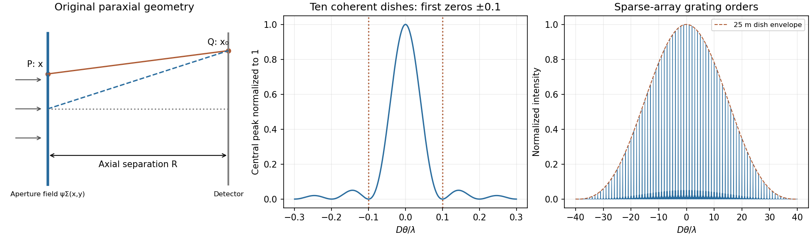

<h1 id="section-b/b8/solution">Solution</h1>

↑ **Parent:** [B8](../b8.md)

The Fraunhofer approximation drops the aperture-dependent quadratic propagation phase. For illuminated extent $b$ and observation distance $R$, a sufficient paraxial condition is $b^2/(\lambda R)\ll1$, with coherent nearly plane incident illumination. Collimation followed by observation in a lens's back [focal plane](../../../../../focal-plane.md) produces the same angular Fourier pattern without an astronomical propagation distance.

Let $(x,y)$ label the [aperture](../../../../../aperture.md) field $\psi_\Sigma$ and let $(x_0,y_0)$ be transverse coordinates of the distant detector, with $R$ the axial separation. Expanding the propagation distance retains a common phase and the cross term $-(x_0x+y_0y)/R$, while dropping the [aperture](../../../../../aperture.md)'s quadratic term. Summing the scalar Huygens contributions gives a field proportional to the [Fourier transform](../../../../../fourier-transform-split.md) at $(k x_0/R,k y_0/R)$. In one dimension, writing $q=kx_0/R$, $\widetilde\psi(q)=\int\psi(x)e^{-iqx}dx$ gives

$$
\boxed{\psi(x)=\frac1{2\pi}\int\widetilde\psi(q)e^{iqx}\,dq}.
$$

Remove the known propagation prefactor and any detector-plane quadratic phase before applying this inverse transform. Recovery needs the complex diffracted field, including phase; its intensity alone is insufficient for this inversion.

The [whole-aperture Fraunhofer distance of a coherent array](../../../../../whole-aperture-fraunhofer-distance-of-a-coherent-array.md) uses the full ten-dish extent, which is about $b=9D+25\ \mathrm m=7.225\ \mathrm{km}$. Thus $b^2/\lambda\simeq8.7\times10^8\ \mathrm m$, and a conventional boundary $2b^2/\lambda$ is about $1.7\times10^9\ \mathrm m$. **Far-field propagation must be of order a million kilometres or more**, with a stronger inequality for accurate Fraunhofer behaviour. Applying the condition to only one dish or one spacing would miss the array extent.

For equal synchronized dish fields, the array sum is $\sum_{j=0}^9e^{-ij k_0D\sin\theta}$. Its intensity is

$$
\boxed{I(\theta)=I_1(\theta)
\left[\frac{\sin(10\beta)}{\sin\beta}\right]^2,\qquad
\beta=\frac{k_0D\sin\theta}{2}}.
$$

Near the centre, $\sin\theta\simeq\theta$ and the single-dish envelope $I_1(\theta)$ is nearly constant, giving the requested approximation. A uniformly illuminated circular dish instead supplies the broader envelope $[2J_1(\pi d\sin\theta/\lambda)/(\pi d\sin\theta/\lambda)]^2$, with first zero near $1.22\lambda/d=2.93\times10^{-3}\ \mathrm{rad}$. It cannot be ignored over the entire pattern.

Principal array maxima have $\sin\theta_m=m\lambda/D$, height $100I_1(\theta_m)$, with spacing approximately $7.5\times10^{-5}\ \mathrm{rad}=15.5$ arcseconds. There are narrow sidelobes and many grating orders within the dish envelope because $D\gg d$. The central maximum's first zeros obey $10\beta=\pm\pi$. By reception/transmission reciprocity, the source must therefore move through

$$
\boxed{\Delta\theta\simeq\frac{\lambda}{10D}=7.50\times10^{-6}\ \mathrm{rad}=1.55\text{ arcseconds}}
$$

from zero-order maximum to first minimum. The equatorial geometry fixes the sweep direction; no elapsed time is requested.

**[Figure 3](#section-b/b8/image-original-labelled-fraunhofer-geometry-ten-element-central-interference-lobe-and-grating-orders-under-a-circular-dish-envelope). Original labelled Fraunhofer geometry, ten-element central interference lobe and grating orders under a circular-dish envelope**.

## ↑ Ancestors (14)

1. [B8](../b8.md)
2. [Section B](../../section-b.md)
3. [Paper 2](../../../paper-2-split.md)
4. [2012](../../../split.md)
5. [Past exam of the physics A course of the University of Cambridge](../../../../split.md)
6. [Physics A course of the University of Cambridge](../../../../../physics-a-course-of-the-university-of-cambridge.md)
7. [Physics course of the year 2 of the natural sciences course of the University of Cambridge](../../../../../physics-course-of-the-year-2-of-the-natural-sciences-course-of-the-university-of-cambridge.md)
8. [Year 2 of the natural sciences course of the University of Cambridge](../../../../../year-2-of-the-natural-sciences-course-of-the-university-of-cambridge.md)
9. [Year of the natural sciences course of the University of Cambridge](../../../../../year-of-the-natural-sciences-course-of-the-university-of-cambridge.md)
10. [Natural sciences course of the University of Cambridge](../../../../../natural-sciences-course-of-the-university-of-cambridge.md)
11. [Course of the University of Cambridge](../../../../../course-of-the-university-of-cambridge.md)
12. [University of Cambridge](../../../../../university-of-cambridge-split.md)
13. [List of universities](../../../../../list-of-universities.md)
14. [Codex Wiki](../../../../../split.md)
