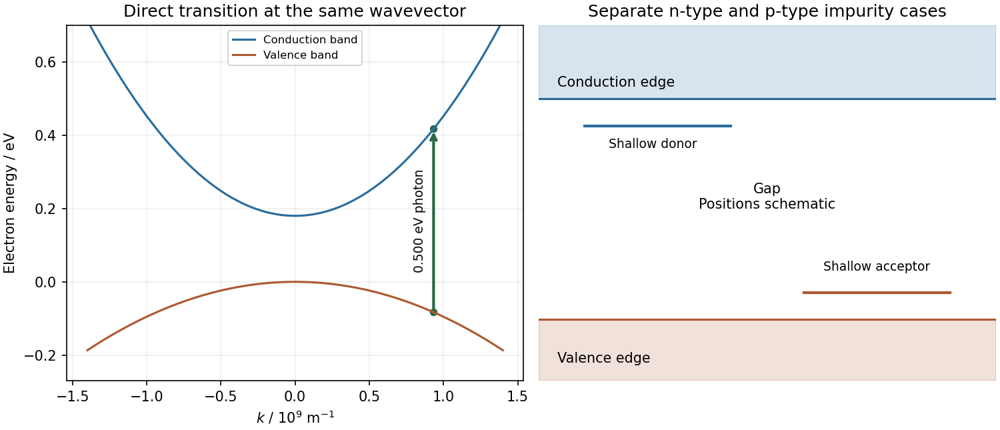

<h1 id="section-c/c10/solution">Solution</h1>

↑ **Parent:** [C10](../c10.md)

In a periodic crystal potential, atomic levels broaden into bands of allowed [bloch states](../../../../../bloch-state.md). Coupling between states of the same symmetry opens [avoided crossings](../../../../../avoided-crossing.md), including Bragg-coupled states in the nearly free-electron picture. Bonding and antibonding combinations provide a complementary tight-binding picture. A [semiconductor](../../../../../semiconductor-split.md) has a filled [valence band](../../../../../valence-band.md) and an empty [conduction band](../../../../../conduction-band.md) at zero [temperature](../../../../../temperature-split.md) separated by a forbidden [energy](../../../../../energy-split.md) interval; thermal excitation, light and doping provide mobile [electrons](../../../../../electron.md) and holes. The gap depends on the crystal's [periodic potential](../../../../../periodic-potential.md), bonding and symmetry, not on a classical collision barrier. In a direct gap, the relevant extrema coincide in [wavevector](../../../../../wavevector.md).

For the stated parabolic edges, take $E_v(k)=-\hbar^2k^2/(2m_h^*)$ and $E_c(k)=E_g+\hbar^2k^2/(2m_e^*)$. Negligible [photon](../../../../../photon.md) [momentum](../../../../../momentum-split.md) and no [phonon](../../../../../phonon.md) make the transition nearly vertical in $E$ versus $k$. [parabolic-band optical energy sharing](../../../../../parabolic-band-optical-energy-sharing.md) divides the excess [photon](../../../../../photon.md) [energy](../../../../../energy-split.md) $0.32\ \mathrm{eV}$ in inverse proportion to the effective masses:

$$
K_e=0.32\frac{0.4}{0.14+0.4}=0.2370\ \mathrm{eV},\qquad
K_h=0.32\frac{0.14}{0.14+0.4}=0.0830\ \mathrm{eV}.
$$

Thus the initial and final [electron](../../../../../electron.md) energies, relative to the valence-band maximum, are

$$
\boxed{E_i=-0.0830\ \mathrm{eV},\qquad E_f=0.4170\ \mathrm{eV}}.
$$

Their difference is $0.5000\ \mathrm{eV}$. The selected $|k|$ is about $9.33\times10^8\ \mathrm{m^{-1}}$; either sign gives the same [energy](../../../../../energy-split.md) in this symmetric approximation.

A shallow donor supplies an [electron](../../../../../electron.md) in a screened impurity potential, so its localized level lies just below the conduction edge. A shallow acceptor binds a hole and has an electron-occupation level just above the valence edge; thermal ionization supplies mobile holes. The level positions are measured relative to the relevant band edge, and deep impurities need not obey this hydrogenic approximation.

For the supplied bound-carrier [mass](../../../../../mass.md) and unit effective ionic charge, [dielectric screening](../../../../../dielectric-screening.md) and effective [mass](../../../../../mass.md) change the hydrogen binding [energy](../../../../../energy-split.md) to

$$
\boxed{E_b=13.6\frac{0.1}{12^2}\ \mathrm{eV}=9.44\ \mathrm{meV}}.
$$

This corresponds to $E_b/k_B\simeq110\ \mathrm K$ and an effective Bohr radius about $6.35\ \mathrm{nm}$. The binding is shallow compared with the [band gap](../../../../../band-gap.md) and typical atomic binding. Trivalent denotes chemical valence, not an unscreened hydrogenic charge of three. An acceptor physically binds a hole; the question's stated $0.1m_e$ is used as its stipulated bound-carrier [mass](../../../../../mass.md) rather than silently replacing it by the separate band-edge $0.4m_e$.

**[Figure 4](#section-c/c10/image-original-direct-gap-vertical-transition-with-mass-dependent-energy-sharing-and-separate-schematic-shallow-donor-and-acceptor-levels). Original direct-gap vertical transition with mass-dependent energy sharing, and separate schematic shallow donor and acceptor levels**.

## ↑ Ancestors (14)

1. [C10](../c10.md)
2. [Section C](../../section-c.md)
3. [Paper 2](../../../paper-2-split.md)
4. [2012](../../../split.md)
5. [Past exam of the physics A course of the University of Cambridge](../../../../split.md)
6. [Physics A course of the University of Cambridge](../../../../../physics-a-course-of-the-university-of-cambridge.md)
7. [Physics course of the year 2 of the natural sciences course of the University of Cambridge](../../../../../physics-course-of-the-year-2-of-the-natural-sciences-course-of-the-university-of-cambridge.md)
8. [Year 2 of the natural sciences course of the University of Cambridge](../../../../../year-2-of-the-natural-sciences-course-of-the-university-of-cambridge.md)
9. [Year of the natural sciences course of the University of Cambridge](../../../../../year-of-the-natural-sciences-course-of-the-university-of-cambridge.md)
10. [Natural sciences course of the University of Cambridge](../../../../../natural-sciences-course-of-the-university-of-cambridge.md)
11. [Course of the University of Cambridge](../../../../../course-of-the-university-of-cambridge.md)
12. [University of Cambridge](../../../../../university-of-cambridge-split.md)
13. [List of universities](../../../../../list-of-universities.md)
14. [Codex Wiki](../../../../../split.md)
