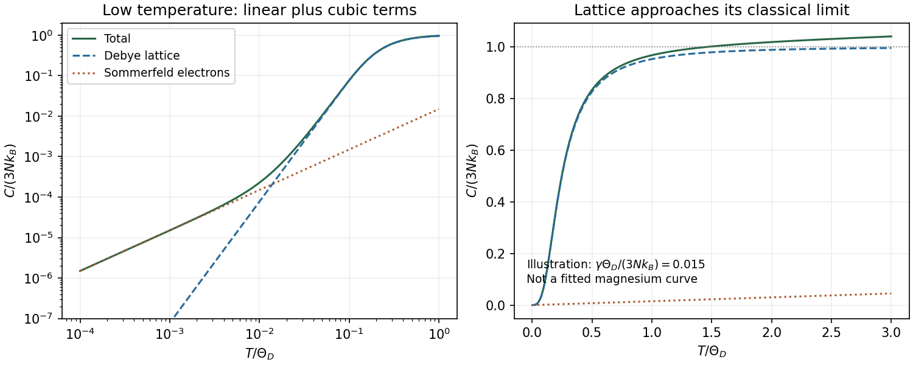

<h1 id="section-c/c11/solution">Solution</h1>

↑ **Parent:** [C11](../c11.md)

With periodic [boundary conditions](../../../../../boundary-condition.md), each $k$ state occupies volume $(2\pi)^3/V$ and has two spin states. Filling a sphere gives $n=k_F^3/(3\pi^2)$ and

$$
\boxed{E_F=\frac{\hbar^2}{2m_e}(3\pi^2n)^{2/3}},\qquad
D(E)=\frac1{2\pi^2}\left(\frac{2m_e}{\hbar^2}\right)^{3/2}\sqrt E,
\quad \boxed{D(E_F)=\frac{3n}{2E_F}}.
$$

Here $D$ is [density of states](../../../../../density-of-states.md) per volume and per [energy](../../../../../energy-split.md); the extensive $g(E)$ is $VD(E)$. Both spin states are already included.

For divalent magnesium, $n=8.6\times10^{28}\ \mathrm{m^{-3}}$, giving

$$
\boxed{E_F=7.10\ \mathrm{eV},\qquad
D(E_F)=1.13\times10^{47}\ \mathrm{J^{-1}m^{-3}}
=1.82\times10^{28}\ \mathrm{eV^{-1}m^{-3}}}.
$$

At $T\ll T_F$, only [electrons](../../../../../electron.md) within about $k_BT$ of the [Fermi surface](../../../../../fermi-surface.md) change occupancy. The Sommerfeld [heat capacity](../../../../../heat-capacity.md) is

$$
\boxed{\frac{C_e}{V}=\frac{\pi^2}{3}k_B^2D(E_F)T
=71.1\,T\ \mathrm{J\,m^{-3}\,K^{-1}}}.
$$

Equivalently $C_{e,m}=0.995\,T\ \mathrm{mJ\,mol^{-1}\,K^{-1}}$, with $T$ in kelvin, so at room [temperature](../../../../../temperature-split.md) it is about $0.299\ \mathrm{J\,mol^{-1}\,K^{-1}}$. A [temperature](../../../../../temperature-split.md) was not specified for the estimate; the linear coefficient is the general result.

At sufficiently low [temperature](../../../../../temperature-split.md), an ordinary nonsuperconducting metal has $C\simeq\gamma T+\beta T^3$: [electrons](../../../../../electron.md) dominate at the lowest [temperatures](../../../../../temperature-split.md), acoustic [phonons](../../../../../phonon.md) produce the cubic contribution, and the lattice approaches $3R$ per mole as [temperature](../../../../../temperature-split.md) exceeds its characteristic Debye scale. Anharmonic expansion can distinguish measured $C_p$ from $C_V$. In the room-temperature regime, $T/T_F\simeq0.0036$ since $T_F\simeq8.24\times10^4\ \mathrm K$, so [electron](../../../../../electron.md) excitation is strongly Pauli-limited. The free-electron estimate is only about $1.2\%$ of the classical $3R$ lattice scale. Calling it negligible means small relative to the lattice contribution, not identically zero or negligible as $T\to0$. Real band structure and interactions can alter the coefficient.

**[Figure 5](#section-c/c11/image-original-illustrative-metal-heat-capacity-regimes-sommerfeld-linear-electrons-and-debye-phonons-with-explicit-dimensionless-model-parameters). Original illustrative metal heat-capacity regimes: Sommerfeld linear electrons and Debye phonons, with explicit dimensionless model parameters**.

## ↑ Ancestors (14)

1. [C11](../c11.md)
2. [Section C](../../section-c.md)
3. [Paper 2](../../../paper-2-split.md)
4. [2012](../../../split.md)
5. [Past exam of the physics A course of the University of Cambridge](../../../../split.md)
6. [Physics A course of the University of Cambridge](../../../../../physics-a-course-of-the-university-of-cambridge.md)
7. [Physics course of the year 2 of the natural sciences course of the University of Cambridge](../../../../../physics-course-of-the-year-2-of-the-natural-sciences-course-of-the-university-of-cambridge.md)
8. [Year 2 of the natural sciences course of the University of Cambridge](../../../../../year-2-of-the-natural-sciences-course-of-the-university-of-cambridge.md)
9. [Year of the natural sciences course of the University of Cambridge](../../../../../year-of-the-natural-sciences-course-of-the-university-of-cambridge.md)
10. [Natural sciences course of the University of Cambridge](../../../../../natural-sciences-course-of-the-university-of-cambridge.md)
11. [Course of the University of Cambridge](../../../../../course-of-the-university-of-cambridge.md)
12. [University of Cambridge](../../../../../university-of-cambridge-split.md)
13. [List of universities](../../../../../list-of-universities.md)
14. [Codex Wiki](../../../../../split.md)
