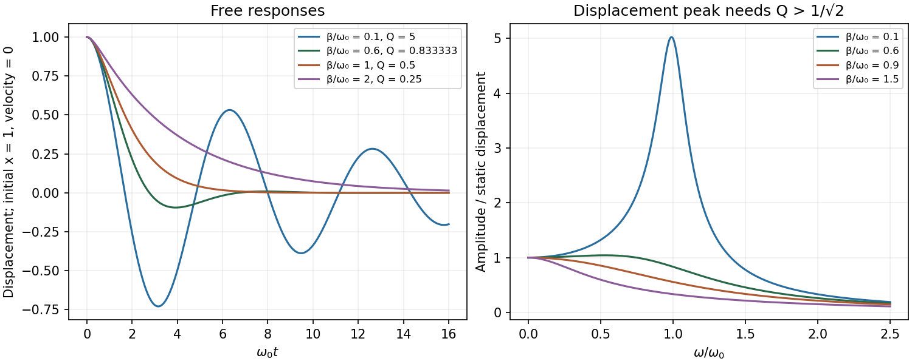

<h1 id="section-d/d12/solution">Solution</h1>

↑ **Parent:** [D12](../d12.md)

For $m\ddot x+b\dot x+kx=F_0\cos\omega t$, define $\omega_0=\sqrt{k/m}$ and $\beta=b/(2m)$. The parameter relating [quality factor and viscous damping regimes](../../../../../quality-factor-and-viscous-damping-regimes.md) is

$$
\boxed{Q=\frac{\omega_0}{2\beta}=\frac{m\omega_0}{b}}.
$$

At weak damping it also equals $2\pi$ times stored [energy](../../../../../energy-split.md) divided by [energy](../../../../../energy-split.md) lost per cycle. The stored-energy convention and [frequency](../../../../../frequency.md) matter: this cycle-based interpretation should not be extended to free motions that never complete a cycle.

For $\beta<\omega_0$ the free motion is $e^{-\beta t}[A\cos\omega_dt+B\sin\omega_dt]$, where $\omega_d=\sqrt{\omega_0^2-\beta^2}$. Thus **[underdamping](../../../../../underdamping.md) means $Q>1/2$**. High $Q$ gives many oscillations per amplitude-decay time, narrow [resonance](../../../../../resonance.md) and strong [frequency](../../../../../frequency.md) selectivity; a lightly loaded tuning fork, optical cavity or low-loss electrical [resonator](../../../../../resonator.md) provides examples. The amplitude decay time is $\tau_A=1/\beta=2Q/\omega_0$, while the slowly averaged [energy](../../../../../energy-split.md) decays with $\tau_E=1/(2\beta)=Q/\omega_0$. These times differ by a factor of two.

At [critical damping](../../../../../critical-damping.md), $\beta=\omega_0$ and $Q=1/2$, with $x=(A+Bt)e^{-\omega_0t}$. There is no ringing; a simple critically damped position indicator can settle without oscillation. For $\beta>\omega_0$ and $Q<1/2$, there are two real negative decay rates $-\beta\pm\sqrt{\beta^2-\omega_0^2}$. Increasing very strong drag slows the long-time return, whose rate approaches $\omega_0^2/(2\beta)$. A strongly viscously damped mechanical indicator illustrates this regime. These classifications concern the linear homogeneous equation, not every possible nonlinear damping law.

The driven displacement amplitude is

$$
A(\omega)=\frac{F_0/m}{\sqrt{(\omega_0^2-\omega^2)^2+4\beta^2\omega^2}}.
$$

The [displacement-resonance threshold of a viscous oscillator](../../../../../displacement-resonance-threshold-of-a-viscous-oscillator.md) requires $\beta<\omega_0/\sqrt2$, or **$Q>1/\sqrt2$**; it lies at $\sqrt{\omega_0^2-2\beta^2}$. Some underdamped systems therefore have no such maximum. Average absorbed [power](../../../../../power.md) instead peaks at $\omega_0$ for this viscous model. Its half-power frequencies are $\sqrt{\omega_0^2+\beta^2}\pm\beta$, so their separation is $2\beta$ and $Q=\omega_0/\Delta\omega$. For broad response this ratio remains a useful parameter but not a claim of many free oscillations. The familiar displacement-linewidth version is a high-$Q$ approximation.

A [series RLC circuit](../../../../../series-rlc-circuit.md) has $\omega_0=1/\sqrt{LC}$ and $Q=\omega_0L/R$ for the charge oscillation. Resistance dissipates [energy](../../../../../energy-split.md), inductance provides the inertial analogue and capacitance the restoring analogue. Ringdown and a calibrated half-power scan independently estimate loss; parasitic resistance, loading and radiation change the measured value. A large $Q$ increases [frequency](../../../../../frequency.md) selectivity but also lengthens settling time, so it is not universally the best instrumental choice.

**[Figure 6](#section-d/d12/image-original-free-decay-and-forced-displacement-curves-distinguishing-underdamping-critical-damping-overdamping-and-the-resonance-threshold). Original free decay and forced-displacement curves distinguishing underdamping, critical damping, overdamping and the resonance threshold**.

## ↑ Ancestors (14)

1. [D12](../d12.md)
2. [Section D](../../section-d.md)
3. [Paper 2](../../../paper-2-split.md)
4. [2012](../../../split.md)
5. [Past exam of the physics A course of the University of Cambridge](../../../../split.md)
6. [Physics A course of the University of Cambridge](../../../../../physics-a-course-of-the-university-of-cambridge.md)
7. [Physics course of the year 2 of the natural sciences course of the University of Cambridge](../../../../../physics-course-of-the-year-2-of-the-natural-sciences-course-of-the-university-of-cambridge.md)
8. [Year 2 of the natural sciences course of the University of Cambridge](../../../../../year-2-of-the-natural-sciences-course-of-the-university-of-cambridge.md)
9. [Year of the natural sciences course of the University of Cambridge](../../../../../year-of-the-natural-sciences-course-of-the-university-of-cambridge.md)
10. [Natural sciences course of the University of Cambridge](../../../../../natural-sciences-course-of-the-university-of-cambridge.md)
11. [Course of the University of Cambridge](../../../../../course-of-the-university-of-cambridge.md)
12. [University of Cambridge](../../../../../university-of-cambridge-split.md)
13. [List of universities](../../../../../list-of-universities.md)
14. [Codex Wiki](../../../../../split.md)
