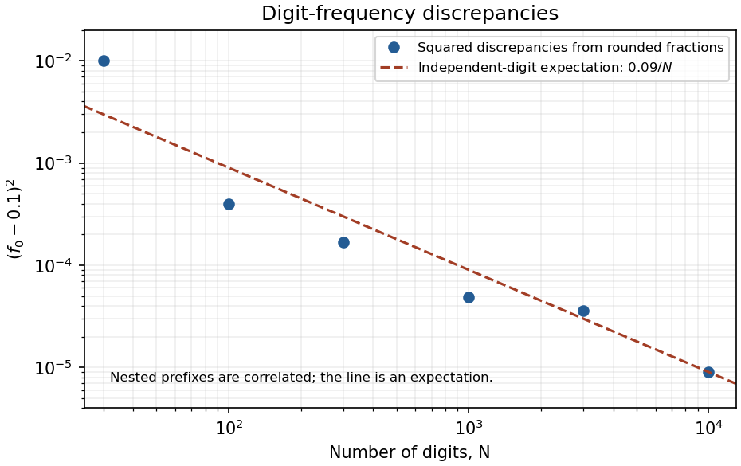
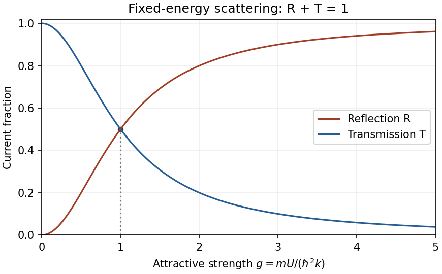
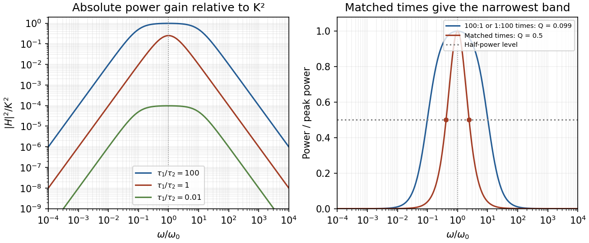

# Paper 1

↑ **Parent:** [2013](../2013.md)

[Original public PDF, physical pages 72–78; dated 25 May 2013](https://www.whatdotheyknow.com/request/natural_science_tripos_physics_e_2/response/2340776/attach/2/FOI%202023%20399%20Zahid%20materials.pdf?cookie_passthrough=1)

**Table of contents**

- [Section A](#section-a)
  - [1](#section-a/1)
    - [Solution](#section-a/1/solution)
  - [2](#section-a/2)
    - [Solution](#section-a/2/solution)
  - [3](#section-a/3)
    - [Solution](#section-a/3/solution)
  - [4](#section-a/4)
    - [Solution](#section-a/4/solution)
  - [5](#section-a/5)
    - [Solution](#section-a/5/solution)
- [Section B](#section-b)
  - [B6](#section-b/b6)
    - [Solution](#section-b/b6/solution)
  - [B7](#section-b/b7)
    - [Solution](#section-b/b7/solution)
  - [B8](#section-b/b8)
    - [Solution](#section-b/b8/solution)
  - [B9](#section-b/b9)
    - [Solution](#section-b/b9/solution)
- [Section C](#section-c)
  - [C10](#section-c/c10)
    - [Solution](#section-c/c10/solution)
  - [C11](#section-c/c11)
    - [a](#section-c/c11/a)
      - [Solution](#section-c/c11/a/solution)
    - [b](#section-c/c11/b)
      - [Solution](#section-c/c11/b/solution)
    - [c](#section-c/c11/c)
      - [Solution](#section-c/c11/c/solution)
- [Section D](#section-d)
  - [D12](#section-d/d12)
    - [Solution](#section-d/d12/solution)
  - [D13](#section-d/d13)
    - [a](#section-d/d13/a)
      - [Solution](#section-d/d13/a/solution)
    - [b](#section-d/d13/b)
      - [Solution](#section-d/d13/b/solution)
    - [c](#section-d/d13/c)
      - [Solution](#section-d/d13/c/solution)

## Section A

↑ **Parent:** [Paper 1](paper-1.md)

<h3 id="section-a/1">1</h3>

↑ **Parent:** [Section A](#section-a)

<h4 id="section-a/1/solution">Solution</h4>

↑ **Parent:** [1](#section-a/1)

In the [small-angle approximation](../../geometry-and-topology.md#small-angle-approximation) the [physical pendulum](../../mathematical-physics.md#physical-pendulum) is a [harmonic oscillator](../../classical-mechanics.md#simple-harmonic-motion) with $\omega=2\pi/T$. Its classical [energy](../../energy.md) is $E=m\omega^2A^2/2=3.55\times10^{-3}\,\mathrm J$. Equating this to $(n+1/2)\hbar\omega$ gives

$$
\boxed{n\simeq\frac{m\omega A^2}{2\hbar}=5.36\times10^{30}}.
$$

An oscillating bob is not a single stationary [energy eigenstate](../../energy-eigenvalue.md#energy-eigenstate). An ideal [coherent state](../../quantum-theory.md#coherent-state) has a [Poisson distribution](../../discrete-probability-distribution.md#poisson-distribution) of oscillator occupations centred on this [mean](../../expected-value.md), with relative spread $1/\sqrt{\bar n}$, exceptionally small here. This [quantum occupation scale of a classical oscillator](../../quantum-harmonic-oscillator.md#quantum-occupation-scale-of-a-classical-oscillator) fixes the excitation scale without requiring the real, damped clock to be a pure [coherent state](../../quantum-theory.md#coherent-state).

<h3 id="section-a/2">2</h3>

↑ **Parent:** [Section A](#section-a)

<h4 id="section-a/2/solution">Solution</h4>

↑ **Parent:** [2](#section-a/2)

The [free particle](../../quantum-mechanics.md#free-particle) [dispersion relation](../../dispersion-relation.md) is $\hbar\omega=\hbar^2k^2/(2m)$. Hence

$$
\boxed{v_{\rm ph}=\omega/k=\hbar k/(2m),\qquad v_g=d\omega/dk=\hbar k/m}.
$$

The [phase velocity](../../dispersion-relation.md#phase-velocity) follows constant-phase surfaces of a [plane wave](../../wave-function.md#plane-wave). The [group velocity](../../dispersion-relation.md#group-velocity) follows the envelope of a narrow-band [wave packet](../../dispersion-relation.md#wave-packet) and equals its classical velocity $p/m$. Dispersion can spread the packet; the phase speed is not the particle's transport velocity. In three dimensions $\mathbf v_g=\hbar\mathbf k/m$ and the phase speed quoted is along $\mathbf k$.

<h3 id="section-a/3">3</h3>

↑ **Parent:** [Section A](#section-a)

<h4 id="section-a/3/solution">Solution</h4>

↑ **Parent:** [3](#section-a/3)

The [mass dependence of fixed-barrier tunnelling](../../analysis.md#mass-dependence-of-fixed-barrier-tunnelling) follows by holding [energy](../../energy.md) and the potential-energy barrier fixed: [quantum tunnelling](../../quantum-mechanics.md#quantum-tunnelling) has the leading [WKB approximation](../../analysis.md#wkb-approximation)

$$
T\propto\exp\!\left[-\frac2\hbar\int_{x_1}^{x_2}\sqrt{2m(V-E)}\,dx\right].
$$

The alpha-particle [mass](../../classical-mechanics.md#mass) is about $7.3\times10^3$ [electron](../../physics.md#electron) [masses](../../classical-mechanics.md#mass), so its decay exponent is about **85 times larger** for the same $V-E$ profile. Exponential suppression therefore makes transmission much smaller. This comparison holds the [potential energy](../../energy.md#potential-energy) and incident [energy](../../energy.md) fixed: the same electrostatic potential is not the same potential-energy barrier for charges of different magnitude and sign.

<h3 id="section-a/4">4</h3>

↑ **Parent:** [Section A](#section-a)

<h4 id="section-a/4/solution">Solution</h4>

↑ **Parent:** [4](#section-a/4)

For the [squared discrepancy of a digit frequency](../../discrete-probability-distribution.md#squared-discrepancy-of-a-digit-frequency), write $d_N^2=(f_0-0.1)^2$. The plotted ordinates are $10^{-2}$, $4.00\times10^{-4}$, $1.69\times10^{-4}$, $4.90\times10^{-5}$, $3.60\times10^{-5}$ and $9.00\times10^{-6}$ in increasing $N$. Under an independent, equiprobable-digit model, the zero count is binomial and

$$
\boxed{\mathbb E[d_N^2]=\operatorname{Var}(f_0)=\frac{0.1(0.9)}N=\frac{0.09}N}.
$$

Thus the expected log-log slope is **$-1$**. If “relative” means division by the expected fraction before squaring, every ordinate is multiplied by 100 and the prediction becomes $9/N$; the slope is unchanged. These are nested prefixes of one digit sequence, so the points are correlated, rounded observations, not independent [variance](../../variance.md) estimates. Their rough trend supports a reciprocal-power scale but does not prove independence or that $\pi$ is a [normal number](../../number-theory.md#normal-number).

**[Figure 1](#section-a/4/image-original-log-log-plot-of-squared-digit-frequency-discrepancies-with-the-independent-digit-expectation). Original log-log plot of squared digit-frequency discrepancies with the independent-digit expectation**.

<h3 id="section-a/5">5</h3>

↑ **Parent:** [Section A](#section-a)

<h4 id="section-a/5/solution">Solution</h4>

↑ **Parent:** [5](#section-a/5)

From [Snell's law](../../partial-differential-equation.md#snell-s-law), $n=\sin\theta_i/\sin\theta_r=1.5204$. Treating the quoted angle errors as independent one-standard-deviation uncertainties and using radians in [derivatives](../../calculus.md#derivative),

$$
\sigma_n^2=n^2\left(\cot^2\theta_i\,\sigma_i^2+\cot^2\theta_r\,\sigma_r^2\right),\qquad
\boxed{n=1.52\pm0.14}.
$$

This [refractive-index uncertainty from Snell's law](../../wave-equation.md#refractive-index-uncertainty-from-snell-s-law) is first-order [propagation of uncertainty](../../wave-equation.md#propagation-of-uncertainty), with air's index approximated by one. Correlated angular [calibration](../../differential-geometry.md#calibration-differential-geometry) errors add $-2n^2\cot\theta_i\cot\theta_r\operatorname{Cov}(\theta_i,\theta_r)$. If the quoted errors are hard bounds instead, their conservative first-order sum gives about $0.19$, rather than the statistical quadrature value.

## Section B

↑ **Parent:** [Paper 1](paper-1.md)

<h3 id="section-b/b6">B6</h3>

↑ **Parent:** [Section B](#section-b)

<h4 id="section-b/b6/solution">Solution</h4>

↑ **Parent:** [B6](#section-b/b6)

Apply the [radial momentum operator](../../mathematical-physics.md#radial-momentum-operator) to a smooth radial test function. More generally $[f(r),p_r]=i\hbar f'(r)$, giving the first two labelled identities. Expanding the square gives the third:

$$
\text{(i)}\ [r,p_r]=i\hbar,\qquad
\text{(ii)}\ [r^{-1},p_r]=-i\hbar r^{-2},\qquad
\text{(iii)}\ p_r^2=-\hbar^2\left(\partial_r^2+\frac2r\partial_r\right).
$$

The kinetic-energy decomposition is $p^2=p_r^2+L^2/r^2$. A [central potential](../../energy.md#central-potential) commutes with $L^2$ and $L_z$, so choose simultaneous angular [eigenfunctions](../../linear-operator-theory.md#eigenfunction) $Y_{lm}$, with $L^2=l(l+1)\hbar^2$ and $l=0,1,\ldots$. The radial [Hamiltonian](../../hamiltonian-mechanics.md#hamiltonian) consequently has the stated centrifugal term. The radial inner product uses measure $r^2dr$; adjoints below are taken on compatible regular bound-state domains. The formal radial [momentum](../../momentum.md) is not thereby asserted to be a self-adjoint observable on a half-line.

Set $q=l+1$, $W=-q/r+1/(qa)$ and $D=i p_r/\hbar$. Since $D^\dagger=-D$ formally and $[D,W]=W'=q/r^2$,

$$
A_l^\dagger A_l=\frac{a^2}{2}\left[\frac{p_r^2}{\hbar^2}+\frac{l(l+1)}{r^2}-\frac2{ar}+\frac1{q^2a^2}\right].
$$

The [hydrogen radial Hamiltonian factorization](../../mathematical-physics.md#hydrogen-radial-hamiltonian-factorization) follows by matching the Coulomb coefficient, which fixes the [Bohr radius](../../mathematical-physics.md#bohr-radius)

$$
\boxed{a=\frac{4\pi\epsilon_0\hbar^2}{me^2}},\qquad
H_l=\frac{\hbar^2}{ma^2}\left(A_l^\dagger A_l-\frac1{2(l+1)^2}\right).
$$

For the second pair of labelled relations, the opposite product changes the sign of $W'$, hence

$$
\text{(i)}\quad[A_l,A_l^\dagger]=a^2W'=\frac{a^2(l+1)}{r^2}
=\frac{ma^2}{\hbar^2}(H_{l+1}-H_l).
$$

Using $[A,A^\dagger A]=[A,A^\dagger]A$ in the [factorization](../../algebra.md#factorization) then gives

$$
\text{(ii)}\quad[A_l,H_l]=(H_{l+1}-H_l)A_l,
\qquad H_{l+1}A_l=A_lH_l.
$$

This [Coulomb angular-momentum intertwining](../../mathematical-physics.md#coulomb-angular-momentum-intertwining) means applying $A_l$ to an [energy eigenstate](../../energy-eigenvalue.md#energy-eigenstate) either gives zero or an eigenstate of $H_{l+1}$ with the same [energy](../../energy.md). For a normalized negative-energy state,

$$
\|A_l\psi\|^2=\frac{ma^2E}{\hbar^2}+\frac1{2(l+1)^2}\ge0.
$$

At fixed $E<0$ this would become negative if raising $l$ continued indefinitely. The [bound-state ladder termination by norm positivity](../../mathematical-physics.md#bound-state-ladder-termination-by-norm-positivity) occurs at some $L$ with $A_L\psi=0$, giving

$$
\boxed{E_n=-\frac{\hbar^2}{2ma^2n^2}=-\frac{me^4}{2(4\pi\epsilon_0)^2\hbar^2n^2},\quad n=L+1=1,2,\ldots}.
$$

The terminating radial function is proportional to $r^L e^{-r/[(L+1)a]}$, regular and normalizable; adjoint intertwiners generate lower $l$ values at fixed $n$. Positive-energy [scattering states](../../quantum-scattering.md#scattering-state) are not subject to this terminating negative-energy argument. Here $m$ is the [mass](../../classical-mechanics.md#mass) in the supplied [Hamiltonian](../../hamiltonian-mechanics.md#hamiltonian); including nuclear motion replaces it by the [reduced mass](../../classical-mechanics.md#reduced-mass).

<h3 id="section-b/b7">B7</h3>

↑ **Parent:** [Section B](#section-b)

<h4 id="section-b/b7/solution">Solution</h4>

↑ **Parent:** [B7](#section-b/b7)

The remaining cyclic [commutators](../../lie-algebra.md#commutator) are $[S_y,S_z]=i\hbar S_x$ and $[S_z,S_x]=i\hbar S_y$. In a spin-$s$ irreducible representation,

$$
\boxed{S_z=\hbar m_s,\quad m_s=-s,-s+1,\ldots,s;\qquad S^2=\hbar^2s(s+1)}.
$$

For [spin](../../angular-momentum-operator.md#spin) one-half, $S_i=\hbar\sigma_i/2$, appropriate to an [electron](../../physics.md#electron)'s [spin](../../angular-momentum-operator.md#spin). Each $S_i^2=\hbar^2I/4$, so this [Hamiltonian](../../hamiltonian-mechanics.md#hamiltonian) is $H=A\hbar^2I/4$. The orthonormal vectors $(1,0)^T$ and $(0,1)^T$ are eigenstates with the same [energy](../../energy.md) **$A\hbar^2/4$**; every normalized [superposition](../../vector-space.md#superposition-principle) is also an eigenstate. The $B$ term vanishes identically because [spin-one-half quadratic anisotropy is constant](../../angular-momentum-operator.md#spin-one-half-quadratic-anisotropy-is-constant).

For the supplied three-dimensional basis one consistent choice is

$$
S_y=i\hbar\begin{pmatrix}0&0&1\\0&0&0\\-1&0&0\end{pmatrix},\qquad
S_z=i\hbar\begin{pmatrix}0&1&0\\-1&0&0\\0&0&0\end{pmatrix}.
$$

These [Hermitian matrices](../../hilbert-space.md#hermitian-operator) obey the cyclic [commutators](../../lie-algebra.md#commutator) with the given $S_x$, and $S^2=2\hbar^2I$, representing [spin](../../angular-momentum-operator.md#spin) one. Their squares give

$$
H=\hbar^2\operatorname{diag}(A-B,A+B,0).
$$

Thus the three normalized Cartesian basis vectors $e_1,e_2,e_3$ have energies **$\hbar^2(A-B)$, $\hbar^2(A+B)$ and $0$**, respectively; degeneracies permit arbitrary orthonormal choices in the corresponding [eigenspaces](../../linear-operator-theory.md#eigenspace).

The parallel and antiparallel $S_x$ states are $|+x\rangle=(0,1,-i)^T/\sqrt2$ and $|-x\rangle=(0,1,i)^T/\sqrt2$. Evolution from the first gives

$$
|\psi(t)\rangle=\frac1{\sqrt2}\begin{pmatrix}0\\e^{-i(A+B)\hbar t}\\-i\end{pmatrix},\qquad
P_{-x}(t)=\sin^2\left(\frac{(A+B)\hbar t}{2}\right).
$$

This [spin-one reversal under quadratic anisotropy](../../angular-momentum-operator.md#spin-one-reversal-under-quadratic-anisotropy) is complete when

$$
\boxed{t=\frac{(2j+1)\pi}{|A+B|\hbar},\quad j=0,1,\ldots}
$$

provided $A+B\ne0$. If $A+B=0$, its initial state is stationary up to phase and complete reversal never occurs. Assume real $A,B$ for a Hermitian [Hamiltonian](../../hamiltonian-mechanics.md#hamiltonian).

<h3 id="section-b/b8">B8</h3>

↑ **Parent:** [Section B](#section-b)

<h4 id="section-b/b8/solution">Solution</h4>

↑ **Parent:** [B8](#section-b/b8)

The stationary equation is

$$
-\frac{\hbar^2}{2m}\psi''-U\delta(x)\psi=E\psi.
$$

The second [derivative](../../calculus.md#derivative) represents [kinetic energy](../../energy.md#kinetic-energy); the delta term is an attractive point interaction, with $U$ having dimensions [energy](../../energy.md) times length. A jump in $\psi$ would produce a delta [derivative](../../calculus.md#derivative) in $\psi''$, with no matching term in this potential, so $\psi$ is continuous. Integrating through the origin gives

$$
\psi'(0^+)-\psi'(0^-)=-\frac{2mU}{\hbar^2}\psi(0).
$$

For $E<0$ define $\kappa=\sqrt{-2mE}/\hbar$. Each side has general solution $c_+e^{\kappa x}+c_-e^{-\kappa x}$ with independent constants. Square integrability retains $Ce^{\kappa x}$ on the left and $Ce^{-\kappa x}$ on the right. The jump requires $\kappa=mU/\hbar^2$, and [wavefunction normalization](../../wave-function.md#wavefunction-normalization) gives

$$
\boxed{E_b=-\frac{mU^2}{2\hbar^2},\qquad
\psi_b(x)=\sqrt{\frac{mU}{\hbar^2}}\,e^{-mU|x|/\hbar^2}}.
$$

There is one [bound state](../../quantum-system.md#bound-state) for every $U>0$.

For $E>0$ write $k=\sqrt{2mE}/\hbar$. General solutions are independent combinations of $e^{ikx}$ and $e^{-ikx}$ on each side. For incidence from the left choose $\psi_L=e^{ikx}+r e^{-ikx}$ and $\psi_R=t e^{ikx}$. Continuity gives $t=1+r$ and the jump gives $2ikr=-2(mU/\hbar^2)t$. With $g=mU/(\hbar^2k)$,

$$
r=\frac{ig}{1-ig},\qquad t=\frac1{1-ig},\qquad
\boxed{R=\frac{g^2}{1+g^2},\quad T=\frac1{1+g^2},\quad R+T=1}.
$$

The incident and transmitted velocities are equal, so squared amplitude ratios are current ratios here. At fixed positive [energy](../../energy.md), $U\to0$ gives full transmission and increasing $U$ gives increasing reflection, approaching unity. Even an attractive point well reflects quantum waves; [energy](../../energy.md) is conserved, and the static potential does not irreversibly capture the incident particle into its [bound state](../../quantum-system.md#bound-state).

**[Figure 2](#section-b/b8/image-original-reflection-and-transmission-curves-versus-dimensionless-attractive-well-strength-at-fixed-incident-energy). Original reflection and transmission curves versus dimensionless attractive-well strength at fixed incident energy**.

<h3 id="section-b/b9">B9</h3>

↑ **Parent:** [Section B](#section-b)

<h4 id="section-b/b9/solution">Solution</h4>

↑ **Parent:** [B9](#section-b/b9)

The [anisotropic quantum harmonic oscillator](../../quantum-harmonic-oscillator.md#anisotropic-quantum-harmonic-oscillator) is a sum of three commuting one-coordinate oscillator [Hamiltonians](../../hamiltonian-mechanics.md#hamiltonian). Substituting $\psi=X(x)Y(y)Z(z)$ and dividing by $XYZ$ gives a sum of three functions of independent coordinates, so each equals a separation constant. Consequently

$$
\psi_{n_xn_yn_z}=X_{n_x}Y_{n_y}Z_{n_z},\qquad
E=\hbar\sum_{i=x,y,z}\omega_i(n_i+1/2).
$$

For a time-independent operator, conservation for arbitrary states follows from $[H,Q]=0$, since $d\langle Q\rangle/dt=(i/\hbar)\langle[H,Q]\rangle$. The first labelled operator is $iL_z/\hbar$; the second is $-L^2/\hbar^2$. The [kinetic energy](../../energy.md#kinetic-energy) is rotationally invariant. The potential is invariant under [rotations](../../riemannian-geometry.md#rotation-mathematics) about $z$ precisely when **(i) $\omega_x^2=\omega_y^2$**; full rotational invariance requires **(ii) $\omega_x^2=\omega_y^2=\omega_z^2$**. For positive oscillator [frequencies](../../wave.md#frequency) these are equality of the [frequencies](../../wave.md#frequency) themselves. Acting with the [commutators](../../lie-algebra.md#commutator) on arbitrary test functions excludes anisotropic potentials in case (ii).

In the isotropic case let $b=m\omega/\hbar$. Then

$$
\boxed{E_N=\hbar\omega(N+3/2),\quad N=n_x+n_y+n_z},\qquad
\psi_{100}=\sqrt2\,\frac{b^{5/4}}{\pi^{3/4}}\,x e^{-br^2/2},\qquad
\boxed{\alpha=\frac{m\omega}{2\hbar}}.
$$

The polynomial $x$ is the first excited oscillator factor and the other two factors are ground-state [Gaussians](../../probability-distribution.md#normal-distribution). The first excited spatial level has three independent choices, proportional to $x,y,z$. Odd [parity](../../quantum-mechanics.md#parity) gives $\langle x\rangle=0$, and [Gaussian](../../probability-distribution.md#normal-distribution) integration yields

$$
\langle x^2\rangle=\frac{3}{2b},\qquad
\boxed{\Delta x=\sqrt{\frac{3\hbar}{2m\omega}}}.
$$

For [oscillator uncertainty and allocation of classical energy](../../quantum-harmonic-oscillator.md#oscillator-uncertainty-and-allocation-of-classical-energy), the $x$ mode has [energy](../../energy.md) $3\hbar\omega/2$, whose classical amplitude is $A_x=\sqrt{3\hbar/(m\omega)}$, giving $\Delta x=A_x/\sqrt2$. If “same [energy](../../energy.md)” instead means assigning the entire three-dimensional [energy](../../energy.md) $5\hbar\omega/2$ to one classical coordinate, its amplitude is $\sqrt{5\hbar/(m\omega)}$ and the ratio is $\sqrt{3/10}$. A general three-dimensional classical orbit's $x$ amplitude is not fixed by total [energy](../../energy.md) without specifying its allocation among modes.

The [capacity of an isotropic oscillator shell](../../quantum-harmonic-oscillator.md#capacity-of-an-isotropic-oscillator-shell), including the two [electron](../../physics.md#electron) [spin](../../angular-momentum-operator.md#spin) states, is $(N+1)(N+2)$ [electrons](../../physics.md#electron). Nine non-interacting [electrons](../../physics.md#electron) occupy shells as $2,6,1$ for $N=0,1,2$. Thus

$$
\boxed{E_g=\left[2\frac32+6\frac52+\frac72\right]\hbar\omega=\frac{43}{2}\hbar\omega,\qquad
E_{\rm first\ higher}=\frac{45}{2}\hbar\omega}.
$$

The least positive excitation promotes an [electron](../../physics.md#electron) by one oscillator quantum. Rearrangements within the partly filled degenerate shell remain [ground states](../../quantum-mechanics.md#ground-state) and cost no [energy](../../energy.md).

## Section C

↑ **Parent:** [Paper 1](paper-1.md)

<h3 id="section-c/c10">C10</h3>

↑ **Parent:** [Section C](#section-c)

<h4 id="section-c/c10/solution">Solution</h4>

↑ **Parent:** [C10](#section-c/c10)

A pure [quantum state](../../quantum-system.md#quantum-state) is a unit ray in a complex [Hilbert space](../../hilbert-space.md): normalization fixes total probability, a common phase is unobservable, and [superpositions](../../vector-space.md#superposition-principle) retain relative phases. Observables are [self-adjoint operators](../../linear-operator-theory.md#self-adjoint-operator). For an ideal [projective measurement](../../quantum-measurement.md#projective-measurement) with [spectral projector](../../hilbert-space.md#spectral-projector) $P_a$, the [Born rule](../../wave-function.md#born-rule) gives $p(a)=\langle\psi|P_a|\psi\rangle$ and the [Lüders rule](../../quantum-measurement.md#luders-rule) gives conditional state $P_a\psi/\sqrt{p(a)}$. This preserves an [eigenspace](../../linear-operator-theory.md#eigenspace), not necessarily a unique vector when the outcome is degenerate. Between measurements, a closed system evolves unitarily according to $i\hbar\partial_t\psi=H\psi$. Composite systems use [tensor products](../../multilinear-algebra.md#tensor-product); quantum statistics additionally restrict identical-particle states. These are a framework supported by many experiments, not separate logical deductions from any one experiment.

In the [photoelectric effect](../../quantum-mechanics.md#photoelectric-effect), monochromatic light illuminates a clean metal and a retarding potential measures the largest emitted [electron](../../physics.md#electron) [kinetic energy](../../energy.md#kinetic-energy). [frequency](../../wave.md#frequency) controls the stopping [energy](../../energy.md), $eV_s=h\nu-\Phi$, while in the one-photon regime intensity mainly controls the emission rate. A threshold [frequency](../../wave.md#frequency) and a stopping-energy slope $h/e$ support quantized [energy](../../energy.md) exchange rather than gradual absorption of arbitrary classical-wave [energy](../../energy.md) by each [electron](../../physics.md#electron). Contact potentials, surface contamination, [dark current](../../optical-instrument.md#dark-current-physics) and spectral impurities require controls. [Robert Andrews Millikan](../../physicist.md#robert-andrews-millikan) tested the [frequency](../../wave.md#frequency)–stopping-potential relation with careful surface and electrical control.[1916, apparatus and stopping-potential measurements, §§2–5](../../physics-bibliography.md#a-direct-photoelectric-determination-of-planck-s-h-by-robert-andrews-millikan)

The [Stern-Gerlach experiment](../../angular-momentum-operator.md#stern-gerlach-experiment) sends a collimated neutral [silver](../../chemical-substance.md#silver) beam through an inhomogeneous [magnetic field](../../magnetic-field.md) onto a detector. The force is approximately $F_z=\mu_z\partial_zB$ in an appropriate strong-field electronic description. Two resolved components rather than a continuous classical orientation spread support discrete angular-momentum projections. Field-off beam profiles and magnetic-gradient/beam-width controls distinguish splitting from ordinary broadening. In the modern description the [silver](../../chemical-substance.md#silver) ground electronic state has $J=1/2$; the 1922 experiment preceded the electron-spin interpretation. Ideal sequential analyzers along different axes illustrate incompatible observables and state preparation, but were not the original apparatus.[1922; translated experimental setup and field-on/off deposition profiles](../../physics-bibliography.md#der-experimentelle-nachweis-der-richtungsquantelung-im-magnetfeld-by-walther-gerlach-and-otto-stern)

In the [Davisson–Germer experiment](../../quantum-scattering.md#davisson-germer-experiment), accelerated [electrons](../../physics.md#electron) scatter from a [nickel](../../chemical-substance.md#nickel) single crystal and an angularly scanned collector measures the scattered intensity. Changing voltage and crystal orientation changes narrow [diffraction](../../quantum-scattering.md#diffraction) maxima. The inferred [wavelength](../../wave-equation.md#wavelength) agrees with $\lambda=h/p$, with nonrelativistic $p=\sqrt{2meV}$. [vacuum](../../physics.md#vacuum), crystal cleaning, [energy](../../energy.md) selection and background measurements matter: adsorbed surface gas can produce additional [diffraction](../../quantum-scattering.md#diffraction) features. This supports matter-wave amplitudes and [interference](../../physical-optics.md#interference-wave-propagation), with measured intensities related to their squared magnitude; it does not mean an [electron](../../physics.md#electron) must follow a classical orbit through the apparatus.[1927, abstract; apparatus and diffraction patterns](../../physics-bibliography.md#diffraction-of-electrons-by-a-crystal-of-nickel-by-c-davisson-and-l-h-germer) Together these experiments motivate quantized outcomes, wave amplitudes and probabilistic measurement while leaving a distinction between observed evidence and the general postulates used to organize it.

<h3 id="section-c/c11">C11</h3>

↑ **Parent:** [Section C](#section-c)

<h4 id="section-c/c11/a">a</h4>

↑ **Parent:** [C11](#section-c/c11)

<h5 id="section-c/c11/a/solution">Solution</h5>

↑ **Parent:** [A](#section-c/c11/a)

A [continuous symmetry](../../physics.md#continuous-symmetry) is represented by a unitary family $U(\epsilon)=e^{-i\epsilon G/\hbar}$ with a self-adjoint [conserved generator of a continuous quantum symmetry](../../quantum-system.md#conserved-generator-of-a-continuous-quantum-symmetry) $G$. If $UHU^\dagger=H$ for all $\epsilon$, differentiating gives $[H,G]=0$. Thus, for no explicit time dependence,

$$
\boxed{\frac{d\langle G\rangle}{dt}=\frac{i}{\hbar}\langle[H,G]\rangle=0}.
$$

[translation](../../geometry-and-topology.md#translation-geometry) invariance conserves the corresponding [momentum](../../momentum.md) component; rotational invariance about one axis conserves that angular-momentum component. A [central potential](../../energy.md#central-potential) conserves all components and $L^2$, but the components need not be simultaneously measurable because $[L_x,L_y]=i\hbar L_z$. Time-translation invariance of a closed system gives a time-independent [Hamiltonian](../../hamiltonian-mechanics.md#hamiltonian) and [energy](../../energy.md) conservation.

A [discrete symmetry](../../physics.md#discrete-symmetry) need not have a continuously varying generator. For [parity](../../quantum-mechanics.md#parity), $[H,P]=0$ lets stationary states be chosen even or odd, and preserves [parity](../../quantum-mechanics.md#parity) sectors. [symmetry](../../physics.md#symmetry-physics) does not force every state to be an eigenstate of its conserved [observable](../../quantum-system.md#observable). Explicit time dependence adds $\langle\partial G/\partial t\rangle$ to the conservation equation, and an external symmetry-breaking potential generally permits exchange with the environment. Degenerate [eigenspaces](../../linear-operator-theory.md#eigenspace) require choosing a compatible common basis rather than assuming every eigenvector already diagonalizes every commuting operator.

<h4 id="section-c/c11/b">b</h4>

↑ **Parent:** [C11](#section-c/c11)

<h5 id="section-c/c11/b/solution">Solution</h5>

↑ **Parent:** [B](#section-c/c11/b)

For a dilute linear [diatomic gas](../../ideal-gas.md#diatomic-gas) with fixed molecular number, [translation](../../geometry-and-topology.md#translation-geometry) contributes molar $C_V=3R/2$. Rotational levels are $E_J=\hbar^2J(J+1)/(2I)$ with degeneracy $2J+1$:

$$
Z_{\rm rot}=\sum_{J=0}^\infty(2J+1)e^{-\theta_rJ(J+1)/T},\qquad
\theta_r=\frac{\hbar^2}{2Ik_B}.
$$

At $T\ll\theta_r$ rotational excitation is frozen out; at $T\gg\theta_r$ the [partition function](../../canonical-ensemble.md#canonical-partition-function) is proportional to $T$, giving $U_{\rm rot}=Nk_BT$ and $C_{V,\rm rot}=Nk_B$. Nuclear-spin populations and molecular [symmetry](../../physics.md#symmetry-physics) modify detailed low-temperature behaviour. The high-temperature result corresponds to two quadratic rotational [degrees of freedom](../../classical-mechanics.md#degree-of-freedom); a nonlinear molecule has three and contributes $3Nk_B/2$.

For each independent harmonic vibration, write $x=\hbar\omega/(k_BT)$. Its [energy](../../energy.md) and [heat capacity](../../heat.md#heat-capacity) are

$$
U_{\rm vib}=N\hbar\omega\left(\frac12+\frac1{e^x-1}\right),\qquad
\boxed{C_{V,\rm vib}=Nk_B\frac{x^2e^x}{(e^x-1)^2}}.
$$

The contribution is exponentially small at low [temperature](../../temperature.md) and approaches $Nk_B$ per mode at high [temperature](../../temperature.md). [zero-point energy](../../quantum-harmonic-oscillator.md#zero-point-energy) does not contribute to $dU/dT$. Typically [rotations](../../riemannian-geometry.md#rotation-mathematics) activate before bond stretching, producing diatomic plateaus **$C_V/R=3/2,5/2,7/2$** as [temperature](../../temperature.md) increases within the molecular regime; ideal-gas $C_P=C_V+R$. Dissociation, electronic excitation and nonideal interactions eventually invalidate this simple sequence. Polyatomic gases sum over their distinct vibrational [frequencies](../../wave.md#frequency); no single activation [temperature](../../temperature.md) describes all modes.

<h4 id="section-c/c11/c">c</h4>

↑ **Parent:** [C11](#section-c/c11)

<h5 id="section-c/c11/c/solution">Solution</h5>

↑ **Parent:** [C](#section-c/c11/c)

A black body absorbs all incident radiation; a small opening into an equilibrated opaque cavity approximates it because internal reflections strongly suppress escape without absorption. Equilibrium radiation has zero [photon chemical potential](../../chemical-potential.md#photon-chemical-potential). Counting electromagnetic modes and assigning [mean](../../expected-value.md) occupation $(e^{h\nu/(k_BT)}-1)^{-1}$ gives the spectral [energy](../../energy.md) density

$$
\boxed{u_\nu(T)=\frac{8\pi h\nu^3}{c^3}\frac1{e^{h\nu/(k_BT)}-1}}.
$$

At low [frequency](../../wave.md#frequency) this becomes the [Rayleigh-Jeans law](../../astrophysics.md#rayleigh-jeans-law), $u_\nu\simeq8\pi k_BT\nu^2/c^3$; using that limit at all [frequencies](../../wave.md#frequency) gives the [ultraviolet catastrophe](../../astrophysics.md#ultraviolet-catastrophe). At high [frequency](../../wave.md#frequency) the exponential suppresses the spectrum. Quantized mode [energy](../../energy.md) resolves the classical divergence.

Integration gives $u=a_{\rm rad}T^4$. An isotropic radiation field sends outward flux $cu/4$ through a small aperture, so

$$
\boxed{M=\sigma T^4,\qquad\sigma=\frac{2\pi^5k_B^4}{15h^3c^2}}.
$$

Differentiating the [wavelength](../../wave-equation.md#wavelength) spectrum gives $\lambda_{\max}T\simeq2.90\times10^{-3}\,\mathrm{m\,K}$; the frequency-spectrum maximum is a different transformed peak, not simply $c/\lambda_{\max}$. A real surface has [emissivity](../../heat.md#emissivity) less than one and possibly dependent on [wavelength](../../wave-equation.md#wavelength). Cavity [temperature](../../temperature.md) uniformity, aperture geometry, calibrated detector response and background subtraction are necessary when testing the spectrum or inferring [temperature](../../temperature.md) from it.

## Section D

↑ **Parent:** [Paper 1](paper-1.md)

<h3 id="section-d/d12">D12</h3>

↑ **Parent:** [Section D](#section-d)

<h4 id="section-d/d12/solution">Solution</h4>

↑ **Parent:** [D12](#section-d/d12)

An [ideal operational amplifier](../../electrical-circuit.md#ideal-operational-amplifier) has infinite differential open-loop gain, infinite [input impedance](../../electrical-circuit.md#input-impedance), zero [output impedance](../../electrical-circuit.md#output-impedance) and unlimited [bandwidth](../../electrical-engineering.md#bandwidth-signal-processing) and output capability, and zero [input offset voltage](../../electrical-circuit.md#input-offset-voltage) and [input bias current](../../electrical-circuit.md#input-bias-current). In a stable negative-feedback circuit operating linearly, its input currents vanish and $V_-=V_+$. This equality is a feedback consequence, not a rule for a saturated or open-loop amplifier. Here the grounded non-inverting input makes the inverting node a virtual earth.

The [inverting two-pole band-pass filter](../../electrical-circuit.md#inverting-two-pole-band-pass-filter) has a series [resistor](../../electric-charge.md#resistor) and [capacitor](../../electromagnetism.md#capacitor) input, while the feedback arm is a parallel [resistor](../../electric-charge.md#resistor) and [capacitor](../../electromagnetism.md#capacitor). With Laplace variable $s$,

$$
Z_{\rm in}=R_1+\frac1{sC_1},\qquad
Z_f=\frac{R_2}{1+sR_2C_2},\qquad
\boxed{H(s)=-\frac{Z_f}{Z_{\rm in}}=-K\frac{s\tau_1}{(1+s\tau_1)(1+s\tau_2)}},\quad K=R_2/R_1.
$$

[Kirchhoff's current law](../../random-walk.md#kirchhoff-node-law) at virtual earth gives the minus sign. Substituting $s=i\omega$ yields

$$
|H|^2=K^2\frac{\omega^2\tau_1^2}{(1-\omega^2\tau_1\tau_2)^2+\omega^2(\tau_1+\tau_2)^2}.
$$

It vanishes at zero and infinite [frequency](../../wave.md#frequency), with low-frequency $|H|^2\simeq(\omega R_2C_1)^2$ and high-frequency $|H|^2\simeq1/(\omega R_1C_2)^2$. Differentiation gives the single maximum

$$
\boxed{\omega_0=\frac1{\sqrt{\tau_1\tau_2}},\quad
|H|_{\max}=K\frac{\tau_1}{\tau_1+\tau_2}}.
$$

For $\tau_1\gg\tau_2$, the broad interval $1/\tau_1\ll\omega\ll1/\tau_2$ has $|H|\simeq R_2/R_1$. For $\tau_2\gg\tau_1$, the interval $1/\tau_2\ll\omega\ll1/\tau_1$ instead has $|H|\simeq C_1/C_2$. The same rising and falling asymptotes apply outside either plateau.

**[Figure 3](#section-d/d12/image-original-ideal-filter-power-gains-for-different-time-constant-ratios-showing-the-finite-selectivity-limit). Original ideal filter power gains for different time-constant ratios, showing the finite selectivity limit**.

Writing $a=\tau_1+\tau_2$ and $b=\tau_1\tau_2$, the half-power [frequencies](../../wave.md#frequency) and [quality factor](../../dynamical-systems.md#q-factor) are

$$
\omega_\pm=\frac{\sqrt{a^2+4b}\pm a}{2b},\quad
\Delta\omega=\omega_+-\omega_-=\frac ab,\quad
\boxed{Q=\frac{\omega_0}{\Delta\omega}=\frac{\sqrt{\tau_1\tau_2}}{\tau_1+\tau_2}\le\frac12}.
$$

Equal time constants give the narrowest fractional pass-band achievable here, with $\omega_\pm=(\sqrt2\pm1)\omega_0$ and

$$
\boxed{|H|_{\max}=\frac{R_2}{2R_1}=\frac{C_1}{2C_2}\quad(\tau_1=\tau_2)}.
$$

**This topology cannot make a genuinely sharp, high-$Q$ band-pass.** Its [poles](../../isolated-singularity.md#pole) are real, and the [selectivity bound for a two-real-pole band-pass](../../electrical-circuit.md#selectivity-bound-for-a-two-real-pole-band-pass) prevents arbitrarily narrow selection. A more selective resonant filter needs additional circuit structure. The gain above answers the component-ratio question for the sharpest available setting without assuming an impossible limit.

Real amplifiers have finite frequency-dependent gain and phase lag, so virtual earth becomes inaccurate, the response changes and stability must be checked. Gain-bandwidth limits, [slew rate](../../electrical-circuit.md#slew-rate) for large [signals](../../electrical-engineering.md#signal), output loading and [amplifier saturation](../../electrical-circuit.md#amplifier-saturation) also matter. Component tolerances move the corners; [capacitor](../../electromagnetism.md#capacitor) parasitics, stray [capacitance](../../electromagnetism.md#capacitance), [resistor](../../electric-charge.md#resistor) [noise](../../electrical-engineering.md#noise-signal-processing) and input [noise](../../electrical-engineering.md#noise-signal-processing) become significant. The ideal high-frequency tail should not be extrapolated beyond the amplifier and lumped-component operating ranges.

<h3 id="section-d/d13">D13</h3>

↑ **Parent:** [Section D](#section-d)

<h4 id="section-d/d13/a">a</h4>

↑ **Parent:** [D13](#section-d/d13)

<h5 id="section-d/d13/a/solution">Solution</h5>

↑ **Parent:** [A](#section-d/d13/a)

A [systematic error](../../physics.md#systematic-error) shifts results in a reproducible or correlated way relative to the [measurand](../../physics.md#measurand). Examples include zero offsets, gain miscalibration, nonlinearity, drift, geometrical misalignment, loading, background contamination and an inadequate response model. Repeated measurements under unchanged conditions can reduce independent [noise](../../electrical-engineering.md#noise-signal-processing) without exposing such a shift; a small [standard error](../../statistical-inference.md#standard-error) is not proof of [measurement accuracy](../../physics.md#measurement-accuracy).

Use traceable standards and independent measurement methods, test zero and span, reverse the physical [signal](../../electrical-engineering.md#signal) where possible, and vary the conditions that could cause the bias. For [common-offset cancellation by signal reversal](../../physics.md#common-offset-cancellation-by-signal-reversal), take measurements $y_+=S+b$ and $y_-=-S+b$. The half-difference estimates $S$ while the half-sum diagnoses an unchanged offset $b$. Drift between the two readings would violate that cancellation, so alternate or interleave measurements. Randomizing acquisition order separates slow drift from controlled parameter changes; blanks and [calibration](../../differential-geometry.md#calibration-differential-geometry) samples test backgrounds and instrument gain. Blinding helps reduce analysis choices that follow an expected answer.

Corrections have uncertainties and may be correlated across data. Include residual offsets and gains as [nuisance parameters](../../statistical-model.md#nuisance-parameter) or propagate their [calibration](../../differential-geometry.md#calibration-differential-geometry) [covariance](../../variance.md#covariance), rather than treating a common [calibration](../../differential-geometry.md#calibration-differential-geometry) error as fresh independent [noise](../../electrical-engineering.md#noise-signal-processing) for each datum. Document assumptions and check stability with controlled perturbations. These methods suppress or quantify specified systematic effects; they cannot guarantee elimination of every unknown bias.

<h4 id="section-d/d13/b">b</h4>

↑ **Parent:** [D13](#section-d/d13)

<h5 id="section-d/d13/b/solution">Solution</h5>

↑ **Parent:** [B](#section-d/d13/b)

The [likelihood](../../maximum-likelihood-estimation.md#likelihood-function) is $L(\theta;d)=p(d\mid\theta)$ considered as a function of parameters at the observed data. It is not itself a probability distribution over $\theta$. [Bayes' theorem](../../probability-theory.md#bayes-theorem) gives

$$
\boxed{p(\theta\mid d)=\frac{p(d\mid\theta)\pi(\theta)}{\int p(d\mid\vartheta)\pi(\vartheta)\,d\vartheta}}.
$$

The [prior](../../bayesian-statistics.md#prior-probability) represents parameter information before these data; the denominator normalizes the [posterior](../../bayesian-statistics.md#bayesian-posterior) and can compare fully specified models with compatible [prior](../../bayesian-statistics.md#prior-probability) assumptions. Detector response, backgrounds, dependence and selection must be included in the data model.

For independent measurements $x_i\sim N(\theta,\sigma_i^2)$ with known errors, $\log L=\mathrm{constant}-\tfrac12\sum_i(x_i-\theta)^2/\sigma_i^2$. Maximum [likelihood](../../maximum-likelihood-estimation.md#likelihood-function) minimizes this [chi-squared](../../probability-distribution.md#chi-squared-distribution) and gives $\widehat\theta=\sum_iw_ix_i/\sum_iw_i$, $w_i=\sigma_i^{-2}$. A [Gaussian](../../probability-distribution.md#normal-distribution) [prior](../../bayesian-statistics.md#prior-probability) $N(\mu_0,s_0^2)$ instead yields

$$
\boxed{s_{\rm post}^2=\frac1{\sum_iw_i+s_0^{-2}},\qquad
\mu_{\rm post}=s_{\rm post}^2\left(\sum_iw_ix_i+\frac{\mu_0}{s_0^2}\right)}.
$$

This explicitly combines data and [prior](../../bayesian-statistics.md#prior-probability) precision, approaching the [weighted mean](../../arithmetic.md#weighted-arithmetic-mean) when [prior](../../bayesian-statistics.md#prior-probability) information is weak. Unknown [calibration](../../differential-geometry.md#calibration-differential-geometry) parameters should be jointly inferred and marginalized, not silently fixed. [posterior](../../bayesian-statistics.md#bayesian-posterior) intervals are conditional on the assumed model and [prior](../../bayesian-statistics.md#prior-probability); [posterior predictive checks](../../bayesian-statistics.md#posterior-predictive-check) and sensitivity to plausible [priors](../../bayesian-statistics.md#prior-probability) help expose poor fits and weakly identified parameters. The maximum-likelihood estimate and a Bayesian [posterior](../../bayesian-statistics.md#bayesian-posterior) answer different inferential questions even when their numerical centres agree.

<h4 id="section-d/d13/c">c</h4>

↑ **Parent:** [D13](#section-d/d13)

<h5 id="section-d/d13/c/solution">Solution</h5>

↑ **Parent:** [C](#section-d/d13/c)

[temperature](../../temperature.md) changes alter dimensions, resistances, [refractive indices](../../electromagnetic-wave.md#refractive-index) and offsets; gradients can generate thermoelectric voltages. Identify the dominant heat paths and the experiment's [temperature](../../temperature.md) coefficients before choosing insulation. Reduce [convection](../../convection.md) with an enclosure or, where appropriate, [vacuum](../../physics.md#vacuum); reduce conduction through supports and leads with suitable geometry and [thermal anchoring](../../temperature.md#thermal-anchoring); use [thermal radiation shields](../../electromagnetic-radiation.md#thermal-radiation-shield) and low-emissivity surfaces to reduce radiative exchange. [vacuum](../../physics.md#vacuum) alone does not remove heat conduction through wires or [thermal radiation](../../electromagnetic-radiation.md#thermal-radiation).

In [first-order thermal isolation](../../heat.md#first-order-thermal-isolation), a sample with [heat capacity](../../heat.md#heat-capacity) $C$ and [thermal conductance](../../heat.md#thermal-conductance) $G$ to its surroundings obeys

$$
C\,\delta\dot T_s+G\delta T_s=G\delta T_b+\delta P,\qquad
\boxed{\frac{\delta T_s}{\delta T_b}=\frac1{1+i\omega\tau},\quad\tau=C/G}.
$$

Thermal [mass](../../classical-mechanics.md#mass) and insulation suppress rapid fluctuations but only delay slow ambient drift: the zero-frequency gain remains one. Active [temperature](../../temperature.md) control, a stable reference environment, adequate equilibration time and an appropriate sensor location address long-term stability. Self-heating produces a steady offset $\delta T_s=\delta P/G$; increasing insulation can worsen that offset and settling time. Check [temperature](../../temperature.md) gradients rather than relying on a remote thermometer.

Match materials or use differential/reference measurements to reduce expansion and resistance drift; keep dissimilar-metal junctions isothermal to suppress thermoelectric offsets. Log [temperature](../../temperature.md) alongside the [signal](../../electrical-engineering.md#signal) and deliberately vary environmental [temperature](../../temperature.md) to measure residual coupling, using a physically justified correction with uncertainty. Interleave [calibrations](../../differential-geometry.md#calibration-differential-geometry) and allow equilibration after changing power. Feedback must remain stable, and heater/sensor electronics should not introduce electrical [interference](../../physical-optics.md#interference-wave-propagation) into the measurement.

## ↑ Ancestors (11)

1. [2013](../2013.md)
2. [Past exam of the physics A course of the University of Cambridge](../../past-exam-of-the-physics-a-course-of-the-university-of-cambridge.md)
3. [Physics A course of the University of Cambridge](../../university-of-cambridge.md#physics-a-course-of-the-university-of-cambridge)
4. [Physics course of the year 2 of the natural sciences course of the University of Cambridge](../../university-of-cambridge.md#physics-course-of-the-year-2-of-the-natural-sciences-course-of-the-university-of-cambridge)
5. [Year 2 of the natural sciences course of the University of Cambridge](../../university-of-cambridge.md#year-2-of-the-natural-sciences-course-of-the-university-of-cambridge)
6. [Year of the natural sciences course of the University of Cambridge](../../university-of-cambridge.md#year-of-the-natural-sciences-course-of-the-university-of-cambridge)
7. [Natural sciences course of the University of Cambridge](../../university-of-cambridge.md#natural-sciences-course-of-the-university-of-cambridge)
8. [Course of the University of Cambridge](../../university-of-cambridge.md#course-of-the-university-of-cambridge)
9. [University of Cambridge](../../university-of-cambridge.md)
10. [List of universities](../../README.md#list-of-universities)
11. [Codex Wiki](../../README.md)
