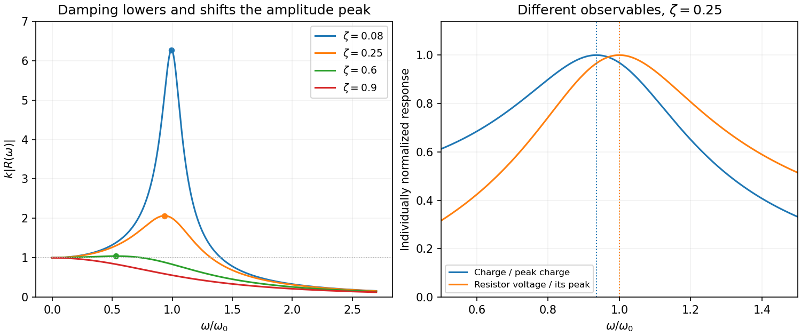

<h1 id="section-b/b7/solution">Solution</h1>

↑ **Parent:** [B7](../b7.md)

**Response and [resonance](../../../../../resonance.md).** The terms $m\ddot x$, $b\dot x$ and $kx$ describe inertia, linear viscous resistance and the spring's restoring [force](../../../../../force-split.md); the right side is the applied harmonic [force](../../../../../force-split.md). Substituting the complex trial motion and taking [real parts](../../../../../real-part.md) gives

$$
\boxed{A=R(\omega)F_0,\qquad R(\omega)=\frac1{k-m\omega^2+ib\omega}}.
$$

The steady response excludes the decaying homogeneous transient. Its magnitude is $[(k-m\omega^2)^2+b^2\omega^2]^{-1/2}$. Differentiating the denominator gives $2\omega[-2m(k-m\omega^2)+b^2]=0$, so

$$
\boxed{\omega_{\rm res}=\sqrt{k/m-b^2/(2m^2)}}.
$$

A nonzero-frequency amplitude maximum exists only for $b^2<2km$; otherwise the maximum is at zero [frequency](../../../../../frequency.md). Increasing [damping](../../../../../damping.md) lowers and broadens the peak and shifts it downward. Every curve starts at $|R(0)|=1/k$ and tends to $1/(m\omega^2)$ at high [frequency](../../../../../frequency.md).

**[Figure 1](#section-b/b7/image-original-normalized-oscillator-response-for-several-damping-ratios-distinguishing-amplitude-and-current-resonance). Original normalized oscillator response for several damping ratios, distinguishing amplitude and current resonance**.

**Series circuit.** The PDF circuit has the [resistor](../../../../../resistor.md), [inductor](../../../../../inductor.md) and [capacitor](../../../../../capacitor.md) in one loop. With current $I=\dot q$, [Kirchhoff's voltage law](../../../../../kirchhoff-cycle-law.md) gives $V=L\dot I+RI+q/C$, hence

$$
\boxed{L\ddot q+R\dot q+q/C=V}.
$$

Thus $m,b,k$ correspond to $L,R,1/C$. The [resistor](../../../../../resistor.md)'s rms voltage is

$$
V_{R,\rm rms}=\frac{|V_0|}{\sqrt2}\frac{R}{\sqrt{R^2+(\omega L-1/(\omega C))^2}}.
$$

It is maximized exactly at $\omega_{\max}=\omega_0=1/\sqrt{LC}$ for $R>0$. The charge-amplitude [resonance](../../../../../resonance.md) is lower. Expanding its square root for $R^2C/L\ll1$ gives

$$
\boxed{\omega_{\max}-\omega_{\rm res}
=\omega_0-\sqrt{\omega_0^2-R^2/(2L^2)}
\simeq\frac{R^2}{4L}\sqrt{\frac CL}}.
$$

The two maxima refer to different observables: [resistor](../../../../../resistor.md) voltage follows current, whereas charge follows displacement.

## ↑ Ancestors (14)

1. [B7](../b7.md)
2. [Section B](../../section-b.md)
3. [Paper 2](../../../paper-2-split.md)
4. [2013](../../../split.md)
5. [Past exam of the physics A course of the University of Cambridge](../../../../split.md)
6. [Physics A course of the University of Cambridge](../../../../../physics-a-course-of-the-university-of-cambridge.md)
7. [Physics course of the year 2 of the natural sciences course of the University of Cambridge](../../../../../physics-course-of-the-year-2-of-the-natural-sciences-course-of-the-university-of-cambridge.md)
8. [Year 2 of the natural sciences course of the University of Cambridge](../../../../../year-2-of-the-natural-sciences-course-of-the-university-of-cambridge.md)
9. [Year of the natural sciences course of the University of Cambridge](../../../../../year-of-the-natural-sciences-course-of-the-university-of-cambridge.md)
10. [Natural sciences course of the University of Cambridge](../../../../../natural-sciences-course-of-the-university-of-cambridge.md)
11. [Course of the University of Cambridge](../../../../../course-of-the-university-of-cambridge.md)
12. [University of Cambridge](../../../../../university-of-cambridge-split.md)
13. [List of universities](../../../../../list-of-universities.md)
14. [Codex Wiki](../../../../../split.md)
