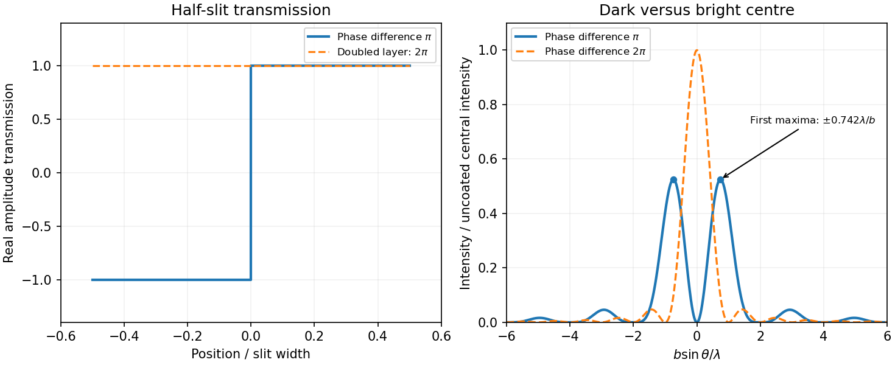

<h1 id="section-b/b9/solution">Solution</h1>

↑ **Parent:** [B9](../b9.md)

**Far-field transform.** For transverse aperture scale $b$ and screen distance $z$, the quadratic phase across the aperture is negligible when $kb^2/(2z)\ll1$, equivalently a small [Fresnel number](../../../../../fresnel-number.md) up to geometrical factors. Expanding the source-to-screen distance at transverse screen coordinate $X$ gives

$$
r\simeq z+\frac{X^2}{2z}-\frac{Xx}{z}+\frac{x^2}{2z}.
$$

Dropping the final aperture-dependent term and treating the prefactor as constant gives

$$
U(X)\propto\frac{e^{ikz+ikX^2/(2z)}}z\int h(x)e^{-i(kX/z)x}dx,
\qquad
\boxed{I(\theta)\propto\left|\int h(x)e^{-ikx\sin\theta}dx\right|^2}.
$$

Thus intensity is the modulus squared of the aperture [Fourier transform](../../../../../fourier-transform-split.md). A lens [focal plane](../../../../../focal-plane.md) supplies the same angular transform without a very distant screen. The infinitely extended vertical dimension is treated per unit vertical extent.

**[half-slit phase-reversal diffraction](../../../../../half-slit-phase-reversal-diffraction.md).** Put $h=-1$ on the left half and $h=1$ on the right half. With $q=k\sin\theta$ and $s=qb/4$,

$$
H(q)=\int_0^{b/2}e^{-iqx}dx-\int_{-b/2}^0e^{-iqx}dx
=\frac{4\sin^2(qb/4)}{iq}.
$$

Therefore

$$
\boxed{I(\theta)\propto\frac{\sin^4(kb\sin\theta/4)}{\sin^2\theta}}.
$$

The apparent singularity at zero angle is removable: $H\to0$, so the centre is dark. Normalizing by the uncoated slit's on-axis intensity $I_0$ gives $I/I_0=\sin^4s/s^2$. Noncentral zeros have $s=j\pi$, or $\sin\theta=2j\lambda/b$. The two largest lobes are symmetric, at the first nonzero root of $\tan s=2s$, $s\simeq\pm1.166$, giving $\sin\theta\simeq\pm0.742\lambda/b$ when those directions propagate. Smaller lobes lie farther out under a decaying envelope.

**[Figure 2](#section-b/b9/image-original-calculated-half-slit-phase-reversal-pattern-and-its-change-when-the-phase-layer-thickness-is-doubled). Original calculated half-slit phase-reversal pattern and its change when the phase-layer thickness is doubled**.

**Doubled thickness.** Neglecting absorption and interface [reflection](../../../../../reflection-mathematics.md), the phase delay doubles from $\pi$ to $2\pi$. Both halves then transmit with the same phase, recovering the ordinary single-slit pattern

$$
\boxed{I/I_0=\left[\frac{\sin(qb/2)}{qb/2}\right]^2}.
$$

It has a bright centre and first zeros at $\sin\theta=\pm\lambda/b$. The phase layer redistributes transmitted [power](../../../../../power.md) rather than absorbing it in this idealization.

## ↑ Ancestors (14)

1. [B9](../b9.md)
2. [Section B](../../section-b.md)
3. [Paper 2](../../../paper-2-split.md)
4. [2013](../../../split.md)
5. [Past exam of the physics A course of the University of Cambridge](../../../../split.md)
6. [Physics A course of the University of Cambridge](../../../../../physics-a-course-of-the-university-of-cambridge.md)
7. [Physics course of the year 2 of the natural sciences course of the University of Cambridge](../../../../../physics-course-of-the-year-2-of-the-natural-sciences-course-of-the-university-of-cambridge.md)
8. [Year 2 of the natural sciences course of the University of Cambridge](../../../../../year-2-of-the-natural-sciences-course-of-the-university-of-cambridge.md)
9. [Year of the natural sciences course of the University of Cambridge](../../../../../year-of-the-natural-sciences-course-of-the-university-of-cambridge.md)
10. [Natural sciences course of the University of Cambridge](../../../../../natural-sciences-course-of-the-university-of-cambridge.md)
11. [Course of the University of Cambridge](../../../../../course-of-the-university-of-cambridge.md)
12. [University of Cambridge](../../../../../university-of-cambridge-split.md)
13. [List of universities](../../../../../list-of-universities.md)
14. [Codex Wiki](../../../../../split.md)
