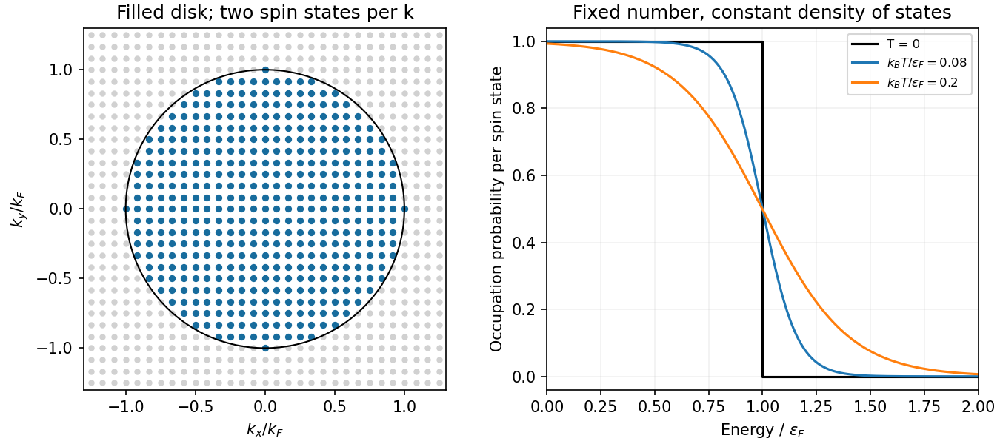

<h1 id="section-c/c10/solution">Solution</h1>

↑ **Parent:** [C10](../c10.md)

**[spin normalization in two-dimensional free-electron state counting](../../../../../spin-normalization-in-two-dimensional-free-electron-state-counting.md).** Treat the mobile [electrons](../../../../../electron.md) as independent particles in a constant interior potential, with [parabolic dispersion](../../../../../parabolic-band-dispersion.md) $\epsilon=\hbar^2k^2/(2m)$, and impose confinement or [periodic boundary conditions](../../../../../periodic-boundary-conditions.md). [electron](../../../../../electron.md)–[electron](../../../../../electron.md) interactions and the detailed periodic ionic potential are neglected, while Fermi statistics are retained. Each spatial state occupies area $(2\pi)^2/A$ in two-dimensional [wavevector](../../../../../wavevector.md) space. For [spin degeneracy](../../../../../spin-degeneracy.md) $g_s$,

$$
\mathcal N(k)=g_s\frac{A\pi k^2}{(2\pi)^2},\qquad
\boxed{g(\epsilon)=\frac{d\mathcal N}{d\epsilon}=\frac{g_sAm}{2\pi\hbar^2}}.
$$

The printed coefficient $Am/(2\pi\hbar^2)$ is the **per-spin [density of states](../../../../../density-of-states.md)**. Unpolarized spin-one-half [electrons](../../../../../electron.md) have $g_s=2$, doubling it. Actual [graphene](../../../../../graphene.md) near its [Dirac points](../../../../../dirac-point.md) has approximately linear dispersion, so its energy-dependent [density of states](../../../../../density-of-states.md) is not this parabolic-model result; the plane geometry alone does not establish the free-electron dispersion.[Abstract: massless Dirac charge carriers rather than a finite-mass parabolic band](../../../../../two-dimensional-gas-of-massless-dirac-fermions-in-graphene-by-konstantin-novoselov-and-others.md)

**Occupied disk and [Fermi energy](../../../../../fermi-energy.md).** At zero [temperature](../../../../../temperature-split.md) fill the lowest states up to a disk of radius $k_F$. State counting gives

$$
\boxed{k_F=\sqrt{\frac{4\pi N}{g_sA}},\qquad
\epsilon_F=\frac{2\pi\hbar^2N}{g_sAm}}.
$$

Thus the physical spin-degenerate result is $\epsilon_F=\pi\hbar^2N/(Am)$. If $N$ instead counts one spin species, the per-spin convention gives $2\pi\hbar^2N/(Am)$. Each occupied [wavevector](../../../../../wavevector.md) can contain one [electron](../../../../../electron.md) of each allowed spin, never two in the same complete [one-particle state](../../../../../one-particle-state.md).

**[Figure 3](#section-c/c10/image-original-occupied-wavevector-disk-and-fermi-dirac-occupations-for-a-parabolic-two-dimensional-electron-gas). Original occupied wavevector disk and Fermi-Dirac occupations for a parabolic two-dimensional electron gas**.

**Occupation probability and [chemical potential of a two-dimensional ideal Fermi gas](../../../../../chemical-potential-of-a-two-dimensional-ideal-fermi-gas.md).** A single [fermion](../../../../../fermion.md) state permits occupation zero or one. In a [grand canonical ensemble](../../../../../grand-canonical-ensemble.md) their relative weights are $1$ and $e^{-\beta(\epsilon-\mu)}$. Normalizing gives

$$
\boxed{p(\epsilon)=\frac{e^{-\beta(\epsilon-\mu)}}{1+e^{-\beta(\epsilon-\mu)}}
=\frac1{e^{\beta(\epsilon-\mu)}+1}}.
$$

The [chemical potential](../../../../../chemical-potential-split.md) is fixed by the total particle number. Here the total [density of states](../../../../../density-of-states.md) $D=g_sAm/(2\pi\hbar^2)$ is constant above the band bottom. Integrating the occupation gives $N=Dk_BT\ln(1+e^{\mu/(k_BT)})$, and therefore

$$
\boxed{\mu=\epsilon_F+k_BT\ln\left(1-e^{-\epsilon_F/(k_BT)}\right)
\longrightarrow\epsilon_F\quad(T\to0)}.
$$

The approach is exponentially close in this ideal two-dimensional constant-density-of-states model; a three-dimensional $T^2$ correction should not be inserted here. A narrow interval of width of order $k_BT$ around $\mu$ is thermally smeared.

## ↑ Ancestors (14)

1. [C10](../c10.md)
2. [Section C](../../section-c.md)
3. [Paper 2](../../../paper-2-split.md)
4. [2013](../../../split.md)
5. [Past exam of the physics A course of the University of Cambridge](../../../../split.md)
6. [Physics A course of the University of Cambridge](../../../../../physics-a-course-of-the-university-of-cambridge.md)
7. [Physics course of the year 2 of the natural sciences course of the University of Cambridge](../../../../../physics-course-of-the-year-2-of-the-natural-sciences-course-of-the-university-of-cambridge.md)
8. [Year 2 of the natural sciences course of the University of Cambridge](../../../../../year-2-of-the-natural-sciences-course-of-the-university-of-cambridge.md)
9. [Year of the natural sciences course of the University of Cambridge](../../../../../year-of-the-natural-sciences-course-of-the-university-of-cambridge.md)
10. [Natural sciences course of the University of Cambridge](../../../../../natural-sciences-course-of-the-university-of-cambridge.md)
11. [Course of the University of Cambridge](../../../../../course-of-the-university-of-cambridge.md)
12. [University of Cambridge](../../../../../university-of-cambridge-split.md)
13. [List of universities](../../../../../list-of-universities.md)
14. [Codex Wiki](../../../../../split.md)
