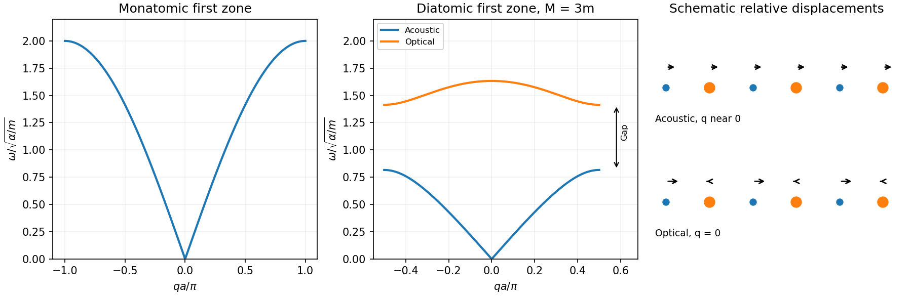

<h1 id="section-c/c11/solution">Solution</h1>

↑ **Parent:** [C11](../c11.md)

**One [mass](../../../../../mass.md) per cell.** If $u_j$ is the displacement from equilibrium, the two springs give $m\ddot u_j=\alpha(u_{j+1}+u_{j-1}-2u_j)$. Substituting $u_j=Ue^{i(qja-\omega t)}$ yields

$$
\boxed{\omega(q)=2\sqrt{\alpha/m}\,|\sin(qa/2)|}.
$$

The [first Brillouin zone](../../../../../first-brillouin-zone.md) is $-\pi/a\leq q\leq\pi/a$; adding $2\pi/a$ leaves the sampled displacements unchanged. The branch is linear near zero, with [sound speed](../../../../../speed-of-sound.md) $a\sqrt{\alpha/m}$, and reaches $2\sqrt{\alpha/m}$ at either zone edge.

**Two [masses](../../../../../mass.md) per cell.** Take a cell of length $2a$, with light displacement $u_j=Ue^{i(2jaq-\omega t)}$ and heavy displacement $v_j=Ve^{i[(2j+1)aq-\omega t]}$. The coupled equations reduce to

$$
\begin{pmatrix}2\alpha-m\omega^2&-2\alpha\cos qa\\
-2\alpha\cos qa&2\alpha-M\omega^2\end{pmatrix}
\begin{pmatrix}U\\V\end{pmatrix}=0.
$$

A nonzero displacement requires determinant zero:

$$
Mm\omega^4-2\alpha(M+m)\omega^2+4\alpha^2\sin^2qa=0.
$$

Solving this quadratic in $\omega^2$ gives

$$
\boxed{\omega_\pm^2=\frac\alpha{Mm}\left[M+m\pm\sqrt{(M+m)^2-4Mm\sin^2qa}\right]}.
$$

Now the first zone is $|q|\leq\pi/(2a)$. The minus branch is acoustic: as $q\to0$, both sublattices move together and $\omega_-\to0$. Its [sound speed](../../../../../speed-of-sound.md) is $a\sqrt{2\alpha/(M+m)}$. The plus branch is optical: at $q=0$ the atoms move oppositely with $mU+MV=0$, giving finite [frequency](../../../../../frequency.md) $\sqrt{2\alpha(1/m+1/M)}$. This terminology describes relative motion; optical activity itself also requires coupling to the electromagnetic field.

**[diatomic-chain zone-edge polarizations](../../../../../diatomic-chain-zone-edge-polarizations.md) and dimensionality.** At the edge, $\cos qa=0$, so the heavy and light sublattices decouple: the acoustic edge [frequency](../../../../../frequency.md) is $\sqrt{2\alpha/M}$ and the optical edge [frequency](../../../../../frequency.md) is $\sqrt{2\alpha/m}$. Hence

$$
\boxed{\Delta\omega=\sqrt{2\alpha/m}-\sqrt{2\alpha/M}}.
$$

The acoustic edge mode moves only the heavy sublattice; the optical edge mode only the light one. If $M=m$, the gap closes and the two branches are the zone-folded monatomic branch.

**[Figure 4](#section-c/c11/image-original-monatomic-and-diatomic-chain-dispersions-zone-edge-gap-and-long-wavelength-displacement-patterns). Original monatomic and diatomic chain dispersions, zone-edge gap and long-wavelength displacement patterns**.

A three-dimensional crystal with two atoms per primitive cell has **six branches: three acoustic and three optical**. For propagation along a suitable symmetry direction these resolve into one longitudinal and two transverse branches of each type. The [wavevector](../../../../../wavevector.md) and [Brillouin zone](../../../../../brillouin-zone.md) are three-dimensional; anisotropic [force](../../../../../force-split.md) constants determine the dispersions, and polar crystals can have longitudinal–transverse optical splitting. A universal six-branch curve cannot be specified from [masses](../../../../../mass.md) alone.

## ↑ Ancestors (14)

1. [C11](../c11.md)
2. [Section C](../../section-c.md)
3. [Paper 2](../../../paper-2-split.md)
4. [2013](../../../split.md)
5. [Past exam of the physics A course of the University of Cambridge](../../../../split.md)
6. [Physics A course of the University of Cambridge](../../../../../physics-a-course-of-the-university-of-cambridge.md)
7. [Physics course of the year 2 of the natural sciences course of the University of Cambridge](../../../../../physics-course-of-the-year-2-of-the-natural-sciences-course-of-the-university-of-cambridge.md)
8. [Year 2 of the natural sciences course of the University of Cambridge](../../../../../year-2-of-the-natural-sciences-course-of-the-university-of-cambridge.md)
9. [Year of the natural sciences course of the University of Cambridge](../../../../../year-of-the-natural-sciences-course-of-the-university-of-cambridge.md)
10. [Natural sciences course of the University of Cambridge](../../../../../natural-sciences-course-of-the-university-of-cambridge.md)
11. [Course of the University of Cambridge](../../../../../course-of-the-university-of-cambridge.md)
12. [University of Cambridge](../../../../../university-of-cambridge-split.md)
13. [List of universities](../../../../../list-of-universities.md)
14. [Codex Wiki](../../../../../split.md)
