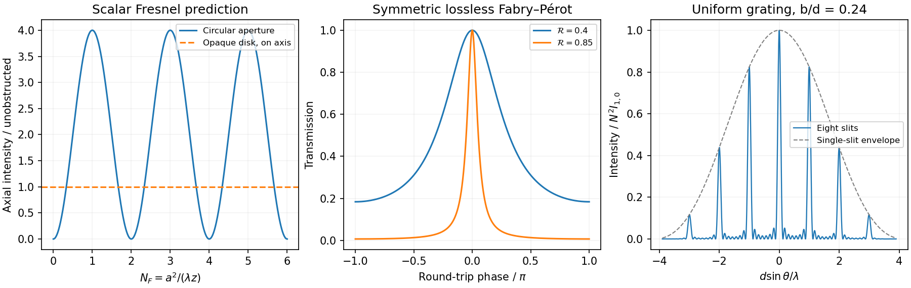

<h1 id="section-d/d13/a/solution">Solution</h1>

↑ **Parent:** [A](../a.md)

For a circular structure, cylindrical symmetry reduces the scalar [Fresnel-Kirchhoff diffraction integral](../../../../../../fresnel-kirchhoff-diffraction-integral.md) to concentric annuli. With plane-wave illumination, radius $a$ and distance $z$, the relevant [Fresnel number](../../../../../../fresnel-number.md) is $N_F=a^2/(\lambda z)$. Successive [Fresnel half-period zones](../../../../../../fresnel-half-period-zone.md) have radii $r_j^2\simeq j\lambda z$: their areas are approximately equal while their phases alternate by $\pi$, causing neighbouring-zone cancellation.

For [Fresnel diffraction by a circular aperture](../../../../../../fresnel-diffraction-by-a-circular-aperture.md), the on-axis field follows directly from the radial [integral](../../../../../../integral-split.md),

$$
\frac{U_{\rm ap}}{U_{\rm free}}
=\frac1{i\lambda z}\int_0^a e^{i\pi r^2/(\lambda z)}2\pi r\,dr
=1-e^{i\pi N_F},\qquad
\boxed{I_{\rm ap}/I_{\rm free}=4\sin^2(\pi N_F/2)}.
$$

Odd zone counts reinforce on axis; even counts cancel in this ideal scalar model. An annular opening gives the difference of the corresponding two edge exponentials. A [zone plate](../../../../../../zone-plate.md) alternately blocks or phase-shifts zones so that otherwise cancelling contributions reinforce at a focus, with $r_j^2\simeq j\lambda f$ for its principal focal distance.

[Babinet's principle](../../../../../../babinet-s-principle.md) gives $U_{\rm disk}=U_{\rm free}-U_{\rm ap}=U_{\rm free}e^{i\pi N_F}$ for [Fresnel diffraction by an opaque disk](../../../../../../fresnel-diffraction-by-an-opaque-disk.md). Thus **its ideal on-axis intensity equals the unobstructed intensity**, the [Arago spot](../../../../../../arago-spot.md), even within the geometric shadow. This concerns a narrow axial feature, not the whole shadow. Finite source size, imperfect circularity, [bandwidth](../../../../../../bandwidth-signal-processing.md) and alignment reduce its visibility. When $N_F\ll1$, the circular-aperture far-field pattern becomes the [Airy disk](../../../../../../airy-disk.md) intensity pattern $[2J_1(u)/u]^2$, with $u=ka\sin\theta$ and first minimum near $\theta=1.22\lambda/(2a)$.

**[Figure 5](#section-d/d13/a/image-original-calculated-circular-fresnel-fabry-perot-and-finite-grating-intensity-patterns-under-their-stated-idealizations). Original calculated circular Fresnel, Fabry–Pérot and finite-grating intensity patterns under their stated idealizations**.

## ↑ Ancestors (15)

1. [A](../a.md)
2. [D13](../../d13.md)
3. [Section D](../../../section-d.md)
4. [Paper 2](../../../../paper-2-split.md)
5. [2013](../../../../split.md)
6. [Past exam of the physics A course of the University of Cambridge](../../../../../split.md)
7. [Physics A course of the University of Cambridge](../../../../../../physics-a-course-of-the-university-of-cambridge.md)
8. [Physics course of the year 2 of the natural sciences course of the University of Cambridge](../../../../../../physics-course-of-the-year-2-of-the-natural-sciences-course-of-the-university-of-cambridge.md)
9. [Year 2 of the natural sciences course of the University of Cambridge](../../../../../../year-2-of-the-natural-sciences-course-of-the-university-of-cambridge.md)
10. [Year of the natural sciences course of the University of Cambridge](../../../../../../year-of-the-natural-sciences-course-of-the-university-of-cambridge.md)
11. [Natural sciences course of the University of Cambridge](../../../../../../natural-sciences-course-of-the-university-of-cambridge.md)
12. [Course of the University of Cambridge](../../../../../../course-of-the-university-of-cambridge.md)
13. [University of Cambridge](../../../../../../university-of-cambridge-split.md)
14. [List of universities](../../../../../../list-of-universities.md)
15. [Codex Wiki](../../../../../../split.md)
