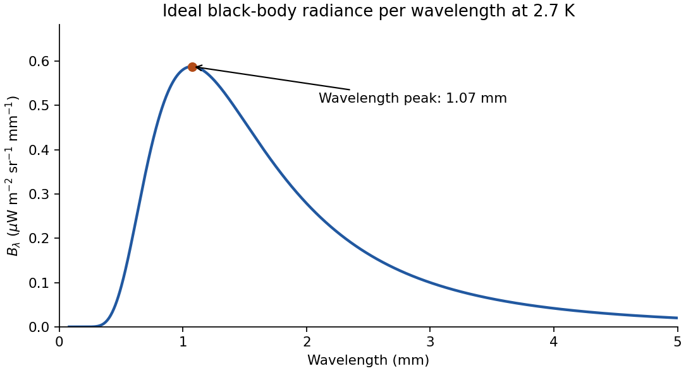
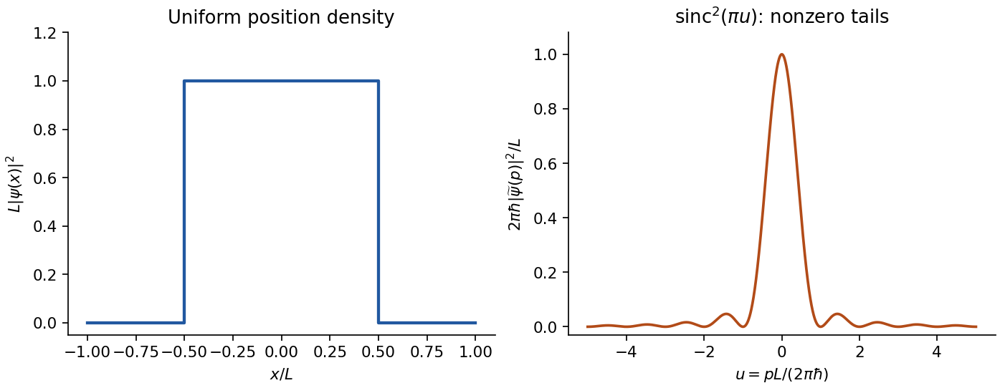
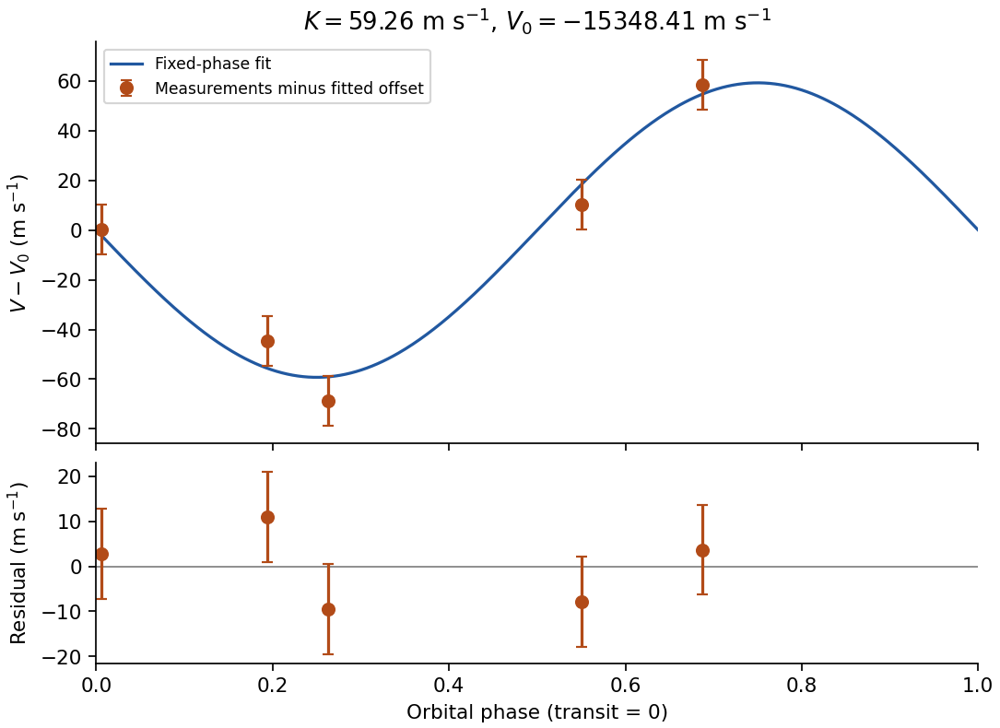

# Paper 1

↑ **Parent:** [2014](../2014.md)

Original solutions to every question and printed alternative. [Original public PDF, physical pages 86–92; dated 24 May 2014](https://www.whatdotheyknow.com/request/natural_science_tripos_physics_e_2/response/2340776/attach/2/FOI%202023%20399%20Zahid%20materials.pdf?cookie_passthrough=1#page=86)

**Table of contents**

- [Section A](#section-a)
  - [1](#section-a/1)
    - [Solution](#section-a/1/solution)
  - [2](#section-a/2)
    - [Solution](#section-a/2/solution)
  - [3](#section-a/3)
    - [Solution](#section-a/3/solution)
  - [4](#section-a/4)
    - [Solution](#section-a/4/solution)
  - [5](#section-a/5)
    - [Solution](#section-a/5/solution)
- [Section B](#section-b)
  - [B6](#section-b/b6)
    - [Solution](#section-b/b6/solution)
  - [B7](#section-b/b7)
    - [Solution](#section-b/b7/solution)
  - [B8](#section-b/b8)
    - [Solution](#section-b/b8/solution)
  - [B9](#section-b/b9)
    - [Solution](#section-b/b9/solution)
- [Section C](#section-c)
  - [C10](#section-c/c10)
    - [Solution](#section-c/c10/solution)
  - [C11](#section-c/c11)
    - [a](#section-c/c11/a)
      - [Solution](#section-c/c11/a/solution)
    - [b](#section-c/c11/b)
      - [Solution](#section-c/c11/b/solution)
    - [c](#section-c/c11/c)
      - [Solution](#section-c/c11/c/solution)
- [Section D](#section-d)
  - [D12](#section-d/d12)
    - [Solution](#section-d/d12/solution)
  - [D13](#section-d/d13)
    - [a](#section-d/d13/a)
      - [Solution](#section-d/d13/a/solution)
    - [b](#section-d/d13/b)
      - [Solution](#section-d/d13/b/solution)
    - [c](#section-d/d13/c)
      - [Solution](#section-d/d13/c/solution)

## Section A

↑ **Parent:** [Paper 1](paper-1.md)

<h3 id="section-a/1">1</h3>

↑ **Parent:** [Section A](#section-a)

<h4 id="section-a/1/solution">Solution</h4>

↑ **Parent:** [1](#section-a/1)

Write the one-electron Coulomb energies as $E_n=-C/n^2$, $C>0$. The [Pauli exclusion principle](../../tensor-product-of-quantum-systems.md#pauli-exclusion-principle) allows $2n^2$ [electrons](../../physics.md#electron) in shell $n$, including [spin](../../angular-momentum-operator.md#spin). The ground configuration therefore has two [electrons](../../physics.md#electron) in $n=1$ and seven in $n=2$, giving $E_g=-C(2+7/4)=-15C/4$. The least energy-increasing promotion is from $n=2$ to $n=3$:

$$
E_e=-C\left(2+\frac64+\frac19\right)=-\frac{65C}{18},\qquad
\boxed{\frac{E_e}{E_g}=\frac{26}{27}.}
$$

Rearranging the partly occupied degenerate $n=2$ shell does not produce a higher [energy](../../energy.md). Both total energies are negative, so this ratio is below one even though $E_e>E_g$.

<h3 id="section-a/2">2</h3>

↑ **Parent:** [Section A](#section-a)

<h4 id="section-a/2/solution">Solution</h4>

↑ **Parent:** [2](#section-a/2)

Choose the centre of the [finite square well](../../quantum-mechanics.md#finite-square-well) as the origin and its edges as $\pm a$. The first three bound [wavefunctions](../../wave-function.md) have **even, odd, even [parity](../../quantum-mechanics.md#parity)**, with respectively **zero, one and two interior [nodes](../../dynamical-systems.md#node-dynamical-systems)**. They oscillate inside and decay exponentially outside, with $\kappa_n=\sqrt{2m(U-E_n)}/\hbar$. Both the [wavefunction](../../wave-function.md) and its first [derivative](../../calculus.md#derivative) are continuous at each finite potential step. The higher [bound states](../../quantum-system.md#bound-state) have longer external decay [lengths](../../physics.md#length) because they lie closer to the barrier height. Overall sign is arbitrary.

**[Figure 1](#section-a/2/image-original-normalized-finite-well-eigenfunctions-with-parity-nodes-and-exponential-tails-illustrative-dimensionless-depth-not-supplied-numerical-data). Original normalized finite-well eigenfunctions with parity, nodes and exponential tails; illustrative dimensionless depth, not supplied numerical data**.

<h3 id="section-a/3">3</h3>

↑ **Parent:** [Section A](#section-a)

<h4 id="section-a/3/solution">Solution</h4>

↑ **Parent:** [3](#section-a/3)

Confinement to [length](../../physics.md#length) $L$ gives a [momentum](../../momentum.md) scale $p\sim\hbar/L$ by the [Heisenberg uncertainty principle](../../quantum-theory.md#heisenberg-uncertainty-relation). Using the alpha-particle [mass](../../classical-mechanics.md#mass) $m_\alpha\simeq6.64\times10^{-27}\,\mathrm{kg}$, its speed scale is $v\sim\hbar/(m_\alpha L)$. Counting encounters with either wall,

$$
\boxed{\nu\sim\frac vL\sim\frac{\hbar}{m_\alpha L^2}
\simeq1.6\times10^{20}\,\mathrm{s^{-1}}.}
$$

This is an order-of-magnitude collision-rate estimate, not a classical trajectory of a stationary [quantum state](../../quantum-system.md#quantum-state). Taking $\Delta x\Delta p=\hbar/2$, a different geometric interpretation of the well size, or successive returns to the same wall changes the coefficient by factors of order unity; the robust scale is $10^{20}\,\mathrm{s^{-1}}$.

<h3 id="section-a/4">4</h3>

↑ **Parent:** [Section A](#section-a)

<h4 id="section-a/4/solution">Solution</h4>

↑ **Parent:** [4](#section-a/4)

Let $D$ denote detection. Weight each incident fraction by its [detection efficiency](../../physics.md#detection-efficiency), not by its loss [probability](../../probability-theory.md#probability). [Bayes' theorem](../../probability-theory.md#bayes-theorem) gives

$$
\boxed{P(H\mid D)=\frac{0.05(1-0.50)}{0.65(1-0.05)+0.30(1-0.20)+0.05(1-0.50)}
=\frac{10}{353}\simeq0.0283.}
$$

Thus about **2.83%** of detected particles are in the high-energy group. Energy-dependent [detector dead time](../../particle-detection.md#detector-dead-time) changes the composition of the observed sample.

<h3 id="section-a/5">5</h3>

↑ **Parent:** [Section A](#section-a)

<h4 id="section-a/5/solution">Solution</h4>

↑ **Parent:** [5](#section-a/5)

Interpret the quoted r.m.s. as the root-mean-square fluctuation about the [mean](../../expected-value.md), namely the [standard deviation](../../variance.md#standard-deviation) $\sigma=10\,\mathrm K$. Standardization gives $z=(293-273)/10=2$. The supplied cumulative Gaussian curve gives $\Phi(2)\simeq0.977$, hence

$$
\boxed{P(T>293\,\mathrm K)=1-\Phi(2)\simeq0.023.}
$$

The exact Gaussian value is $0.02275$. A raw r.m.s. [temperature](../../temperature.md) of $10\,\mathrm K$ could not coexist with a [mean](../../expected-value.md) of $273\,\mathrm K$; the spread interpretation is required.

## Section B

↑ **Parent:** [Paper 1](paper-1.md)

<h3 id="section-b/b6">B6</h3>

↑ **Parent:** [Section B](#section-b)

<h4 id="section-b/b6/solution">Solution</h4>

↑ **Parent:** [B6](#section-b/b6)

Set $k=\sqrt{2mE}/\hbar$ and $\kappa=\sqrt{2m(U-E)}/\hbar$. For unit incident [amplitude](../../wave.md#wave-amplitude), use $\psi=e^{ikx}+r e^{-ikx}$ on the left and $\psi=t_s e^{-\kappa x}$ on the right; the growing exponential is excluded at infinity. Continuity at zero gives $1+r=t_s$ and $ik(1-r)=-\kappa t_s$. Thus

$$
r=\frac{k-i\kappa}{k+i\kappa}=e^{i\delta},\qquad |r|^2=1,
\qquad\boxed{\delta=-2\arctan(\kappa/k)=-2\arccos\sqrt{E/U}.}
$$

The phase is chosen in $(-\pi,0)$ for $0<E<U$. The [evanescent wave](../../elasticity-physics.md#evanescent-wave) is $\psi(x)=2k\,e^{-\kappa x}/(k+i\kappa)$ for $x>0$. Its [probability density](../../wave-function.md#probability-density) is nonzero, but its [probability current](../../wave-function.md#probability-current) $j=(\hbar/m)\operatorname{Im}(\psi^*\psi')$ is zero. Penetration into a forbidden region therefore does not require transmitted flux through a semi-infinite step.

For a finite rectangular barrier, matching both interfaces gives

$$
\mathcal T=\left[1+\frac{U^2}{4E(U-E)}\sinh^2(\kappa a)\right]^{-1}
\simeq\frac{16E(U-E)}{U^2}e^{-2\kappa a}.
$$

The approximation requires **$\kappa a\gg1$**, or a width much greater than the evanescent penetration [length](../../physics.md#length). The tunnelling exponent is $-2a\sqrt{2m(U-E)}/\hbar$; its factor of two converts an [amplitude](../../wave.md#wave-amplitude) decay to a [probability](../../probability-theory.md#probability) decay. For the [electron](../../physics.md#electron) parameters, $\kappa=1.984\times10^9\,\mathrm{m^{-1}}$ and $\kappa a=19.84$. Therefore

$$
\boxed{\mathcal T\simeq3e^{-39.68}=1.75\times10^{-17}.}
$$

Keeping only the exponential gives $5.83\times10^{-18}$; the matched-interface prefactor accounts for the factor of three.

<h3 id="section-b/b7">B7</h3>

↑ **Parent:** [Section B](#section-b)

<h4 id="section-b/b7/solution">Solution</h4>

↑ **Parent:** [B7](#section-b/b7)

In [spherical coordinates](../../multivariable-calculus.md#spherical-coordinate-system), the angular [Laplacian](../../multivariable-calculus.md#laplacian) has [spherical harmonics](../../analysis.md#spherical-harmonic) as [eigenfunctions](../../linear-operator-theory.md#eigenfunction), $L^2Y_{lm}=\hbar^2l(l+1)Y_{lm}$ and $L_zY_{lm}=\hbar mY_{lm}$. Separation leaves

$$
-\frac{\hbar^2}{2m}\left[R''+\frac2rR'-\frac{l(l+1)}{r^2}R\right]-\frac{C}{r}R=ER,
\qquad C=\frac{e^2}{4\pi\epsilon_0}.
$$

Regularity and normalizability give [principal quantum number](../../mathematical-physics.md#principal-quantum-number) $n=1,2,\ldots$, orbital [quantum number](../../quantum-system.md#quantum-number) $l=0,\ldots,n-1$, and [magnetic quantum number](../../quantum-mechanics.md#magnetic-quantum-number) $m=-l,\ldots,l$. Here the $m$ in the kinetic coefficient is the [electron mass](../../physics.md#electron-mass), distinct from the magnetic label.

For the proposed angular factor, $\cos\theta\propto Y_{10}$, so $l=1$ and [magnetic quantum number](../../quantum-mechanics.md#magnetic-quantum-number) zero. Direct differentiation gives $\nabla^2(re^{-\alpha r}\cos\theta)=(\alpha^2-4\alpha/r)\psi$. The $1/r$ term in the [Schrödinger equation](../../mathematical-physics.md#schrodinger-equation) vanishes when $2\hbar^2\alpha/m=C$. With [Bohr radius](../../mathematical-physics.md#bohr-radius) $a_0=\hbar^2/(mC)$,

$$
\boxed{\alpha=\frac1{2a_0},\qquad E=-\frac{\hbar^2\alpha^2}{2m}=-\frac{\hbar^2}{8ma_0^2}\simeq-3.40\,\mathrm{eV},\qquad l=1.}
$$

[wavefunction normalization](../../wave-function.md#wavefunction-normalization) uses $\int d\Omega\cos^2\theta=4\pi/3$ and $\int_0^\infty r^4e^{-2\alpha r}dr=24/(2\alpha)^5$, giving

$$
\boxed{A=\sqrt{\alpha^5/\pi}=\frac1{4\sqrt{2\pi}\,a_0^{5/2}}.}
$$

An arbitrary constant phase is allowed. This is the $2p_z$ state. Under spatial inversion, $r$ is unchanged and $\cos\theta$ changes sign, so its [parity](../../quantum-mechanics.md#parity) [eigenvalue](../../linear-operator-theory.md#eigenvalue) is **$-1$**, also given by $(-1)^l$.

Rotational invariance [means](../../expected-value.md) rotated states have the same [energy](../../energy.md); it does not require each member of a degenerate [energy](../../energy.md) eigenspace to be invariant. [rotations](../../riemannian-geometry.md#rotation-mathematics) mix the three $l=1$ magnetic substates. An orbital oriented along $z$ can therefore have an anisotropic [probability density](../../wave-function.md#probability-density) while the [Hamiltonian](../../hamiltonian-mechanics.md#hamiltonian) remains spherically symmetric.

<h3 id="section-b/b8">B8</h3>

↑ **Parent:** [Section B](#section-b)

<h4 id="section-b/b8/solution">Solution</h4>

↑ **Parent:** [B8](#section-b/b8)

The [angular momentum commutation relations](../../angular-momentum-operator.md#angular-momentum-commutation-relations) are $[L_x,L_y]=i\hbar L_z$ and cyclic permutations. The product rule yields $[L_z,L_x^2]=i\hbar(L_yL_x+L_xL_y)$ and $[L_z,L_y^2]=-i\hbar(L_xL_y+L_yL_x)$, so **$[L_z,L^2]=0$**. Simultaneous [eigenstates](../../energy-eigenvalue.md#eigenstate) have [eigenvalues](../../linear-operator-theory.md#eigenvalue) $\hbar^2l(l+1)$ and $\hbar m$; [orbital angular momentum](../../quantum-mechanics.md#orbital-angular-momentum) has integer $l\ge0$ and $m=-l,\ldots,l$.

By cyclic [symmetry](../../physics.md#symmetry-physics), $L^2$ commutes with every component and hence every squared component. Therefore $[H,L^2]=0$: an [energy](../../energy.md) eigenbasis can be chosen with definite $l$. For unequal transverse coefficients, $L_z$ need not commute with $H$, so definite $m$ is not generally available.

Expanding the [ladder operators](../../semisimple-lie-algebra.md#ladder-operator) gives $L_+^2+L_-^2=2(L_x^2-L_y^2)$ and $L^2-L_z^2=L_x^2+L_y^2$. Comparing coefficients gives

$$
\boxed{\alpha=\frac{a_x-a_y}{4},\qquad\beta=\frac{a_x+a_y}{2},\qquad\gamma=a_z.}
$$

For $l=1,m=0$, both squared [ladder operators](../../semisimple-lie-algebra.md#ladder-operator) vanish, since two raising or lowering steps would leave the multiplet. Thus $E_0=2\beta\hbar^2=\hbar^2(a_x+a_y)$. In the remaining basis $\{|1,1\rangle,|1,-1\rangle\}$ the [Hamiltonian](../../hamiltonian-mechanics.md#hamiltonian) is

$$
\hbar^2\begin{pmatrix}\beta+\gamma&2\alpha\\2\alpha&\beta+\gamma\end{pmatrix}.
$$

Its symmetric and antisymmetric combinations have energies $\hbar^2(a_x+a_z)$ and $\hbar^2(a_y+a_z)$, respectively. Consequently

$$
\boxed{\{E_{l=1}\}=\hbar^2\{a_x+a_y,\ a_y+a_z,\ a_z+a_x\}.}
$$

The energies are related by permutation of the principal axes, not generally equal. Two coincide when the corresponding coefficients coincide; all three become $2a\hbar^2$ in the isotropic limit.

<h3 id="section-b/b9">B9</h3>

↑ **Parent:** [Section B](#section-b)

<h4 id="section-b/b9/solution">Solution</h4>

↑ **Parent:** [B9](#section-b/b9)

Use $[x,p]=i\hbar$. Acting on a smooth test [wavefunction](../../wave-function.md), $[f(x),p]\psi=f(-i\hbar\psi')+i\hbar(f\psi)'=i\hbar f'\psi$. Take $f$ real and use the [self-adjoint operator](../../linear-operator-theory.md#self-adjoint-operator) domain with vanishing integration-by-parts boundary terms. Writing $Q=p-if$ gives

$$
H=\frac{Q^\dagger Q}{2m}=\frac{p^2+f^2-\hbar f'}{2m},
\qquad\boxed{V(x)=\frac{f(x)^2-\hbar f'(x)}{2m}.}
$$

The [energy](../../energy.md) form is $\langle\psi,H\psi\rangle=\|Q\psi\|^2/(2m)\ge0$, so every normalizable [energy eigenstate](../../energy-eigenvalue.md#energy-eigenstate) has $E\ge0$. If a normalizable zero-energy state exists, its nonnegative norm must vanish, $Q\psi_0=0$. Hence

$$
\hbar\psi_0'+f\psi_0=0,\qquad
\boxed{\psi_0(x)=N\exp\left[-\frac1\hbar\int_0^xf(t)dt\right].}
$$

Zero [energy](../../energy.md) is an additional existence assumption, not a consequence of factorization alone.

For $\psi_1=Q^\dagger\psi_0$, the [commutator](../../lie-algebra.md#commutator) $[Q,Q^\dagger]=2\hbar f'$ gives

$$
H\psi_1=\frac\hbar m Q^\dagger(f'\psi_0)
=-\frac{i\hbar^2}{m}f''\psi_0+\frac\hbar m f'\psi_1.
$$

Thus **$\alpha(x)=-i\hbar^2f''(x)/m$ and $\beta(x)=\hbar f'(x)/m$** in the requested relation. Generally these are multiplication functions, not constant coefficients, and $\psi_1$ is not automatically an [energy eigenstate](../../energy-eigenvalue.md#energy-eigenstate).

If $f(x)=cx^n+\cdots$, its integral has leading term $cx^{n+1}/(n+1)$. Decay at both infinities on the full real line requires **odd $n$ and positive [leading coefficient](../../polynomial.md#leading-coefficient-of-a-polynomial) $c$**. Odd degree alone is not sufficient. For $f=kx$ take $k=m\omega>0$. Then $H=H_{\rm SHO}-\hbar\omega/2$, $\alpha=0$ and $\beta=\hbar\omega$. After normalization and removal of an irrelevant phase,

$$
\boxed{\psi_0=\left(\frac{m\omega}{\pi\hbar}\right)^{1/4}e^{-m\omega x^2/(2\hbar)},\quad
\psi_1=\sqrt{\frac{2m\omega}{\hbar}}\,x\psi_0,\quad
E_0^{\rm SHO}=\frac12\hbar\omega,\quad E_1^{\rm SHO}=\frac32\hbar\omega.}
$$

The corresponding factorized-Hamiltonian energies are zero and $\hbar\omega$; the constant shift must be restored for the stated oscillator [Hamiltonian](../../hamiltonian-mechanics.md#hamiltonian).

## Section C

↑ **Parent:** [Paper 1](paper-1.md)

<h3 id="section-c/c10">C10</h3>

↑ **Parent:** [Section C](#section-c)

<h4 id="section-c/c10/solution">Solution</h4>

↑ **Parent:** [C10](#section-c/c10)

Each electromagnetic [normal mode](../../wave-equation.md#normal-mode) is a [quantum harmonic oscillator](../../quantum-harmonic-oscillator.md) with $E_n=(n+1/2)h\nu$. For $x=h\nu/(k_BT)$ its [canonical partition function](../../canonical-ensemble.md#canonical-partition-function) and occupation [probabilities](../../probability-theory.md#probability) are

$$
Z_\nu=\frac{e^{-x/2}}{1-e^{-x}},\qquad
P_n=(1-e^{-x})e^{-nx},\qquad
\langle n\rangle=\frac1{e^x-1}.
$$

The [geometric distribution](../../discrete-probability-distribution.md#geometric-distribution) is normalized and gives thermal mode [energy](../../energy.md) $h\nu/(e^x-1)$. The zero-point term $h\nu/2$ is not part of the thermally emitted black-body [intensity](../../wave.md#intensity-physics). The equilibrium [photon](../../quantum-mechanics.md#photon) [chemical potential](../../chemical-potential.md) is zero because [photon number](../../quantum-harmonic-oscillator.md#photon-number) is not conserved.

Counting two transverse [polarizations](../../wave.md#polarization-waves) gives $8\pi\nu^2/c^3$ modes per volume per [frequency](../../wave.md#frequency) interval. Thus the spectral [energy density](../../statistical-physics.md#energy-density) is $u_\nu=8\pi h\nu^3/[c^3(e^x-1)]$. In an isotropic radiation field, [spectral radiance](../../radiometry.md#spectral-radiance) is $B_\nu=cu_\nu/(4\pi)$. Transforming the spectral measure, $B_\lambda=B_\nu|d\nu/d\lambda|$, gives

$$
\boxed{B_\lambda(T)=\frac{2hc^2}{\lambda^5}\frac1{e^{hc/(\lambda k_BT)}-1}.}
$$

Here [intensity](../../wave.md#intensity-physics) [means](../../expected-value.md) [radiance](../../radiometry.md#radiance) per [wavelength](../../wave-equation.md#wavelength) and solid angle; the hemispheric spectral exitance of a black surface is $M_\lambda=\pi B_\lambda$. The extra Jacobian is essential: the [wavelength](../../wave-equation.md#wavelength) peak is not found by simply converting the [frequency](../../wave.md#frequency) peak using $\lambda=c/\nu$.

At short [wavelength](../../wave-equation.md#wavelength) the exponential suppresses radiation. At long [wavelength](../../wave-equation.md#wavelength) the Rayleigh-Jeans limit is $B_\lambda\simeq2ck_BT/\lambda^4$; using classical equipartition at every [frequency](../../wave.md#frequency) instead would produce the [ultraviolet catastrophe](../../astrophysics.md#ultraviolet-catastrophe). The [wavelength](../../wave-equation.md#wavelength) maximum solves $5(1-e^{-x})=x$, with nonzero root $x=4.9651$, yielding [Wien's displacement law](../../astrophysics.md#wien-s-displacement-law). For the specified [temperature](../../temperature.md),

$$
\boxed{\lambda_{\max}=\frac{2.898\times10^{-3}\,\mathrm{m\,K}}{2.7\,\mathrm K}
\simeq1.07\,\mathrm{mm}.}
$$

Integrating the hemispheric flux gives the Stefan-Boltzmann law, $M=\sigma T^4\simeq3.01\times10^{-6}\,\mathrm{W\,m^{-2}}$. The plot uses the specified ideal [temperature](../../temperature.md), rather than substituting a later measured value. The physical black-body description of the [cosmic microwave background](../../cosmic-microwave-background.md) is tested by comparing the sky spectrum with an absolute reference blackbody and separating instrumental and Galactic contributions.[abstract; FIRAS comparison with a precise blackbody and limits on spectral residuals](../../physics-bibliography.md#the-cosmic-microwave-background-spectrum-from-the-full-cobe-firas-data-set-by-dale-j-fixsen-and-others)

**[Figure 2](#section-c/c10/image-original-ideal-spectral-radiance-per-wavelength-at-2-7-k-with-the-wavelength-peak-near-1-07-mm). Original ideal spectral radiance per wavelength at 2.7 K, with the wavelength peak near 1.07 mm**.

<h3 id="section-c/c11">C11</h3>

↑ **Parent:** [Section C](#section-c)

<h4 id="section-c/c11/a">a</h4>

↑ **Parent:** [C11](#section-c/c11)

<h5 id="section-c/c11/a/solution">Solution</h5>

↑ **Parent:** [A](#section-c/c11/a)

For a normalized [top-hat wavefunction](../../wave-function.md#top-hat-wavefunction) of width $L$ centred at zero, $\psi(x)=L^{-1/2}$ inside the interval and zero outside. Its [position](../../classical-mechanics.md#position) [distribution](../../distribution-theory.md#distribution-mathematical-analysis) has $\langle x\rangle=0$ and $\Delta x=L/\sqrt{12}$. With Fourier convention $(2\pi\hbar)^{-1/2}$, the [momentum](../../momentum.md) [amplitude](../../wave.md#wave-amplitude) is

$$
\widetilde\psi(p)=\sqrt{\frac L{2\pi\hbar}}\,
\operatorname{sinc}\left(\frac{pL}{2\hbar}\right),\qquad
\operatorname{sinc}z=\frac{\sin z}{z}.
$$

The [momentum](../../momentum.md) density has long oscillatory $1/p^2$ tails. Consequently $\int p^2|\widetilde\psi|^2dp$ diverges: **the ideal discontinuous top hat has infinite r.m.s. [momentum](../../momentum.md) spread**. Its symmetric [momentum](../../momentum.md) density has formal principal-value [mean](../../expected-value.md) zero, but no finite absolute first moment either. The finite-variance form $\Delta x\Delta p\ge\hbar/2$ is therefore not saturated and cannot be evaluated using the width of the central diffraction lobe as $\Delta p$.

The first [momentum](../../momentum.md) zeros occur at $p=\pm2\pi\hbar/L$, showing the inverse-width scale. Smoothing the edges sufficiently gives a finite [momentum](../../momentum.md) [variance](../../variance.md) and restores the ordinary finite-variance uncertainty comparison; sharper edges require larger high-momentum components. It is the ideal jump, not a violation of the uncertainty principle, that causes the divergence.

**[Figure 3](#section-c/c11/a/image-original-top-hat-position-density-and-sinc-squared-momentum-density-the-latter-has-tails-giving-divergent-momentum-variance). Original top-hat position density and sinc-squared momentum density; the latter has tails giving divergent momentum variance**.

<h4 id="section-c/c11/b">b</h4>

↑ **Parent:** [C11](#section-c/c11)

<h5 id="section-c/c11/b/solution">Solution</h5>

↑ **Parent:** [B](#section-c/c11/b)

In a [classically forbidden region](../../mathematical-physics.md#classically-forbidden-region) the local [wavevector](../../elasticity-physics.md#wavevector) becomes imaginary. For a slowly varying barrier, the WKB [transmission probability](../../quantum-scattering.md#transmission-probability) has leading exponential

$$
\mathcal T\sim e^{-2G},\qquad
G=\frac1\hbar\int_{r_1}^{r_2}\sqrt{2\mu[V(r)-Q]}\,dr,
$$

where $r_1,r_2$ are turning points and $\mu$ is the [reduced mass](../../classical-mechanics.md#reduced-mass). This is a [probability](../../probability-theory.md#probability) exponent; the wave [amplitude](../../wave.md#wave-amplitude) has only half that exponent. Near a turning point one uses matching formulas rather than the unmodified local WKB expression.

For [alpha decay](../../physics.md#alpha-decay), an attractive nuclear interior supports a quasibound state behind the repulsive [Coulomb barrier](../../physics.md#coulomb-barrier) of the daughter nucleus. For zero [orbital angular momentum](../../quantum-mechanics.md#orbital-angular-momentum), write the exterior potential as $C/r$, $C=2Z_de^2/(4\pi\epsilon_0)$, with nuclear matching radius $R$ and outer turning point $b=C/Q>R$. The exterior [action](../../lagrangian-mechanics.md#action) can be integrated:

$$
G=\frac{\sqrt{2\mu Q}\,b}{\hbar}
\left[\arccos\sqrt{R/b}-\sqrt{(R/b)(1-R/b)}\right].
$$

The decay rate is approximately $\lambda=\nu P_{\rm pre}e^{-2G}$ and the [half-life](../../analysis.md#half-life) is $\ln2/\lambda$. Here $\nu$ is the interior assault-frequency scale and $P_{\rm pre}$ is the alpha preformation [probability](../../probability-theory.md#probability). They are model-dependent; barrier penetration alone does not determine them. Nonzero [orbital angular momentum](../../quantum-mechanics.md#orbital-angular-momentum) adds a [centrifugal barrier](../../mathematical-physics.md#centrifugal-barrier).

For $R/b\ll1$, the leading dependence is $G\propto Z_d/\sqrt Q$. Thus a modest increase in decay [energy](../../energy.md) can cause an enormous increase in decay rate, giving the [Geiger-Nuttall law](../../physics.md#geiger-nuttall-law) relating logarithmic [half-life](../../analysis.md#half-life) to inverse square-root [energy](../../energy.md) along a suitable isotope sequence. Tunnelling conserves the total [energy](../../energy.md): the escaping [alpha particle](../../atomic-nucleus.md#alpha-particle) does not acquire [energy](../../energy.md) from the barrier.

<h4 id="section-c/c11/c">c</h4>

↑ **Parent:** [C11](#section-c/c11)

<h5 id="section-c/c11/c/solution">Solution</h5>

↑ **Parent:** [C](#section-c/c11/c)

[electron spin](../../angular-momentum-operator.md#electron-spin) is intrinsic [angular momentum](../../momentum.md#angular-momentum), independent of an orbital [wavefunction](../../wave-function.md)'s $\mathbf r\times\mathbf p$. It has $s=1/2$, so

$$
\boxed{S^2=\frac34\hbar^2,\qquad S_z=\pm\frac\hbar2,\qquad
S_i=\frac\hbar2\sigma_i,\qquad[S_i,S_j]=i\hbar\epsilon_{ijk}S_k.}
$$

A spatial orbital therefore carries a two-component [spinor](../../algebra-over-a-field.md#spinor) degree of freedom. Noncommuting components do not describe an ordinary [vector](../../vector-space.md#vector) with simultaneously definite projections; measurements along one axis give only the two allowed values. Even a spherically symmetric $l=0$ orbital retains [electron spin](../../angular-momentum-operator.md#electron-spin).

The associated magnetic moment is $\boldsymbol\mu=-g_e e\mathbf S/(2m_e)$ with $e>0$ and $g_e\simeq2$. A [spinor](../../algebra-over-a-field.md#spinor) changes sign under a $2\pi$ [rotation](../../riemannian-geometry.md#rotation-mathematics) and returns under $4\pi$; that sign is observable only relative to another coherent [amplitude](../../wave.md#wave-amplitude), not as an isolated [global phase](../../quantum-system.md#global-phase). A literal classically rotating charged sphere does not account for this fixed half-integer [representation](../../representation-theory.md#group-representation), component algebra and [spinor](../../algebra-over-a-field.md#spinor) [rotation](../../riemannian-geometry.md#rotation-mathematics) law. Classical [angular momentum](../../momentum.md#angular-momentum) provides useful analogies for torque and precession, but no ordinary classical orientation reproduces the full intrinsic quantum [spin](../../angular-momentum-operator.md#spin) structure.

## Section D

↑ **Parent:** [Paper 1](paper-1.md)

<h3 id="section-d/d12">D12</h3>

↑ **Parent:** [Section D](#section-d)

<h4 id="section-d/d12/solution">Solution</h4>

↑ **Parent:** [D12](#section-d/d12)

Define $s_i=\sin[2\pi(t_i-T)/P+\pi]$ and use the independent quoted Gaussian errors $\sigma=10\,\mathrm{m\,s^{-1}}$, with period and [exoplanet transit](../../exoplanet.md#exoplanet-transit) epoch fixed. The model is linear in $K,V_0$ despite its sinusoidal [time](../../classical-mechanics.md#time-in-physics) dependence. Minimize $\chi^2=\sum_i(V_i-Ks_i-V_0)^2/\sigma^2$. With $N=5$ the [normal equations](../../normal-linear-model.md#normal-equation) are

$$
\begin{pmatrix}\sum s_i^2&\sum s_i\\\sum s_i&N\end{pmatrix}
\begin{pmatrix}K\\V_0\end{pmatrix}
=\begin{pmatrix}\sum s_iV_i\\\sum V_i\end{pmatrix}.
$$

Using $\sum s_i=-0.741472$ and $\sum s_i^2=2.824633$, the solution is

$$
\boxed{K=59.26\,\mathrm{m\,s^{-1}},\qquad
V_0=-15348.41\,\mathrm{m\,s^{-1}}.}
$$

The residuals in observation order are $(3.67,11.01,2.74,-7.90,-9.51)\,\mathrm{m\,s^{-1}}$. Therefore $\chi^2_{\min}=2.950$ for $5-2=3$ [degrees of freedom](../../classical-mechanics.md#degree-of-freedom), giving reduced $\chi^2=0.983$. The upper-tail [probability](../../probability-theory.md#probability) is about $0.40$: **the fit is consistent with the stated errors**, although five points do not establish a unique physical explanation.

For known errors the [covariance matrix](../../variance.md#covariance-matrix) is $\sigma^2(X^TX)^{-1}$. Equivalently, profiling out the fitted offset gives

$$
\sigma_K^2=\frac{\sigma^2}{\sum_i(s_i-\bar s)^2},\qquad
\boxed{\sigma_K=6.07\,\mathrm{m\,s^{-1}}.}
$$

This is the $\Delta\chi^2=1$ one-parameter uncertainty, not the curvature with $V_0$ incorrectly held fixed. Propagating it through the supplied [mass](../../classical-mechanics.md#mass) relation, and treating its coefficient and $P$ as fixed,

$$
\boxed{m_p=(0.347\pm0.035)\,M_J.}
$$

The symbol $\pm nP$ in the [exoplanet transit](../../exoplanet.md#exoplanet-transit) epoch denotes periodic copies of the same [exoplanet transit](../../exoplanet.md#exoplanet-transit) phase, not an uncertainty [distribution](../../distribution-theory.md#distribution-mathematical-analysis) to propagate. No independent error for the empirical [mass](../../classical-mechanics.md#mass) coefficient was supplied.

Additional independent observations retain positive weight even with twice the error: each has one quarter of the previous per-observation weight. Their information adds to the existing information [matrix](../../vector-space.md#matrix), so the formal [mass](../../classical-mechanics.md#mass) uncertainty **decreases for informative additional orbital phases and cannot increase** under this fixed-error model. It can remain unchanged in a degenerate phase configuration that supplies no further [amplitude](../../wave.md#wave-amplitude) information after fitting the offset. The conclusion assumes the same correct model and independent errors, not a new fitted error rescaling or unmodelled systematic effects.

**[Figure 4](#section-d/d12/image-original-plot-of-the-fitted-orbital-radial-velocity-variation-and-residuals-observed-numbers-used-without-reproducing-the-source-table). Original plot of the fitted orbital radial-velocity variation and residuals; observed numbers used without reproducing the source table**.

<h3 id="section-d/d13">D13</h3>

↑ **Parent:** [Section D](#section-d)

<h4 id="section-d/d13/a">a</h4>

↑ **Parent:** [D13](#section-d/d13)

<h5 id="section-d/d13/a/solution">Solution</h5>

↑ **Parent:** [A](#section-d/d13/a)

In an [operational-amplifier negative feedback](../../electrical-circuit.md#operational-amplifier-negative-feedback) loop, an [operational amplifier](../../electrical-circuit.md#operational-amplifier) has large [open-loop gain](../../electrical-circuit.md#open-loop-gain) $A$, with $V_o=A(V_+-V_-)$. Feeding a fraction $\beta V_o$ back to the inverting input opposes an output increase. For a non-inverting [signal](../../electrical-engineering.md#signal) input,

$$
\boxed{\frac{V_o}{V_i}=\frac A{1+A\beta}\simeq\frac1\beta\quad\text{when }|A\beta|\gg1.}
$$

Its sensitivity to [open-loop gain](../../electrical-circuit.md#open-loop-gain) changes is reduced by $d\ln A_{\rm cl}/d\ln A=1/(1+A\beta)$. Thus [resistor](../../electric-charge.md#resistor) ratios can set a reproducible gain despite device variation; feedback also suppresses internal distortion and reduces [output impedance](../../electrical-circuit.md#output-impedance). Gain is traded for usable [bandwidth](../../electrical-engineering.md#bandwidth-signal-processing), subject to the amplifier's [frequency](../../wave.md#frequency) response.

For the non-inverting connection, place $R_f$ between output and inverting input and $R_g$ between that input and ground. Then $\beta=R_g/(R_f+R_g)$, giving gain $1+R_f/R_g$. For an inverting connection, ground the non-inverting input, inject the [signal](../../electrical-engineering.md#signal) through $R_{\rm in}$ and return $R_f$ from output to the inverting [node](../../dynamical-systems.md#node-dynamical-systems). Small differential input and negligible input current then give gain $-R_f/R_{\rm in}$. The near-zero [node](../../dynamical-systems.md#node-dynamical-systems) is a [virtual ground](../../electrical-circuit.md#virtual-ground), not a physical ground connection.

The feedback must remain stable at the [frequencies](../../wave.md#frequency) where [loop gain](../../electrical-circuit.md#loop-gain) matters. Extra phase lag can turn the intended opposition into oscillation; adequate [phase margin](../../electrical-circuit.md#phase-margin), supply headroom, input common-mode range, output-current capability and [slew rate](../../electrical-circuit.md#slew-rate) are required. Feedback neither prevents clipping nor removes all input [noise](../../electrical-engineering.md#noise-signal-processing).[Chapter 3, §§3.2.2–3.2.4, gain stability, loop gain and frequency dependence](../../physics-bibliography.md#operational-amplifier-negative-feedback-by-analog-devices)

<h4 id="section-d/d13/b">b</h4>

↑ **Parent:** [D13](#section-d/d13)

<h5 id="section-d/d13/b/solution">Solution</h5>

↑ **Parent:** [B](#section-d/d13/b)

A [lock-in amplifier](../../electrical-circuit.md#lock-in-amplifier) multiplies the measured [signal](../../electrical-engineering.md#signal) by a synchronized reference and [low-pass filters](../../electrical-engineering.md#low-pass-filter) the product. For $s(t)=A\cos(\omega t+\phi)+n(t)$ and reference $2\cos\omega t$, the [signal](../../electrical-engineering.md#signal) product is $A\cos\phi+A\cos(2\omega t+\phi)$. Averaging away the second harmonic gives $X=A\cos\phi$ in this peak-amplitude convention. A second reference $-2\sin\omega t$ gives $Y=A\sin\phi$, so

$$
\boxed{A=\sqrt{X^2+Y^2},\qquad\phi=\operatorname{atan2}(Y,X).}
$$

A single quadrature could read zero for a substantial [signal](../../electrical-engineering.md#signal) $90^\circ$ from its reference. Two quadratures avoid that blind spot; the phase is undefined at zero [amplitude](../../wave.md#wave-amplitude). Instrument RMS calibrations can include a different constant normalization.

The reference shifts the wanted [frequency](../../wave.md#frequency) to zero, where a narrow low-pass [bandwidth](../../electrical-engineering.md#bandwidth-signal-processing) can select it. Uncorrelated broadband [noise](../../electrical-engineering.md#noise-signal-processing) averages down, whereas a simple amplifier would enlarge [signal](../../electrical-engineering.md#signal) and [noise](../../electrical-engineering.md#noise-signal-processing) together. Longer averaging improves narrow-band sensitivity but slows the response to changing [amplitude](../../wave.md#wave-amplitude). The [signal](../../electrical-engineering.md#signal) must remain phase coherent with the reference; [frequency](../../wave.md#frequency) mismatch creates a beat instead of a constant output. [interference](../../physical-optics.md#interference-wave-propagation) at the same reference [frequency](../../wave.md#frequency) survives, so shielding and independent background measurements remain necessary.[printed pp.3-1–3-3, multiplication, dual-phase detection and RMS-versus-peak conventions](../../physics-bibliography.md#model-sr830-dsp-lock-in-amplifier-manual-by-stanford-research-systems)

<h4 id="section-d/d13/c">c</h4>

↑ **Parent:** [D13](#section-d/d13)

<h5 id="section-d/d13/c/solution">Solution</h5>

↑ **Parent:** [C](#section-d/d13/c)

Sampling at $t_n=n/f_s$ makes a [frequency](../../wave.md#frequency) $f$ indistinguishable from $f+kf_s$, since the extra phase is $2\pi kn$. For a real [sinusoid](../../geometry-and-topology.md#sinusoid), reflection to $|kf_s-f|$ also gives an alias, up to phase. For example, a $50\,\mathrm{Hz}$ cosine sampled at $80\,\mathrm{Hz}$ has exactly the samples of a $30\,\mathrm{Hz}$ cosine. A measured low-frequency feature can therefore originate above the instrument's [Nyquist frequency](../../fourier-analysis.md#nyquist-frequency).

To reconstruct an arbitrary baseband [signal](../../electrical-engineering.md#signal) limited to [bandwidth](../../electrical-engineering.md#bandwidth-signal-processing) $B$, sample strictly above $2B$ and use an analogue [anti-aliasing filter](../../fourier-analysis.md#anti-aliasing-filter) before the sampler. A practical filter needs a transition band, so merely choosing a nominal rate $2B$ is insufficient. [frequency](../../wave.md#frequency) components already folded together cannot in general be separated by later digital filtering. [aliasing](../../fourier-analysis.md#aliasing) from insufficient sampling is distinct from [spectral leakage](../../fourier-transform.md#spectral-leakage) caused by a finite observation window.

## ↑ Ancestors (11)

1. [2014](../2014.md)
2. [Past exam of the physics A course of the University of Cambridge](../../past-exam-of-the-physics-a-course-of-the-university-of-cambridge.md)
3. [Physics A course of the University of Cambridge](../../university-of-cambridge.md#physics-a-course-of-the-university-of-cambridge)
4. [Physics course of the year 2 of the natural sciences course of the University of Cambridge](../../university-of-cambridge.md#physics-course-of-the-year-2-of-the-natural-sciences-course-of-the-university-of-cambridge)
5. [Year 2 of the natural sciences course of the University of Cambridge](../../university-of-cambridge.md#year-2-of-the-natural-sciences-course-of-the-university-of-cambridge)
6. [Year of the natural sciences course of the University of Cambridge](../../university-of-cambridge.md#year-of-the-natural-sciences-course-of-the-university-of-cambridge)
7. [Natural sciences course of the University of Cambridge](../../university-of-cambridge.md#natural-sciences-course-of-the-university-of-cambridge)
8. [Course of the University of Cambridge](../../university-of-cambridge.md#course-of-the-university-of-cambridge)
9. [University of Cambridge](../../university-of-cambridge.md)
10. [List of universities](../../README.md#list-of-universities)
11. [Codex Wiki](../../README.md)
