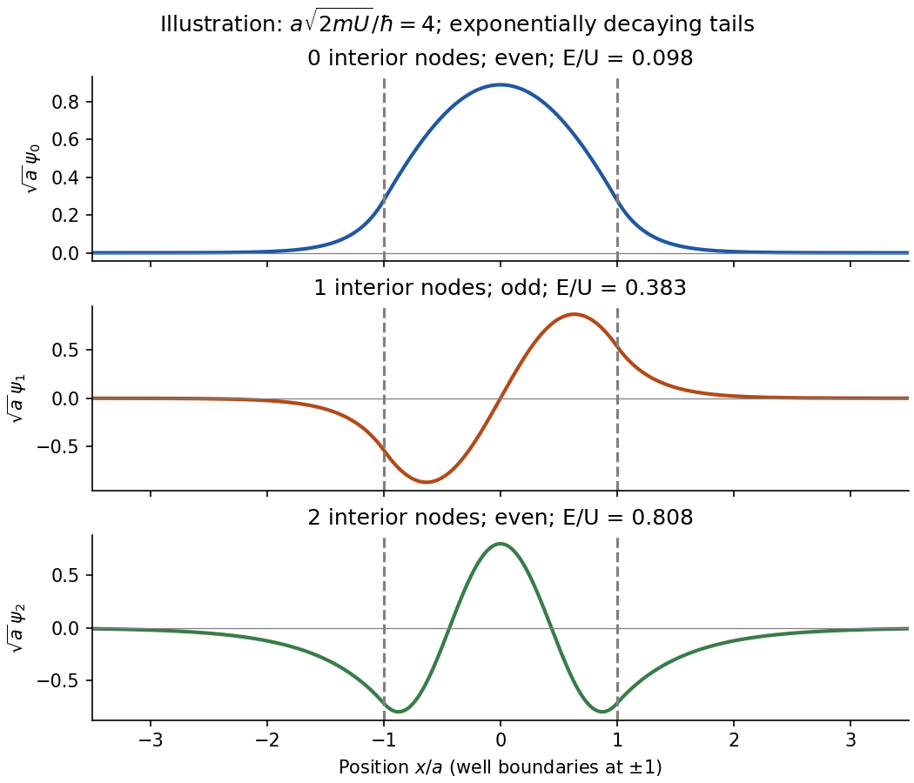

<h1 id="section-a/2/solution">Solution</h1>

↑ **Parent:** [2](../2.md)

Choose the centre of the [finite square well](../../../../../finite-square-well.md) as the origin and its edges as $\pm a$. The first three bound [wavefunctions](../../../../../wave-function-split.md) have **even, odd, even [parity](../../../../../parity.md)**, with respectively **zero, one and two interior [nodes](../../../../../node-dynamical-systems.md)**. They oscillate inside and decay exponentially outside, with $\kappa_n=\sqrt{2m(U-E_n)}/\hbar$. Both the [wavefunction](../../../../../wave-function-split.md) and its first [derivative](../../../../../derivative.md) are continuous at each finite potential step. The higher [bound states](../../../../../bound-state.md) have longer external decay [lengths](../../../../../length.md) because they lie closer to the barrier height. Overall sign is arbitrary.

**[Figure 1](#section-a/2/image-original-normalized-finite-well-eigenfunctions-with-parity-nodes-and-exponential-tails-illustrative-dimensionless-depth-not-supplied-numerical-data). Original normalized finite-well eigenfunctions with parity, nodes and exponential tails; illustrative dimensionless depth, not supplied numerical data**.

## ↑ Ancestors (14)

1. [2](../2.md)
2. [Section A](../../section-a.md)
3. [Paper 1](../../../paper-1-split.md)
4. [2014](../../../split.md)
5. [Past exam of the physics A course of the University of Cambridge](../../../../split.md)
6. [Physics A course of the University of Cambridge](../../../../../physics-a-course-of-the-university-of-cambridge.md)
7. [Physics course of the year 2 of the natural sciences course of the University of Cambridge](../../../../../physics-course-of-the-year-2-of-the-natural-sciences-course-of-the-university-of-cambridge.md)
8. [Year 2 of the natural sciences course of the University of Cambridge](../../../../../year-2-of-the-natural-sciences-course-of-the-university-of-cambridge.md)
9. [Year of the natural sciences course of the University of Cambridge](../../../../../year-of-the-natural-sciences-course-of-the-university-of-cambridge.md)
10. [Natural sciences course of the University of Cambridge](../../../../../natural-sciences-course-of-the-university-of-cambridge.md)
11. [Course of the University of Cambridge](../../../../../course-of-the-university-of-cambridge.md)
12. [University of Cambridge](../../../../../university-of-cambridge-split.md)
13. [List of universities](../../../../../list-of-universities.md)
14. [Codex Wiki](../../../../../split.md)
