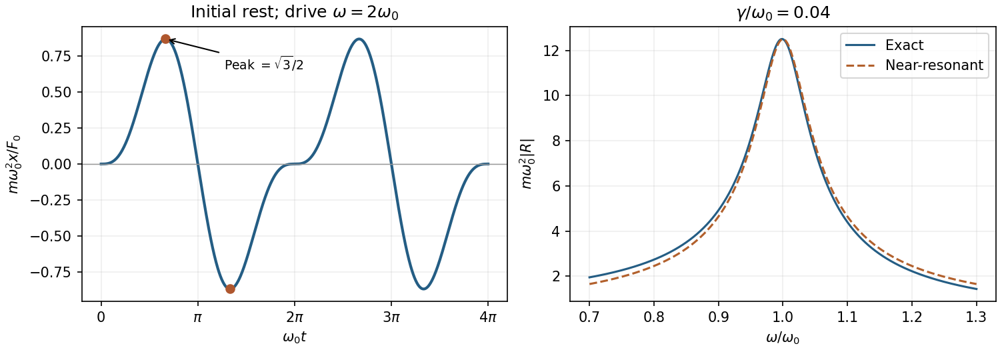
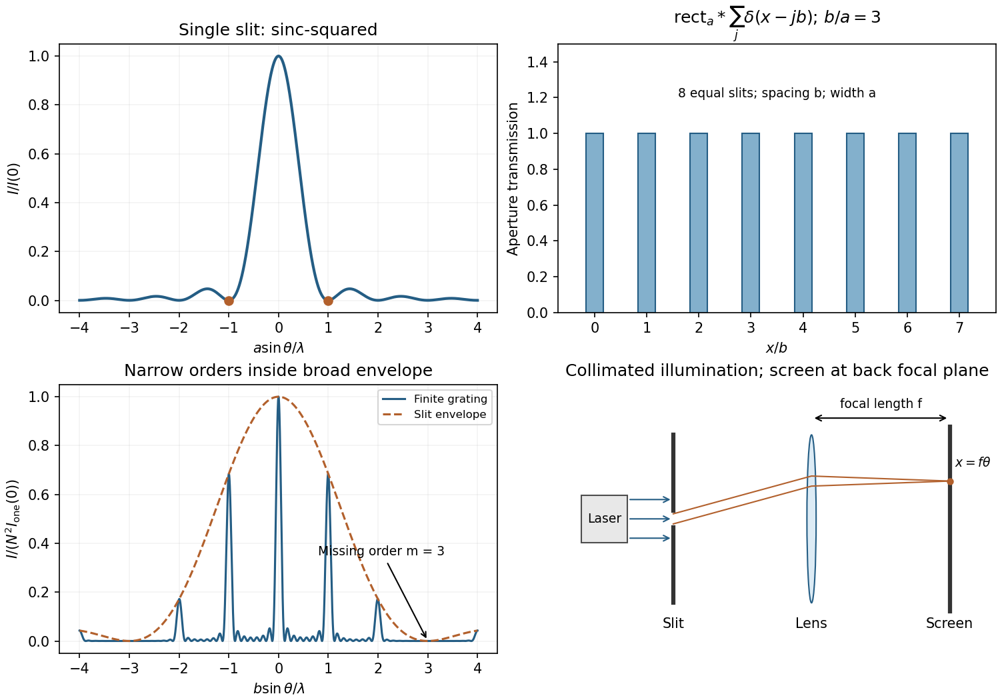
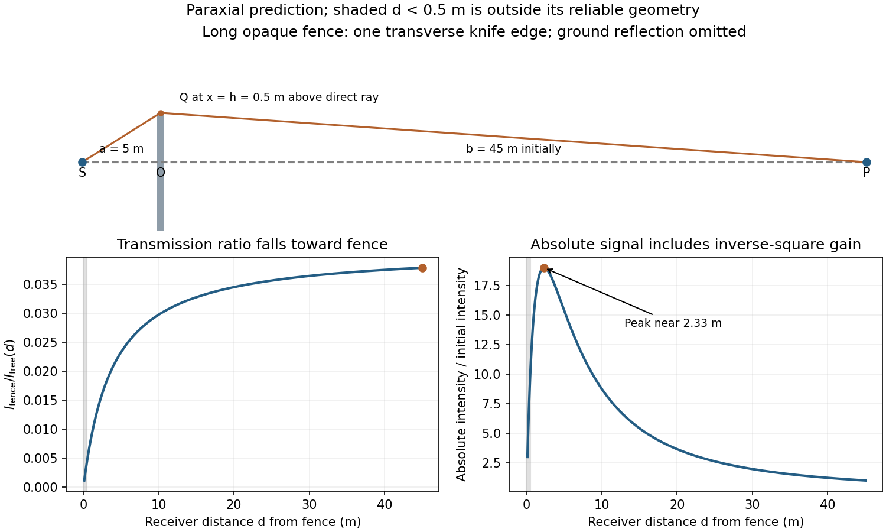
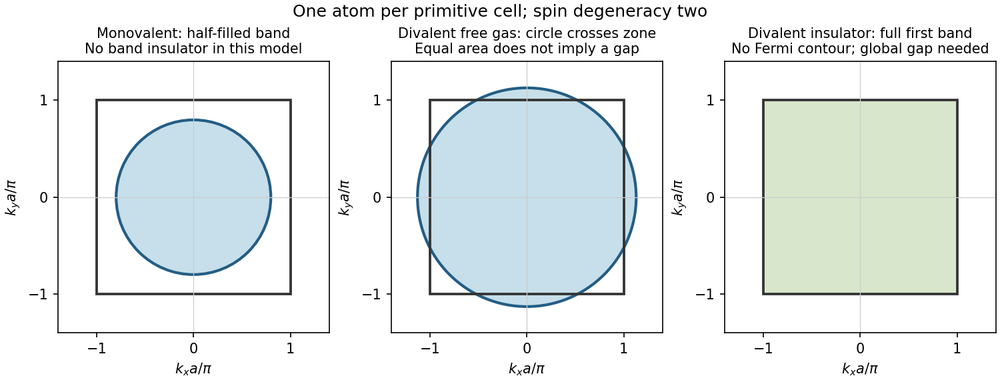
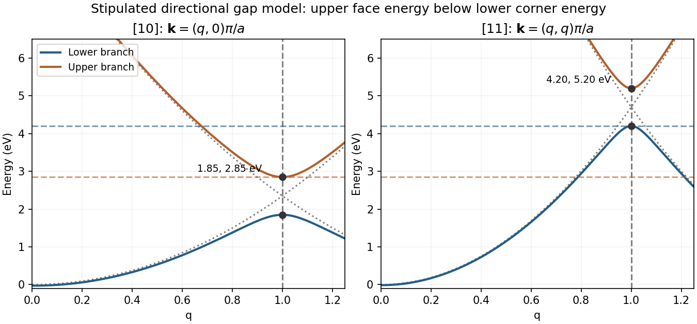

# Paper 2

↑ **Parent:** [2014](../2014.md)

[Original public PDF, physical pages 93–99](https://www.whatdotheyknow.com/request/natural_science_tripos_physics_e_2/response/2340776/attach/2/FOI%202023%20399%20Zahid%20materials.pdf?cookie_passthrough=1)

**Table of contents**

- [Section A](#section-a)
  - [1](#section-a/1)
    - [Solution](#section-a/1/solution)
  - [2](#section-a/2)
    - [Solution](#section-a/2/solution)
  - [3](#section-a/3)
    - [Solution](#section-a/3/solution)
  - [4](#section-a/4)
    - [Solution](#section-a/4/solution)
  - [5](#section-a/5)
    - [Solution](#section-a/5/solution)
- [Section B](#section-b)
  - [B6](#section-b/b6)
    - [Solution](#section-b/b6/solution)
  - [B7](#section-b/b7)
    - [Solution](#section-b/b7/solution)
    - [a](#section-b/b7/a)
      - [Solution](#section-b/b7/a/solution)
    - [b](#section-b/b7/b)
      - [Solution](#section-b/b7/b/solution)
  - [B8](#section-b/b8)
    - [Solution](#section-b/b8/solution)
  - [B9](#section-b/b9)
    - [Solution](#section-b/b9/solution)
- [Section C](#section-c)
  - [C10](#section-c/c10)
    - [Solution](#section-c/c10/solution)
  - [C11](#section-c/c11)
    - [i](#section-c/c11/i)
      - [Solution](#section-c/c11/i/solution)
    - [ii](#section-c/c11/ii)
      - [Solution](#section-c/c11/ii/solution)
    - [Solution](#section-c/c11/solution)
- [Section D](#section-d)
  - [D12](#section-d/d12)
    - [a](#section-d/d12/a)
      - [Solution](#section-d/d12/a/solution)
    - [b](#section-d/d12/b)
      - [Solution](#section-d/d12/b/solution)
    - [c](#section-d/d12/c)
      - [Solution](#section-d/d12/c/solution)
  - [D13](#section-d/d13)
    - [Solution](#section-d/d13/solution)

## Section A

↑ **Parent:** [Paper 2](paper-2.md)

<h3 id="section-a/1">1</h3>

↑ **Parent:** [Section A](#section-a)

<h4 id="section-a/1/solution">Solution</h4>

↑ **Parent:** [1](#section-a/1)

For a diffraction-limited circular aperture, the [Rayleigh criterion](../../point-spread-function.md#rayleigh-criterion) gives $\theta=1.22\lambda/D$. The [photon](../../quantum-mechanics.md#photon) [wavelength](../../wave-equation.md#wavelength) is $\lambda=hc/E=1.24\ \mu\mathrm m$, hence **$\theta\simeq1.5\times10^{-6}\ \mathrm{rad}$**. This assumes adequate optical quality and sampling; being in space removes atmospheric seeing, not [diffraction](../../quantum-scattering.md#diffraction).

<h3 id="section-a/2">2</h3>

↑ **Parent:** [Section A](#section-a)

<h4 id="section-a/2/solution">Solution</h4>

↑ **Parent:** [2](#section-a/2)

For a lossless single interface at [normal incidence](../../optics.md#normal-incidence), $R=1-T=0.04$ and the [Fresnel equations](../../electromagnetic-wave.md#fresnel-equations) give $R=[(n-1)/(n+1)]^2$, taking air's [refractive index](../../electromagnetic-wave.md#refractive-index) as one. Selecting the [glass](../../chemical-substance.md#glass) branch $n>1$ gives

$$
\boxed{n=\frac{1+\sqrt R}{1-\sqrt R}=1.50}.
$$

The reciprocal root $2/3$ is the mathematical lower-index branch, not ordinary [glass](../../chemical-substance.md#glass).

<h3 id="section-a/3">3</h3>

↑ **Parent:** [Section A](#section-a)

<h4 id="section-a/3/solution">Solution</h4>

↑ **Parent:** [3](#section-a/3)

The [power](../../energy.md#power) linewidth is $\Delta f=f_0/Q\simeq0.044\ \mathrm{Hz}$. [Fourier frequency resolution](../../discrete-fourier-transform.md#fourier-frequency-resolution) is of order $1/T_{\rm obs}$, so **$T_{\rm obs}\gtrsim Q/f_0\simeq23\ \mathrm{s}$**, and preferably longer to distinguish the intrinsic linewidth from the observation-window width. [zero padding](../../fourier-analysis.md#zero-padding) does not improve this physical resolution. A freely decaying signal also needs sufficient microphone dynamic range.

<h3 id="section-a/4">4</h3>

↑ **Parent:** [Section A](#section-a)

<h4 id="section-a/4/solution">Solution</h4>

↑ **Parent:** [4](#section-a/4)

The [mean energy of a two-dimensional Fermi gas](../../quantum-ideal-gas-statistics.md#mean-energy-of-a-two-dimensional-fermi-gas) follows from its constant [density of states](../../quantum-ideal-gas-statistics.md#density-of-states) $g$ for nonrelativistic quadratic dispersion. At zero [temperature](../../temperature.md), states below $\epsilon_F$ are filled, so

$$
N=g\epsilon_F,\qquad U=\int_0^{\epsilon_F}g\epsilon\,d\epsilon
=\frac12g\epsilon_F^2,\qquad
\boxed{\frac UN=\frac{\epsilon_F}{2}}.
$$

<h3 id="section-a/5">5</h3>

↑ **Parent:** [Section A](#section-a)

<h4 id="section-a/5/solution">Solution</h4>

↑ **Parent:** [5](#section-a/5)

Translating a scattering centre by any [lattice translation](../../quantum-scattering.md#lattice-translation) $\mathbf R$ changes the scattered [amplitude](../../wave.md#wave-amplitude) by $e^{i\mathbf G\cdot\mathbf R}$, up to the immaterial overall sign convention. [constructive interference](../../fourier-analysis.md#constructive-interference) requires $\mathbf G\cdot\mathbf R=2\pi$ times an integer. Applying this to $a\hat{\mathbf x},a\hat{\mathbf y},a\hat{\mathbf z}$ yields

$$
\boxed{\mathbf G=\frac{2\pi}{a}(h,k,l),\quad h,k,l\in\mathbb Z}.
$$

Thus $\mathbf G$ lies in the [reciprocal lattice](../../quantum-scattering.md#reciprocal-lattice). [elastic scattering](../../quantum-scattering.md#elastic-scattering) additionally requires $|\mathbf k_i+\mathbf G|=|\mathbf k_i|=2\pi/\lambda$; not every reciprocal vector is accessible for a fixed incident beam.

## Section B

↑ **Parent:** [Paper 2](paper-2.md)

<h3 id="section-b/b6">B6</h3>

↑ **Parent:** [Section B](#section-b)

<h4 id="section-b/b6/solution">Solution</h4>

↑ **Parent:** [B6](#section-b/b6)

For pendulum length $\ell$, small angular displacement gives $x\simeq\ell\theta$ and horizontal restoring force $-mgx/\ell$. Thus $\omega_0^2=g/\ell$ and

$$
\boxed{\ddot x+\omega_0^2x=\frac{F_0}{m}\sin\omega t}.
$$

For $\omega\ne\omega_0$, the [complementary solution](../../linear-ordinary-differential-equation.md#homogeneous-solution) and a sinusoidal [particular solution](../../linear-ordinary-differential-equation.md#particular-solution) give

$$
x=A\cos\omega_0t+B\sin\omega_0t+
\frac{F_0\sin\omega t}{m(\omega_0^2-\omega^2)}.
$$

Initial rest at the origin fixes $A=0$ and $B=-F_0\omega/[m\omega_0(\omega_0^2-\omega^2)]$, giving

$$
\boxed{x=\frac{F_0}{m(\omega_0^2-\omega^2)}
\left(\sin\omega t-\frac{\omega}{\omega_0}\sin\omega_0t\right)}.
$$

At exact [resonance](../../dynamical-systems.md#resonance) the corresponding limit is $x=F_0[\sin\omega_0t-\omega_0t\cos\omega_0t]/(2m\omega_0^2)$; unrestricted initial conditions add the [complementary solution](../../linear-ordinary-differential-equation.md#homogeneous-solution).

For $\omega=2\omega_0$, set $\tau=\omega_0t$. Then $m\omega_0^2x/F_0=(2\sin\tau-\sin2\tau)/3$: the period is $2\pi$ in $\tau$, zeros are at integer multiples of $\pi$, and the first extrema are $(2\pi/3,\sqrt3/2)$ and $(4\pi/3,-\sqrt3/2)$. Both initial displacement and slope vanish.

Substitution of the damped complex ansatz gives $[m(\omega_0^2-\omega^2)+ib\omega]x_0=F_0$. Hence

$$
\boxed{R(\omega)=\frac1{m(\omega_0^2-\omega^2)+ib\omega}}.
$$

For the [near-resonant mechanical susceptibility](../../analysis.md#near-resonant-mechanical-susceptibility), put $\gamma=b/(2m)\ll\omega_0$ and $\delta=\omega-\omega_0$, and neglect $\delta^2$ and $b\delta$ near [resonance](../../dynamical-systems.md#resonance):

$$
\boxed{R(\omega_0)=-\frac{i}{b\omega_0},\qquad
R(\omega)\simeq\frac1{2m\omega_0(-\delta+i\gamma)}}.
$$

Thus $|R|^2\simeq[4m^2\omega_0^2(\delta^2+\gamma^2)]^{-1}$, with angular-frequency full width $2\gamma=b/m$. The displacement lags the force by $\pi/2$ at $\omega_0$.

**[Figure 1](#section-b/b6/image-original-initial-rest-response-at-twice-the-natural-frequency-and-weak-damping-resonance). Original initial-rest response at twice the natural frequency and weak-damping resonance**.

<h3 id="section-b/b7">B7</h3>

↑ **Parent:** [Section B](#section-b)

<h4 id="section-b/b7/solution">Solution</h4>

↑ **Parent:** [B7](#section-b/b7)

Reflection at the fixed edges combines waves with opposite $k_y$ into a transverse [standing wave](../../mathematical-physics.md#standing-wave) while retaining their common longitudinal propagation factor. The [membrane waveguide](../../wave-equation.md#membrane-waveguide) scalar transverse displacement satisfies the [wave equation](../../wave-equation.md) and vanishes at both edges:

$$
\psi=\operatorname{Re}\{A\sin(k_yy)e^{i(\omega t-k_xx)}\},\qquad
k_y=\frac{n\pi}{b},\quad n=1,2,\ldots.
$$

The $n=0$ sine gives no displacement. [separation of variables](../../partial-differential-equation.md#separation-of-variables) gives

$$
\boxed{\omega^2=v_m^2\left[k_x^2+\left(\frac{n\pi}{b}\right)^2\right]},
\qquad
f_{c,n}=\frac{nv_m}{2b}.
$$

For a propagating branch with $k_x>0$,

$$
\boxed{v_p=\frac{\omega}{k_x}
=\frac{v_m}{\sqrt{1-(\omega_{c,n}/\omega)^2}},\qquad
v_g=\frac{d\omega}{dk_x}
=v_m\sqrt{1-(\omega_{c,n}/\omega)^2}}.
$$

Their product is $v_m^2$. The [phase velocity](../../dispersion-relation.md#phase-velocity) can exceed the material [wave speed](../../wave-equation.md#wave-speed); [energy](../../energy.md) transport follows the [group velocity](../../dispersion-relation.md#group-velocity).

Here the cutoff sequence is $10n\ \mathrm{kHz}$. At $15\ \mathrm{kHz}$ only $n=1$ propagates, with **$k_x=175.6\ \mathrm{m^{-1}}$** for travel toward positive $x$.

<h4 id="section-b/b7/a">a</h4>

↑ **Parent:** [B7](#section-b/b7)

<h5 id="section-b/b7/a/solution">Solution</h5>

↑ **Parent:** [A](#section-b/b7/a)

At $5\ \mathrm{kHz}$ every transverse mode is below cutoff. There is **no propagating guided mode** in an infinite uniform guide; excitation produces only [evanescent](../../elasticity-physics.md#evanescent-wave) penetration. For the slowest-decaying mode write $\psi\propto e^{-\kappa x}$, so $k_x=-i\kappa$ under the preceding convention, with $\kappa=\sqrt{(\pi/b)^2-(2\pi f/v_m)^2}=136.0\ \mathrm{m^{-1}}$, giving a penetration length about $7.35\ \mathrm{mm}$.

<h4 id="section-b/b7/b">b</h4>

↑ **Parent:** [B7](#section-b/b7)

<h5 id="section-b/b7/b/solution">Solution</h5>

↑ **Parent:** [B](#section-b/b7/b)

At $50\ \mathrm{kHz}$ **modes $n=1,2,3,4$ can propagate**. Their positive $k_x$ values are approximately $769.5,719.8,628.3,471.2\ \mathrm{m^{-1}}$. Mode $n=5$ is a [nonpropagating mode at waveguide cutoff](../../wave-equation.md#nonpropagating-mode-at-waveguide-cutoff): $k_x=0$ and $v_g=0$, so it does not carry longitudinal [power](../../energy.md#power) as a traveling mode. Higher modes are [evanescent](../../elasticity-physics.md#evanescent-wave). The injected transverse profile determines which permitted modes are actually excited.

<h3 id="section-b/b8">B8</h3>

↑ **Parent:** [Section B](#section-b)

<h4 id="section-b/b8/solution">Solution</h4>

↑ **Parent:** [B8](#section-b/b8)

For uniform illumination, the aperture is $h(x)=1$ for $|x|<a/2$ and zero otherwise. With $q=2\pi\sin\theta/\lambda$,

$$
\widetilde h(q)=\int_{-a/2}^{a/2}e^{-iqx}\,dx
=a\frac{\sin(qa/2)}{qa/2},\qquad
\boxed{I(\theta)=I(0)\left(\frac{\sin\alpha}{\alpha}\right)^2,\quad
\alpha=\frac{\pi a\sin\theta}{\lambda}}.
$$

Zeros occur at $\sin\theta=j\lambda/a$, $j\ne0$; the central maximum extends between $\pm\lambda/a$. A monochromatic [laser](../../laser.md) expanded into a collimated beam can illuminate the slit. A [lens](../../geometrical-optics.md#lens-optics) with the screen in its back [focal plane](../../optical-instrument.md#focal-plane) produces the Fraunhofer pattern; alternatively use a sufficiently distant screen, $z\gg a^2/\lambda$. Align the slit and beam and avoid detector saturation.

For $N$ equally spaced slits, write the aperture as a [convolution](../../fourier-analysis.md#convolution)

$$
h_N=\operatorname{rect}_a*\sum_{j=0}^{N-1}\delta(x-jb).
$$

The [convolution theorem](../../fourier-analysis.md#convolution-theorem) converts this into a single-slit transform times the finite-array transform. Therefore

$$
\boxed{I_N(q)\propto a^2\operatorname{sinc}^2\left(\frac{qa}{2}\right)
\left[\frac{\sin(Nqb/2)}{\sin(qb/2)}\right]^2},
\qquad \operatorname{sinc}u=\frac{\sin u}{u}.
$$

Principal maxima are at $b\sin\theta=m\lambda$ for [normal incidence](../../optics.md#normal-incidence), inside the single-slit envelope. Their height scales as $N^2$ times the envelope, and their first zeros are separated from a peak by $\delta(\sin\theta)=\lambda/(Nb)$.

The envelope-to-order-spacing ratio is $b/a$: increasing it admits more orders within the central envelope and changes the relative order strengths. In particular, an order is missing when $ma/b$ is a nonzero integer. Statements about absolute angular spacing need a fixed dimension: at fixed $a$, increasing $b$ reduces order spacing; at fixed $b$, decreasing $a$ broadens the envelope.

For fixed incident angle, differentiating the [grating equation](../../physical-optics.md#grating-equation) gives an order displacement $\delta(\sin\theta)=|m|\delta\lambda/b$. Equating this to the peak-to-first-zero width gives

$$
\boxed{\delta\lambda=\frac{\lambda}{|m|N}\simeq\frac{\lambda b}{|m|W}}.
$$

Here $W\simeq Nb$ is the illuminated grating width; this is the ideal Rayleigh limit, before slit width or aberrations broaden the spectral image.

With $b=(1600\ \mathrm{mm^{-1}})^{-1}=0.000625\ \mathrm{mm}$, the required count is $N\ge372.7/(2\times0.2)=931.75$. Thus **932 illuminated slits**, or **$W_{\min}\simeq0.5825\ \mathrm{mm}$**, suffice ideally. Checking [diffraction-order feasibility](../../physical-optics.md#diffraction-order-feasibility), [normal incidence](../../optics.md#normal-incidence) cannot produce this second order because $2\lambda/b=1.193>1$; an oblique [spectrograph](../../optical-instrument.md#spectrograph) geometry is required. A feasible reflection-Littrow example has $\sin\theta=m\lambda/(2b)=0.5963$, or $\theta\simeq36.6^\circ$.

**[Figure 2](#section-b/b8/image-original-slit-finite-array-convolution-diffraction-pattern-and-fourier-plane-experimental-layout). Original slit, finite-array convolution, diffraction pattern and Fourier-plane experimental layout**.

<h3 id="section-b/b9">B9</h3>

↑ **Parent:** [Section B](#section-b)

<h4 id="section-b/b9/solution">Solution</h4>

↑ **Parent:** [B9](#section-b/b9)

For time dependence $e^{-i\omega t}$, a scalar Fresnel-Kirchhoff aperture formula for a point-source [amplitude](../../wave.md#wave-amplitude) $A$ is

$$
U(P)=\frac{A}{i\lambda}\int_{\mathcal A}
K(Q)\frac{e^{ik[s(Q)+r(Q)]}}{s(Q)r(Q)}\,dS_Q,\qquad k=\frac{2\pi}{\lambda}.
$$

Here $s=|S-Q|$, $r=|P-Q|$, and $K$ is the [obliquity factor](../../quantum-scattering.md#obliquity-factor), approximately the mean of the incident and outgoing direction cosines measured with the forward aperture normal. The factors describe incident spherical spreading, outgoing spreading and accumulated phase. This is the scalar Kirchhoff aperture approximation; it does not supply an exact electromagnetic edge boundary solution.

In the Fresnel regime, expand path lengths to quadratic order in aperture coordinates while replacing slowly varying [amplitude](../../wave.md#wave-amplitude) and [obliquity factors](../../quantum-scattering.md#obliquity-factor) by their axial values. In the Fraunhofer regime the quadratic aperture phase is negligible, leaving the aperture [Fourier transform](../../fourier-transform.md). For characteristic aperture size $D$, the latter requires $D^2/(\lambda R)\ll1$ in the relevant finite-source geometry; a [lens](../../geometrical-optics.md#lens-optics) can supply the Fourier-plane configuration.

For the one-dimensional Cornu construction, put $S,O,P$ on the unobstructed straight ray, with the aperture plane perpendicular at $O$. An element is displaced transversely by $x$, with $|x|\ll a,b$, where $a=SO$ and $b=OP$. A long straight edge or slit makes the other transverse direction separable. Then

$$
\sqrt{a^2+x^2}+\sqrt{b^2+x^2}
=a+b+\frac{x^2}{2}\left(\frac1a+\frac1b\right)+O(x^4),
\qquad
\boxed{\frac1R=\frac1a+\frac1b}.
$$

For [knife-edge diffraction](../../physical-optics.md#knife-edge-diffraction) at the fence, the edge is $h=0.5\ \mathrm m$ above the direct ray, with $a=5\ \mathrm m$, $b=45\ \mathrm m$, $\lambda\simeq0.100\ \mathrm m$, and $R=4.5\ \mathrm m$. The unblocked aperture extends upward from $h$, so its Cornu chord runs from $u_h=h\sqrt{2/(\lambda R)}=1.054$ to infinity. Using $C(\infty)=S(\infty)=1/2$ and normalizing by the full unobstructed chord gives

$$
\boxed{\mathcal T=\frac{I_{\rm fence}}{I_{\rm free}}
=\frac{[1/2-C(u_h)]^2+[1/2-S(u_h)]^2}{2}
\simeq0.038}.
$$

The approximate chord coordinates are $C=0.775$, $S=0.492$. This is the standard single-knife-edge Fresnel normalization.[Annex 1, Sections 2.7 and 4.1, Fresnel integrals and single knife edge](../../physics-bibliography.md#propagation-by-diffraction-itu-r-p-526-13-by-international-telecommunication-union)

For [geometric spreading in a moving-receiver diffraction measurement](../../physical-optics.md#geometric-spreading-in-a-moving-receiver-diffraction-measurement), set $b=d$ while retaining $a=5$ and $h=0.5$:

$$
u(d)=h\sqrt{\frac2\lambda\left(\frac15+\frac1d\right)},\qquad
I_{\rm received}(d)\propto\frac{\mathcal T[u(d)]}{(5+d)^2}.
$$

**Normalized transmission decreases toward the fence. Absolute received [intensity](../../wave.md#intensity-physics) initially increases**, because the free-space spherical-wave [intensity](../../wave.md#intensity-physics) rises as source–receiver distance decreases. In this model it reaches a maximum near $d\simeq2.3\ \mathrm m$, then falls. The formal paraxial small-$d$ behavior is $I\propto d/(5+d)^3$; extrapolation to $d\lesssim h$ is outside the [small-angle approximation](../../geometry-and-topology.md#small-angle-approximation). The sketch distinguishes the absolute signal from its ratio to the unobstructed signal at each position.

**[Figure 3](#section-b/b9/image-original-knife-edge-geometry-and-distinct-absolute-intensity-and-normalized-transmission-predictions). Original knife-edge geometry and distinct absolute-intensity and normalized-transmission predictions**.

## Section C

↑ **Parent:** [Paper 2](paper-2.md)

<h3 id="section-c/c10">C10</h3>

↑ **Parent:** [Section C](#section-c)

<h4 id="section-c/c10/solution">Solution</h4>

↑ **Parent:** [C10](#section-c/c10)

The [Pauli exclusion principle](../../tensor-product-of-quantum-systems.md#pauli-exclusion-principle) confines thermally excited conduction [electrons](../../physics.md#electron) to an [energy](../../energy.md) interval of order $k_BT$ around the [Fermi surface](../../fermi-liquid.md#fermi-surface). Their excess [energy](../../energy.md) is therefore proportional to $T^2$, giving an [electronic heat capacity](../../heat.md#electronic-heat-capacity) $\gamma T$. More precisely, $\gamma=(\pi^2/3)k_B^2g_{\rm mol}(\epsilon_F)$. In a three-dimensional [Debye model](../../quantum-ideal-gas-statistics.md#debye-model), [acoustic phonons](../../quantum-ideal-gas-statistics.md#acoustic-phonon) have [density of states](../../quantum-ideal-gas-statistics.md#density-of-states) proportional to $\omega^2$; their thermal [energy](../../energy.md) scales as $T^4$, giving

$$
\boxed{C=\gamma T+\beta T^3,\qquad
\beta=\frac{12\pi^4R}{5\theta_D^3}}
$$

per mole of atoms. This assumes a normal [metal](../../chemical-substance.md#metal) without a lower-temperature superconducting or magnetic anomaly.

For $\theta_D\ll T\ll T_F$, the lattice approaches the Dulong-Petit value, so **$C_V\simeq3R+\gamma T$, usually dominated by $3R$**. Each classical vibrational mode contributes $k_B$ through kinetic and potential equipartition. This is a high-temperature solid-state regime, not a claim that the solid persists to arbitrarily high [temperature](../../temperature.md); anharmonicity and $C_P-C_V$ can matter.

The [body-centred cubic](../../quantum-scattering.md#body-centered-cubic-lattice) cell has two atoms, so $n_{\rm at}=2/a^3$. Counting three acoustic branches gives $k_D^3=6\pi^2n_{\rm at}$. By the Debye-temperature definition,

$$
\boxed{\omega_D=\frac{k_B\theta_D}{\hbar}=1.18\times10^{13}\ \mathrm{s^{-1}},
\qquad
v_D=\frac{k_B\theta_D}{\hbar(12\pi^2/a^3)^{1/3}}
\simeq1.25\times10^3\ \mathrm{m\,s^{-1}}}.
$$

This is an effective [Debye sound speed](../../quantum-ideal-gas-statistics.md#debye-sound-speed); separate longitudinal and transverse speeds are not determined. For isotropic branches, $3/v_D^3=1/v_L^3+2/v_T^3$.

<h3 id="section-c/c11">C11</h3>

↑ **Parent:** [Section C](#section-c)

<h4 id="section-c/c11/i">i</h4>

↑ **Parent:** [C11](#section-c/c11)

<h5 id="section-c/c11/i/solution">Solution</h5>

↑ **Parent:** [I](#section-c/c11/i)

The [first Brillouin zone](../../bloch-s-theorem.md#first-brillouin-zone) is $|k_x|,|k_y|\le\pi/a$. For one atom per primitive cell and two spin states, a monovalent free-electron gas has

$$
n_{2D}=\frac1{a^2}=\frac{k_F^2}{2\pi},\qquad
\boxed{k_Fa=\sqrt{2\pi}}.
$$

Its circular [Fermi surface](../../fermi-liquid.md#fermi-surface) lies inside the zone and encloses half its area: **a partially filled band is conducting**. Here [odd filling obstructs a spin-degenerate band insulator](../../bloch-s-theorem.md#odd-filling-obstructs-a-spin-degenerate-band-insulator): a monovalent [band insulator](../../bloch-s-theorem.md#band-insulator) is impossible in this spin-degenerate one-atom independent-electron model. It would require changed premises, such as unit-cell enlargement or physics beyond the free-electron picture; no insulating free-electron contour should be invented.

<h4 id="section-c/c11/ii">ii</h4>

↑ **Parent:** [C11](#section-c/c11)

<h5 id="section-c/c11/ii/solution">Solution</h5>

↑ **Parent:** [Ii](#section-c/c11/ii)

For divalent atoms, $k_Fa=\sqrt{4\pi}$. The circle has the same area as the [first Brillouin zone](../../bloch-s-theorem.md#first-brillouin-zone) but crosses its faces and leaves its corners unfilled. Thus **the free-electron case remains conducting**: filling capacity alone does not remove band overlap. A nearly free-electron conductor has reconstructed [electron](../../physics.md#electron) and [hole pockets](../../fermi-liquid.md#hole-pocket); a divalent [band insulator](../../bloch-s-theorem.md#band-insulator) instead has one completely filled band separated from all higher bands, with no [Fermi surface](../../fermi-liquid.md#fermi-surface) in the gap.

**[Figure 4](#section-c/c11/ii/image-original-square-zone-state-counting-monovalent-and-divalent-free-contours-and-insulating-band-filling). Original square-zone state counting, monovalent and divalent free contours, and insulating band filling**.

<h4 id="section-c/c11/solution">Solution</h4>

↑ **Parent:** [C11](#section-c/c11)

For two [electrons](../../physics.md#electron) per primitive cell,

$$
\boxed{\epsilon_F=\frac{\hbar^2k_F^2}{2m_e}
=\frac{2\pi\hbar^2}{m_ea^2}
\simeq2.99\ \mathrm{eV}}.
$$

Set $A=\hbar^2\pi^2/(2m_ea^2)=2.350\ \mathrm{eV}$. In the [indirect gap in a uniformly split zone-boundary model](../../bloch-s-theorem.md#indirect-gap-in-a-uniformly-split-zone-boundary-model) approximation stipulated here, the free boundary [energies](../../energy.md) are $A$ along $[10]$ at $X=(\pi/a,0)$ and $2A$ along $[11]$ at $M=(\pi/a,\pi/a)$. Opening a symmetric gap gives

$$
\boxed{E_{X,\pm}=A\pm E_g/2=1.85,\ 2.85\ \mathrm{eV}},
\qquad
\boxed{E_{M,\pm}=2A\pm E_g/2=4.20,\ 5.20\ \mathrm{eV}}.
$$

The branches bend away from the free-electron crossings and flatten at their boundary extrema. Importantly, the upper band near $X$ lies below the lower band's corner [energy](../../energy.md):

$$
\boxed{E_{\rm indirect}\simeq E_{X,+}-E_{M,-}=E_g-A=-1.35\ \mathrm{eV}<0}.
$$

Therefore **the crystal is metallic despite its positive boundary gaps**; [electron](../../physics.md#electron) and [hole](../../quantum-mechanics.md#electron-hole) occupations redistribute across overlapping bands. [positive direct gaps can coexist with band overlap](../../bloch-s-theorem.md#positive-direct-gaps-can-coexist-with-band-overlap).

A microscopic square-lattice corner has additional plane-wave degeneracy. The quoted symmetric boundary numbers use the question's directional gap model, not an unspecified four-state corner Hamiltonian. For the [indirect gap of a separable square cosine potential](../../bloch-s-theorem.md#indirect-gap-of-a-separable-square-cosine-potential), a separable weak potential with the same face gap gives the lowest corner [energy](../../energy.md) $2A-E_g=3.70\ \mathrm{eV}$, still above the $2.85\ \mathrm{eV}$ upper-band face [energy](../../energy.md). This refinement preserves the metallic conclusion.

**[Figure 5](#section-c/c11/image-original-directional-avoided-crossings-and-the-overlap-of-lower-and-upper-band-boundary-energies). Original directional avoided crossings and the overlap of lower- and upper-band boundary energies**.

## Section D

↑ **Parent:** [Paper 2](paper-2.md)

<h3 id="section-d/d12">D12</h3>

↑ **Parent:** [Section D](#section-d)

<h4 id="section-d/d12/a">a</h4>

↑ **Parent:** [D12](#section-d/d12)

<h5 id="section-d/d12/a/solution">Solution</h5>

↑ **Parent:** [A](#section-d/d12/a)

For a plane sound wave, [acoustic impedance](../../elasticity-physics.md#acoustic-impedance) is $Z=p/u=\rho c$, with [pressure](../../pressure.md) [amplitude](../../wave.md#wave-amplitude) $p$ and particle-velocity [amplitude](../../wave.md#wave-amplitude) $u$. Continuity of [pressure](../../pressure.md) and normal velocity at normal incidence on a lossless interface gives

$$
\boxed{r_p=\frac{Z_2-Z_1}{Z_2+Z_1},\quad
\mathcal R=r_p^2,\quad
\mathcal T=\frac{4Z_1Z_2}{(Z_1+Z_2)^2}}.
$$

Matching $Z_1=Z_2$ eliminates reflection. A quarter-wave intermediate layer with $Z_m=\sqrt{Z_1Z_2}$ transforms the load to the source impedance at its design [frequency](../../wave.md#frequency); its bandwidth is limited. For strings, the analogous [mechanical impedance](../../classical-mechanics.md#mechanical-impedance) is transverse force divided by velocity, $Z=Tv^{-1}=\sqrt{T\mu}$; continuity of displacement and transverse force gives the corresponding matching condition. These [amplitudes](../../wave.md#wave-amplitude) use different force/velocity conventions from acoustic [pressure](../../pressure.md), so reflection signs must be stated consistently.

<h4 id="section-d/d12/b">b</h4>

↑ **Parent:** [D12](#section-d/d12)

<h5 id="section-d/d12/b/solution">Solution</h5>

↑ **Parent:** [B](#section-d/d12/b)

Reflections from the two film surfaces interfere with propagation phase $4\pi nd\cos\theta_t/\lambda_0$ plus the relative reflection phase. Reflection from a lower to a higher [refractive index](../../electromagnetic-wave.md#refractive-index) contributes a $\pi$ phase reversal. For a higher-index film surrounded by air there is one relative reversal, hence

$$
\boxed{\text{reflection maxima: }2nd\cos\theta_t=(m+\tfrac12)\lambda_0,\quad
\text{minima: }2nd\cos\theta_t=m\lambda_0}.
$$

Thickness or angle variation therefore produces fringes or colours under broadband illumination. An [antireflection coating](../../physical-optics.md#antireflection-coating) between indices $n_0,n_s$ instead uses, at [normal incidence](../../optics.md#normal-incidence), $n_f=\sqrt{n_0n_s}$ and $n_fd=\lambda_0/4$: the two reflected [amplitudes](../../wave.md#wave-amplitude) then cancel at the design [wavelength](../../wave-equation.md#wavelength). Absorption, [polarization](../../wave.md#polarization-waves), unequal [amplitudes](../../wave.md#wave-amplitude) and multiple reflections determine the full contrast.

<h4 id="section-d/d12/c">c</h4>

↑ **Parent:** [D12](#section-d/d12)

<h5 id="section-d/d12/c/solution">Solution</h5>

↑ **Parent:** [C](#section-d/d12/c)

A [Michelson interferometer](../../physical-optics.md#michelson-interferometer) divides light at a [beam splitter](../../optical-instrument.md#beam-splitter), sends it to two mirrors, and recombines the returned beams. A compensating plate can equalize [glass](../../chemical-substance.md#glass) traversal. For approximately axial rays the [optical path difference](../../physical-optics.md#optical-path-difference) is $\Delta=2(n_1L_1-n_2L_2)$, plus fixed instrument phase, and

$$
I=I_1+I_2+2\sqrt{I_1I_2}\cos(2\pi\Delta/\lambda_0+\phi_0)
$$

for coherent, mode-matched fields. Moving one mirror by $\delta L$ in air changes the round-trip path by $2\delta L$, so **one fringe corresponds to $\lambda_0/2$ mirror motion**. It measures displacement, [wavelength](../../wave-equation.md#wavelength) and refractive-index changes; scanning the delay enables Fourier-transform spectroscopy. Mirror alignment, [polarization](../../wave.md#polarization-waves) overlap, vibration and source coherence control visibility. A finite coherence length limits useful arm mismatch.

<h3 id="section-d/d13">D13</h3>

↑ **Parent:** [Section D](#section-d)

<h4 id="section-d/d13/solution">Solution</h4>

↑ **Parent:** [D13](#section-d/d13)

Donor doping supplies conduction [electrons](../../physics.md#electron) to [n-type semiconductor](../../semiconductor.md#n-type-semiconductor); acceptor doping supplies [holes](../../quantum-mechanics.md#electron-hole) to [p-type semiconductor](../../semiconductor.md#p-type-semiconductor). In the nondegenerate, fully ionized limit, majority densities are approximately $n_n=N_D$ and $p_p=N_A$, while minority densities follow $np=n_i^2$. On contact, majority carriers diffuse across the junction, exposing positive donor ions on the n side and negative acceptor ions on the p side. The depletion-region [electric field](../../electric-field.md) points from n to p and opposes further [diffusion](../../thermodynamics.md#diffusion). At [thermal equilibrium](../../thermal-equilibrium.md) the [Fermi level](../../quantum-ideal-gas-statistics.md#fermi-level) is uniform and drift balances [diffusion](../../thermodynamics.md#diffusion), with no net current.

For an abrupt junction with uniform doping and permittivity $\varepsilon_s$, charge neutrality gives $N_Dx_n=N_Ax_p$. [Poisson's equation](../../partial-differential-equation.md#poisson-s-equation) then gives

$$
V_{\rm bi}=\frac{k_BT}{q}\log\frac{N_AN_D}{n_i^2},\qquad
\boxed{W=x_n+x_p=
\sqrt{\frac{2\varepsilon_s}{q}\left(\frac1{N_A}+\frac1{N_D}\right)(V_{\rm bi}-V)}}.
$$

Positive applied $V$ means [forward bias](../../electrical-circuit.md#forward-bias): it lowers the barrier and narrows the [depletion region](../../semiconductor.md#depletion-region). Most depletion width lies in the more lightly doped side. The formula assumes the [depletion approximation](../../semiconductor.md#depletion-approximation) and fails once its operating assumptions break down.

[forward bias](../../electrical-circuit.md#forward-bias) increases minority densities at the depletion edges by the factor $e^{qV/k_BT}$. In the neutral material, the steady [diffusion](../../thermodynamics.md#diffusion)–[recombination](../../cosmology.md#recombination-cosmology) equation gives exponentially decaying excess minorities, with lengths $L_n=\sqrt{D_n\tau_n}$ and $L_p=\sqrt{D_p\tau_p}$. Taking the carrier gradients at the junction yields

$$
\boxed{I=I_S\left(e^{qV/k_BT}-1\right),\qquad
I_S=qA_jn_i^2\left(\frac{D_n}{L_nN_A}+\frac{D_p}{L_pN_D}\right)}.
$$

This ideal [diode](../../electrical-circuit.md#diode) law assumes low injection, nondegenerate statistics, negligible depletion-region [recombination](../../cosmology.md#recombination-cosmology) and series resistance, and sufficiently long neutral regions. Its exponential comes from the bias-dependent injection barrier; there is no universal abrupt “turn-on” voltage. [reverse bias](../../electrical-circuit.md#reverse-bias) suppresses injection, giving an approximate $-I_S$ current until additional leakage or breakdown matters.[Bell System Technical Journal 28, pp. 435–489, minority-carrier injection and rectifying-junction theory](../../physics-bibliography.md#the-theory-of-p-n-junctions-in-semiconductors-and-p-n-junction-transistors-by-william-shockley)

Rectification uses the asymmetric [current-voltage characteristic](../../electrical-circuit.md#current-voltage-characteristic); controlled reverse breakdown enables voltage references, with current limiting. Bias-dependent depletion capacitance enables varactors. [photodiodes](../../optical-instrument.md#photodiode) and [solar cells](../../quantum-mechanics.md#solar-cell) collect optically generated carriers through the junction field and diffusion toward it; efficient [light-emitting diodes](../../electrical-circuit.md#light-emitting-diode) use radiative [electron](../../physics.md#electron)–[hole](../../quantum-mechanics.md#electron-hole) [recombination](../../cosmology.md#recombination-cosmology), preferably in a direct-gap material. Series resistance, high injection, trap-assisted [recombination](../../cosmology.md#recombination-cosmology), heating and finite carrier storage explain departures from the ideal steady-state law.

## ↑ Ancestors (11)

1. [2014](../2014.md)
2. [Past exam of the physics A course of the University of Cambridge](../../past-exam-of-the-physics-a-course-of-the-university-of-cambridge.md)
3. [Physics A course of the University of Cambridge](../../university-of-cambridge.md#physics-a-course-of-the-university-of-cambridge)
4. [Physics course of the year 2 of the natural sciences course of the University of Cambridge](../../university-of-cambridge.md#physics-course-of-the-year-2-of-the-natural-sciences-course-of-the-university-of-cambridge)
5. [Year 2 of the natural sciences course of the University of Cambridge](../../university-of-cambridge.md#year-2-of-the-natural-sciences-course-of-the-university-of-cambridge)
6. [Year of the natural sciences course of the University of Cambridge](../../university-of-cambridge.md#year-of-the-natural-sciences-course-of-the-university-of-cambridge)
7. [Natural sciences course of the University of Cambridge](../../university-of-cambridge.md#natural-sciences-course-of-the-university-of-cambridge)
8. [Course of the University of Cambridge](../../university-of-cambridge.md#course-of-the-university-of-cambridge)
9. [University of Cambridge](../../university-of-cambridge.md)
10. [List of universities](../../README.md#list-of-universities)
11. [Codex Wiki](../../README.md)
