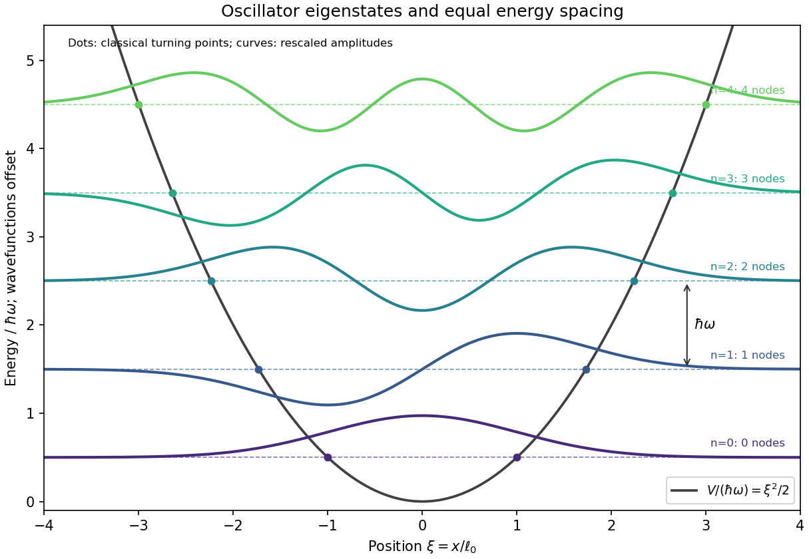
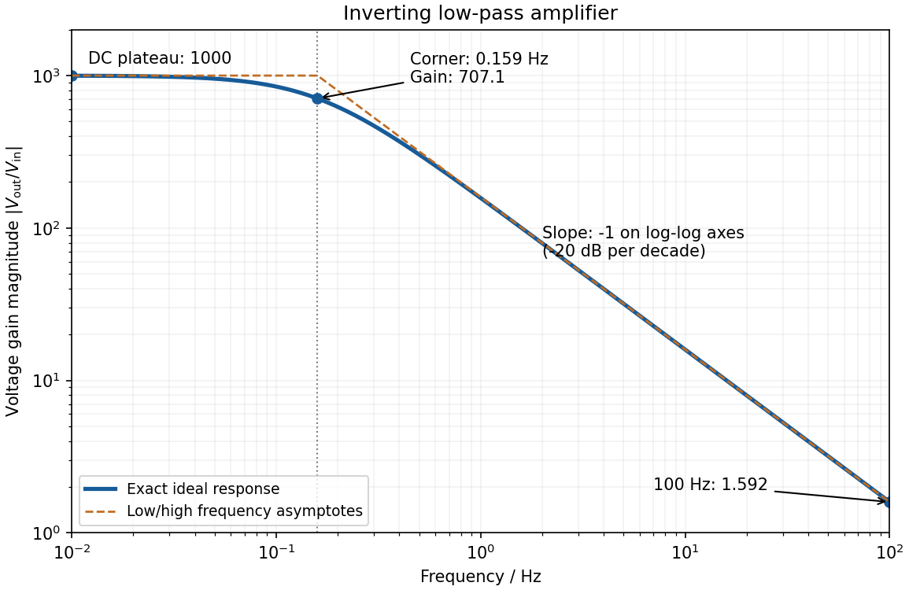

# Paper 1

↑ **Parent:** [2015](../2015.md)

Original source: [Released examination PDF, physical pages 100–105](https://www.whatdotheyknow.com/request/natural_science_tripos_physics_e_2/response/2340776/attach/2/FOI%202023%20399%20Zahid%20materials.pdf?cookie_passthrough=1#page=100). All alternatives are treated below.

**Table of contents**

- [Section A](#section-a)
  - [1](#section-a/1)
    - [Solution](#section-a/1/solution)
  - [2](#section-a/2)
    - [Solution](#section-a/2/solution)
  - [3](#section-a/3)
    - [Solution](#section-a/3/solution)
  - [4](#section-a/4)
    - [Solution](#section-a/4/solution)
  - [5](#section-a/5)
    - [Solution](#section-a/5/solution)
- [Section B](#section-b)
  - [B6](#section-b/b6)
    - [Solution](#section-b/b6/solution)
  - [B7](#section-b/b7)
    - [Solution](#section-b/b7/solution)
  - [B8](#section-b/b8)
    - [Solution](#section-b/b8/solution)
  - [B9](#section-b/b9)
    - [Solution](#section-b/b9/solution)
- [Section C](#section-c)
  - [C10](#section-c/c10)
    - [Solution](#section-c/c10/solution)
  - [C11](#section-c/c11)
    - [a](#section-c/c11/a)
      - [Solution](#section-c/c11/a/solution)
    - [b](#section-c/c11/b)
      - [Solution](#section-c/c11/b/solution)
    - [c](#section-c/c11/c)
      - [Solution](#section-c/c11/c/solution)
- [Section D](#section-d)
  - [D12](#section-d/d12)
    - [Solution](#section-d/d12/solution)
  - [D13](#section-d/d13)
    - [a](#section-d/d13/a)
      - [Solution](#section-d/d13/a/solution)
    - [b](#section-d/d13/b)
      - [Solution](#section-d/d13/b/solution)
    - [c](#section-d/d13/c)
      - [Solution](#section-d/d13/c/solution)

## Section A

↑ **Parent:** [Paper 1](paper-1.md)

<h3 id="section-a/1">1</h3>

↑ **Parent:** [Section A](#section-a)

<h4 id="section-a/1/solution">Solution</h4>

↑ **Parent:** [1](#section-a/1)

The [Born rule](../../wave-function.md#born-rule) uses the squared modulus, so the imaginary term contributes positively: $|a+ix|^2=a^2+x^2$. For $a>0$, [wavefunction normalization](../../wave-function.md#wavefunction-normalization) would multiply the supplied expression by $N=\sqrt{3/(4a^3)}$. Equivalently, take the ratio of the integrals directly:

$$
P=\frac{\int_{a/2}^a(a^2+x^2)\,dx}{\int_0^a(a^2+x^2)\,dx}
=\frac{19a^3/24}{4a^3/3}
=\boxed{\frac{19}{32}}.
$$

Using $\psi^2$ instead of $|\psi|^2$ would fail to produce a real, nonnegative [probability density](../../wave-function.md#probability-density).

<h3 id="section-a/2">2</h3>

↑ **Parent:** [Section A](#section-a)

<h4 id="section-a/2/solution">Solution</h4>

↑ **Parent:** [2](#section-a/2)

For the [quantum harmonic oscillator](../../quantum-harmonic-oscillator.md), put $\ell_0=\sqrt{\hbar/(m\omega)}$ and $\xi=x/\ell_0$. The normalized [energy eigenstates](../../energy-eigenvalue.md#energy-eigenstate) are

$$
\boxed{E_n=\hbar\omega(n+\tfrac12)},\qquad
\psi_n(x)=\frac{H_n(\xi)e^{-\xi^2/2}}{\pi^{1/4}\sqrt{2^nn!\ell_0}},\qquad n=0,1,\ldots,
$$

where $H_n$ is a [Hermite polynomial](../../orthogonal-polynomial.md#hermite-polynomial). Successive [energies](../../energy.md) are equally spaced; the [ground state](../../quantum-mechanics.md#ground-state) retains [zero-point energy](../../quantum-harmonic-oscillator.md#zero-point-energy) $\hbar\omega/2$. The $n$th [wavefunction](../../wave-function.md) has $n$ [nodes of a wavefunction](../../wave-function.md#node-of-a-wavefunction) and [parity](../../quantum-mechanics.md#parity) $(-1)^n$. In particular, the first three shapes are proportional to $e^{-\xi^2/2}$, $\xi e^{-\xi^2/2}$, and $(2\xi^2-1)e^{-\xi^2/2}$. The [classical turning points](../../analysis.md#classical-turning-point) satisfy $x=\pm\ell_0\sqrt{2n+1}$; the [wavefunctions](../../wave-function.md) extend beyond them and decay, rather than ending abruptly.

**[Figure 1](#section-a/2/image-quantum-harmonic-oscillator-energies-signed-wavefunctions-nodes-and-classical-turning-points). Quantum harmonic oscillator energies, signed wavefunctions, nodes and classical turning points**.

The [wavefunctions](../../wave-function.md) are plotted with arbitrary vertical scale about their [energy](../../energy.md) levels. Their signed excursions are amplitudes, not additional [energies](../../energy.md) or [probability](../../probability-theory.md#probability) densities.

<h3 id="section-a/3">3</h3>

↑ **Parent:** [Section A](#section-a)

<h4 id="section-a/3/solution">Solution</h4>

↑ **Parent:** [3](#section-a/3)

In the [position representation in quantum mechanics](../../wave-function.md#position-representation-in-quantum-mechanics), $\hat{\mathbf p}=-i\hbar\nabla$. Therefore the [orbital angular momentum](../../quantum-mechanics.md#orbital-angular-momentum) operator gives

$$
\hat L_z=\hat x\hat p_y-\hat y\hat p_x=-i\hbar(x\partial_y-y\partial_x).
$$

At fixed $r,\theta$, the [spherical coordinates](../../multivariable-calculus.md#spherical-coordinate-system) obey $\partial_\phi x=-y$, $\partial_\phi y=x$, and $\partial_\phi z=0$. The [chain rule](../../calculus.md#chain-rule) consequently gives $\partial_\phi=-y\partial_x+x\partial_y$, hence

$$
\boxed{\hat L_z=-i\hbar\frac{\partial}{\partial\phi}}.
$$

The derivative holds the other two [spherical coordinates](../../multivariable-calculus.md#spherical-coordinate-system) fixed; it is not a derivative along an arbitrary spatial curve.

<h3 id="section-a/4">4</h3>

↑ **Parent:** [Section A](#section-a)

<h4 id="section-a/4/solution">Solution</h4>

↑ **Parent:** [4](#section-a/4)

For a fixed [magnitude zero point](../../astrophysics.md#magnitude-zero-point), [photometric magnitude uncertainty](../../astrophysics.md#photometric-magnitude-uncertainty) follows from [propagation of uncertainty](../../wave-equation.md#propagation-of-uncertainty)

$$
\frac{dm}{df}=-\frac{2.5}{f\ln10},\qquad
\sigma_m=\frac{2.5}{\ln10}\frac{\sigma_f}{f}
=\boxed{0.1086\ \mathrm{mag}}.
$$

This is the absolute [standard uncertainty](../../physics.md#standard-uncertainty) of the [apparent magnitude](../../astrophysics.md#apparent-magnitude). The requested fractional uncertainty is instead

$$
\boxed{\frac{\sigma_m}{|m|}=\frac{0.1086}{|m|}
=\frac{0.1}{|\ln(f/f_0)|}}.
$$

This is the requested fractional [standard uncertainty](../../physics.md#standard-uncertainty) as a function of $m$; **there is no single numerical fractional error independent of the magnitude**. At $m=0$ it is undefined. Moreover, its value changes when the [magnitude zero point](../../astrophysics.md#magnitude-zero-point) changes; the absolute magnitude uncertainty is the useful invariant of such a zero-point shift. Treating the stated percentage as a finite perturbation rather than a [standard uncertainty](../../physics.md#standard-uncertainty) gives changes $-0.1035$ mag for $f\mapsto1.1f$ and $+0.1144$ mag for $f\mapsto0.9f$, consistent with the linear estimate.

<h3 id="section-a/5">5</h3>

↑ **Parent:** [Section A](#section-a)

<h4 id="section-a/5/solution">Solution</h4>

↑ **Parent:** [5](#section-a/5)

[negative feedback](../../signal-transduction.md#negative-feedback) and the ideal [operational amplifier](../../electrical-circuit.md#operational-amplifier)'s [virtual short](../../electrical-circuit.md#virtual-short) hold the inverting node at zero potential, with no current entering either input. The parallel feedback [resistor](../../electric-charge.md#resistor) and [capacitor](../../electromagnetism.md#capacitor) have [electrical impedance](../../electrical-circuit.md#electrical-impedance)

$$
Z_f=\left(R_f^{-1}+i\omega C\right)^{-1}
=\frac{R_f}{1+i\omega R_fC}.
$$

[Kirchhoff's current law](../../random-walk.md#kirchhoff-node-law) at the inverting node gives $V_{\rm in}/R_i=-V_{\rm out}/Z_f$. For the component values read from the circuit,

$$
G(f)=\frac{V_{\rm out}}{V_{\rm in}}
=-\frac{1000}{1+i\,2\pi f(1\,\mathrm s)},\qquad
\boxed{|G(f)|=\frac{1000}{\sqrt{1+(f/0.15915\,\mathrm{Hz})^2}}}.
$$

This [inverting low-pass amplifier](../../electrical-circuit.md#inverting-low-pass-amplifier) has a DC gain magnitude of 1000 and [cutoff frequency](../../electrical-engineering.md#cutoff-frequency) $f_c=(2\pi R_fC)^{-1}=0.15915$ Hz. At the corner, $|G|=707.1$. Above it the gain approaches $1/(2\pi fR_iC)=159.15/f$, with $f$ in Hz: a slope of $-1$ on logarithmic axes, or $-20$ dB per decade on a [Bode plot](../../control-theory.md#bode-plot). At $0.01,1,10,100$ Hz the magnitudes are approximately $998,157.2,15.91,1.592$. These are voltage ratios, not [decibels](../../physics.md#decibel).

**[Figure 2](#section-a/5/image-calculated-magnitude-response-of-the-inverting-low-pass-amplifier). Calculated magnitude response of the inverting low-pass amplifier**.

## Section B

↑ **Parent:** [Paper 1](paper-1.md)

<h3 id="section-b/b6">B6</h3>

↑ **Parent:** [Section B](#section-b)

<h4 id="section-b/b6/solution">Solution</h4>

↑ **Parent:** [B6](#section-b/b6)

**Single travelling wave.** Differentiation of the [plane wave](../../wave-function.md#plane-wave) gives $\partial_x\psi=ik\psi$, so its [probability current](../../wave-function.md#probability-current) is

$$
J=\operatorname{Re}\left(\psi^*\frac{\hbar}{im}\partial_x\psi\right)
=\boxed{\frac{\hbar k}{m}|A|^2}.
$$

This is [probability density](../../wave-function.md#probability-density) times the free-particle velocity $\hbar k/m$.

**Counterpropagating waves.** Remove the common time phase and set $z=B^*Ae^{2ikx}$. Direct multiplication gives

$$
\psi^*\partial_x\psi
=ik\left(|A|^2-|B|^2+z-z^*\right).
$$

Consequently

$$
J=\frac{\hbar k}{m}\operatorname{Re}\left(|A|^2-|B|^2+z-z^*\right)
=\boxed{\frac{\hbar k}{m}\left(|A|^2-|B|^2\right)}.
$$

The [interference](../../physical-optics.md#interference-wave-propagation) term $z-z^*$ is purely imaginary in the last real-part operation. The [probability density](../../wave-function.md#probability-density) can have [interference fringes](../../physical-optics.md#interference-fringe) even though this net [probability current](../../wave-function.md#probability-current) is spatially constant.

**Scattering amplitudes.** Locate the step at $x=0$ and first take $E>V$. With $k_1=\sqrt{2mE}/\hbar$ and $k_2=\sqrt{2m(E-V)}/\hbar$, use

$$
\psi_1=e^{ik_1x}+r_a e^{-ik_1x},\qquad
\psi_2=t_a e^{ik_2x}.
$$

The common factor $e^{-iEt/\hbar}$ has been suppressed. A finite step with the same mass on both sides requires continuity of $\psi$ and $\psi'$, giving $1+r_a=t_a$ and $k_1(1-r_a)=k_2t_a$. Hence

$$
\boxed{r_a=\frac{k_1-k_2}{k_1+k_2}
=\frac{\sqrt E-\sqrt{E-V}}{\sqrt E+\sqrt{E-V}}},
\qquad
\boxed{t_a=\frac{2k_1}{k_1+k_2}}.
$$

If $0<E<V$, choose $k_2=i\kappa$, $\kappa=\sqrt{2m(V-E)}/\hbar$, so the transmitted wave decays. The same amplitude formulae continue to hold, but the semi-infinite forbidden region carries no outgoing [probability current](../../wave-function.md#probability-current): $R=1$ and $T=0$.

**Flux balance.** In the propagating case,

$$
R=|r_a|^2,\qquad
T=\frac{k_2}{k_1}|t_a|^2
=\frac{4k_1k_2}{(k_1+k_2)^2},\qquad R+T=1.
$$

In particular,

$$
J_1=\frac{\hbar k_1}{m}(1-R)
=\frac{\hbar k_2}{m}|t_a|^2=J_2.
$$

The velocity ratio in $T$ is essential: the squared transmission amplitude alone is not the [transmission probability](../../quantum-scattering.md#transmission-probability) when the two velocities differ.

**Numerical transmission.** The mass cancels from the ratio, and the [energies](../../energy.md) can remain in the same [electronvolt](../../electronegativity.md#electronvolt) units:

$$
\boxed{T=\frac{4\sqrt3}{(\sqrt3+1)^2}=0.92820}.
$$

Thus about $92.8\%$ is transmitted and $7.18\%$ reflected, despite the incident [energy](../../energy.md) exceeding the step.

<h3 id="section-b/b7">B7</h3>

↑ **Parent:** [Section B](#section-b)

<h4 id="section-b/b7/solution">Solution</h4>

↑ **Parent:** [B7](#section-b/b7)

**Stationary states.** Inside the [infinite square well](../../quantum-mechanics.md#infinite-square-well), the [time-independent Schrödinger equation](../../mathematical-physics.md#time-independent-schrodinger-equation) has sinusoidal solutions. The [boundary conditions](../../differential-equation.md#boundary-condition) $\phi(0)=\phi(a)=0$ select $k_na=n\pi$; normalization then gives

$$
\boxed{\phi_n(x)=\sqrt{\frac2a}\sin\frac{n\pi x}{a},\quad
E_n=\frac{n^2\pi^2\hbar^2}{2ma^2}},\qquad n=1,2,\ldots.
$$

Each [wavefunction](../../wave-function.md) vanishes outside the well. There is no nonzero $n=0$ state.

**Immediate [energy](../../energy.md) measurement after expansion.** For the [one-sided sudden expansion of an infinite square well](../../quantum-mechanics.md#one-sided-sudden-expansion-of-an-infinite-square-well), take the original wall at $x=0$ as fixed, so the expanded well occupies $0<x<2a$. In the [sudden approximation](../../quantum-mechanics.md#sudden-approximation), the initial [wavefunction](../../wave-function.md) remains $\sqrt{2/a}\sin(\pi x/a)$ on $0<x<a$, extended by zero elsewhere. The new [ground state](../../quantum-mechanics.md#ground-state) is $\chi_1=a^{-1/2}\sin(\pi x/(2a))$. Its [probability amplitude](../../wave-function.md#probability-amplitude) is

$$
c_1=\frac{\sqrt2}{a}\int_0^a\sin\frac{\pi x}{a}\sin\frac{\pi x}{2a}\,dx
=\frac{4\sqrt2}{3\pi}.
$$

The [Born rule](../../wave-function.md#born-rule) therefore gives

$$
\boxed{P_1=|c_1|^2=\frac{32}{9\pi^2}=0.36025}.
$$

The motion of the walls matters: a symmetric expansion about the old midpoint would instead give $64/(9\pi^2)$. The stated width alone does not explicitly identify the final endpoints. The first result uses the natural continuation of the specified left boundary; if both boundaries are moved, the final location must be supplied. For a new well $(b,b+2a)$ containing $(0,a)$, the overlap is $c_1(b)=(4\sqrt2/(3\pi))[\cos(\pi b/(2a))-\sin(\pi b/(2a))]$.

**Evolution of one [energy eigenstate](../../energy-eigenvalue.md#energy-eigenstate).** For a time-independent [Hamiltonian operator](../../quantum-system.md#hamiltonian-quantum-mechanics), write $|\psi(t)\rangle=f(t)|\phi_n\rangle$. Substitution into the [Time-dependent Schrödinger equation](../../mathematical-physics.md#time-dependent-schrodinger-equation) gives $i\hbar \dot f=E_nf$, so

$$
\boxed{|\psi(t)\rangle=e^{-iE_nt/\hbar}|\phi_n\rangle}.
$$

Only a [global phase](../../quantum-system.md#global-phase) changes, leaving all measurement [probabilities](../../probability-theory.md#probability) unchanged.

**Delayed [energy](../../energy.md) measurement.** Expand the unchanged initial state in the complete new [energy](../../energy.md) [eigenbasis](../../linear-operator-theory.md#eigenbasis),

$$
\psi(x,t)=\sum_{n=1}^\infty c_n\chi_n(x)e^{-iE_n't/\hbar},
\quad \chi_n=\frac1{\sqrt a}\sin\frac{n\pi x}{2a},
\quad E_n'=\frac{n^2\pi^2\hbar^2}{8ma^2}.
$$

For the fixed-left-wall geometry, direct overlap integration gives

$$
c_2=\frac1{\sqrt2},\qquad
c_n=\frac{4\sqrt2\sin(n\pi/2)}{\pi(4-n^2)}\quad(n\ne2).
$$

[orthogonality](../../inner-product.md#orthogonal-vectors) isolates the new ground-state amplitude as $c_1e^{-iE_1't/\hbar}$. Its phase cancels on squaring, so **the ground-state [probability](../../probability-theory.md#probability) remains $32/(9\pi^2)$ for every delay**, provided the expanded well remains fixed and no intervening measurement or environment changes the state. The position [probability density](../../wave-function.md#probability-density) generally evolves because different [eigenstates](../../energy-eigenvalue.md#eigenstate) acquire different relative phases.

<h3 id="section-b/b8">B8</h3>

↑ **Parent:** [Section B](#section-b)

<h4 id="section-b/b8/solution">Solution</h4>

↑ **Parent:** [B8](#section-b/b8)

**Factorization.** Put $\alpha=\sqrt{m\omega/(2\hbar)}$ and use the [canonical commutation relation](../../quantum-mechanics.md#canonical-commutation-relation) $[x,p]=i\hbar$:

$$
a^\dagger a=\alpha^2\left(x-\frac{ip}{m\omega}\right)
\left(x+\frac{ip}{m\omega}\right)
=\frac{m\omega x^2}{2\hbar}+\frac{p^2}{2m\hbar\omega}-\frac12.
$$

It follows that

$$
\boxed{H=\hbar\omega(a^\dagger a+\tfrac12)}.
$$

The $-1/2$ arises from [quantum operator ordering](../../quantum-mechanics.md#quantum-operator-ordering); treating $x$ and $p$ as commuting would lose the [zero-point energy](../../quantum-harmonic-oscillator.md#zero-point-energy).

**[commutators](../../lie-algebra.md#commutator).** Direct use of $[x,p]=i\hbar$ gives $[a,a^\dagger]=1$. The product rule for [commutators](../../lie-algebra.md#commutator) then yields $[a^\dagger a,a]=-a$ and $[a^\dagger a,a^\dagger]=a^\dagger$, hence

$$
\boxed{[a,a^\dagger]=1,\quad[H,a]=-\hbar\omega a,\quad
[H,a^\dagger]=\hbar\omega a^\dagger}.
$$

**Raising the [energy](../../energy.md).** If $H|\phi\rangle=E|\phi\rangle$, then

$$
Ha^\dagger|\phi\rangle
=(a^\dagger H+[H,a^\dagger])|\phi\rangle
=(E+\hbar\omega)a^\dagger|\phi\rangle.
$$

Thus the [creation operator](../../quantum-harmonic-oscillator.md#creation-operator) produces an [energy eigenstate](../../energy-eigenvalue.md#energy-eigenstate) with **[energy](../../energy.md) $E+\hbar\omega$**. It is nonzero: for a normalized physical oscillator [eigenstate](../../energy-eigenvalue.md#eigenstate), $\|a^\dagger\phi\|^2=\langle aa^\dagger\rangle=E/(\hbar\omega)+1/2>0$. Normalize by this norm if a normalized state is wanted.

**Lowest [wavefunctions](../../wave-function.md) and [orthogonality](../../inner-product.md#orthogonal-vectors).** In the [position representation in quantum mechanics](../../wave-function.md#position-representation-in-quantum-mechanics),

$$
a=\sqrt{\frac{m\omega}{2\hbar}}\left(x+\frac{\hbar}{m\omega}\frac{d}{dx}\right).
$$

The annihilation condition therefore gives $\psi_0'=-(m\omega/\hbar)x\psi_0$. Applying $a^\dagger$ to its solution gives

$$
\boxed{\psi_0\propto e^{-m\omega x^2/(2\hbar)},\qquad
\psi_1\propto x e^{-m\omega x^2/(2\hbar)}}.
$$

Their [inner product](../../inner-product.md) is proportional to $\int_{-\infty}^\infty x e^{-m\omega x^2/\hbar}\,dx=0$, since the integrand is odd. These are the even and odd lowest [wavefunctions](../../wave-function.md) shown in A2, with [energies](../../energy.md) $\hbar\omega/2$ and $3\hbar\omega/2$.

<h3 id="section-b/b9">B9</h3>

↑ **Parent:** [Section B](#section-b)

<h4 id="section-b/b9/solution">Solution</h4>

↑ **Parent:** [B9](#section-b/b9)

**Exchange constraint.** Exchange of two [identical particles](../../tensor-product-of-quantum-systems.md#indistinguishable-particles) cannot change physical predictions. For the usual three-dimensional bosonic or fermionic state space, the [exchange operator](../../tensor-product-of-quantum-systems.md#exchange-operator) obeys $P_{12}^2=1$, so its allowed [eigenvalues](../../linear-operator-theory.md#eigenvalue) are $\pm1$. [bosons](../../tensor-product-of-quantum-systems.md#boson) use the symmetric overall [wavefunction](../../wave-function.md), $P_{12}\Psi=+\Psi$; [fermions](../../tensor-product-of-quantum-systems.md#fermion) use the antisymmetric overall [wavefunction](../../wave-function.md), $P_{12}\Psi=-\Psi$. Exchange includes the spatial coordinates and all internal labels. The identity $P_{12}^2=1$ alone does not prove which particle species has which statistics; that assignment is the [Spin-statistics theorem](../../tensor-product-of-quantum-systems.md#spin-statistics-theorem).

**Factored [fermion](../../tensor-product-of-quantum-systems.md#fermion) states.** If $\Psi=\psi_{\rm space}\chi_{\rm spin}$ and both factors have definite exchange symmetry, their exchange signs must multiply to $-1$. Thus a symmetric spatial factor requires an antisymmetric spin factor, and an antisymmetric spatial factor requires a symmetric spin factor. For two spin-one-half particles, the former spin factor is the singlet $(|\uparrow\downarrow\rangle-|\downarrow\uparrow\rangle)/\sqrt2$; the latter factors are the three [triplet states](../../angular-momentum-operator.md#spin-one-half-triplet-state). A more general entangled spin-space state need not factor, but must still be antisymmetric overall.

**[hydrogen](../../chemical-substance.md#hydrogen) spin isomers.** The two [protons](../../physics.md#proton) are identical spin-one-half [fermions](../../tensor-product-of-quantum-systems.md#fermion). [parahydrogen](../../molecule.md#parahydrogen) has total [nuclear spin](../../atomic-nucleus.md#nuclear-spin) $I_{\rm n}=0$, the antisymmetric singlet; [orthohydrogen](../../molecule.md#orthohydrogen) has $I_{\rm n}=1$, the symmetric triplet. Here $I_{\rm n}$ is a spin quantum number, distinct from the [moment of inertia](../../rigid-body-dynamics.md#moment-of-inertia) used below.

**Rotational restriction.** In the electronic and vibrational [ground state](../../quantum-mechanics.md#ground-state), these two factors are symmetric under nuclear exchange. Exchanging the [protons](../../physics.md#proton) reverses the internuclear axis, $(\theta,\phi)\mapsto(\pi-\theta,\phi+\pi)$. The [spherical harmonic](../../analysis.md#spherical-harmonic) rotational state contributes the exchange sign $(-1)^\ell$. Overall antisymmetry therefore requires

$$
(-1)^\ell(-1)=-1\quad\hbox{for <parahydrogen>},\qquad
(-1)^\ell(+1)=-1\quad\hbox{for <orthohydrogen>}.
$$

Hence **[parahydrogen](../../molecule.md#parahydrogen) has even $\ell$; [orthohydrogen](../../molecule.md#orthohydrogen) has odd $\ell$**. The $\ell$ here labels [molecular rotation](../../molecule.md#molecular-rotation), rather than the [angular momentum](../../momentum.md#angular-momentum) obtained by also coupling the [nuclear spins](../../atomic-nucleus.md#nuclear-spin).

**Conversion [heat](../../heat.md).** The [ortho-para conversion heat](../../molecule.md#ortho-para-conversion-heat) follows from the [linear rigid rotor](../../molecule.md#linear-rigid-rotor) approximation, $E_\ell=\hbar^2\ell(\ell+1)/(2I)$ with $I=\mu r^2\simeq m_pr^2/2$. Thus conversion of one [molecule](../../molecule.md) from $\ell=1$ to $\ell=0$ releases

$$
\Delta E=\frac{\hbar^2}{I}=\frac{2\hbar^2}{m_pr^2}
\simeq2.43\times10^{-21}\ \mathrm J.
$$

Neglecting the small [electron](../../physics.md#electron) contribution to the molecular mass, a sample of mass $M$ contains $M/(2m_p)$ [molecules](../../molecule.md). Only the initial [orthohydrogen](../../molecule.md#orthohydrogen) fraction releases this [energy](../../energy.md), giving

$$
Q=\frac34\frac{M}{2m_p}\frac{2\hbar^2}{m_pr^2}
=\frac{3M\hbar^2}{4m_p^2r^2}
=\boxed{5.44\times10^5\ \mathrm J\quad(M=1\,\mathrm{kg})}.
$$

The estimate uses $r=74$ pm, $m_p\simeq1.67262\times10^{-27}$ kg and $\hbar\simeq1.05457\times10^{-34}$ J s. Handbook-level rounding and the [rigid rotor](../../molecule.md#rigid-rotor) approximation justify about three significant figures, not a high-precision thermochemical prediction.[recommended-value entries: proton mass and reduced Planck constant](../../physics-bibliography.md#codata-recommended-values-of-the-fundamental-physical-constants-2022-by-national-institute-of-standards-and-technology)

**Storage consequence.** The internal conversion is a delayed [heat](../../heat.md) source even in a well insulated container, causing warming or additional evaporation of the liquid. Insulation reduces external [heat transfer](../../heat.md#heat-transfer) but does not remove this source. Converting to predominantly [parahydrogen](../../molecule.md#parahydrogen) during liquefaction, while removing the released [heat](../../heat.md), reduces the subsequent storage [heat](../../heat.md) load. No evaporation fraction can be calculated without a [latent heat](../../thermodynamic-potential.md#latent-heat) and a model for how the [heat](../../heat.md) is removed.

## Section C

↑ **Parent:** [Paper 1](paper-1.md)

<h3 id="section-c/c10">C10</h3>

↑ **Parent:** [Section C](#section-c)

<h4 id="section-c/c10/solution">Solution</h4>

↑ **Parent:** [C10](#section-c/c10)

A [density operator](../../density-matrix.md) describes both a [quantum state](../../quantum-system.md#quantum-state) prepared in one [pure state](../../quantum-theory.md#pure-state) and a statistical preparation whose members occupy different [pure states](../../quantum-theory.md#pure-state). If normalized vectors $|\psi_i\rangle$ occur with [probabilities](../../probability-theory.md#probability) $p_i$, define

$$
\rho=\sum_i p_i|\psi_i\rangle\langle\psi_i|,\qquad
p_i\geq0,\quad\sum_i p_i=1.
$$

The resulting operator is [Hermitian](../../hilbert-space.md#hermitian-operator), [positive semidefinite](../../quadratic-form.md#positive-semidefinite-matrix) and has [trace](../../linear-algebra.md#matrix-trace) one. Positivity follows because $\langle v|\rho|v\rangle=\sum_i p_i|\langle\psi_i|v\rangle|^2\geq0$. Conversely, the [spectral theorem](../../hilbert-space.md#spectral-theorem) gives such a representation of any finite-dimensional operator with these properties, using its [eigenvectors](../../linear-operator-theory.md#eigenvector) and [eigenvalues](../../linear-operator-theory.md#eigenvalue). The [matrix](../../vector-space.md#matrix) representing $\rho$ depends on the chosen [basis](../../vector-space.md#basis); the operator and its predictions do not.

**One operator gives every measurement [probability](../../probability-theory.md#probability).** For a [projective measurement](../../quantum-measurement.md#projective-measurement) with [orthogonal projections](../../hilbert-space.md#orthogonal-projection) $\Pi_a$ and outcomes $a$,

$$
P(a)=\operatorname{Tr}(\rho\Pi_a),\qquad
\langle A\rangle=\operatorname{Tr}(\rho A),\qquad
(\Delta A)^2=\operatorname{Tr}(\rho A^2)-\langle A\rangle^2.
$$

For example, the first formula follows by averaging $\langle\psi_i|\Pi_a|\psi_i\rangle$ over the preparation. The [trace](../../linear-algebra.md#matrix-trace) expression is [basis](../../vector-space.md#basis) independent. A general measurement replaces $\Pi_a$ by positive measurement effects that sum to the identity, without changing the [probability](../../probability-theory.md#probability) formula. Thus $\rho$ specifies the statistics accessible to measurements on that system.

The distinction between pure and [mixed states](../../density-matrix.md#mixed-state) is especially transparent in the [eigenvalues](../../linear-operator-theory.md#eigenvalue). A [pure state](../../quantum-theory.md#pure-state) has $\rho=|\psi\rangle\langle\psi|$, $\rho^2=\rho$, and $\operatorname{Tr}\rho^2=1$. A [mixed state](../../density-matrix.md#mixed-state) has at least two positive [eigenvalues](../../linear-operator-theory.md#eigenvalue) and $\operatorname{Tr}\rho^2<1$. For a [qubit](../../quantum-system.md#qubit),

$$
\rho=\tfrac12(I+\mathbf r\cdot\boldsymbol\sigma),\qquad
|\mathbf r|\leq1,\qquad
\operatorname{Tr}\rho^2=\tfrac12(1+|\mathbf r|^2).
$$

[pure states](../../quantum-theory.md#pure-state) lie on the [Bloch sphere](../../density-matrix.md#bloch-sphere); [mixed states](../../density-matrix.md#mixed-state) lie inside the [Bloch ball](../../density-matrix.md#bloch-ball). The maximally mixed [qubit](../../quantum-system.md#qubit) $\rho=I/2$ can be prepared by choosing equally between the two $z$ spin [eigenstates](../../energy-eigenvalue.md#eigenstate), or equally between the two $x$ spin [eigenstates](../../energy-eigenvalue.md#eigenstate). These ensembles are different preparation procedures but give the same [density operator](../../density-matrix.md). No measurement on the resulting [qubit](../../quantum-system.md#qubit) alone can identify which ensemble was used.

[quantum coherence](../../density-matrix.md#quantum-coherence-in-a-specified-basis) must be distinguished from merely having two populated levels. In the $z$ [basis](../../vector-space.md#basis), the state $|+x\rangle$ has

$$
\rho_{+x}=\frac12\begin{pmatrix}1&1\\1&1\end{pmatrix},
\qquad
\rho_{\rm mix}=\frac12\begin{pmatrix}1&0\\0&1\end{pmatrix}.
$$

Both give equal [probabilities](../../probability-theory.md#probability) for the two $z$ outcomes. A measurement along $x$ gives the positive result with [probability](../../probability-theory.md#probability) one for the first state and one half for the second. The off-diagonal entries encode the relative phase information responsible for this difference. Whether a [matrix](../../vector-space.md#matrix) entry is off diagonal is [basis](../../vector-space.md#basis) dependent; [purity](../../density-matrix.md#purity-of-a-density-operator) is not.

For an isolated system, each component evolves with the same unitary time-evolution operator. Therefore $\rho(t)=U(t)\rho(0)U^\dagger(t)$ and

$$
\boxed{i\hbar\dot\rho=[H,\rho]}.
$$

Unitary evolution preserves the [eigenvalues](../../linear-operator-theory.md#eigenvalue) and [purity](../../density-matrix.md#purity-of-a-density-operator) of $\rho$. A [density operator](../../density-matrix.md) commuting with a time-independent [Hamiltonian operator](../../quantum-system.md#hamiltonian-quantum-mechanics) is stationary. A [thermal equilibrium](../../thermal-equilibrium.md) example is the [canonical ensemble](../../canonical-ensemble.md) $\rho_\beta=e^{-\beta H}/Z$, where $Z=\operatorname{Tr}(e^{-\beta H})$ and $\beta=1/(k_{\rm B}T)$. [expectation values](../../quantum-system.md#expectation-value) then reproduce quantum [statistical mechanics](../../statistical-physics.md#statistical-mechanics) without assigning the system a definite [energy eigenstate](../../energy-eigenvalue.md#energy-eigenstate) on every run.

A [mixed state](../../density-matrix.md#mixed-state) can also arise without classical randomness in the joint preparation. For a [bipartite quantum system](../../quantum-mechanics.md#bipartite-quantum-system), the [reduced density operator](../../bell-state.md#reduced-density-matrix) $\rho_A=\operatorname{Tr}_B\rho_{AB}$ gives every measurement [probability](../../probability-theory.md#probability) accessible to subsystem $A$. For the [Bell state](../../bell-state.md) $(|00\rangle+|11\rangle)/\sqrt2$, the joint state is pure, whereas $\rho_A=I/2$. Its local mixedness reflects [entanglement](../../bell-state.md#entangled-state) with the inaccessible system; the [partial trace](../../quantum-theory.md#partial-trace) discards [correlations](../../variance.md#pearson-correlation-coefficient) that matter for joint measurements. More generally, interaction with an environment can suppress off-diagonal entries in a selected [basis](../../vector-space.md#basis), producing [decoherence](../../quantum-theory.md#quantum-decoherence) while the combined system still evolves unitarily.

Finally, state evolution conditional on a measurement outcome differs from isolated evolution. An ideal [projective measurement](../../quantum-measurement.md#projective-measurement) yielding $a$ updates the state by the [Lüders rule](../../quantum-measurement.md#luders-rule) $\rho\mapsto\Pi_a\rho\Pi_a/P(a)$. Discarding the outcome gives $\sum_a\Pi_a\rho\Pi_a$, which generally removes coherence between different [eigenspaces](../../linear-operator-theory.md#eigenspace). The [Von Neumann entropy](../../von-neumann-entropy.md) $-\operatorname{Tr}(\rho\ln\rho)$ quantifies mixedness: it vanishes for [pure states](../../quantum-theory.md#pure-state) and reaches $\ln d$ for $I/d$. Multiplying by $k_{\rm B}$ gives thermodynamic [entropy](../../entropy.md) units. These uses make the [density operator](../../density-matrix.md) a common language for preparation uncertainty, measurement, thermal states and entangled subsystems, while retaining their distinct physical origins.

<h3 id="section-c/c11">C11</h3>

↑ **Parent:** [Section C](#section-c)

<h4 id="section-c/c11/a">a</h4>

↑ **Parent:** [C11](#section-c/c11)

<h5 id="section-c/c11/a/solution">Solution</h5>

↑ **Parent:** [A](#section-c/c11/a)

With two coherent paths, the [probability amplitude](../../wave-function.md#probability-amplitude) at a screen is $\psi_1(x)+e^{i\phi}\psi_2(x)$. The [Born rule](../../wave-function.md#born-rule) gives

$$
p(x)=|\psi_1|^2+|\psi_2|^2+
2\operatorname{Re}\left(e^{i\phi}\psi_1^*\psi_2\right).
$$

The final term shifts when the relative phase changes, producing [interference fringes](../../physical-optics.md#interference-fringe). For slit separation $d$ in the far field, the phase difference is approximately $2\pi d\sin\theta/\lambda$; constructive [interference](../../physical-optics.md#interference-wave-propagation) occurs at $d\sin\theta=n\lambda$. Finite slit widths add a [diffraction](../../quantum-scattering.md#diffraction) envelope, so an ideal equally bright, infinitely narrow slit model does not predict the full observed envelope.

[single-electron interference pattern buildup](../../physical-optics.md#single-electron-interference-pattern-buildup) starts with isolated localized detector events at sufficiently low source intensity. Repeated events accumulate the [interference](../../physical-optics.md#interference-wave-propagation) [probability](../../probability-theory.md#probability) distribution. Thus detection is discrete while propagation is described by coherent [probability amplitudes](../../wave-function.md#probability-amplitude). The effect cannot be explained by [interference](../../physical-optics.md#interference-wave-propagation) between different particles if the apparatus is occupied by at most one particle at a time. A motivating realization used a field-emission [electron](../../physics.md#electron) source, an [electron](../../physics.md#electron) biprism to recombine two paths, [electron](../../physics.md#electron) lenses and a position-sensitive [electron](../../physics.md#electron) counter; it recorded individual arrivals building up the fringes. This was a biprism realization of two-path [interference](../../physical-optics.md#interference-wave-propagation), not a plate with two literal slits.[section III, American Journal of Physics 57, pp. 117–120](../../physics-bibliography.md#demonstration-of-single-electron-buildup-of-an-interference-pattern-by-akira-tonomura-and-others)

The crucial comparison is between both coherent paths open and a preparation that supplies which-path information. If the paths become correlated with detector states $|D_1\rangle,|D_2\rangle$, the joint state is $\psi_1|D_1\rangle+e^{i\phi}\psi_2|D_2\rangle$. Ignoring that detector multiplies the [interference](../../physical-optics.md#interference-wave-propagation) term by $\langle D_1|D_2\rangle$. Orthogonal detector states remove the term completely, while identical detector states preserve it. This is a consequence of [entanglement](../../bell-state.md#entangled-state) and the [partial trace](../../quantum-theory.md#partial-trace); a human need not read the detector.

In a real test, check the single-path distributions, detector background, source coherence and stability of the relative phase. Classical phase drift can wash out fringes without supplying which-path information. Conversely, localized detections alone do not establish coherent two-path propagation; the controlled phase dependence of their accumulated distribution provides the discriminating evidence.

<h4 id="section-c/c11/b">b</h4>

↑ **Parent:** [C11](#section-c/c11)

<h5 id="section-c/c11/b/solution">Solution</h5>

↑ **Parent:** [B](#section-c/c11/b)

[orbital angular momentum](../../quantum-mechanics.md#orbital-angular-momentum) generates spatial rotations and is $\mathbf L=\mathbf r\times\mathbf p$. With $\mathbf p=-i\hbar\nabla$, its components satisfy

$$
[L_i,L_j]=i\hbar\epsilon_{ijk}L_k,\qquad [L^2,L_i]=0.
$$

Thus $L^2$ and one component, conventionally $L_z$, have simultaneous [eigenstates](../../energy-eigenvalue.md#eigenstate), while all three components cannot generally have sharp values. On ordinary single-valued spatial [wavefunctions](../../wave-function.md),

$$
L^2Y_{\ell m}=\hbar^2\ell(\ell+1)Y_{\ell m},\qquad
L_zY_{\ell m}=\hbar mY_{\ell m},
\quad\ell=0,1,\ldots,\quad m=-\ell,\ldots,\ell.
$$

The [spherical harmonics](../../analysis.md#spherical-harmonic) form an [orthonormal](../../inner-product.md#orthonormal-set) angular [basis](../../vector-space.md#basis). The integer restriction is specific to orbital [wavefunctions](../../wave-function.md); half-integer spin is an intrinsic degree of freedom, not the angular dependence of a scalar spatial [wavefunction](../../wave-function.md).

The [angular momentum ladder operators](../../quantum-mechanics.md#angular-momentum-ladder-operator) obey

$$
L_\pm Y_{\ell m}=\hbar\sqrt{\ell(\ell+1)-m(m\pm1)}\,Y_{\ell,m\pm1}.
$$

The ladder ends at $m=\pm\ell$, producing $2\ell+1$ states. A state with specified $m$ has a sharp projection $\hbar m$, but the [angular momentum](../../momentum.md#angular-momentum) magnitude is $\hbar\sqrt{\ell(\ell+1)}$, not $\hbar\ell$. No classical picture of a vector with simultaneously fixed Cartesian components reproduces all these measurement properties.

In a [central potential](../../energy.md#central-potential), [rotational symmetry](../../linear-algebra.md#rotational-symmetry) gives $[H,L_i]=0$. [separation of variables](../../partial-differential-equation.md#separation-of-variables) yields $\psi(\mathbf r)=R_\ell(r)Y_{\ell m}(\theta,\phi)$. The radial [Schrödinger equation](../../mathematical-physics.md#schrodinger-equation) includes a [centrifugal potential](../../mathematical-physics.md#centrifugal-potential) $\hbar^2\ell(\ell+1)/(2mr^2)$, which suppresses small-radius amplitude for nonzero $\ell$. The [energy](../../energy.md) is independent of $m$ when [rotational symmetry](../../linear-algebra.md#rotational-symmetry) is intact, but need not be independent of $\ell$. A [magnetic field](../../magnetic-field.md) can break that degeneracy. Spatial inversion gives $Y_{\ell m}(-\widehat{\mathbf r})=(-1)^\ell Y_{\ell m}(\widehat{\mathbf r})$, connecting [orbital angular momentum](../../quantum-mechanics.md#orbital-angular-momentum) to [parity](../../quantum-mechanics.md#parity) and to the even/odd rotational restriction for the [hydrogen](../../chemical-substance.md#hydrogen) spin isomers.

<h4 id="section-c/c11/c">c</h4>

↑ **Parent:** [C11](#section-c/c11)

<h5 id="section-c/c11/c/solution">Solution</h5>

↑ **Parent:** [C](#section-c/c11/c)

For a nonrelativistic spinless particle in a scalar potential, the [Time-dependent Schrödinger equation](../../mathematical-physics.md#time-dependent-schrodinger-equation) is

$$
\boxed{i\hbar\frac{\partial\psi}{\partial t}
=\left[-\frac{\hbar^2}{2m}\nabla^2+V(\mathbf r,t)\right]\psi}.
$$

An initial [wavefunction](../../wave-function.md) together with [boundary conditions](../../differential-equation.md#boundary-condition) specifies the evolution. The [Hamiltonian operator](../../quantum-system.md#hamiltonian-quantum-mechanics) must be self-adjoint on the appropriate domain for closed-system evolution to be unitary. The equation is linear, so a superposition of solutions is another solution. Its complex [wavefunction](../../wave-function.md) predicts [probability amplitudes](../../wave-function.md#probability-amplitude); the [Born rule](../../wave-function.md#born-rule) separately supplies the connection to measurement [probabilities](../../probability-theory.md#probability).

For a time-independent potential, separation $\psi(\mathbf r,t)=\phi(\mathbf r)e^{-iEt/\hbar}$ gives the [time-independent Schrödinger equation](../../mathematical-physics.md#time-independent-schrodinger-equation) $H\phi=E\phi$. Normalizability and [boundary conditions](../../differential-equation.md#boundary-condition) select the allowed [energies](../../energy.md) of [bound states](../../quantum-system.md#bound-state); [scattering states](../../quantum-scattering.md#scattering-state) instead use incoming and outgoing [boundary conditions](../../differential-equation.md#boundary-condition) and generalized normalization. A general state is a superposition of [energy eigenstates](../../energy-eigenvalue.md#energy-eigenstate), with a spectral integral as well if there is a [continuous spectrum](../../linear-operator-theory.md#continuous-spectrum). Different [energies](../../energy.md) accumulate different phases, allowing time-dependent position densities and oscillatory [expectation values](../../quantum-system.md#expectation-value) even though a single [energy eigenstate](../../energy-eigenvalue.md#energy-eigenstate) has a stationary density.

For a real scalar potential, combining the equation with its [complex conjugate](../../complex-analysis.md#complex-conjugate) yields [probability](../../probability-theory.md#probability) conservation:

$$
\partial_t|\psi|^2+\nabla\cdot\mathbf J=0,\qquad
\mathbf J=\frac{\hbar}{m}\operatorname{Im}(\psi^*\nabla\psi).
$$

With no current escaping the boundary, $\int|\psi|^2\,d^3r$ is constant. Matching conditions at a finite potential step follow from the differential equation and enforce the flux balance used in B6.

The [Schrödinger equation](../../mathematical-physics.md#schrodinger-equation) is a dynamical postulate of nonrelativistic [quantum mechanics](../../quantum-mechanics.md), not a consequence of [classical mechanics](../../classical-mechanics.md) alone. The substitutions $E\mapsto i\hbar\partial_t$ and $\mathbf p\mapsto-i\hbar\nabla$ motivate its free-particle form from the [dispersion relation](../../dispersion-relation.md), but do not derive the measurement postulates. The scalar equation omits intrinsic spin and relativistic particle creation. Spinful or relativistic problems require the corresponding extended theory. Nor does its deterministic unitary evolution, by itself, prescribe conditioning on a particular observed measurement outcome.

## Section D

↑ **Parent:** [Paper 1](paper-1.md)

<h3 id="section-d/d12">D12</h3>

↑ **Parent:** [Section D](#section-d)

<h4 id="section-d/d12/solution">Solution</h4>

↑ **Parent:** [D12](#section-d/d12)

**Graph.** The original plot below places distance on the horizontal axis and recession speed on the vertical axis. Both axes include the origin, so the proportional model and departures from it can be judged directly. The displayed line is the fitted through-origin line, not a sequence joining adjacent observations.

**[Figure 3](#section-d/d12/image-distance-speed-observations-fitted-proportional-relation-and-residuals). Distance–speed observations, fitted proportional relation and residuals**.

**Minimization.** Write $S_{dd}=\sum_i d_i^2$ and $S_{dV}=\sum_i d_iV_i$. Differentiating the specified [chi-squared](../../probability-distribution.md#chi-squared-distribution) objective gives

$$
\frac{d\chi^2}{dH}=-\frac2{\sigma^2}\sum_i d_i(V_i-Hd_i)=0,
\quad
\frac{d^2\chi^2}{dH^2}=\frac{2S_{dd}}{\sigma^2}>0.
$$

Thus the unique least-squares minimum is

$$
\widehat H=\frac{S_{dV}}{S_{dd}},\qquad
S_{dd}=14\,327\,500\ \mathrm{kpc^2},\quad
S_{dV}=7\,801\,500\ \mathrm{kpc\,km\,s^{-1}}.
$$

Consequently

$$
\boxed{\widehat H=0.5445123\ \mathrm{km\,s^{-1}\,kpc^{-1}}
=544.5123\ \mathrm{km\,s^{-1}\,Mpc^{-1}}}.
$$

An unweighted average of $V_i/d_i$ would not minimize this [chi-squared](../../probability-distribution.md#chi-squared-distribution) objective: equal speed errors give greater slope information to the more distant points. No intercept is fitted because the supplied model constrains it to zero.

**Estimated error.** For the [residual estimate of slope uncertainty through the origin](../../normal-linear-model.md#residual-estimate-of-slope-uncertainty-through-the-origin), independent equal-variance speed errors imply

$$
\operatorname{Var}(\widehat H)
=\frac{\sigma^2\sum_i d_i^2}{S_{dd}^2}
=\frac{\sigma^2}{S_{dd}}.
$$

Equivalently, completing the square gives $\chi^2(H)-\chi^2(\widehat H)=S_{dd}(H-\widehat H)^2/\sigma^2$. The common $\sigma$ is not supplied. Estimate it from the residuals, using eight residual [degrees of freedom](../../classical-mechanics.md#degree-of-freedom) after fitting one parameter:

$$
\mathrm{RSS}=\sum_i(V_i-\widehat Hd_i)^2
=90\,687.28\ \mathrm{(km\,s^{-1})^2},\qquad
s=\sqrt{\frac{\mathrm{RSS}}{9-1}}=106.47\ \mathrm{km\,s^{-1}}.
$$

The estimated [standard error](../../statistical-inference.md#standard-error) is $s/\sqrt{S_{dd}}=0.0281283$ km s$^{-1}$ kpc$^{-1}$, giving

$$
\boxed{H=(545\pm28)\ \mathrm{km\,s^{-1}\,Mpc^{-1}}}
$$

with the uncertainty interpreted as one estimated [standard error](../../statistical-inference.md#standard-error). If the common errors are Gaussian, $(\widehat H-H)/(s/\sqrt{S_{dd}})$ has a [Student's t-distribution](../../continuous-probability-distribution.md#student-s-t-distribution) with eight [degrees of freedom](../../classical-mechanics.md#degree-of-freedom); an exact [confidence interval](../../statistical-inference.md#confidence-interval) uses the corresponding quantile rather than treating the estimated $s$ as known. The quoted error is conditional on exact distances, independent constant-variance speed scatter and the proportional model. A common distance-calibration bias or correlated velocities would not be captured by this residual calculation.

<h3 id="section-d/d13">D13</h3>

↑ **Parent:** [Section D](#section-d)

<h4 id="section-d/d13/a">a</h4>

↑ **Parent:** [D13](#section-d/d13)

<h5 id="section-d/d13/a/solution">Solution</h5>

↑ **Parent:** [A](#section-d/d13/a)

A [systematic error](../../physics.md#systematic-error) is a reproducible displacement caused by the apparatus, procedure or measurement model. Repeating the same experiment can determine its mean very precisely while retaining that displacement. Reducing random [measurement error](../../probability-and-statistics.md#measurement-error) therefore does not establish accuracy.

Start with a measurement model listing the response, zero offset, [calibration](../../differential-geometry.md#calibration-differential-geometry) scale and relevant environmental corrections. Compare the instrument with traceable standards at several points across its working range; a single zero check cannot reveal a gain error or nonlinearity. Measure blanks and backgrounds using the same acquisition chain as the signal. Repeat [calibration](../../differential-geometry.md#calibration-differential-geometry) before and after the run to detect drift, and retain the uncertainty of every applied correction.

[systematic-error cancellation by reversal](../../physics.md#systematic-error-cancellation-by-reversal) separates a wanted effect from an offset with a different symmetry. For example, a resistance measurement with thermoelectric offset $V_0$ gives $V_+=RI+V_0$ and $V_-=-RI+V_0$. The difference gives

$$
\boxed{R=\frac{V_+-V_-}{2I}},
$$

cancelling a stable offset, while $(V_++V_-)/2$ diagnoses it. Alternate the current direction quickly enough that the offset is approximately unchanged. This does not cancel a current-scale [calibration](../../differential-geometry.md#calibration-differential-geometry) error or resistance changes from [Joule heating](../../electric-charge.md#joule-heating); vary the current magnitude and monitor temperature to test those effects. Control measurements must target the actual proposed bias.

Randomizing the order of settings prevents slow drift from consistently imitating a physical trend. Interleaving a reference measurement helps track that drift. Reversing geometry, exchanging matched detectors and changing alignment can expose effects tied to one part of the apparatus. Repeating the measurement with an independent method is particularly valuable when its dominant biases differ; agreement between two instruments sharing the same [calibration](../../differential-geometry.md#calibration-differential-geometry) does not test a common [calibration](../../differential-geometry.md#calibration-differential-geometry) error.

Apply justified corrections, propagate their uncertainties and include [correlations](../../variance.md#pearson-correlation-coefficient) when the same [calibration](../../differential-geometry.md#calibration-differential-geometry) enters several observations. A systematic component shared by all observations does not shrink as $1/\sqrt N$. A [measurement uncertainty budget](../../physics.md#measurement-uncertainty-budget) should distinguish the physical origin of each effect from the method used to evaluate its uncertainty: statistical Type A and other Type B evaluations do not simply mean random and systematic, respectively.[sections 2–5 and Appendix D.1.1.6: systematic error and correction](../../physics-bibliography.md#guidelines-for-evaluating-and-expressing-the-uncertainty-of-nist-measurement-results-by-barry-n-taylor-and-chris-e-kuyatt)

<h4 id="section-d/d13/b">b</h4>

↑ **Parent:** [D13](#section-d/d13)

<h5 id="section-d/d13/b/solution">Solution</h5>

↑ **Parent:** [B](#section-d/d13/b)

[Bayes' theorem](../../probability-theory.md#bayes-theorem) updates a hypothesis using observed data. For mutually exclusive exhaustive hypotheses $H_j$ and data $D$ of nonzero [probability](../../probability-theory.md#probability),

$$
\boxed{P(H_j\mid D)=
\frac{P(D\mid H_j)P(H_j)}
{\sum_kP(D\mid H_k)P(H_k)}}.
$$

The prior $P(H_j)$ describes information before these data; the [likelihood](../../maximum-likelihood-estimation.md#likelihood-function) $P(D\mid H_j)$ describes the sampling model; the denominator is the evidence; and the posterior is the updated [probability](../../probability-theory.md#probability). [likelihood](../../maximum-likelihood-estimation.md#likelihood-function) and posterior are different conditional quantities. For a continuous parameter, sums become integrals and the posterior is a [probability density](../../wave-function.md#probability-density).

Consider a counter registering independent events at unknown constant rate $\lambda$, observed for known exposure $T$ with negligible background and dead time. The observed count has a [Poisson distribution](../../discrete-probability-distribution.md#poisson-distribution):

$$
P(n\mid\lambda,T)=\frac{(\lambda T)^n e^{-\lambda T}}{n!}.
$$

Take a proper gamma prior in shape-rate convention,

$$
\pi(\lambda)=\frac{\beta^\alpha}{\Gamma(\alpha)}
\lambda^{\alpha-1}e^{-\beta\lambda},\qquad
\alpha,\beta>0.
$$

Multiplying by the [likelihood](../../maximum-likelihood-estimation.md#likelihood-function) adds the count to the shape and the exposure to the rate. Normalization therefore gives

$$
\boxed{\lambda\mid n,T\sim\operatorname{Gamma}(\alpha+n,\beta+T)},\qquad
\mathbb E(\lambda\mid n,T)=\frac{\alpha+n}{\beta+T},
\quad
\operatorname{Var}(\lambda\mid n,T)=\frac{\alpha+n}{(\beta+T)^2}.
$$

Here $\beta$ has exposure units. This is [Poisson-gamma conjugacy](../../bayesian-statistics.md#poisson-gamma-conjugacy). Successive independent counting runs update the same posterior by adding their counts and exposures, so the result agrees with analysing all the data together.

A [credible interval](../../bayesian-statistics.md#credible-interval) contains a specified [posterior probability](../../bayesian-statistics.md#posterior-probability) for $\lambda$, conditional on the chosen prior and model. For low counts, the posterior can be asymmetric and sensitive to the prior, and a symmetric Gaussian error bar can be misleading. For large $n$ and an exposure dominating prior information, the mean approaches $n/T$ and its standard deviation approaches $\sqrt n/T$. Background, missed events or time-dependent rates require a richer [likelihood](../../maximum-likelihood-estimation.md#likelihood-function); [Bayes' theorem](../../probability-theory.md#bayes-theorem) cannot compensate for an incorrect physical counting model. The prior must be specified independently of the same data being used in the [likelihood](../../maximum-likelihood-estimation.md#likelihood-function), unless its estimation is explicitly included in a larger model.

<h4 id="section-d/d13/c">c</h4>

↑ **Parent:** [D13](#section-d/d13)

<h5 id="section-d/d13/c/solution">Solution</h5>

↑ **Parent:** [C](#section-d/d13/c)

[shot noise](../../electrical-engineering.md#shot-noise) arises from fluctuations in discrete transfer events. For equal charges $q$ arriving independently with a constant Poisson rate $\lambda$, the charge collected during $\tau$ is $Q=qN$, with

$$
\mathbb E(N)=\operatorname{Var}(N)=\lambda\tau,\quad
I=q\lambda,\quad
\operatorname{Var}(Q/\tau)=\frac{qI}{\tau}.
$$

Thus the relative counting uncertainty is $1/\sqrt{\lambda\tau}$. Longer integration improves the precision of the mean current even when the microscopic arrivals remain irregular.

In the [frequency](../../wave.md#frequency) range where independent arrivals can be treated as instantaneous pulses, the one-sided current [power spectral density](../../electrical-engineering.md#power-spectral-density) is

$$
\boxed{S_I^{(1)}(f)=2qI\quad\mathrm{A^2\,Hz^{-1}}}.
$$

For an ideal unit-gain rectangular bandwidth $B$, this gives $i_{\rm rms}=\sqrt{2qIB}$. [boxcar averaging of Poisson shot noise](../../electrical-engineering.md#boxcar-averaging-of-poisson-shot-noise) over duration $\tau$ has [effective noise bandwidth](../../electrical-engineering.md#effective-noise-bandwidth) $B_{\rm n}=1/(2\tau)$, reproducing the counting result $i_{\rm rms}=\sqrt{qI/\tau}$. The two-sided spectral convention instead assigns $qI$ to each sign of [frequency](../../wave.md#frequency). Stating that convention prevents a factor-of-two error.

A [photodiode](../../optical-instrument.md#photodiode) illuminated at a stable rate provides a useful measurement: subtract the mean current, amplify its fluctuations through a calibrated [linear filter](../../electrical-engineering.md#linear-filter), and compare the [variance](../../variance.md) with the mean [photocurrent](../../optical-instrument.md#photocurrent). Independent detected photoelectrons predict a [variance](../../variance.md) proportional to mean current. Measure the dark and amplifier backgrounds separately, check the filter's [effective noise bandwidth](../../electrical-engineering.md#effective-noise-bandwidth) and vary illumination to distinguish this term from classical intensity noise, whose [variance](../../variance.md) can scale quadratically with mean current. The [shot noise](../../electrical-engineering.md#shot-noise) model concerns counting statistics, whereas [thermal electrical noise](../../electrical-engineering.md#thermal-electrical-noise) can exist in an unbiased [resistor](../../electric-charge.md#resistor). [Walter Schottky](../../physicist.md#walter-schottky)'s motivating analysis treated amplifier limits and independent [electron](../../physics.md#electron) transfers in thermionic discharge tubes.[Part II, especially pp. 557–563](../../physics-bibliography.md#uber-spontane-stromschwankungen-in-verschiedenen-elektrizitatsleitern-by-walter-schottky)

The Poisson result is a model, not a universal consequence of charge quantization. Correlated arrivals, [detector dead time](../../particle-detection.md#detector-dead-time), avalanche multiplication or a non-Poisson light source can change the fluctuations. Filtering reduces integrated noise at the cost of temporal resolution. Increasing the detected event rate reduces relative [shot noise](../../electrical-engineering.md#shot-noise) but raises its absolute [variance](../../variance.md); [balanced photodetection](../../optical-instrument.md#balanced-photodetection) cancels shared classical fluctuations, not the independent [shot noise](../../electrical-engineering.md#shot-noise) of two uncorrelated detectors.

## ↑ Ancestors (11)

1. [2015](../2015.md)
2. [Past exam of the physics A course of the University of Cambridge](../../past-exam-of-the-physics-a-course-of-the-university-of-cambridge.md)
3. [Physics A course of the University of Cambridge](../../university-of-cambridge.md#physics-a-course-of-the-university-of-cambridge)
4. [Physics course of the year 2 of the natural sciences course of the University of Cambridge](../../university-of-cambridge.md#physics-course-of-the-year-2-of-the-natural-sciences-course-of-the-university-of-cambridge)
5. [Year 2 of the natural sciences course of the University of Cambridge](../../university-of-cambridge.md#year-2-of-the-natural-sciences-course-of-the-university-of-cambridge)
6. [Year of the natural sciences course of the University of Cambridge](../../university-of-cambridge.md#year-of-the-natural-sciences-course-of-the-university-of-cambridge)
7. [Natural sciences course of the University of Cambridge](../../university-of-cambridge.md#natural-sciences-course-of-the-university-of-cambridge)
8. [Course of the University of Cambridge](../../university-of-cambridge.md#course-of-the-university-of-cambridge)
9. [University of Cambridge](../../university-of-cambridge.md)
10. [List of universities](../../README.md#list-of-universities)
11. [Codex Wiki](../../README.md)
