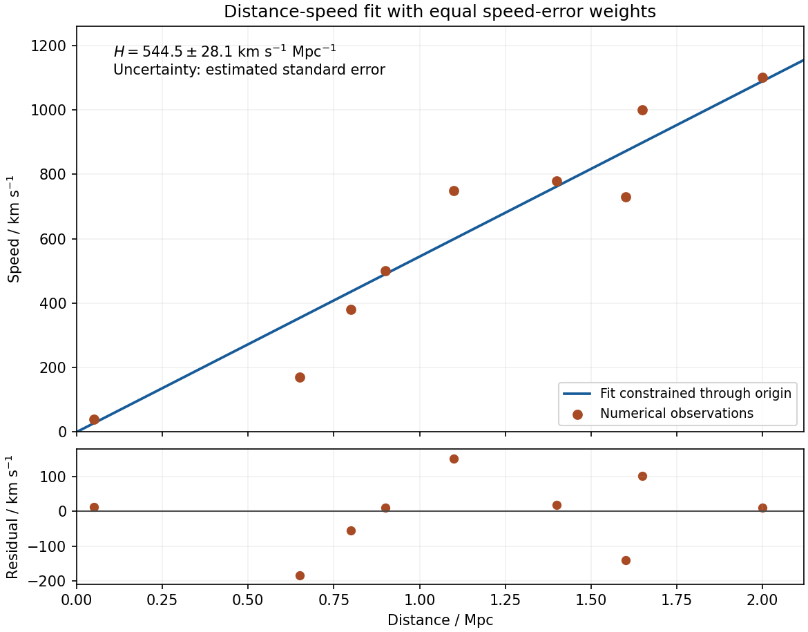

<h1 id="section-d/d12/solution">Solution</h1>

↑ **Parent:** [D12](../d12.md)

**Graph.** The original plot below places distance on the horizontal axis and recession speed on the vertical axis. Both axes include the origin, so the proportional model and departures from it can be judged directly. The displayed line is the fitted through-origin line, not a sequence joining adjacent observations.

**[Figure 3](#section-d/d12/image-distance-speed-observations-fitted-proportional-relation-and-residuals). Distance–speed observations, fitted proportional relation and residuals**.

**Minimization.** Write $S_{dd}=\sum_i d_i^2$ and $S_{dV}=\sum_i d_iV_i$. Differentiating the specified [chi-squared](../../../../../chi-squared-distribution.md) objective gives

$$
\frac{d\chi^2}{dH}=-\frac2{\sigma^2}\sum_i d_i(V_i-Hd_i)=0,
\quad
\frac{d^2\chi^2}{dH^2}=\frac{2S_{dd}}{\sigma^2}>0.
$$

Thus the unique least-squares minimum is

$$
\widehat H=\frac{S_{dV}}{S_{dd}},\qquad
S_{dd}=14\,327\,500\ \mathrm{kpc^2},\quad
S_{dV}=7\,801\,500\ \mathrm{kpc\,km\,s^{-1}}.
$$

Consequently

$$
\boxed{\widehat H=0.5445123\ \mathrm{km\,s^{-1}\,kpc^{-1}}
=544.5123\ \mathrm{km\,s^{-1}\,Mpc^{-1}}}.
$$

An unweighted average of $V_i/d_i$ would not minimize this [chi-squared](../../../../../chi-squared-distribution.md) objective: equal speed errors give greater slope information to the more distant points. No intercept is fitted because the supplied model constrains it to zero.

**Estimated error.** For the [residual estimate of slope uncertainty through the origin](../../../../../residual-estimate-of-slope-uncertainty-through-the-origin.md), independent equal-variance speed errors imply

$$
\operatorname{Var}(\widehat H)
=\frac{\sigma^2\sum_i d_i^2}{S_{dd}^2}
=\frac{\sigma^2}{S_{dd}}.
$$

Equivalently, completing the square gives $\chi^2(H)-\chi^2(\widehat H)=S_{dd}(H-\widehat H)^2/\sigma^2$. The common $\sigma$ is not supplied. Estimate it from the residuals, using eight residual [degrees of freedom](../../../../../degree-of-freedom.md) after fitting one parameter:

$$
\mathrm{RSS}=\sum_i(V_i-\widehat Hd_i)^2
=90\,687.28\ \mathrm{(km\,s^{-1})^2},\qquad
s=\sqrt{\frac{\mathrm{RSS}}{9-1}}=106.47\ \mathrm{km\,s^{-1}}.
$$

The estimated [standard error](../../../../../standard-error.md) is $s/\sqrt{S_{dd}}=0.0281283$ km s$^{-1}$ kpc$^{-1}$, giving

$$
\boxed{H=(545\pm28)\ \mathrm{km\,s^{-1}\,Mpc^{-1}}}
$$

with the uncertainty interpreted as one estimated [standard error](../../../../../standard-error.md). If the common errors are Gaussian, $(\widehat H-H)/(s/\sqrt{S_{dd}})$ has a [Student's t-distribution](../../../../../student-s-t-distribution.md) with eight [degrees of freedom](../../../../../degree-of-freedom.md); an exact [confidence interval](../../../../../confidence-interval.md) uses the corresponding quantile rather than treating the estimated $s$ as known. The quoted error is conditional on exact distances, independent constant-variance speed scatter and the proportional model. A common distance-calibration bias or correlated velocities would not be captured by this residual calculation.

## ↑ Ancestors (14)

1. [D12](../d12.md)
2. [Section D](../../section-d.md)
3. [Paper 1](../../../paper-1-split.md)
4. [2015](../../../split.md)
5. [Past exam of the physics A course of the University of Cambridge](../../../../split.md)
6. [Physics A course of the University of Cambridge](../../../../../physics-a-course-of-the-university-of-cambridge.md)
7. [Physics course of the year 2 of the natural sciences course of the University of Cambridge](../../../../../physics-course-of-the-year-2-of-the-natural-sciences-course-of-the-university-of-cambridge.md)
8. [Year 2 of the natural sciences course of the University of Cambridge](../../../../../year-2-of-the-natural-sciences-course-of-the-university-of-cambridge.md)
9. [Year of the natural sciences course of the University of Cambridge](../../../../../year-of-the-natural-sciences-course-of-the-university-of-cambridge.md)
10. [Natural sciences course of the University of Cambridge](../../../../../natural-sciences-course-of-the-university-of-cambridge.md)
11. [Course of the University of Cambridge](../../../../../course-of-the-university-of-cambridge.md)
12. [University of Cambridge](../../../../../university-of-cambridge-split.md)
13. [List of universities](../../../../../list-of-universities.md)
14. [Codex Wiki](../../../../../split.md)
