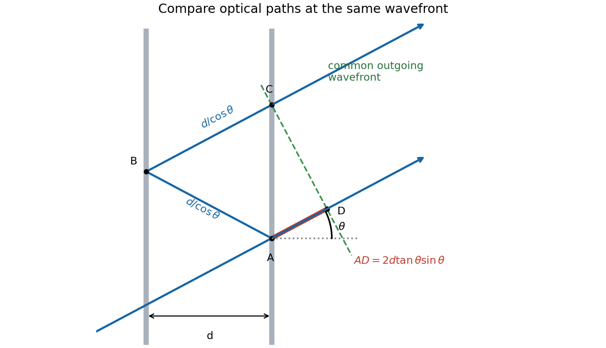
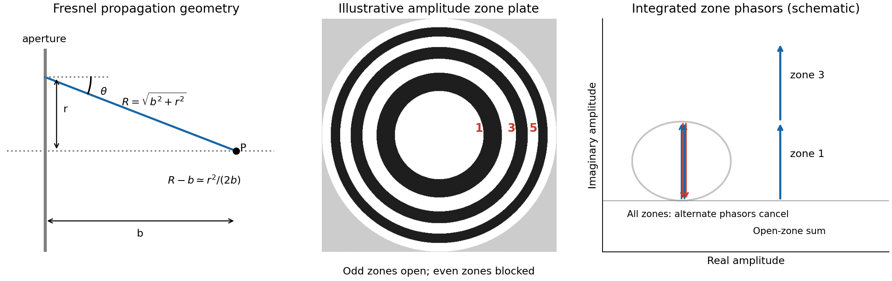
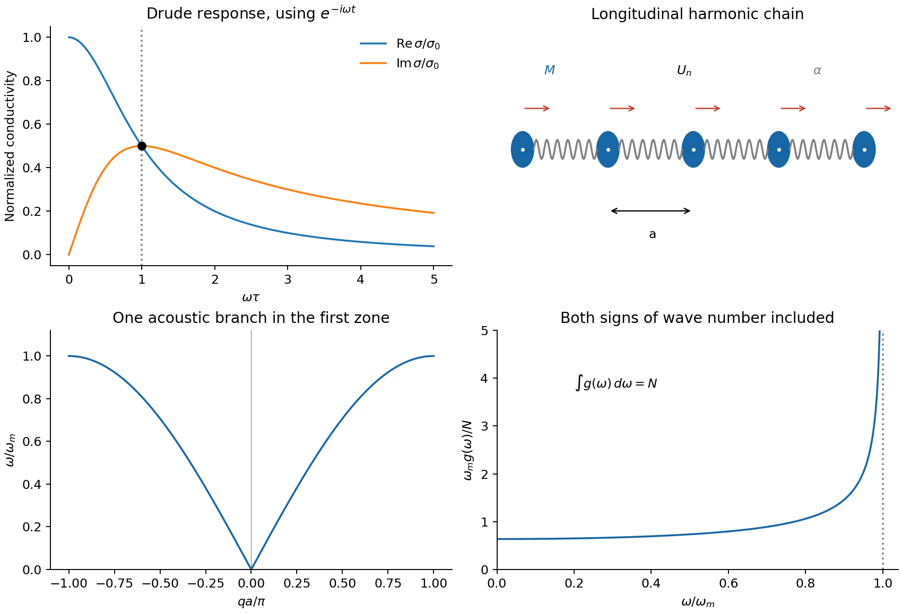
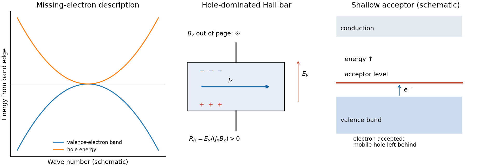
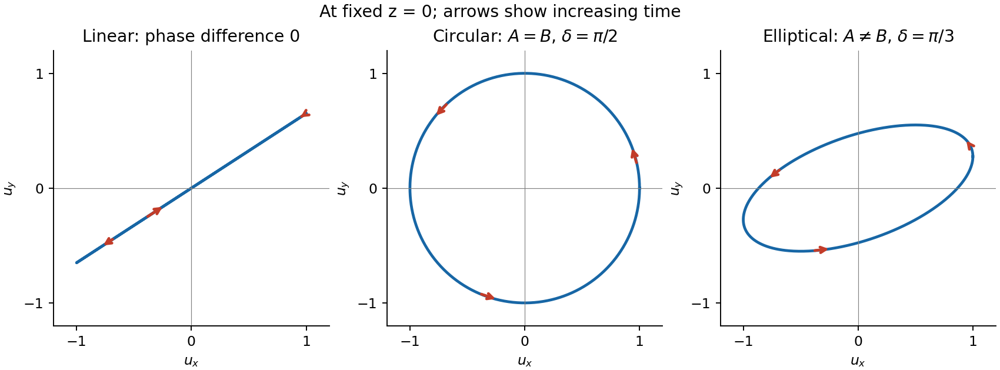

# Paper 2

↑ **Parent:** [2015](../2015.md)

Original paper: [PHYSICS A (2), 28 May 2015; physical PDF pages 106–111](https://www.whatdotheyknow.com/request/natural_science_tripos_physics_e_2/response/2340776/attach/2/FOI%202023%20399%20Zahid%20materials.pdf?cookie_passthrough=1#page=106).

**Table of contents**

- [Section A](#section-a)
  - [1](#section-a/1)
    - [a](#section-a/1/a)
      - [Solution](#section-a/1/a/solution)
    - [b](#section-a/1/b)
      - [Solution](#section-a/1/b/solution)
  - [2](#section-a/2)
    - [Solution](#section-a/2/solution)
  - [3](#section-a/3)
    - [Solution](#section-a/3/solution)
  - [4](#section-a/4)
    - [Solution](#section-a/4/solution)
  - [5](#section-a/5)
    - [Solution](#section-a/5/solution)
- [Section B](#section-b)
  - [B6](#section-b/b6)
    - [Solution](#section-b/b6/solution)
    - [a](#section-b/b6/a)
      - [Solution](#section-b/b6/a/solution)
    - [b](#section-b/b6/b)
      - [Solution](#section-b/b6/b/solution)
    - [c](#section-b/b6/c)
      - [Solution](#section-b/b6/c/solution)
  - [B7](#section-b/b7)
    - [Solution](#section-b/b7/solution)
  - [B8](#section-b/b8)
    - [Solution](#section-b/b8/solution)
  - [B9](#section-b/b9)
    - [Solution](#section-b/b9/solution)
- [Section C](#section-c)
  - [C10](#section-c/c10)
    - [Solution](#section-c/c10/solution)
  - [C11](#section-c/c11)
    - [Solution](#section-c/c11/solution)
- [Section D](#section-d)
  - [D12](#section-d/d12)
    - [Solution](#section-d/d12/solution)
  - [D13](#section-d/d13)
    - [a](#section-d/d13/a)
      - [Solution](#section-d/d13/a/solution)
    - [b](#section-d/d13/b)
      - [Solution](#section-d/d13/b/solution)
    - [c](#section-d/d13/c)
      - [Solution](#section-d/d13/c/solution)

## Section A

↑ **Parent:** [Paper 2](paper-2.md)

<h3 id="section-a/1">1</h3>

↑ **Parent:** [Section A](#section-a)

<h4 id="section-a/1/a">a</h4>

↑ **Parent:** [1](#section-a/1)

<h5 id="section-a/1/a/solution">Solution</h5>

↑ **Parent:** [A](#section-a/1/a)

The [photon](../../quantum-mechanics.md#photon) relation gives $\lambda=hc/E=2.4797\times10^{-12}\,\mathrm m$. The diffraction-limited angular scale of an [aperture](../../optics.md#aperture) of diameter $D$ is therefore

$$
\boxed{\theta\sim\lambda/D=2.48\times10^{-11}\,\mathrm{rad}.}
$$

For a uniformly illuminated circular [aperture](../../optics.md#aperture), the [Rayleigh criterion](../../point-spread-function.md#rayleigh-criterion) instead gives $1.22\lambda/D=3.03\times10^{-11}\,\mathrm{rad}$. Both express the same requested estimate. This is an ideal [diffraction limit](../../optics.md#diffraction-limit), conditional on the effective diameter behaving as a coherent imaging [aperture](../../optics.md#aperture); [photon energy](../../quantum-mechanics.md#photon-energy) and diameter alone do not specify the performance of a practical gamma-ray telescope.

<h4 id="section-a/1/b">b</h4>

↑ **Parent:** [1](#section-a/1)

<h5 id="section-a/1/b/solution">Solution</h5>

↑ **Parent:** [B](#section-a/1/b)

At distance $L$, the [small-angle approximation](../../geometry-and-topology.md#small-angle-approximation) gives $\ell=L\theta$. Thus **the transverse resolution is approximately $2.5\times10^{10}\,\mathrm m$**, or $3.0\times10^{10}\,\mathrm m$ with the circular-aperture [Rayleigh criterion](../../point-spread-function.md#rayleigh-criterion). This is a transverse separation at the source, rather than a determination of its distance along the line of sight.

<h3 id="section-a/2">2</h3>

↑ **Parent:** [Section A](#section-a)

<h4 id="section-a/2/solution">Solution</h4>

↑ **Parent:** [2](#section-a/2)

Let $T$ be the common [tension](../../force.md#tension) and $\mu_j$ the [linear mass densities](../../fluid-mechanics.md#linear-mass-density). The [characteristic impedance of a stretched string](../../wave-equation.md#characteristic-impedance-of-a-stretched-string) is $Z_j=T/c_j=\sqrt{T\mu_j}$. Continuity of [displacement](../../classical-mechanics.md#displacement) and transverse [force](../../force.md) at a massless junction gives $1+r=t$ and $Z_1(1-r)=Z_2t$. Consequently

$$
r=\frac{Z_1-Z_2}{Z_1+Z_2}=\frac{1-\sqrt3}{1+\sqrt3},\qquad
\boxed{\mathcal R=|r|^2=(2-\sqrt3)^2=0.07180.}
$$

**The reflected [power](../../energy.md#power) is $7.18\%$.** The minus sign of $r$ represents a phase reversal, not negative [power](../../energy.md#power). Both incident and reflected [waves](../../wave.md) travel in the first string, so their [power](../../energy.md#power) ratio is simply the squared displacement-amplitude ratio. As a check, $\mathcal T=(Z_2/Z_1)|t|^2=0.92820$ and $\mathcal R+\mathcal T=1$.

<h3 id="section-a/3">3</h3>

↑ **Parent:** [Section A](#section-a)

<h4 id="section-a/3/solution">Solution</h4>

↑ **Parent:** [3](#section-a/3)

Compare a directly transmitted ray emerging at $A$ with a ray that makes one extra round trip inside the [Fabry–Pérot interferometer](../../optical-instrument.md#fabry-perot-interferometer) and emerges at $C$. Both emerge parallel at angle $\theta$ to the plate normal. The extra internal distance is $2d/\cos\theta$, and their emergence points differ laterally by $AC=2d\tan\theta$. The first ray has already travelled $AC\sin\theta$ towards a common outgoing [wavefront](../../physical-optics.md#wavefront) when the second reaches $C$. The [air-gap optical path difference in a Fabry–Pérot interferometer](../../optical-instrument.md#air-gap-optical-path-difference-in-a-fabry-perot-interferometer) follows because [optical path length](../../physical-optics.md#optical-path-length) equals geometric path length in the air-gap approximation:

$$
\Delta=\frac{2d}{\cos\theta}-2d\tan\theta\sin\theta
=\frac{2d(1-\sin^2\theta)}{\cos\theta}
=\boxed{2d\cos\theta}.
$$

The subtraction is essential: comparing distances only inside the plates would compare different outgoing [wavefronts](../../physical-optics.md#wavefront). The corresponding propagation [phase difference](../../wave.md#phase-difference) is $2\pi\Delta/\lambda$. Coating reflection phases can add a separate phase offset; they do not change this geometric [optical path difference](../../physical-optics.md#optical-path-difference).

**[Figure 1](#section-a/3/image-one-extra-round-trip-and-the-common-outgoing-wavefront-in-an-air-spaced-fabry-perot-interferometer). One extra round trip and the common outgoing wavefront in an air-spaced Fabry–Pérot interferometer**.

<h3 id="section-a/4">4</h3>

↑ **Parent:** [Section A](#section-a)

<h4 id="section-a/4/solution">Solution</h4>

↑ **Parent:** [4](#section-a/4)

Count two [electron spin](../../angular-momentum-operator.md#electron-spin) states in each reciprocal-space cell of volume $(2\pi)^3/V$. Filling a [Fermi sphere](../../fermi-liquid.md#fermi-sphere) at zero [temperature](../../temperature.md) gives

$$
n=\frac{2}{(2\pi)^3}\frac{4\pi k_F^3}{3},\qquad
k_F=(3\pi^2n)^{1/3}=1.360\times10^{10}\,\mathrm{m^{-1}}.
$$

The [free electron model](../../physics.md#free-electron-model) then gives

$$
\boxed{E_F=\frac{\hbar^2}{2m_e}(3\pi^2n)^{2/3}
=1.129\times10^{-18}\,\mathrm J\simeq7.05\,\mathrm{eV}.}
$$

The [energy](../../energy.md) zero is the bottom of the model's [conduction band](../../quantum-mechanics.md#conduction-band). The supplied [carrier density](../../electric-charge.md#carrier-density) already incorporates the one-electron-per-atom assumption; it must not be multiplied by another atomic count.

<h3 id="section-a/5">5</h3>

↑ **Parent:** [Section A](#section-a)

<h4 id="section-a/5/solution">Solution</h4>

↑ **Parent:** [5](#section-a/5)

Write $a=V_c^{1/3}$ for the primitive [cubic lattice](../../graph.md#cubic-lattice) spacing. With [wavevector](../../elasticity-physics.md#wavevector) convention $e^{i\mathbf k\cdot\mathbf r}$, reciprocal-lattice primitive vectors have length $2\pi/a$. The first [Brillouin zone](../../bloch-s-theorem.md#brillouin-zone) is the cube $-\pi/a\leq k_j\leq\pi/a$, hence

$$
\boxed{V_{\mathrm{BZ}}=\left(\frac{2\pi}{a}\right)^3=\frac{(2\pi)^3}{V_c}.}
$$

It has the same volume as any primitive reciprocal unit cell. A reciprocal coordinate defined in cycles per metre would instead give $1/V_c$; that is a different convention from this $k$-space convention.

## Section B

↑ **Parent:** [Paper 2](paper-2.md)

<h3 id="section-b/b6">B6</h3>

↑ **Parent:** [Section B](#section-b)

<h4 id="section-b/b6/solution">Solution</h4>

↑ **Parent:** [B6](#section-b/b6)

Take $m,k,b>0$, and define $\omega_0=\sqrt{k/m}$ and $\gamma=b/(2m)$. Substitution of $e^{rt}$ into the unforced equation gives $r^2+2\gamma r+\omega_0^2=0$. The roots determine whether the return is oscillatory.

For return after a [displacement](../../classical-mechanics.md#displacement) in this ideal model, **[critical damping](../../wave-equation.md#critical-damping), case (b), is the usual comfort choice**: it removes repeated bouncing while avoiding the slow relaxation mode of strong [overdamping](../../wave-equation.md#overdamping). For release from rest it gives a monotone return with the fastest asymptotic decay available without oscillation. This criterion does not prove optimal comfort for every road profile or initial [velocity](../../classical-mechanics.md#velocity); actual comfort also depends on [acceleration](../../classical-mechanics.md#acceleration), road forcing and suspension travel.

For the forced response, set $\Omega=2\pi u/d$ and use $x_{\rm ss}=\operatorname{Re}(\widehat x e^{i\Omega t})$. Then

$$
(k-m\Omega^2+ib\Omega)\widehat x=kA,\qquad
\boxed{x_{\rm ss}(t)=X(\Omega)\cos(\Omega t-\delta),}
$$

$$
X(\Omega)=\frac{kA}{\sqrt{(k-m\Omega^2)^2+b^2\Omega^2}},\qquad
\delta=\operatorname{atan2}(b\Omega,k-m\Omega^2).
$$

The general forced solution adds the appropriate homogeneous transient from (a), (b) or (c). Initial data were not specified, so its constants cannot be fixed. Positive [damping](../../wave-equation.md#damping) removes this transient at long times. This solution uses the particular driving [force](../../force.md) in the supplied equation; it does not silently replace it by a different moving-support model.

Maximising $X$ is minimising its squared denominator $D$. Differentiation gives

$$
\frac{dD}{d\Omega}=2\Omega[-2mk+2m^2\Omega^2+b^2],\qquad
\Omega_r^2=\frac{k}{m}-\frac{b^2}{2m^2}.
$$

A nonzero [displacement](../../classical-mechanics.md#displacement) [resonance](../../dynamical-systems.md#resonance) exists only if $b^2<2mk$. Here $\Omega_r^2=0.175\,\mathrm{s^{-2}}$, and therefore

$$
\boxed{u_r=\frac{d}{2\pi}\sqrt{0.175}=0.666\,\mathrm{m\,s^{-1}}\simeq2.40\,\mathrm{km\,h^{-1}},}
$$

$$
\boxed{X_{\max}=\frac{kA}{b\sqrt{k/m-b^2/(4m^2)}}=0.0616\,\mathrm m.}
$$

The low-frequency limit is $X(0)=A$, whereas $X\to0$ at large $\Omega$. The parameters give [damping ratio](../../wave-equation.md#damping-ratio) $\zeta=b/(2\sqrt{mk})=0.456$, consistent with an underdamped system and the existence of this amplitude maximum.

<h4 id="section-b/b6/a">a</h4>

↑ **Parent:** [B6](#section-b/b6)

<h5 id="section-b/b6/a/solution">Solution</h5>

↑ **Parent:** [A](#section-b/b6/a)

For $b^2>4mk$, define $\beta=\sqrt{\gamma^2-\omega_0^2}$. The two [characteristic roots](../../differential-equation.md#characteristic-root-of-a-constant-coefficient-differential-equation) are real and negative:

$$
\boxed{x(t)=C_+e^{(-\gamma+\beta)t}+C_-e^{(-\gamma-\beta)t}.}
$$

This is [overdamping](../../wave-equation.md#overdamping): there is no repeated oscillation, and the slow root controls late-time return. A generic initial [velocity](../../classical-mechanics.md#velocity) can still cause a single crossing of [equilibrium](../../dynamical-systems.md#equilibrium-point-of-a-dynamical-system), so “nonoscillatory” need not mean monotone for all initial data. For large $b$, the slow root approaches $-k/b$.

<h4 id="section-b/b6/b">b</h4>

↑ **Parent:** [B6](#section-b/b6)

<h5 id="section-b/b6/b/solution">Solution</h5>

↑ **Parent:** [B](#section-b/b6/b)

For $b^2=4mk$, the repeated [characteristic root](../../differential-equation.md#characteristic-root-of-a-constant-coefficient-differential-equation) requires a second linearly independent solution $te^{-\gamma t}$:

$$
\boxed{x(t)=(C_1+C_2t)e^{-\gamma t}.}
$$

This is [critical damping](../../wave-equation.md#critical-damping). If $x(0)=x_0$ and $\dot x(0)=0$, then $x=x_0(1+\gamma t)e^{-\gamma t}$, demonstrating the monotone return used in the suspension discussion.

<h4 id="section-b/b6/c">c</h4>

↑ **Parent:** [B6](#section-b/b6)

<h5 id="section-b/b6/c/solution">Solution</h5>

↑ **Parent:** [C](#section-b/b6/c)

For $b^2<4mk$, put $\omega_d=\sqrt{\omega_0^2-\gamma^2}$. Complex-conjugate roots give the real solution

$$
\boxed{x(t)=e^{-\gamma t}[C\cos(\omega_dt)+D\sin(\omega_dt)].}
$$

This is [underdamping](../../wave-equation.md#underdamping): oscillation at $\omega_d$ persists within a decaying exponential envelope. [damping](../../wave-equation.md#damping) reduces the oscillation [frequency](../../wave.md#frequency) below $\omega_0$. Constants in all three cases are determined by two [initial conditions](../../differential-equation.md#initial-condition).

<h3 id="section-b/b7">B7</h3>

↑ **Parent:** [Section B](#section-b)

<h4 id="section-b/b7/solution">Solution</h4>

↑ **Parent:** [B7](#section-b/b7)

For a [monochromatic wave](../../wave.md#monochromatic-wave), a constant phase $kx-\omega t$ moves at [phase velocity](../../dispersion-relation.md#phase-velocity) $v_p=\omega/k$. For a narrow [wave packet](../../dispersion-relation.md#wave-packet) around $k$, expansion $\omega(k+\Delta k)\simeq\omega(k)+(d\omega/dk)\Delta k$ shows that its envelope moves at [group velocity](../../dispersion-relation.md#group-velocity) $v_g=d\omega/dk$. The envelope interpretation requires a sufficiently narrow spectrum and weak distortion; it is not a general identification with a causal signal front. Since $\omega=kv_p$ and $\lambda=2\pi/k$,

$$
v_g=v_p+k\frac{dv_p}{dk}
=\boxed{v_p-\lambda\frac{dv_p}{d\lambda}}.
$$

For the [gravity-capillary wave](../../surface-tension.md#gravity-capillary-wave), put $s=\sigma/\rho$ and take $k>0$. Direct differentiation gives

$$
v_p=\sqrt{g/k+sk},\qquad
v_g=\frac{g+3sk^2}{2\sqrt{gk+sk^3}},\qquad
\boxed{\frac{v_g}{v_p}=\frac{g+3sk^2}{2(g+sk^2)}
=1-\frac{g/k^2-s}{2(g/k^2+s)}.}
$$

Thus $v_g=v_p$ when $sk_*^2=g$, or

$$
\boxed{\lambda^*=2\pi\sqrt{\frac{\sigma}{\rho g}}=2.89\times10^{-2}\,\mathrm m.}
$$

At this [wavelength](../../wave-equation.md#wavelength) the gravity and surface-tension restoring terms contribute equally. Also $d(v_p^2)/dk=-g/k^2+s=0$ with positive [second derivative](../../calculus.md#second-derivative): this is the [minimum phase speed of a gravity-capillary wave](../../surface-tension.md#minimum-phase-speed-of-a-gravity-capillary-wave), $v_{p,\min}=(4g\sigma/\rho)^{1/4}=0.214\,\mathrm{m\,s^{-1}}$. Locally the carrier crests and narrow envelope travel together. **The medium has not become nondispersive**: $d^2\omega/dk^2=k_*d^2v_p/dk^2\ne0$ there, so a finite [wave packet](../../dispersion-relation.md#wave-packet) can still spread. In the gravity-dominated limit $v_g/v_p\to1/2$; in the capillary-dominated limit it tends to $3/2$.

<h3 id="section-b/b8">B8</h3>

↑ **Parent:** [Section B](#section-b)

<h4 id="section-b/b8/solution">Solution</h4>

↑ **Parent:** [B8](#section-b/b8)

Take the [aperture](../../optics.md#aperture) in $z=0$ and the observation point $P=(0,0,b)$, with $b>0$. Under [scalar diffraction theory](../../physical-optics.md#scalar-diffraction-theory), the [Huygens-Fresnel principle](../../physical-optics.md#huygens-fresnel-principle) sums [complex amplitudes](../../wave.md#complex-amplitude) from area elements, rather than summing their [intensities](../../wave.md#intensity-physics). Apart from a common normalization,

$$
\psi(P)\propto\iint h(x,y)K(\theta)\frac{e^{ikR}}R\,dx\,dy,
\qquad R=\sqrt{b^2+x^2+y^2},\quad k=2\pi/\lambda.
$$

Here $h$ is the complex [aperture](../../optics.md#aperture) transmission, $b$ is the axial distance, and $\theta$ is the angle of the secondary ray to the [aperture](../../optics.md#aperture) normal. The [obliquity factor](../../quantum-scattering.md#obliquity-factor) $K$ describes the direction dependence of the secondary contribution; one Kirchhoff convention is $K=(1+\cos\theta)/2$ for normal illumination. Other scalar boundary approximations have slightly different angular weights, all tending to unity near the axis.

Put $r^2=x^2+y^2$. The [paraxial approximation](../../partial-differential-equation.md#paraxial-approximation) gives $R\simeq b+r^2/(2b)$ in the phase and $1/R\simeq1/b$ in the amplitude. Removing common $e^{ikb}/b$ yields

$$
\boxed{\psi(P)\propto\iint h(x,y)K(\theta)
\exp\left[\frac{i\pi(x^2+y^2)}{\lambda b}\right]dx\,dy.}
$$

Assumptions are uniform normally incident plane-wave illumination, coherent monochromatic propagation, [aperture](../../optics.md#aperture) dimensions large enough for the scalar description, $r/b\ll1$, and phase accuracy $kr^4/(8b^3)\ll1$ over the relevant [aperture](../../optics.md#aperture). The last condition justifies dropping the quartic distance term; geometric smallness alone does not guarantee phase accuracy.

**[Figure 2](#section-b/b8/image-axial-fresnel-geometry-and-phasor-addition-with-alternate-half-period-zones-blocked). Axial Fresnel geometry and phasor addition with alternate half-period zones blocked**.

For a circular [aperture](../../optics.md#aperture), $h=1$ for $r\leq a$ and zero elsewhere. Rotational symmetry and $s=r^2$ give $dx\,dy=r\,dr\,d\varphi$, $r\,dr=ds/2$, and

$$
\psi\propto2\pi\int_0^a K(\theta)e^{i\pi r^2/(\lambda b)}r\,dr
=\pi\int_0^{a^2}K(\theta)e^{i\pi s/(\lambda b)}ds.
$$

The constant $\pi$ can be absorbed into the proportionality factor, producing the required one-dimensional [integral](../../integral.md).

At a focus a distance $f$ away, half-period-zone boundaries obey

$$
\sqrt{f^2+r_n^2}-f=\frac{n\lambda}{2},\qquad
r_n^2=n\lambda f+\frac{n^2\lambda^2}{4}\simeq n\lambda f.
$$

With slowly varying obliquity and illumination, each zone has almost the same area and its integrated [phasor](../../wave.md#phasor) has the opposite sign to its neighbour. A [zone plate](../../physical-optics.md#zone-plate) blocks alternate zones, so the remaining [phasors](../../wave.md#phasor) add instead of nearly cancelling. Choosing an open central zone, the first three open regions have outer boundaries $n=1,3,5$:

$$
\boxed{r_1=0.100\,\mathrm{mm},\qquad r_3=0.173\,\mathrm{mm},\qquad r_5=0.224\,\mathrm{mm}.}
$$

These are outer radii, not zone widths; the second open region is the annulus between $r_2$ and $r_3$.

For the specified outer radius, $R^2/(\lambda f)=49$: there are approximately 49 half-period zones, of which 25 odd zones are open. Normalize to the field $\psi_0$ of the unobstructed [plane wave](../../wave-function.md#plane-wave). The normalized Fresnel [aperture](../../optics.md#aperture) [integral](../../integral.md) is

$$
\frac{\psi}{\psi_0}=\frac{1}{i\lambda f}\int h\,e^{i\pi r^2/(\lambda f)}dA.
$$

For any odd open annulus this gives $2$, so the whole plate gives $\psi/\psi_0\simeq50$ and

$$
\boxed{I_{\rm focus}/I_{\rm unobstructed}\simeq4(25)^2=2.50\times10^3.}
$$

The [axial intensity gain of an amplitude zone plate](../../physical-optics.md#axial-intensity-gain-of-an-amplitude-zone-plate) grows as the square of the number of open zones. Treating the number of zones continuously gives $49^2\simeq2.40\times10^3$, the same accuracy as an estimate. This large local [intensity](../../wave.md#intensity-physics) gain is consistent with [conservation of energy](../../mathematical-physics.md#conservation-of-energy) because light is concentrated into a small focal spot. It is not a [power](../../energy.md#power) efficiency; the ideal first-order [power](../../energy.md#power) efficiency of a binary amplitude [zone plate](../../physical-optics.md#zone-plate) is only $1/\pi^2$.[X-Ray Data Booklet, §4.4, first-order efficiency paragraph](../../physics-bibliography.md#zone-plates-by-janos-kirz-and-david-attwood)

“Without the [zone plate](../../physical-optics.md#zone-plate)” has here meant removing the finite plate and its outer stop, giving the unobstructed incident [wave](../../wave.md). If instead a clear circular [aperture](../../optics.md#aperture) of radius $R$ is retained, its axial field is $\psi_{\rm clear}/\psi_0=1-e^{i49\pi}=2$, so **the ratio to that finite-aperture reference is $2500/4=625$**. The two reference experiments differ; neither ratio should be confused with total transmitted [power](../../energy.md#power).

<h3 id="section-b/b9">B9</h3>

↑ **Parent:** [Section B](#section-b)

<h4 id="section-b/b9/solution">Solution</h4>

↑ **Parent:** [B9](#section-b/b9)

A [Michelson interferometer](../../physical-optics.md#michelson-interferometer) divides a source beam at a partially reflecting [beam splitter](../../optical-instrument.md#beam-splitter). The two perpendicular arms terminate in [mirrors](../../optical-instrument.md#mirror) whose reflected beams return to the splitter and overlap at the detector. The recombined fields must have overlapping [wavefronts](../../physical-optics.md#wavefront) and compatible [polarization of waves](../../wave.md#polarization-waves). Moving one [mirror](../../optical-instrument.md#mirror) by $\Delta L$ changes the round-trip [optical path difference](../../physical-optics.md#optical-path-difference) by $2\Delta L$, so $N$ passing fringes determine $\Delta L=N\lambda/2$. Conversely a known [mirror](../../optical-instrument.md#mirror) [displacement](../../classical-mechanics.md#displacement) measures [wavelength](../../wave-equation.md#wavelength). Scanning the delay can determine [temporal optical coherence](../../physical-optics.md#temporal-optical-coherence) and, by [Fourier transform spectroscopy](../../optical-instrument.md#fourier-transform-spectroscopy), spectral structure. A compensating plate may equalize glass traversal, particularly for broadband illumination.

**[Figure 3](#section-b/b9/image-michelson-optical-arrangement-and-the-calculated-top-hat-spectrum-interferogram). Michelson optical arrangement and the calculated top-hat-spectrum interferogram**.

For equal real peak field amplitudes, the superposition is

$$
E(t)=a\cos\omega t+a\cos(\omega t+\phi)
=2a\cos(\phi/2)\cos(\omega t+\phi/2).
$$

Time averaging the square over many optical cycles gives $\langle E^2\rangle=2a^2\cos^2(\phi/2)=a^2(1+\cos\phi)$. With $\phi=kx$ after absorbing a constant port-dependent phase into the zero of $x$,

$$
\boxed{I(x)=I_0[1+\cos(kx)].}
$$

Here $I_0$ is the sum of the two separate-arm [intensities](../../wave.md#intensity-physics); maximum [intensity](../../wave.md#intensity-physics) is $2I_0$ and the ideal minimum is zero. Equal amplitudes give unit [interference visibility](../../physical-optics.md#interferometric-visibility).

For a stationary source with a flat [intensity](../../wave.md#intensity-physics) spectrum, different spectral components add in time-averaged [intensity](../../wave.md#intensity-physics). Keeping their individual two-arm interference terms and defining $\operatorname{sinc}z=\sin z/z$ gives

$$
I(x)=C\int_{k_0-\Delta k/2}^{k_0+\Delta k/2}[1+\cos(k'x)]\,dk'
=C\Delta k\left[1+\cos(k_0x)\operatorname{sinc}\left(\frac{x\Delta k}{2}\right)\right].
$$

One must not coherently add unrelated source [frequencies](../../wave.md#frequency) as if they had a fixed common phase. The sinc envelope is the [Fourier transform](../../fourier-transform.md) of the rectangular spectral [intensity](../../wave.md#intensity-physics).

Numerically, $\nu_0=5.00\times10^{14}\,\mathrm{Hz}$ and $\Delta\nu=1.00\times10^{13}\,\mathrm{Hz}$. The annotated interferogram uses

$$
\boxed{\frac{I(x)}{C\Delta k}=1+\cos\left(\frac{2\pi\nu_0x}{c}\right)
\operatorname{sinc}\left(\frac{\pi\Delta\nu x}{c}\right).}
$$

It is even in $x$, has central value 2 and background 1, and its carrier-fringe period in [optical path difference](../../physical-optics.md#optical-path-difference) is $c/\nu_0=0.600\,\mathrm{\mu m}$. The first envelope zeros are at **$x=\pm c/\Delta\nu=\pm30.0\,\mathrm{\mu m}$**, corresponding to [mirror](../../optical-instrument.md#mirror) shifts of $\pm15.0\,\mathrm{\mu m}$ from equal paths. Side lobes persist beyond the zeros; a negative sinc reverses fringe phase. The [intensity](../../wave.md#intensity-physics) remains between $1-|\operatorname{sinc}|$ and $1+|\operatorname{sinc}|$, not between the signed sinc curves with an assumed fixed ordering.

## Section C

↑ **Parent:** [Paper 2](paper-2.md)

<h3 id="section-c/c10">C10</h3>

↑ **Parent:** [Section C](#section-c)

<h4 id="section-c/c10/solution">Solution</h4>

↑ **Parent:** [C10](#section-c/c10)

The [free electron model](../../physics.md#free-electron-model) replaces the microscopic ionic potential and interacting electronic motion by independent mobile [electrons](../../physics.md#electron) in a uniform neutralizing background, with approximately parabolic dispersion $\epsilon=\hbar^2k^2/(2m^*)$. Its quantum version fills states according to [Fermi-Dirac statistics](../../tensor-product-of-quantum-systems.md#fermi-dirac-statistics) and the [Pauli exclusion principle](../../tensor-product-of-quantum-systems.md#pauli-exclusion-principle). Scattering is represented by a [momentum relaxation time](../../electric-charge.md#momentum-relaxation-time) $\tau$, rather than derived from the model's ideal free trajectories. This model explains a [Fermi energy](../../quantum-ideal-gas-statistics.md#fermi-energy) much larger than room-temperature thermal [energy](../../energy.md), an [electronic heat capacity](../../heat.md#electronic-heat-capacity) proportional to [temperature](../../temperature.md) at low [temperature](../../temperature.md), and a Drude [electrical conductivity](../../electric-charge.md#electrical-conductivity). With appropriate scattering assumptions it also yields the [Wiedemann-Franz law](../../heat.md#wiedemann-franz-law). It cannot by itself explain [band gaps](../../bloch-s-theorem.md#band-gap), detailed band anisotropy, strong correlations, or the microscopic [temperature](../../temperature.md) dependence of $\tau$.

The inertial term is [mass](../../classical-mechanics.md#mass) times the rate of change of mean [drift velocity](../../electric-charge.md#drift-velocity). The electric [force](../../force.md) is $eE$, taking the printed $e$ as the signed [electron](../../physics.md#electron) charge, and $-\gamma\langle v\rangle=-m^*\langle v\rangle/\tau$ describes loss of directed momentum to scattering. [electrons](../../physics.md#electron) retain large microscopic [velocities](../../classical-mechanics.md#velocity); this [damping](../../wave-equation.md#damping) is of their mean directed motion. In a steady DC field,

$$
\langle v\rangle=\frac{e\tau}{m^*}E,\qquad
j=ne\langle v\rangle,\qquad
\boxed{\sigma_0=\frac{ne^2\tau}{m^*}.}
$$

Both charge factors are negative for [electrons](../../physics.md#electron), so the conductivity is positive. If $e$ instead denotes a positive charge magnitude, the [force](../../force.md) and current equations each require a minus sign and give the same result.

For AC response choose physical fields as [real parts](../../complex-analysis.md#real-part) of [phasors](../../wave.md#phasor) proportional to $e^{-i\omega t}$. Substitution gives

$$
(-i\omega+1/\tau)\widehat v=\frac{e}{m^*}\widehat E,\qquad
\boxed{\sigma(\omega)=\frac{\sigma_0}{1-i\omega\tau}.}
$$

Thus

$$
\boxed{\operatorname{Re}\sigma=\frac{\sigma_0}{1+(\omega\tau)^2},\qquad
\operatorname{Im}\sigma=\frac{\sigma_0\omega\tau}{1+(\omega\tau)^2}.}
$$

The [real part](../../complex-analysis.md#real-part) decreases from $\sigma_0$ to zero. The [imaginary part](../../complex-analysis.md#imaginary-part) starts at zero, reaches $\sigma_0/2$ at $\omega\tau=1$, and falls as $1/\omega$. The [real part](../../complex-analysis.md#real-part) falls as $1/\omega^2$ at high [frequency](../../wave.md#frequency). With an $e^{+i\omega t}$ convention, only the sign of the [imaginary part](../../complex-analysis.md#imaginary-part) changes. Positive $\operatorname{Re}\sigma$ gives positive cycle-averaged dissipation $\langle jE\rangle=\operatorname{Re}\sigma\,|\widehat E|^2/2$.

**[Figure 4](#section-c/c10/image-drude-conductivity-and-the-dispersion-and-density-of-states-of-a-monatomic-harmonic-chain). Drude conductivity and the dispersion and density of states of a monatomic harmonic chain**.

The supplied DC conductivity determines the transport time:

$$
\tau=\frac{m_e\sigma_0}{ne^2}=2.49\times10^{-14}\,\mathrm s.
$$

Inertia matters when $\omega\tau\sim1$, giving **$\omega_c\simeq4.02\times10^{13}\,\mathrm{rad\,s^{-1}}$**, or **$\nu_c=\omega_c/(2\pi)\simeq6.40\times10^{12}\,\mathrm{Hz}$**. Quoting the former number as hertz would introduce an erroneous factor of $2\pi$.

<h3 id="section-c/c11">C11</h3>

↑ **Parent:** [Section C](#section-c)

<h4 id="section-c/c11/solution">Solution</h4>

↑ **Parent:** [C11](#section-c/c11)

Write the real [displacement](../../classical-mechanics.md#displacement) as $U_n(t)=\operatorname{Re}[u e^{i\omega t-iqna}]$, choosing real positive peak amplitude $u$. Nearest-neighbour harmonic springs store [energy](../../energy.md) in their extension $U_n-U_{n+1}$, each spring counted once. Therefore the instantaneous physical [energy](../../energy.md) is

$$
\boxed{E=\frac12M\sum_n\dot U_n^2+\frac12\alpha\sum_n(U_n-U_{n+1})^2.}
$$

The printed complex [displacement](../../classical-mechanics.md#displacement) is a calculation device: squaring the complex [phasor](../../wave.md#phasor) itself would not produce physical [energy](../../energy.md). The chain sketch in the accompanying figure shows [masses](../../classical-mechanics.md#mass) at [equilibrium](../../dynamical-systems.md#equilibrium-point-of-a-dynamical-system) spacing $a$, with longitudinal [displacements](../../classical-mechanics.md#displacement) along the chain.

The two spring [forces](../../force.md) on site $n$ give

$$
M\ddot U_n=\alpha(U_{n+1}+U_{n-1}-2U_n).
$$

Substituting the normal-mode [phasor](../../wave.md#phasor) and cancelling its nonzero amplitude gives

$$
-M\omega^2=\alpha(e^{iqa}+e^{-iqa}-2),\qquad
\boxed{\omega^2=\frac{4\alpha}{M}\sin^2\left(\frac{qa}{2}\right).}
$$

The long-wavelength limit is acoustic, $\omega\simeq a\sqrt{\alpha/M}|q|$, and the first [Brillouin zone](../../bloch-s-theorem.md#brillouin-zone) ends at $|q|=\pi/a$. The maximum [angular frequency](../../lagrangian-mechanics.md#angular-frequency) is **$\omega_m=2\sqrt{\alpha/M}$**.

Time averaging uses $\langle[\operatorname{Re}(ze^{i\omega t})]^2\rangle=|z|^2/2$. Consequently

$$
\frac{\langle T\rangle}{N}=\frac14M\omega^2u^2,\qquad
\frac{\langle V\rangle}{N}=\frac14\alpha u^2|1-e^{-iqa}|^2
=\frac12\alpha(1-\cos qa)u^2.
$$

The [dispersion relation](../../dispersion-relation.md) makes these two contributions equal, giving

$$
\boxed{\langle E\rangle/N=\frac14M\omega^2u^2+
\frac12\alpha(1-\cos qa)u^2=\frac12M\omega^2u^2.}
$$

This is equality of time-averaged kinetic and [potential energies](../../energy.md#potential-energy) in a harmonic [normal mode](../../wave-equation.md#normal-mode); the instantaneous [energy](../../energy.md) partition need not be equal.

Use [periodic boundary conditions](../../differential-equation.md#periodic-boundary-conditions) on length $L=Na$ to count modes: $q_j=2\pi j/L$. The density on the signed $q$ axis is $L/(2\pi)$. Using [folded wave-number counting for a monatomic chain](../../quantum-ideal-gas-statistics.md#folded-wave-number-counting-for-a-monatomic-chain) combines $q$ and $-q$ at positive magnitude and counts both directions, so the convention used by the requested expression is

$$
\boxed{g(q)=\frac{2L}{2\pi}=\frac{Na}{\pi},\quad 0<q<\pi/a.}
$$

This is a large-$N$ continuum density, not a second independent branch. It gives $N$ modes after integrating over that half-zone; endpoint counting changes only finite-size corrections.

For positive $q$, $\omega=\omega_m\sin(qa/2)$ and

$$
\frac{d\omega}{dq}=\frac a2\sqrt{\omega_m^2-\omega^2},\qquad
\boxed{g(\omega)=g(q)\left|\frac{dq}{d\omega}\right|
=\frac{2N}{\pi\sqrt{\omega_m^2-\omega^2}},\quad0<\omega<\omega_m.}
$$

The [density of states of a monatomic harmonic chain](../../quantum-ideal-gas-statistics.md#density-of-states-of-a-monatomic-harmonic-chain) vanishes outside the band, is constant to leading order near zero, and has an integrable [Van Hove singularity](../../quantum-ideal-gas-statistics.md#van-hove-singularity) at the upper band edge where [group velocity](../../dispersion-relation.md#group-velocity) vanishes. Normalization checks the directional counting:

$$
\int_0^{\omega_m}g(\omega)\,d\omega
=\frac{2N}{\pi}[\arcsin(\omega/\omega_m)]_0^{\omega_m}=N.
$$

## Section D

↑ **Parent:** [Paper 2](paper-2.md)

<h3 id="section-d/d12">D12</h3>

↑ **Parent:** [Section D](#section-d)

<h4 id="section-d/d12/solution">Solution</h4>

↑ **Parent:** [D12](#section-d/d12)

A completely filled [valence band](../../quantum-mechanics.md#valence-band) carries no net current: its occupied crystal-momentum states have [velocities](../../classical-mechanics.md#velocity) that cancel. Near a valence-band maximum, an almost full band is conveniently described by the few missing [electrons](../../physics.md#electron), or [electron holes](../../quantum-mechanics.md#electron-hole). Removing an [electron](../../physics.md#electron) of charge $-e_0$, with $e_0>0$, changes the charge relative to the filled band by $+e_0$. This is a [quasiparticle](../../quantum-mechanics.md#quasiparticle) description of electronic motion, not a mobile positive ion or a [Positron](../../physics.md#positron).

For an isotropic parabolic maximum, $\epsilon_v(\mathbf k)=E_v-\hbar^2k^2/(2m_h^*)$. Assign the missing-electron state momentum $\mathbf k_h=-\mathbf k_e$ and hole [energy](../../energy.md)

$$
\epsilon_h(\mathbf k_h)=E_v-\epsilon_v(-\mathbf k_h)
=\frac{\hbar^2k_h^2}{2m_h^*}.
$$

It has positive [effective mass](../../bloch-s-theorem.md#band-effective-mass) $m_h^*$. Its [velocity](../../classical-mechanics.md#velocity) equals the [velocity](../../classical-mechanics.md#velocity) of the missing [electron](../../physics.md#electron) state, and its positive-charge current replaces the negative of that state's electronic current. Semiclassical motion is thus $\hbar\dot{\mathbf k}_h=+e_0(\mathbf E+\mathbf v_h\times\mathbf B)$. With [momentum relaxation time](../../electric-charge.md#momentum-relaxation-time) $\tau_h$, the low-field mobility is $\mu_h=e_0\tau_h/m_h^*$ and

$$
\boxed{\sigma_h=e_0p\mu_h=\frac{p e_0^2\tau_h}{m_h^*}.}
$$

If [electrons](../../physics.md#electron) also contribute, $\sigma=e_0(p\mu_h+n\mu_e)$: the two species' longitudinal conductivities add.

A [Hall bar](../../relativistic-electromagnetism.md#hall-bar) separates carrier concentration from mobility. Apply [current density](../../electric-charge.md#current-density) $j_x$, [magnetic field](../../magnetic-field.md) $B_z$, and measure transverse [electric field](../../electric-field.md) $E_y$. For one isotropic hole population, transverse [force](../../force.md) balance gives $E_y=v_xB_z$, so

$$
\boxed{R_H=\frac{E_y}{j_xB_z}=\frac1{e_0p}>0,\qquad
p=\frac1{e_0R_H},\qquad \mu_h=\sigma R_H.}
$$

For thickness $t$, the Hall-voltage magnitude is $|V_H|=IB/(e_0pt)$. A longitudinal [four-terminal resistance measurement](../../superconductivity.md#four-terminal-sensing) supplies $\sigma$ independently. Use [ohmic contacts](../../semiconductor.md#ohmic-contact), known conducting thickness, controlled [temperature](../../temperature.md) and low enough current to avoid self-heating. Reversing [magnetic field](../../magnetic-field.md) removes even-in-field longitudinal offsets from contact misalignment; reversing current also helps reject thermoelectric offsets. These are central controls, rather than merely taking one transverse voltage reading.[Sample Geometry; Resistivity Measurements; Definitions for Hall Measurements; Hall Measurements and Hall Calculations](../../physics-bibliography.md#resistivity-and-hall-measurements-by-national-institute-of-standards-and-technology)

The simple inference assumes one carrier type and a known [Hall scattering factor](../../relativistic-electromagnetism.md#hall-scattering-factor). More generally $R_H=r_H/(e_0p)$, so $\sigma R_H$ measures [Hall mobility](../../electric-charge.md#hall-mobility) rather than automatically the drift mobility. With two carrier populations at weak field,

$$
R_H=\frac{p\mu_h^2-n\mu_e^2}{e_0(p\mu_h+n\mu_e)^2}.
$$

Its sign alone need not identify the more numerous carrier. A Hall experiment also cannot determine $m_h^*$ and $\tau_h$ separately: their ratio sets mobility. [cyclotron resonance](../../quantum-theory.md#cyclotron-resonance) supplies an independent [mass](../../classical-mechanics.md#mass) measurement by sweeping [frequency](../../wave.md#frequency) or [magnetic field](../../magnetic-field.md) through $\omega=e_0B/m_c$ and detecting resonant absorption. The measured [cyclotron effective mass](../../bloch-s-theorem.md#cyclotron-effective-mass) can depend on band anisotropy and need not equal every curvature [mass](../../classical-mechanics.md#mass); the isotropic parabolic model identifies them. Its linewidth provides a scattering-time estimate only with a specified [damping](../../wave-equation.md#damping) model.

**[Figure 5](#section-d/d12/image-positive-curvature-hole-energy-a-hall-bar-measurement-and-an-acceptor-level-in-a-semiconductor). Positive-curvature hole energy, a Hall-bar measurement, and an acceptor level in a semiconductor**.

[semiconductor doping](../../semiconductor.md#semiconductor-doping) generates holes by adding [acceptor impurities](../../semiconductor.md#acceptor-impurity). In [silicon](../../chemical-substance.md#silicon), a substitutional group-III atom such as [boron](../../chemical-substance.md#boron) provides one fewer valence [electron](../../physics.md#electron) than [silicon](../../chemical-substance.md#silicon). A shallow acceptor level lies slightly above the valence-band edge: accepting a valence [electron](../../physics.md#electron) makes the dopant negatively ionized and leaves a mobile hole in the [valence band](../../quantum-mechanics.md#valence-band). The impurity stays fixed in the lattice. [charge neutrality](../../electric-charge.md#charge-neutrality) and the nondegenerate [equilibrium](../../dynamical-systems.md#equilibrium-point-of-a-dynamical-system) mass-action law give

$$
p+N_D^+=n+N_A^-,\qquad np=n_i^2.
$$

For fully ionized, uncompensated acceptors in the extrinsic regime, $p\simeq N_A$ and $n\simeq n_i^2/N_A$; with fully ionized donor compensation, $p\simeq N_A-N_D$ while holes remain dominant. The [Fermi level](../../quantum-ideal-gas-statistics.md#fermi-level) moves towards the [valence band](../../quantum-mechanics.md#valence-band). At low [temperature](../../temperature.md), [semiconductor carrier freeze-out](../../semiconductor.md#semiconductor-carrier-freeze-out) suppresses mobile [electron holes](../../quantum-mechanics.md#electron-hole); at high [temperature](../../temperature.md) intrinsic electron-hole generation can dominate. Increasing dopant density also changes scattering, so a conductivity increase alone cannot distinguish increased [carrier density](../../electric-charge.md#carrier-density) from changed mobility. Temperature-dependent Hall and conductivity measurements separate these effects, subject to the carrier and scattering qualifications above.

<h3 id="section-d/d13">D13</h3>

↑ **Parent:** [Section D](#section-d)

<h4 id="section-d/d13/a">a</h4>

↑ **Parent:** [D13](#section-d/d13)

<h5 id="section-d/d13/a/solution">Solution</h5>

↑ **Parent:** [A](#section-d/d13/a)

For a small longitudinal disturbance, let the [equilibrium](../../dynamical-systems.md#equilibrium-point-of-a-dynamical-system) pressure and [mass density](../../fluid-mechanics.md#density) be $p_0,\rho_0$, their perturbations be $p',\rho'$, and the fluid [velocity](../../classical-mechanics.md#velocity) be $v$. Linearizing [conservation of mass](../../continuum-mechanics.md#mass-conservation) and the inviscid momentum equation in one dimension gives

$$
\partial_t\rho'=-\rho_0\partial_xv,\qquad
\rho_0\partial_tv=-\partial_xp'.
$$

When compression is adiabatic, the [equation of state](../../pressure.md#equation-of-state) gives $p'=c_s^2\rho'$ with $c_s^2=(\partial p/\partial\rho)_s$. Differentiating and eliminating $v$ yields

$$
\partial_t^2\rho'=c_s^2\partial_x^2\rho',\qquad
\boxed{c_s=\sqrt{\gamma p_0/\rho_0}=\sqrt{\gamma RT/M_{\rm mol}}}
$$

for an [ideal gas](../../ideal-gas.md) with heat-capacity ratio $\gamma=C_p/C_v$ and molar [mass](../../classical-mechanics.md#mass) $M_{\rm mol}$. Compression raises [temperature](../../temperature.md) as well as density, explaining the factor $\gamma$ compared with the isothermal value $\sqrt{p_0/\rho_0}$.

A rightgoing plane [sound wave](../../fluid-mechanics.md#acoustic-wave) has pressure and particle [velocity](../../classical-mechanics.md#velocity) in phase, $p'=\rho_0c_sv$, and mean [intensity](../../wave.md#intensity-physics) $\langle p'v\rangle=\widehat p^{\,2}/(2\rho_0c_s)=\rho_0c_s\widehat v^{\,2}/2$ for peak amplitudes. Particle [displacement](../../classical-mechanics.md#displacement) is a quarter-cycle out of phase with particle [velocity](../../classical-mechanics.md#velocity): particles oscillate locally while the compression pattern transports [energy](../../energy.md). This continuum linear description requires [wavelength](../../wave-equation.md#wavelength) much larger than the [mean free path](../../ideal-gas.md#mean-free-path), small pressure perturbations and negligible viscous attenuation. Adiabatic propagation requires heat exchange across the compressed region to be slow on the oscillation time; strong thermal coupling would instead favour an isothermal response.

<h4 id="section-d/d13/b">b</h4>

↑ **Parent:** [D13](#section-d/d13)

<h5 id="section-d/d13/b/solution">Solution</h5>

↑ **Parent:** [B](#section-d/d13/b)

The [Q factor](../../dynamical-systems.md#q-factor) measures stored [energy](../../energy.md) relative to loss: $Q=2\pi E/(\text{energy lost per cycle})$, or $Q=\omega_0 E/P_{\rm loss}$ in the weak-loss limit. For viscous [damping](../../wave-equation.md#damping) $m\ddot x+b\dot x+kx=0$, write $\gamma=b/(2m)$, $\omega_0=\sqrt{k/m}$ and $\omega_d=\sqrt{\omega_0^2-\gamma^2}$. The conventional oscillator parameter is

$$
\boxed{Q=\frac{m\omega_0}{b}=\frac{\omega_0}{2\gamma}.}
$$

In free ringdown, fit the amplitude envelope $A(t)=A_0e^{-\gamma t}$. Its decay time is $\tau_A=1/\gamma$, whereas the cycle-averaged [energy](../../energy.md) envelope decays on $\tau_E=1/(2\gamma)$; thus $Q=\omega_0\tau_A/2=\omega_0\tau_E$. Equivalently the [logarithmic decrement](../../wave-equation.md#logarithmic-decrement) between same-sign peaks is $\delta=\ln(A_n/A_{n+1})=2\pi\gamma/\omega_d$. It gives **$Q\simeq\pi/\delta$ for weak [damping](../../wave-equation.md#damping)**, or the exact parameter relation $Q=\sqrt{1/4+(\pi/\delta)^2}$. Fit multiple peaks above the noise floor, measure the damped period, and verify an exponential envelope rather than assuming all amplitude loss is viscous.

For a driven measurement, allow transients to settle and scan [frequency](../../wave.md#frequency) at fixed [force](../../force.md) amplitude. Near [resonance](../../dynamical-systems.md#resonance) and at high $Q$, the response is Lorentzian in [displacement](../../classical-mechanics.md#displacement) [power](../../energy.md#power), with half-power points at [displacement](../../classical-mechanics.md#displacement) amplitudes $1/\sqrt2$ of the maximum. Their angular-frequency separation gives **$Q\simeq\omega_0/\Delta\omega$**. Halving the amplitude is not a half-power criterion.

The [absorbed-power bandwidth of a viscously damped oscillator](../../dynamical-systems.md#absorbed-power-bandwidth-of-a-viscously-damped-oscillator) can be found exactly. Since

$$
\overline P(\Omega)=\frac{bF_0^2\Omega^2}{2[(k-m\Omega^2)^2+b^2\Omega^2]},
$$

its maximum is at $\Omega=\omega_0$, and the half-power [frequencies](../../wave.md#frequency) satisfy $|k-m\Omega^2|=b\Omega$. Hence

$$
\Omega_\pm=\frac{\sqrt{b^2+4mk}\pm b}{2m},\qquad
\boxed{\Omega_+-\Omega_-=b/m,\quad Q=\omega_0/(\Omega_+-\Omega_-).}
$$

For broad [resonances](../../dynamical-systems.md#resonance), [displacement](../../classical-mechanics.md#displacement) and absorbed-power peaks differ, so the measured observable must be specified. Frequency-dependent drive, backgrounds or several overlapping modes can otherwise masquerade as a changed [Q factor](../../dynamical-systems.md#q-factor).

<h4 id="section-d/d13/c">c</h4>

↑ **Parent:** [D13](#section-d/d13)

<h5 id="section-d/d13/c/solution">Solution</h5>

↑ **Parent:** [C](#section-d/d13/c)

For propagation along $z$, a [transverse wave](../../wave.md#transverse-wave) has two perpendicular [displacement](../../classical-mechanics.md#displacement) components. With $\phi=kz-\omega t$, write $u_x=A\cos\phi$, $u_y=B\cos(\phi+\delta)$. Their trajectory at a fixed point obeys

$$
\boxed{\left(\frac{u_x}{A}\right)^2+\left(\frac{u_y}{B}\right)^2
-2\frac{u_xu_y}{AB}\cos\delta=\sin^2\delta.}
$$

The general nondegenerate trajectory is an ellipse: [elliptical polarization](../../wave.md#elliptical-polarization). For $\delta=0$ or $\pi$, the components remain in phase or antiphase and the trajectory collapses to a line. A single nonzero component is also linearly polarized. Equal amplitudes $A=B$ with $\delta=\pm\pi/2$ give [circular polarization](../../electromagnetic-wave.md#circular-polarization). Unequal quadrature amplitudes give an ellipse aligned with the chosen axes, while general [phase differences](../../wave.md#phase-difference) rotate its axes.

**[Figure 6](#section-d/d13/c/image-linear-circular-and-elliptical-transverse-wave-trajectories-at-a-fixed-spatial-point). Linear, circular and elliptical transverse-wave trajectories at a fixed spatial point**.

For the displayed convention and $\delta=+\pi/2$, at $z=0$ the vector starts at $+x$ and moves towards $+y$ as time increases. Reversing $\delta$ reverses its rotation. Right- and left-handed labels require a stated viewing and phase convention, so rotation is defined explicitly here. A fixed ellipse is a coherent relationship between transverse components; unpolarized light instead has fluctuating orientation and phase relationships on the measurement timescale.

A linear polarizer transmits a linearly polarized beam with [intensity](../../wave.md#intensity-physics) proportional to $\cos^2\theta$, allowing its direction to be measured by an analyser. [circular polarization](../../electromagnetic-wave.md#circular-polarization) transmits equal [intensity](../../wave.md#intensity-physics) through any linear analyser, but that test alone does not distinguish it from unpolarized light. A [quarter-wave plate](../../maxwell-equations.md#quarter-wave-plate) converts a suitable coherent circular state to [linear polarization](../../electromagnetic-wave.md#linear-polarization), allowing the combination to discriminate them. For light the [electric field](../../electric-field.md) defines the usual polarization; the [magnetic field](../../magnetic-field.md) remains perpendicular to it and to propagation. Longitudinal sound in a homogeneous gas lacks the two transverse degrees of freedom needed for these polarization states.

## ↑ Ancestors (11)

1. [2015](../2015.md)
2. [Past exam of the physics A course of the University of Cambridge](../../past-exam-of-the-physics-a-course-of-the-university-of-cambridge.md)
3. [Physics A course of the University of Cambridge](../../university-of-cambridge.md#physics-a-course-of-the-university-of-cambridge)
4. [Physics course of the year 2 of the natural sciences course of the University of Cambridge](../../university-of-cambridge.md#physics-course-of-the-year-2-of-the-natural-sciences-course-of-the-university-of-cambridge)
5. [Year 2 of the natural sciences course of the University of Cambridge](../../university-of-cambridge.md#year-2-of-the-natural-sciences-course-of-the-university-of-cambridge)
6. [Year of the natural sciences course of the University of Cambridge](../../university-of-cambridge.md#year-of-the-natural-sciences-course-of-the-university-of-cambridge)
7. [Natural sciences course of the University of Cambridge](../../university-of-cambridge.md#natural-sciences-course-of-the-university-of-cambridge)
8. [Course of the University of Cambridge](../../university-of-cambridge.md#course-of-the-university-of-cambridge)
9. [University of Cambridge](../../university-of-cambridge.md)
10. [List of universities](../../README.md#list-of-universities)
11. [Codex Wiki](../../README.md)
