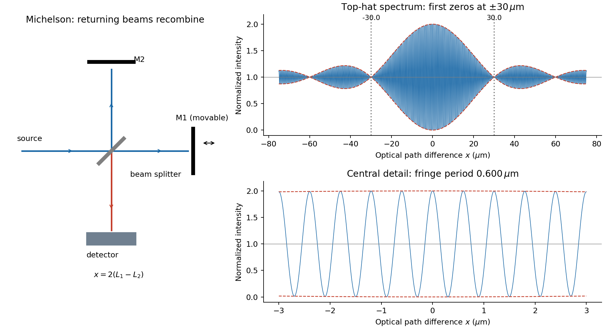

<h1 id="section-b/b9/solution">Solution</h1>

↑ **Parent:** [B9](../b9.md)

A [Michelson interferometer](../../../../../michelson-interferometer.md) divides a source beam at a partially reflecting [beam splitter](../../../../../beam-splitter.md). The two perpendicular arms terminate in [mirrors](../../../../../mirror.md) whose reflected beams return to the splitter and overlap at the detector. The recombined fields must have overlapping [wavefronts](../../../../../wavefront.md) and compatible [polarization of waves](../../../../../polarization-waves.md). Moving one [mirror](../../../../../mirror.md) by $\Delta L$ changes the round-trip [optical path difference](../../../../../optical-path-difference.md) by $2\Delta L$, so $N$ passing fringes determine $\Delta L=N\lambda/2$. Conversely a known [mirror](../../../../../mirror.md) [displacement](../../../../../displacement.md) measures [wavelength](../../../../../wavelength.md). Scanning the delay can determine [temporal optical coherence](../../../../../temporal-optical-coherence.md) and, by [Fourier transform spectroscopy](../../../../../fourier-transform-spectroscopy.md), spectral structure. A compensating plate may equalize glass traversal, particularly for broadband illumination.

**[Figure 3](#section-b/b9/image-michelson-optical-arrangement-and-the-calculated-top-hat-spectrum-interferogram). Michelson optical arrangement and the calculated top-hat-spectrum interferogram**.

For equal real peak field amplitudes, the superposition is

$$
E(t)=a\cos\omega t+a\cos(\omega t+\phi)
=2a\cos(\phi/2)\cos(\omega t+\phi/2).
$$

Time averaging the square over many optical cycles gives $\langle E^2\rangle=2a^2\cos^2(\phi/2)=a^2(1+\cos\phi)$. With $\phi=kx$ after absorbing a constant port-dependent phase into the zero of $x$,

$$
\boxed{I(x)=I_0[1+\cos(kx)].}
$$

Here $I_0$ is the sum of the two separate-arm [intensities](../../../../../intensity-physics.md); maximum [intensity](../../../../../intensity-physics.md) is $2I_0$ and the ideal minimum is zero. Equal amplitudes give unit [interference visibility](../../../../../interferometric-visibility.md).

For a stationary source with a flat [intensity](../../../../../intensity-physics.md) spectrum, different spectral components add in time-averaged [intensity](../../../../../intensity-physics.md). Keeping their individual two-arm interference terms and defining $\operatorname{sinc}z=\sin z/z$ gives

$$
I(x)=C\int_{k_0-\Delta k/2}^{k_0+\Delta k/2}[1+\cos(k'x)]\,dk'
=C\Delta k\left[1+\cos(k_0x)\operatorname{sinc}\left(\frac{x\Delta k}{2}\right)\right].
$$

One must not coherently add unrelated source [frequencies](../../../../../frequency.md) as if they had a fixed common phase. The sinc envelope is the [Fourier transform](../../../../../fourier-transform-split.md) of the rectangular spectral [intensity](../../../../../intensity-physics.md).

Numerically, $\nu_0=5.00\times10^{14}\,\mathrm{Hz}$ and $\Delta\nu=1.00\times10^{13}\,\mathrm{Hz}$. The annotated interferogram uses

$$
\boxed{\frac{I(x)}{C\Delta k}=1+\cos\left(\frac{2\pi\nu_0x}{c}\right)
\operatorname{sinc}\left(\frac{\pi\Delta\nu x}{c}\right).}
$$

It is even in $x$, has central value 2 and background 1, and its carrier-fringe period in [optical path difference](../../../../../optical-path-difference.md) is $c/\nu_0=0.600\,\mathrm{\mu m}$. The first envelope zeros are at **$x=\pm c/\Delta\nu=\pm30.0\,\mathrm{\mu m}$**, corresponding to [mirror](../../../../../mirror.md) shifts of $\pm15.0\,\mathrm{\mu m}$ from equal paths. Side lobes persist beyond the zeros; a negative sinc reverses fringe phase. The [intensity](../../../../../intensity-physics.md) remains between $1-|\operatorname{sinc}|$ and $1+|\operatorname{sinc}|$, not between the signed sinc curves with an assumed fixed ordering.

## ↑ Ancestors (14)

1. [B9](../b9.md)
2. [Section B](../../section-b.md)
3. [Paper 2](../../../paper-2-split.md)
4. [2015](../../../split.md)
5. [Past exam of the physics A course of the University of Cambridge](../../../../split.md)
6. [Physics A course of the University of Cambridge](../../../../../physics-a-course-of-the-university-of-cambridge.md)
7. [Physics course of the year 2 of the natural sciences course of the University of Cambridge](../../../../../physics-course-of-the-year-2-of-the-natural-sciences-course-of-the-university-of-cambridge.md)
8. [Year 2 of the natural sciences course of the University of Cambridge](../../../../../year-2-of-the-natural-sciences-course-of-the-university-of-cambridge.md)
9. [Year of the natural sciences course of the University of Cambridge](../../../../../year-of-the-natural-sciences-course-of-the-university-of-cambridge.md)
10. [Natural sciences course of the University of Cambridge](../../../../../natural-sciences-course-of-the-university-of-cambridge.md)
11. [Course of the University of Cambridge](../../../../../course-of-the-university-of-cambridge.md)
12. [University of Cambridge](../../../../../university-of-cambridge-split.md)
13. [List of universities](../../../../../list-of-universities.md)
14. [Codex Wiki](../../../../../split.md)
