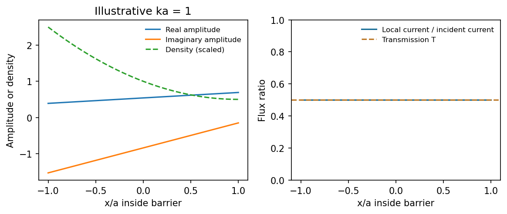
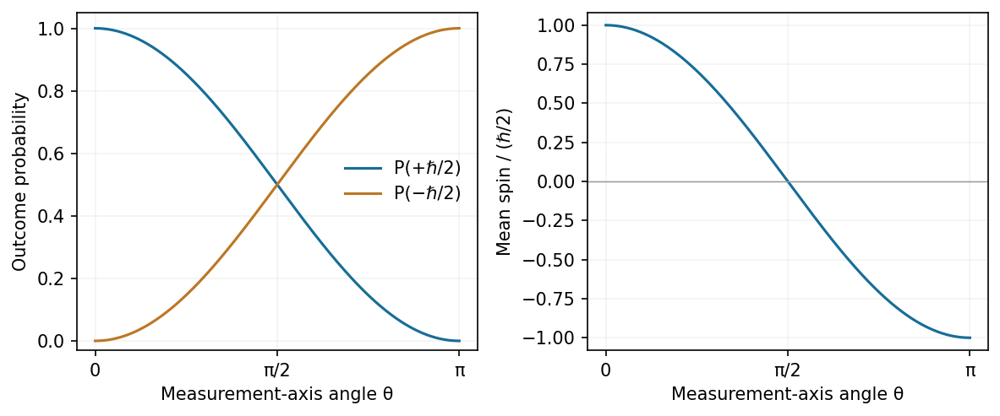
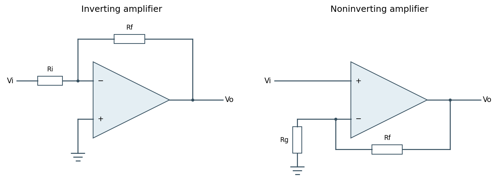
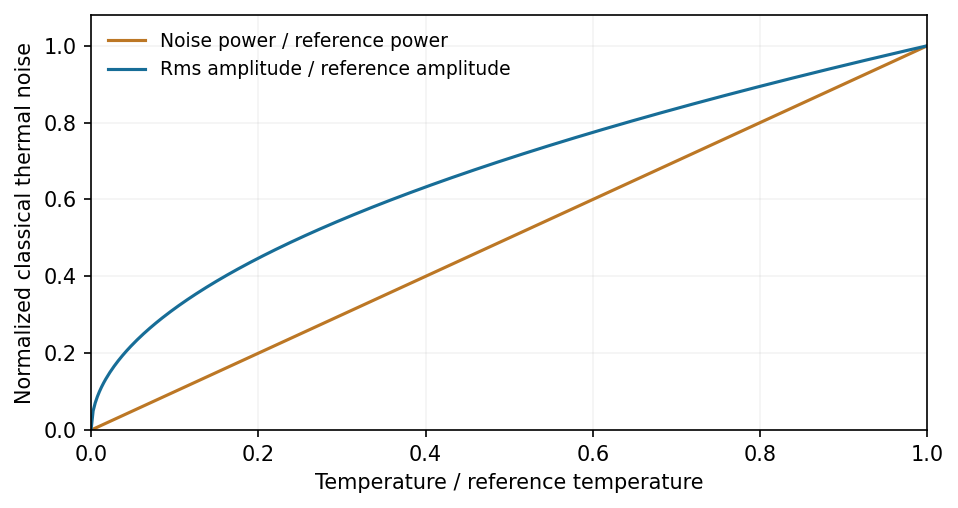
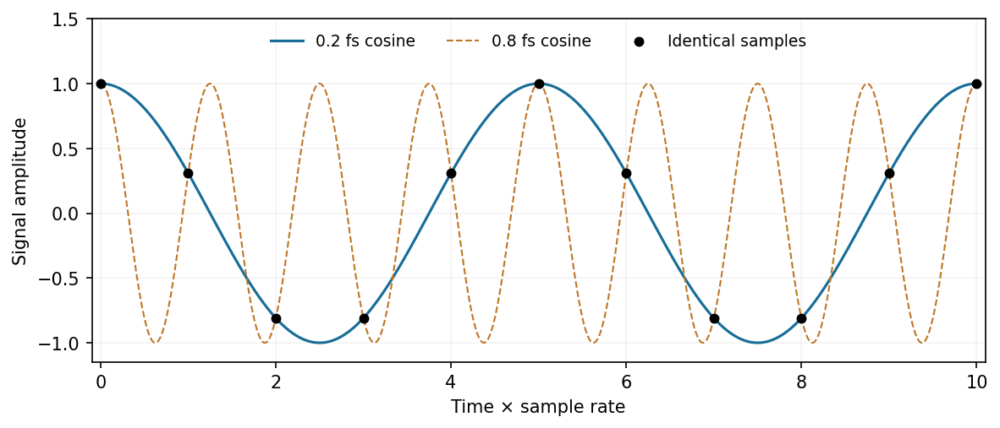

# Paper 1

↑ **Parent:** [2016](../2016.md)

[Original examination PDF, physical pages 112–119](https://www.whatdotheyknow.com/request/natural_science_tripos_physics_e_2/response/2340776/attach/2/FOI%202023%20399%20Zahid%20materials.pdf?cookie_passthrough=1#page=112)

**Table of contents**

- [Section A](#section-a)
  - [1](#section-a/1)
    - [Solution](#section-a/1/solution)
  - [2](#section-a/2)
    - [Solution](#section-a/2/solution)
  - [3](#section-a/3)
    - [Solution](#section-a/3/solution)
  - [4](#section-a/4)
    - [Solution](#section-a/4/solution)
  - [5](#section-a/5)
    - [Solution](#section-a/5/solution)
- [Section B](#section-b)
  - [B6](#section-b/b6)
    - [Solution](#section-b/b6/solution)
  - [B7](#section-b/b7)
    - [Solution](#section-b/b7/solution)
  - [B8](#section-b/b8)
    - [Solution](#section-b/b8/solution)
  - [B9](#section-b/b9)
    - [Solution](#section-b/b9/solution)
- [Section C](#section-c)
  - [C10](#section-c/c10)
    - [Solution](#section-c/c10/solution)
  - [C11](#section-c/c11)
    - [a](#section-c/c11/a)
      - [Solution](#section-c/c11/a/solution)
    - [b](#section-c/c11/b)
      - [Solution](#section-c/c11/b/solution)
    - [c](#section-c/c11/c)
      - [Solution](#section-c/c11/c/solution)
- [Section D](#section-d)
  - [D12](#section-d/d12)
    - [Solution](#section-d/d12/solution)
  - [D13](#section-d/d13)
    - [a](#section-d/d13/a)
      - [Solution](#section-d/d13/a/solution)
    - [b](#section-d/d13/b)
      - [Solution](#section-d/d13/b/solution)
    - [c](#section-d/d13/c)
      - [Solution](#section-d/d13/c/solution)

## Section A

↑ **Parent:** [Paper 1](paper-1.md)

<h3 id="section-a/1">1</h3>

↑ **Parent:** [Section A](#section-a)

<h4 id="section-a/1/solution">Solution</h4>

↑ **Parent:** [1](#section-a/1)

Use the unitary position-to-momentum [Fourier transform](../../fourier-transform.md) $\phi(p)=(2\pi\hbar)^{-1/2}\int\psi(x)e^{-ipx/\hbar}\,dx$. Integration gives

$$
\phi(p,0)=\frac1{\sqrt{2\pi\hbar a}}\frac{2\hbar}{p}\sin\!\left(\frac{pa}{2\hbar}\right)=\boxed{\sqrt{\frac{a}{2\pi\hbar}}\,\operatorname{sinc}\!\left(\frac{pa}{2\hbar}\right)},
$$

where $\operatorname{sinc}u=\sin u/u$ with its continuous value one at zero. The amplitude is real and even, with central maximum $\sqrt{a/(2\pi\hbar)}$, zeros at $p=2n\pi\hbar/a$ for nonzero integer $n$, and alternating-sign sidelobes decaying as $1/|p|$.

**[Figure 1](#section-a/1/image-a-finite-rectangular-position-amplitude-gives-a-sinc-momentum-amplitude-and-a-sinc-squared-momentum-density). A finite rectangular position amplitude gives a sinc momentum amplitude and a sinc-squared momentum density**. [Source](paper-1-top-hat-momentum.py).

The [probability density](../../wave-function.md#probability-density) is $|\phi|^2$, not the signed [Sinc function](../../fourier-transform.md#sinc-function) amplitude. Its integral is one by the unitarity of the [Fourier transform](../../fourier-transform.md).

<h3 id="section-a/2">2</h3>

↑ **Parent:** [Section A](#section-a)

<h4 id="section-a/2/solution">Solution</h4>

↑ **Parent:** [2](#section-a/2)

Nonrelativistic acceleration from rest gives $p=\sqrt{2m_eeV}$ and $\lambda=h/p$. The observed deflection is the angle between incident and diffracted beams, **$2\theta=22^\circ$**, so [Bragg's law](../../quantum-scattering.md#bragg-s-law) at first order gives

$$
\boxed{d=\frac{h}{2\sin11^\circ\sqrt{2m_ee(150\,\mathrm V)}}\simeq2.62\times10^{-10}\,\mathrm m=0.262\,\mathrm{nm}.}
$$

Here $\lambda\simeq0.100\,\mathrm{nm}$. The numerical evaluation uses the externally documented CODATA 2014 values $h=6.626070040\times10^{-34}\,\mathrm{J\,s}$, $m_e=9.10938356\times10^{-31}\,\mathrm{kg}$ and $e=1.6021766208\times10^{-19}\,\mathrm C$; it does not assert which rounded constants were in the exam's handbook. Relativistic corrections at this voltage are negligible at the precision of the angle.[Planck constant, elementary charge and electron mass in the historical reference table](../../physics-bibliography.md#codata-recommended-values-of-the-fundamental-physical-constants-2014-by-national-institute-of-standards-and-technology)

<h3 id="section-a/3">3</h3>

↑ **Parent:** [Section A](#section-a)

<h4 id="section-a/3/solution">Solution</h4>

↑ **Parent:** [3](#section-a/3)

If $\hat A|a\rangle=\lambda|a\rangle$, the [Hermitian operator](../../hilbert-space.md#hermitian-operator) property makes $\lambda$ real. Applying the operator identity to this [eigenvector](../../linear-operator-theory.md#eigenvector) gives $\lambda^3=1$. Its only real root is **$\lambda=1$**; the other cube roots of unity are nonreal. In an orthonormal [eigenbasis](../../linear-operator-theory.md#eigenbasis), $\hat A=\sum_a|a\rangle\langle a|=\boxed{\hat I}$. Equivalently, the [spectral theorem](../../hilbert-space.md#spectral-theorem) places the entire spectrum of the self-adjoint observable at one, giving the same conclusion. The quantum-mechanical setting assumes the usual well-defined observable and operator domains.

<h3 id="section-a/4">4</h3>

↑ **Parent:** [Section A](#section-a)

<h4 id="section-a/4/solution">Solution</h4>

↑ **Parent:** [4](#section-a/4)

At the central values, $z=\sqrt{\tan45^\circ}+0.10^2=1.010$. For independent input standard errors, linear propagation gives

$$
\sigma_z^2=\left(\frac{\sec^2x}{2\sqrt{\tan x}}\sigma_x\right)^2+(2y\sigma_y)^2.
$$

The angular derivative here is with respect to radians, so $\sigma_x=2\pi/180=0.03491$. At $x=\pi/4$, the derivative is one, and

$$
\sigma_z=\sqrt{(0.03491)^2+(0.2\times0.02)^2}=0.0351.
$$

Thus **$\boxed{z=1.010\pm0.035}$**, with the stated [measurement uncertainty](../../physics.md#measurement-uncertainty) interpreted as one [standard error](../../statistical-inference.md#standard-error). Correlated inputs would require a [covariance](../../variance.md#covariance) term; their correlation is not supplied.

<h3 id="section-a/5">5</h3>

↑ **Parent:** [Section A](#section-a)

<h4 id="section-a/5/solution">Solution</h4>

↑ **Parent:** [5](#section-a/5)

For independent charge arrivals described by a [Poisson distribution](../../discrete-probability-distribution.md#poisson-distribution), the one-sided [Shot noise](../../electrical-engineering.md#shot-noise) current [Power spectral density](../../electrical-engineering.md#power-spectral-density) is $S_I=2eI$. Treating the stated [bandwidth](../../electrical-engineering.md#bandwidth-signal-processing) as the [Effective noise bandwidth](../../electrical-engineering.md#effective-noise-bandwidth),

$$
\boxed{i_{\rm rms}=\sqrt{2eI\Delta f}=\sqrt{2(1.6021766208\times10^{-19})(10^{-9})(10^5)}=5.66\times10^{-12}\,\mathrm A.}
$$

The expected rms noise is **$5.66\,\mathrm{pA}$**, about $0.566\%$ of the mean current. This is the full [Shot noise](../../electrical-engineering.md#shot-noise) value with [Fano factor](../../variance.md#fano-factor) one; correlations can suppress or enhance it. The elementary charge is from the external CODATA 2014 table.[Elementary charge](../../physics-bibliography.md#codata-recommended-values-of-the-fundamental-physical-constants-2014-by-national-institute-of-standards-and-technology)

## Section B

↑ **Parent:** [Paper 1](paper-1.md)

<h3 id="section-b/b6">B6</h3>

↑ **Parent:** [Section B](#section-b)

<h4 id="section-b/b6/solution">Solution</h4>

↑ **Parent:** [B6](#section-b/b6)

For the oppositely travelling components, write $u=c_1e^{ikx}$ and $v=c_2e^{-ikx}$ after removing the common time phase. Then $\partial_x\psi=ik(u-v)e^{-i\omega t}$. In $\operatorname{Im}(\psi^*\partial_x\psi)$ the [interference](../../physical-optics.md#interference-wave-propagation) terms contribute no imaginary part, so

$$
\boxed{J=\frac{\hbar k}{m}(|c_1|^2-|c_2|^2).}
$$

A standing-wave [interference](../../physical-optics.md#interference-wave-propagation) pattern can therefore change density without adding a cross-term to the net current.

For **[barrier-top scattering](../../quantum-mechanics.md#barrier-top-scattering)**, the stationary equation inside the barrier is $-\hbar^2\psi_2''/(2m)=0$. Thus its spatial part is linear: $\psi_2=(bx+c)e^{-i\omega t}$. Take incident amplitude one, $k=\sqrt{2mE}/\hbar$ and $\omega=E/\hbar$. Continuity of the spatial [wave function](../../wave-function.md) and its derivative at the two finite steps gives

$$
\begin{aligned}
e^{-ika}+re^{ika}&=-ab+c,& ik(e^{-ika}-re^{ika})&=b,\\
te^{ika}&=ab+c,& ikte^{ika}&=b.
\end{aligned}
$$

Solving these four equations yields

$$
\boxed{r=-\frac{ika\,e^{-2ika}}{1-ika},\qquad t=\frac{e^{-2ika}}{1-ika}.}
$$

The equal exterior velocities mean flux ratios are squared amplitude ratios:

$$
\boxed{T=|t|^2=\frac1{1+k^2a^2}=\left(1+\frac{2mEa^2}{\hbar^2}\right)^{-1},\qquad R=\frac{k^2a^2}{1+k^2a^2},\qquad R+T=1.}
$$

This is the threshold limit of finite-barrier scattering, not exponential decay with a nonzero interior decay constant.

The interior constants are

$$
\boxed{b=\frac{ik e^{-ika}}{1-ika},\qquad c=e^{-ika}.}
$$

Since $\operatorname{Im}[(bx+c)^*b]=\operatorname{Im}(c^*b)=k/(1+k^2a^2)$,

$$
\boxed{J_2=\frac{\hbar k/m}{1+k^2a^2}=J_{\rm incident}T.}
$$

It is positive and independent of [position](../../classical-mechanics.md#position), matching the transmitted flux. Although the classical kinetic energy inside is zero, the complex linear quantum [wave function](../../wave-function.md) carries conserved [probability current](../../wave-function.md#probability-current); its phase varies with [position](../../classical-mechanics.md#position).

**[Figure 2](#section-b/b6/image-at-the-barrier-top-energy-the-complex-amplitude-is-linear-while-its-probability-current-remains-constant). At the barrier-top energy the complex amplitude is linear while its probability current remains constant**. [Source](paper-1-barrier-top-current.py).

<h3 id="section-b/b7">B7</h3>

↑ **Parent:** [Section B](#section-b)

<h4 id="section-b/b7/solution">Solution</h4>

↑ **Parent:** [B7](#section-b/b7)

Differentiating the [expectation value](../../quantum-system.md#expectation-value) and using $\partial_t|\psi\rangle=-i\hat H|\psi\rangle/\hbar$ and $\partial_t\langle\psi|=i\langle\psi|\hat H/\hbar$ gives

$$
\boxed{\frac{d\langle\hat A\rangle}{dt}=\frac i\hbar\langle[\hat H,\hat A]\rangle+\left\langle\frac{\partial\hat A}{\partial t}\right\rangle.}
$$

The second term means explicit operator time dependence, distinct from the state's evolution.

The [commutator product rule](../../lie-algebra.md#commutator-product-rule) follows by adding and subtracting $\hat B\hat A\hat C$:

$$
[\hat A,\hat B\hat C]=\hat A\hat B\hat C-\hat B\hat C\hat A=[\hat A,\hat B]\hat C+\hat B[\hat A,\hat C].
$$

For the **[mathematical induction](../../foundations-of-mathematics.md#mathematical-induction) step**, let $\hat D=[\hat A,\hat B]$ and use $[\hat A,\hat D]=0$. The case $n=1$ is immediate. If $[\hat A^m,\hat B]=m\hat D\hat A^{m-1}$, then

$$
[\hat A^{m+1},\hat B]=\hat A^m\hat D+[\hat A^m,\hat B]\hat A=(m+1)\hat D\hat A^m.
$$

Thus the claimed identity holds for every positive integer. Commutation of $\hat B$ with $\hat D$ is not needed for this particular step. This is the [central-commutator differentiation rule](../../lie-algebra.md#central-commutator-differentiation-rule). Termwise application to a convergent [power series](../../sequence-and-series.md#power-series), on a common domain where the operations are justified, gives

$$
\boxed{[F(\hat A),\hat B]=\sum_{n\geq1}na_n\hat D\hat A^{n-1}=\hat D F'(\hat A).}
$$

For [position](../../classical-mechanics.md#position) and [momentum](../../momentum.md), $[\hat x,\hat p]=i\hbar\hat I$. Hence $[\hat p^2,\hat x]=-2i\hbar\hat p$, $[V(\hat x),\hat x]=0$ and $[V(\hat x),\hat p]=i\hbar V'(\hat x)$. Substitution gives **[Ehrenfest theorem](../../quantum-mechanics.md#ehrenfest-theorem)**:

$$
\boxed{\frac{d\langle\hat x\rangle}{dt}=\frac{\langle\hat p\rangle}{m},\qquad\frac{d\langle\hat p\rangle}{dt}=-\langle V'(\hat x)\rangle.}
$$

The mean [momentum](../../momentum.md) changes by the mean [force](../../force.md). It does not follow for a general nonlinear [Potential energy](../../energy.md#potential-energy) that $\langle V'(\hat x)\rangle=V'(\langle\hat x\rangle)$: a closed classical trajectory for the mean [position](../../classical-mechanics.md#position) requires an additional condition, such as a quadratic [Potential energy](../../energy.md#potential-energy) or a sufficiently localized [wave packet](../../dispersion-relation.md#wave-packet).

<h3 id="section-b/b8">B8</h3>

↑ **Parent:** [Section B](#section-b)

<h4 id="section-b/b8/solution">Solution</h4>

↑ **Parent:** [B8](#section-b/b8)

Expanding with the [angular momentum](../../momentum.md#angular-momentum) [commutators](../../lie-algebra.md#commutator) gives

$$
\begin{aligned}
[\hat L_z,\hat L_\pm]&=[\hat L_z,\hat L_x]\pm i[\hat L_z,\hat L_y]=\pm\hbar\hat L_\pm,\\
\hat L_-\hat L_+&=(\hat L_x-i\hat L_y)(\hat L_x+i\hat L_y)=\hat L_x^2+\hat L_y^2+i[\hat L_x,\hat L_y]=\hat L^2-\hat L_z^2-\hbar\hat L_z.
\end{aligned}
$$

For $\hat L_z|\psi\rangle=\alpha\hbar|\psi\rangle$, commuting $\hat L_z$ past a [ladder operator](../../semisimple-lie-algebra.md#ladder-operator) gives

$$
\hat L_z\hat L_\pm|\psi\rangle=(\alpha\pm1)\hbar\hat L_\pm|\psi\rangle.
$$

Thus the raised or lowered vector, **if nonzero**, is an [eigenvector](../../linear-operator-theory.md#eigenvector) with the shifted [eigenvalue](../../linear-operator-theory.md#eigenvalue); an [angular momentum ladder endpoint](../../quantum-mechanics.md#angular-momentum-ladder-endpoint) can instead be annihilated. Also $[\hat L^2,\hat L_\pm]=0$, so $\hat L^2\hat L_\pm|\psi\rangle=\Lambda\hbar^2\hat L_\pm|\psi\rangle$ for every nonzero ladder result.

For [orbital angular momentum](../../quantum-mechanics.md#orbital-angular-momentum), $\hat L_z=-i\hbar\partial_\phi$ gives an azimuthal factor $e^{i\alpha\phi}$. Single-valuedness under $\phi\mapsto\phi+2\pi$ requires **integer $\alpha$**. Positivity of ladder norms gives

$$
\|\hat L_+|\Lambda,m\rangle\|^2=\hbar^2[\Lambda-m(m+1)],\qquad
\|\hat L_-|\Lambda,m\rangle\|^2=\hbar^2[\Lambda-m(m-1)]
$$

for normalized states. A fixed finite $\Lambda$ therefore has upper and lower endpoints. Writing the upper endpoint as $m=\ell$, its vanishing raising norm gives $\Lambda=\ell(\ell+1)$; the lower endpoint is $m=-\ell$. Consequently

$$
\boxed{\hat L^2|\ell,m\rangle=\ell(\ell+1)\hbar^2|\ell,m\rangle,\quad \hat L_z|\ell,m\rangle=m\hbar|\ell,m\rangle,\quad m=-\ell,-\ell+1,\ldots,\ell,}
$$

with $\ell=0,1,2,\ldots$. This integer conclusion is for [orbital angular momentum](../../quantum-mechanics.md#orbital-angular-momentum); [spin](../../angular-momentum-operator.md#spin) representations can also have half-integer labels.

For the specified Gaussian-radial state, use a [Cartesian p-orbital decomposition](../../analysis.md#cartesian-p-orbital-decomposition): write $x+y+z=r(\sin\theta\cos\phi+\sin\theta\sin\phi+\cos\theta)$. Its angular factor is

$$
\sqrt{\frac{2\pi}{3}}\left[(1+i)Y_{1,-1}+\sqrt2Y_{1,0}+(-1+i)Y_{1,1}\right].
$$

Only $\ell=1$ occurs. The squared angular coefficients are $2,2,2$ before common normalization, so each allowed $m$ has probability one third. Therefore the simultaneous outcome is

$$
\boxed{P(L^2=2\hbar^2,L_z=\hbar)=\frac13.}
$$

The common normalized radial factor cancels from this ratio. The standard symmetric $m$ sequence used above resolves the duplicated central positive entry in the printed list.

<h3 id="section-b/b9">B9</h3>

↑ **Parent:** [Section B](#section-b)

<h4 id="section-b/b9/solution">Solution</h4>

↑ **Parent:** [B9](#section-b/b9)

Direct [matrix multiplication](../../vector-space.md#matrix-multiplication) gives

$$
\begin{array}{c|cc}
&|\uparrow\rangle&|\downarrow\rangle\\\hline
\hat S_x&\frac\hbar2|\downarrow\rangle&\frac\hbar2|\uparrow\rangle\\
\hat S_y&\frac{i\hbar}2|\downarrow\rangle&-\frac{i\hbar}2|\uparrow\rangle\\
\hat S_z&\frac\hbar2|\uparrow\rangle&-\frac\hbar2|\downarrow\rangle
\end{array}
$$

The normalized $S_x$ [eigenvectors](../../linear-operator-theory.md#eigenvector) are $(|\uparrow\rangle\pm|\downarrow\rangle)/\sqrt2$, and the $S_y$ [eigenvectors](../../linear-operator-theory.md#eigenvector) are $(|\uparrow\rangle\pm i|\downarrow\rangle)/\sqrt2$, with [eigenvalues](../../linear-operator-theory.md#eigenvalue) $\pm\hbar/2$ in each case.

For $N=|a|^2+|b|^2>0$, allowing for a possibly unnormalized input pair of coefficients,

$$
\boxed{\langle\hat S_z\rangle=\frac\hbar2\frac{|a|^2-|b|^2}{N},\qquad\langle\hat S^2\rangle=\frac{3\hbar^2}{4}.}
$$

For a normalized state $N=1$. The second result follows because each squared [Spin operator](../../angular-momentum-operator.md#spin-operator) matrix equals $\hbar^2\hat I/4$.

The tilted component is $\hat S_{z'}=(\hbar/2)\begin{pmatrix}\cos\theta&\sin\theta\\\sin\theta&-\cos\theta\end{pmatrix}$. Its [eigenvalues](../../linear-operator-theory.md#eigenvalue) remain $\pm\hbar/2$, with one real phase convention for the normalized [eigenvectors](../../linear-operator-theory.md#eigenvector)

$$
\boxed{|+z'\rangle=\cos(\theta/2)|\uparrow\rangle+\sin(\theta/2)|\downarrow\rangle,\qquad|-z'\rangle=-\sin(\theta/2)|\uparrow\rangle+\cos(\theta/2)|\downarrow\rangle.}
$$

Projecting the initial $|\uparrow\rangle$ onto them gives **$P_+=\cos^2(\theta/2)$** and **$P_-=\sin^2(\theta/2)$**. Thus

$$
\boxed{\langle\hat S_{z'}\rangle=\frac\hbar2(P_+-P_-)=\frac\hbar2\cos\theta.}
$$

A smaller [expectation](../../expected-value.md) does not imply a smaller individual [spin](../../angular-momentum-operator.md#spin) [eigenvalue](../../linear-operator-theory.md#eigenvalue); it describes the probabilities of the same two measurement outcomes.

**[Figure 3](#section-b/b9/image-rotating-the-measurement-axis-changes-spin-half-outcome-probabilities-rather-than-the-outcome-magnitudes). Rotating the measurement axis changes spin-half outcome probabilities rather than the outcome magnitudes**. [Source](paper-1-spin-projection.py).

## Section C

↑ **Parent:** [Paper 1](paper-1.md)

<h3 id="section-c/c10">C10</h3>

↑ **Parent:** [Section C](#section-c)

<h4 id="section-c/c10/solution">Solution</h4>

↑ **Parent:** [C10](#section-c/c10)

**[identical particles](../../tensor-product-of-quantum-systems.md#indistinguishable-particles) have the same intrinsic properties**, including mass, charge and [spin](../../angular-momentum-operator.md#spin). Their labels are bookkeeping devices rather than measurable identities. When [wave functions](../../wave-function.md) overlap, [quantum mechanics](../../quantum-mechanics.md) supplies no observable trajectory that permanently identifies “particle 1” independently of “particle 2”. A many-particle description must therefore treat exchange consistently. The [Hamiltonian](../../hamiltonian-mechanics.md#hamiltonian) and physical [observables](../../quantum-system.md#observable) are invariant under relabelling [identical particles](../../tensor-product-of-quantum-systems.md#indistinguishable-particles).

For two particles, the [exchange operator](../../tensor-product-of-quantum-systems.md#exchange-operator) obeys $\hat P_{12}^2=\hat I$. The usual three-dimensional [symmetrization postulate](../../tensor-product-of-quantum-systems.md#symmetrization-postulate) selects states symmetric under exchange for [bosons](../../tensor-product-of-quantum-systems.md#boson) and antisymmetric for [fermions](../../tensor-product-of-quantum-systems.md#fermion). In relativistic quantum theory, the [Spin-statistics theorem](../../tensor-product-of-quantum-systems.md#spin-statistics-theorem) associates integer [spin](../../angular-momentum-operator.md#spin) with [bosons](../../tensor-product-of-quantum-systems.md#boson) and half-integer [spin](../../angular-momentum-operator.md#spin) with [fermions](../../tensor-product-of-quantum-systems.md#fermion) under its locality and positivity assumptions; the connection is not derived merely from $\hat P_{12}^2=\hat I$ in elementary nonrelativistic mechanics. For orthonormal one-particle states $u$ and $v$, the two-particle spatial combinations are

$$
\Psi_\pm(1,2)=\frac{u(1)v(2)\pm v(1)u(2)}{\sqrt2}.
$$

The sign concerns the **complete state**, including [spin](../../angular-momentum-operator.md#spin) and other internal variables, not necessarily the spatial factor alone.

The antisymmetric state vanishes if both [fermions](../../tensor-product-of-quantum-systems.md#fermion) occupy the same one-particle state: this is the **[Pauli exclusion principle](../../tensor-product-of-quantum-systems.md#pauli-exclusion-principle)**. For $N$ [fermions](../../tensor-product-of-quantum-systems.md#fermion) in orthonormal [spin orbitals](../../tensor-product-of-quantum-systems.md#spin-orbital) $\chi_j$, the normalized [Slater determinant](../../tensor-product-of-quantum-systems.md#slater-determinant) $\Psi=(N!)^{-1/2}\det[\chi_j(i)]$ supplies the required exchange sign. Bosonic occupation has no corresponding upper limit, and symmetrized products describe many [bosons](../../tensor-product-of-quantum-systems.md#boson). Fermionic occupation is zero or one per complete one-particle state; two electrons can still occupy the same spatial [atomic orbital](../../chemistry.md#atomic-orbital) with opposite [spin](../../angular-momentum-operator.md#spin).

[Spin](../../angular-momentum-operator.md#spin) and spatial symmetry are linked. A two-electron [spin singlet state](../../bell-state.md#spin-singlet-state) is antisymmetric, so its spatial factor must be symmetric. A symmetric [triplet state](../../angular-momentum-operator.md#spin-one-half-triplet-state) instead requires an antisymmetric spatial factor. Exchange then changes pair correlations and the energies available when interactions depend on particle separation, even without introducing a new classical “exchange [force](../../force.md)”. It contributes to atomic shell structure, bonding and magnetic behaviour.

**[Figure 4](#section-c/c10/image-symmetric-and-antisymmetric-two-particle-spatial-states-have-different-joint-position-correlations). Symmetric and antisymmetric two-particle spatial states have different joint-position correlations**. [Source](paper-1-exchange-correlations.py).

In an occupation-number description, bosonic [creation and annihilation operators](../../quantum-harmonic-oscillator.md#creation-and-annihilation-operators) satisfy $[\hat a_i,\hat a_j^\dagger]=\delta_{ij}$, whereas fermionic operators satisfy $\{\hat c_i,\hat c_j^\dagger\}=\delta_{ij}$ and anticommute among themselves. The latter imply $(\hat c_i^\dagger)^2=0$. This formalism implements the same exchange constraints without assigning permanent particle labels.

For noninteracting particles in [thermal equilibrium](../../thermal-equilibrium.md), the mean occupation of a state of energy $\epsilon$ is

$$
\bar n_B=\frac1{e^{(\epsilon-\mu)/(k_BT)}-1},\qquad\bar n_F=\frac1{e^{(\epsilon-\mu)/(k_BT)}+1}.
$$

[Fermi-Dirac statistics](../../tensor-product-of-quantum-systems.md#fermi-dirac-statistics) produces a filled Fermi sea at zero [temperature](../../temperature.md) and [degeneracy pressure](../../quantum-ideal-gas-statistics.md#degeneracy-pressure); [Bose-Einstein statistics](../../quantum-ideal-gas-statistics.md#bose-einstein-statistics) permits macroscopic [Ground state](../../quantum-mechanics.md#ground-state) occupation when the density of available states and thermodynamic conditions allow condensation. The different statistics therefore have measurable collective consequences, not just different notation.[Chapter 3, §§3.5–3.6: Bose and Fermi distributions, condensation and degenerate Fermi gases](../../physics-bibliography.md#statistical-physics-by-david-tong)

When phase-space occupation is dilute, both distributions reduce to the [Maxwell–Boltzmann statistics](../../quantum-ideal-gas-statistics.md#maxwell-boltzmann-statistics) limit. Likewise, well-separated localized [wave packets](../../dispersion-relation.md#wave-packet) have negligible overlap and small exchange corrections, so effectively labelled classical trajectories can become a useful approximation. In two spatial dimensions more general exchange statistics are possible; the standard boson/fermion account here concerns ordinary three-dimensional particles and their total states.

<h3 id="section-c/c11">C11</h3>

↑ **Parent:** [Section C](#section-c)

<h4 id="section-c/c11/a">a</h4>

↑ **Parent:** [C11](#section-c/c11)

<h5 id="section-c/c11/a/solution">Solution</h5>

↑ **Parent:** [A](#section-c/c11/a)

For the nonrelativistic Coulomb [Hamiltonian](../../hamiltonian-mechanics.md#hamiltonian) with reduced electron-proton mass $\mu$, separation in [Spherical coordinate system](../../multivariable-calculus.md#spherical-coordinate-system) gives **$\psi_{n\ell m}(r,\theta,\phi)=R_{n\ell}(r)Y_{\ell m}(\theta,\phi)$**. The [quantum numbers](../../quantum-system.md#quantum-number) obey $n\geq1$, $0\leq\ell\leq n-1$ and $-\ell\leq m\leq\ell$. These are joint [eigenstates](../../energy-eigenvalue.md#eigenstate) of energy, $L^2$ and $L_z$, with the latter two [eigenvalues](../../linear-operator-theory.md#eigenvalue) $\ell(\ell+1)\hbar^2$ and $m\hbar$.

The Coulomb bound-state energies and characteristic length are

$$
\boxed{E_n=-\frac{\mu e^4}{2(4\pi\epsilon_0)^2\hbar^2n^2},\qquad a_\mu=\frac{4\pi\epsilon_0\hbar^2}{\mu e^2}.}
$$

For example, $\psi_{100}=(\pi a_\mu^3)^{-1/2}e^{-r/a_\mu}$ is spherically symmetric and has no radial node. In general the radial part contains an exponential times a [Generalized Laguerre polynomial](../../linear-operator-theory.md#generalized-laguerre-polynomial), with $n-\ell-1$ radial nodes. The [spherical harmonic](../../analysis.md#spherical-harmonic) specifies angular structure and azimuthal phase; real linear combinations of degenerate $m$ states give familiar directional orbitals.

The leading Coulomb energy depends on $n$ alone, giving $n^2$ spatial states for each principal shell, or $2n^2$ including electron [spin](../../angular-momentum-operator.md#spin). [Fine structure](../../atomic-physics.md#fine-structure), [Lamb shift](../../atomic-physics.md#lamb-shift) and [Hyperfine structure](../../quantum-mechanics.md#hyperfine-structure) lift parts of this ideal degeneracy. An [atomic orbital](../../chemistry.md#atomic-orbital) is a probability amplitude, not a classical planetary path.[Section 4: separation of the Coulomb problem and hydrogenic states](../../physics-bibliography.md#quantum-mechanics-by-david-tong)

<h4 id="section-c/c11/b">b</h4>

↑ **Parent:** [C11](#section-c/c11)

<h5 id="section-c/c11/b/solution">Solution</h5>

↑ **Parent:** [B](#section-c/c11/b)

**[Quantum tunnelling](../../quantum-mechanics.md#quantum-tunnelling) is supported by transport and decay through barriers that classical particles of the same energy cannot traverse.** Three complementary examples are:

- In **[alpha decay](../../physics.md#alpha-decay)**, an alpha cluster escapes the attractive nuclear region through a Coulomb barrier. The barrier penetration factor depends exponentially on a forbidden-region action, helping explain the strong dependence of lifetimes on emitted alpha energy. This is evidence from systematic decay rates, rather than direct imaging of an alpha inside the barrier.
- A **[scanning tunnelling microscope](../../quantum-mechanics.md#scanning-tunneling-microscope)** measures current across a narrow [vacuum](../../physics.md#vacuum) gap between a conducting tip and sample. At small bias an approximate dependence is $I\propto e^{-2\kappa s}$ with $\kappa\simeq\sqrt{2m\Phi}/\hbar$. The strong gap-distance sensitivity enables atomic-scale imaging and local spectroscopy. Electronic [density of states](../../quantum-ideal-gas-statistics.md#density-of-states) and barrier height also affect the current, so constant-current contrast is not an unqualified geometric atom map.[Vacuum-tunnelling measurement and surface imaging](../../physics-bibliography.md#surface-studies-by-scanning-tunneling-microscopy-by-gerd-binnig-and-others)
- A heavily doped **[Tunnel diode](../../semiconductor.md#tunnel-diode)** has a narrow p-n barrier. Bias changes the overlap of occupied and empty states across it; interband tunnelling produces a characteristic peak and [Negative differential resistance](../../electric-charge.md#negative-differential-resistance) interval in its current-voltage curve. The measured voltage dependence agrees with the changing band overlap, providing a solid-state transport example.[Germanium-junction tunnelling characteristic](../../physics-bibliography.md#new-phenomenon-in-narrow-germanium-junctions-by-leo-esaki)

Together these test barrier penetration in nuclear decay, vacuum-gap transport and semiconductor transport. Their detailed currents depend on state supply and matching as well as the barrier transmission probability.

<h4 id="section-c/c11/c">c</h4>

↑ **Parent:** [C11](#section-c/c11)

<h5 id="section-c/c11/c/solution">Solution</h5>

↑ **Parent:** [C](#section-c/c11/c)

For the [Quantum harmonic oscillator](../../quantum-harmonic-oscillator.md) define

$$
\hat a=\frac{m\omega\hat x+i\hat p}{\sqrt{2m\hbar\omega}},\qquad\hat a^\dagger=\frac{m\omega\hat x-i\hat p}{\sqrt{2m\hbar\omega}}.
$$

The [Canonical commutation relation](../../quantum-mechanics.md#canonical-commutation-relation) gives $[\hat a,\hat a^\dagger]=1$, and

$$
\boxed{\hat H=\hbar\omega(\hat a^\dagger\hat a+\tfrac12),\qquad[\hat H,\hat a^\dagger]=\hbar\omega\hat a^\dagger,\qquad[\hat H,\hat a]=-\hbar\omega\hat a.}
$$

Thus the [creation operator](../../quantum-harmonic-oscillator.md#creation-operator) and [annihilation operator](../../quantum-harmonic-oscillator.md#annihilation-operator) raise or lower the energy by one quantum. Positivity of $\hat a^\dagger\hat a$ and termination of downward stepping give $E_n=\hbar\omega(n+1/2)$, $n=0,1,\ldots$. Normalized actions are $\hat a|n\rangle=\sqrt n|n-1\rangle$ and $\hat a^\dagger|n\rangle=\sqrt{n+1}|n+1\rangle$. The annihilated [ground state](../../quantum-mechanics.md#ground-state) obeys

$$
\psi_0(x)=\left(\frac{m\omega}{\pi\hbar}\right)^{1/4}e^{-m\omega x^2/(2\hbar)},\qquad|n\rangle=\frac{(\hat a^\dagger)^n}{\sqrt{n!}}|0\rangle.
$$

The nonzero [Ground state](../../quantum-mechanics.md#ground-state) energy is the [zero-point energy](../../quantum-harmonic-oscillator.md#zero-point-energy), consistent with position-momentum [quantum uncertainty](../../quantum-system.md#quantum-uncertainty). Since $\hat x=\sqrt{\hbar/(2m\omega)}(\hat a+\hat a^\dagger)$, a perturbation linear in [position](../../classical-mechanics.md#position) connects only neighbouring number states. The algebra is especially useful for [matrix elements](../../vector-space.md#matrix-element) and [selection rules](../../atomic-physics.md#selection-rule).[Section 2: harmonic oscillator ladder construction](../../physics-bibliography.md#quantum-mechanics-by-david-tong)

**[Figure 5](#section-c/c11/c/image-creation-and-annihilation-connect-equally-spaced-oscillator-levels-while-the-ground-state-lowering-action-vanishes). Creation and annihilation connect equally spaced oscillator levels while the ground-state lowering action vanishes**. [Source](paper-1-oscillator-ladder.py).

## Section D

↑ **Parent:** [Paper 1](paper-1.md)

<h3 id="section-d/d12">D12</h3>

↑ **Parent:** [Section D](#section-d)

<h4 id="section-d/d12/solution">Solution</h4>

↑ **Parent:** [D12](#section-d/d12)

TODO: biology deferred by the user; all five assessed organism-growth tasks are deferred.

<h3 id="section-d/d13">D13</h3>

↑ **Parent:** [Section D](#section-d)

<h4 id="section-d/d13/a">a</h4>

↑ **Parent:** [D13](#section-d/d13)

<h5 id="section-d/d13/a/solution">Solution</h5>

↑ **Parent:** [A](#section-d/d13/a)

The ideal voltage-feedback [Operational amplifier](../../electrical-circuit.md#operational-amplifier) has **zero input currents** and, while stable [negative feedback](../../signal-transduction.md#negative-feedback) holds it in its linear operating range, **equal input voltages**: $i_+=i_-=0$ and $v_+=v_-$. The first rule follows from infinite [input impedance](../../electrical-circuit.md#input-impedance); the second is the large-open-loop-gain limit of $v_o=A(v_+-v_-)$. Equal input [electric potential](../../electric-field.md#electric-potential) is a [virtual short](../../electrical-circuit.md#virtual-short), not an electrically conducting connection.

For an [inverting amplifier](../../electrical-circuit.md#inverting-amplifier) with the noninverting input grounded, $v_-=0$ and node-current balance gives $v_i/R_i=-v_o/R_f$, hence **$v_o=-R_fv_i/R_i$**. For a [noninverting amplifier](../../electrical-circuit.md#noninverting-amplifier), the feedback divider gives $v_-=v_oR_g/(R_f+R_g)=v_i$, hence **$v_o=(1+R_f/R_g)v_i$**.

**[Figure 6](#section-d/d13/a/image-ideal-inverting-and-noninverting-negative-feedback-configurations). Ideal inverting and noninverting negative-feedback configurations**. [Source](paper-1-op-amp-feedback.py).

One should check output swing, input common-mode range, [slew rate](../../electrical-circuit.md#slew-rate), [Gain-bandwidth product](../../electrical-circuit.md#gain-bandwidth-product) and stability before using these limits in a real circuit. Saturation, positive feedback or operation beyond [bandwidth](../../electrical-engineering.md#bandwidth-signal-processing) invalidates the equal-voltage rule; finite input bias currents and offset voltage can also matter.[University electronics course, Chapter 3: high-gain feedback assumptions and practical limits](../../physics-bibliography.md#operational-amplifier-negative-feedback-by-analog-devices)

<h4 id="section-d/d13/b">b</h4>

↑ **Parent:** [D13](#section-d/d13)

<h5 id="section-d/d13/b/solution">Solution</h5>

↑ **Parent:** [B](#section-d/d13/b)

Thermal agitation in a [resistor](../../electric-charge.md#resistor) produces **[Johnson-Nyquist noise](../../electrical-engineering.md#thermal-electrical-noise)**, even without an applied mean current. In the classical low-frequency regime, its one-sided open-circuit voltage spectrum is $S_V=4k_BTR$ and its equivalent short-circuit current spectrum is $S_I=4k_BT/R$. In an [Effective noise bandwidth](../../electrical-engineering.md#effective-noise-bandwidth) $B$,

$$
\boxed{v_{\rm rms}=\sqrt{4k_BTRB},\qquad i_{\rm rms}=\sqrt{4k_BTB/R}.}
$$

For a matched load, available thermal noise power is $k_BTB$. A [resistor](../../electric-charge.md#resistor) and load at the same [temperature](../../temperature.md) exchange noise power without a net heat flow.

Cooling reduces the rms amplitude as $\sqrt T$ if [Electrical resistance](../../electric-charge.md#electrical-resistance) and [bandwidth](../../electrical-engineering.md#bandwidth-signal-processing) remain fixed. A cryogenic bath or refrigerator, [thermal anchoring](../../temperature.md#thermal-anchoring) and controlled heat input can maintain a steady low [temperature](../../temperature.md). Radiation shields, an insulating [vacuum](../../physics.md#vacuum), thermally anchored leads and limited measurement dissipation reduce heat leaks and self-heating. [Temperature](../../temperature.md) sensing and stable [feedback control](../../control-theory.md#closed-loop-control) reduce slow temperature-induced drift; keeping [temperature](../../temperature.md) constant does not remove microscopic [thermal fluctuations](../../statistical-physics.md#thermal-fluctuation).

**[Figure 7](#section-d/d13/b/image-at-fixed-resistance-and-bandwidth-thermal-noise-power-scales-with-temperature-and-rms-amplitude-with-its-square-root). At fixed resistance and bandwidth, thermal-noise power scales with temperature and rms amplitude with its square root**. [Source](paper-1-thermal-noise.py).

[Bandwidth](../../electrical-engineering.md#bandwidth-signal-processing) restriction, suitable impedance and a low-noise amplifier complement cooling. Warm leads, contacts and the amplifier can otherwise dominate the observed noise. At fixed mean current, [shot noise](../../electrical-engineering.md#shot-noise) is not generally reduced merely by cooling, and low-frequency excess noise need not follow the Johnson law. At frequencies with $hf\gtrsim k_BT$, quantum noise expressions replace the classical approximation.[Distinction between resistor thermal noise, amplifier noise and current-noise contributions](../../physics-bibliography.md#op-amp-noise-by-analog-devices)

<h4 id="section-d/d13/c">c</h4>

↑ **Parent:** [D13](#section-d/d13)

<h5 id="section-d/d13/c/solution">Solution</h5>

↑ **Parent:** [C](#section-d/d13/c)

Uniform [signal sampling](../../electrical-engineering.md#signal-sampling) at rate $f_s$ multiplies a continuous signal by a time-domain [Dirac comb](../../distribution-theory.md#dirac-comb), giving frequency-domain replicas spaced by $f_s$:

$$
X_s(f)=f_s\sum_{k=-\infty}^{\infty}X(f-kf_s).
$$

If a baseband signal is restricted to $|f|\leq B$ and **$f_s>2B$**, these replicas can be separated by an ideal reconstruction filter. Frequencies differing by integer multiples of $f_s$ have the same sampled phase progression; for real signals they fold into the interval from zero to $f_s/2$. This ambiguity is **[aliasing](../../fourier-analysis.md#aliasing)**.

**[Figure 8](#section-d/d13/c/image-two-different-continuous-cosine-frequencies-produce-the-same-samples-when-one-lies-above-nyquist). Two different continuous cosine frequencies produce the same samples when one lies above Nyquist**. [Source](paper-1-sampling-alias.py).

For example, $0.8f_s$ and $0.2f_s$ cosines produce identical sample values. Apply an analogue [Anti-aliasing filter](../../fourier-analysis.md#anti-aliasing-filter) before digitization and choose enough sample-rate margin for its finite transition band. A digital filter applied afterward cannot distinguish components already folded onto one another. Out-of-band noise also aliases unless filtered. The sample rate sets temporal/spectral coverage; [quantization](../../computer-science.md#quantization-signal-processing) resolution sets amplitude precision and is a separate limitation. Bandpass [Signal sampling](../../electrical-engineering.md#signal-sampling) has additional conditions beyond the simple baseband rule.[MT-002: spectral replicas, aliases and practical filtering](../../physics-bibliography.md#what-the-nyquist-criterion-means-to-your-sampled-data-system-design-by-walt-kester)

## ↑ Ancestors (11)

1. [2016](../2016.md)
2. [Past exam of the physics A course of the University of Cambridge](../../past-exam-of-the-physics-a-course-of-the-university-of-cambridge.md)
3. [Physics A course of the University of Cambridge](../../university-of-cambridge.md#physics-a-course-of-the-university-of-cambridge)
4. [Physics course of the year 2 of the natural sciences course of the University of Cambridge](../../university-of-cambridge.md#physics-course-of-the-year-2-of-the-natural-sciences-course-of-the-university-of-cambridge)
5. [Year 2 of the natural sciences course of the University of Cambridge](../../university-of-cambridge.md#year-2-of-the-natural-sciences-course-of-the-university-of-cambridge)
6. [Year of the natural sciences course of the University of Cambridge](../../university-of-cambridge.md#year-of-the-natural-sciences-course-of-the-university-of-cambridge)
7. [Natural sciences course of the University of Cambridge](../../university-of-cambridge.md#natural-sciences-course-of-the-university-of-cambridge)
8. [Course of the University of Cambridge](../../university-of-cambridge.md#course-of-the-university-of-cambridge)
9. [University of Cambridge](../../university-of-cambridge.md)
10. [List of universities](../../README.md#list-of-universities)
11. [Codex Wiki](../../README.md)
