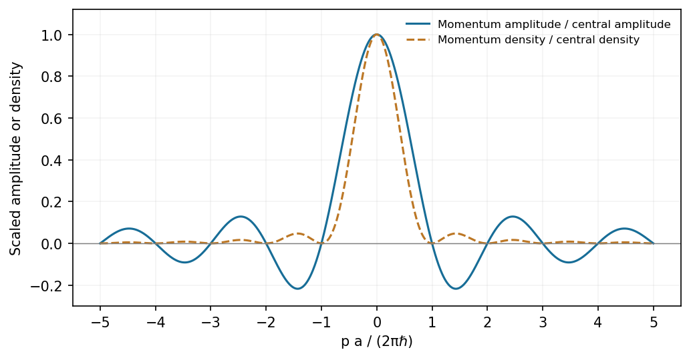

<h1 id="section-a/1/solution">Solution</h1>

↑ **Parent:** [1](../1.md)

Use the unitary position-to-momentum [Fourier transform](../../../../../fourier-transform-split.md) $\phi(p)=(2\pi\hbar)^{-1/2}\int\psi(x)e^{-ipx/\hbar}\,dx$. Integration gives

$$
\phi(p,0)=\frac1{\sqrt{2\pi\hbar a}}\frac{2\hbar}{p}\sin\!\left(\frac{pa}{2\hbar}\right)=\boxed{\sqrt{\frac{a}{2\pi\hbar}}\,\operatorname{sinc}\!\left(\frac{pa}{2\hbar}\right)},
$$

where $\operatorname{sinc}u=\sin u/u$ with its continuous value one at zero. The amplitude is real and even, with central maximum $\sqrt{a/(2\pi\hbar)}$, zeros at $p=2n\pi\hbar/a$ for nonzero integer $n$, and alternating-sign sidelobes decaying as $1/|p|$.

**[Figure 1](#section-a/1/image-a-finite-rectangular-position-amplitude-gives-a-sinc-momentum-amplitude-and-a-sinc-squared-momentum-density). A finite rectangular position amplitude gives a sinc momentum amplitude and a sinc-squared momentum density**. [Source](paper-1-top-hat-momentum.py).

The [probability density](../../../../../probability-density.md) is $|\phi|^2$, not the signed [Sinc function](../../../../../sinc-function.md) amplitude. Its integral is one by the unitarity of the [Fourier transform](../../../../../fourier-transform-split.md).

## ↑ Ancestors (14)

1. [1](../1.md)
2. [Section A](../../section-a.md)
3. [Paper 1](../../../paper-1-split.md)
4. [2016](../../../split.md)
5. [Past exam of the physics A course of the University of Cambridge](../../../../split.md)
6. [Physics A course of the University of Cambridge](../../../../../physics-a-course-of-the-university-of-cambridge.md)
7. [Physics course of the year 2 of the natural sciences course of the University of Cambridge](../../../../../physics-course-of-the-year-2-of-the-natural-sciences-course-of-the-university-of-cambridge.md)
8. [Year 2 of the natural sciences course of the University of Cambridge](../../../../../year-2-of-the-natural-sciences-course-of-the-university-of-cambridge.md)
9. [Year of the natural sciences course of the University of Cambridge](../../../../../year-of-the-natural-sciences-course-of-the-university-of-cambridge.md)
10. [Natural sciences course of the University of Cambridge](../../../../../natural-sciences-course-of-the-university-of-cambridge.md)
11. [Course of the University of Cambridge](../../../../../course-of-the-university-of-cambridge.md)
12. [University of Cambridge](../../../../../university-of-cambridge-split.md)
13. [List of universities](../../../../../list-of-universities.md)
14. [Codex Wiki](../../../../../split.md)
