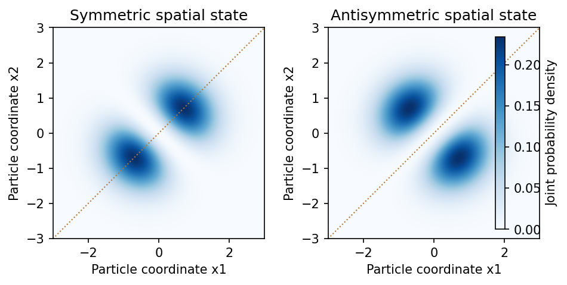

<h1 id="section-c/c10/solution">Solution</h1>

↑ **Parent:** [C10](../c10.md)

**[identical particles](../../../../../indistinguishable-particles.md) have the same intrinsic properties**, including mass, charge and [spin](../../../../../spin.md). Their labels are bookkeeping devices rather than measurable identities. When [wave functions](../../../../../wave-function-split.md) overlap, [quantum mechanics](../../../../../quantum-mechanics-split.md) supplies no observable trajectory that permanently identifies “particle 1” independently of “particle 2”. A many-particle description must therefore treat exchange consistently. The [Hamiltonian](../../../../../hamiltonian.md) and physical [observables](../../../../../observable.md) are invariant under relabelling [identical particles](../../../../../indistinguishable-particles.md).

For two particles, the [exchange operator](../../../../../exchange-operator.md) obeys $\hat P_{12}^2=\hat I$. The usual three-dimensional [symmetrization postulate](../../../../../symmetrization-postulate.md) selects states symmetric under exchange for [bosons](../../../../../boson.md) and antisymmetric for [fermions](../../../../../fermion.md). In relativistic quantum theory, the [Spin-statistics theorem](../../../../../spin-statistics-theorem.md) associates integer [spin](../../../../../spin.md) with [bosons](../../../../../boson.md) and half-integer [spin](../../../../../spin.md) with [fermions](../../../../../fermion.md) under its locality and positivity assumptions; the connection is not derived merely from $\hat P_{12}^2=\hat I$ in elementary nonrelativistic mechanics. For orthonormal one-particle states $u$ and $v$, the two-particle spatial combinations are

$$
\Psi_\pm(1,2)=\frac{u(1)v(2)\pm v(1)u(2)}{\sqrt2}.
$$

The sign concerns the **complete state**, including [spin](../../../../../spin.md) and other internal variables, not necessarily the spatial factor alone.

The antisymmetric state vanishes if both [fermions](../../../../../fermion.md) occupy the same one-particle state: this is the **[Pauli exclusion principle](../../../../../pauli-exclusion-principle.md)**. For $N$ [fermions](../../../../../fermion.md) in orthonormal [spin orbitals](../../../../../spin-orbital.md) $\chi_j$, the normalized [Slater determinant](../../../../../slater-determinant.md) $\Psi=(N!)^{-1/2}\det[\chi_j(i)]$ supplies the required exchange sign. Bosonic occupation has no corresponding upper limit, and symmetrized products describe many [bosons](../../../../../boson.md). Fermionic occupation is zero or one per complete one-particle state; two electrons can still occupy the same spatial [atomic orbital](../../../../../atomic-orbital.md) with opposite [spin](../../../../../spin.md).

[Spin](../../../../../spin.md) and spatial symmetry are linked. A two-electron [spin singlet state](../../../../../spin-singlet-state.md) is antisymmetric, so its spatial factor must be symmetric. A symmetric [triplet state](../../../../../spin-one-half-triplet-state.md) instead requires an antisymmetric spatial factor. Exchange then changes pair correlations and the energies available when interactions depend on particle separation, even without introducing a new classical “exchange [force](../../../../../force-split.md)”. It contributes to atomic shell structure, bonding and magnetic behaviour.

**[Figure 4](#section-c/c10/image-symmetric-and-antisymmetric-two-particle-spatial-states-have-different-joint-position-correlations). Symmetric and antisymmetric two-particle spatial states have different joint-position correlations**. [Source](paper-1-exchange-correlations.py).

In an occupation-number description, bosonic [creation and annihilation operators](../../../../../creation-and-annihilation-operators.md) satisfy $[\hat a_i,\hat a_j^\dagger]=\delta_{ij}$, whereas fermionic operators satisfy $\{\hat c_i,\hat c_j^\dagger\}=\delta_{ij}$ and anticommute among themselves. The latter imply $(\hat c_i^\dagger)^2=0$. This formalism implements the same exchange constraints without assigning permanent particle labels.

For noninteracting particles in [thermal equilibrium](../../../../../thermal-equilibrium-split.md), the mean occupation of a state of energy $\epsilon$ is

$$
\bar n_B=\frac1{e^{(\epsilon-\mu)/(k_BT)}-1},\qquad\bar n_F=\frac1{e^{(\epsilon-\mu)/(k_BT)}+1}.
$$

[Fermi-Dirac statistics](../../../../../fermi-dirac-statistics.md) produces a filled Fermi sea at zero [temperature](../../../../../temperature-split.md) and [degeneracy pressure](../../../../../degeneracy-pressure.md); [Bose-Einstein statistics](../../../../../bose-einstein-statistics.md) permits macroscopic [Ground state](../../../../../ground-state.md) occupation when the density of available states and thermodynamic conditions allow condensation. The different statistics therefore have measurable collective consequences, not just different notation.[Chapter 3, §§3.5–3.6: Bose and Fermi distributions, condensation and degenerate Fermi gases](../../../../../statistical-physics-by-david-tong.md)

When phase-space occupation is dilute, both distributions reduce to the [Maxwell–Boltzmann statistics](../../../../../maxwell-boltzmann-statistics.md) limit. Likewise, well-separated localized [wave packets](../../../../../wave-packet.md) have negligible overlap and small exchange corrections, so effectively labelled classical trajectories can become a useful approximation. In two spatial dimensions more general exchange statistics are possible; the standard boson/fermion account here concerns ordinary three-dimensional particles and their total states.

## ↑ Ancestors (14)

1. [C10](../c10.md)
2. [Section C](../../section-c.md)
3. [Paper 1](../../../paper-1-split.md)
4. [2016](../../../split.md)
5. [Past exam of the physics A course of the University of Cambridge](../../../../split.md)
6. [Physics A course of the University of Cambridge](../../../../../physics-a-course-of-the-university-of-cambridge.md)
7. [Physics course of the year 2 of the natural sciences course of the University of Cambridge](../../../../../physics-course-of-the-year-2-of-the-natural-sciences-course-of-the-university-of-cambridge.md)
8. [Year 2 of the natural sciences course of the University of Cambridge](../../../../../year-2-of-the-natural-sciences-course-of-the-university-of-cambridge.md)
9. [Year of the natural sciences course of the University of Cambridge](../../../../../year-of-the-natural-sciences-course-of-the-university-of-cambridge.md)
10. [Natural sciences course of the University of Cambridge](../../../../../natural-sciences-course-of-the-university-of-cambridge.md)
11. [Course of the University of Cambridge](../../../../../course-of-the-university-of-cambridge.md)
12. [University of Cambridge](../../../../../university-of-cambridge-split.md)
13. [List of universities](../../../../../list-of-universities.md)
14. [Codex Wiki](../../../../../split.md)
