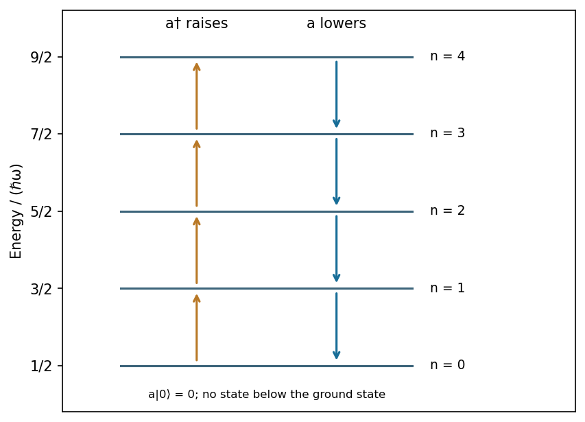

<h1 id="section-c/c11/c/solution">Solution</h1>

↑ **Parent:** [C](../c.md)

For the [Quantum harmonic oscillator](../../../../../../quantum-harmonic-oscillator-split.md) define

$$
\hat a=\frac{m\omega\hat x+i\hat p}{\sqrt{2m\hbar\omega}},\qquad\hat a^\dagger=\frac{m\omega\hat x-i\hat p}{\sqrt{2m\hbar\omega}}.
$$

The [Canonical commutation relation](../../../../../../canonical-commutation-relation.md) gives $[\hat a,\hat a^\dagger]=1$, and

$$
\boxed{\hat H=\hbar\omega(\hat a^\dagger\hat a+\tfrac12),\qquad[\hat H,\hat a^\dagger]=\hbar\omega\hat a^\dagger,\qquad[\hat H,\hat a]=-\hbar\omega\hat a.}
$$

Thus the [creation operator](../../../../../../creation-operator.md) and [annihilation operator](../../../../../../annihilation-operator.md) raise or lower the energy by one quantum. Positivity of $\hat a^\dagger\hat a$ and termination of downward stepping give $E_n=\hbar\omega(n+1/2)$, $n=0,1,\ldots$. Normalized actions are $\hat a|n\rangle=\sqrt n|n-1\rangle$ and $\hat a^\dagger|n\rangle=\sqrt{n+1}|n+1\rangle$. The annihilated [ground state](../../../../../../ground-state.md) obeys

$$
\psi_0(x)=\left(\frac{m\omega}{\pi\hbar}\right)^{1/4}e^{-m\omega x^2/(2\hbar)},\qquad|n\rangle=\frac{(\hat a^\dagger)^n}{\sqrt{n!}}|0\rangle.
$$

The nonzero [Ground state](../../../../../../ground-state.md) energy is the [zero-point energy](../../../../../../zero-point-energy.md), consistent with position-momentum [quantum uncertainty](../../../../../../quantum-uncertainty.md). Since $\hat x=\sqrt{\hbar/(2m\omega)}(\hat a+\hat a^\dagger)$, a perturbation linear in [position](../../../../../../position.md) connects only neighbouring number states. The algebra is especially useful for [matrix elements](../../../../../../matrix-element.md) and [selection rules](../../../../../../selection-rule.md).[Section 2: harmonic oscillator ladder construction](../../../../../../quantum-mechanics-by-david-tong.md)

**[Figure 5](#section-c/c11/c/image-creation-and-annihilation-connect-equally-spaced-oscillator-levels-while-the-ground-state-lowering-action-vanishes). Creation and annihilation connect equally spaced oscillator levels while the ground-state lowering action vanishes**. [Source](paper-1-oscillator-ladder.py).

## ↑ Ancestors (15)

1. [C](../c.md)
2. [C11](../../c11.md)
3. [Section C](../../../section-c.md)
4. [Paper 1](../../../../paper-1-split.md)
5. [2016](../../../../split.md)
6. [Past exam of the physics A course of the University of Cambridge](../../../../../split.md)
7. [Physics A course of the University of Cambridge](../../../../../../physics-a-course-of-the-university-of-cambridge.md)
8. [Physics course of the year 2 of the natural sciences course of the University of Cambridge](../../../../../../physics-course-of-the-year-2-of-the-natural-sciences-course-of-the-university-of-cambridge.md)
9. [Year 2 of the natural sciences course of the University of Cambridge](../../../../../../year-2-of-the-natural-sciences-course-of-the-university-of-cambridge.md)
10. [Year of the natural sciences course of the University of Cambridge](../../../../../../year-of-the-natural-sciences-course-of-the-university-of-cambridge.md)
11. [Natural sciences course of the University of Cambridge](../../../../../../natural-sciences-course-of-the-university-of-cambridge.md)
12. [Course of the University of Cambridge](../../../../../../course-of-the-university-of-cambridge.md)
13. [University of Cambridge](../../../../../../university-of-cambridge-split.md)
14. [List of universities](../../../../../../list-of-universities.md)
15. [Codex Wiki](../../../../../../split.md)
