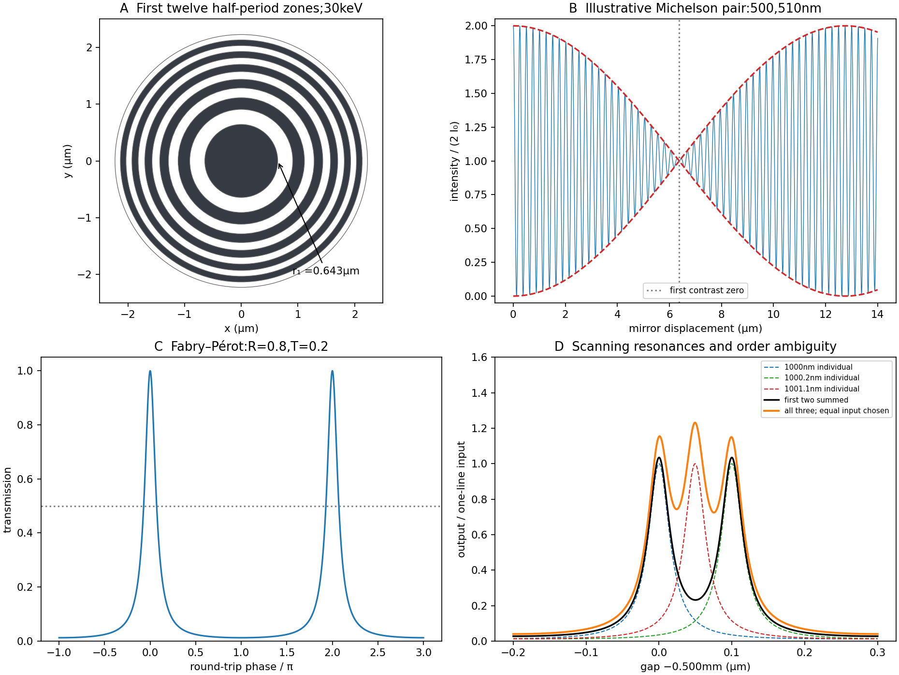
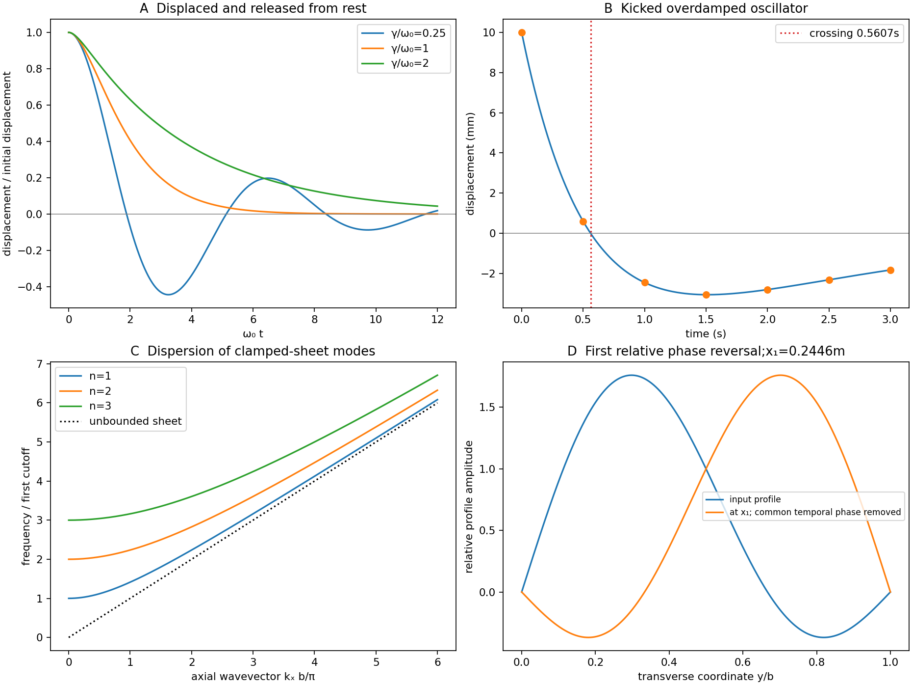

# Paper 2

↑ **Parent:** [2016](../2016.md)

Original source: [Original released paper, physical PDF pages 120–127](https://www.whatdotheyknow.com/request/natural_science_tripos_physics_e_2/response/2340776/attach/2/FOI%202023%20399%20Zahid%20materials.pdf?cookie_passthrough=1#page=120). All questions and all three D13 alternatives are covered.

**Table of contents**

- [Section A](#section-a)
  - [1](#section-a/1)
    - [Solution](#section-a/1/solution)
  - [2](#section-a/2)
    - [Solution](#section-a/2/solution)
  - [3](#section-a/3)
    - [Solution](#section-a/3/solution)
  - [4](#section-a/4)
    - [Solution](#section-a/4/solution)
  - [5](#section-a/5)
    - [Solution](#section-a/5/solution)
- [Section B](#section-b)
  - [B6](#section-b/b6)
    - [Solution](#section-b/b6/solution)
  - [B7](#section-b/b7)
    - [Solution](#section-b/b7/solution)
  - [B8](#section-b/b8)
    - [Solution](#section-b/b8/solution)
  - [B9](#section-b/b9)
    - [Solution](#section-b/b9/solution)
- [Section C](#section-c)
  - [C10](#section-c/c10)
    - [Solution](#section-c/c10/solution)
  - [C11](#section-c/c11)
    - [Solution](#section-c/c11/solution)
- [Section D](#section-d)
  - [D12](#section-d/d12)
    - [Solution](#section-d/d12/solution)
  - [D13](#section-d/d13)
    - [a](#section-d/d13/a)
      - [Solution](#section-d/d13/a/solution)
    - [b](#section-d/d13/b)
      - [Solution](#section-d/d13/b/solution)
    - [c](#section-d/d13/c)
      - [Solution](#section-d/d13/c/solution)

## Section A

↑ **Parent:** [Paper 2](paper-2.md)

<h3 id="section-a/1">1</h3>

↑ **Parent:** [Section A](#section-a)

<h4 id="section-a/1/solution">Solution</h4>

↑ **Parent:** [1](#section-a/1)

For a lossless [antireflection coating](../../physical-optics.md#antireflection-coating), cancellation requires both equal reflected [wave amplitudes](../../wave.md#wave-amplitude) and an odd half-cycle difference in their round-trip [wave phase](../../wave.md#phase-waves). At [normal incidence](../../optics.md#normal-incidence) the interface amplitude coefficients are $r_{01}=(n_0-n)/(n_0+n)$ and $r_{12}=(n-n_s)/(n+n_s)$. Choosing $n_0<n<n_s$ makes both negative: both [reflections](../../linear-algebra.md#reflection-mathematics) acquire the same $\pi$ phase reversal. A quarter-wave optical thickness supplies their remaining relative phase $\pi$.

Equal amplitudes require $r_{01}=r_{12}$, which reduces to $n^2=n_0n_s$. Thus

$$
\boxed{n=\sqrt{1.4(1.6)}=1.49666,\qquad
d_{\min}=\frac{500\ {\rm nm}}{4n}=83.52\ {\rm nm}.}
$$

The exact multilayer [reflection](../../linear-algebra.md#reflection-mathematics) amplitude is zero for these choices, not merely the sum of the first two reflected rays: its numerator is $r_{01}+r_{12}e^{2i\beta}=0$, with $\beta=2\pi nd/\lambda_0=\pi/2$. Any positive odd multiple of this thickness has the same cancellation at the design [wavelength](../../wave-equation.md#wavelength); the smallest is the thin-layer choice. [absorption](../../radiometry.md#absorption-electromagnetic-radiation), index dispersion, angular spread and deviations from the selected [wavelength](../../wave-equation.md#wavelength) limit the practical cancellation.

<h3 id="section-a/2">2</h3>

↑ **Parent:** [Section A](#section-a)

<h4 id="section-a/2/solution">Solution</h4>

↑ **Parent:** [2](#section-a/2)

A [Fresnel zone plate](../../physical-optics.md#zone-plate) replaces a conventional refracting surface by concentric alternating transmitting and absorbing annuli. Successive annuli span half a [wavelength](../../wave-equation.md#wavelength) of optical-path excess to the chosen focus; blocking alternate zones prevents their approximately opposite [wave phases](../../wave.md#phase-waves) from cancelling. For a normally incident [plane wave](../../wave-function.md#plane-wave),

$$
\sqrt{f^2+r_j^2}-f=\frac{j\lambda}{2},\qquad
r_j^2=j\lambda f+\frac{j^2\lambda^2}{4}
\simeq j\lambda f.
$$

The paraxial radii grow as $\sqrt j$, so the zones become narrower outwards.

Using the [photon energy](../../quantum-mechanics.md#photon-energy) relation $\lambda=hc/E$ gives **$\lambda=4.133\times10^{-11}\ {\rm m}=0.04133\ {\rm nm}$**. For $f=10^{-2}\ {\rm m}$,

$$
\boxed{r_j\simeq0.6429\sqrt j\ \mu{\rm m}.}
$$

The first three boundaries are approximately $0.6429$, $0.9092$ and $1.1135\ \mu{\rm m}$. This fixes the zone pattern but **does not fix a unique outside diameter**: the number of zones is a design choice. For example, $N=100$ gives radius $6.429\ \mu{\rm m}$, diameter $12.86\ \mu{\rm m}$ and outermost zone width about $32.2\ {\rm nm}$. A larger usable diameter requires finer outer zones.

One could pattern absorbing [metal](../../chemical-substance.md#metal) annuli on a thin X-ray-transparent support, choosing absorber thickness from its attenuation at the selected [photon energy](../../quantum-mechanics.md#photon-energy); that thickness cannot be determined from [energy](../../energy.md) and [focal length](../../geometrical-optics.md#focal-length) alone. The design is chromatic: for fixed radii $f\propto1/\lambda$, so a narrow [energy](../../energy.md) band is needed for a sharp common focus.

**[Figure 1](#section-a/2/image-original-zone-plate-radii-michelson-visibility-envelope-and-fabry-perot-transmission-calculations). Original zone-plate radii, Michelson visibility envelope and Fabry–Pérot transmission calculations**. The zone-plate panel shows the first twelve mathematical zones, not a specified complete fabricated device. The Michelson panel uses a declared illustrative [wavelength](../../wave-equation.md#wavelength) pair. The etalon panels use the calculated transmission; the added third line is plotted with a chosen equal input intensity.

<h3 id="section-a/3">3</h3>

↑ **Parent:** [Section A](#section-a)

<h4 id="section-a/3/solution">Solution</h4>

↑ **Parent:** [3](#section-a/3)

Let $x$ be [mirror](../../optical-instrument.md#mirror) [displacement](../../classical-mechanics.md#displacement) from equal optical paths in a [Michelson interferometer](../../physical-optics.md#michelson-interferometer), so the [optical path difference](../../physical-optics.md#optical-path-difference) is $2x$. Different spectral components add detected [light intensities](../../wave.md#light-intensity); each component interferes with its own delayed copy. For equal line strengths and ideally balanced arms, write

$$
I(x)=I_0[1+\cos(4\pi x/\lambda_1)]
+I_0[1+\cos(4\pi x/\lambda_2)].
$$

The [trigonometric identity](../../geometry-and-topology.md#trigonometric-identity) for the sum of cosines gives

$$
I(x)=2I_0\left[1+
\cos\!\left(2\pi x\left(\frac1{\lambda_1}-\frac1{\lambda_2}\right)\right)
\cos\!\left(2\pi x\left(\frac1{\lambda_1}+\frac1{\lambda_2}\right)\right)
\right].
$$

Thus the sketch consists of rapid fringes within a slowly varying contrast envelope. With $\bar\lambda$ the mean [wavelength](../../wave-equation.md#wavelength) and $|\Delta\lambda|\ll\bar\lambda$, the mirror-displacement fringe spacing is **$\bar\lambda/2$**. The [interference visibility](../../physical-optics.md#interferometric-visibility) is

$$
\mathcal V(x)=\left|\cos(2\pi x\Delta s)\right|,
\qquad \Delta s=\left|\lambda_1^{-1}-\lambda_2^{-1}\right|.
$$

The first contrast zero is at $x=1/(4\Delta s)$; successive visibility maxima are separated by

$$
\boxed{\Delta x_{\rm revival}=\frac1{2\Delta s}
\simeq\frac{\bar\lambda^2}{2|\Delta\lambda|}.}
$$

Between successive contrast zeros the signed envelope changes sign, shifting the rapid fringes by half a cycle. Unequal line strengths leave a nonzero minimum contrast. Finite linewidth adds a longer-range coherence envelope, while arm imbalance and polarization mismatch can reduce contrast without indicating a different spectral spacing.

<h3 id="section-a/4">4</h3>

↑ **Parent:** [Section A](#section-a)

<h4 id="section-a/4/solution">Solution</h4>

↑ **Parent:** [4](#section-a/4)

Use periodic [boundary conditions](../../differential-equation.md#boundary-condition) temporarily to count the allowed [wavevectors](../../elasticity-physics.md#wavevector). Each state occupies $(2\pi)^3/V$ in reciprocal space. For one acoustic polarization, the spherical shell between $k$ and $k+dk$ contains

$$
dN=\frac{V}{(2\pi)^3}4\pi k^2\,dk.
$$

Both positive and negative [wavevector](../../elasticity-physics.md#wavevector) directions are already included in that sphere; no further factor of two is needed. With the linear [dispersion relation](../../dispersion-relation.md) $k=\omega/v_s$,

$$
g_1(\omega)=\frac{dN}{d\omega}
=\frac{V\omega^2}{2\pi^2v_s^3}.
$$

A three-dimensional monatomic [crystal](../../thermodynamics.md#crystal) has three acoustic branches. Under the stated common-speed approximation,

$$
\boxed{g(\omega)=\frac{3V\omega^2}{2\pi^2v_s^3}.}
$$

This is a [phonon density of states](../../quantum-ideal-gas-statistics.md#phonon-density-of-states) per unit [angular frequency](../../lagrangian-mechanics.md#angular-frequency), not per unit ordinary [frequency](../../wave.md#frequency). If longitudinal and transverse speeds differ, the isotropic expression becomes $g=V\omega^2(v_L^{-3}+2v_T^{-3})/(2\pi^2)$. In the [Debye model](../../quantum-ideal-gas-statistics.md#debye-model), imposing $\int_0^{\omega_D}g(\omega)\,d\omega=3N$ sets the cutoff; the linear approximation is not continued to arbitrarily high [frequency](../../wave.md#frequency) in a finite [lattice](../../mathematical-logic.md#lattice).

<h3 id="section-a/5">5</h3>

↑ **Parent:** [Section A](#section-a)

<h4 id="section-a/5/solution">Solution</h4>

↑ **Parent:** [5](#section-a/5)

The [effective mass](../../bloch-s-theorem.md#band-effective-mass) follows from the curvature of the [electronic band structure](../../bloch-s-theorem.md#electronic-band-structure). Differentiating twice gives

$$
\frac{dE}{dk}=\frac{\hbar^2}{m_ea}\sin ka,\qquad
\frac{d^2E}{dk^2}=\frac{\hbar^2}{m_e}\cos ka,
\qquad m_e^*(k)=\frac{m_e}{\cos ka}.
$$

At either first [Brillouin zone](../../bloch-s-theorem.md#brillouin-zone) boundary $k=\pm\pi/a$,

$$
\boxed{m_e^*=-m_e.}
$$

The boundary is a band maximum, with negative curvature and zero [group velocity](../../dispersion-relation.md#group-velocity). In the semiclassical single-band description, an applied [force](../../force.md) changes $\hbar k$; the resulting [acceleration](../../classical-mechanics.md#acceleration) is opposite the [force](../../force.md) near that maximum. This is a band-response coefficient, not a negative microscopic [electron](../../physics.md#electron) rest mass. A nearly filled band is often described more conveniently through positively charged [electron holes](../../quantum-mechanics.md#electron-hole) near its maximum.

## Section B

↑ **Parent:** [Paper 2](paper-2.md)

<h3 id="section-b/b6">B6</h3>

↑ **Parent:** [Section B](#section-b)

<h4 id="section-b/b6/solution">Solution</h4>

↑ **Parent:** [B6](#section-b/b6)

Put $\omega_0=\sqrt{k/m}$ and $\gamma=b/(2m)$. The characteristic roots are $-\gamma\pm\sqrt{\gamma^2-\omega_0^2}$. For release from rest at [displacement](../../classical-mechanics.md#displacement) $x_0>0$, the three regimes are

$$
x(t)=
\begin{cases}
x_0e^{-\gamma t}\left[\cos(\omega_dt)+\dfrac{\gamma}{\omega_d}\sin(\omega_dt)\right],
&0<\gamma<\omega_0,\quad \omega_d=\sqrt{\omega_0^2-\gamma^2},\\
x_0(1+\omega_0t)e^{-\omega_0t},
&\gamma=\omega_0,\\
x_0e^{-\gamma t}\left[\cosh(st)+\dfrac{\gamma}{s}\sinh(st)\right],
&\gamma>\omega_0,\quad s=\sqrt{\gamma^2-\omega_0^2}.
\end{cases}
$$

[underdamping](../../wave-equation.md#underdamping) produces decaying oscillations; [critical damping](../../wave-equation.md#critical-damping) is the repeated-root boundary; [overdamping](../../wave-equation.md#overdamping) has two real decay rates. The critical and overdamped curves from rest approach equilibrium without crossing it. All three initially have zero slope and negative [acceleration](../../classical-mechanics.md#acceleration). A sufficiently strong initial kick can cause a single crossing even without an oscillatory mode.

For the critical oscillator with initial [velocity](../../classical-mechanics.md#velocity) $-v_0$, the repeated-root solution is

$$
x(t)=\left[x_0+(\omega_0x_0-v_0)t\right]e^{-\omega_0t}.
$$

Its exponential is positive at finite time. Therefore the bracket has a positive-time zero precisely when

$$
\boxed{v_0>\omega_0x_0,\qquad
t_{\rm cross}=\frac{x_0}{v_0-\omega_0x_0}.}
$$

Equality gives a pure positive exponential and no finite-time crossing.

For the specified numerical oscillator, $\omega_0=1\ {\rm s^{-1}}$ and $\gamma=2/\sqrt3\ {\rm s^{-1}}>1\ {\rm s^{-1}}$, verifying [overdamping](../../wave-equation.md#overdamping). Its two roots are $-1/\sqrt3$ and $-\sqrt3$ in inverse seconds. The initial conditions give

$$
\boxed{x(t)=
(0.015-0.015\sqrt3)e^{-t/\sqrt3}
+(0.015\sqrt3-0.005)e^{-\sqrt3t}\quad{\rm m},}
$$

with $t$ in seconds. The slow component has a negative coefficient; the fast positive component initially dominates.

The values for the requested plot are

$$
\begin{array}{c|rrrrrrr}
t\ ({\rm s})&0&0.5&1.0&1.5&2.0&2.5&3.0\\
x\ ({\rm mm})&10.000&0.598&-2.452&-3.057&-2.804&-2.317&-1.827
\end{array}
$$

The curve crosses near $0.56\ {\rm s}$ and then returns toward zero from below. The exact expression provides a check on the graphical estimate:

$$
\boxed{t_{\rm cross}=\frac{\sqrt3}{2}
\ln\!\left(\frac{0.015\sqrt3-0.005}{0.015\sqrt3-0.015}\right)
\simeq0.561\ {\rm s}.}
$$

**[Figure 2](#section-b/b6/image-original-damped-oscillator-solutions-and-clamped-sheet-waveguide-calculations). Original damped-oscillator solutions and clamped-sheet waveguide calculations**. Rest-release curves compare three [damping](../../wave-equation.md#damping) regimes; the separate kicked overdamped trajectory includes the requested sampling times. The guided-mode panel plots the dispersion branches, and the profile panel compares the two-mode input with its first phase-reversed transverse profile.

<h3 id="section-b/b7">B7</h3>

↑ **Parent:** [Section B](#section-b)

<h4 id="section-b/b7/solution">Solution</h4>

↑ **Parent:** [B7](#section-b/b7)

For a uniform taut sheet in the small-displacement approximation, the two-dimensional [wave equation](../../wave-equation.md) is

$$
\partial_t^2\psi=v^2(\partial_x^2\psi+\partial_y^2\psi).
$$

Seek a harmonic solution $Y(y)e^{i\omega t-ik_xx}$. The clamped edges impose [Dirichlet boundary conditions](../../differential-equation.md#dirichlet-boundary-condition) $Y(0)=Y(b)=0$. Hence $Y''+k_y^2Y=0$ has nontrivial solutions only for

$$
Y=A\sin(n\pi y/b),\qquad k_y=n\pi/b,\quad n=1,2,\ldots.
$$

Taking the real part gives the stated sinusoidal transverse profile. There is no nonzero $n=0$ mode satisfying both clamped boundaries.

Substitution gives the [dispersion relation](../../dispersion-relation.md)

$$
\boxed{\omega_n^2=v^2\left[k_x^2+(n\pi/b)^2\right].}
$$

The three branches have cutoffs $\omega_{c,n}=n\pi v/b$ at $k_x=0$ and approach $\omega=v|k_x|$ at large $|k_x|$. Only frequencies above a branch's cutoff give traveling [waves](../../wave.md) along an infinitely long guide; below it, the axial dependence is evanescent. For a forward propagating mode,

$$
\boxed{v_{p,n}=\frac{\omega}{k_x}
=\frac{v}{\sqrt{1-(nv/(2bf))^2}},\qquad
v_{g,n}=\frac{d\omega}{dk_x}=\frac{v^2}{v_{p,n}}.}
$$

The [phase velocity](../../dispersion-relation.md#phase-velocity) exceeds $v$, while the [group velocity](../../dispersion-relation.md#group-velocity) is smaller: the carrier phase speed is not the signal speed.

Here the first two cutoff frequencies are $50$ and $100\ {\rm Hz}$, so both modes propagate at $200\ {\rm Hz}$. With $\omega=400\pi\ {\rm s^{-1}}$,

$$
\boxed{
\begin{array}{c|cc}
n&k_x\ ({\rm m^{-1}})&v_p\ ({\rm m\,s^{-1}})\\
1&10\pi\sqrt{15}=121.673&40/\sqrt{15}=10.328\\
2&20\pi\sqrt3=108.828&20/\sqrt3=11.547
\end{array}}
$$

Each transverse mode independently acquires its axial phase. The second mode first changes sign relative to the first when $(k_1-k_2)x_1=\pi$, giving

$$
\boxed{x_1=\frac{\pi}{10\pi\sqrt{15}-20\pi\sqrt3}
=\frac{1}{10(\sqrt{15}-2\sqrt3)}
\simeq0.2446\ {\rm m}.}
$$

At that distance a common temporal phase is $\phi=-k_1x_1$ modulo $2\pi$; the second term is negative relative to the first for every $y$ and every time, not just at one selected instant.

In an optical fibre, different guided modes have different [group velocities](../../dispersion-relation.md#group-velocity), so an input pulse becomes a sum of differently delayed pulses. This [intermodal dispersion](../../dispersion-relation.md#intermodal-dispersion) broadens pulses and can make adjacent digital symbols overlap. A [single-mode optical fiber](../../optical-instrument.md#single-mode-optical-fiber) removes this particular mode-delay mechanism; a [graded-index optical fiber](../../optical-instrument.md#graded-index-optical-fiber) can reduce it in a multimode design. Single-mode propagation still permits wavelength-dependent group delay, so it does not remove every kind of [optical dispersion](../../geometrical-optics.md#dispersion-optics).

<h3 id="section-b/b8">B8</h3>

↑ **Parent:** [Section B](#section-b)

<h4 id="section-b/b8/solution">Solution</h4>

↑ **Parent:** [B8](#section-b/b8)

The Fourier expression is the scalar [Fraunhofer diffraction](../../physical-optics.md#fraunhofer-diffraction) approximation for coherent, effectively monochromatic illumination with a uniform incident [plane wave](../../wave-function.md#plane-wave) over the [aperture](../../optics.md#aperture). At a distant screen the aperture-dependent quadratic propagation phase must be negligible, roughly $D^2/(\lambda z)\ll1$ for transverse size $D$. Alternatively, a [thin lens](../../geometrical-optics.md#thin-lens) forms the angular [Fourier transform](../../fourier-transform.md) in its back focal plane. That focal-plane construction is the appropriate one here; the aperture-to-lens distance need not itself be an enormous free-propagation distance. [aperture](../../optics.md#aperture) features should be large compared with [wavelength](../../wave-equation.md#wavelength) for this simple scalar transmission-mask model.

If complementary transmissions are $h$ and $1-h$, linearity gives $U_h+U_{1-h}=U_{\rm free}$. Away from the undiffracted forward beam, the uniform plane-wave contribution $U_{\rm free}$ vanishes in angular space, so $U_{1-h}=-U_h$ and their intensities agree. This is [Babinet's principle](../../physical-optics.md#babinet-s-principle). **It equates the off-forward diffracted intensities, not the transmitted power or the on-axis intensity including the direct beam.**

Let $X,Y$ be screen coordinates conjugate to [aperture](../../optics.md#aperture) coordinates $x,y$, so $p\simeq kX/f$, $q\simeq kY/f$. With width $a=0.2\ {\rm mm}$ along $x$ and height $b=0.5\ {\rm mm}$ along $y$, define $\operatorname{sinc}u=\sin u/u$. The complementary rectangle has transform

$$
H(p,q)=ab\,\operatorname{sinc}(pa/2)\operatorname{sinc}(qb/2).
$$

Thus the obstruction's off-forward scattered component has

$$
I_{\rm sc}(X,Y)\propto
\operatorname{sinc}^2\!\left(\frac{\pi aX}{\lambda f}\right)
\operatorname{sinc}^2\!\left(\frac{\pi bY}{\lambda f}\right).
$$

Its dark lines occur at

$$
\boxed{X=m(0.500\ {\rm mm}),\qquad
Y=n(0.200\ {\rm mm}),\quad m,n=\pm1,\pm2,\ldots.}
$$

The central-lobe zero-to-zero size is $1.00\ {\rm mm}$ by $0.400\ {\rm mm}$; it is wider in the direction conjugate to the narrower obstruction. The central forward image of the illuminating beam must be distinguished from this scattered envelope in a real screen observation.

The source figure gives centre-to-centre separation $D=1.0\ {\rm mm}$. Choose the three rectangle centres at $x=-D,0,D$; an overall translation changes only the transform phase. Their scattered amplitude is proportional to

$$
H_3(p,q)=ab\,\operatorname{sinc}(pa/2)\operatorname{sinc}(qb/2)
[1+2\cos(pD)].
$$

Therefore

$$
\boxed{I_{\rm sc}(X,Y)\propto
\operatorname{sinc}^2\!\left(\frac{\pi aX}{\lambda f}\right)
\operatorname{sinc}^2\!\left(\frac{\pi bY}{\lambda f}\right)
\left[1+2\cos\!\left(\frac{2\pi DX}{\lambda f}\right)\right]^2.}
$$

Along the screen's $x$ direction, the three-element interference factor has principal maxima separated by **$\lambda f/D=0.100\ {\rm mm}$**, under the single-rectangle envelope. Its zeros lie at $X=(m+1/3)(0.100\ {\rm mm})$ and $(m+2/3)(0.100\ {\rm mm})$. It also has weaker secondary maxima between principal orders. Every fifth principal order coincides with a single-rectangle zero and is missing; multiplication by the envelope slightly shifts maxima away from the nominal interference-factor positions. The figure plots the calculated scattered component and marks the separate direct-beam limitation.

**[Figure 3](#section-b/b8/image-original-calculated-rectangular-obstruction-and-three-element-fraunhofer-scattered-intensities). Original calculated rectangular-obstruction and three-element Fraunhofer scattered intensities**. Screen coordinates are physical conjugates of the obstruction coordinates. All plotted values describe the scattered component; the unresolved undiffracted illumination at the origin is excluded. Intensities are normalized, and no source figure is reproduced.

<h3 id="section-b/b9">B9</h3>

↑ **Parent:** [Section B](#section-b)

<h4 id="section-b/b9/solution">Solution</h4>

↑ **Parent:** [B9](#section-b/b9)

Let the first transmitted [complex amplitude](../../wave.md#complex-amplitude) be $T E_{\rm in}e^{ikd}$: two amplitude transmission factors each of magnitude $\sqrt T$ give magnitude $T$. Each extra internal round trip adds two amplitude [reflections](../../linear-algebra.md#reflection-mathematics), with combined magnitude $R$, and phase $\delta$. With the [mirror](../../optical-instrument.md#mirror) phase convention already incorporated in the stipulated $\delta$,

$$
E_{\rm out}=TE_{\rm in}e^{ikd}\sum_{j=0}^{\infty}(Re^{i\delta})^j
=\frac{TE_{\rm in}e^{ikd}}{1-Re^{i\delta}}.
$$

Taking the squared modulus gives

$$
\boxed{B=\frac{T^2}{1+R^2-2R\cos\delta}.}
$$

It is $R$, not $R^2$, that multiplies the field after a round trip; $R^2$ would be the corresponding round-trip intensity fraction.

At resonance $\delta=2m\pi$, $B_{\max}=T^2/(1-R)^2$. If $h$ is the positive phase [displacement](../../classical-mechanics.md#displacement) to half maximum,

$$
\sin(h/2)=\frac{1-R}{2\sqrt R},\qquad
h=2\arcsin\frac{1-R}{2\sqrt R}
\simeq\frac{1-R}{\sqrt R}.
$$

For $R=0.80$, **the stipulated high-reflectivity approximation gives $h=0.2236\ {\rm rad}$**, while the exact value is $0.2241\ {\rm rad}$. The full width is twice this value. With $T=0.20$, $B_{\max}=1$, $B_{\min}=T^2/(1+R)^2=1/81$ and the pattern repeats every $2\pi$. Its ideal [finesse](../../optical-instrument.md#finesse) is approximately $\pi\sqrt R/(1-R)=14.05$.

A [wavelength](../../wave-equation.md#wavelength) component resonates at $d=m\lambda/2$. Within the scan interval, the individual resonances are

$$
\boxed{
\begin{array}{c|c|c}
\lambda\ ({\rm nm})&m&d\ ({\rm mm})\\
1000.0&1000&0.500000\\
1000.2&1000&0.500100
\end{array}}
$$

No neighboring orders of these lines fall within the stated interval. The observed signal is the sum of their two Airy transmissions, since different spectral components add intensities. Individual resonance positions identify the two peaks to the plotted precision; the tails cause very small shifts of the maxima of the sum.

The gap-coordinate full width is

$$
\Delta d_{\rm FWHM}=\frac{\lambda h}{2\pi}\simeq0.0357\ \mu{\rm m}.
$$

The separation is $0.100\ \mu{\rm m}$, about $2.8$ full widths, so **the two components can be resolved by the ideal etalon**. The equivalent [wavelength](../../wave-equation.md#wavelength) resolution near order $1000$ is about $\lambda/(m\mathcal F)\simeq0.071\ {\rm nm}$, smaller than their $0.2\ {\rm nm}$ separation.

The added [wavelength](../../wave-equation.md#wavelength) has an order-$999$ resonance at

$$
\boxed{d=\frac{999(1001.1\ {\rm nm})}{2}
=0.50004945\ {\rm mm}.}
$$

It lies between the preceding two peaks; its adjacent orders are outside the scan. Its input strength was not specified, so the third peak's height cannot be uniquely assigned. The original plot uses equal strength only as a declared illustration.

This is an order-identification problem: the [free spectral range](../../physical-optics.md#free-spectral-range) near $d=0.5\ {\rm mm}$ is $\Delta\lambda_{\rm FSR}\simeq\lambda^2/(2d)\simeq1\ {\rm nm}$. A line more than one [free spectral range](../../physical-optics.md#free-spectral-range) away can appear among peaks of another order. A lower-resolution prefilter or additional dispersive spectrometer is needed to identify the order; a narrow peak alone does not identify an absolute [wavelength](../../wave-equation.md#wavelength). [mirror](../../optical-instrument.md#mirror) parallelism, beam collimation and detector angular acceptance must also be controlled before attributing a measured width entirely to reflectivity.[pp.2–5, instrument finesse and free spectral range; central-spot scanning discussion](../../physics-bibliography.md#fabry-perot-interferometer-university-of-washington-physics-331)

## Section C

↑ **Parent:** [Paper 2](paper-2.md)

<h3 id="section-c/c10">C10</h3>

↑ **Parent:** [Section C](#section-c)

<h4 id="section-c/c10/solution">Solution</h4>

↑ **Parent:** [C10](#section-c/c10)

Take the [electron](../../physics.md#electron)'s signed charge to be $e=-q$, where $q>0$ is the elementary-charge magnitude. Conventional [electric current](../../electric-charge.md#electric-current) flows along $+x$, while the mean [electron](../../physics.md#electron) drift [velocity](../../classical-mechanics.md#velocity) is negative. With $\mathbf B=B_z\hat{\mathbf z}$, the magnetic [Lorentz force](../../relativistic-electromagnetism.md#lorentz-force) separates charge across the width until a transverse [electric field](../../electric-field.md) balances it. The accumulated edge charge then sustains a [Hall voltage](../../relativistic-electromagnetism.md#hall-voltage) without a transverse steady current. In a one-carrier model, the [Hall coefficient](../../relativistic-electromagnetism.md#hall-coefficient) identifies the sign and [number density](../../statistical-physics.md#number-density) of carriers; real multiband materials require a more careful interpretation.

The [acceleration](../../classical-mechanics.md#acceleration) term contains the [effective mass](../../bloch-s-theorem.md#band-effective-mass) describing the local band response. The relaxation term removes drift [momentum](../../momentum.md) on the mean momentum-relaxation time $\tau$. The remaining two terms are the electric and magnetic [Lorentz force](../../relativistic-electromagnetism.md#lorentz-force) on signed charge $e$; the magnetic [force](../../force.md) is perpendicular to [velocity](../../classical-mechanics.md#velocity) and does no instantaneous work. The relaxation-time approximation replaces individual scattering events by an averaged drift equation.

Let $n$ be the [electron](../../physics.md#electron) [number density](../../statistical-physics.md#number-density), distinct from the negative charge $e$. In transverse open circuit $\langle\mathbf v\rangle=(v_x,0,0)$ and $j_x=ne v_x=I_x/(wt)$. The steady component equations give

$$
0=-\frac{m^*v_x}{\tau}+eE_x,\qquad
0=e(E_y-v_xB_z),\qquad E_z=0,
$$

hence

$$
\boxed{E_x=\frac{m^*}{ne^2\tau}\,j_x,\qquad
E_y=\frac{B_z}{ne}\,j_x,\qquad E_z=0.}
$$

Consequently

$$
\boxed{\sigma=\frac{ne^2\tau}{m^*},\qquad
R_H=\frac1{ne}=-\frac1{nq}.}
$$

There is no sign ambiguity in this field-defined $R_H$ once axes and carrier charge are fixed.

A measured voltage ratio additionally needs probe polarities, which the geometric bar diagram does not label. To reproduce the positive ratio specified for [electrons](../../physics.md#electron), define the longitudinal voltage drop $V_x=\varphi(0)-\varphi(l)=E_xl$ and the transverse rise $V_y=\varphi(w)-\varphi(0)=-E_yw$. Then

$$
\boxed{\frac{V_y}{V_x}=-\frac{eB_z\tau}{m^*}\frac wl.}
$$

Reversing either voltage's probes reverses the measured ratio, without changing the physical carrier density. With both voltages instead defined as drops along their positive axes, the algebraic ratio would have the opposite sign. The figure records the convention used here.

For the density, geometry gives $\rho=Rwt/l=Rt/(l/w)$ and $|R_H|=t|V_y|/(I_x|B_z|)=tR|V_y/V_x|/|B_z|$. Thus

$$
\rho=5.50\times10^{-9}\ {\rm \Omega\,m},\qquad
|R_H|=7.15\times10^{-11}\ {\rm m^3\,C^{-1}},
$$

and

$$
\boxed{n=\frac1{q|R_H|}
\simeq8.73\times10^{28}\ {\rm m^{-3}}.}
$$

The mobility is $\mu=|R_H|/\rho=0.0130\ {\rm m^2\,V^{-1}\,s^{-1}}$. With $m^*=m_e$,

$$
\boxed{\tau=\frac{m_e\mu}{q}
\simeq7.39\times10^{-14}\ {\rm s}.}
$$

A monovalent copper model assigns roughly one delocalized conduction [electron](../../physics.md#electron) per atom to a broad, approximately free-electron-like band. Using $m_e$ is therefore a sensible first estimate for its transport scale. Monovalence alone does not prove that every band curvature or orbit has exactly the free mass: periodic-potential mixing, the nonspherical [Fermi surface](../../fermi-liquid.md#fermi-surface) and direction-dependent scattering limit the model. The calculated $\tau$ is conditional on the stipulated effective-mass approximation.

Experimentally, reverse both current and [magnetic field](../../magnetic-field.md) and extract the part of the transverse voltage odd in each. This rejects fixed contact offsets and much longitudinal pickup; use four-terminal longitudinal sensing, measure dimensions independently and check heating before assigning material parameters. These controls are implemented in a reusable Hall/conductivity teaching experiment, although that experiment uses germanium rather than the copper sample here.[pp.1–3, equipment, contact geometry, room-temperature conductivity and four current/field polarity combinations](../../physics-bibliography.md#the-hall-effect-and-conductivity-in-germanium-by-rex-tayloe)

**[Figure 4](#section-c/c10/image-original-hall-polarity-convention-scattering-geometry-and-triangular-direct-reciprocal-lattices). Original Hall-polarity convention, scattering geometry and triangular direct/reciprocal lattices**. The Hall sketch defines both measured voltage polarities and uses negative [electron](../../physics.md#electron) charge. The [lattice](../../mathematical-logic.md#lattice) panels use axes and reciprocal units chosen for the derivation; the first nonzero reciprocal-vector magnitude is distinguished from the forward peak.

<h3 id="section-c/c11">C11</h3>

↑ **Parent:** [Section C](#section-c)

<h4 id="section-c/c11/solution">Solution</h4>

↑ **Parent:** [C11](#section-c/c11)

The [reciprocal lattice](../../quantum-scattering.md#reciprocal-lattice) consists of all [wavevectors](../../elasticity-physics.md#wavevector) $\mathbf G$ whose plane-wave phase is unchanged under every direct-lattice translation $\mathbf R$:

$$
e^{i\mathbf G\cdot\mathbf R}=1,\qquad
\mathbf G\cdot\mathbf R\in2\pi\mathbb Z.
$$

It expresses periodicity in [wavevector](../../elasticity-physics.md#wavevector) space, with dimensions of inverse length.

Choose incident field convention $e^{i\mathbf k_i\cdot\mathbf r-i\omega t}$. The [wave](../../wave.md) at the second atom acquires incident phase $\mathbf k_i\cdot\mathbf r_n$ relative to the atom at the origin. Its path to a distant detector is shorter by approximately $\hat{\mathbf k}_f\cdot\mathbf r_n$, contributing outgoing phase $-\mathbf k_f\cdot\mathbf r_n$. Therefore

$$
\Delta\phi=(\mathbf k_i-\mathbf k_f)\cdot\mathbf r_n
=\mathbf k_s\cdot\mathbf r_n.
$$

Neglecting variation of detector distance across the specimen, identical atoms have a common scattering amplitude factor and

$$
\boxed{S\propto\sum_ne^{i\mathbf k_s\cdot\mathbf r_n}.}
$$

The original geometry diagram shows the incident direction, outgoing direction and direct-space [displacement](../../classical-mechanics.md#displacement) separately; $\mathbf k_s$ is a [wavevector](../../elasticity-physics.md#wavevector) difference, not an extra ray path.

The primitive reciprocal vectors obey

$$
\boxed{\mathbf A\cdot\mathbf a=2\pi,\qquad
\mathbf A\cdot\mathbf b=\mathbf A\cdot\mathbf c=0,}
$$

with cyclic versions for $\mathbf B,\mathbf C$. If $\mathbf k_s=h\mathbf A+k\mathbf B+l\mathbf C$, every [lattice](../../mathematical-logic.md#lattice) term has phase $2\pi$ times an integer, so all terms add constructively. Conversely, full translational reinforcement requires $\mathbf k_s\cdot\mathbf a$, $\mathbf k_s\cdot\mathbf b$ and $\mathbf k_s\cdot\mathbf c$ to be integer multiples of $2\pi$, hence $\mathbf k_s$ is reciprocal. These are the [Laue equations](../../quantum-scattering.md#laue-equations). A finite [crystal](../../thermodynamics.md#crystal) gives finite-width maxima rather than ideal reciprocal-space delta peaks; elastic scattering must also satisfy $|\mathbf k_i|=|\mathbf k_f|$.

For the two-dimensional [Bravais lattice](../../quantum-scattering.md#bravais-lattice) interpretation, with one atom per primitive cell, take

$$
\mathbf a=a(1,0),\qquad
\mathbf b=a(1/2,\sqrt3/2).
$$

Solving the duality conditions gives

$$
\mathbf A=\frac{2\pi}{a}(1,-1/\sqrt3),\qquad
\mathbf B=\frac{2\pi}{a}(0,2/\sqrt3),
$$

so

$$
\boxed{\mathbf G_{hk}=\frac{2\pi}{a}
\left(h,\frac{2k-h}{\sqrt3}\right),\qquad
|\mathbf G_{hk}|^2=\frac{16\pi^2}{3a^2}(h^2-hk+k^2).}
$$

The reciprocal primitive vectors have equal length $4\pi/(\sqrt3a)$ and angle $120^\circ$; the array itself is triangular. A different primitive basis can use a $60^\circ$ angle without changing the [lattice](../../mathematical-logic.md#lattice). The direct primitive-cell area is $\sqrt3a^2/2$ and its reciprocal-cell area is $(2\pi)^2$ divided by that area.

For nonzero integer pairs, $h^2-hk+k^2$ has minimum one, attained for six shortest vectors. Therefore **the first nonforward maximum has $|\mathbf k_s|=4\pi/(\sqrt3a)$**. If the forward transmitted maximum is included literally, the smallest value is **$|\mathbf k_s|=0$**; the nonzero value is the first [diffraction](../../quantum-scattering.md#diffraction) shell. Reaching that shell in elastic scattering additionally requires $4\pi/(\sqrt3a)\leq2|\mathbf k_i|$.

## Section D

↑ **Parent:** [Paper 2](paper-2.md)

<h3 id="section-d/d12">D12</h3>

↑ **Parent:** [Section D](#section-d)

<h4 id="section-d/d12/solution">Solution</h4>

↑ **Parent:** [D12](#section-d/d12)

[Fresnel diffraction](../../physical-optics.md#fresnel-diffraction) is interference during propagation when curvature of the optical path across an [aperture](../../optics.md#aperture) matters. It provides a continuous account of fringes near geometric edges and their evolution into the far-field pattern. A screen that is many [aperture](../../optics.md#aperture) widths away is not automatically in the [Fraunhofer diffraction](../../physical-optics.md#fraunhofer-diffraction) limit; [wavelength](../../wave-equation.md#wavelength) also enters the comparison.

For plane-wave illumination of a transmission $h(\xi,\eta)$ at $z=0$, the [Huygens-Fresnel principle](../../physical-optics.md#huygens-fresnel-principle) in the scalar [paraxial approximation](../../partial-differential-equation.md#paraxial-approximation) gives

$$
U(X,Y,z)\simeq\frac{U_{\rm in}e^{ikz}}{i\lambda z}
\iint h(\xi,\eta)
\exp\!\left[\frac{i\pi}{\lambda z}
((X-\xi)^2+(Y-\eta)^2)\right]d\xi\,d\eta.
$$

It follows by expanding the propagation distance as $z+[(X-\xi)^2+(Y-\eta)^2]/(2z)$ while treating the amplitude prefactor as slowly varying. Small propagation angles justify dropping higher path terms. Finite coherent illumination, vector edge fields and very small [apertures](../../optics.md#aperture) can require a more complete theory. The [Fresnel number](../../physical-optics.md#fresnel-number) $N_F=a^2/(\lambda z)$, with a clearly declared [aperture](../../optics.md#aperture) scale $a$, measures whether the [aperture](../../optics.md#aperture)'s quadratic phase is significant. When it is negligible, the remaining linear phase produces the [aperture](../../optics.md#aperture) [Fourier transform](../../fourier-transform.md).[Scalar Diffraction Optics, Fresnel Approximation and Fresnel and Fraunhofer Approximations, equations381–392](../../physics-bibliography.md#interactive-optics-by-sander-konijnenberg-aurele-j-l-adam-and-h-paul-urbach)

Define the optical [Fresnel integrals](../../fourier-transform.md#fresnel-integral)

$$
C(u)=\int_0^u\cos(\pi s^2/2)\,ds,\qquad
S(u)=\int_0^u\sin(\pi s^2/2)\,ds,\qquad
F(u)=C(u)+iS(u).
$$

Their limiting values are $C(\infty)=S(\infty)=1/2$, with odd continuation to negative arguments. The [Cornu spiral](../../topology.md#euler-spiral) plots $(C(u),S(u))$: the field contributed by a finite interval is proportional to the chord between its endpoints. Intensities require squared chord lengths; summing zone intensities would lose the cancellation mechanism.

For an opaque straight edge transmitting $\xi>0$ and all $\eta$, let $v=X\sqrt{2/(\lambda z)}$, so $X>0$ is the geometrically illuminated side. Integrating in the unrestricted transverse direction and using the half-line in the other gives

$$
\frac{U}{U_{\rm in}e^{ikz}}
=\frac{1-i}{2}\left[\frac{1+i}{2}+F(v)\right],
$$

hence

$$
\boxed{\frac{I(v)}{I_{\rm in}}=
\frac12\left[\left(\frac12+C(v)\right)^2+
\left(\frac12+S(v)\right)^2\right].}
$$

Far into the shadow, $I\to0$; far into the illuminated region, $I\to I_{\rm in}$. At the geometric shadow boundary, **$I(0)=I_{\rm in}/4$**, not half the incident intensity: the field is halved there. On the illuminated side, alternating constructive and destructive contributions give bright and dark fringes whose contrast declines away from the edge. Their positions scale with $\sqrt{\lambda z}$ and are not equally spaced. A finite detector averages fine fringes and tends to recover the geometric-optics step. In a controlled experiment, translate a straight edge through a broad collimated beam, scan a small photodetector across the screen and normalize against an unobstructed reference; vary $z$ to test the square-root scaling. Source size, spectral bandwidth, edge roughness and detector [aperture](../../optics.md#aperture) wash out contrast and must be distinguished from a failure of the propagation law.

For a rectangular [aperture](../../optics.md#aperture) of full widths $a,b$, define

$$
u_\pm=\sqrt{\frac2{\lambda z}}\left(\pm\frac a2-X\right),\qquad
v_\pm=\sqrt{\frac2{\lambda z}}\left(\pm\frac b2-Y\right).
$$

The two transverse integrals separate:

$$
\boxed{\frac{U}{U_{\rm in}e^{ikz}}
=\frac1{2i}[F(u_+)-F(u_-)][F(v_+)-F(v_-)],}
$$

and

$$
\boxed{\frac I{I_{\rm in}}=
\frac14|F(u_+)-F(u_-)|^2|F(v_+)-F(v_-)|^2.}
$$

A long slit leaves only one varying Fresnel factor. For a square centred on axis, $a=b$ and $w=(a/2)\sqrt{2/(\lambda z)}$ give

$$
\frac{I(0,0)}{I_{\rm in}}
=4[C(w)^2+S(w)^2]^2.
$$

Opposite edge contributions overlap; changing [aperture](../../optics.md#aperture) size or propagation distance changes their relative phase. Consequently a geometrically illuminated centre can brighten or darken, rather than remaining a fixed top-hat plateau. The original rectangular-aperture map shows fringes parallel to both edges and their crossing structure. Outside the geometric rectangle the [wave](../../wave.md) also extends into the shadow.

At large Fresnel number an interior region approaches geometric illumination while edge fringes remain on a scale $\sqrt{\lambda z}$. At intermediate values the opposite-edge fringes interact across the whole [aperture](../../optics.md#aperture) image. In the far field, the formula tends to the product of sinc-squared factors,

$$
I(X,Y)\propto
\operatorname{sinc}^2\!\left(\frac{\pi aX}{\lambda z}\right)
\operatorname{sinc}^2\!\left(\frac{\pi bY}{\lambda z}\right).
$$

The far-field lobe scale $\lambda z/a$ grows linearly with $z$, unlike the local near-edge scale. The transition is controlled by the neglected phase, not an abrupt physical boundary.

To test the main effect, record normalized profiles at several distances, calculate the [Fresnel integral](../../fourier-transform.md#fresnel-integral) with the measured [aperture](../../optics.md#aperture) dimensions and compare fringe positions before fitting a free intensity scale. Use the same transverse coordinate origin and check that the incident beam is sufficiently uniform. [Babinet's principle](../../physical-optics.md#babinet-s-principle) relates complementary [aperture](../../optics.md#aperture) and obstruction fields through $U_a+U_o=U_{\rm free}$; **their near-field intensities are not generally equal**, because the unobstructed field remains present and interferes with the diffracted field. This is why a far-field obstruction argument cannot simply be carried over as equality of Fresnel intensities.

**[Figure 5](#section-d/d12/image-original-fresnel-integral-calculations-for-a-straight-edge-slits-rectangular-aperture-and-cornu-spiral). Original Fresnel-integral calculations for a straight edge, slits, rectangular aperture and Cornu spiral**. The plots use the stated scalar paraxial model and chosen dimensionless [aperture](../../optics.md#aperture) parameters. The straight-edge boundary value is one quarter. The [aperture](../../optics.md#aperture) panels show quadratic-phase propagation and the Cornu panel identifies field amplitudes as chords rather than summed intensities.

<h3 id="section-d/d13">D13</h3>

↑ **Parent:** [Section D](#section-d)

<h4 id="section-d/d13/a">a</h4>

↑ **Parent:** [D13](#section-d/d13)

<h5 id="section-d/d13/a/solution">Solution</h5>

↑ **Parent:** [A](#section-d/d13/a)

The [free electron model](../../physics.md#free-electron-model) replaces the detailed periodic potential by a constant background, treating conduction [electrons](../../physics.md#electron) as mobile particles with approximately parabolic dispersion $E=\hbar^2k^2/(2m)$. It is useful to distinguish the classical [Drude model](../../electric-charge.md#drude-model) from the quantum [free electron gas](../../physics.md#free-electron-model). They share a simple transport picture, but differ fundamentally in occupation statistics.

With a momentum-relaxation time $\tau$, both lead in a simple isotropic one-band approximation to

$$
\boxed{\sigma=\frac{nq^2\tau}{m},\qquad R_H=-\frac1{nq}.}
$$

This explains approximately Ohmic longitudinal conduction and a carrier-density scale from the [Hall effect](../../relativistic-electromagnetism.md#hall-effect). The relaxation time is phenomenological: introducing it does not itself predict scattering from defects or [phonons](../../quantum-ideal-gas-statistics.md#phonon). A four-probe resistance measurement separates the sample's longitudinal response from current-contact voltage drops; field and current reversals isolate the transverse signal.

The classical model incorrectly assigns roughly $3Nk_B/2$ of electronic [heat capacity](../../heat.md#heat-capacity), far too large in a degenerate [metal](../../chemical-substance.md#metal). [Fermi-Dirac statistics](../../tensor-product-of-quantum-systems.md#fermi-dirac-statistics) fixes this: most occupied states cannot change occupation after a small thermal perturbation because nearby low-energy states are already filled. Only a fraction of order $k_BT/E_F$ near the [Fermi energy](../../quantum-ideal-gas-statistics.md#fermi-energy) participates. For $T\ll T_F$,

$$
C_e=\frac{\pi^2}{2}Nk_B\frac{T}{T_F}.
$$

The quantum model also gives a finite [Fermi velocity](../../quantum-ideal-gas-statistics.md#fermi-velocity) even at zero [temperature](../../temperature.md) and [Pauli paramagnetism](../../quantum-ideal-gas-statistics.md#pauli-paramagnetism). Under predominantly elastic scattering, its electronic heat and charge conductivities obey the [Wiedemann-Franz law](../../heat.md#wiedemann-franz-law),

$$
\frac{\kappa_e}{\sigma T}=L_0,\qquad
L_0=\frac{\pi^2k_B^2}{3q^2}.
$$

This is a quantum success; classical equipartition does not give the correct small [heat capacity](../../heat.md#heat-capacity) and [Lorenz number](../../heat.md#lorenz-number) together.

Its limitations are equally instructive. Without the periodic potential it has no [band gaps](../../bloch-s-theorem.md#band-gap), so it cannot distinguish a filled-band insulator from a [metal](../../chemical-substance.md#metal) or explain [semiconductor doping](../../semiconductor.md#semiconductor-doping). The simplest single-electron Hall formula cannot explain positive [Hall coefficients](../../relativistic-electromagnetism.md#hall-coefficient); band curvature and [electron holes](../../quantum-mechanics.md#electron-hole), or a multiband transport treatment, are needed. It neglects much Fermi-surface anisotropy and detailed optical interband [absorption](../../radiometry.md#absorption-electromagnetic-radiation). Noninteracting [electrons](../../physics.md#electron) alone do not explain [ferromagnetism](../../electromagnetism.md#ferromagnetism) or [superconductivity](../../superconductivity.md), and [lattice](../../mathematical-logic.md#lattice) thermal behavior needs [phonons](../../quantum-ideal-gas-statistics.md#phonon). The [nearly-free electron model](../../bloch-s-theorem.md#nearly-free-electron-model), which allows reciprocal-lattice Fourier components of the potential to mix [plane waves](../../wave-function.md#plane-wave), provides a controlled first correction near Bragg planes.

**Its main success is a simple quantitative baseline for degenerate conduction [electrons](../../physics.md#electron); its main failure is treating the [crystal](../../thermodynamics.md#crystal) and interactions as too featureless.** A fit of conductivity alone is not a test of the whole model: compare [heat capacity](../../heat.md#heat-capacity), Hall sign, optical response and [temperature](../../temperature.md) dependence using independently constrained parameters.

<h4 id="section-d/d13/b">b</h4>

↑ **Parent:** [D13](#section-d/d13)

<h5 id="section-d/d13/b/solution">Solution</h5>

↑ **Parent:** [B](#section-d/d13/b)

In an [electrical insulator](../../permittivity.md#electrical-insulator), [lattice](../../mathematical-logic.md#lattice) vibrations usually carry most heat. A small [temperature gradient](../../heat.md#temperature-gradient) produces an imbalance between [phonons](../../quantum-ideal-gas-statistics.md#phonon) moving in opposite directions. In an isotropic kinetic approximation,

$$
\boxed{\kappa_{\rm ph}\simeq\frac13c_Vv_s\ell_{\rm tr}
=\frac13c_Vv_s^2\tau_{\rm tr},}
$$

where $c_V$ is [heat capacity](../../heat.md#heat-capacity) per unit [volume](../../geometry-and-topology.md#volume), $v_s$ an appropriate acoustic speed and $\ell_{\rm tr}$ the transport [mean free path](../../ideal-gas.md#mean-free-path). The factor one third is the angular average of the squared direction cosine. With several branches and frequency-dependent scattering, replace this estimate by the corresponding weighted mode integral. A short lifetime matters for conductivity only insofar as it relaxes heat current.

For a clean three-dimensional [crystal](../../thermodynamics.md#crystal) at $T\ll\Theta_D$, the [Debye heat capacity](../../quantum-ideal-gas-statistics.md#debye-heat-capacity) varies as $T^3$. If diffuse boundary scattering fixes $\ell_{\rm tr}$ near a specimen dimension, then **$\kappa_{\rm ph}\propto T^3$**. The size dependence is a test of that boundary-limited regime. Specular surfaces, defects and small specimens can change the simple law; at ballistic scales a local conductivity description itself needs care.

As [temperature](../../temperature.md) rises, more [phonons](../../quantum-ideal-gas-statistics.md#phonon) are excited, but phonon-phonon scattering shortens their transport path. Normal processes conserve total [crystal momentum](../../bloch-s-theorem.md#crystal-momentum), whereas an [Umklapp process](../../quantum-ideal-gas-statistics.md#umklapp-scattering) satisfies $\mathbf q_1+\mathbf q_2-\mathbf q_3=\mathbf G\ne0$ with reciprocal vector $\mathbf G$ and can relax directed heat flow. Low-temperature [Umklapp scattering](../../quantum-ideal-gas-statistics.md#umklapp-scattering) is strongly suppressed; its increasing importance often produces a conductivity maximum followed by a decline. Isotope and impurity scattering lower or broaden that maximum.

At sufficiently high [temperature](../../temperature.md), $c_V$ approaches its classical constant while a typical anharmonic Umklapp rate grows approximately as $T$. Under that further approximation,

$$
\boxed{\ell_{\rm tr}\propto T^{-1},\qquad
\kappa_{\rm ph}\propto T^{-1}.}
$$

Thus a clean crystalline insulator commonly shows a low-temperature rise, a peak, then a high-temperature fall. This is not a universal curve for every insulator: glasses, strong disorder, multiple scattering mechanisms, radiative heat transfer and structural transitions can give different behavior.

A steady-state bar experiment supplies a concrete test. Inject known heating power, measure the small [temperature](../../temperature.md) difference between two separated sensors and infer $\kappa=PL/(A\Delta T)$ after correcting for heat leaks. Keep the gradient small enough that a single representative [temperature](../../temperature.md) is meaningful, calibrate sensor contact effects and subtract radiative/background losses. Repeat with different widths or isotope/defect content to distinguish boundary limitation from intrinsic scattering. A power-dependent result may reflect a changing [temperature](../../temperature.md) profile rather than a new microscopic law.

<h4 id="section-d/d13/c">c</h4>

↑ **Parent:** [D13](#section-d/d13)

<h5 id="section-d/d13/c/solution">Solution</h5>

↑ **Parent:** [C](#section-d/d13/c)

A [p-n junction](../../semiconductor.md#p-n-junction) brings p-type and n-type regions into contact. Majority-carrier diffusion initially leaves exposed ionized acceptors and donors, producing a [depletion region](../../semiconductor.md#depletion-region) and a [built-in potential](../../semiconductor.md#built-in-potential). At [thermal equilibrium](../../thermal-equilibrium.md) the electrochemical potential is constant: drift and diffusion currents cancel. The internal barrier is not a freely extractable battery voltage.

For a nondegenerate abrupt homojunction,

$$
V_{\rm bi}=\frac{k_BT}{q}\ln\frac{N_AN_D}{n_i^2},\qquad
W=\sqrt{\frac{2\epsilon_s}{q}(V_{\rm bi}-V)
\left(\frac1{N_A}+\frac1{N_D}\right)}.
$$

Here $V>0$ denotes [forward bias](../../electrical-circuit.md#forward-bias) and the [depletion approximation](../../semiconductor.md#depletion-approximation) is assumed. [forward bias](../../electrical-circuit.md#forward-bias) lowers the barrier and injects [minority carriers](../../semiconductor.md#minority-carrier); [reverse bias](../../electrical-circuit.md#reverse-bias) widens the depleted region and suppresses ordinary majority injection. In the ideal diffusion regime,

$$
\boxed{I=I_s[\exp(qV/(k_BT))-1].}
$$

Recombination can change the ideality factor; series resistance, high-level injection, leakage and breakdown limit this simple [Shockley diode equation](../../electrical-circuit.md#shockley-diode-equation). The original junction theory explicitly treats both [electron](../../physics.md#electron) and hole currents, which is essential to [carrier injection](../../semiconductor.md#carrier-injection) and transistor action.[1949, pp.435–436, introduction: rectification, photosensitivity and injection of minority carriers](../../physics-bibliography.md#the-theory-of-p-n-junctions-in-semiconductors-and-p-n-junction-transistors-by-william-shockley)

As a rectifying [diode](../../electrical-circuit.md#diode), the junction conducts strongly in one bias direction and weakly in the other before breakdown. This permits power rectification, signal detection and electronic switching. Stored minority charge affects turn-off time, so a static exponential current-voltage relation alone does not specify switching speed. A [junction capacitance](../../semiconductor.md#junction-capacitance) $C_j\simeq\epsilon_sA/W$ varies with [reverse bias](../../electrical-circuit.md#reverse-bias) and can be used in a voltage-controlled capacitor; heavily doped or high-field junctions can instead exploit controlled tunnelling or avalanche breakdown.

In a [photodiode](../../optical-instrument.md#photodiode), absorbed photons generate [electron-hole pairs](../../quantum-mechanics.md#electron-hole-pair) and the depleted-region field assists collection. [reverse bias](../../electrical-circuit.md#reverse-bias) widens the collecting region and can improve speed, but adds dark-current noise and breakdown constraints. In a [solar cell](../../quantum-mechanics.md#solar-cell), the same carrier generation supplies current against an external voltage. An ideal illuminated characteristic is $I=I_s(e^{qV/(k_BT)}-1)-I_{\rm ph}$: at open circuit the forward [diode](../../electrical-circuit.md#diode) current balances photocurrent, while useful power is taken at an intermediate operating point. Neither short circuit nor open circuit delivers power to a load.

A forward-biased [light-emitting diode](../../electrical-circuit.md#light-emitting-diode) injects [electrons](../../physics.md#electron) and holes that can recombine radiatively. Efficient emission favors suitable direct-gap materials and carrier confinement; the characteristic [photon energy](../../quantum-mechanics.md#photon-energy) is near the [semiconductor](../../semiconductor.md) [band gap](../../bloch-s-theorem.md#band-gap). [nonradiative recombination](../../semiconductor.md#nonradiative-recombination), escape losses, series resistance and heating limit efficiency. Two coupled junctions also form a [bipolar junction transistor](../../semiconductor.md#bipolar-junction-transistor): an emitter injects [minority carriers](../../semiconductor.md#minority-carrier) through a thin base, and a reverse-biased collector collects them. Useful current gain depends on efficient injection and limited base recombination, not simply on joining any three arbitrary regions.

These functions are experimentally distinguished by measuring dark and illuminated current-voltage curves, bias-dependent capacitance, transient switching or optical emission, with controlled [temperature](../../temperature.md) and current limits. **The common mechanism is bias-controlled [carrier injection](../../semiconductor.md#carrier-injection) or collection at a depletion barrier; the device geometry and operating mode determine which function is useful.**

## ↑ Ancestors (11)

1. [2016](../2016.md)
2. [Past exam of the physics A course of the University of Cambridge](../../past-exam-of-the-physics-a-course-of-the-university-of-cambridge.md)
3. [Physics A course of the University of Cambridge](../../university-of-cambridge.md#physics-a-course-of-the-university-of-cambridge)
4. [Physics course of the year 2 of the natural sciences course of the University of Cambridge](../../university-of-cambridge.md#physics-course-of-the-year-2-of-the-natural-sciences-course-of-the-university-of-cambridge)
5. [Year 2 of the natural sciences course of the University of Cambridge](../../university-of-cambridge.md#year-2-of-the-natural-sciences-course-of-the-university-of-cambridge)
6. [Year of the natural sciences course of the University of Cambridge](../../university-of-cambridge.md#year-of-the-natural-sciences-course-of-the-university-of-cambridge)
7. [Natural sciences course of the University of Cambridge](../../university-of-cambridge.md#natural-sciences-course-of-the-university-of-cambridge)
8. [Course of the University of Cambridge](../../university-of-cambridge.md#course-of-the-university-of-cambridge)
9. [University of Cambridge](../../university-of-cambridge.md)
10. [List of universities](../../README.md#list-of-universities)
11. [Codex Wiki](../../README.md)
