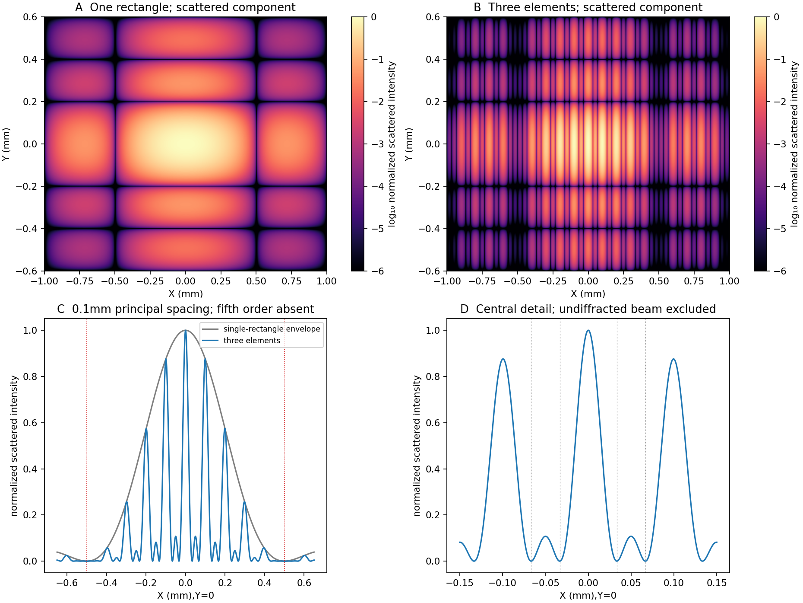

<h1 id="section-b/b8/solution">Solution</h1>

↑ **Parent:** [B8](../b8.md)

The Fourier expression is the scalar [Fraunhofer diffraction](../../../../../fraunhofer-diffraction.md) approximation for coherent, effectively monochromatic illumination with a uniform incident [plane wave](../../../../../plane-wave.md) over the [aperture](../../../../../aperture.md). At a distant screen the aperture-dependent quadratic propagation phase must be negligible, roughly $D^2/(\lambda z)\ll1$ for transverse size $D$. Alternatively, a [thin lens](../../../../../thin-lens.md) forms the angular [Fourier transform](../../../../../fourier-transform-split.md) in its back focal plane. That focal-plane construction is the appropriate one here; the aperture-to-lens distance need not itself be an enormous free-propagation distance. [aperture](../../../../../aperture.md) features should be large compared with [wavelength](../../../../../wavelength.md) for this simple scalar transmission-mask model.

If complementary transmissions are $h$ and $1-h$, linearity gives $U_h+U_{1-h}=U_{\rm free}$. Away from the undiffracted forward beam, the uniform plane-wave contribution $U_{\rm free}$ vanishes in angular space, so $U_{1-h}=-U_h$ and their intensities agree. This is [Babinet's principle](../../../../../babinet-s-principle.md). **It equates the off-forward diffracted intensities, not the transmitted power or the on-axis intensity including the direct beam.**

Let $X,Y$ be screen coordinates conjugate to [aperture](../../../../../aperture.md) coordinates $x,y$, so $p\simeq kX/f$, $q\simeq kY/f$. With width $a=0.2\ {\rm mm}$ along $x$ and height $b=0.5\ {\rm mm}$ along $y$, define $\operatorname{sinc}u=\sin u/u$. The complementary rectangle has transform

$$
H(p,q)=ab\,\operatorname{sinc}(pa/2)\operatorname{sinc}(qb/2).
$$

Thus the obstruction's off-forward scattered component has

$$
I_{\rm sc}(X,Y)\propto
\operatorname{sinc}^2\!\left(\frac{\pi aX}{\lambda f}\right)
\operatorname{sinc}^2\!\left(\frac{\pi bY}{\lambda f}\right).
$$

Its dark lines occur at

$$
\boxed{X=m(0.500\ {\rm mm}),\qquad
Y=n(0.200\ {\rm mm}),\quad m,n=\pm1,\pm2,\ldots.}
$$

The central-lobe zero-to-zero size is $1.00\ {\rm mm}$ by $0.400\ {\rm mm}$; it is wider in the direction conjugate to the narrower obstruction. The central forward image of the illuminating beam must be distinguished from this scattered envelope in a real screen observation.

The source figure gives centre-to-centre separation $D=1.0\ {\rm mm}$. Choose the three rectangle centres at $x=-D,0,D$; an overall translation changes only the transform phase. Their scattered amplitude is proportional to

$$
H_3(p,q)=ab\,\operatorname{sinc}(pa/2)\operatorname{sinc}(qb/2)
[1+2\cos(pD)].
$$

Therefore

$$
\boxed{I_{\rm sc}(X,Y)\propto
\operatorname{sinc}^2\!\left(\frac{\pi aX}{\lambda f}\right)
\operatorname{sinc}^2\!\left(\frac{\pi bY}{\lambda f}\right)
\left[1+2\cos\!\left(\frac{2\pi DX}{\lambda f}\right)\right]^2.}
$$

Along the screen's $x$ direction, the three-element interference factor has principal maxima separated by **$\lambda f/D=0.100\ {\rm mm}$**, under the single-rectangle envelope. Its zeros lie at $X=(m+1/3)(0.100\ {\rm mm})$ and $(m+2/3)(0.100\ {\rm mm})$. It also has weaker secondary maxima between principal orders. Every fifth principal order coincides with a single-rectangle zero and is missing; multiplication by the envelope slightly shifts maxima away from the nominal interference-factor positions. The figure plots the calculated scattered component and marks the separate direct-beam limitation.

**[Figure 3](#section-b/b8/image-original-calculated-rectangular-obstruction-and-three-element-fraunhofer-scattered-intensities). Original calculated rectangular-obstruction and three-element Fraunhofer scattered intensities**. Screen coordinates are physical conjugates of the obstruction coordinates. All plotted values describe the scattered component; the unresolved undiffracted illumination at the origin is excluded. Intensities are normalized, and no source figure is reproduced.

## ↑ Ancestors (14)

1. [B8](../b8.md)
2. [Section B](../../section-b.md)
3. [Paper 2](../../../paper-2-split.md)
4. [2016](../../../split.md)
5. [Past exam of the physics A course of the University of Cambridge](../../../../split.md)
6. [Physics A course of the University of Cambridge](../../../../../physics-a-course-of-the-university-of-cambridge.md)
7. [Physics course of the year 2 of the natural sciences course of the University of Cambridge](../../../../../physics-course-of-the-year-2-of-the-natural-sciences-course-of-the-university-of-cambridge.md)
8. [Year 2 of the natural sciences course of the University of Cambridge](../../../../../year-2-of-the-natural-sciences-course-of-the-university-of-cambridge.md)
9. [Year of the natural sciences course of the University of Cambridge](../../../../../year-of-the-natural-sciences-course-of-the-university-of-cambridge.md)
10. [Natural sciences course of the University of Cambridge](../../../../../natural-sciences-course-of-the-university-of-cambridge.md)
11. [Course of the University of Cambridge](../../../../../course-of-the-university-of-cambridge.md)
12. [University of Cambridge](../../../../../university-of-cambridge-split.md)
13. [List of universities](../../../../../list-of-universities.md)
14. [Codex Wiki](../../../../../split.md)
