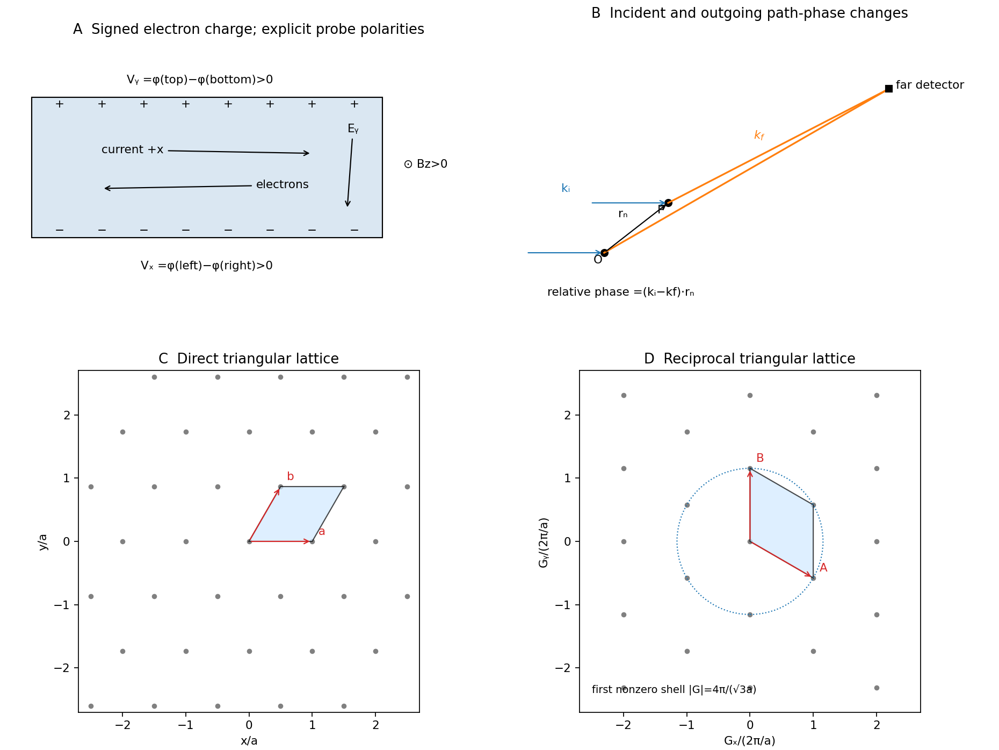

<h1 id="section-c/c10/solution">Solution</h1>

↑ **Parent:** [C10](../c10.md)

Take the [electron](../../../../../electron.md)'s signed charge to be $e=-q$, where $q>0$ is the elementary-charge magnitude. Conventional [electric current](../../../../../electric-current.md) flows along $+x$, while the mean [electron](../../../../../electron.md) drift [velocity](../../../../../velocity.md) is negative. With $\mathbf B=B_z\hat{\mathbf z}$, the magnetic [Lorentz force](../../../../../lorentz-force.md) separates charge across the width until a transverse [electric field](../../../../../electric-field-split.md) balances it. The accumulated edge charge then sustains a [Hall voltage](../../../../../hall-voltage.md) without a transverse steady current. In a one-carrier model, the [Hall coefficient](../../../../../hall-coefficient.md) identifies the sign and [number density](../../../../../number-density.md) of carriers; real multiband materials require a more careful interpretation.

The [acceleration](../../../../../acceleration.md) term contains the [effective mass](../../../../../band-effective-mass.md) describing the local band response. The relaxation term removes drift [momentum](../../../../../momentum-split.md) on the mean momentum-relaxation time $\tau$. The remaining two terms are the electric and magnetic [Lorentz force](../../../../../lorentz-force.md) on signed charge $e$; the magnetic [force](../../../../../force-split.md) is perpendicular to [velocity](../../../../../velocity.md) and does no instantaneous work. The relaxation-time approximation replaces individual scattering events by an averaged drift equation.

Let $n$ be the [electron](../../../../../electron.md) [number density](../../../../../number-density.md), distinct from the negative charge $e$. In transverse open circuit $\langle\mathbf v\rangle=(v_x,0,0)$ and $j_x=ne v_x=I_x/(wt)$. The steady component equations give

$$
0=-\frac{m^*v_x}{\tau}+eE_x,\qquad
0=e(E_y-v_xB_z),\qquad E_z=0,
$$

hence

$$
\boxed{E_x=\frac{m^*}{ne^2\tau}\,j_x,\qquad
E_y=\frac{B_z}{ne}\,j_x,\qquad E_z=0.}
$$

Consequently

$$
\boxed{\sigma=\frac{ne^2\tau}{m^*},\qquad
R_H=\frac1{ne}=-\frac1{nq}.}
$$

There is no sign ambiguity in this field-defined $R_H$ once axes and carrier charge are fixed.

A measured voltage ratio additionally needs probe polarities, which the geometric bar diagram does not label. To reproduce the positive ratio specified for [electrons](../../../../../electron.md), define the longitudinal voltage drop $V_x=\varphi(0)-\varphi(l)=E_xl$ and the transverse rise $V_y=\varphi(w)-\varphi(0)=-E_yw$. Then

$$
\boxed{\frac{V_y}{V_x}=-\frac{eB_z\tau}{m^*}\frac wl.}
$$

Reversing either voltage's probes reverses the measured ratio, without changing the physical carrier density. With both voltages instead defined as drops along their positive axes, the algebraic ratio would have the opposite sign. The figure records the convention used here.

For the density, geometry gives $\rho=Rwt/l=Rt/(l/w)$ and $|R_H|=t|V_y|/(I_x|B_z|)=tR|V_y/V_x|/|B_z|$. Thus

$$
\rho=5.50\times10^{-9}\ {\rm \Omega\,m},\qquad
|R_H|=7.15\times10^{-11}\ {\rm m^3\,C^{-1}},
$$

and

$$
\boxed{n=\frac1{q|R_H|}
\simeq8.73\times10^{28}\ {\rm m^{-3}}.}
$$

The mobility is $\mu=|R_H|/\rho=0.0130\ {\rm m^2\,V^{-1}\,s^{-1}}$. With $m^*=m_e$,

$$
\boxed{\tau=\frac{m_e\mu}{q}
\simeq7.39\times10^{-14}\ {\rm s}.}
$$

A monovalent copper model assigns roughly one delocalized conduction [electron](../../../../../electron.md) per atom to a broad, approximately free-electron-like band. Using $m_e$ is therefore a sensible first estimate for its transport scale. Monovalence alone does not prove that every band curvature or orbit has exactly the free mass: periodic-potential mixing, the nonspherical [Fermi surface](../../../../../fermi-surface.md) and direction-dependent scattering limit the model. The calculated $\tau$ is conditional on the stipulated effective-mass approximation.

Experimentally, reverse both current and [magnetic field](../../../../../magnetic-field-split.md) and extract the part of the transverse voltage odd in each. This rejects fixed contact offsets and much longitudinal pickup; use four-terminal longitudinal sensing, measure dimensions independently and check heating before assigning material parameters. These controls are implemented in a reusable Hall/conductivity teaching experiment, although that experiment uses germanium rather than the copper sample here.[pp.1–3, equipment, contact geometry, room-temperature conductivity and four current/field polarity combinations](../../../../../the-hall-effect-and-conductivity-in-germanium-by-rex-tayloe.md)

**[Figure 4](#section-c/c10/image-original-hall-polarity-convention-scattering-geometry-and-triangular-direct-reciprocal-lattices). Original Hall-polarity convention, scattering geometry and triangular direct/reciprocal lattices**. The Hall sketch defines both measured voltage polarities and uses negative [electron](../../../../../electron.md) charge. The [lattice](../../../../../lattice.md) panels use axes and reciprocal units chosen for the derivation; the first nonzero reciprocal-vector magnitude is distinguished from the forward peak.

## ↑ Ancestors (14)

1. [C10](../c10.md)
2. [Section C](../../section-c.md)
3. [Paper 2](../../../paper-2-split.md)
4. [2016](../../../split.md)
5. [Past exam of the physics A course of the University of Cambridge](../../../../split.md)
6. [Physics A course of the University of Cambridge](../../../../../physics-a-course-of-the-university-of-cambridge.md)
7. [Physics course of the year 2 of the natural sciences course of the University of Cambridge](../../../../../physics-course-of-the-year-2-of-the-natural-sciences-course-of-the-university-of-cambridge.md)
8. [Year 2 of the natural sciences course of the University of Cambridge](../../../../../year-2-of-the-natural-sciences-course-of-the-university-of-cambridge.md)
9. [Year of the natural sciences course of the University of Cambridge](../../../../../year-of-the-natural-sciences-course-of-the-university-of-cambridge.md)
10. [Natural sciences course of the University of Cambridge](../../../../../natural-sciences-course-of-the-university-of-cambridge.md)
11. [Course of the University of Cambridge](../../../../../course-of-the-university-of-cambridge.md)
12. [University of Cambridge](../../../../../university-of-cambridge-split.md)
13. [List of universities](../../../../../list-of-universities.md)
14. [Codex Wiki](../../../../../split.md)
