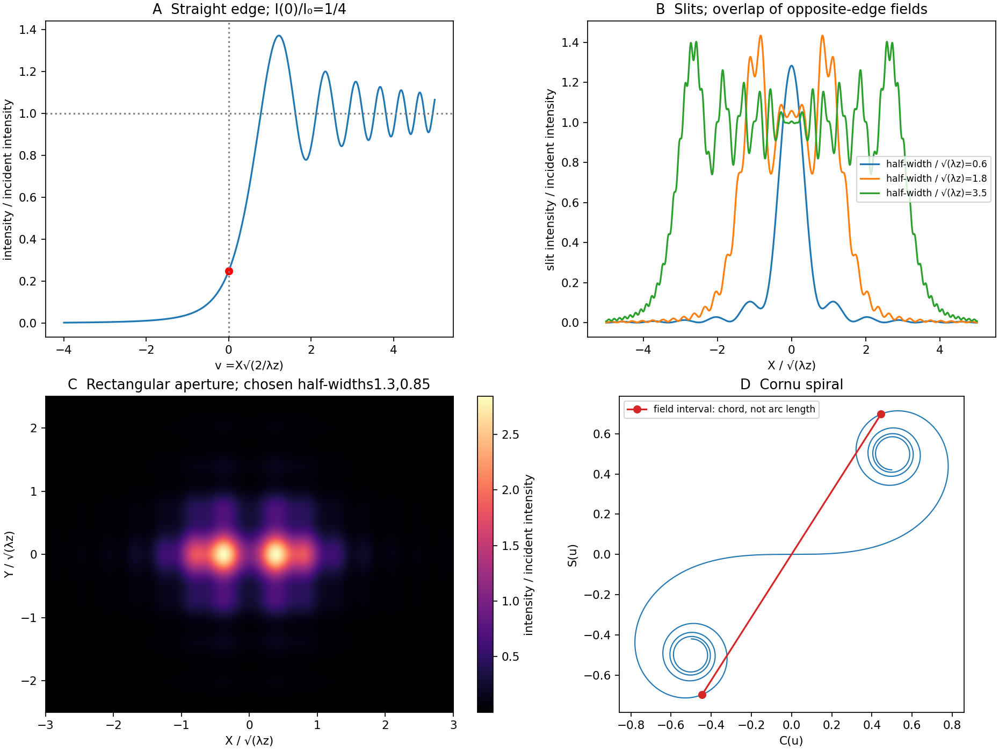

<h1 id="section-d/d12/solution">Solution</h1>

↑ **Parent:** [D12](../d12.md)

[Fresnel diffraction](../../../../../fresnel-diffraction.md) is interference during propagation when curvature of the optical path across an [aperture](../../../../../aperture.md) matters. It provides a continuous account of fringes near geometric edges and their evolution into the far-field pattern. A screen that is many [aperture](../../../../../aperture.md) widths away is not automatically in the [Fraunhofer diffraction](../../../../../fraunhofer-diffraction.md) limit; [wavelength](../../../../../wavelength.md) also enters the comparison.

For plane-wave illumination of a transmission $h(\xi,\eta)$ at $z=0$, the [Huygens-Fresnel principle](../../../../../huygens-fresnel-principle.md) in the scalar [paraxial approximation](../../../../../paraxial-approximation.md) gives

$$
U(X,Y,z)\simeq\frac{U_{\rm in}e^{ikz}}{i\lambda z}
\iint h(\xi,\eta)
\exp\!\left[\frac{i\pi}{\lambda z}
((X-\xi)^2+(Y-\eta)^2)\right]d\xi\,d\eta.
$$

It follows by expanding the propagation distance as $z+[(X-\xi)^2+(Y-\eta)^2]/(2z)$ while treating the amplitude prefactor as slowly varying. Small propagation angles justify dropping higher path terms. Finite coherent illumination, vector edge fields and very small [apertures](../../../../../aperture.md) can require a more complete theory. The [Fresnel number](../../../../../fresnel-number.md) $N_F=a^2/(\lambda z)$, with a clearly declared [aperture](../../../../../aperture.md) scale $a$, measures whether the [aperture](../../../../../aperture.md)'s quadratic phase is significant. When it is negligible, the remaining linear phase produces the [aperture](../../../../../aperture.md) [Fourier transform](../../../../../fourier-transform-split.md).[Scalar Diffraction Optics, Fresnel Approximation and Fresnel and Fraunhofer Approximations, equations381–392](../../../../../interactive-optics-by-sander-konijnenberg-aurele-j-l-adam-and-h-paul-urbach.md)

Define the optical [Fresnel integrals](../../../../../fresnel-integral.md)

$$
C(u)=\int_0^u\cos(\pi s^2/2)\,ds,\qquad
S(u)=\int_0^u\sin(\pi s^2/2)\,ds,\qquad
F(u)=C(u)+iS(u).
$$

Their limiting values are $C(\infty)=S(\infty)=1/2$, with odd continuation to negative arguments. The [Cornu spiral](../../../../../euler-spiral.md) plots $(C(u),S(u))$: the field contributed by a finite interval is proportional to the chord between its endpoints. Intensities require squared chord lengths; summing zone intensities would lose the cancellation mechanism.

For an opaque straight edge transmitting $\xi>0$ and all $\eta$, let $v=X\sqrt{2/(\lambda z)}$, so $X>0$ is the geometrically illuminated side. Integrating in the unrestricted transverse direction and using the half-line in the other gives

$$
\frac{U}{U_{\rm in}e^{ikz}}
=\frac{1-i}{2}\left[\frac{1+i}{2}+F(v)\right],
$$

hence

$$
\boxed{\frac{I(v)}{I_{\rm in}}=
\frac12\left[\left(\frac12+C(v)\right)^2+
\left(\frac12+S(v)\right)^2\right].}
$$

Far into the shadow, $I\to0$; far into the illuminated region, $I\to I_{\rm in}$. At the geometric shadow boundary, **$I(0)=I_{\rm in}/4$**, not half the incident intensity: the field is halved there. On the illuminated side, alternating constructive and destructive contributions give bright and dark fringes whose contrast declines away from the edge. Their positions scale with $\sqrt{\lambda z}$ and are not equally spaced. A finite detector averages fine fringes and tends to recover the geometric-optics step. In a controlled experiment, translate a straight edge through a broad collimated beam, scan a small photodetector across the screen and normalize against an unobstructed reference; vary $z$ to test the square-root scaling. Source size, spectral bandwidth, edge roughness and detector [aperture](../../../../../aperture.md) wash out contrast and must be distinguished from a failure of the propagation law.

For a rectangular [aperture](../../../../../aperture.md) of full widths $a,b$, define

$$
u_\pm=\sqrt{\frac2{\lambda z}}\left(\pm\frac a2-X\right),\qquad
v_\pm=\sqrt{\frac2{\lambda z}}\left(\pm\frac b2-Y\right).
$$

The two transverse integrals separate:

$$
\boxed{\frac{U}{U_{\rm in}e^{ikz}}
=\frac1{2i}[F(u_+)-F(u_-)][F(v_+)-F(v_-)],}
$$

and

$$
\boxed{\frac I{I_{\rm in}}=
\frac14|F(u_+)-F(u_-)|^2|F(v_+)-F(v_-)|^2.}
$$

A long slit leaves only one varying Fresnel factor. For a square centred on axis, $a=b$ and $w=(a/2)\sqrt{2/(\lambda z)}$ give

$$
\frac{I(0,0)}{I_{\rm in}}
=4[C(w)^2+S(w)^2]^2.
$$

Opposite edge contributions overlap; changing [aperture](../../../../../aperture.md) size or propagation distance changes their relative phase. Consequently a geometrically illuminated centre can brighten or darken, rather than remaining a fixed top-hat plateau. The original rectangular-aperture map shows fringes parallel to both edges and their crossing structure. Outside the geometric rectangle the [wave](../../../../../wave-split.md) also extends into the shadow.

At large Fresnel number an interior region approaches geometric illumination while edge fringes remain on a scale $\sqrt{\lambda z}$. At intermediate values the opposite-edge fringes interact across the whole [aperture](../../../../../aperture.md) image. In the far field, the formula tends to the product of sinc-squared factors,

$$
I(X,Y)\propto
\operatorname{sinc}^2\!\left(\frac{\pi aX}{\lambda z}\right)
\operatorname{sinc}^2\!\left(\frac{\pi bY}{\lambda z}\right).
$$

The far-field lobe scale $\lambda z/a$ grows linearly with $z$, unlike the local near-edge scale. The transition is controlled by the neglected phase, not an abrupt physical boundary.

To test the main effect, record normalized profiles at several distances, calculate the [Fresnel integral](../../../../../fresnel-integral.md) with the measured [aperture](../../../../../aperture.md) dimensions and compare fringe positions before fitting a free intensity scale. Use the same transverse coordinate origin and check that the incident beam is sufficiently uniform. [Babinet's principle](../../../../../babinet-s-principle.md) relates complementary [aperture](../../../../../aperture.md) and obstruction fields through $U_a+U_o=U_{\rm free}$; **their near-field intensities are not generally equal**, because the unobstructed field remains present and interferes with the diffracted field. This is why a far-field obstruction argument cannot simply be carried over as equality of Fresnel intensities.

**[Figure 5](#section-d/d12/image-original-fresnel-integral-calculations-for-a-straight-edge-slits-rectangular-aperture-and-cornu-spiral). Original Fresnel-integral calculations for a straight edge, slits, rectangular aperture and Cornu spiral**. The plots use the stated scalar paraxial model and chosen dimensionless [aperture](../../../../../aperture.md) parameters. The straight-edge boundary value is one quarter. The [aperture](../../../../../aperture.md) panels show quadratic-phase propagation and the Cornu panel identifies field amplitudes as chords rather than summed intensities.

## ↑ Ancestors (14)

1. [D12](../d12.md)
2. [Section D](../../section-d.md)
3. [Paper 2](../../../paper-2-split.md)
4. [2016](../../../split.md)
5. [Past exam of the physics A course of the University of Cambridge](../../../../split.md)
6. [Physics A course of the University of Cambridge](../../../../../physics-a-course-of-the-university-of-cambridge.md)
7. [Physics course of the year 2 of the natural sciences course of the University of Cambridge](../../../../../physics-course-of-the-year-2-of-the-natural-sciences-course-of-the-university-of-cambridge.md)
8. [Year 2 of the natural sciences course of the University of Cambridge](../../../../../year-2-of-the-natural-sciences-course-of-the-university-of-cambridge.md)
9. [Year of the natural sciences course of the University of Cambridge](../../../../../year-of-the-natural-sciences-course-of-the-university-of-cambridge.md)
10. [Natural sciences course of the University of Cambridge](../../../../../natural-sciences-course-of-the-university-of-cambridge.md)
11. [Course of the University of Cambridge](../../../../../course-of-the-university-of-cambridge.md)
12. [University of Cambridge](../../../../../university-of-cambridge-split.md)
13. [List of universities](../../../../../list-of-universities.md)
14. [Codex Wiki](../../../../../split.md)
