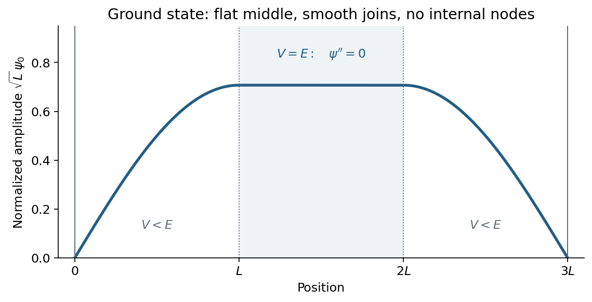
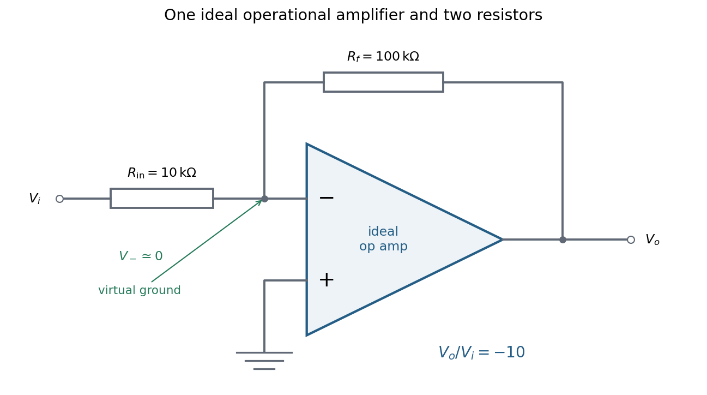
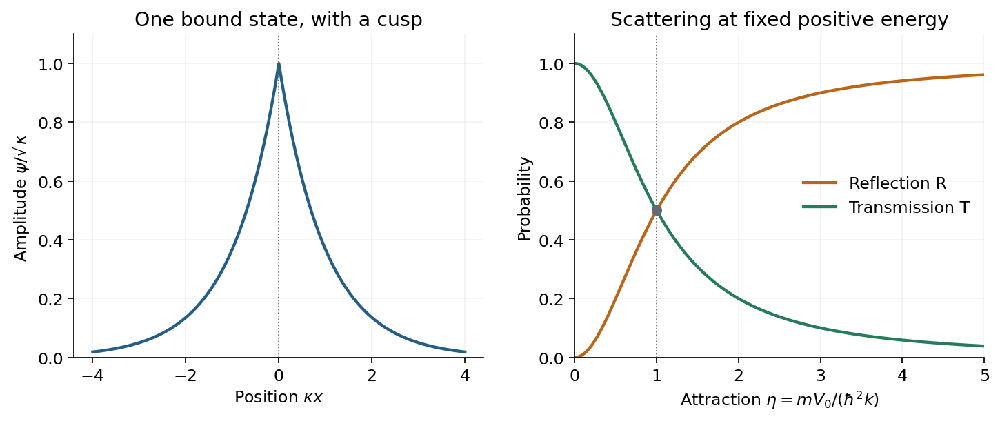
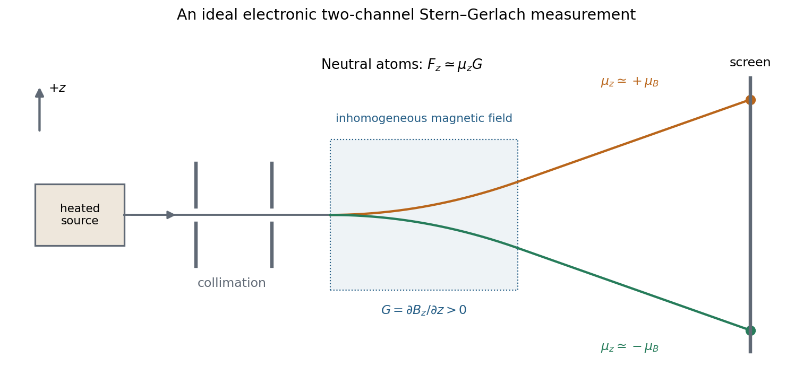
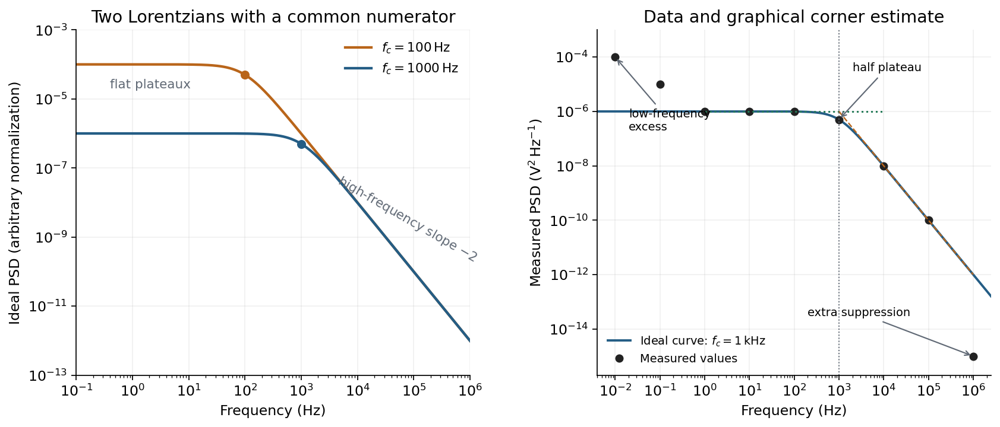

# Paper 1

↑ **Parent:** [2017](../2017.md)

[Original paper, released PDF pages 65–72](https://www.whatdotheyknow.com/request/natural_science_tripos_physics_e/response/2127325/attach/3/FOI%202022%20639%20Sullivan%20materials.pdf?cookie_passthrough=1#page=65)

**Table of contents**

- [Section A](#section-a)
  - [1](#section-a/1)
    - [Solution](#section-a/1/solution)
  - [2](#section-a/2)
    - [Solution](#section-a/2/solution)
  - [3](#section-a/3)
    - [Solution](#section-a/3/solution)
  - [4](#section-a/4)
    - [Solution](#section-a/4/solution)
  - [5](#section-a/5)
    - [Solution](#section-a/5/solution)
- [Section B](#section-b)
  - [B6](#section-b/b6)
    - [Solution](#section-b/b6/solution)
  - [B7](#section-b/b7)
    - [Solution](#section-b/b7/solution)
  - [B8](#section-b/b8)
    - [Solution](#section-b/b8/solution)
  - [B9](#section-b/b9)
    - [Solution](#section-b/b9/solution)
- [Section C](#section-c)
  - [C10](#section-c/c10)
    - [Solution](#section-c/c10/solution)
  - [C11](#section-c/c11)
    - [a](#section-c/c11/a)
      - [Solution](#section-c/c11/a/solution)
    - [b](#section-c/c11/b)
      - [Solution](#section-c/c11/b/solution)
    - [c](#section-c/c11/c)
      - [Solution](#section-c/c11/c/solution)
- [Section D](#section-d)
  - [D12](#section-d/d12)
    - [Solution](#section-d/d12/solution)
  - [D13](#section-d/d13)
    - [a](#section-d/d13/a)
      - [Solution](#section-d/d13/a/solution)
    - [b](#section-d/d13/b)
      - [Solution](#section-d/d13/b/solution)
    - [c](#section-d/d13/c)
      - [Solution](#section-d/d13/c/solution)

## Section A

↑ **Parent:** [Paper 1](paper-1.md)

<h3 id="section-a/1">1</h3>

↑ **Parent:** [Section A](#section-a)

<h4 id="section-a/1/solution">Solution</h4>

↑ **Parent:** [1](#section-a/1)

The original diagram places hard walls at $0$ and $3L$, and the central plateau on $L<x<2L$ is **exactly at the indicated ground-state [energy](../../energy.md)**. This equality determines the middle of the requested sketch. In the [time-independent Schrödinger equation](../../mathematical-physics.md#time-independent-schrodinger-equation),

$$
\psi''=\frac{2m}{\hbar^2}(V-E)\psi,
$$

the central interval has $V=E$, hence $\psi''=0$. The [ground state](../../quantum-mechanics.md#ground-state) can be chosen real and positive inside the walls by the [nodeless theorem for a one-dimensional ground state](../../quantum-theory.md#nodeless-theorem-for-a-one-dimensional-ground-state). Reflection symmetry makes it even about $x=3L/2$, so its linear central segment must be constant.

The hard-wall boundary conditions are $\psi(0)=\psi(3L)=0$. On both outer intervals $V=0<E$, so the positive [wavefunction](../../wave-function.md) has negative curvature and is sinusoidal. [Wavefunction matching at a finite potential step](../../mathematical-physics.md#wavefunction-matching-at-a-finite-potential-step) requires both $\psi$ and $\psi'$ to remain continuous at $L,2L$; the [derivative](../../calculus.md#derivative) therefore vanishes where each sinusoidal flank meets the flat middle. A normalized representative is

$$
\boxed{\psi_0(x)=\frac1{\sqrt{2L}}\begin{cases}
\sin\!\left(\dfrac{\pi x}{2L}\right),&0<x<L,\\
1,&L\le x\le2L,\\
\sin\!\left(\dfrac{\pi(3L-x)}{2L}\right),&2L<x<3L,\\
0,&x\le0\ \text{or}\ x\ge3L.
\end{cases}}
$$

Each side contributes $L/2$ and the plateau contributes $L$ to the squared norm before multiplying by $1/(2L)$. The corresponding consistency condition is $E=\pi^2\hbar^2/(8mL^2)$; a numerical [energy](../../energy.md) is not required for the sketch.

**[Figure 1](#section-a/1/image-the-positive-ground-state-wavefunction-has-sinusoidal-flanks-and-a-flat-central-segment-at-v-equals-e). The positive ground-state wavefunction has sinusoidal flanks and a flat central segment at V equals E**.

Thus the [ground state at the top of a central rectangular barrier](../../quantum-mechanics.md#ground-state-at-the-top-of-a-central-rectangular-barrier) has **no internal nodes, continuous value and slope, and a flat middle**, rather than an exponential dip through a classically forbidden region. Multiplication by an overall constant phase changes none of these physical features.

<h3 id="section-a/2">2</h3>

↑ **Parent:** [Section A](#section-a)

<h4 id="section-a/2/solution">Solution</h4>

↑ **Parent:** [2](#section-a/2)

Use the [canonical commutation relation](../../quantum-mechanics.md#canonical-commutation-relation) $[\widehat x,\widehat p]=i\hbar I$ on a common invariant domain of the operator products. Write $A=\widehat p\widehat x$, so $\widehat x\widehat p=A+i\hbar I$. Associativity then gives

$$
\widehat x\widehat p^2\widehat x
=(\widehat x\widehat p)(\widehat p\widehat x)
=(A+i\hbar I)A=A^2+i\hbar A,
$$

whereas

$$
\widehat p\widehat x^2\widehat p
=(\widehat p\widehat x)(\widehat x\widehat p)
=A(A+i\hbar I)=A^2+i\hbar A.
$$

Therefore

$$
\boxed{\widehat x\widehat p^2\widehat x=\widehat p\widehat x^2\widehat p.}
$$

As a direct position-representation check, the [momentum operator](../../quantum-mechanics.md#momentum-operator) is $\widehat p=-i\hbar\,d/dx$. Acting on a smooth function $f$ gives

$$
x(-\hbar^2)\frac{d^2(xf)}{dx^2}
=-\hbar^2(x^2f''+2xf')
=(-i\hbar)\frac d{dx}\left[x^2(-i\hbar f')\right].
$$

This is the [equality of two quadratic position-momentum orderings](../../quantum-mechanics.md#equality-of-two-quadratic-position-momentum-orderings); it does not make arbitrary rearrangements of noncommuting [linear operators](../../vector-space.md#linear-operator) interchangeable.

<h3 id="section-a/3">3</h3>

↑ **Parent:** [Section A](#section-a)

<h4 id="section-a/3/solution">Solution</h4>

↑ **Parent:** [3](#section-a/3)

For [addition of angular momentum](../../angular-momentum-operator.md#addition-of-angular-momentum), the allowed total [quantum number](../../quantum-system.md#quantum-number) runs in unit steps from $|\ell-s|$ to $\ell+s$. With $\ell=2$ and $s=1$,

$$
\boxed{j=1,2,3,\qquad m_j=-j,-j+1,\ldots,j.}
$$

Thus the complete list of multiplets is

$$
\begin{array}{c|l}
j&m_j\\\hline
1&-1,0,1\\
2&-2,-1,0,1,2\\
3&-3,-2,-1,0,1,2,3
\end{array}
$$

The [total angular momentum operator](../../angular-momentum-operator.md#total-angular-momentum-operator) has squared magnitude [eigenvalue](../../linear-operator-theory.md#eigenvalue) $\hbar^2j(j+1)$ and chosen-axis component [eigenvalue](../../linear-operator-theory.md#eigenvalue) $\hbar m_j$. The number of states is $3+5+7=15$, matching the uncoupled dimension $(2\ell+1)(2s+1)=5\times3$.

<h3 id="section-a/4">4</h3>

↑ **Parent:** [Section A](#section-a)

<h4 id="section-a/4/solution">Solution</h4>

↑ **Parent:** [4](#section-a/4)

Use an [inverting operational amplifier](../../electrical-circuit.md#inverting-operational-amplifier). Ground the non-inverting input, connect the source to the inverting input through $R_{\rm in}$, and connect $R_f$ from the output back to that same input.

**[Figure 2](#section-a/4/image-an-ideal-inverting-amplifier-with-10-kilohm-input-resistance-and-100-kilohm-feedback-resistance). An ideal inverting amplifier with 10 kilohm input resistance and 100 kilohm feedback resistance**.

In linear operation the ideal [operational amplifier](../../electrical-circuit.md#operational-amplifier) draws no input [electric current](../../electric-charge.md#electric-current), and feedback holds the inverting input at the same [electric potential](../../electric-field.md#electric-potential) as the grounded non-inverting input. This node is a [virtual ground](../../electrical-circuit.md#virtual-ground). [Kirchhoff's current law](../../random-walk.md#kirchhoff-node-law) there gives

$$
\frac{V_i}{R_{\rm in}}+\frac{V_o}{R_f}=0,
\qquad
\frac{V_o}{V_i}=-\frac{R_f}{R_{\rm in}}.
$$

The source supplies current $I_i=V_i/R_{\rm in}$, so its [input impedance](../../electrical-circuit.md#input-impedance) is $R_{\rm in}$. The required design is therefore

$$
\boxed{R_{\rm in}=10\,\mathrm{k\Omega},\qquad R_f=100\,\mathrm{k\Omega},
\qquad V_o=-10V_i.}
$$

Only these two [resistors](../../electric-charge.md#resistor) and the single ideal [operational amplifier](../../electrical-circuit.md#operational-amplifier) are needed in the [signal](../../electrical-engineering.md#signal) circuit; its power supplies are implicit. The result assumes an input small enough to keep the output within its linear operating range.

<h3 id="section-a/5">5</h3>

↑ **Parent:** [Section A](#section-a)

<h4 id="section-a/5/solution">Solution</h4>

↑ **Parent:** [5](#section-a/5)

Use the [sample mean](../../variance.md#sample-mean) to estimate each [magnetic susceptibility](../../statistical-physics.md#magnetic-susceptibility), and the unbiased [sample variance](../../statistical-inference.md#sample-variance) with denominator $n-1=4$ to estimate the repeatability of individual readings. In the numerical scale supplied by the paper,

$$
\overline\chi_A=2.26,\qquad \overline\chi_B=2.42,
\qquad s_A^2=0.0130,\qquad s_B^2=0.0070.
$$

If the repeated measurements have [independent](../../random-variable.md#independent-random-variables) random errors, their mean estimates have [standard errors](../../statistical-inference.md#standard-error)

$$
s_{\overline A}=\sqrt{0.0130/5}=0.0510,\qquad
s_{\overline B}=\sqrt{0.0070/5}=0.0374.
$$

The difference and its estimated [standard uncertainty](../../physics.md#standard-uncertainty) are therefore

$$
\boxed{\overline\chi_B-\overline\chi_A=0.160,\qquad
s_{B-A}=\sqrt{\frac{0.0130+0.0070}{5}}=0.0632.}
$$

The separation is about $2.53$ [standard errors](../../statistical-inference.md#standard-error). Under an approximately [normal distribution](../../probability-distribution.md#normal-distribution) model with no experimenter-dependent bias, [Welch's t-test](../../statistical-hypothesis-test.md#welch-s-t-test) gives about $7.34$ [statistical degrees of freedom](../../statistical-inference.md#statistical-degrees-of-freedom) and a two-sided [p-value](../../statistical-hypothesis-test.md#p-value) of $0.038$. Thus there is **modest evidence against equal underlying susceptibilities** at a conventional $5\%$ [significance level](../../statistical-hypothesis-test.md#significance-level); overlap of the ranges of individual readings is not an adequate comparison of the means. Five readings per sample provide limited information about the error distribution.

Crucially, material and student exhibit complete [confounding](../../causal-inference.md#confounding): each student measured only one sample. An experimenter-dependent [systematic error](../../physics.md#systematic-error) could mimic the difference. [Paramagnetism](../../electromagnetism.md#paramagnetism) also depends on conditions such as [temperature](../../temperature.md), so equal material alone does not guarantee equal readings without controlling those conditions. The defensible physical conclusion is **the data suggest a difference, but do not establish different materials**. Both students should measure both samples in randomized or alternating order, with calibration and [temperature](../../temperature.md) controlled, to separate a sample effect from an operator effect. No unit or scale factor absent from the original table has been invented.

## Section B

↑ **Parent:** [Paper 1](paper-1.md)

<h3 id="section-b/b6">B6</h3>

↑ **Parent:** [Section B](#section-b)

<h4 id="section-b/b6/solution">Solution</h4>

↑ **Parent:** [B6](#section-b/b6)

**Equation and boundary conditions.** The [delta potential](../../quantum-mechanics.md#delta-potential) has strength $V_0$ with units of [energy](../../energy.md) times length, because the [Dirac delta function](../../distribution-theory.md#dirac-delta-function) has units of inverse length. The [time-independent Schrödinger equation](../../mathematical-physics.md#time-independent-schrodinger-equation) is

$$
-\frac{\hbar^2}{2m}\psi''(x)-V_0\delta(x)\psi(x)=E\psi(x).
$$

The [wavefunction](../../wave-function.md) is continuous at the origin. A finite jump in $\psi$ would produce a [derivative](../../calculus.md#derivative) of a [Dirac delta function](../../distribution-theory.md#dirac-delta-function) in $\psi''$, with no corresponding term in this potential. A jump in $\psi'$ does produce a delta contribution and is allowed. Integrate through a symmetric interval:

$$
-\frac{\hbar^2}{2m}[\psi'(\epsilon)-\psi'(-\epsilon)]
-V_0\psi(0)=E\int_{-\epsilon}^{\epsilon}\psi(x)\,dx.
$$

For continuous finite $\psi$, the right-hand side vanishes as $\epsilon\to0$. Consequently

$$
\boxed{\psi'(0^+)-\psi'(0^-)=-\frac{2mV_0}{\hbar^2}\psi(0).}
$$

This [derivative](../../calculus.md#derivative) jump is the boundary condition associated with the attractive [delta potential](../../quantum-mechanics.md#delta-potential).

**Unique [bound state](../../quantum-system.md#bound-state).** For $E<0$, write $\kappa=\sqrt{-2mE}/\hbar>0$. Away from the origin, $\psi''=\kappa^2\psi$. Normalizability excludes exponentials growing at either infinity, leaving

$$
\psi(x)=\begin{cases}A e^{\kappa x},&x<0,\\B e^{-\kappa x},&x>0.\end{cases}
$$

[Continuity](../../calculus.md#continuous-function) gives $A=B=C$. The [derivative](../../calculus.md#derivative) jump then becomes $-2\kappa C=-2mV_0C/\hbar^2$. For a nonzero state,

$$
\kappa=\frac{mV_0}{\hbar^2},\qquad
\boxed{E=-\frac{\hbar^2\kappa^2}{2m}=-\frac{mV_0^2}{2\hbar^2}.}
$$

There is exactly one positive value of $\kappa$, so exactly one negative-energy [bound state](../../quantum-system.md#bound-state). An odd solution would have $\psi(0)=0$; the allowed decaying exponentials would then both vanish identically. Normalize the even solution using

$$
1=2|C|^2\int_0^\infty e^{-2\kappa x}\,dx=\frac{|C|^2}{\kappa}.
$$

Choosing the overall phase real and positive gives the [bound state in a delta potential](../../quantum-mechanics.md#bound-state-in-a-delta-potential):

$$
\boxed{\psi_0(x)=\sqrt\kappa\,e^{-\kappa|x|},\qquad\kappa=\frac{mV_0}{\hbar^2}.}
$$

It peaks at the origin, has a downward cusp there, and decays exponentially on both sides. Its value, but not its slope, is continuous.

**Scattering amplitudes and fluxes.** For $E>0$, put $k=\sqrt{2mE}/\hbar$ and retain $\kappa=mV_0/\hbar^2$ as a strength parameter. A unit-amplitude wave incident from the left has

$$
\psi_L=e^{ikx}+r e^{-ikx},\qquad\psi_R=t e^{ikx}.
$$

[Continuity](../../calculus.md#continuous-function) gives $t=1+r$. The jump condition gives

$$
ik t-ik(1-r)=-2\kappa t,\qquad ikr=-\kappa(1+r).
$$

Solving,

$$
r=-\frac{\kappa}{\kappa+ik},\qquad t=\frac{ik}{\kappa+ik}.
$$

The [probability current](../../wave-function.md#probability-current) of a [plane wave](../../wave-function.md#plane-wave) of amplitude $A$ is $\hbar k|A|^2/m$ in its propagation direction. Since the asymptotic [wavenumber](../../wave-equation.md#wavenumber) is the same on both sides, [reflection probability](../../quantum-scattering.md#quantum-reflection-probability) and [transmission probability](../../quantum-scattering.md#transmission-probability) are just $|r|^2$ and $|t|^2$:

$$
\boxed{R=\frac{\kappa^2}{k^2+\kappa^2}
=\frac{mV_0^2/\hbar^2}{2E+mV_0^2/\hbar^2},\qquad
T=\frac{k^2}{k^2+\kappa^2}
=\frac{2E}{2E+mV_0^2/\hbar^2}.}
$$

They satisfy $R+T=1$, expressing conserved [probability current](../../wave-function.md#probability-current) in this real potential.

**[Figure 3](#section-b/b6/image-the-normalized-delta-well-bound-state-and-reflection-transmission-probabilities-as-attraction-increases). The normalized delta-well bound state and reflection/transmission probabilities as attraction increases**.

The right-hand plot uses $\eta=\kappa/k=V_0\sqrt{m/(2E)}/\hbar$, proportional to $V_0$ at fixed incident [energy](../../energy.md). Then $R=\eta^2/(1+\eta^2)$ rises monotonically from zero to one, while $T=1/(1+\eta^2)$ falls from one to zero; they are equal at $\eta=1$. Despite the absence of a classical forbidden barrier, an abrupt attractive interaction reflects a quantum wave. Increasing attraction strengthens the [derivative](../../calculus.md#derivative) mismatch and can approach complete reflection at fixed positive [energy](../../energy.md). At fixed $V_0$, increasing incident [energy](../../energy.md) instead makes the well increasingly transparent. The negative-energy [bound state](../../quantum-system.md#bound-state) and the positive-energy scattering states are different stationary solutions, not an absorptive loss channel.

<h3 id="section-b/b7">B7</h3>

↑ **Parent:** [Section B](#section-b)

<h4 id="section-b/b7/solution">Solution</h4>

↑ **Parent:** [B7](#section-b/b7)

**Hamiltonian and [commutators](../../lie-algebra.md#commutator).** Use the [canonical commutation relation](../../quantum-mechanics.md#canonical-commutation-relation) $[\widehat x,\widehat p]=i\hbar I$ and define $c_0=\sqrt{m\omega/(2\hbar)}$. Expanding the product of the given [creation and annihilation operators](../../quantum-harmonic-oscillator.md#creation-and-annihilation-operators),

$$
\widehat a^\dagger\widehat a
=c_0^2\left(\widehat x^2+\frac{\widehat p^2}{m^2\omega^2}
+\frac{i}{m\omega}[\widehat x,\widehat p]\right)
=\frac{m\omega}{2\hbar}\widehat x^2
+\frac{\widehat p^2}{2m\hbar\omega}-\frac12I.
$$

Therefore the [quantum harmonic oscillator](../../quantum-harmonic-oscillator.md) [Hamiltonian operator](../../quantum-system.md#hamiltonian-quantum-mechanics) is

$$
\boxed{\widehat H=\frac{\widehat p^2}{2m}+\frac12m\omega^2\widehat x^2
=\hbar\omega\left(\widehat a^\dagger\widehat a+\frac12I\right).}
$$

Similarly,

$$
[\widehat a,\widehat a^\dagger]
=c_0^2\left(-\frac{i}{m\omega}[\widehat x,\widehat p]
+\frac{i}{m\omega}[\widehat p,\widehat x]\right)=I.
$$

Using $[AB,C]=A[B,C]+[A,C]B$ gives

$$
\boxed{[\widehat a,\widehat a^\dagger]=I,\qquad
[\widehat H,\widehat a]=\hbar\omega[\widehat a^\dagger\widehat a,\widehat a]
=-\hbar\omega\widehat a.}
$$

**Lowering a normalized [energy](../../energy.md) [eigenstate](../../energy-eigenvalue.md#eigenstate).** The [commutator](../../lie-algebra.md#commutator) implies

$$
\widehat H\widehat a|\phi_n\rangle
=(E_n-\hbar\omega)\widehat a|\phi_n\rangle
=E_{n-1}\widehat a|\phi_n\rangle.
$$

For $n>0$, nondegeneracy of this one-dimensional [energy](../../energy.md) level means $\widehat a|\phi_n\rangle=c_n|\phi_{n-1}\rangle$. Its norm is fixed by the [number operator](../../quantum-harmonic-oscillator.md#number-operator):

$$
|c_n|^2=\langle\phi_n|\widehat a^\dagger\widehat a|\phi_n\rangle
=\frac{E_n}{\hbar\omega}-\frac12=n.
$$

Choosing successive [eigenstate](../../energy-eigenvalue.md#eigenstate) phases in the conventional way makes $c_n=\sqrt n$, so

$$
\boxed{\widehat a|\phi_n\rangle=\sqrt n\,|\phi_{n-1}\rangle.}
$$

For $n=0$, the same norm is zero, hence $\widehat a|\phi_0\rangle=0$. A nonzero lowered [ground state](../../quantum-mechanics.md#ground-state) would have [energy](../../energy.md) below the lowest allowed level, and positivity of $\widehat a^\dagger\widehat a$ forbids that possibility.

**Coherent-state [eigenvalue](../../linear-operator-theory.md#eigenvalue).** Applying the [annihilation operator](../../quantum-harmonic-oscillator.md#annihilation-operator) term by term, with the $n=0$ contribution zero, gives

$$
\begin{aligned}
\widehat a|\chi_\alpha\rangle
&=e^{-|\alpha|^2/2}\sum_{n=1}^\infty
\frac{\alpha^n\sqrt n}{\sqrt{n!}}|\phi_{n-1}\rangle\\
&=\alpha e^{-|\alpha|^2/2}\sum_{r=0}^\infty
\frac{\alpha^r}{\sqrt{r!}}|\phi_r\rangle
=\alpha|\chi_\alpha\rangle.
\end{aligned}
$$

Thus

$$
\boxed{\widehat a|\chi_\alpha\rangle=\alpha|\chi_\alpha\rangle.}
$$

The [coherent state](../../quantum-theory.md#coherent-state) is normalized because $e^{-|\alpha|^2}\sum_n|\alpha|^{2n}/n!=1$. Its [annihilation operator](../../quantum-harmonic-oscillator.md#annihilation-operator) is not Hermitian, so the [eigenvalue](../../linear-operator-theory.md#eigenvalue) $\alpha$ may be complex.

**Time evolution.** Under the time-independent [Hamiltonian operator](../../quantum-system.md#hamiltonian-quantum-mechanics), each [energy](../../energy.md) component acquires its own phase:

$$
\begin{aligned}
|\chi_\alpha;t\rangle
&=e^{-|\alpha|^2/2}\sum_{n=0}^\infty
\frac{\alpha^n}{\sqrt{n!}}e^{-i(n+1/2)\omega t}|\phi_n\rangle\\
&=e^{-i\omega t/2}e^{-|\alpha|^2/2}\sum_{n=0}^\infty
\frac{(\alpha e^{-i\omega t})^n}{\sqrt{n!}}|\phi_n\rangle.
\end{aligned}
$$

Since $|\alpha e^{-i\omega t}|=|\alpha|$, the normalization prefactor is unchanged. Hence

$$
\boxed{|\chi_\alpha;t\rangle=e^{-i\omega t/2}|\chi_\beta\rangle,
\qquad\beta=\alpha e^{-i\omega t}.}
$$

The state remains a [coherent state](../../quantum-theory.md#coherent-state), with its complex parameter rotating at the oscillator's [angular frequency](../../lagrangian-mechanics.md#angular-frequency); the displayed extra factor is a global phase from the zero-point [energy](../../energy.md).

<h3 id="section-b/b8">B8</h3>

↑ **Parent:** [Section B](#section-b)

<h4 id="section-b/b8/solution">Solution</h4>

↑ **Parent:** [B8](#section-b/b8)

**Reduced radial equation.** A [spherical harmonic](../../analysis.md#spherical-harmonic) satisfies $\widehat L^2Y_{\ell m}=\ell(\ell+1)\hbar^2Y_{\ell m}$. Substitute $\psi=RY_{\ell m}$ into the [time-independent Schrödinger equation](../../mathematical-physics.md#time-independent-schrodinger-equation), divide out the angular function, and put $R=U/r$. Direct differentiation gives

$$
r^2R'=rU'-U,\qquad
\frac1{r^2}(r^2R')'=\frac{U''}{r}.
$$

Multiplication by $r$ then gives the [Radial Schrodinger equation](../../mathematical-physics.md#radial-schrodinger-equation-for-the-hydrogen-atom)

$$
\boxed{-\frac{\hbar^2}{2\mu}U''+
\frac{\ell(\ell+1)\hbar^2}{2\mu r^2}U+V(r)U=EU.}
$$

Here $\mu=m_1m_2/(m_1+m_2)$ is the [reduced mass](../../classical-mechanics.md#reduced-mass), and the extra positive term is the [centrifugal potential](../../mathematical-physics.md#centrifugal-potential).

**Boundary conditions.** At the origin this finite central potential has no point interaction. The physical radial solution is regular there, requiring $U(0)=0$; for $\ell=0$, a nonzero constant $U(0)$ would give $R\sim1/r$ and a point-source singularity of the three-dimensional [Laplacian](../../multivariable-calculus.md#laplacian). Mere square integrability alone would not remove that singular solution. For a [bound state](../../quantum-system.md#bound-state), the radial [probability](../../probability-theory.md#probability) integral is $\int_0^\infty |U|^2dr$, so the exterior solution must decay and $U(r)\to0$ as $r\to\infty$.

**Solutions for zero [orbital angular momentum](../../quantum-mechanics.md#orbital-angular-momentum).** For $\ell=0$ and $-V_0<E<0$, define

$$
\boxed{k=\frac{\sqrt{2\mu(V_0+E)}}{\hbar},\qquad
q=\frac{\sqrt{-2\mu E}}{\hbar}.}
$$

The interior equation is $U''+k^2U=0$; $U(0)=0$ excludes the cosine. The exterior equation is $U''-q^2U=0$; normalizability excludes the growing exponential. Thus

$$
\boxed{U(r)=\begin{cases}A\sin kr,&0\le r\le a,\\Be^{-qr},&r>a.\end{cases}}
$$

The constants cannot remain independent once the interface is matched. Since the [potential step](../../quantum-scattering.md#step-potential) is finite, both $U$ and $U'$ are continuous at $a$:

$$
A\sin ka=Be^{-qa},\qquad Ak\cos ka=-qBe^{-qa}.
$$

Dividing the equations yields

$$
\boxed{k\cot ka=-q,\qquad\tan ka=-\frac kq.}
$$

**Existence and number of s-wave bound states.** Put $z=ka$, $y=qa$, and $\rho_0=a\sqrt{2\mu V_0}/\hbar$. Then

$$
z^2+y^2=\rho_0^2,\qquad z\cot z=-y.
$$

The lowest branch lies on $\pi/2<z<\pi$. Along it, $y=-z\cot z>0$ and $\rho_0=z/\sin z$ increases continuously from $\pi/2$ to infinity. Therefore a first negative-energy solution exists precisely when $\rho_0>\pi/2$, or

$$
\boxed{V_0>V_*\equiv\frac{\pi^2\hbar^2}{8\mu a^2}.}
$$

Further branches begin at $z=3\pi/2,5\pi/2,\ldots$ as $q\to0^+$. Hence the [bound-state thresholds of a spherical square well](../../quantum-mechanics.md#bound-state-thresholds-of-a-spherical-square-well) give exactly one negative-energy $\ell=0$ state when

$$
\boxed{\frac{\pi^2\hbar^2}{8\mu a^2}<V_0
\le\frac{9\pi^2\hbar^2}{8\mu a^2}.}
$$

The upper equality is included: the second branch is then only at $E=0$, with constant exterior $U$, and is not normalizable. If threshold cases are excluded by convention, the commonly quoted open interval has a strict upper inequality; the physical negative-energy state count at equality is still one.

**Deuteron estimate.** Using $m_pc^2\simeq938.27\,\mathrm{MeV}$, $m_nc^2\simeq939.57\,\mathrm{MeV}$ and $\hbar c\simeq197.327\,\mathrm{MeV\,fm}$ gives $\mu c^2\simeq469.46\,\mathrm{MeV}$. At $a=2.1\,\mathrm{fm}$,

$$
\boxed{
V_*=\frac{\pi^2(197.327)^2}{8(469.46)(2.1)^2}\,\mathrm{MeV}
=23.2\,\mathrm{MeV},\qquad V_0>23.2\,\mathrm{MeV}.}
$$

The threshold for a second $s$ state is $9V_*\simeq209\,\mathrm{MeV}$, far above the stipulated depth $33.5\,\mathrm{MeV}$. Thus this model has **no radially excited s-wave [bound state](../../quantum-system.md#bound-state)**.

Checking other [orbital angular momentum](../../quantum-mechanics.md#orbital-angular-momentum) sectors matters before ruling out every excitation. At the first $p$-wave threshold, the regular interior reduced radial function is $rj_1(kr)$ and the zero-energy exterior function is proportional to $r^{-1}$. Matching their logarithmic [derivatives](../../calculus.md#derivative) requires $j_0(ka)=0$, whose first root is $ka=\pi$. Hence

$$
V_{p,*}=\frac{\pi^2\hbar^2}{2\mu a^2}=4V_*\simeq92.8\,\mathrm{MeV}>33.5\,\mathrm{MeV}.
$$

Larger $\ell$ only increases the [centrifugal potential](../../mathematical-physics.md#centrifugal-potential). Therefore **no bound orbital excited states are expected in the specified central square-well model**. Its [spin](../../angular-momentum-operator.md#spin) dependence and tensor nuclear forces have not been specified; the calculation does not resolve the real deuteron's internal [spin](../../angular-momentum-operator.md#spin) structure.

<h3 id="section-b/b9">B9</h3>

↑ **Parent:** [Section B](#section-b)

<h4 id="section-b/b9/solution">Solution</h4>

↑ **Parent:** [B9](#section-b/b9)

**Distinguishable noninteracting particles.** Interpret $V$ as the same external one-particle potential for each particle; the total potential is $V(\mathbf r_1)+V(\mathbf r_2)$. The [Time-dependent Schrödinger equation](../../mathematical-physics.md#time-dependent-schrodinger-equation) is

$$
\boxed{i\hbar\frac{\partial\Psi}{\partial t}=
\left[-\frac{\hbar^2}{2m}(\nabla_1^2+\nabla_2^2)
+V(\mathbf r_1)+V(\mathbf r_2)\right]\Psi.}
$$

Let $\widehat h\phi_a=\epsilon_a\phi_a$ and $\widehat h\phi_b=\epsilon_b\phi_b$, where $\widehat h=-\hbar^2\nabla^2/(2m)+V$. Applying $\widehat h_1+\widehat h_2$ to the product multiplies it by $\epsilon_a+\epsilon_b$. The time [derivative](../../calculus.md#derivative) of $e^{-iEt/\hbar}$ multiplies it by $E$. Thus the proposed stationary product is a solution provided

$$
\boxed{E=\epsilon_a+\epsilon_b.}
$$

The [tensor product](../../multilinear-algebra.md#tensor-product) separates the two independent one-particle dynamics.

**Identical spin-one-half particles.** Identical [fermions](../../tensor-product-of-quantum-systems.md#fermion) require antisymmetry under exchange of the complete position-and-spin labels. First take $a,b$ to be distinct orthonormal spatial orbitals, and define

$$
\Phi_\pm(1,2)=\frac{\phi_a(\mathbf r_1)\phi_b(\mathbf r_2)
\pm\phi_b(\mathbf r_1)\phi_a(\mathbf r_2)}{\sqrt2}.
$$

The symmetric spatial state must multiply the antisymmetric [spin-one-half singlet state](../../angular-momentum-operator.md#spin-one-half-singlet-state); the antisymmetric spatial state must multiply one of the three symmetric [spin-one-half triplet states](../../angular-momentum-operator.md#spin-one-half-triplet-state). The four normalized possibilities, each with the common time factor $e^{-iEt/\hbar}$, are

$$
\begin{array}{c|c|c}
\text{spatial factor}&\text{spin factor}&(S,m_S)\\\hline
\Phi_+&\dfrac{|\uparrow\downarrow\rangle-|\downarrow\uparrow\rangle}{\sqrt2}&(0,0)\\[4pt]
\Phi_-&|\uparrow\uparrow\rangle&(1,1)\\
\Phi_-&\dfrac{|\uparrow\downarrow\rangle+|\downarrow\uparrow\rangle}{\sqrt2}&(1,0)\\[4pt]
\Phi_-&|\downarrow\downarrow\rangle&(1,-1)
\end{array}
$$

These are the required product states under [fermionic exchange symmetry](../../tensor-product-of-quantum-systems.md#fermi-dirac-statistics). If $a=b$, the antisymmetric spatial combination vanishes. Only the product $\phi_a(\mathbf r_1)\phi_a(\mathbf r_2)$ times the singlet remains, as required by the [Pauli exclusion principle](../../tensor-product-of-quantum-systems.md#pauli-exclusion-principle). A nonorthogonal pair would require different normalization factors; the displayed $1/\sqrt2$ assumes an orthonormal stationary-state basis.

**Weak repulsive [Coulomb interaction](../../electrostatics.md#coulomb-interaction).** For fixed orbitals $a,b$, first-order [perturbation theory](../../asymptotic-expansion.md#perturbation-theory) gives spatial [energy](../../energy.md) shifts $J\pm K$. Here $J$ is the direct interaction [energy](../../energy.md), while the exchange integral for repulsion strength $g>0$ is

$$
K=g\iint\frac{\phi_a^*(\mathbf r)\phi_b(\mathbf r)
\phi_b^*(\mathbf r')\phi_a(\mathbf r')}{|\mathbf r-\mathbf r'|}\,d^3r\,d^3r'\ge0.
$$

The positivity follows from the positive [Fourier transform](../../fourier-transform.md) of the Coulomb kernel. Consequently [Coulomb exchange splitting of two orbitals](../../electromagnetism.md#coulomb-exchange-splitting-of-two-orbitals) gives

$$
\boxed{E_{\rm triplet}=\epsilon_a+\epsilon_b+J-K
\le E_{\rm singlet}=\epsilon_a+\epsilon_b+J+K.}
$$

All three triplet [spin](../../angular-momentum-operator.md#spin) components remain degenerate for a spin-independent [Coulomb interaction](../../electrostatics.md#coulomb-interaction). Their antisymmetric spatial factor vanishes at coincidence and reduces close encounters. The inequality is strict when $K>0$; for negligible orbital overlap, the splitting may vanish. This comparison fixes one particle in each of the specified orbitals and does not rank singlets with a different orbital occupation.

**Spin-zero bosons.** For one particle in each of the same distinct orthonormal orbitals, the [spin](../../angular-momentum-operator.md#spin) factor is symmetric and [bosonic exchange symmetry](../../tensor-product-of-quantum-systems.md#bosonic-exchange-symmetry) requires $\Phi_+$. At coincident positions,

$$
|\Phi_+(\mathbf r,\mathbf r)|^2=2|\phi_a(\mathbf r)|^2|\phi_b(\mathbf r)|^2,
\qquad
|\Psi_D(\mathbf r,\mathbf r)|^2=|\phi_a(\mathbf r)|^2|\phi_b(\mathbf r)|^2.
$$

Thus the [bosonic coincidence enhancement in two orthogonal orbitals](../../tensor-product-of-quantum-systems.md#bosonic-coincidence-enhancement-in-two-orthogonal-orbitals) is

$$
\boxed{\frac{P_B(\mathbf r,\mathbf r)}{P_D(\mathbf r,\mathbf r)}=2.}
$$

These are joint [probability densities](../../wave-function.md#probability-density), or small-detector-volume limits; an exactly specified point has zero [probability](../../probability-theory.md#probability) in a continuous distribution. If both particles occupy the same orbital, the properly normalized product is already symmetric and the corresponding enhancement relative to distinguishable particles in that same orbital is one. The paper's usual factor-two answer presumes distinct orthogonal input orbitals.

## Section C

↑ **Parent:** [Paper 1](paper-1.md)

<h3 id="section-c/c10">C10</h3>

↑ **Parent:** [Section C](#section-c)

<h4 id="section-c/c10/solution">Solution</h4>

↑ **Parent:** [C10](#section-c/c10)

**Operators, quantization and rotations.** [Angular momentum](../../momentum.md#angular-momentum) is the generator of spatial rotations. In [quantum mechanics](../../quantum-mechanics.md), its components are [Hermitian operators](../../hilbert-space.md#hermitian-operator) on their appropriate domains and obey

$$
[\widehat J_i,\widehat J_j]=i\hbar\epsilon_{ijk}\widehat J_k,
\qquad [\widehat J^2,\widehat J_i]=0.
$$

These [angular momentum commutation relations](../../angular-momentum-operator.md#angular-momentum-commutation-relations) prevent all three components from having simultaneous sharp values. For example, the [Robertson uncertainty principle](../../quantum-theory.md#robertson-uncertainty-principle) gives $\Delta J_x\Delta J_y\ge\hbar|\langle J_z\rangle|/2$. One conventionally diagonalizes $\widehat J^2$ and a selected component $\widehat J_z$:

$$
\boxed{\widehat J^2|j,m\rangle=\hbar^2j(j+1)|j,m\rangle,
\qquad\widehat J_z|j,m\rangle=\hbar m|j,m\rangle.}
$$

The allowed labels are $j=0,\tfrac12,1,\tfrac32,\ldots$ and $m=-j,-j+1,\ldots,j$. An angular-momentum multiplet has $2j+1$ states. The magnitude $\hbar\sqrt{j(j+1)}$ differs from the largest possible component $\hbar j$; the remaining components fluctuate even in a state with maximal $m$.

The [angular momentum lowering operator](../../angular-momentum-operator.md#angular-momentum-lowering-operator) and its raising counterpart, $\widehat J_\pm=\widehat J_x\pm i\widehat J_y$, satisfy

$$
\widehat J_\pm|j,m\rangle
=\hbar\sqrt{j(j+1)-m(m\pm1)}\,|j,m\pm1\rangle.
$$

The ladder terminates at $m=\pm j$. A rotation through angle $\theta$ about unit vector $\widehat{\mathbf n}$ acts through the [unitary operator](../../vector-space.md#unitary-operator) $\exp[-i\theta\widehat{\mathbf n}\cdot\widehat{\mathbf J}/\hbar]$. Thus quantized components and the continuous rotation of a state are compatible.

**[Orbital angular momentum](../../quantum-mechanics.md#orbital-angular-momentum).** The orbital contribution is associated with motion in space:

$$
\widehat{\mathbf L}=\widehat{\mathbf r}\times\widehat{\mathbf p}
=-i\hbar\,\mathbf r\times\boldsymbol\nabla.
$$

For a spinless spatial [wavefunction](../../wave-function.md), the simultaneous angular eigenfunctions are the [spherical harmonics](../../analysis.md#spherical-harmonic) $Y_{\ell m}(\theta,\phi)$, with $\ell=0,1,2,\ldots$ and $m=-\ell,\ldots,\ell$. Single-valued ordinary scalar spatial [wavefunctions](../../wave-function.md) give integer orbital labels. In a central [potential energy](../../energy.md#potential-energy), $[\widehat H,\widehat L^2]=[\widehat H,\widehat L_z]=0$, so stationary states may be labelled by these angular [quantum numbers](../../quantum-system.md#quantum-number). The angular kinetic contribution appears in the radial equation as $\ell(\ell+1)\hbar^2/(2mr^2)$, the [centrifugal potential](../../mathematical-physics.md#centrifugal-potential). Noncentral interactions need not conserve these orbital labels.

**Intrinsic [spin](../../angular-momentum-operator.md#spin) and addition.** [Spin angular momentum](../../angular-momentum-operator.md#spin) is an intrinsic internal degree of freedom with the same commutation algebra. It is not the [angular momentum](../../momentum.md#angular-momentum) of a small classical charged sphere literally rotating about its centre. For an [electron](../../physics.md#electron), $s=1/2$ and $m_s=\pm1/2$, so $\widehat S_i=(\hbar/2)\sigma_i$ in terms of the [Pauli matrices](../../algebra.md#pauli-matrices). Its squared [spin](../../angular-momentum-operator.md#spin) is $3\hbar^2/4$. Other particles can have integer or half-integer [spin](../../angular-momentum-operator.md#spin), including [spin](../../angular-momentum-operator.md#spin) zero.

For one particle with orbital and [spin](../../angular-momentum-operator.md#spin) degrees of freedom, $\widehat{\mathbf J}=\widehat{\mathbf L}+\widehat{\mathbf S}$; the two component sets commute with each other. [Addition of angular momentum](../../angular-momentum-operator.md#addition-of-angular-momentum) permits $j=|\ell-s|,|\ell-s|+1,\ldots,\ell+s$. The coupled states $|j,m_j\rangle$ are linear combinations of the uncoupled $|\ell,m_\ell\rangle|s,m_s\rangle$ with $m_j=m_\ell+m_s$, determined by [Clebsch-Gordan coefficients](../../representation-theory.md#clebsch-gordan-coefficients). A rotationally invariant [spin-orbit interaction](../../atomic-physics.md#spin-orbit-interaction) can conserve $J^2,J_z$ while mixing the separate component labels.

[Angular momentum](../../momentum.md#angular-momentum) also carries a [magnetic moment](../../electromagnetism.md#magnetic-dipole-moment). For an electron's orbital motion and intrinsic [spin](../../angular-momentum-operator.md#spin),

$$
\boldsymbol\mu_L=-\frac e{2m_e}\mathbf L,\qquad
\boldsymbol\mu_S=-g_s\frac e{2m_e}\mathbf S,\qquad g_s\simeq2.
$$

The minus signs reflect negative [electric charge](../../electric-charge.md). With the [Bohr magneton](../../electromagnetism.md#bohr-magneton) $\mu_B=e\hbar/(2m_e)$, a [spin](../../angular-momentum-operator.md#spin) projection $m_s$ has $\mu_z=-g_s\mu_Bm_s$. A [magnetic field](../../magnetic-field.md) can therefore distinguish angular-momentum states through their interaction [energy](../../energy.md) $-\boldsymbol\mu\cdot\mathbf B$.

**Stern–Gerlach measurement.** In the [Stern-Gerlach experiment](../../angular-momentum-operator.md#stern-gerlach-experiment), atoms emerge from a heated source, pass through collimating apertures, traverse a strongly inhomogeneous [magnetic field](../../magnetic-field.md), and strike a position-sensitive screen. The beam is neutral, so its separation is interpreted through the atomic [magnetic moment](../../electromagnetism.md#magnetic-dipole-moment) rather than the ordinary charged-particle [Lorentz force](../../relativistic-electromagnetism.md#lorentz-force). Near a chosen quantization direction, the interaction gives

$$
U=-\mu_zB_z,\qquad F_z\simeq\mu_z\frac{\partial B_z}{\partial z}.
$$

A uniform field can exert a [torque](../../momentum.md#torque) but would not separate the beam by this translational force; the gradient is essential. Different allowed magnetic-moment components become correlated with different trajectories. A classical ensemble with continuously varying orientations would yield a continuous spread, whereas discrete quantum components yield separated channels.

In the modern electronic description of ground-state [silver](../../chemical-substance.md#silver), filled shells cancel their electronic angular momenta and the unpaired $5s$ electron has $L=0$, $S=1/2$, $J=1/2$. The effective electronic measurement therefore has two components, approximately $\mu_z=\pm\mu_B$, rather than an orbital $\ell=1/2$, which is not allowed. For positive field gradient the electronic $m_J=+1/2$ component has negative $\mu_z$ and deflects downward in this coordinate convention. Nuclear [spin](../../angular-momentum-operator.md#spin) and [hyperfine structure](../../quantum-mechanics.md#hyperfine-structure) are neglected in this simplified two-channel account. Historically the original splitting preceded the electron-spin interpretation, so the modern explanation should not be confused with the original investigators' interpretation.

**[Figure 4](#section-c/c10/image-a-neutral-atomic-beam-separates-into-two-electronic-magnetic-moment-channels-in-a-field-gradient). A neutral atomic beam separates into two electronic magnetic-moment channels in a field gradient**.

More generally a prepared [spin](../../angular-momentum-operator.md#spin) state $a|+z\rangle+b|-z\rangle$ gives the two outcomes with probabilities $|a|^2,|b|^2$. Selecting one channel prepares a state for further measurements. An ideal second analyser along the same axis then gives a definite result, whereas one along a perpendicular axis gives two equally likely outcomes for a spin-one-half [eigenstate](../../energy-eigenvalue.md#eigenstate). This connects the apparatus directly to incompatible [spin](../../angular-momentum-operator.md#spin) components and the [Born rule](../../wave-function.md#born-rule). **[Angular momentum](../../momentum.md#angular-momentum) is quantized through its operator algebra; the Stern–Gerlach gradient turns that discrete internal information into spatially distinguishable outcomes.**

<h3 id="section-c/c11">C11</h3>

↑ **Parent:** [Section C](#section-c)

<h4 id="section-c/c11/a">a</h4>

↑ **Parent:** [C11](#section-c/c11)

<h5 id="section-c/c11/a/solution">Solution</h5>

↑ **Parent:** [A](#section-c/c11/a)

The [Bohr model](../../mathematical-physics.md#bohr-model) combines classical circular motion in the [Coulomb potential](../../electrostatics.md#coulomb-potential-energy) with explicitly quantum postulates. A one-electron atom of nuclear charge $+Ze$ has electron–nucleus [reduced mass](../../classical-mechanics.md#reduced-mass) $\mu$. With $C=Ze^2/(4\pi\varepsilon_0)$, the relative circular orbit obeys

$$
\frac{\mu v^2}{r}=\frac C{r^2},\qquad L=\mu vr.
$$

Bohr postulates permitted nonradiating stationary orbits with $L=n\hbar$, for $n=1,2,\ldots$. These assumptions give

$$
\boxed{r_n=\frac{n^2\hbar^2}{\mu C}
=\frac{4\pi\varepsilon_0\hbar^2}{\mu Ze^2}n^2.}
$$

For hydrogen with the nucleus taken infinitely heavy, the $n=1$ radius is the [Bohr radius](../../mathematical-physics.md#bohr-radius), $a_0\simeq5.29\times10^{-11}\,\mathrm m$. The finite [reduced mass](../../classical-mechanics.md#reduced-mass) gives the small nuclear-motion correction, and increasing $Z$ contracts the one-electron orbit.

The circular-motion equation gives $T=C/(2r)$ while the [potential energy](../../energy.md#potential-energy) is $-C/r$, so the total [energy](../../energy.md) is $-C/(2r)$. Substituting the quantized radius yields

$$
\boxed{E_n=-\frac{\mu C^2}{2\hbar^2n^2}
=-\frac{\mu Z^2e^4}{2(4\pi\varepsilon_0)^2\hbar^2n^2}.}
$$

For the heavy-nucleus hydrogen approximation, $E_n\simeq-13.6\,\mathrm{eV}/n^2$. The ionization threshold is zero [energy](../../energy.md), so removing the ground-state electron requires about $13.6\,\mathrm{eV}$.

The model further postulates that radiation is emitted or absorbed only in transitions between stationary orbits, with [photon energy](../../quantum-mechanics.md#photon-energy) $h\nu=|E_i-E_f|$. Emission from $n_i>n_f$ gives

$$
\frac1\lambda=R_\mu Z^2\left(\frac1{n_f^2}-\frac1{n_i^2}\right),\qquad
R_\mu=\frac{\mu e^4}{8\varepsilon_0^2h^3c}.
$$

Thus it reproduces the principal [hydrogen spectral series](../../mathematical-physics.md#hydrogen-spectral-series), their limiting [wavelengths](../../wave-equation.md#wavelength), and the gross hydrogenic [energy](../../energy.md) levels. For example, $n=3\to2$ in hydrogen has $\Delta E\simeq1.89\,\mathrm{eV}$ and $\lambda\simeq656\,\mathrm{nm}$, a visible line. Absorption reverses the transition when the photon matches the [energy](../../energy.md) gap.

The achievement is that quantized energies explain discrete spectra, but the model's stationary orbits are postulates rather than consequences of classical electrodynamics: an accelerating classical charge would radiate. It does not provide a general calculation of line intensities or transition selection rules and fails as a quantitative theory of many-electron atoms. [Spin](../../angular-momentum-operator.md#spin), [fine structure](../../atomic-physics.md#fine-structure) and the full [Zeeman effect](../../atomic-physics.md#zeeman-splitting) require further physics. Modern [quantum mechanics](../../quantum-mechanics.md) replaces definite electron orbits by [wavefunctions](../../wave-function.md) and quantum probabilities. In particular, the true hydrogen [ground state](../../quantum-mechanics.md#ground-state) has $\ell=0$, so its [orbital angular momentum](../../quantum-mechanics.md#orbital-angular-momentum) vanishes; the model's rule $L=n\hbar$ should not be identified with the modern orbital [eigenvalue](../../linear-operator-theory.md#eigenvalue) rule $L^2=\ell(\ell+1)\hbar^2$. **Bohr's [energy](../../energy.md) quantization remains a successful hydrogenic approximation, while its literal orbital picture does not.**

<h4 id="section-c/c11/b">b</h4>

↑ **Parent:** [C11](#section-c/c11)

<h5 id="section-c/c11/b/solution">Solution</h5>

↑ **Parent:** [B](#section-c/c11/b)

[Ehrenfest theorem](../../quantum-mechanics.md#ehrenfest-theorem) relates the dynamics of quantum [expectation values](../../quantum-system.md#expectation-value) to operator [commutators](../../lie-algebra.md#commutator). For a normalized state obeying $i\hbar|\dot\psi\rangle=\widehat H|\psi\rangle$ and a possibly time-dependent [observable](../../quantum-system.md#observable) $\widehat A$, differentiate $\langle A\rangle=\langle\psi|\widehat A|\psi\rangle$. Using the adjoint [Schrödinger equation](../../mathematical-physics.md#schrodinger-equation) for the bra gives

$$
\begin{aligned}
\frac d{dt}\langle A\rangle
&=\frac i\hbar\langle HA\rangle-\frac i\hbar\langle AH\rangle
+\left\langle\frac{\partial A}{\partial t}\right\rangle\\
&=\frac1{i\hbar}\langle[A,H]\rangle
+\left\langle\frac{\partial A}{\partial t}\right\rangle.
\end{aligned}
$$

Thus

$$
\boxed{\frac d{dt}\langle A\rangle=
\frac1{i\hbar}\langle[A,H]\rangle+\langle\partial_t A\rangle.}
$$

The identity assumes a common domain on which the required products and [derivatives](../../calculus.md#derivative) are defined.

For $H=p^2/(2m)+V(x)$, the [canonical commutation relation](../../quantum-mechanics.md#canonical-commutation-relation) gives $[x,H]=i\hbar p/m$ and $[p,H]=-i\hbar V'(x)$. Therefore

$$
\boxed{\frac d{dt}\langle x\rangle=\frac{\langle p\rangle}{m},\qquad
\frac d{dt}\langle p\rangle=-\langle V'(x)\rangle.}
$$

These resemble [Hamilton's equations](../../hamiltonian-mechanics.md#hamilton-s-equations) and [Newton's second law](../../force.md#newton-s-second-law), but generally $\langle V'(x)\rangle\ne V'(\langle x\rangle)$. If the state is localized about $\overline x=\langle x\rangle$, a local expansion gives

$$
\langle V'(x)\rangle=V'(\overline x)+\frac12V^{(3)}(\overline x)
\langle(x-\overline x)^2\rangle+\cdots.
$$

The classical trajectory equation for the mean is accurate when the force changes little across the [wave packet](../../dispersion-relation.md#wave-packet). For a quadratic [harmonic potential](../../energy.md#harmonic-potential), $V'$ is linear and this closure is exact for every state with the relevant finite moments: $m\,d^2\langle x\rangle/dt^2=-m\omega^2\langle x\rangle$. This exact classical evolution of the centroid does not eliminate its quantum [position uncertainty](../../quantum-system.md#position-uncertainty) or make every state a point particle.

The [correspondence principle](../../quantum-mechanics.md#correspondence-principle) is broader: quantum predictions recover classical ones in an appropriate limit, such as large action compared with $\hbar$ and observations that cannot resolve individual quantum levels. It is not the assertion that every large [quantum number](../../quantum-system.md#quantum-number) automatically makes every possible state classical. Delocalized superpositions and interference can remain significant unless the physical preparation and measurement justify a classical description.

A spectral example is useful. For a [quantum harmonic oscillator](../../quantum-harmonic-oscillator.md), neighboring levels differ by $\hbar\omega$, giving transition [frequency](../../wave.md#frequency) $\omega/(2\pi)$, equal to its classical oscillation [frequency](../../wave.md#frequency). A [coherent state](../../quantum-theory.md#coherent-state) makes the connection more concrete: its mean [position](../../classical-mechanics.md#position) and [momentum](../../momentum.md) oscillate classically while the finite-width Gaussian profile retains its quantum uncertainty. For hydrogenic Bohr levels $E_n=-A/n^2$, transitions between nearby large $n$ have $\Delta E/\hbar\simeq2A/(\hbar n^3)$, which equals the classical circular orbital angular [frequency](../../wave.md#frequency) in that model. **Ehrenfest's theorem supplies an exact expectation-value bridge; a classical trajectory follows only when the force can also be evaluated at the mean [position](../../classical-mechanics.md#position).**

<h4 id="section-c/c11/c">c</h4>

↑ **Parent:** [C11](#section-c/c11)

<h5 id="section-c/c11/c/solution">Solution</h5>

↑ **Parent:** [C](#section-c/c11/c)

A [Hermitian operator](../../hilbert-space.md#hermitian-operator) satisfies the adjoint symmetry condition

$$
\langle\phi|\widehat A\psi\rangle=\langle\widehat A\phi|\psi\rangle
$$

for vectors in its specified domain. For a finite matrix this means $A=A^\dagger$. For an unbounded differential operator, boundary conditions and domains matter: symmetry on a chosen domain is not alone sufficient for [self-adjointness](../../linear-operator-theory.md#self-adjoint-operator). Physical observables require the corresponding [self-adjoint operator](../../linear-operator-theory.md#self-adjoint-operator) and its spectral measure. This distinction prevents purely formal integration by parts from being mistaken for a complete operator definition.

**Real [eigenvalues](../../linear-operator-theory.md#eigenvalue).** If $A|a\rangle=a|a\rangle$ with nonzero norm, Hermiticity implies

$$
a\langle a|a\rangle=\langle a|A|a\rangle
=\langle a|A|a\rangle^*=a^*\langle a|a\rangle,
$$

so $a=a^*$. Thus [eigenvalues](../../linear-operator-theory.md#eigenvalue) representing measurement outcomes are real.

**[Orthogonality](../../inner-product.md#orthogonal-vectors).** For eigenvectors $|a\rangle,|b\rangle$,

$$
a\langle b|a\rangle=\langle b|A|a\rangle
=\langle Ab|a\rangle=b\langle b|a\rangle.
$$

Hence $(a-b)\langle b|a\rangle=0$, and distinct [eigenvalues](../../linear-operator-theory.md#eigenvalue) have orthogonal eigenvectors. Within a degenerate eigenspace, [Gram-Schmidt orthogonalization](../../inner-product.md#gram-schmidt-process) can choose an [orthonormal basis](../../inner-product.md#orthonormal-basis). In finite dimensions the [spectral theorem](../../hilbert-space.md#spectral-theorem) gives a complete orthonormal eigenbasis and

$$
\boxed{A=\sum_a aP_a,\qquad I=\sum_aP_a,}
$$

where $P_a$ projects onto each eigenspace. In infinite dimensions a continuous spectrum may require a spectral integral rather than a normalizable eigenvector for every possible outcome; a [position operator](../../quantum-mechanics.md#position-operator) on the full line is a familiar example.

**Measurements and probabilities.** In the discrete case the [Born rule](../../wave-function.md#born-rule) assigns [probability](../../probability-theory.md#probability) $\langle\psi|P_a|\psi\rangle$ to the outcome $a$. For a nondegenerate eigenbasis, $|\psi\rangle=\sum_ac_a|a\rangle$ gives probabilities $|c_a|^2$, with

$$
\langle A\rangle=\sum_a a|c_a|^2\in\mathbb R,\qquad
(\Delta A)^2=\langle(A-\langle A\rangle)^2\rangle\ge0.
$$

The [variance](../../variance.md) vanishes precisely when the state lies in an eigenspace with a single sharp outcome. A repeatable ideal projective measurement prepares the corresponding eigenspace; superpositions of different [eigenvalues](../../linear-operator-theory.md#eigenvalue) do not have a preassigned sharp value of that observable in this description.

**Compatibility and dynamics.** Commuting Hermitian matrices admit simultaneous diagonalization, permitting a common set of sharp labels. For example $L^2,L_z$ commute, whereas $L_x,L_y$ do not. In the differential-operator setting the corresponding spectral compatibility requires appropriate domain conditions. Noncommuting observables obey the [Robertson uncertainty principle](../../quantum-theory.md#robertson-uncertainty-principle)

$$
\boxed{\Delta A\,\Delta B\ge\frac12|\langle[A,B]\rangle|.}
$$

The [canonical commutation relation](../../quantum-mechanics.md#canonical-commutation-relation) then gives $\Delta x\Delta p\ge\hbar/2$.

The [Hamiltonian operator](../../quantum-system.md#hamiltonian-quantum-mechanics) represents [energy](../../energy.md). A self-adjoint $H$ generates [unitary time evolution](../../quantum-system.md#unitary-time-evolution), $U(t)=e^{-iHt/\hbar}$, preserving norm and total [probability](../../probability-theory.md#probability); its [eigenvalues](../../linear-operator-theory.md#eigenvalue) determine stationary-state phases and transition energies. **Hermiticity supplies real outcomes and orthogonal eigenspaces, while self-adjointness and the spectral theorem make these measurement and evolution rules mathematically complete.**

## Section D

↑ **Parent:** [Paper 1](paper-1.md)

<h3 id="section-d/d12">D12</h3>

↑ **Parent:** [Section D](#section-d)

<h4 id="section-d/d12/solution">Solution</h4>

↑ **Parent:** [D12](#section-d/d12)

**Ideal spectrum.** Write $P_i(f)=C/(f^2+f_c^2)$, with $C>0$. The [overdamped harmonic-trap power spectrum](../../gaussian-process.md#overdamped-harmonic-trap-power-spectrum) is a [Lorentzian line shape](../../stellar-astrophysics.md#lorentzian-line-shape):

$$
P_i\simeq\frac C{f_c^2}\quad(f\ll f_c),\qquad
P_i\simeq\frac C{f^2}\quad(f\gg f_c).
$$

Thus its [log-log plot](../../calculus.md#log-log-plot) is horizontal at low [frequency](../../wave.md#frequency) and approaches slope $-2$ at high [frequency](../../wave.md#frequency), changing around $f_c$. The left panel below compares two characteristic frequencies with the same illustrative $C$; a common numerator is explicitly assumed for this sketch. Their high-frequency tails coincide and their low-frequency plateaux differ as $f_c^{-2}$.

**[Figure 5](#section-d/d12/image-ideal-lorentzian-spectra-at-two-corner-frequencies-and-the-measured-spectrum-with-its-graphical-corner-estimate). Ideal Lorentzian spectra at two corner frequencies and the measured spectrum with its graphical corner estimate**.

The right panel plots all nine original data points, including the very-low-frequency excess and the highest-frequency suppression. It also shows the ideal curve inferred only from the requested intermediate range.

**Graphical corner estimate.** Between roughly $1$ and $100\,\mathrm{Hz}$ the measured [power spectral density](../../electrical-engineering.md#power-spectral-density) is approximately the plateau $P_0=10^{-6}\,\mathrm{V^2\,Hz^{-1}}$. At $10^4$ and $10^5\,\mathrm{Hz}$,

$$
f^2P_m(f)\simeq1\,\mathrm{V^2\,Hz},
$$

so the descending asymptote is $C/f^2$ with $C\simeq1\,\mathrm{V^2\,Hz}$. The [graphical corner frequency of a Lorentzian spectrum](../../gaussian-process.md#graphical-corner-frequency-of-a-lorentzian-spectrum) is where these asymptotes intersect:

$$
\boxed{f_c=\sqrt{\frac C{P_0}}\simeq10^3\,\mathrm{Hz}.}
$$

Independently, the measured value $P_m(1000\,\mathrm{Hz})=5\times10^{-7}\,\mathrm{V^2\,Hz^{-1}}=P_0/2$ is exactly the half-plateau condition $P_i(f_c)=P_0/2$. Both graphical readings agree. The inferred ideal curve is approximately

$$
P_i(f)=\frac{10^{-6}\,\mathrm{V^2\,Hz^{-1}}}{1+(f/1000\,\mathrm{Hz})^2}.
$$

**Low-frequency excess and recording duration.** The two lowest-frequency measurements increase approximately as $1/f$, whereas the ideal trapped oscillator tends to a constant plateau. This resembles [flicker noise](../../electrical-engineering.md#flicker-noise) or slow apparatus drift superposed on the motion. The [transimpedance amplifier](../../electrical-circuit.md#transimpedance-amplifier), detector or environment could contribute; the spectrum alone does not identify the source uniquely. It would be incorrect to attribute that whole excess to the ideal Brownian oscillator.

A finite record of duration $T$ has ordinary [Fourier frequency resolution](../../discrete-fourier-transform.md#fourier-frequency-resolution) of order $1/T$. Resolving the lowest tabulated [frequency](../../wave.md#frequency) $0.01\,\mathrm{Hz}$ therefore requires at least

$$
\boxed{T_{\min}\simeq\frac1{0.01\,\mathrm{Hz}}=100\,\mathrm s.}
$$

This is a formal lower bound corresponding to about one cycle; a reliable noise-spectrum estimate normally needs a substantially longer record and averaging.

**Sampling.** The largest reported [frequency](../../wave.md#frequency) is $f_{\max}=10^6\,\mathrm{Hz}$. The [Nyquist–Shannon sampling theorem](../../fourier-analysis.md#nyquist-shannon-sampling-theorem) therefore gives the Nyquist lower bound

$$
\boxed{f_s\ge2f_{\max}=2.0\times10^6\,\mathrm{samples\,s^{-1}}.}
$$

In practice choose a rate above $2\,\mathrm{MS\,s^{-1}}$, with an analogue [anti-aliasing filter](../../fourier-analysis.md#anti-aliasing-filter) suppressing unmeasured content above half the [sampling rate](../../wave-equation.md#sampling-rate). Exact equality cannot recover an arbitrary pure sinusoid precisely at the boundary for every phase; it is the limiting lower-bound answer rather than a comfortable practical sampling design.

**High-frequency departure and [amplifier](../../electrical-circuit.md#amplifier) design.** Extrapolating the fitted $f^{-2}$ tail to $10^6\,\mathrm{Hz}$ predicts approximately $10^{-12}\,\mathrm{V^2\,Hz^{-1}}$, while the measured value is $10^{-15}\,\mathrm{V^2\,Hz^{-1}}$. The observed drop from $10^5$ to $10^6\,\mathrm{Hz}$ has effective logarithmic slope $-5$, much steeper than the ideal $-2$.

A detector or [amplifier](../../electrical-circuit.md#amplifier) bandwidth limit, or intentional filtering before digitization, can explain such suppression. For a [linear filter](../../electrical-engineering.md#linear-filter) the [spectral density transformation under a linear filter](../../time-series.md#spectral-density-transformation-under-a-linear-filter) is $P_{\rm out}=|H|^2P_{\rm in}$, so the last point corresponds approximately to an additional relative voltage gain $\sqrt{10^{-3}}=0.0316$, if attributed entirely to the readout transfer function. One additional point does not determine a unique filter order or identify the circuit responsible.

Rolling off an [amplifier](../../electrical-circuit.md#amplifier)'s gain beyond the useful [signal](../../electrical-engineering.md#signal) band reduces integrated high-frequency [noise](../../electrical-engineering.md#noise-signal-processing), suppresses interference, and helps prevent [aliasing](../../fourier-analysis.md#aliasing) in the [analogue-to-digital converter](../../electrical-engineering.md#analog-to-digital-converter). Limiting high-frequency loop gain can also improve feedback stability and suppress unwanted oscillation. The cutoff must retain the frequencies needed for the measurement; excessive filtering would distort the desired fluctuation spectrum itself.

<h3 id="section-d/d13">D13</h3>

↑ **Parent:** [Section D](#section-d)

<h4 id="section-d/d13/a">a</h4>

↑ **Parent:** [D13](#section-d/d13)

<h5 id="section-d/d13/a/solution">Solution</h5>

↑ **Parent:** [A](#section-d/d13/a)

[Electrical noise reduction](../../electrical-engineering.md#electrical-noise-reduction) starts by identifying what is unwanted in the measured [signal](../../electrical-engineering.md#signal) and where it enters. Increasing gain amplifies both [signal](../../electrical-engineering.md#signal) and input [noise](../../electrical-engineering.md#noise-signal-processing); it does not by itself improve the input [signal-to-noise ratio](../../electrical-engineering.md#signal-to-noise-ratio). Separate intrinsic component fluctuations, [amplifier](../../electrical-circuit.md#amplifier) [noise](../../electrical-engineering.md#noise-signal-processing) and external pickup before choosing a remedy.

**Physical sources.** A [resistor](../../electric-charge.md#resistor) at [temperature](../../temperature.md) $T$ has classical one-sided open-circuit [thermal electrical noise](../../electrical-engineering.md#thermal-electrical-noise) density $S_V=4k_BTR$ per hertz. In a flat measurement bandwidth $B$, its rms voltage is $\sqrt{4k_BTRB}$. Lowering an appropriate resistance, reducing [temperature](../../temperature.md) or narrowing the useful bandwidth can reduce this [noise](../../electrical-engineering.md#noise-signal-processing), with loading and signal-gain tradeoffs considered. These are [power spectral densities](../../electrical-engineering.md#power-spectral-density); an [amplitude spectral density](../../electrical-engineering.md#amplitude-spectral-density) is their square root.

Discrete independent charge transfers give [shot noise](../../electrical-engineering.md#shot-noise), with one-sided current density $S_I=2eI$ in the simple [Poisson process](../../poisson-process.md) model. Reducing leakage or unwanted bias current can help, but reducing a [photocurrent](../../optical-instrument.md#photocurrent) may also reduce the desired [signal](../../electrical-engineering.md#signal). Charge correlations can change the simple shot-noise law. At low [frequency](../../wave.md#frequency), [flicker noise](../../electrical-engineering.md#flicker-noise) and drift often dominate and are not described by a white spectrum.

**[Amplifier](../../electrical-circuit.md#amplifier) and impedance choice.** An [operational amplifier](../../electrical-circuit.md#operational-amplifier) has equivalent input voltage and current [noise](../../electrical-engineering.md#noise-signal-processing). In a simplified uncorrelated model, a resistive source contributes the input-referred voltage density

$$
S_{V,\rm eq}\simeq e_n^2+4k_BTR_s+i_n^2|Z_s|^2.
$$

Here $e_n,i_n$ are the voltage and current amplitude spectral densities and $Z_s$ is the source [electrical impedance](../../electrical-circuit.md#electrical-impedance); feedback components add further terms in a full circuit. Low current [noise](../../electrical-engineering.md#noise-signal-processing) matters particularly for a high-impedance source, while voltage [noise](../../electrical-engineering.md#noise-signal-processing) can dominate for a low-impedance source. Minimize needless source impedance, leakage and long sensitive connections without sacrificing the required transduction gain or bandwidth. Bias-current offsets and thermal drift also require calibration; they are not removed simply by quoting a random-noise density.

**Pickup and bandwidth.** Shield sensitive circuits against electric-field coupling, minimize loop area to reduce changing magnetic-flux pickup, and use twisted signal/return pairs or suitable coaxial connections. Differential readout rejects common-mode interference when impedances and [amplifier](../../electrical-circuit.md#amplifier) responses are adequately matched. Plan the [signal](../../electrical-engineering.md#signal) returns to avoid unwanted circulating ground currents, and decouple supply rails locally so supply fluctuations do not enter the [signal](../../electrical-engineering.md#signal) path. Mechanical vibration, cable motion and [temperature](../../temperature.md) changes may be converted into electrical [noise](../../electrical-engineering.md#noise-signal-processing) as well.

A [low-pass filter](../../electrical-engineering.md#low-pass-filter) removes out-of-band [noise](../../electrical-engineering.md#noise-signal-processing) before digitization; an [anti-aliasing filter](../../fourier-analysis.md#anti-aliasing-filter) is needed because digital filtering cannot undo already aliased content. Avoid a narrower passband than the physical [signal](../../electrical-engineering.md#signal) requires. For a known periodic [signal](../../electrical-engineering.md#signal), modulation and a [lock-in amplifier](../../electrical-circuit.md#lock-in-amplifier) select a narrow [frequency](../../wave.md#frequency) interval, often moving the measurement above a strong [flicker noise](../../electrical-engineering.md#flicker-noise) region. A notch can reject a narrow interference line if that does not remove essential [signal](../../electrical-engineering.md#signal) information.

Independent [noise](../../electrical-engineering.md#noise-signal-processing) contributions add in [variance](../../variance.md), not directly in rms amplitude. Averaging $N$ independent equal-variance readings reduces the [standard error](../../statistical-inference.md#standard-error) by $N^{-1/2}$, but slow correlated drift and [systematic errors](../../physics.md#systematic-error) need separate controls. **Good [noise](../../electrical-engineering.md#noise-signal-processing) reduction preserves the information-bearing [signal](../../electrical-engineering.md#signal) while reducing unwanted coupling, intrinsic fluctuations or the admitted [noise](../../electrical-engineering.md#noise-signal-processing) bandwidth.**

<h4 id="section-d/d13/b">b</h4>

↑ **Parent:** [D13](#section-d/d13)

<h5 id="section-d/d13/b/solution">Solution</h5>

↑ **Parent:** [B](#section-d/d13/b)

In this digital-sampling context, Nyquist's theorem means the [Nyquist–Shannon sampling theorem](../../fourier-analysis.md#nyquist-shannon-sampling-theorem). A continuous [signal](../../electrical-engineering.md#signal) with no Fourier content outside $|f|\le B$ can be reconstructed from uniformly spaced samples taken sufficiently fast. The familiar practical condition is

$$
\boxed{f_s>2B,\qquad T_s=\frac1{f_s},\qquad f_N=\frac{f_s}{2}.}
$$

Here $f_N$ is the Nyquist [frequency](../../wave.md#frequency), while $2B$ is the Nyquist rate required by that [signal](../../electrical-engineering.md#signal) bandwidth. A finite-energy bandlimited formulation allows equality; a rule intended to include arbitrary pure sinusoids at the boundary must be strict, because $\sin(\pi f_st)$ vanishes at every sampling time $t=n/f_s$.

The mechanism is visible in the [Fourier transform](../../fourier-transform.md). Sampling by a time comb creates shifted copies of the original spectrum, separated by $f_s$:

$$
x_s(t)=\sum_nx(nT_s)\delta(t-nT_s),\qquad
X_s(f)=f_s\sum_kX(f-kf_s).
$$

If those copies do not overlap, an ideal reconstruction filter selects one copy and recovers the original waveform. Equivalently, ideal interpolation uses the normalized [sinc function](../../fourier-transform.md#sinc-function):

$$
\boxed{x(t)=\sum_{n=-\infty}^{\infty}x(nT_s)
\operatorname{sinc}\!\left(\frac{t-nT_s}{T_s}\right),\qquad
\operatorname{sinc}u=\frac{\sin\pi u}{\pi u}.}
$$

Each interpolation function is one at its own sample and zero at all other sample times. Exact reconstruction presumes the bandwidth condition, an ideal sampling clock and the full sample sequence.

If the spectrum extends beyond half the [sampling rate](../../wave-equation.md#sampling-rate), different continuous frequencies become indistinguishable: this is [aliasing](../../fourier-analysis.md#aliasing). A sinusoid at [frequency](../../wave.md#frequency) $f$ is indistinguishable on the sampling grid from frequencies differing by integer multiples of $f_s$, with the usual sign reflection for real [signals](../../electrical-engineering.md#signal). For example, $10\,\mathrm{kHz}$ sampled at $8\,\mathrm{kS\,s^{-1}}$ aliases to $2\,\mathrm{kHz}$; a later digital filter cannot tell which [signal](../../electrical-engineering.md#signal) generated those samples.

Use an analogue [anti-aliasing filter](../../fourier-analysis.md#anti-aliasing-filter) before the [analogue-to-digital converter](../../electrical-engineering.md#analog-to-digital-converter) and choose a [sampling rate](../../wave-equation.md#sampling-rate) leaving room for its finite transition band. Faster sampling can relax that analogue filtering problem, but simply increasing the number of samples in a fixed-duration record does not improve the independent Fourier-bin spacing beyond approximately $1/T$. A long recording is needed for low-frequency resolution, while a small sampling interval is needed for high-frequency coverage. Finite records also introduce windowing and [spectral leakage](../../fourier-transform.md#spectral-leakage).

Digitization adds amplitude quantization as well as time sampling. An ideal $N$-bit converter spanning voltage range $V_{\rm span}$ has step $\Delta=V_{\rm span}/2^N$. When quantization error may be modeled as independent and uniform across one step, its rms size is $\Delta/\sqrt{12}$; small coherent [signals](../../electrical-engineering.md#signal) need not obey that white-noise approximation. **[Sampling rate](../../wave-equation.md#sampling-rate) controls temporal ambiguity, recording duration controls [frequency](../../wave.md#frequency) resolution, and converter resolution controls amplitude discretization.**

<h4 id="section-d/d13/c">c</h4>

↑ **Parent:** [D13](#section-d/d13)

<h5 id="section-d/d13/c/solution">Solution</h5>

↑ **Parent:** [C](#section-d/d13/c)

A [Gaussian distribution](../../probability-distribution.md#normal-distribution) with mean $\mu$ and [standard deviation](../../variance.md#standard-deviation) $\sigma$ has [probability density](../../wave-function.md#probability-density)

$$
\boxed{p(x)=\frac1{\sqrt{2\pi}\sigma}
\exp\!\left[-\frac{(x-\mu)^2}{2\sigma^2}\right].}
$$

Its symmetry, finite [variance](../../variance.md) and simple behavior under linear combinations make it useful for repeated measurements. Roughly $68.3\%$, $95.4\%$ and $99.7\%$ of observations lie within one, two and three true standard deviations of the mean. These are coverage probabilities for a specified distribution, not guarantees that every experimental error is normal.

**Why it appears.** The [central limit theorem](../../convergence-of-random-variables.md#central-limit-theorem) explains why many sums of small independent finite-variance contributions approach a Gaussian law after centering and scaling, provided no single contribution dominates. Detector [noise](../../electrical-engineering.md#noise-signal-processing), small mechanical disturbances and multiple electronic fluctuations can combine approximately this way. The theorem does not remove a common calibration bias, and it does not justify assuming normal tails for rare large disturbances or arbitrarily correlated errors. A large-mean [Poisson distribution](../../discrete-probability-distribution.md#poisson-distribution) also approaches a Gaussian with [variance](../../variance.md) equal to its mean, making normal approximations useful for high-count photon or particle data; low counts require the discrete model.

A classical particle at thermal equilibrium in a one-dimensional [harmonic potential](../../energy.md#harmonic-potential) has a Gaussian [position](../../classical-mechanics.md#position) distribution directly from the [Boltzmann distribution](../../thermodynamics.md#boltzmann-distribution):

$$
p(x)\propto e^{-kx^2/(2k_BT)},\qquad
\langle x^2\rangle=\frac{k_BT}{k}.
$$

Thus a Gaussian law can arise from the [energy](../../energy.md) dependence of equilibrium [probability](../../probability-theory.md#probability), rather than only from an informal appeal to many independent errors.

**Precision of repeated measurements.** For $N$ independent observations with the same mean and [variance](../../variance.md), the [sample mean](../../variance.md#sample-mean) has [variance](../../variance.md) $\sigma^2/N$. For Gaussian observations this mean is exactly Gaussian:

$$
\boxed{\sigma_{\overline x}=\frac\sigma{\sqrt N}.}
$$

Consequently quadrupling the number of independent readings halves the random [standard error](../../statistical-inference.md#standard-error). When the true [variance](../../variance.md) is unknown, a small-sample [confidence interval](../../statistical-inference.md#confidence-interval) for a normal mean uses a [Student t-distribution](../../continuous-probability-distribution.md#student-s-t-distribution) with $N-1$ [statistical degrees of freedom](../../statistical-inference.md#statistical-degrees-of-freedom); replacing that by a normal quantile can overstate precision. Shared [systematic errors](../../physics.md#systematic-error) and correlations do not decrease by the same averaging rule.

**Combining results and fitting models.** Independent Gaussian estimates $x_i$ of one quantity, with known [variances](../../variance.md) $\sigma_i^2$, combine through the inverse-variance weighted mean

$$
\widehat\mu=\frac{\sum_i x_i/\sigma_i^2}{\sum_i1/\sigma_i^2},\qquad
\operatorname{Var}(\widehat\mu)=\frac1{\sum_i1/\sigma_i^2}.
$$

For a model $y_i=g_i(\theta)+\epsilon_i$ with independent zero-mean [Gaussian noise](../../probability-distribution.md#gaussian-noise), maximizing the [likelihood](../../maximum-likelihood-estimation.md#likelihood-function) is equivalent to minimizing the weighted least-squares statistic

$$
\chi^2(\theta)=\sum_i\frac{[y_i-g_i(\theta)]^2}{\sigma_i^2}.
$$

For a correct linear model with known independent Gaussian errors and $p$ fitted parameters of full rank, the minimized statistic has a [chi-squared distribution](../../probability-distribution.md#chi-squared-distribution) with $N-p$ degrees of freedom. Nonlinear fits only inherit that familiar approximation under additional regularity and adequate-data assumptions. Known correlated Gaussian errors require the full inverse [covariance matrix](../../variance.md#covariance-matrix) in the quadratic form.

These properties support [confidence intervals](../../statistical-inference.md#confidence-interval), consistency checks, calibration and error propagation. They also give practical diagnostics: inspect residuals for trends, changing spread, correlations or outliers before trusting a Gaussian fit. **Gaussian models connect physical fluctuations to quantitative uncertainty, but their assumptions must be checked rather than inferred from the shape of a convenient bell curve.**

## ↑ Ancestors (11)

1. [2017](../2017.md)
2. [Past exam of the physics A course of the University of Cambridge](../../past-exam-of-the-physics-a-course-of-the-university-of-cambridge.md)
3. [Physics A course of the University of Cambridge](../../university-of-cambridge.md#physics-a-course-of-the-university-of-cambridge)
4. [Physics course of the year 2 of the natural sciences course of the University of Cambridge](../../university-of-cambridge.md#physics-course-of-the-year-2-of-the-natural-sciences-course-of-the-university-of-cambridge)
5. [Year 2 of the natural sciences course of the University of Cambridge](../../university-of-cambridge.md#year-2-of-the-natural-sciences-course-of-the-university-of-cambridge)
6. [Year of the natural sciences course of the University of Cambridge](../../university-of-cambridge.md#year-of-the-natural-sciences-course-of-the-university-of-cambridge)
7. [Natural sciences course of the University of Cambridge](../../university-of-cambridge.md#natural-sciences-course-of-the-university-of-cambridge)
8. [Course of the University of Cambridge](../../university-of-cambridge.md#course-of-the-university-of-cambridge)
9. [University of Cambridge](../../university-of-cambridge.md)
10. [List of universities](../../README.md#list-of-universities)
11. [Codex Wiki](../../README.md)
