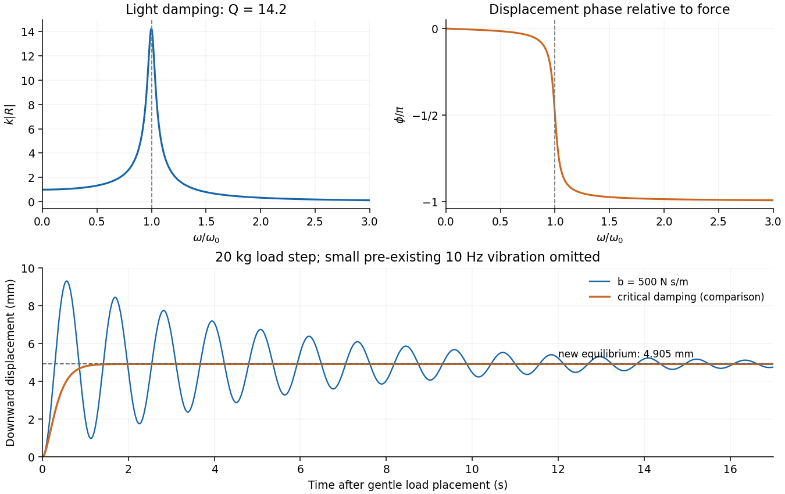
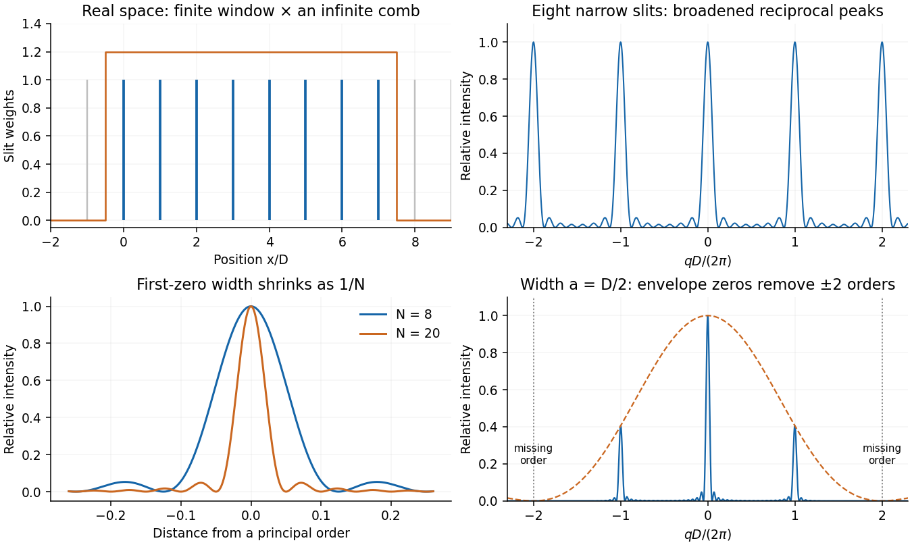
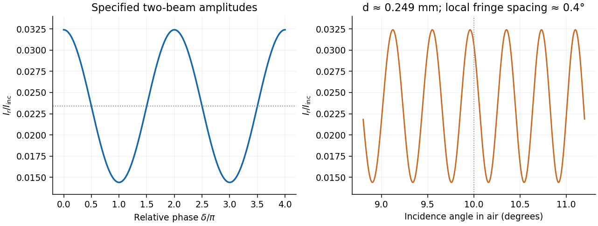
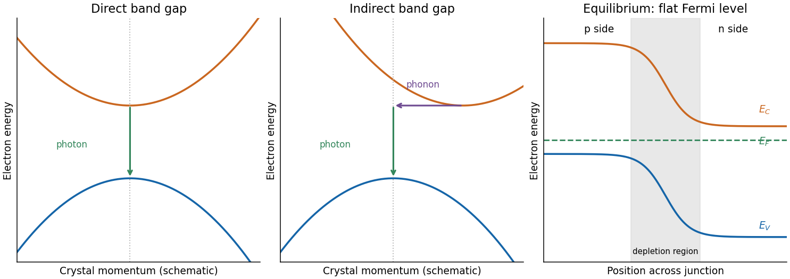
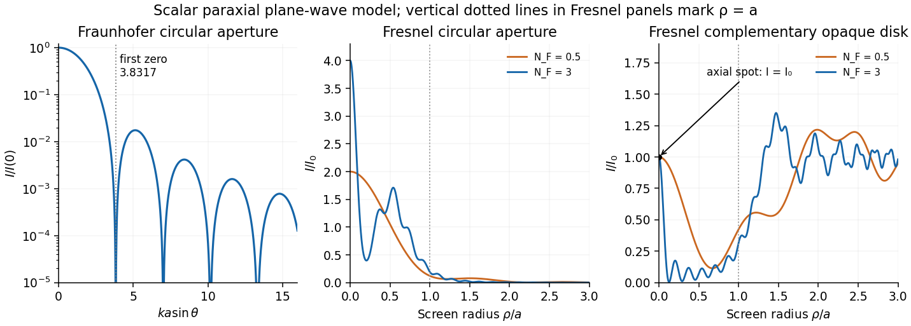
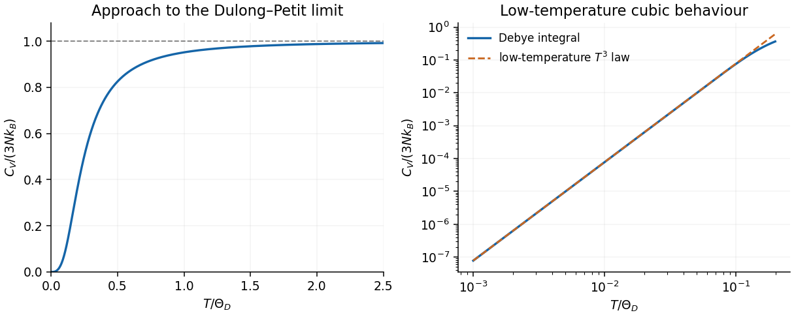
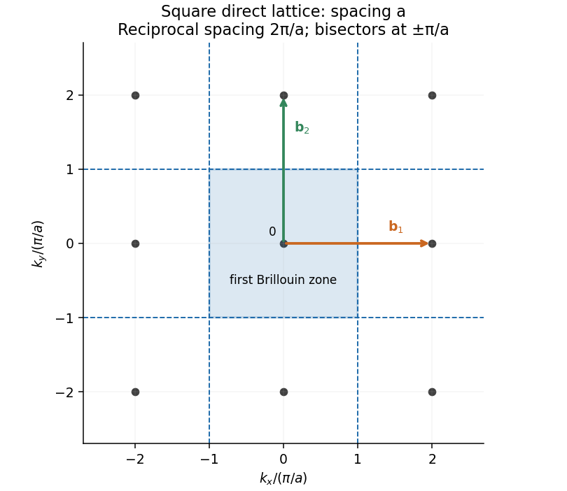

# Paper 2

↑ **Parent:** [2017](../2017.md)

[Original paper, released PDF pages 73–80](https://www.whatdotheyknow.com/request/natural_science_tripos_physics_e/response/2127325/attach/3/FOI%202022%20639%20Sullivan%20materials.pdf?cookie_passthrough=1#page=73)

**Table of contents**

- [Section A](#section-a)
  - [1](#section-a/1)
    - [Solution](#section-a/1/solution)
  - [2](#section-a/2)
    - [Solution](#section-a/2/solution)
  - [3](#section-a/3)
    - [Solution](#section-a/3/solution)
  - [4](#section-a/4)
    - [Solution](#section-a/4/solution)
  - [5](#section-a/5)
    - [Solution](#section-a/5/solution)
- [Section B](#section-b)
  - [B6](#section-b/b6)
    - [Solution](#section-b/b6/solution)
      - [Response function and light-damping sketch](#section-b/b6/response-function-and-light-damping-sketch)
      - [Resonance and high-frequency asymptote](#section-b/b6/resonance-and-high-frequency-asymptote)
      - [Table mass and the strict displacement bound](#section-b/b6/table-mass-and-the-strict-displacement-bound)
      - [Response to the added load](#section-b/b6/response-to-the-added-load)
      - [Practical damping choice](#section-b/b6/practical-damping-choice)
  - [B7](#section-b/b7)
    - [Solution](#section-b/b7/solution)
      - [Wavepacket derivation of group velocity](#section-b/b7/wavepacket-derivation-of-group-velocity)
      - [Which wavelength enters the derivative formula](#section-b/b7/which-wavelength-enters-the-derivative-formula)
      - [Numerical group velocity from refraction](#section-b/b7/numerical-group-velocity-from-refraction)
      - [Transit and pulse evolution](#section-b/b7/transit-and-pulse-evolution)
  - [B8](#section-b/b8)
    - [Solution](#section-b/b8/solution)
      - [Convolution and a finite slit array](#section-b/b8/convolution-and-a-finite-slit-array)
      - [Second-order direction](#section-b/b8/second-order-direction)
      - [Illuminated width for spectral resolution](#section-b/b8/illuminated-width-for-spectral-resolution)
      - [Detector pixels and optical layout](#section-b/b8/detector-pixels-and-optical-layout)
      - [Why the given slit width removes the chosen order](#section-b/b8/why-the-given-slit-width-removes-the-chosen-order)
  - [B9](#section-b/b9)
    - [Solution](#section-b/b9/solution)
      - [Propagation and reflection phases](#section-b/b9/propagation-and-reflection-phases)
      - [Two reflected amplitudes and intensity sketch](#section-b/b9/two-reflected-amplitudes-and-intensity-sketch)
      - [Thickness from angular fringe spacing](#section-b/b9/thickness-from-angular-fringe-spacing)
      - [Nonuniform oil film in monochromatic light](#section-b/b9/nonuniform-oil-film-in-monochromatic-light)
- [Section C](#section-c)
  - [C10](#section-c/c10)
    - [Solution](#section-c/c10/solution)
      - [Physical meaning of a phonon](#section-c/c10/physical-meaning-of-a-phonon)
      - [Coupled-chain equations and dispersion relation](#section-c/c10/coupled-chain-equations-and-dispersion-relation)
      - [Acoustic and optical branches](#section-c/c10/acoustic-and-optical-branches)
      - [Long-wavelength limits](#section-c/c10/long-wavelength-limits)
      - [Spring constant from the original graph](#section-c/c10/spring-constant-from-the-original-graph)
      - [Sound speed and inferred plane spacing](#section-c/c10/sound-speed-and-inferred-plane-spacing)
  - [C11](#section-c/c11)
    - [Solution](#section-c/c11/solution)
      - [Semiconductor bands and efficient light emission](#section-c/c11/semiconductor-bands-and-efficient-light-emission)
      - [Doping and the equilibrium junction sketch](#section-c/c11/doping-and-the-equilibrium-junction-sketch)
      - [Donor binding energy, size and thermal ionisation](#section-c/c11/donor-binding-energy-size-and-thermal-ionisation)
      - [Carrier density and the conductivity-ratio assumption](#section-c/c11/carrier-density-and-the-conductivity-ratio-assumption)
      - [Measuring carrier concentration](#section-c/c11/measuring-carrier-concentration)
      - [Concentration for appreciable donor overlap](#section-c/c11/concentration-for-appreciable-donor-overlap)
- [Section D](#section-d)
  - [D12](#section-d/d12)
    - [Solution](#section-d/d12/solution)
  - [D13](#section-d/d13)
    - [a](#section-d/d13/a)
      - [Solution](#section-d/d13/a/solution)
    - [b](#section-d/d13/b)
      - [Solution](#section-d/d13/b/solution)
    - [c](#section-d/d13/c)
      - [Solution](#section-d/d13/c/solution)

## Section A

↑ **Parent:** [Paper 2](paper-2.md)

<h3 id="section-a/1">1</h3>

↑ **Parent:** [Section A](#section-a)

<h4 id="section-a/1/solution">Solution</h4>

↑ **Parent:** [1](#section-a/1)

The [characteristic impedance of a stretched string](../../wave-equation.md#characteristic-impedance-of-a-stretched-string) is $Z=T/c=\rho c$, since its [wave speed](../../wave-equation.md#wave-speed) obeys $c^2=T/\rho$. Put the endpoint at $x=0$ and use displacement [complex amplitudes](../../wave.md#complex-amplitude) $A$ incident and $B$ reflected:

$$
\Psi=(Ae^{ikx}+Be^{-ikx})e^{-i\omega t},\qquad k=\omega/c.
$$

At the massless end, the string's transverse [force](../../force.md) $-T\Psi_x$ balances the damper's [force](../../force.md) $-\alpha\Psi_t$. Thus $T\Psi_x=-\alpha\Psi_t$, or $Z(A-B)=\alpha(A+B)$. This [viscous termination of a stretched string](../../wave-equation.md#viscous-termination-of-a-stretched-string) has

$$
r=\frac BA=\frac{Z-\alpha}{Z+\alpha},\qquad \mathcal R=|r|^2.
$$

Half the incident mean [power](../../energy.md#power) is reflected when $r=\pm1/\sqrt2$, giving **two positive solutions**:

$$
\boxed{\alpha=(3-2\sqrt2)\rho c\quad\text{or}\quad\alpha=(3+2\sqrt2)\rho c}.
$$

They are approximately $0.1716\rho c$ and $5.828\rho c$, in $\mathrm{kg\,s^{-1}}$. The smaller coefficient produces no reflected displacement-phase reversal; the larger produces a $\pi$ reversal. Both dissipate the remaining half of the incident [power](../../energy.md#power). Choosing the impedance-matched value $\alpha=\rho c$ would instead absorb all of it.

<h3 id="section-a/2">2</h3>

↑ **Parent:** [Section A](#section-a)

<h4 id="section-a/2/solution">Solution</h4>

↑ **Parent:** [2](#section-a/2)

For an object near the front focal plane, the objective's [numerical aperture](../../point-spread-function.md#numerical-aperture) in air is

$$
\mathrm{NA}=\sin\theta\simeq\frac{D}{2f}=\frac{0.005}{2(0.020)}=0.125.
$$

The [Rayleigh criterion](../../point-spread-function.md#rayleigh-criterion) for a circular objective gives object-space [diffraction-limited resolution](../../point-spread-function.md#diffraction-limited-resolution)

$$
\boxed{\Delta x\simeq\frac{0.61\lambda}{\mathrm{NA}}=\frac{1.22\lambda f}{D}=2.93\times10^{-6}\,\mathrm m\simeq2.9\,\mathrm{\mu m}}.
$$

The factor $1.22$ comes from the first zero of the [Airy disk](../../point-spread-function.md#airy-disk). Using the exact $\sin(\arctan(D/(2f)))$ changes the result by less than $1\%$. A coarser $\lambda f/D$ estimate gives $2.4\,\mathrm{\mu m}$; the chosen criterion must be stated. This estimates the [aperture](../../optics.md#aperture) limit, before aberrations and detector sampling.

<h3 id="section-a/3">3</h3>

↑ **Parent:** [Section A](#section-a)

<h4 id="section-a/3/solution">Solution</h4>

↑ **Parent:** [3](#section-a/3)

The original diagram puts the upper edge of the obstruction exactly on the straight line from source to detector. The detector is therefore at the geometric shadow boundary, not deep inside the shadow. In the optical convention, the [Cornu spiral](../../topology.md#euler-spiral) is

$$
C(u)+iS(u)=\int_0^u e^{i\pi t^2/2}\,dt,
$$

with limiting points $(-1/2,-1/2)$ and $(1/2,1/2)$. The unobstructed [Fresnel diffraction](../../physical-optics.md#fresnel-diffraction) amplitude is the chord joining both endpoints, proportional to $1+i$. The open half-plane supplies only the chord from $(0,0)$ to $(1/2,1/2)$, proportional to $(1+i)/2$. The coordinate perpendicular to the page contributes the same factor in both cases.

$$
\boxed{\frac{U}{U_0}=\frac12,\qquad \frac{I}{I_0}=\left|\frac{U}{U_0}\right|^2=\frac14}.
$$

This is the [half-plane shadow-boundary intensity](../../physical-optics.md#half-plane-shadow-boundary-intensity). The missing half of the [aperture](../../optics.md#aperture) removes half the field here, so taking half the intensity would be incorrect.

**[Figure 1](#section-a/3/image-cornu-spiral-chords-for-a-fully-open-wavefront-and-for-a-straight-edge-shadow-boundary). Cornu-spiral chords for a fully open wavefront and for a straight-edge shadow boundary**.

<h3 id="section-a/4">4</h3>

↑ **Parent:** [Section A](#section-a)

<h4 id="section-a/4/solution">Solution</h4>

↑ **Parent:** [4](#section-a/4)

In a conventional [face-centered cubic lattice](../../quantum-scattering.md#face-centered-cubic-lattice) cell of side $a_F$, touching nearest-neighbour [hard spheres](../../statistical-physics.md#hard-sphere) lie along a face diagonal. Four radii span that diagonal, so $\sqrt2a_F=4r$ and $a_F=2\sqrt2r$. In a conventional [body-centered cubic lattice](../../quantum-scattering.md#body-centered-cubic-lattice) cell, the contact lies on the body diagonal: $\sqrt3a_B=4r$, giving $a_B=4r/\sqrt3$. Therefore

$$
\boxed{\frac{V_F}{V_B}=\left(\frac{2\sqrt2r}{4r/\sqrt3}\right)^3=\frac{3\sqrt6}{4}=1.837}.
$$

These are the nonprimitive cubic [unit cells](../../quantum-scattering.md#unit-cell) requested. They contain four and two atoms respectively, so their volume ratio should not be confused with the volume-per-atom ratio, which is half as large, $3\sqrt6/8\simeq0.9186$. The common sphere radius cancels.

<h3 id="section-a/5">5</h3>

↑ **Parent:** [Section A](#section-a)

<h4 id="section-a/5/solution">Solution</h4>

↑ **Parent:** [5](#section-a/5)

For fixed [electron](../../physics.md#electron) number $N$, the specified [electron degeneracy pressure](../../quantum-ideal-gas-statistics.md#electron-degeneracy-pressure) scales as $P\propto V^{-5/3}$. Differentiating at fixed low [temperature](../../temperature.md) gives the [degeneracy-pressure bulk modulus](../../quantum-ideal-gas-statistics.md#degeneracy-pressure-bulk-modulus),

$$
\boxed{K_T=-V\frac{\partial P}{\partial V}=\frac53P}.
$$

A monovalent sample has one conduction [electron](../../physics.md#electron) per atom. Its [carrier density](../../electric-charge.md#carrier-density) is

$$
n=\frac{862\,\mathrm{kg\,m^{-3}}}{0.039\,\mathrm{kg\,mol^{-1}}}N_A
=1.331\times10^{28}\,\mathrm{m^{-3}},
$$

using the [Avogadro constant](../../physics.md#avogadro-constant) $N_A=6.02214076\times10^{23}\,\mathrm{mol^{-1}}$. Substitution with [reduced Planck constant](../../quantum-mechanics.md#reduced-planck-constant) $\hbar=1.05457\times10^{-34}\,\mathrm{J\,s}$ and [electron mass](../../physics.md#electron-mass) $m_e=9.10938\times10^{-31}\,\mathrm{kg}$ gives

$$
P=1.747\times10^9\,\mathrm{Pa},\qquad
\boxed{K_T=2.91\times10^9\,\mathrm{Pa}\simeq2.9\,\mathrm{GPa}}.
$$

Equivalently, $P=2nE_F/5$ and $K_T=2nE_F/3$ for this [free electron model](../../physics.md#free-electron-model). This is the assumed electronic contribution, not a calculation of the complete equation of state of real potassium: ionic cohesion and interaction corrections have been excluded as instructed. The supplied pressure is the zero-temperature form, appropriate to leading order for $T\ll T_F$.

## Section B

↑ **Parent:** [Paper 2](paper-2.md)

<h3 id="section-b/b6">B6</h3>

↑ **Parent:** [Section B](#section-b)

<h4 id="section-b/b6/solution">Solution</h4>

↑ **Parent:** [B6](#section-b/b6)

<h5 id="section-b/b6/response-function-and-light-damping-sketch">Response function and light-damping sketch</h5>

↑ **Parent:** [Solution](#section-b/b6/solution)

Use the $e^{i\omega t}$ convention for the harmonic [force](../../force.md) and displacement [complex amplitudes](../../wave.md#complex-amplitude). Substitution in the [forced harmonic oscillator](../../analysis.md#forced-harmonic-oscillator) equation gives

$$
(k-m\omega^2+ib\omega)x_0=F_0,\qquad
\boxed{R(\omega)=\frac1{k-m\omega^2+ib\omega}}.
$$

Its magnitude and [phase](../../wave.md#phase-waves) relative to the [force](../../force.md) are

$$
|R|=\frac1{\sqrt{(k-m\omega^2)^2+b^2\omega^2}},\qquad
\phi=-\operatorname{atan2}(b\omega,k-m\omega^2).
$$

At zero [frequency](../../wave.md#frequency), $|R|=1/k$ and $\phi=0$. At $\omega_0=\sqrt{k/m}$, $\phi=-\pi/2$; at high [frequency](../../wave.md#frequency) the [phase](../../wave.md#phase-waves) approaches $-\pi$. For light [viscous damping](../../wave-equation.md#viscous-damping), the [quality factor](../../dynamical-systems.md#q-factor) $Q=m\omega_0/b$ is large and there is a tall narrow displacement peak close to $\omega_0$.

<h5 id="section-b/b6/resonance-and-high-frequency-asymptote">Resonance and high-frequency asymptote</h5>

↑ **Parent:** [Solution](#section-b/b6/solution)

To find the displacement peak, minimize the squared denominator:

$$
\frac{d}{d\omega}[(k-m\omega^2)^2+b^2\omega^2]
=2\omega[-2m(k-m\omega^2)+b^2].
$$

The nonzero minimum gives

$$
\boxed{\omega_a=\sqrt{\frac km-\frac{b^2}{2m^2}}},\qquad b^2<2mk.
$$

For stronger damping there is no positive-frequency displacement maximum. When $\omega\gg\omega_0$ and $b\ll m\omega$,

$$
\boxed{|R(\omega)|\simeq\frac1{m\omega^2}},\qquad R\simeq-\frac1{m\omega^2}.
$$

The inertia then dominates the restoring and damping [forces](../../force.md).

<h5 id="section-b/b6/table-mass-and-the-strict-displacement-bound">Table mass and the strict displacement bound</h5>

↑ **Parent:** [Solution](#section-b/b6/solution)

The four supporting [springs](../../elasticity-physics.md#spring) act in parallel, so their total [spring constant](../../elasticity-physics.md#spring-constant) is $k=4.00\times10^4\,\mathrm{N\,m^{-1}}$. The driving [angular frequency](../../lagrangian-mechanics.md#angular-frequency) is $\omega=2\pi(10)=62.83\,\mathrm{s^{-1}}$. The [force-driven vibration isolation](../../analysis.md#force-driven-vibration-isolation) estimate gives

$$
|x_0|\simeq\frac{F_0}{m\omega^2},\qquad
\boxed{m_{\rm estimate}=\frac{5}{(2\pi\,10)^2(10^{-6})}=1.267\times10^3\,\mathrm{kg}}.
$$

At this [mass](../../classical-mechanics.md#mass), $f_0=\sqrt{k/m}/(2\pi)=0.894\,\mathrm{Hz}\ll10\,\mathrm{Hz}$, and $Q=\sqrt{mk}/b\simeq14.2$, so the assumptions are consistent. The exact forced amplitude is

$$
|x_0|=\frac5{\sqrt{(4.00\times10^4-m\omega^2)^2+(500\omega)^2}}
=\boxed{1.008\,\mathrm{\mu m}}.
$$

It is indeed close to $1\,\mathrm{\mu m}$, but it is slightly **above** the strict requested bound. Setting the exact expression to $10^{-6}\,\mathrm m$ gives the high-mass threshold

$$
\boxed{m_{\min}=\frac{k+\sqrt{(F_0/x_{\max})^2-b^2\omega^2}}{\omega^2}=1.277\times10^3\,\mathrm{kg}}.
$$

Choose a [mass](../../classical-mechanics.md#mass) strictly greater than this threshold for a strict inequality; $1.28\times10^3\,\mathrm{kg}$ is a suitable rounded choice. Simply rounding the high-frequency estimate down would not guarantee the bound.

<h5 id="section-b/b6/response-to-the-added-load">Response to the added load</h5>

↑ **Parent:** [Solution](#section-b/b6/solution)

Measure downward displacement relative to the former mean equilibrium. The added $M=20\,\mathrm{kg}$ changes the equilibrium by

$$
\boxed{\Delta=\frac{Mg}{k}=4.905\,\mathrm{mm}}.
$$

Assume the load is deposited without a significant impact impulse and then moves with the table. The moving [mass](../../classical-mechanics.md#mass) becomes $m+M$. Ignoring the tiny pre-existing $10\,\mathrm{Hz}$ vibration in the sketch, the [added-load step response of a supported table](../../analysis.md#added-load-step-response-of-a-supported-table) is

$$
x(t)=\Delta\left[1-e^{-\beta t}\left(\cos\omega_dt+\frac\beta{\omega_d}\sin\omega_dt\right)\right],\quad
\beta=\frac b{2(m+M)},\quad\omega_d=\sqrt{\frac{k}{m+M}-\beta^2}.
$$

For the estimated [mass](../../classical-mechanics.md#mass), $\beta=0.194\,\mathrm{s^{-1}}$, the envelope time is $1/\beta=5.15\,\mathrm s$, and the period is about $1.13\,\mathrm s$. The table overshoots and rings about the new equilibrium, with the displacement starting continuously at zero and with zero initial slope. A real impact adds an initial-velocity transient; the problem gives no impact history. The residual driven vibration, of order a micrometre, can be superposed.

**[Figure 2](#section-b/b6/image-lightly-damped-response-amplitude-and-phase-followed-by-the-table-s-load-step-displacement-and-a-critically-damped-comparison). Lightly damped response amplitude and phase, followed by the table's load-step displacement and a critically damped comparison**.

<h5 id="section-b/b6/practical-damping-choice">Practical damping choice</h5>

↑ **Parent:** [Solution](#section-b/b6/solution)

To settle quickly after loading, [critical damping](../../wave-equation.md#critical-damping) is preferable to the supplied weak damper:

$$
\boxed{b_c=2\sqrt{k(m+M)}\simeq1.44\times10^4\,\mathrm{N\,s\,m^{-1}}}.
$$

Using the strict-bound [mass](../../classical-mechanics.md#mass) instead changes this by less than $1\%$. This eliminates free ringing while avoiding the slow tail of severe [overdamping](../../wave-equation.md#overdamping). In the stipulated external-force model, greater damping also reduces the steady forced amplitude; there is no finite optimum based solely on that amplitude. A critical or near-critical value is a practical compromise for rapid settling. If the disturbance were specified as floor displacement transmitted through the legs, damping would introduce an additional transmission tradeoff, but that is a different forcing model.

<h3 id="section-b/b7">B7</h3>

↑ **Parent:** [Section B](#section-b)

<h4 id="section-b/b7/solution">Solution</h4>

↑ **Parent:** [B7](#section-b/b7)

<h5 id="section-b/b7/wavepacket-derivation-of-group-velocity">Wavepacket derivation of group velocity</h5>

↑ **Parent:** [Solution](#section-b/b7/solution)

Superpose two nearby harmonic waves. The identity

$$
\cos(k_1x-\omega_1t)+\cos(k_2x-\omega_2t)
=2\cos\!\left(\frac{\Delta k\,x-\Delta\omega\,t}{2}\right)
\cos(\bar kx-\bar\omega t)
$$

separates a rapid carrier from a slow beat envelope. A constant point of the envelope moves at $\Delta\omega/\Delta k$, which tends to

$$
\boxed{v_g=\frac{d\omega}{dk}}
$$

as the components approach one another. Equivalently, expand a narrow [wave packet](../../dispersion-relation.md#wave-packet) spectrum around $k_0$: $\omega(k)=\omega_0+v_g(k-k_0)+\cdots$. Factoring the carrier out of its [Fourier transform](../../fourier-transform.md) representation leaves an envelope depending on $x-v_gt$. This interpretation requires a narrow spectrum and little attenuation or distortion; higher derivatives of the [dispersion relation](../../dispersion-relation.md) can change the envelope shape. The carrier [phase velocity](../../dispersion-relation.md#phase-velocity) is $v_p=\omega/k$ and need not equal $v_g$.

<h5 id="section-b/b7/which-wavelength-enters-the-derivative-formula">Which wavelength enters the derivative formula</h5>

↑ **Parent:** [Solution](#section-b/b7/solution)

For the _wavelength in the medium_, $\lambda_m=2\pi/k$, differentiate $\omega=kv_p(k)$:

$$
v_g=v_p+k\frac{dv_p}{dk}
=v_p+k\frac{dv_p}{d\lambda_m}\left(-\frac{\lambda_m}{k}\right),\qquad
\boxed{v_g=v_p-\lambda_m\frac{dv_p}{d\lambda_m}}.
$$

The distinction in [group velocity in material and vacuum wavelength coordinates](../../dispersion-relation.md#group-velocity-in-material-and-vacuum-wavelength-coordinates) is essential for the numerical data. For incident _vacuum_ wavelength $\lambda_0=2\pi c/\omega$, differentiation of $k=\omega/v_p(\lambda_0)$ instead gives

$$
\boxed{v_g=\frac{v_p}{1+(\lambda_0/v_p)\,dv_p/d\lambda_0}
=\frac{c}{n-\lambda_0\,dn/d\lambda_0}}.
$$

Thus the printed derivative identity is valid, but its wavelength coordinate cannot be carried unchanged into data specified before refraction.

<h5 id="section-b/b7/numerical-group-velocity-from-refraction">Numerical group velocity from refraction</h5>

↑ **Parent:** [Solution](#section-b/b7/solution)

The wavelengths specified for incidence from vacuum are $\lambda_0$. With fixed incident angle $\theta_i$, [Snell's law](../../partial-differential-equation.md#snell-s-law) gives $n=\sin\theta_i/\sin\theta_t$ and $v_p=c\sin\theta_t/\sin\theta_i$. At the central wavelength,

$$
n=\frac{\sin45.00^\circ}{\sin17.80^\circ}=2.3131,\qquad
v_p=1.2961\times10^8\,\mathrm{m\,s^{-1}}.
$$

Use a central difference, converting the angle change to radians:

$$
\frac{d\theta_t}{d\lambda_0}\simeq\frac{0.020\pi/180}{4.0\times10^{-9}}
=8.7266\times10^4\,\mathrm{rad\,m^{-1}}.
$$

The [group index from refracted-angle dispersion](../../physical-optics.md#group-index-from-refracted-angle-dispersion) is

$$
n_g=n\left[1+\lambda_0\cot\theta_t\frac{d\theta_t}{d\lambda_0}\right]=2.6275,
\qquad
\boxed{v_g=\frac c{n_g}=1.141\times10^8\,\mathrm{m\,s^{-1}}}.
$$

Directly inserting the incident vacuum wavelengths into $v_p-\lambda\,dv_p/d\lambda$ would instead give $1.120\times10^8\,\mathrm{m\,s^{-1}}$. That is a plausible intended rough answer, but it mixes wavelength coordinates; the boxed result consistently uses the incident data. The two agree only to first order in a sufficiently small dimensionless dispersion correction.

<h5 id="section-b/b7/transit-and-pulse-evolution">Transit and pulse evolution</h5>

↑ **Parent:** [Solution](#section-b/b7/solution)

Taking $L=1.00\,\mathrm{cm}$ as the distance travelled in the medium, the narrowband [group delay](../../physical-optics.md#group-delay) is

$$
\boxed{t_g=L/v_g=8.76\times10^{-11}\,\mathrm s=87.6\,\mathrm{ps}}.
$$

If $1\,\mathrm{cm}$ denotes a slab thickness measured normal to the interface instead, the central ray travels $L/\cos17.80^\circ$, giving about $92.1\,\mathrm{ps}$. The coordinate-mixed velocity above would give $89.3\,\mathrm{ps}$ for a $1\,\mathrm{cm}$ path; it should not replace the consistent calculation silently.

The pulse envelope travels at the local [group velocity](../../dispersion-relation.md#group-velocity), while individual carrier crests move at the [phase velocity](../../dispersion-relation.md#phase-velocity). In general, variation of [group velocity](../../dispersion-relation.md#group-velocity) across the pulse spectrum produces different delays, temporal broadening and chirp. Absorption can reshape the spectrum and envelope as well. The refraction data also show wavelength-dependent angles, so a finite-width incident beam acquires spatial separation of its spectral components. The supplied first derivative determines the central delay but does not specify a pulse duration, absorption spectrum or reliable second derivative of the [dispersion relation](../../dispersion-relation.md); it therefore does not determine a numerical broadening, or its sign. If propagation [phase](../../wave.md#phase-waves) is effectively linear across a sufficiently narrow spectrum, the leading approximation is a delayed pulse with unchanged shape.

<h3 id="section-b/b8">B8</h3>

↑ **Parent:** [Section B](#section-b)

<h4 id="section-b/b8/solution">Solution</h4>

↑ **Parent:** [B8](#section-b/b8)

<h5 id="section-b/b8/convolution-and-a-finite-slit-array">Convolution and a finite slit array</h5>

↑ **Parent:** [Solution](#section-b/b8/solution)

Use [Fourier transform](../../fourier-transform.md) convention $\widehat f(q)=\int f(x)e^{-iqx}dx$. The [convolution theorem](../../fourier-analysis.md#convolution-theorem) gives

$$
\boxed{\widehat{f*g}=\widehat f\,\widehat g},\qquad
\boxed{\widehat{fg}=\frac1{2\pi}\widehat f*\widehat g}.
$$

A finite array of very narrow slits at $x=jD$, $j=0,\ldots,N-1$, has transmission proportional to $\sum_j\delta(x-jD)$. It can be constructed by multiplying an infinite [Dirac comb](../../distribution-theory.md#dirac-comb) by a finite window. The infinite comb transforms to a reciprocal comb; the finite window convolves each reciprocal peak with a narrow sinc-shaped amplitude. Thus increasing the illuminated length narrows each [Fraunhofer diffraction](../../physical-optics.md#fraunhofer-diffraction) peak.

The exact finite sum makes the argument quantitative:

$$
\widehat t(q)\propto\sum_{j=0}^{N-1}e^{-iqjD}
=e^{-iq(N-1)D/2}\frac{\sin(NqD/2)}{\sin(qD/2)},\qquad q=\frac{2\pi}{\lambda}\sin\theta.
$$

Its normalized intensity is $[\sin(NqD/2)/(N\sin(qD/2))]^2$. Principal maxima occur at $qD=2\pi m$; their first zeros are displaced by $|\Delta(qD)|=2\pi/N$. Replacing the ideal narrow slit by a finite slit function convolves the array in real space, multiplying this field by the single-slit [Fourier transform](../../fourier-transform.md). Field amplitudes are transformed and combined before their squared modulus is taken.

**[Figure 3](#section-b/b8/image-a-finite-narrow-slit-array-and-its-fourier-intensity-showing-how-the-principal-peaks-narrow-with-slit-count). A finite narrow-slit array and its Fourier intensity, showing how the principal peaks narrow with slit count**.

<h5 id="section-b/b8/second-order-direction">Second-order direction</h5>

↑ **Parent:** [Solution](#section-b/b8/solution)

The pitch corresponding to $500\,\mathrm{mm^{-1}}$ is $D=2.00\,\mathrm{\mu m}$. The normal-incidence [diffraction grating](../../physical-optics.md#diffraction-grating) equation gives

$$
D\sin\theta=m\lambda,\qquad
\boxed{\theta_2=\arcsin\!\left(\frac{2(400\,\mathrm{nm})}{2.00\,\mathrm{\mu m}}\right)=23.58^\circ}.
$$

This locates the array-factor maximum; the single-slit envelope must also be nonzero for an observable peak.

<h5 id="section-b/b8/illuminated-width-for-spectral-resolution">Illuminated width for spectral resolution</h5>

↑ **Parent:** [Solution](#section-b/b8/solution)

Near order $m$, the first angular zero from a principal maximum is $\delta\theta=\lambda/(ND\cos\theta)$. Two wavelengths have peak separation $\Delta\theta=m\Delta\lambda/(D\cos\theta)$. Equating them applies the [Rayleigh criterion](../../point-spread-function.md#rayleigh-criterion) and gives the [resolving power of a diffraction grating](../../physical-optics.md#resolving-power-of-a-diffraction-grating),

$$
\boxed{\frac\lambda{\Delta\lambda}=mN}.
$$

Here the required resolving [power](../../energy.md#power) is $400/0.2=2000$, so in second order $N\geq1000$. The illuminated width is therefore

$$
\boxed{W\simeq ND=2.00\,\mathrm{mm}}.
$$

Whether one counts the full illuminated window or the first-to-last slit-centre distance changes the width by one pitch and is immaterial at this precision. The result assumes negligible aberrations and adequate slit illumination and coherence.

<h5 id="section-b/b8/detector-pixels-and-optical-layout">Detector pixels and optical layout</h5>

↑ **Parent:** [Solution](#section-b/b8/solution)

The angular dispersion at the chosen order is

$$
\frac{d\theta}{d\lambda}=\frac m{D\cos\theta},\qquad
\Delta\theta=2.182\times10^{-4}\,\mathrm{rad}.
$$

For a collecting lens with its axis directed along the selected second-order beam, the local focal-plane separation is

$$
\Delta x\simeq f\Delta\theta=\boxed{54.6\,\mathrm{\mu m}}.
$$

A basic one-pixel separation criterion is therefore $\boxed{t\lesssim55\,\mathrm{\mu m}}$. A more reliable two-pixels-per-resolution-interval choice is $\boxed{t\lesssim27\,\mathrm{\mu m}}$. Finite pixels integrate the pattern, so sampling and pixel response should not degrade the grating's optical resolution.

This [pixel sampling of a grating spectrum](../../physical-optics.md#pixel-sampling-of-a-grating-spectrum) depends on the layout and criterion, neither of which is fully specified. If the detector is instead described by $x=f\tan\theta$ relative to the incident-axis coordinate, the derivative contains an additional $\sec^2\theta$ and gives $65.0\,\mathrm{\mu m}$ separation, or about $32\,\mathrm{\mu m}$ for two-pixel sampling. The more approximate paraxial mapping $x\simeq fm\lambda/D$ gives $50\,\mathrm{\mu m}$. These are stated alternatives rather than one falsely precise universal pixel width.

<h5 id="section-b/b8/why-the-given-slit-width-removes-the-chosen-order">Why the given slit width removes the chosen order</h5>

↑ **Parent:** [Solution](#section-b/b8/solution)

For a slit of width $a$, the [single-slit diffraction](../../physical-optics.md#single-slit-diffraction) amplitude is proportional to $\operatorname{sinc}(\pi a\sin\theta/\lambda)$. At a grating maximum, $D\sin\theta=m\lambda$, so the envelope factor is

$$
\operatorname{sinc}\!\left(\frac{\pi ma}{D}\right).
$$

The specified $a=1\,\mathrm{\mu m}=D/2$ gives $ma/D=1$ at $m=2$. Thus

$$
\boxed{\operatorname{sinc}(\pi)=0:\quad\text{the second order is a missing diffraction order}.}
$$

The grating maximum coincides exactly with the first single-slit minimum for each wavelength. The preceding width and detector calculations describe the ideal array factor, but this particular rectangular-aperture grating cannot deliver the assumed second-order signal. Pixel refinement cannot repair the missing optical peak. One must change the [aperture](../../optics.md#aperture) duty cycle or grating profile, or use an available order and recalculate its resolving [power](../../energy.md#power).

<h3 id="section-b/b9">B9</h3>

↑ **Parent:** [Section B](#section-b)

<h4 id="section-b/b9/solution">Solution</h4>

↑ **Parent:** [B9](#section-b/b9)

<h5 id="section-b/b9/propagation-and-reflection-phases">Propagation and reflection phases</h5>

↑ **Parent:** [Solution](#section-b/b9/solution)

Let the first ray reflect at the upper surface and the second traverse the film, reflect below, and emerge at a laterally displaced point. Its internal round-trip geometric length is $2d/\cos\theta$, but the external path to a common outgoing [wavefront](../../physical-optics.md#wavefront) must also be included. The lateral separation is $2d\tan\theta$, whose projection along the external ray is $2d\tan\theta\sin\theta_i$. The net [optical path difference](../../physical-optics.md#optical-path-difference) is therefore

$$
\Delta\ell=\frac{2nd}{\cos\theta}-2d\tan\theta\sin\theta_i
=\frac{2nd(1-\sin^2\theta)}{\cos\theta}=2nd\cos\theta,
$$

using [Snell's law](../../partial-differential-equation.md#snell-s-law) $\sin\theta_i=n\sin\theta$. Multiplying by the vacuum [wavenumber](../../wave-equation.md#wavenumber) gives

$$
\boxed{\delta=\frac{4\pi nd}{\lambda}\cos\theta}.
$$

For the usual index ordering $1<n<n_2$, including the stated later value $n=1.2$, both reflections are towards higher [refractive index](../../electromagnetic-wave.md#refractive-index) and both reverse the electric-field sign. Their relative reflection [phase](../../wave.md#phase-waves) is therefore zero; $\delta$ is also their total relative [phase](../../wave.md#phase-waves) modulo $2\pi$. A different index ordering or polarization-dependent reflection [phase](../../wave.md#phase-waves) would require that additional term.

<h5 id="section-b/b9/two-reflected-amplitudes-and-intensity-sketch">Two reflected amplitudes and intensity sketch</h5>

↑ **Parent:** [Solution](#section-b/b9/solution)

At the same output in air, use incident intensity $I_{\rm inc}\propto|A|^2$. The two specified output amplitudes, including their common reflection sign, give the [thin-film interference](../../physical-optics.md#thin-film-interference) result

$$
\frac{I_r}{I_{\rm inc}}=|0.15+0.03e^{i\delta}|^2
=\boxed{0.0234+0.0090\cos\delta}.
$$

The output is a cosine with mean $0.0234I_{\rm inc}$, period $2\pi$, and extrema

$$
\boxed{I_{\max}=0.0324I_{\rm inc}\quad(\delta=2\pi m)},\qquad
\boxed{I_{\min}=0.0144I_{\rm inc}\quad(\delta=(2m+1)\pi)}.
$$

The unequal amplitudes prevent a dark minimum; their [interference visibility](../../physical-optics.md#interferometric-visibility) is $0.009/0.0234=5/13\simeq0.385$. This is the stipulated two-beam model: the supplied amplitudes already include propagation and transmission factors, and internal re-reflections are excluded by the stated assumption. They need not be recomputed from the later index value.

<h5 id="section-b/b9/thickness-from-angular-fringe-spacing">Thickness from angular fringe spacing</h5>

↑ **Parent:** [Solution](#section-b/b9/solution)

Eliminate the internal angle using [Snell's law](../../partial-differential-equation.md#snell-s-law):

$$
\delta(\theta_i)=\frac{4\pi d}{\lambda}\sqrt{n^2-\sin^2\theta_i},\qquad
\frac{d\delta}{d\theta_i}=-\frac{4\pi d}{\lambda}\frac{\sin\theta_i\cos\theta_i}{\sqrt{n^2-\sin^2\theta_i}}.
$$

Neighbouring bright fringes differ in [phase](../../wave.md#phase-waves) by $2\pi$. The local [angular fringe spacing of a transparent film](../../physical-optics.md#angular-fringe-spacing-of-a-transparent-film) therefore gives

$$
d\simeq\frac{\lambda\sqrt{n^2-\sin^2\theta_i}}{2\sin\theta_i\cos\theta_i\,\Delta\theta_i}.
$$

With $\Delta\theta_i=0.4\pi/180=6.981\times10^{-3}\,\mathrm{rad}$, $\theta_i\simeq10^\circ$, $n=1.2$ and $\lambda=500\,\mathrm{nm}$,

$$
\boxed{d\simeq2.49\times10^{-4}\,\mathrm m\simeq0.25\,\mathrm{mm}}.
$$

The data specify a local spacing near $10^\circ$, so differentiating is appropriate; choosing particular neighbouring fringe angles slightly shifts this approximate result. The [phase](../../wave.md#phase-waves) decreases as incidence angle increases.

**[Figure 4](#section-b/b9/image-two-beam-reflected-intensity-versus-phase-and-angular-fringes-for-the-inferred-film-thickness). Two-beam reflected intensity versus phase and angular fringes for the inferred film thickness**.

<h5 id="section-b/b9/nonuniform-oil-film-in-monochromatic-light">Nonuniform oil film in monochromatic light</h5>

↑ **Parent:** [Solution](#section-b/b9/solution)

At normal incidence, the propagation [phase](../../wave.md#phase-waves) is $4\pi n_{\rm oil}d(x,y)/\lambda$. Different film thicknesses therefore produce bright and dark contours of equal thickness, with adjacent same-type fringes differing by $\boxed{\Delta d=\lambda/(2n_{\rm oil})}$. Under monochromatic illumination these are intensity variations of the incident colour, rather than a rainbow.

For the usual case $n_{\rm oil}>n_{\rm water}>1$, reflection at air-oil reverses [phase](../../wave.md#phase-waves) while reflection at oil-water does not. The additional relative $\pi$ makes reflected minima occur at $2n_{\rm oil}d=m\lambda$ and maxima at $2n_{\rm oil}d=(m+1/2)\lambda$. If the oil index were below the water index, the phase-reversal pattern would change and these conditions would interchange. The thinnest regions need not be completely dark because the two reflected amplitudes need not match; at vanishing thickness the residual reflection approaches that of the air-water boundary. Surface motion changes the thickness contours and moves the fringes.

## Section C

↑ **Parent:** [Paper 2](paper-2.md)

<h3 id="section-c/c10">C10</h3>

↑ **Parent:** [Section C](#section-c)

<h4 id="section-c/c10/solution">Solution</h4>

↑ **Parent:** [C10](#section-c/c10)

<h5 id="section-c/c10/physical-meaning-of-a-phonon">Physical meaning of a phonon</h5>

↑ **Parent:** [Solution](#section-c/c10/solution)

A [phonon](../../quantum-ideal-gas-statistics.md#phonon) is one quantum of a crystal's vibrational [normal modes](../../wave-equation.md#normal-mode). In the [harmonic approximation](../../lagrangian-mechanics.md#harmonic-approximation), each mode is a quantum [harmonic oscillator](../../classical-mechanics.md#simple-harmonic-motion) with [energy](../../energy.md) levels $(n+1/2)\hbar\omega$. A [phonon](../../quantum-ideal-gas-statistics.md#phonon) carries excitation [energy](../../energy.md) $\hbar\omega$ and [crystal momentum](../../bloch-s-theorem.md#crystal-momentum) $\hbar q$ modulo a [reciprocal lattice](../../quantum-scattering.md#reciprocal-lattice) vector. It is a collective lattice excitation, not one atom travelling along the chain. [Phonons](../../quantum-ideal-gas-statistics.md#phonon) obey [Bose-Einstein statistics](../../quantum-ideal-gas-statistics.md#bose-einstein-statistics); their number need not be conserved in thermal equilibrium.

<h5 id="section-c/c10/coupled-chain-equations-and-dispersion-relation">Coupled-chain equations and dispersion relation</h5>

↑ **Parent:** [Solution](#section-c/c10/solution)

Put type-A atoms at $2ja$ and type-B atoms at $(2j+1)a$. Their displacements $u_j,v_j$ obey [Newton's second law](../../force.md#newton-s-second-law),

$$
m_A\ddot u_j=\alpha(v_j+v_{j-1}-2u_j),\qquad
m_B\ddot v_j=\alpha(u_j+u_{j+1}-2v_j).
$$

Choose [normal modes](../../wave-equation.md#normal-mode) $u_j=Ue^{i(2jaq-\omega t)}$ and $v_j=Ve^{i((2j+1)aq-\omega t)}$. Substitution gives

$$
\begin{pmatrix}2\alpha-m_A\omega^2&-2\alpha\cos qa\\-2\alpha\cos qa&2\alpha-m_B\omega^2\end{pmatrix}
\begin{pmatrix}U\\V\end{pmatrix}=0.
$$

A nonzero displacement vector requires zero [determinant](../../multilinear-algebra.md#determinant):

$$
m_Am_B\omega^4-2\alpha(m_A+m_B)\omega^2+4\alpha^2\sin^2qa=0.
$$

Solving this quadratic in $\omega^2$ gives the [diatomic-chain dispersion relation with equal springs](../../quantum-ideal-gas-statistics.md#diatomic-chain-dispersion-relation-with-equal-springs),

$$
\boxed{\omega_\pm^2=\frac\alpha{m_Am_B}\left[(m_A+m_B)\pm\sqrt{(m_A+m_B)^2-4m_Am_B\sin^2qa}\right]}.
$$

The [primitive unit cell](../../quantum-scattering.md#primitive-unit-cell) has length $2a$, so the first [Brillouin zone](../../bloch-s-theorem.md#brillouin-zone) is $|q|\leq\pi/(2a)$.

<h5 id="section-c/c10/acoustic-and-optical-branches">Acoustic and optical branches</h5>

↑ **Parent:** [Solution](#section-c/c10/solution)

The minus solution is the [acoustic phonon branch](../../quantum-ideal-gas-statistics.md#acoustic-phonon-branch). As $q\to0$, $\omega_-$ tends to zero and $U=V$: adjacent atoms move together in a long-wavelength compression. The plus solution is the [optical phonon branch](../../quantum-ideal-gas-statistics.md#optical-phonon-branch), with nonzero zone-centre [frequency](../../wave.md#frequency) and $m_AU+m_BV=0$: the two sublattices move against one another with fixed cell centre of [mass](../../classical-mechanics.md#mass). For oppositely charged ions, this relative displacement can couple to an electric field, motivating the optical name.

At the zone boundary the frequencies are $\sqrt{2\alpha/m_{\rm heavy}}$ and $\sqrt{2\alpha/m_{\rm light}}$. Different masses produce a gap; equal masses make the two branches meet, recovering a folded monatomic dispersion.

<h5 id="section-c/c10/long-wavelength-limits">Long-wavelength limits</h5>

↑ **Parent:** [Solution](#section-c/c10/solution)

Put $S=m_A+m_B$ and use $\sin qa\simeq qa$. Expanding the square root gives

$$
\sqrt{S^2-4m_Am_B\sin^2qa}\simeq S-\frac{2m_Am_B}{S}a^2q^2.
$$

Thus, to leading nonzero orders,

$$
\boxed{\omega_+\simeq\sqrt{\frac{2\alpha(m_A+m_B)}{m_Am_B}}},\qquad
\boxed{\omega_-\simeq|q|a\sqrt{\frac{2\alpha}{m_A+m_B}}}.
$$

The absolute value ensures a nonnegative [angular frequency](../../lagrangian-mechanics.md#angular-frequency) for either direction. The [speed of sound](../../compressible-flow.md#speed-of-sound) is the initial acoustic slope $v_s=a\sqrt{2\alpha/(m_A+m_B)}$.

<h5 id="section-c/c10/spring-constant-from-the-original-graph">Spring constant from the original graph</h5>

↑ **Parent:** [Solution](#section-c/c10/solution)

The vertical axis of the original figure is **[angular frequency](../../lagrangian-mechanics.md#angular-frequency)**, in $10^{13}\,\mathrm{rad\,s^{-1}}$, not ordinary [frequency](../../wave.md#frequency). Its zone-centre optical intercept is approximately $\omega_+(0)=4.8\times10^{13}\,\mathrm{s^{-1}}$. Convert the relative atomic masses using $m_u=1.66054\times10^{-27}\,\mathrm{kg}$:

$$
m_A=23m_u=3.819\times10^{-26}\,\mathrm{kg},\qquad
m_B=35.5m_u=5.895\times10^{-26}\,\mathrm{kg}.
$$

The [long-wavelength inference of diatomic-chain parameters](../../quantum-ideal-gas-statistics.md#long-wavelength-inference-of-diatomic-chain-parameters) then gives

$$
\boxed{\alpha=\frac{m_Am_B\omega_+^2(0)}{2(m_A+m_B)}\simeq26.7\,\mathrm{N\,m^{-1}}\simeq27\,\mathrm{N\,m^{-1}}}.
$$

No factor $2\pi$ is needed because the graph already plots $\omega$.

<h5 id="section-c/c10/sound-speed-and-inferred-plane-spacing">Sound speed and inferred plane spacing</h5>

↑ **Parent:** [Solution](#section-c/c10/solution)

Reading near the origin, an acoustic point is approximately $(q,\omega)=(1.9\times10^9\,\mathrm{m^{-1}},0.9\times10^{13}\,\mathrm{s^{-1}})$. The initial slope therefore estimates

$$
\boxed{v_s=\left.\frac{d\omega_-}{dq}\right|_{q=0}\simeq4.7\times10^3\,\mathrm{m\,s^{-1}}}.
$$

Combining the slope with the inferred [spring constant](../../elasticity-physics.md#spring-constant) gives

$$
\boxed{a=v_s\sqrt{\frac{m_A+m_B}{2\alpha}}\simeq2.0\times10^{-10}\,\mathrm m=0.20\,\mathrm{nm}}.
$$

This $a$ is the model's adjacent Na-plane to Cl-plane spacing; its cell length is $2a$. The slope is a graphical estimate, so values around $4.5$–$5.0\,\mathrm{km\,s^{-1}}$ and spacings near $0.2\,\mathrm{nm}$ are consistent with the reading precision. A real ionic crystal has interactions beyond the scalar nearest-neighbour model; an intercept-and-slope fit need not reproduce the entire measured dispersion or independently measured structural spacing exactly.

<h3 id="section-c/c11">C11</h3>

↑ **Parent:** [Section C](#section-c)

<h4 id="section-c/c11/solution">Solution</h4>

↑ **Parent:** [C11](#section-c/c11)

<h5 id="section-c/c11/semiconductor-bands-and-efficient-light-emission">Semiconductor bands and efficient light emission</h5>

↑ **Parent:** [Solution](#section-c/c11/solution)

A [semiconductor](../../semiconductor.md) has a filled [valence band](../../quantum-mechanics.md#valence-band) and an empty [conduction band](../../quantum-mechanics.md#conduction-band) at zero [temperature](../../temperature.md) in the intrinsic idealisation, separated by a modest [band gap](../../bloch-s-theorem.md#band-gap). Thermal excitation or deliberately introduced impurities can create mobile [electrons](../../physics.md#electron) and [electron holes](../../quantum-mechanics.md#electron-hole). Its conductivity is consequently very sensitive to [temperature](../../temperature.md) and doping. A [metal](../../chemical-substance.md#metal) has available electronic states at the occupied [energy](../../energy.md) boundary, through a partly filled band or overlapping bands, and need not thermally excite carriers across a gap.

For a [direct band gap](../../bloch-s-theorem.md#direct-band-gap), the conduction-band minimum and valence-band maximum occur at the same [crystal momentum](../../bloch-s-theorem.md#crystal-momentum). An [electron](../../physics.md#electron) can recombine with a hole near these extrema and emit a [photon](../../quantum-mechanics.md#photon) while conserving crystal momentum, since optical photon momentum is small on the lattice scale. For an [indirect band gap](../../bloch-s-theorem.md#indirect-band-gap), the extrema lie at different crystal momenta. A band-edge radiative transition then ordinarily needs a [phonon](../../quantum-ideal-gas-statistics.md#phonon) as well, making it less probable and allowing nonradiative processes to compete more effectively.

[gallium arsenide](../../chemical-substance.md#gallium-arsenide) has a direct fundamental gap, while [silicon](../../chemical-substance.md#silicon) has an indirect one. This makes efficient band-edge emission and hence a [light-emitting diode](../../electrical-circuit.md#light-emitting-diode) easier to obtain from gallium arsenide. It does not mean [silicon](../../chemical-substance.md#silicon) has no optical transitions or that every direct-gap sample emits efficiently: defects, surfaces and carrier confinement also matter.

<h5 id="section-c/c11/doping-and-the-equilibrium-junction-sketch">Doping and the equilibrium junction sketch</h5>

↑ **Parent:** [Solution](#section-c/c11/solution)

[Semiconductor doping](../../semiconductor.md#semiconductor-doping) introduces impurities with levels close to the band edges. A [donor impurity](../../semiconductor.md#donor-impurity) can release an [electron](../../physics.md#electron) to the [conduction band](../../quantum-mechanics.md#conduction-band), leaving a fixed positive ion; an [n-type semiconductor](../../semiconductor.md#n-type-semiconductor) has [electrons](../../physics.md#electron) as majority carriers. An [acceptor impurity](../../semiconductor.md#acceptor-impurity) can take an [electron](../../physics.md#electron) from the [valence band](../../quantum-mechanics.md#valence-band), leaving a mobile hole and fixed negative ion; a [p-type semiconductor](../../semiconductor.md#p-type-semiconductor) has holes as majority carriers. The opposite species remains as a [minority carrier](../../semiconductor.md#minority-carrier) population, and a neutral bulk sample balances the ionised dopants with mobile carriers.

At a [p-n junction](../../semiconductor.md#p-n-junction), concentration gradients initially drive [electrons](../../physics.md#electron) and holes across the join. Their removal near the join exposes negative acceptor ions on the p side and positive donor ions on the n side, forming a [depletion region](../../semiconductor.md#depletion-region). Its electric field opposes further majority-carrier diffusion. Equilibrium has a flat [Fermi level](../../quantum-ideal-gas-statistics.md#fermi-level), no net current and spatially bent band edges. With p on the left and n on the right, the [electron](../../physics.md#electron) band edges fall towards the n side; the difference is the equilibrium barrier in [electron](../../physics.md#electron) [energy](../../energy.md). A flat [Fermi level](../../quantum-ideal-gas-statistics.md#fermi-level) does not mean flat conduction and valence edges.

**[Figure 5](#section-c/c11/image-qualitative-direct-and-indirect-band-gaps-and-band-bending-across-an-equilibrium-p-n-junction). Qualitative direct and indirect band gaps, and band bending across an equilibrium p-n junction**.

<h5 id="section-c/c11/donor-binding-energy-size-and-thermal-ionisation">Donor binding energy, size and thermal ionisation</h5>

↑ **Parent:** [Solution](#section-c/c11/solution)

For a [hydrogenic donor state](../../semiconductor.md#hydrogenic-donor-state), replace the bare [electron](../../physics.md#electron) [mass](../../classical-mechanics.md#mass) by $m^*=0.1m_e$ and the Coulomb permittivity by $\epsilon_r\epsilon_0$ with $\epsilon_r=16$. Rescaling the [Bohr model](../../mathematical-physics.md#bohr-model) gives the positive ground-state binding magnitude

$$
\boxed{E_B=13.6057\,\mathrm{eV}\frac{0.1}{16^2}=5.31\times10^{-3}\,\mathrm{eV}=5.31\,\mathrm{meV}}.
$$

The radius is

$$
\boxed{a_B^*=a_0\frac{16}{0.1}=8.47\times10^{-9}\,\mathrm m=8.47\,\mathrm{nm}},
$$

using the [Bohr radius](../../mathematical-physics.md#bohr-radius) $a_0=5.29177\times10^{-11}\,\mathrm m$. The supplied positive hydrogen “[energy](../../energy.md)” formula should be interpreted as a binding magnitude; the bound level's [energy](../../energy.md) relative to the conduction-band edge is $-E_B$.

At $300\,\mathrm K$, $k_BT=25.9\,\mathrm{meV}$, about five times the binding [energy](../../energy.md). Thus **a substantial fraction, ordinarily most of the shallow donors in the dilute nondegenerate regime, will be ionised**. An exact fraction also depends on the [Fermi level](../../quantum-ideal-gas-statistics.md#fermi-level), donor concentration and degeneracies; comparing $E_B$ with $k_BT$ alone does not determine it exactly. The large radius explains why a weakly bound donor extends across many unit cells.

<h5 id="section-c/c11/carrier-density-and-the-conductivity-ratio-assumption">Carrier density and the conductivity-ratio assumption</h5>

↑ **Parent:** [Solution](#section-c/c11/solution)

The atomic [number density](../../statistical-physics.md#number-density) is

$$
n_{\rm at}=\frac{5300\,\mathrm{kg\,m^{-3}}}{0.073\,\mathrm{kg\,mol^{-1}}}N_A=4.372\times10^{28}\,\mathrm{m^{-3}}.
$$

One fully ionised single-electron donor per million atoms gives

$$
\boxed{N_D=4.372\times10^{22}\,\mathrm{m^{-3}}},\qquad
\boxed{N_D/n_i=1.46\times10^3},\quad n_i=3\times10^{19}\,\mathrm{m^{-3}}.
$$

The usual simplified answer treats conductivity as proportional to [electron](../../physics.md#electron) concentration and assumes unchanged [electron mobility](../../electric-charge.md#electron-mobility), giving **about $1.46\times10^3$ times the undoped conductivity**. There is a qualification: the [conductivity ratio of doped and intrinsic semiconductors](../../semiconductor.md#conductivity-ratio-of-doped-and-intrinsic-semiconductors) is not fixed by [electron](../../physics.md#electron) counts alone. Intrinsic material also has $p=n_i$, whereas the heavily n-type sample has $n\simeq N_D$ and $p\simeq n_i^2/N_D$. Therefore

$$
\boxed{\frac{\sigma_d}{\sigma_i}\simeq
\frac{N_D\mu_{e,d}}{n_i(\mu_{e,i}+\mu_{h,i})}}.
$$

With unchanged [electron](../../physics.md#electron) mobility and negligible intrinsic hole conductivity this reduces to $1.46\times10^3$; with equal, unchanged [electron](../../physics.md#electron) and hole mobilities it is about $7.29\times10^2$. The problem supplies no mobilities, so the density-ratio estimate requires its stated approximation. Ionised impurities may additionally reduce mobility.

<h5 id="section-c/c11/measuring-carrier-concentration">Measuring carrier concentration</h5>

↑ **Parent:** [Solution](#section-c/c11/solution)

Use a [Hall effect](../../relativistic-electromagnetism.md#hall-effect) measurement. Pass a known current $I$ through a thin rectangular specimen, apply a perpendicular magnetic field $B$, and measure the transverse [Hall voltage](../../relativistic-electromagnetism.md#hall-voltage) $V_H$. For a uniform single-carrier sample of thickness $t$,

$$
R_H=\frac{V_Ht}{IB},\qquad
\boxed{n=\frac1{e|R_H|}=\frac{IB}{et|V_H|}}.
$$

The Hall-voltage sign identifies the carrier sign. Reverse $B$ and the current to separate the field-odd Hall signal from voltage-probe misalignment and offsets, and measure the specimen thickness accurately. The extraction assumes a one-carrier Hall factor near one. In intrinsic or mixed-carrier material, the [two-carrier Hall coefficient](../../relativistic-electromagnetism.md#two-carrier-hall-coefficient) is mobility weighted, so Hall voltage and conductivity need a two-carrier interpretation rather than this simple inverse formula.

<h5 id="section-c/c11/concentration-for-appreciable-donor-overlap">Concentration for appreciable donor overlap</h5>

↑ **Parent:** [Solution](#section-c/c11/solution)

For donor [number density](../../statistical-physics.md#number-density) $N_D$, the mean separation is of order $\ell\sim N_D^{-1/3}$. A [donor-state overlap estimate](../../semiconductor.md#donor-state-overlap-estimate) sets this scale comparable with the effective radius:

$$
\boxed{N_D\sim(a_B^*)^{-3}=1.65\times10^{24}\,\mathrm{m^{-3}}}.
$$

Relative to the atomic density, this is $3.77\times10^{-5}$, about $38$ parts per million. If “start to overlap” is defined geometrically by centre separation $2a_B^*$, the estimate is instead $2.06\times10^{23}\,\mathrm{m^{-3}}$, about $4.7$ parts per million. Thus the geometric estimate is of order $10^{23}$–$10^{24}\,\mathrm{m^{-3}}$. Real donor wavefunctions have tails, not hard orbit edges, so this does not define a sharp threshold or by itself locate a metal-insulator transition.

## Section D

↑ **Parent:** [Paper 2](paper-2.md)

<h3 id="section-d/d12">D12</h3>

↑ **Parent:** [Section D](#section-d)

<h4 id="section-d/d12/solution">Solution</h4>

↑ **Parent:** [D12](#section-d/d12)

**Circular [apertures](../../optics.md#aperture) and circular obstructions illustrate both the usefulness and the limits of geometric shadow arguments.** In [scalar diffraction theory](../../physical-optics.md#scalar-diffraction-theory), each point of a transmitted [wavefront](../../physical-optics.md#wavefront) contributes a complex secondary field. Their coherent sum, described by the [Huygens-Fresnel principle](../../physical-optics.md#huygens-fresnel-principle), determines the intensity. Circular symmetry simplifies the integral, but the answer depends on whether propagation is in the [Fraunhofer diffraction](../../physical-optics.md#fraunhofer-diffraction) or [Fresnel diffraction](../../physical-optics.md#fresnel-diffraction) regime.

For [aperture](../../optics.md#aperture) radius $a$ and axial propagation distance $z$, the [Fresnel number](../../physical-optics.md#fresnel-number) $N_F=a^2/(\lambda z)$ measures the importance of quadratic [phase](../../wave.md#phase-waves) across the [aperture](../../optics.md#aperture). The far-field condition is $N_F\ll1$; a lens can produce the same angular spectrum in its back focal plane. Fresnel propagation retains that quadratic [phase](../../wave.md#phase-waves). For an axial point source a distance $s$ before the object and an observer a distance $r$ after it, the [phase](../../wave.md#phase-waves) uses the effective distance $z_{\rm eff}=sr/(s+r)$, because both incident and outgoing spherical paths contribute curvature. Scalar, paraxial propagation and an opening large compared with wavelength are assumed throughout.

**A circular hole in the far field gives an Airy pattern.** For uniform plane illumination the field is the two-dimensional [Fourier transform](../../fourier-transform.md) of the [aperture](../../optics.md#aperture). In polar coordinates, let $Q=k\sin\theta$; the angular integral gives the [Bessel function](../../bessel-function.md) $J_0$:

$$
U(\theta)\propto\int_0^a r\,dr\int_0^{2\pi}e^{-iQr\cos\phi}\,d\phi
=2\pi\int_0^a rJ_0(Qr)\,dr
=\pi a^2\frac{2J_1(Qa)}{Qa}.
$$

Thus

$$
\boxed{\frac{I(\theta)}{I(0)}=\left[\frac{2J_1(ka\sin\theta)}{ka\sin\theta}\right]^2}.
$$

The limiting central value is one because $J_1(u)\simeq u/2$ near zero. A bright central [Airy disk](../../point-spread-function.md#airy-disk) is surrounded by progressively weaker concentric rings. The first dark ring has $ka\sin\theta=3.8317$, or $\sin\theta\simeq1.22\lambda/D$ with diameter $D=2a$. This scale gives the [Rayleigh criterion](../../point-spread-function.md#rayleigh-criterion) for a circular optical instrument. Larger [apertures](../../optics.md#aperture) narrow the angular pattern; a lens of focal length $f$ maps the first dark ring to radius $1.22\lambda f/D$ in its focal plane.

**In the Fresnel regime, the axial intensity oscillates as [aperture](../../optics.md#aperture) size or distance changes.** [Fresnel half-period zones](../../physical-optics.md#fresnel-half-period-zone) have boundaries at path excesses $m\lambda/2$ and approximately opposite phases in successive zones. For a plane wave, their radii obey $r_m^2=m\lambda z$. A circular opening can therefore expose alternating constructive and cancelling zone contributions. More precisely, [Fresnel diffraction by a circular aperture](../../physical-optics.md#fresnel-diffraction-by-a-circular-aperture) gives, normalized by the unobstructed field,

$$
\frac{U_a(0)}{U_0}=\frac{2\pi}{i\lambda z}\int_0^a r\exp\!\left(\frac{i\pi r^2}{\lambda z}\right)dr
=1-e^{i\pi N_F},\qquad
\boxed{\frac{I_a(0)}{I_0}=4\sin^2\!\left(\frac{\pi N_F}{2}\right)}.
$$

An odd integer number of zones gives a bright axial point with ideal intensity $4I_0$; an even number gives an axial zero. Intensity can locally exceed the unobstructed value because interference redistributes [energy](../../energy.md); total transmitted [power](../../energy.md#power) still obeys [conservation of energy](../../mathematical-physics.md#conservation-of-energy). The relative normalisation here differs from the Airy expression, which normalises each far-field pattern by its own central intensity.

Off axis, the circular Fresnel field is

$$
\frac{U_a(\rho)}{U_0}=\frac{2\pi}{i\lambda z}e^{ik\rho^2/(2z)}
\int_0^a r\,e^{ikr^2/(2z)}J_0(k\rho r/z)\,dr.
$$

Its concentric structure evolves with $N_F$ and includes fringes near the geometrical edge. The axial zone argument does not determine the complete off-axis pattern.

**Complementary holes and opaque disks are related at the field level.** [Babinet's principle](../../physical-optics.md#babinet-s-principle) states $U_a+U_d=U_0$ for complementary [aperture](../../optics.md#aperture) and disk transmissions under the same illumination. In the Fraunhofer region away from the direct transmitted beam, the background field is absent and the diffracted fields are opposite in sign. Their scattered intensity profiles therefore have the same Airy angular dependence. Exactly in the forward direction the unobstructed field must be retained; subtracting intensities is incorrect. Finite incident beams also give a finite-width direct beam rather than an ideal angular delta function.

For [Fresnel diffraction by an opaque disk](../../physical-optics.md#fresnel-diffraction-by-an-opaque-disk), the axial complement is particularly striking:

$$
\frac{U_d(0)}{U_0}=1-\frac{U_a(0)}{U_0}=e^{i\pi N_F},\qquad
\boxed{I_d(0)=I_0}.
$$

The ideal circular disk has an [Arago spot](../../physical-optics.md#arago-spot) at the centre of its geometric shadow. Circular edge contributions reach the axial point with the same [phase](../../wave.md#phase-waves). This does not mean the whole shadow is illuminated: off-axis cancellation produces the surrounding shadow and rings, and the axial spot becomes narrower for larger obstruction or shorter propagation distance. An [aperture](../../optics.md#aperture)'s axial intensity oscillates, while its complementary disk's axial intensity stays constant in this ideal paraxial model.

**[Figure 6](#section-d/d12/image-original-computed-circular-diffraction-profiles-airy-far-field-and-fresnel-aperture-and-complementary-disk-intensities). Original computed circular diffraction profiles: Airy far field and Fresnel aperture and complementary-disk intensities**.

A practical observation uses a compact coherent source, an accurately circular hole or disk, and an aligned screen or camera. Varying the propagation distance or [aperture](../../optics.md#aperture) radius reveals the transition between regimes. A point source, or spatial filtering, prevents different source positions from washing out the fine structure. Finite source size, incomplete coherence, edge roughness, misalignment, vector effects for wavelength-sized objects and lens aberrations reduce the ideal contrast. These experimental limitations explain why a geometrically unexpected axial bright point requires a suitable setup even though its scalar derivation is simple.

<h3 id="section-d/d13">D13</h3>

↑ **Parent:** [Section D](#section-d)

<h4 id="section-d/d13/a">a</h4>

↑ **Parent:** [D13](#section-d/d13)

<h5 id="section-d/d13/a/solution">Solution</h5>

↑ **Parent:** [A](#section-d/d13/a)

The [Debye model](../../quantum-ideal-gas-statistics.md#debye-model) treats a solid's low-frequency lattice vibrations as acoustic [phonons](../../quantum-ideal-gas-statistics.md#phonon) in an elastic continuum. There are three polarizations per [wavevector](../../elasticity-physics.md#wavevector), one longitudinal and two transverse, with approximately linear [dispersion relations](../../dispersion-relation.md). A cutoff is chosen to preserve the total $3N$ vibrational modes of $N$ atoms. The [phonon](../../quantum-ideal-gas-statistics.md#phonon) number itself is not fixed; mode occupations follow the [Bose-Einstein distribution](../../quantum-ideal-gas-statistics.md#bose-einstein-distribution) with zero [chemical potential](../../chemical-potential.md).

For one polarization of speed $v_s$, counting [wavevector](../../elasticity-physics.md#wavevector) states in a spherical shell gives $g_s(\omega)=V\omega^2/(2\pi^2v_s^3)$. Define an average Debye speed by $3/v_D^3=1/v_L^3+2/v_T^3$. The total [density of states](../../quantum-ideal-gas-statistics.md#density-of-states) can then be written

$$
g(\omega)=\frac{9N\omega^2}{\omega_D^3},\quad0\leq\omega\leq\omega_D,\qquad
\int_0^{\omega_D}g(\omega)d\omega=3N.
$$

The [Debye wavevector](../../quantum-ideal-gas-statistics.md#debye-wavevector) is $k_D=(6\pi^2N/V)^{1/3}$, the [Debye frequency](../../quantum-ideal-gas-statistics.md#debye-frequency) is $\omega_D=v_Dk_D$, and the [Debye temperature](../../quantum-ideal-gas-statistics.md#debye-temperature) is $\Theta_D=\hbar\omega_D/k_B$.

Omitting the temperature-independent [zero-point energy](../../quantum-harmonic-oscillator.md#zero-point-energy), the vibrational [energy](../../energy.md) and resulting [Debye heat capacity](../../quantum-ideal-gas-statistics.md#debye-heat-capacity) are

$$
U=\int_0^{\omega_D}\frac{g(\omega)\hbar\omega}{e^{\hbar\omega/(k_BT)}-1}\,d\omega,\qquad
\boxed{C_V=9Nk_B\left(\frac T{\Theta_D}\right)^3\int_0^{\Theta_D/T}\frac{x^4e^x}{(e^x-1)^2}\,dx}.
$$

At low [temperature](../../temperature.md) the upper limit can be extended to infinity. The integral is $4\pi^4/15$, giving

$$
\boxed{C_V\simeq\frac{12\pi^4}{5}Nk_B\left(\frac T{\Theta_D}\right)^3},\qquad T\ll\Theta_D.
$$

Only the long-wavelength acoustic modes are appreciably populated, explaining the [Debye T-cubed test](../../heat.md#debye-t-cubed-test). At high [temperature](../../temperature.md) every mode contributes $k_B$ by [equipartition theorem](../../canonical-ensemble.md#equipartition-theorem), so $\boxed{C_V\to3Nk_B}$, the [Dulong-Petit law](../../heat.md#dulong-petit-law).

**[Figure 7](#section-d/d13/a/image-debye-heat-capacity-approaching-its-classical-limit-and-its-low-temperature-cubic-law). Debye heat capacity approaching its classical limit and its low-temperature cubic law**.

The model succeeds especially at low [temperature](../../temperature.md), where long-wavelength elasticity is reliable. It replaces real anisotropic branches by a simple continuum and cannot reproduce detailed [optical phonon branches](../../quantum-ideal-gas-statistics.md#optical-phonon-branch) or every intermediate-temperature feature. Metals also have an [electronic heat capacity](../../heat.md#electronic-heat-capacity) approximately proportional to $T$; defects, magnetic excitations or a [phase](../../wave.md#phase-waves) transition can add other terms. Experiments often measure [heat capacity at constant pressure](../../enthalpy.md#heat-capacity-at-constant-pressure), which need not equal the harmonic model's $C_V$ exactly.

<h4 id="section-d/d13/b">b</h4>

↑ **Parent:** [D13](#section-d/d13)

<h5 id="section-d/d13/b/solution">Solution</h5>

↑ **Parent:** [B](#section-d/d13/b)

A [band effective mass](../../bloch-s-theorem.md#band-effective-mass) describes the acceleration of an electronic wavepacket in a periodic lattice through the local [band curvature](../../bloch-s-theorem.md#band-curvature). It incorporates the periodic lattice potential into a useful transport parameter without changing the bare [electron](../../physics.md#electron) [mass](../../classical-mechanics.md#mass). For a [Bloch state](../../bloch-s-theorem.md#bloch-state) in an isolated band,

$$
\mathbf v_g=\frac1\hbar\nabla_{\mathbf k}\epsilon(\mathbf k),\qquad
\hbar\dot{\mathbf k}=\mathbf F.
$$

Differentiation gives

$$
a_i=\sum_j(m^{*-1})_{ij}F_j,\qquad
\boxed{(m^{*-1})_{ij}=\frac1{\hbar^2}\frac{\partial^2\epsilon}{\partial k_i\partial k_j}}.
$$

In one dimension this becomes $\boxed{m^*=\hbar^2/(d^2\epsilon/dk^2)}$. A locally parabolic isotropic band minimum has $\epsilon\simeq\epsilon_c+\hbar^2|\mathbf k-\mathbf k_c|^2/(2m^*)$ with positive $m^*$. A flatter band has a larger [effective mass](../../bloch-s-theorem.md#band-effective-mass). At a band maximum the [electron](../../physics.md#electron) curvature is negative, so the [electron](../../physics.md#electron) accelerates oppositely to the applied [force](../../force.md). Describing the missing [electron](../../physics.md#electron) as a positive-charge [electron hole](../../quantum-mechanics.md#electron-hole) with positive [mass](../../classical-mechanics.md#mass) is often simpler.

In the scalar relaxation-time approximation, a conduction [electron](../../physics.md#electron) in an electric field reaches $\mathbf v_d=-e\tau\mathbf E/m^*$. Thus

$$
\boxed{\mu_e=\frac{e\tau}{m^*}},\qquad
\boxed{\sigma=ne\mu_e=\frac{ne^2\tau}{m^*}}.
$$

For a crystal with different directional curvatures, conductivity is a tensor and involves the occupied states and their scattering. Contributions from [electrons](../../physics.md#electron) and holes add: $\sigma=e(n\mu_e+p\mu_h)$ in an isotropic two-carrier description. A filled band contributes no ordinary longitudinal current because opposite group velocities cancel; a partially filled band or holes permit a current response.

[Effective mass](../../bloch-s-theorem.md#band-effective-mass) therefore connects measured electrical transport to [electronic band structure](../../bloch-s-theorem.md#electronic-band-structure), but [carrier density](../../electric-charge.md#carrier-density) and [momentum relaxation time](../../electric-charge.md#momentum-relaxation-time) matter as much as curvature. Ionised impurities and [phonons](../../quantum-ideal-gas-statistics.md#phonon) alter $\tau$. A smaller [mass](../../classical-mechanics.md#mass) does not guarantee a higher conductivity if carrier population or scattering changes. Nor are all reported masses identical: density-of-states, cyclotron and conductivity masses weight anisotropic bands differently. The simple semiclassical formula assumes an isolated band, slowly varying weak fields and negligible interband transitions; near degeneracies or strong fields a single constant scalar [mass](../../classical-mechanics.md#mass) is inadequate.

<h4 id="section-d/d13/c">c</h4>

↑ **Parent:** [D13](#section-d/d13)

<h5 id="section-d/d13/c/solution">Solution</h5>

↑ **Parent:** [C](#section-d/d13/c)

For a [Bravais lattice](../../quantum-scattering.md#bravais-lattice) with primitive translation vectors $\mathbf a_1,\mathbf a_2,\mathbf a_3$, define the [reciprocal lattice](../../quantum-scattering.md#reciprocal-lattice) by vectors $\mathbf G$ satisfying $e^{i\mathbf G\cdot\mathbf R}=1$ for every direct-lattice translation $\mathbf R$. A convenient basis is

$$
\boxed{\mathbf b_1=2\pi\frac{\mathbf a_2\times\mathbf a_3}{\mathbf a_1\cdot(\mathbf a_2\times\mathbf a_3)}}
$$

with cyclic formulas for $\mathbf b_2,\mathbf b_3$. Then $\mathbf a_i\cdot\mathbf b_j=2\pi\delta_{ij}$ and $\mathbf G=h\mathbf b_1+k\mathbf b_2+l\mathbf b_3$ for integers $h,k,l$. The reciprocal primitive volume is $(2\pi)^3/V_{\rm cell}$.

These vectors are the spatial [Fourier series](../../fourier-series.md) frequencies of a periodic lattice potential or density. Elastic coherent crystal [diffraction](../../quantum-scattering.md#diffraction) occurs when the scattering [wavevector](../../elasticity-physics.md#wavevector) transfer equals a [reciprocal lattice](../../quantum-scattering.md#reciprocal-lattice) vector, with intensities additionally controlled by the basis [crystal lattice structure factor](../../quantum-scattering.md#crystal-lattice-structure-factor). This is the reciprocal-space version of [Bragg's law](../../quantum-scattering.md#bragg-s-law). A lattice of points and its basis should not be confused: a basis can make allowed reciprocal-lattice [diffraction](../../quantum-scattering.md#diffraction) intensities vanish.

The first [Brillouin zone](../../bloch-s-theorem.md#brillouin-zone) is the [Wigner-Seitz cell](../../quantum-scattering.md#wigner-seitz-cell) around the reciprocal origin: it consists of points closer to $\mathbf G=0$ than to any other reciprocal point. Its faces lie on the perpendicular bisectors

$$
\boxed{\mathbf k\cdot\mathbf G=|\mathbf G|^2/2}.
$$

To see the condition, equate $|\mathbf k|^2$ and $|\mathbf k-\mathbf G|^2$. These are also free-electron Bragg-degeneracy planes, where a periodic potential can open a [band gap](../../bloch-s-theorem.md#band-gap). Higher zones classify regions beyond successive Bragg planes; the reduced-zone description folds them into the first zone while retaining a band label.

In one dimension with spacing $a$, reciprocal points occur at $2\pi j/a$, and the first zone is $[-\pi/a,\pi/a]$. A square lattice of spacing $a$ has reciprocal basis $2\pi\hat{\mathbf x}/a,2\pi\hat{\mathbf y}/a$, and a square first zone with edges at $k_x,k_y=\pm\pi/a$.

**[Figure 8](#section-d/d13/c/image-reciprocal-points-and-the-first-brillouin-zone-of-a-two-dimensional-square-lattice). Reciprocal points and the first Brillouin zone of a two-dimensional square lattice**.

The reciprocal of a [face-centered cubic lattice](../../quantum-scattering.md#face-centered-cubic-lattice) is a [body-centered cubic lattice](../../quantum-scattering.md#body-centered-cubic-lattice) and vice versa, with the scale fixed by the primitive-vector definition. In a [Bloch state](../../bloch-s-theorem.md#bloch-state), [wavevectors](../../elasticity-physics.md#wavevector) differing by $\mathbf G$ describe equivalent crystal momenta modulo the lattice periodicity. A crystal with $N$ primitive cells has $N$ allowed [wavevectors](../../elasticity-physics.md#wavevector) in one Brillouin zone, hence $N$ states in each band per spin. This state count links reciprocal geometry to [band filling](../../bloch-s-theorem.md#band-filling), metallic conduction and band insulating behaviour. Reciprocal space also labels [phonons](../../quantum-ideal-gas-statistics.md#phonon) and makes conservation of [crystal momentum](../../bloch-s-theorem.md#crystal-momentum) modulo $\hbar\mathbf G$ transparent.

## ↑ Ancestors (11)

1. [2017](../2017.md)
2. [Past exam of the physics A course of the University of Cambridge](../../past-exam-of-the-physics-a-course-of-the-university-of-cambridge.md)
3. [Physics A course of the University of Cambridge](../../university-of-cambridge.md#physics-a-course-of-the-university-of-cambridge)
4. [Physics course of the year 2 of the natural sciences course of the University of Cambridge](../../university-of-cambridge.md#physics-course-of-the-year-2-of-the-natural-sciences-course-of-the-university-of-cambridge)
5. [Year 2 of the natural sciences course of the University of Cambridge](../../university-of-cambridge.md#year-2-of-the-natural-sciences-course-of-the-university-of-cambridge)
6. [Year of the natural sciences course of the University of Cambridge](../../university-of-cambridge.md#year-of-the-natural-sciences-course-of-the-university-of-cambridge)
7. [Natural sciences course of the University of Cambridge](../../university-of-cambridge.md#natural-sciences-course-of-the-university-of-cambridge)
8. [Course of the University of Cambridge](../../university-of-cambridge.md#course-of-the-university-of-cambridge)
9. [University of Cambridge](../../university-of-cambridge.md)
10. [List of universities](../../README.md#list-of-universities)
11. [Codex Wiki](../../README.md)
