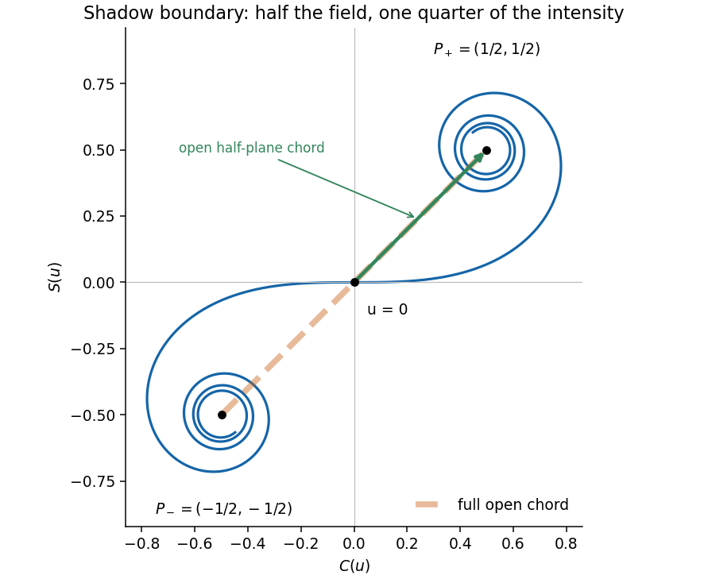

<h1 id="section-a/3/solution">Solution</h1>

↑ **Parent:** [3](../3.md)

The original diagram puts the upper edge of the obstruction exactly on the straight line from source to detector. The detector is therefore at the geometric shadow boundary, not deep inside the shadow. In the optical convention, the [Cornu spiral](../../../../../euler-spiral.md) is

$$
C(u)+iS(u)=\int_0^u e^{i\pi t^2/2}\,dt,
$$

with limiting points $(-1/2,-1/2)$ and $(1/2,1/2)$. The unobstructed [Fresnel diffraction](../../../../../fresnel-diffraction.md) amplitude is the chord joining both endpoints, proportional to $1+i$. The open half-plane supplies only the chord from $(0,0)$ to $(1/2,1/2)$, proportional to $(1+i)/2$. The coordinate perpendicular to the page contributes the same factor in both cases.

$$
\boxed{\frac{U}{U_0}=\frac12,\qquad \frac{I}{I_0}=\left|\frac{U}{U_0}\right|^2=\frac14}.
$$

This is the [half-plane shadow-boundary intensity](../../../../../half-plane-shadow-boundary-intensity.md). The missing half of the [aperture](../../../../../aperture.md) removes half the field here, so taking half the intensity would be incorrect.

**[Figure 1](#section-a/3/image-cornu-spiral-chords-for-a-fully-open-wavefront-and-for-a-straight-edge-shadow-boundary). Cornu-spiral chords for a fully open wavefront and for a straight-edge shadow boundary**.

## ↑ Ancestors (14)

1. [3](../3.md)
2. [Section A](../../section-a.md)
3. [Paper 2](../../../paper-2-split.md)
4. [2017](../../../split.md)
5. [Past exam of the physics A course of the University of Cambridge](../../../../split.md)
6. [Physics A course of the University of Cambridge](../../../../../physics-a-course-of-the-university-of-cambridge.md)
7. [Physics course of the year 2 of the natural sciences course of the University of Cambridge](../../../../../physics-course-of-the-year-2-of-the-natural-sciences-course-of-the-university-of-cambridge.md)
8. [Year 2 of the natural sciences course of the University of Cambridge](../../../../../year-2-of-the-natural-sciences-course-of-the-university-of-cambridge.md)
9. [Year of the natural sciences course of the University of Cambridge](../../../../../year-of-the-natural-sciences-course-of-the-university-of-cambridge.md)
10. [Natural sciences course of the University of Cambridge](../../../../../natural-sciences-course-of-the-university-of-cambridge.md)
11. [Course of the University of Cambridge](../../../../../course-of-the-university-of-cambridge.md)
12. [University of Cambridge](../../../../../university-of-cambridge-split.md)
13. [List of universities](../../../../../list-of-universities.md)
14. [Codex Wiki](../../../../../split.md)
