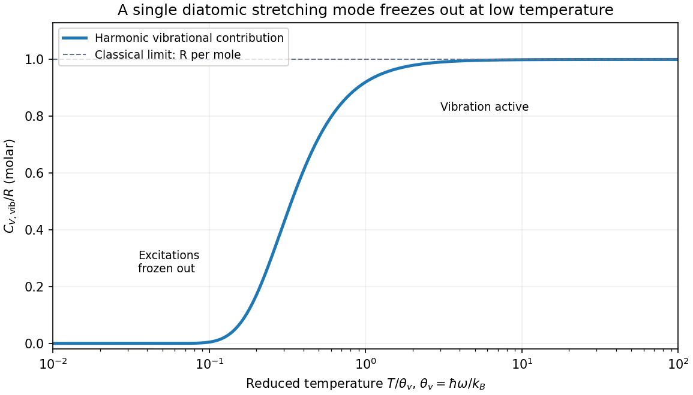

# Paper 1

↑ **Parent:** [2018](../2018.md)

[Original paper, released PDF pages 86–92](https://www.whatdotheyknow.com/request/natural_science_tripos_physics_e/response/2127325/attach/3/FOI%202022%20639%20Sullivan%20materials.pdf?cookie_passthrough=1#page=86)

**Table of contents**

- [Section A](#section-a)
  - [A1](#section-a/a1)
    - [Solution](#section-a/a1/solution)
  - [A2](#section-a/a2)
    - [Solution](#section-a/a2/solution)
  - [A3](#section-a/a3)
    - [Solution](#section-a/a3/solution)
  - [A4](#section-a/a4)
    - [Solution](#section-a/a4/solution)
  - [A5](#section-a/a5)
    - [Solution](#section-a/a5/solution)
- [Section B](#section-b)
  - [B6](#section-b/b6)
    - [a](#section-b/b6/a)
      - [Solution](#section-b/b6/a/solution)
    - [b](#section-b/b6/b)
      - [Solution](#section-b/b6/b/solution)
    - [c](#section-b/b6/c)
      - [Solution](#section-b/b6/c/solution)
    - [d](#section-b/b6/d)
      - [Solution](#section-b/b6/d/solution)
  - [B7](#section-b/b7)
    - [a](#section-b/b7/a)
      - [Solution](#section-b/b7/a/solution)
    - [b](#section-b/b7/b)
      - [Solution](#section-b/b7/b/solution)
    - [c](#section-b/b7/c)
      - [Solution](#section-b/b7/c/solution)
    - [d](#section-b/b7/d)
      - [Solution](#section-b/b7/d/solution)
  - [B8](#section-b/b8)
    - [a](#section-b/b8/a)
      - [Solution](#section-b/b8/a/solution)
    - [b](#section-b/b8/b)
      - [Solution](#section-b/b8/b/solution)
    - [c](#section-b/b8/c)
      - [Solution](#section-b/b8/c/solution)
    - [d](#section-b/b8/d)
      - [Solution](#section-b/b8/d/solution)
  - [B9](#section-b/b9)
    - [a](#section-b/b9/a)
      - [Solution](#section-b/b9/a/solution)
    - [b](#section-b/b9/b)
      - [Solution](#section-b/b9/b/solution)
    - [c](#section-b/b9/c)
      - [Solution](#section-b/b9/c/solution)
    - [d](#section-b/b9/d)
      - [Solution](#section-b/b9/d/solution)
- [Section C](#section-c)
  - [C10](#section-c/c10)
    - [Solution](#section-c/c10/solution)
  - [C11](#section-c/c11)
    - [a](#section-c/c11/a)
      - [Solution](#section-c/c11/a/solution)
    - [b](#section-c/c11/b)
      - [Solution](#section-c/c11/b/solution)
    - [c](#section-c/c11/c)
      - [Solution](#section-c/c11/c/solution)
- [Section D](#section-d)
  - [D12](#section-d/d12)
    - [a](#section-d/d12/a)
      - [Solution](#section-d/d12/a/solution)
    - [b](#section-d/d12/b)
      - [Solution](#section-d/d12/b/solution)
    - [c](#section-d/d12/c)
      - [Solution](#section-d/d12/c/solution)
    - [d](#section-d/d12/d)
      - [Solution](#section-d/d12/d/solution)
    - [e](#section-d/d12/e)
      - [Solution](#section-d/d12/e/solution)
  - [D13](#section-d/d13)
    - [a](#section-d/d13/a)
      - [Solution](#section-d/d13/a/solution)
    - [b](#section-d/d13/b)
      - [Solution](#section-d/d13/b/solution)
    - [c](#section-d/d13/c)
      - [Solution](#section-d/d13/c/solution)

## Section A

↑ **Parent:** [Paper 1](paper-1.md)

<h3 id="section-a/a1">A1</h3>

↑ **Parent:** [Section A](#section-a)

<h4 id="section-a/a1/solution">Solution</h4>

↑ **Parent:** [A1](#section-a/a1)

For a neutral atom, count both the nucleons and the electrons. Protons, neutrons and electrons are all [fermions](../../tensor-product-of-quantum-systems.md#fermion), and exchanging two identical intact atoms produces the sign $(-1)^{N_f}$ from exchanging their fermionic constituents. An odd number gives a composite [fermion](../../tensor-product-of-quantum-systems.md#fermion); an even number gives a composite [boson](../../tensor-product-of-quantum-systems.md#boson), consistently with the [Spin-statistics theorem](../../tensor-product-of-quantum-systems.md#spin-statistics-theorem).

A lithium atom has three protons and three electrons. Lithium-6 also has three neutrons, giving $3+3+3=9$ fermionic constituents; lithium-7 has four neutrons, giving $3+4+3=10$. Therefore

$$
\boxed{{}^6\mathrm{Li}\text{ atoms are fermions},\qquad {}^7\mathrm{Li}\text{ atoms are bosons}.}
$$

The [composite statistics of neutral atoms](../../tensor-product-of-quantum-systems.md#composite-statistics-of-neutral-atoms) cannot be inferred from the [mass](../../classical-mechanics.md#mass) number alone: counting only nucleons would classify the nuclei and give the opposite answers here. The atom's total [spin](../../angular-momentum-operator.md#spin) includes its electrons as well as its nucleus.

<h3 id="section-a/a2">A2</h3>

↑ **Parent:** [Section A](#section-a)

<h4 id="section-a/a2/solution">Solution</h4>

↑ **Parent:** [A2](#section-a/a2)

The [infinite square well](../../quantum-mechanics.md#infinite-square-well) has [energy levels](../../quantum-mechanics.md#energy-level) $E_n=n^2h^2/(8m_eL^2)$, with $n=1,2,\ldots$. The longest absorption [wavelength](../../wave-equation.md#wavelength) corresponds to the smallest available [energy](../../energy.md) difference from the [ground state](../../quantum-mechanics.md#ground-state), namely $n=1\to2$. Its [position](../../classical-mechanics.md#position) [matrix element](../../vector-space.md#matrix-element) is nonzero because the two states have opposite [parity](../../quantum-mechanics.md#parity) about the center of the well, so it is an allowed [electric dipole transition](../../quantum-mechanics.md#electric-dipole-transition).

Equating the [photon](../../quantum-mechanics.md#photon) [energy](../../energy.md) to this gap gives

$$
\frac{hc}{\lambda}=E_2-E_1=\frac{3h^2}{8m_eL^2},\qquad \boxed{L=\sqrt{\frac{3h\lambda}{8m_ec}}=8.53\times10^{-10}\,\mathrm m=0.853\,\mathrm{nm}.}
$$

Here the [photon](../../quantum-mechanics.md#photon) gap is approximately $1.55\,\mathrm{eV}$, not the [ground-state energy](../../quantum-mechanics.md#ground-state-energy) itself.

<h3 id="section-a/a3">A3</h3>

↑ **Parent:** [Section A](#section-a)

<h4 id="section-a/a3/solution">Solution</h4>

↑ **Parent:** [A3](#section-a/a3)

In the [orthonormal](../../inner-product.md#orthonormal-set) $S_z$ [eigenbasis](../../linear-operator-theory.md#eigenbasis) $(\alpha,\beta)$, the [spin one-half](../../angular-momentum-operator.md#spin-one-half) operator is $S_x=(\hbar/2)\begin{pmatrix}0&1\\1&0\end{pmatrix}$. An eigenvector $a\alpha+b\beta$ with [eigenvalue](../../linear-operator-theory.md#eigenvalue) $s_x$ obeys $b=(2s_x/\hbar)a$ and $a=(2s_x/\hbar)b$. A nonzero vector requires $(2s_x/\hbar)^2=1$. Choosing normalized [quantum phases](../../quantum-system.md#quantum-phase) gives

$$
\boxed{s_x=+\frac\hbar2,\quad \chi_+=\frac{\alpha+\beta}{\sqrt2};\qquad s_x=-\frac\hbar2,\quad \chi_-=\frac{\alpha-\beta}{\sqrt2}.}
$$

These [spin eigenstates](../../angular-momentum-operator.md#spin-eigenstate) are [orthogonal](../../inner-product.md#orthogonal-vectors) and have unit [norm](../../normed-vector-space.md#norm) because $\alpha$ and $\beta$ do.

<h3 id="section-a/a4">A4</h3>

↑ **Parent:** [Section A](#section-a)

<h4 id="section-a/a4/solution">Solution</h4>

↑ **Parent:** [A4](#section-a/a4)

Substitution in the [moment of inertia](../../rigid-body-dynamics.md#moment-of-inertia) gives

$$
\boxed{I=\frac12\pi(8\times10^3)(0.01)(1)^4=40\pi\simeq126\,\mathrm{kg\,m^2}.}
$$

For independent errors interpreted as [standard uncertainties](../../physics.md#standard-uncertainty), logarithmic differentiation and [propagation of uncertainty](../../wave-equation.md#propagation-of-uncertainty) give

$$
\left(\frac{u_I}{I}\right)^2=\left(\frac{u_\rho}{\rho}\right)^2+\left(\frac{u_s}{s}\right)^2+16\left(\frac{u_R}{R}\right)^2.
$$

Consequently

$$
\boxed{\frac{u_R}{R}\leq\frac14\sqrt{0.025^2-0.01^2-0.01^2}=0.00515,\qquad u_R\leq5.15\,\mathrm{mm}.}
$$

This is a $0.515\%$ statistical precision requirement. If “accuracy” instead means hard bounds whose worst cases must be guaranteed, first-order absolute errors add: $0.01+0.01+4\epsilon_R\leq0.025$, giving $\boxed{\epsilon_R\leq0.125\%,\quad |\delta R|\leq1.25\,\mathrm{mm}}$ to first order. For an exact symmetric hard bound about the nominal values, the upper extreme is slightly more restrictive: $(1.01)^2(1+\epsilon_R)^4\leq1.025$ gives $\epsilon_R\leq0.1199\%$, or $1.20\,\mathrm{mm}$. The question does not distinguish a statistical uncertainty from a worst-case tolerance, so the convention matters.

<h3 id="section-a/a5">A5</h3>

↑ **Parent:** [Section A](#section-a)

<h4 id="section-a/a5/solution">Solution</h4>

↑ **Parent:** [A5](#section-a/a5)

Use an unloaded [RC low-pass filter](../../electrical-engineering.md#rc-low-pass-filter): a series [resistor](../../electric-charge.md#resistor) between the source and the output node, with a [capacitor](../../electromagnetism.md#capacitor) from that node to ground, and measure the output across the [capacitor](../../electromagnetism.md#capacitor). The components are ideal in this first-order model; “ideal” here does not mean a brick-wall [frequency](../../wave.md#frequency) response.

The [time constant](../../analysis.md#time-constant) is $\tau=RC$, hence

$$
\boxed{C=\frac{10^{-6}}{10^4}=10^{-10}\,\mathrm F=100\,\mathrm{pF}.}
$$

The capacitive [electrical impedance](../../electrical-circuit.md#electrical-impedance) gives the [transfer function](../../control-theory.md#transfer-function) $H(i\omega)=1/(1+i\omega RC)$, so

$$
|H|=\frac1{\sqrt{1+(f/f_c)^2}},\qquad \boxed{f_c=\frac1{2\pi RC}=1.59\times10^5\,\mathrm{Hz}.}
$$

On the magnitude [Bode plot](../../control-theory.md#bode-plot), $20\log_{10}|H|=-10\log_{10}[1+(f/f_c)^2]$. The gain approaches $0\,\mathrm{dB}$ for $f\ll f_c$, is $-3.01\,\mathrm{dB}$ at $f_c$, and falls with slope $-20\,\mathrm{dB}$ per decade for $f\gg f_c$. These results assume negligible source resistance beyond the specified $R$ and a sufficiently large load impedance.

**[Figure 1](#section-a/a5/image-unloaded-rc-low-pass-circuit-and-its-first-order-bode-magnitude). Unloaded RC low-pass circuit and its first-order Bode magnitude**.

## Section B

↑ **Parent:** [Paper 1](paper-1.md)

<h3 id="section-b/b6">B6</h3>

↑ **Parent:** [Section B](#section-b)

<h4 id="section-b/b6/a">a</h4>

↑ **Parent:** [B6](#section-b/b6)

<h5 id="section-b/b6/a/solution">Solution</h5>

↑ **Parent:** [A](#section-b/b6/a)

Let $\rho=\psi^*\psi$ be the [probability density](../../wave-function.md#probability-density). For a real [potential energy](../../energy.md#potential-energy) $V(x)$, the [Schrödinger equation](../../mathematical-physics.md#schrodinger-equation) and its complex conjugate are

$$
i\hbar\partial_t\psi=-\frac{\hbar^2}{2m}\partial_x^2\psi+V\psi,\qquad -i\hbar\partial_t\psi^*=-\frac{\hbar^2}{2m}\partial_x^2\psi^*+V\psi^*.
$$

Differentiate $\rho$ and substitute both equations. The potential terms cancel, leaving

$$
\partial_t\rho=\frac{i\hbar}{2m}(\psi^*\partial_x^2\psi-\psi\partial_x^2\psi^*)=\frac{i\hbar}{2m}\partial_x(\psi^*\partial_x\psi-\psi\partial_x\psi^*).
$$

Comparison with the [probability continuity equation](../../wave-function.md#probability-continuity-equation) $\partial_t\rho+\partial_xJ=0$ identifies

$$
\boxed{J=\frac{i\hbar}{2m}[(\partial_x\psi^*)\psi-\psi^*(\partial_x\psi)]=\frac\hbar m\operatorname{Im}(\psi^*\partial_x\psi).}
$$

For a [plane wave](../../wave-function.md#plane-wave) of [amplitude](../../wave.md#wave-amplitude) $A$ and positive [wavenumber](../../wave-equation.md#wavenumber) $k$, $J=\hbar k|A|^2/m$, the density times the [velocity](../../classical-mechanics.md#velocity). Integrating the continuity equation over an interval makes its [probability](../../probability-theory.md#probability) change equal to the incoming current minus the outgoing current.

<h4 id="section-b/b6/b">b</h4>

↑ **Parent:** [B6](#section-b/b6)

<h5 id="section-b/b6/b/solution">Solution</h5>

↑ **Parent:** [B](#section-b/b6/b)

Set

$$
k_0=\frac{\sqrt{2mE}}\hbar,\qquad k_1=\frac{\sqrt{2m(E-V_1)}}\hbar,\qquad k_2=\frac{\sqrt{2m(E-V_2)}}\hbar.
$$

All are real and $k_0>k_1>k_2>0$. Suppressing a common time [quantum phase](../../quantum-system.md#quantum-phase) $e^{-iEt/\hbar}$, choose

$$
\boxed{\psi_{\mathrm L}=Ae^{ik_0x}+Be^{-ik_0x},\qquad \psi_{\mathrm M}=Ce^{ik_1x}+De^{-ik_1x},\qquad \psi_{\mathrm R}=Fe^{ik_2(x-a)}.}
$$

The rightmost region has no left-moving term because no wave is incident from the right. The shifted [quantum phase](../../quantum-system.md#quantum-phase) convention makes $F$ the transmitted [amplitude](../../wave.md#wave-amplitude) at the second interface.

For finite potential steps and equal [mass](../../classical-mechanics.md#mass), [wavefunction matching at a finite potential step](../../mathematical-physics.md#wavefunction-matching-at-a-finite-potential-step) requires continuity of both $\psi$ and $\partial_x\psi$. Explicitly,

$$
A+B=C+D,\quad k_0(A-B)=k_1(C-D),
$$

$$
Ce^{ik_1a}+De^{-ik_1a}=F,\quad k_1(Ce^{ik_1a}-De^{-ik_1a})=k_2F.
$$

A discontinuous [wavefunction](../../wave-function.md) would introduce an inadmissible singular kinetic term, while integrating the stationary [Schrödinger equation](../../mathematical-physics.md#schrodinger-equation) across a finite step shows that the [derivative](../../calculus.md#derivative) cannot jump. These conditions also keep the [probability current](../../wave-function.md#probability-current) continuous, so a finite interface neither creates nor destroys [probability](../../probability-theory.md#probability). The [derivative](../../calculus.md#derivative) rule would need modification for a delta-function potential or a different effective [mass](../../classical-mechanics.md#mass); neither occurs here.

<h4 id="section-b/b6/c">c</h4>

↑ **Parent:** [B6](#section-b/b6)

<h5 id="section-b/b6/c/solution">Solution</h5>

↑ **Parent:** [C](#section-b/b6/c)

Zero reflection means $B=0$. Matching the first interface then gives

$$
C=\frac A2\left(1+\frac{k_0}{k_1}\right),\qquad D=\frac A2\left(1-\frac{k_0}{k_1}\right).
$$

The specified layer [quantum phase](../../quantum-system.md#quantum-phase) is $k_1a=\pi/2$, so $e^{ik_1a}=i$ and $e^{-ik_1a}=-i$. The second-interface conditions become

$$
F=i(C-D)=i\frac{k_0}{k_1}A,\qquad i k_1(C+D)=k_2F.
$$

Since $C+D=A$, compatibility requires $\boxed{k_1^2=k_0k_2}$. This is a [quantum quarter-wave matching layer](../../mathematical-physics.md#quantum-quarter-wave-matching-layer): the intermediate [wavenumber](../../wave-equation.md#wavenumber) is the geometric mean, and the two interface reflections cancel after their round trip through the layer.

In terms of the physical energies,

$$
\boxed{E-V_1=\sqrt{E(E-V_2)},\qquad (E-V_1)^2=E(E-V_2).}
$$

Rearranging also gives

$$
\boxed{E=\frac{V_1^2}{2V_1-V_2}.}
$$

A finite positive [energy](../../energy.md) satisfying the stated ordering requires $V_2/2<V_1<V_2$. Under that condition $E-V_2=(V_2-V_1)^2/(2V_1-V_2)>0$, consistent with the assumed propagating transmitted wave. The width must simultaneously satisfy the given quarter-wave [quantum phase](../../quantum-system.md#quantum-phase) condition.

<h4 id="section-b/b6/d">d</h4>

↑ **Parent:** [B6](#section-b/b6)

<h5 id="section-b/b6/d/solution">Solution</h5>

↑ **Parent:** [D](#section-b/b6/d)

From the second-edge [amplitude](../../wave.md#wave-amplitude) in part (c),

$$
\boxed{\frac FA=i\frac{k_0}{k_1}=i\sqrt{\frac{k_0}{k_2}}.}
$$

This uses $\psi_{\mathrm R}=Fe^{ik_2(x-a)}$. If the transmitted wave is instead written $Te^{ik_2x}$, its coefficient is $\boxed{T/A=i\sqrt{k_0/k_2}\,e^{-ik_2a}}$; the extra factor only changes the [quantum phase](../../quantum-system.md#quantum-phase) convention.

Using the [probability current](../../wave-function.md#probability-current) of a [plane wave](../../wave-function.md#plane-wave),

$$
J_{\mathrm{in}}=\frac{\hbar k_0}{m}|A|^2,\qquad J_{\mathrm{trans}}=\frac{\hbar k_2}{m}|F|^2=\frac{\hbar k_2}{m}\frac{k_0}{k_2}|A|^2=\boxed{J_{\mathrm{in}}.}
$$

Thus the flux [transmission probability](../../quantum-scattering.md#transmission-probability) is one. The larger transmitted density $|F|^2>|A|^2$ compensates for the smaller transmitted [velocity](../../classical-mechanics.md#velocity) $\hbar k_2/m$; equal currents need not have equal wave amplitudes.

<h3 id="section-b/b7">B7</h3>

↑ **Parent:** [Section B](#section-b)

<h4 id="section-b/b7/a">a</h4>

↑ **Parent:** [B7](#section-b/b7)

<h5 id="section-b/b7/a/solution">Solution</h5>

↑ **Parent:** [A](#section-b/b7/a)

The one-dimensional time-independent [Schrödinger equation](../../mathematical-physics.md#schrodinger-equation) is

$$
\boxed{-\frac{\hbar^2}{2m}\frac{d^2\Psi(x)}{dx^2}+V(x)\Psi(x)=E\Psi(x).}
$$

Here $m$ is the particle [mass](../../classical-mechanics.md#mass), $V(x)$ its [potential energy](../../energy.md#potential-energy), $E$ the stationary [energy eigenvalue](../../energy-eigenvalue.md), and $\hbar=h/(2\pi)$ the reduced [Planck constant](../../quantum-mechanics.md#planck-constant). The spatial [wavefunction](../../wave-function.md) is $\Psi$; the full stationary state is $\Psi(x)e^{-iEt/\hbar}$. Physical bound states satisfy the boundary conditions and [wavefunction normalization](../../wave-function.md#wavefunction-normalization) $\int|\Psi|^2dx=1$. The operator on the left is the [Hamiltonian operator](../../quantum-system.md#hamiltonian-quantum-mechanics), the sum of kinetic and potential energies.

<h4 id="section-b/b7/b">b</h4>

↑ **Parent:** [B7](#section-b/b7)

<h5 id="section-b/b7/b/solution">Solution</h5>

↑ **Parent:** [B](#section-b/b7/b)

Assume $a>0$ and define $\omega=\sqrt{2a/m}$ so that the potential is that of a [quantum harmonic oscillator](../../quantum-harmonic-oscillator.md). The two trial forms have derivatives

$$
\Psi_1''=(4C^2x^2-2C)\Psi_1,\qquad \Psi_2''=(4C^2x^2-6C)\Psi_2.
$$

Substitution into the stationary [Schrödinger equation](../../mathematical-physics.md#schrodinger-equation) cancels the $x^2$ terms precisely when $a=2\hbar^2C^2/m$. Normalizability selects the positive root,

$$
\boxed{C=\sqrt{\frac{ma}{2\hbar^2}}=\frac{m\omega}{2\hbar}.}
$$

The remaining constants give

$$
\boxed{E_{\Psi_1}=\frac{\hbar^2C}{m}=\frac{\hbar\omega}{2},\qquad E_{\Psi_2}=\frac{3\hbar^2C}{m}=\frac{3\hbar\omega}{2}.}
$$

For later overlaps choose positive normalization constants. The [Gaussian integral](../../integral.md#gaussian-integral) gives $A=(2C/\pi)^{1/4}$, while its second-moment [integral](../../integral.md) gives $B=2\sqrt C\,A$. Thus both wavefunctions have unit [norm](../../normed-vector-space.md#norm) and are [orthogonal](../../inner-product.md#orthogonal-vectors) by their opposite [parity](../../quantum-mechanics.md#parity).

The real Gaussian is positive everywhere and has no nodes; the odd state has exactly one node at $x=0$. The [Sturm oscillation theorem](../../sturm-liouville-theory.md#sturm-oscillation-theorem) orders one-dimensional bound states by their node count. Consequently these are the [ground state](../../quantum-mechanics.md#ground-state) and first excited state, respectively, also agreeing with the oscillator spectrum $E_n=(n+1/2)\hbar\omega$.

<h4 id="section-b/b7/c">c</h4>

↑ **Parent:** [B7](#section-b/b7)

<h5 id="section-b/b7/c/solution">Solution</h5>

↑ **Parent:** [C](#section-b/b7/c)

The infinite wall imposes $\boxed{\Psi(0)=0}$, and the [wavefunction](../../wave-function.md) vanishes for $x<0$. The even full-oscillator [ground state](../../quantum-mechanics.md#ground-state) fails this [boundary condition](../../differential-equation.md#boundary-condition); the lowest admissible state is the positive-half restriction of the odd first excited state. Multiplying by $\sqrt2$ restores normalization because half its [probability](../../probability-theory.md#probability) originally lay on either side.

With $\ell=\sqrt{\hbar/(m\omega)}$, the [half-harmonic oscillator](../../quantum-harmonic-oscillator.md#half-harmonic-oscillator) [ground state](../../quantum-mechanics.md#ground-state) is

$$
\boxed{\Psi_h(x)=\begin{cases}\displaystyle\frac{2x}{\pi^{1/4}\ell^{3/2}}e^{-x^2/(2\ell^2)},&x\geq0,\\0,&x<0,\end{cases}\qquad E_h=\frac32\hbar\omega.}
$$

It rises from zero at the wall, reaches its wave-amplitude maximum at $x=\ell$, and decays to zero as $x\to\infty$. It is positive throughout the interior of the allowed region, with no interior node, as required for its [ground state](../../quantum-mechanics.md#ground-state). The wall need not make the [derivative](../../calculus.md#derivative) continuous with the forbidden half-line.

**[Figure 2](#section-b/b7/c/image-half-oscillator-ground-state-and-the-full-oscillator-states-after-removing-the-wall). Half-oscillator ground state and the full-oscillator states after removing the wall**.

<h4 id="section-b/b7/d">d</h4>

↑ **Parent:** [B7](#section-b/b7)

<h5 id="section-b/b7/d/solution">Solution</h5>

↑ **Parent:** [D](#section-b/b7/d)

For [removal of a half-oscillator wall](../../quantum-harmonic-oscillator.md#removal-of-a-half-oscillator-wall), the [sudden approximation](../../quantum-mechanics.md#sudden-approximation) keeps the state unchanged during the change of potential. Its [probability](../../probability-theory.md#probability) in the new full-oscillator [ground state](../../quantum-mechanics.md#ground-state) $\Psi_0=\pi^{-1/4}\ell^{-1/2}e^{-x^2/(2\ell^2)}$ is the squared overlap:

$$
\langle0|\Psi_h\rangle=\int_0^\infty\frac{2x}{\sqrt\pi\ell^2}e^{-x^2/\ell^2}\,dx=\frac1{\sqrt\pi},
$$

where $\int_0^\infty xe^{-x^2/\ell^2}dx=\ell^2/2$. Therefore

$$
\boxed{P_{\mathrm{new\ ground}}=\frac1\pi\simeq0.318.}
$$

The [integral](../../integral.md) runs only over the initially occupied half-line. The initial state is not the odd full-line [eigenstate](../../energy-eigenvalue.md#eigenstate): it is zero, rather than negative, on the left. Indeed its overlap with that final first excited state is $1/\sqrt2$, giving [probability](../../probability-theory.md#probability) $1/2$, and the remaining [probability](../../probability-theory.md#probability) lies in higher states. Subsequent evolution under the new fixed [Hamiltonian operator](../../quantum-system.md#hamiltonian-quantum-mechanics) changes the [quantum phases](../../quantum-system.md#quantum-phase) of its [energy](../../energy.md) components without changing these energy-measurement probabilities.

<h3 id="section-b/b8">B8</h3>

↑ **Parent:** [Section B](#section-b)

<h4 id="section-b/b8/a">a</h4>

↑ **Parent:** [B8](#section-b/b8)

<h5 id="section-b/b8/a/solution">Solution</h5>

↑ **Parent:** [A](#section-b/b8/a)

The [quantum rotor](../../quantum-mechanics.md#quantum-rotor) has orientation angle $\phi$ of period $2\pi$, so physical wavefunctions satisfy $\psi(\phi+2\pi)=\psi(\phi)$. The exponential solutions of $H u=Eu$ are therefore

$$
\boxed{u_m(\phi)=\frac{e^{im\phi}}{\sqrt{2\pi}},\qquad E_m=\frac{\hbar^2m^2}{2I},\qquad m\in\mathbb Z.}
$$

They are normalized and [orthogonal](../../inner-product.md#orthogonal-vectors) on $[0,2\pi)$. The corresponding [angular momentum](../../momentum.md#angular-momentum) operator is $L_z=-i\hbar\partial_\phi$, with [eigenvalue](../../linear-operator-theory.md#eigenvalue) $m\hbar$. The $m=0$ ground level is nondegenerate, and every $|m|>0$ [energy level](../../quantum-mechanics.md#energy-level) has the twofold degeneracy $m\leftrightarrow-m$. This uses ordinary periodic boundary conditions, with no flux or twisted [quantum phase](../../quantum-system.md#quantum-phase).

<h4 id="section-b/b8/b">b</h4>

↑ **Parent:** [B8](#section-b/b8)

<h5 id="section-b/b8/b/solution">Solution</h5>

↑ **Parent:** [B](#section-b/b8/b)

Expand the initial [wavefunction](../../wave-function.md) in the [angular momentum](../../momentum.md#angular-momentum) [eigenbasis](../../linear-operator-theory.md#eigenbasis) using $\cos^2\phi=1/2+(e^{2i\phi}+e^{-2i\phi})/4$. With the normalized $u_m$ from part (a), this gives

$$
\boxed{|\Psi(0)\rangle=\sqrt{\frac23}|m=0\rangle+\frac1{\sqrt6}|m=2\rangle+\frac1{\sqrt6}|m=-2\rangle.}
$$

The coefficient squares sum to one, also verifying the stated normalization. The [Born rule](../../wave-function.md#born-rule) therefore gives [angular momentum](../../momentum.md#angular-momentum) outcomes

$$
\boxed{L_z=0,\ +2\hbar,\ -2\hbar\quad\text{with probabilities}\quad\frac23,\ \frac16,\ \frac16.}
$$

For an [energy](../../energy.md) measurement the two distinct $m=\pm2$ states belong to the same [energy](../../energy.md) eigenspace. Sum their probabilities, rather than adding their amplitudes, to obtain

$$
\boxed{E=0\ \text{with probability }\frac23,\qquad E=\frac{2\hbar^2}{I}\ \text{with probability }\frac13.}
$$

Their relative probabilities are $4:1:1$ for the angular momenta and $2:1$ for the energies. In particular, zero mean [angular momentum](../../momentum.md#angular-momentum) does not imply zero rotational [energy](../../energy.md).

<h4 id="section-b/b8/c">c</h4>

↑ **Parent:** [B8](#section-b/b8)

<h5 id="section-b/b8/c/solution">Solution</h5>

↑ **Parent:** [C](#section-b/b8/c)

Each [energy eigenstate](../../energy-eigenvalue.md#energy-eigenstate) evolves by its own [quantum phase](../../quantum-system.md#quantum-phase) $e^{-iE_mt/\hbar}$. The two $m=\pm2$ components have the same [energy](../../energy.md), while the $m=0$ [quantum phase](../../quantum-system.md#quantum-phase) stays one. Thus

$$
|\Psi(t)\rangle=\sqrt{\frac23}|0\rangle+\frac{e^{-2i\hbar t/I}}{\sqrt6}(|2\rangle+|-2\rangle).
$$

In angle representation this is

$$
\boxed{\Psi(\phi,t)=\frac1{\sqrt{3\pi}}\left[1+e^{-2i\hbar t/I}\cos2\phi\right].}
$$

At $t=0$, $1+\cos2\phi=2\cos^2\phi$ recovers the initial state. The fixed coefficient magnitudes keep the [angular momentum](../../momentum.md#angular-momentum) and [energy](../../energy.md) probabilities constant even though the density in angle changes.

<h4 id="section-b/b8/d">d</h4>

↑ **Parent:** [B8](#section-b/b8)

<h5 id="section-b/b8/d/solution">Solution</h5>

↑ **Parent:** [D](#section-b/b8/d)

Taking the modulus squared gives the [three-mode revival of a planar quantum rotor](../../quantum-mechanics.md#three-mode-revival-of-a-planar-quantum-rotor):

$$
\boxed{\rho(\phi,t)=\frac1{3\pi}[1+\cos^22\phi+2\cos2\phi\cos(\Omega t)],\qquad \Omega=\frac{2\hbar}{I}.}
$$

The angular density has period $\pi$, while both the state and its density revive after $\boxed{T=2\pi/\Omega=\pi I/\hbar}$. Its [integral](../../integral.md) over $0\leq\phi<2\pi$ is one because $\int\cos2\phi\,d\phi=0$ and $\int\cos^22\phi\,d\phi=\pi$.

At $t=0$, the density is $4\cos^4\phi/(3\pi)$, with maxima at $0,\pi$ and zeros at $\pi/2,3\pi/2$. At $t=T/2$ it becomes $4\sin^4\phi/(3\pi)$, interchanging those maxima and zeros. At $t=T/4$ and $3T/4$, it is $[1+\cos^22\phi]/(3\pi)$, with four equal maxima along the coordinate axes and positive minima halfway between them. At $t=T$ the original profile returns.

**[Figure 3](#section-b/b8/d/image-angle-time-probability-density-and-snapshots-over-one-planar-rotor-revival). Angle-time probability density and snapshots over one planar-rotor revival**.

The changing profile is [interference](../../physical-optics.md#interference-wave-propagation) between the stationary $m=0$ mode and the degenerate counter-rotating $m=\pm2$ modes. It does not translate rigidly around the circle; the standing-wave weights alternate between two orientations.

<h3 id="section-b/b9">B9</h3>

↑ **Parent:** [Section B](#section-b)

<h4 id="section-b/b9/a">a</h4>

↑ **Parent:** [B9](#section-b/b9)

<h5 id="section-b/b9/a/solution">Solution</h5>

↑ **Parent:** [A](#section-b/b9/a)

The [commutator](../../lie-algebra.md#commutator) is $\boxed{[A,B]=AB-BA}$. To evaluate it for differential operators, apply it to a smooth test [wavefunction](../../wave-function.md) $f$:

$$
[x,p_x]f=x(-i\hbar f')+i\hbar(xf)'=i\hbar f.
$$

Thus the [canonical commutation relation](../../quantum-mechanics.md#canonical-commutation-relation) is $\boxed{[x,p_x]=i\hbar I}$. The associated [Heisenberg uncertainty relation](../../quantum-theory.md#heisenberg-uncertainty-relation) is $\Delta x\,\Delta p_x\geq\hbar/2$. [Position](../../classical-mechanics.md#position) and [momentum](../../momentum.md) cannot both have arbitrarily sharp outcome distributions in the same prepared state, even with ideal measuring apparatus. This concerns quantum-state preparation, not merely a calibration error in a particular instrument.

<h4 id="section-b/b9/b">b</h4>

↑ **Parent:** [B9](#section-b/b9)

<h5 id="section-b/b9/b/solution">Solution</h5>

↑ **Parent:** [B](#section-b/b9/b)

Expand the proposed product rule without interchanging any operator factors:

$$
[A,B]C+B[A,C]=(AB-BA)C+B(AC-CA)=ABC-BCA=[A,BC].
$$

Applying this [commutator](../../lie-algebra.md#commutator) identity with $A=x$ and $B=C=p_x$ gives

$$
\boxed{[x,p_x^2]=[x,p_x]p_x+p_x[x,p_x]=2i\hbar p_x.}
$$

For a differentiable multiplication potential, apply the other [commutator](../../lie-algebra.md#commutator) to a test function:

$$
[p_x,V(x)]f=-i\hbar\frac d{dx}(Vf)+i\hbar Vf'=-i\hbar V'f.
$$

Therefore

$$
\boxed{[p_x,V(x)]=-i\hbar V'(x).}
$$

These operator equalities are understood on a common domain where the indicated products and derivatives are defined, with the boundary conditions appropriate to the state.

<h4 id="section-b/b9/c">c</h4>

↑ **Parent:** [B9](#section-b/b9)

<h5 id="section-b/b9/c/solution">Solution</h5>

↑ **Parent:** [C](#section-b/b9/c)

For a normalized state, the [expectation value](../../quantum-system.md#expectation-value) is

$$
\boxed{\langle Q\rangle=\langle\psi|Q|\psi\rangle=\int\psi^*(x,t)\,Q\psi(x,t)\,dx.}
$$

For a time-independent operator, differentiation gives

$$
\frac d{dt}\langle Q\rangle=\langle\dot\psi|Q|\psi\rangle+\langle\psi|Q|\dot\psi\rangle.
$$

The [Schrödinger equation](../../mathematical-physics.md#schrodinger-equation) says $|\dot\psi\rangle=-iH|\psi\rangle/\hbar$. The [self-adjointness](../../linear-operator-theory.md#self-adjoint-operator) of $H$ gives $\langle\dot\psi|=i\langle\psi|H/\hbar$, so

$$
\frac d{dt}\langle Q\rangle=\frac i\hbar\langle HQ-QH\rangle=\boxed{\frac1{i\hbar}\langle[Q,H]\rangle.}
$$

In the [integral](../../integral.md) derivation, the same [self-adjointness](../../linear-operator-theory.md#self-adjoint-operator) step is integration by parts with vanishing boundary terms. An explicitly time-dependent observable would also contribute $\langle\partial Q/\partial t\rangle$. These are the expectation-value equations underlying the [Heisenberg equation of motion](../../quantum-system.md#heisenberg-equation-of-motion).

<h4 id="section-b/b9/d">d</h4>

↑ **Parent:** [B9](#section-b/b9)

<h5 id="section-b/b9/d/solution">Solution</h5>

↑ **Parent:** [D](#section-b/b9/d)

The [Hamiltonian operator](../../quantum-system.md#hamiltonian-quantum-mechanics) is

$$
\boxed{H=\frac{p_x^2}{2m}+V(x)=-\frac{\hbar^2}{2m}\frac{d^2}{dx^2}+V(x).}
$$

Since multiplication by $x$ commutes with multiplication by $V(x)$, part (b) gives $[x,H]=i\hbar p_x/m$. Similarly $[p_x,H]=-i\hbar V'(x)$. Substituting into part (c) gives [Ehrenfest theorem](../../quantum-mechanics.md#ehrenfest-theorem):

$$
\boxed{\frac{d\langle x\rangle}{dt}=\frac{\langle p_x\rangle}{m},\qquad \frac{d\langle p_x\rangle}{dt}=-\langle V'(x)\rangle.}
$$

Thus the mean [momentum](../../momentum.md) changes according to the mean force, and the [derivative](../../calculus.md#derivative) of mean [position](../../classical-mechanics.md#position) is mean [velocity](../../classical-mechanics.md#velocity). These exact quantum equations resemble Hamilton's classical equations, but $\langle V'(x)\rangle$ generally differs from $V'(\langle x\rangle)$. The classical point-particle equation for the center is exact for potentials at most quadratic and is an approximation for a localized packet when the force varies little across it. A spatially broad packet in a nonlinear potential need not follow a classical trajectory. Even where its center follows classical motion, its width and measurement uncertainties remain quantum properties.

## Section C

↑ **Parent:** [Paper 1](paper-1.md)

<h3 id="section-c/c10">C10</h3>

↑ **Parent:** [Section C](#section-c)

<h4 id="section-c/c10/solution">Solution</h4>

↑ **Parent:** [C10](#section-c/c10)

The [postulates of quantum mechanics](../../quantum-mechanics.md#postulates-of-quantum-mechanics) give a framework for predicting observations from a prepared state. The experiments below motivate different features of that framework; no one experiment proves the whole set of postulates or specifies every [Hamiltonian operator](../../quantum-system.md#hamiltonian-quantum-mechanics).

A pure [quantum state](../../quantum-system.md#quantum-state) is a normalized vector in a complex [Hilbert space](../../hilbert-space.md), with vectors differing by an overall [quantum phase](../../quantum-system.md#quantum-phase) representing the same physical preparation. In [position](../../classical-mechanics.md#position) representation, $\int|\psi(\mathbf r)|^2d^3r=1$. The linear state space permits [quantum superposition](../../quantum-system.md#quantum-superposition), while the [Born rule](../../wave-function.md#born-rule) assigns [probability](../../probability-theory.md#probability) $\int_\Omega|\psi|^2d^3r$ to a [position](../../classical-mechanics.md#position) outcome in a region $\Omega$. The [wavefunction](../../wave-function.md) is a [probability amplitude](../../wave-function.md#probability-amplitude); it is not a classical distribution of definite particle positions and momenta.

An observable is represented by a [self-adjoint operator](../../linear-operator-theory.md#self-adjoint-operator). If $Q$ has spectral projectors $P_q$, its possible measurement outcomes are its spectral values and $\Pr(q)=\langle\psi|P_q|\psi\rangle$. The mean is $\langle Q\rangle=\langle\psi|Q|\psi\rangle$. For an ideal repeatable [projective measurement](../../quantum-measurement.md#projective-measurement), obtaining $q$ leaves the normalized conditional state $P_q\psi/\sqrt{\Pr(q)}$. This projects onto an entire eigenspace if the outcome is degenerate. General detectors need more general [measurement in quantum mechanics](../../quantum-measurement.md) models; the projective update is an idealization. Noncommuting observables need not have simultaneous sharp values, as the [canonical commutation relation](../../quantum-mechanics.md#canonical-commutation-relation) and [Heisenberg uncertainty relation](../../quantum-theory.md#heisenberg-uncertainty-relation) illustrate.

Between measurements, an isolated system has [unitary time evolution](../../quantum-system.md#unitary-time-evolution) generated by its [Hamiltonian operator](../../quantum-system.md#hamiltonian-quantum-mechanics):

$$
i\hbar\frac{\partial|\psi\rangle}{\partial t}=H|\psi\rangle,\qquad U(t)=e^{-iHt/\hbar}\quad\text{for fixed }H.
$$

This preserves normalization and superpositions. Composite systems use a [tensor product](../../multilinear-algebra.md#tensor-product) of state spaces, allowing entangled states as well as product states; identical particles additionally require the bosonic or fermionic exchange symmetry appropriate to their species. Statistical mixtures are described by a [density matrix](../../density-matrix.md), with $\Pr(q)=\operatorname{tr}(\rho P_q)$. These rules separate preparation, coherent evolution and measurement.

The [photoelectric effect](../../quantum-mechanics.md#photoelectric-effect) exposes discrete [energy](../../energy.md) transfer by light. Illuminate a clean metal cathode in an evacuated tube and measure the collected [electron](../../physics.md#electron) current while varying the light [frequency](../../wave.md#frequency), intensity and a retarding [voltage](../../random-walk.md#voltage). The [stopping potential](../../quantum-mechanics.md#stopping-potential) $V_s$ probes the largest emitted [electron](../../physics.md#electron) [kinetic energy](../../energy.md#kinetic-energy), whereas the [photocurrent](../../optical-instrument.md#photocurrent) measures the rate at which charge is collected. In the ordinary single-photon regime there is a threshold [frequency](../../wave.md#frequency); above it the maximum [energy](../../energy.md) grows with [frequency](../../wave.md#frequency), rather than with intensity. Changing intensity at fixed [frequency](../../wave.md#frequency) mainly changes the number of emitted electrons. These observations are summarized by the [Einstein photoelectric equation](../../quantum-mechanics.md#einstein-photoelectric-equation)

$$
\boxed{K_{\max}=h\nu-\Phi=eV_s,\qquad \nu_0=\Phi/h.}
$$

Here $\Phi$ is the surface [work function](../../quantum-mechanics.md#work-function), and the stopping [voltage](../../random-walk.md#voltage) is understood after any [photoelectric contact-potential correction](../../quantum-mechanics.md#photoelectric-contact-potential-correction). A [photon](../../quantum-mechanics.md#photon) delivers $h\nu$ in an absorption event; emission is allowed only when that [energy](../../energy.md) can pay the escape cost. This accounts for the [frequency](../../wave.md#frequency) threshold and the lack of the classical waiting time associated with slowly accumulating [energy](../../energy.md) in a single [electron](../../physics.md#electron). The experiment supports [energy](../../energy.md) quantization of light; it does not imply that every incident [photon](../../quantum-mechanics.md#photon) emits an [electron](../../physics.md#electron) or that every emitted [electron](../../physics.md#electron) has the maximum [energy](../../energy.md). Surface losses and collection geometry affect the full current-voltage curve.

The [Davisson–Germer experiment](../../quantum-scattering.md#davisson-germer-experiment) demonstrates a complementary wave property of matter. An [electron](../../physics.md#electron) gun uses a heated emitter, accelerating [voltage](../../random-walk.md#voltage) and apertures to send a narrow beam onto a nickel single crystal in vacuum. A movable collector measures scattered [electric current](../../electric-charge.md#electric-current) versus direction; rotating the crystal also tests its azimuthal symmetry. The crystal gives sharp angular beams whose positions depend on [voltage](../../random-walk.md#voltage) and crystal orientation. A prominent feature occurs near $54\,\mathrm V$ accelerating [voltage](../../random-walk.md#voltage) and roughly $50^\circ$ detector colatitude. The nonrelativistic [de Broglie wavelength](../../wave-function.md#de-broglie-wavelength) predicted at that [voltage](../../random-walk.md#voltage) is

$$
\lambda=\frac h{\sqrt{2m_e eU}}\simeq0.167\,\mathrm{nm}.
$$

[Diffraction](../../quantum-scattering.md#diffraction) wavelengths inferred using the known crystal structure agree with this [voltage](../../random-walk.md#voltage) dependence. These angular peaks arise from coherent addition of scattering amplitudes from the crystal, not from classical specular reflection of independent point projectiles. [Bragg's law](../../quantum-scattering.md#bragg-s-law) is $2d\sin\theta_B=r\lambda$ for lattice-plane spacing $d$ and angle to those planes; a detector colatitude is a different angle and must not be substituted without its geometry. The historical readout was current, not a photograph of individual [electron](../../physics.md#electron) trajectories.[1927, apparatus pp. 707–710 and angular/[voltage](../../random-walk.md#voltage) scans pp. 715–719](../../physics-bibliography.md#diffraction-of-electrons-by-a-crystal-of-nickel-by-c-davisson-and-l-h-germer)

The [double-slit experiment](../../physical-optics.md#double-slit-experiment) makes the role of amplitudes especially direct. A coherent source illuminates two narrow slits; an observation screen a distance $D$ away records the pattern. For slit spacing $d$ and small screen displacement $y$, the path difference is approximately $dy/D$. The two amplitudes add before probabilities are formed:

$$
\boxed{P(y)=|\psi_1(y)+\psi_2(y)|^2=|\psi_1|^2+|\psi_2|^2+2\operatorname{Re}(\psi_1^*\psi_2).}
$$

For equal coherent illumination the [interference](../../physical-optics.md#interference-wave-propagation) term varies as $\cos(2\pi dy/(\lambda D))$, giving fringe spacing $\lambda D/d$ beneath the single-slit [diffraction](../../quantum-scattering.md#diffraction) envelope. Blocking one slit removes that cross term. Young's optical experiment established wave [interference](../../physical-optics.md#interference-wave-propagation); later particle-resolved realizations with photons or electrons show localized detection events whose accumulated distribution has the [interference](../../physical-optics.md#interference-wave-propagation) pattern. Low arrival rates demonstrate that this pattern does not require different incident particles to collide with one another.

If the paths become correlated with distinguishable detector states $|D_1\rangle$ and $|D_2\rangle$, the cross term acquires their overlap $\langle D_2|D_1\rangle$. Perfectly distinguishable path records make that overlap zero, suppressing [interference](../../physical-optics.md#interference-wave-propagation) even if the spatial beams still overlap. This connects [quantum entanglement](../../bell-state.md#entangled-state), measurement and loss of observable coherence. Without a path measurement, the two alternatives are amplitudes for one preparation, rather than classical mutually exclusive events whose probabilities may simply be added.

Together these experiments motivate a description in which [energy](../../energy.md) transfer and detector outcomes can be discrete, yet propagation retains complex [quantum phases](../../quantum-system.md#quantum-phase) and [interference](../../physical-optics.md#interference-wave-propagation). The [Born rule](../../wave-function.md#born-rule) connects those amplitudes to repeatable frequencies of outcomes. The [Schrödinger equation](../../mathematical-physics.md#schrodinger-equation) supplies the dynamics once a [Hamiltonian operator](../../quantum-system.md#hamiltonian-quantum-mechanics) is specified, while observable operators, state preparation and the measurement model specify what the apparatus can read.

<h3 id="section-c/c11">C11</h3>

↑ **Parent:** [Section C](#section-c)

<h4 id="section-c/c11/a">a</h4>

↑ **Parent:** [C11](#section-c/c11)

<h5 id="section-c/c11/a/solution">Solution</h5>

↑ **Parent:** [A](#section-c/c11/a)

[Indistinguishable particles](../../tensor-product-of-quantum-systems.md#indistinguishable-particles) have the same intrinsic properties and cannot be assigned physically observable permanent labels. Exchanging their mathematical coordinates leaves all physical predictions unchanged. In ordinary three-dimensional quantum mechanics the total state, including [spin](../../angular-momentum-operator.md#spin), obeys

$$
\boxed{P_{12}\Psi=+\Psi\quad\text{for bosons},\qquad P_{12}\Psi=-\Psi\quad\text{for fermions}.}
$$

The [Spin-statistics theorem](../../tensor-product-of-quantum-systems.md#spin-statistics-theorem) associates integer [spin](../../angular-momentum-operator.md#spin) with bosons and half-integer [spin](../../angular-momentum-operator.md#spin) with fermions. Exchange does not mean physically transporting two particles along some prescribed trajectories; it is the symmetry of the many-particle state under permutation of its arguments.

For [orthonormal](../../inner-product.md#orthonormal-set) one-particle states $u,v$, normalized two-particle spatial combinations are $[u(1)v(2)\pm v(1)u(2)]/\sqrt2$. They illustrate coherent exchange amplitudes. If both fermions have the same complete one-particle state, the antisymmetric combination vanishes. This is the [Pauli exclusion principle](../../tensor-product-of-quantum-systems.md#pauli-exclusion-principle): a fermionic mode has occupation zero or one. Bosonic modes can have arbitrarily large occupation. A many-fermion product basis is antisymmetrized by a [Slater determinant](../../tensor-product-of-quantum-systems.md#slater-determinant).

It is the full spin-spatial state that must have the appropriate symmetry. For two electrons, an antisymmetric [spin](../../angular-momentum-operator.md#spin) [singlet state](../../angular-momentum-operator.md#singlet-state) can accompany a symmetric spatial orbital, so opposite-spin electrons can occupy the same spatial orbital. A symmetric [spin](../../angular-momentum-operator.md#spin) triplet instead needs an antisymmetric spatial state. Thus exclusion concerns identical complete states, not an unconditional prohibition on sharing a [position](../../classical-mechanics.md#position) or spatial orbital.

Counting allowed occupations gives [Bose-Einstein statistics](../../quantum-ideal-gas-statistics.md#bose-einstein-statistics) and [Fermi-Dirac statistics](../../tensor-product-of-quantum-systems.md#fermi-dirac-statistics). For an ideal gas in [thermal equilibrium](../../thermal-equilibrium.md),

$$
\overline n_i=\frac1{e^{(\epsilon_i-\mu)/(k_BT)}-1}\quad\text{for bosons},\qquad \overline n_i=\frac1{e^{(\epsilon_i-\mu)/(k_BT)}+1}\quad\text{for fermions}.
$$

Bosonic accumulation permits [Bose-Einstein condensation](../../quantum-ideal-gas-statistics.md#bose-einstein-condensation); exclusion gives a filled [Fermi sea](../../quantum-ideal-gas-statistics.md#fermi-sea) and degeneracy pressure even at zero [temperature](../../temperature.md). In the dilute classical limit the occupations are small and both expressions approach the [Maxwell-Boltzmann distribution](../../quantum-ideal-gas-statistics.md#maxwell-boltzmann-distribution). Exchange effects become important when wavepackets overlap appreciably, often characterized by number density times the cube of the [thermal wavelength](../../canonical-ensemble.md#thermal-de-broglie-wavelength).

Composite particles follow their total exchange statistics while remaining intact. The [composite statistics of neutral atoms](../../tensor-product-of-quantum-systems.md#composite-statistics-of-neutral-atoms) depend on electrons as well as nucleons, as in the two lithium isotopes above. Symmetrization can produce bunching or antibunching in joint detection probabilities even in the absence of an interaction potential; it is not an additional classical force.

<h4 id="section-c/c11/b">b</h4>

↑ **Parent:** [C11](#section-c/c11)

<h5 id="section-c/c11/b/solution">Solution</h5>

↑ **Parent:** [B](#section-c/c11/b)

A [diatomic molecule](../../molecule.md#diatomic-molecule) has one internal bond-stretching vibrational coordinate. Near its equilibrium separation, approximate the bond by a spring of stiffness $K$ and use the [reduced mass](../../classical-mechanics.md#reduced-mass) $\mu=m_1m_2/(m_1+m_2)$. Its [frequency](../../wave.md#frequency) is $\omega=\sqrt{K/\mu}$ and its [quantum harmonic oscillator](../../quantum-harmonic-oscillator.md) levels are $\epsilon_r=(r+1/2)\hbar\omega$.

For independent molecules in [thermal equilibrium](../../thermal-equilibrium.md), set $x=\hbar\omega/(k_BT)=\theta_v/T$. The single-molecule [canonical partition function](../../canonical-ensemble.md#canonical-partition-function) is a [geometric series](../../sequence-and-series.md#geometric-series):

$$
z_v=\sum_{r=0}^\infty e^{-(r+1/2)x}=\frac{e^{-x/2}}{1-e^{-x}}.
$$

Using $U=-\partial\log(z_v^N)/\partial\beta$, where $\beta=1/(k_BT)$, gives

$$
U_v=N\hbar\omega\left(\frac12+\frac1{e^x-1}\right),\qquad \boxed{C_{V,v}=\left(\frac{\partial U_v}{\partial T}\right)_V=Nk_B\frac{x^2e^x}{(e^x-1)^2}.}
$$

Per mole replace $Nk_B$ by $R$. The [zero-point energy](../../quantum-harmonic-oscillator.md#zero-point-energy) is present in $U_v$ but is temperature-independent and contributes nothing to the [heat capacity](../../heat.md#heat-capacity).

For $T\ll\theta_v$, occupation of the first excited vibrational state is exponentially suppressed: $C_{V,v}\simeq Nk_Bx^2e^{-x}\to0$. The vibrational degree of freedom is frozen out. For $T\gg\theta_v$, $C_{V,v}\to Nk_B$. This recovers classical equipartition: the quadratic kinetic term and quadratic elastic term each contribute $k_B/2$ per molecule.

**[Figure 4](#section-c/c11/b/image-activation-of-a-diatomic-molecule-s-harmonic-vibrational-contribution-to-heat-capacity). Activation of a diatomic molecule's harmonic vibrational contribution to heat capacity**.

The [vibrational heat capacity of a diatomic gas](../../molecule.md#vibrational-heat-capacity-of-a-diatomic-gas) must be distinguished from the total [heat capacity](../../heat.md#heat-capacity). In a dilute gas with rotations already active and vibration still frozen, translation contributes $3R/2$ and rotation $R$, so molar $C_V\simeq5R/2$. Once vibration is active it adds $R$, giving $C_V\simeq7R/2$. For an ideal gas of a fixed number of intact molecules, $C_P=C_V+R$, so the corresponding values are $7R/2$ and $9R/2$. Very low temperatures also freeze rotations, while sufficiently high temperatures bring anharmonicity, dissociation or electronic excitations; the harmonic plateau is restricted to the range where those effects are negligible.

<h4 id="section-c/c11/c">c</h4>

↑ **Parent:** [C11](#section-c/c11)

<h5 id="section-c/c11/c/solution">Solution</h5>

↑ **Parent:** [C](#section-c/c11/c)

[Quantum tunnelling](../../quantum-mechanics.md#quantum-tunnelling) is transmission through a finite classically forbidden region, where $E<V(x)$. The stationary [Schrödinger equation](../../mathematical-physics.md#schrodinger-equation) permits an evanescent [wavefunction](../../wave-function.md) inside such a barrier rather than forcing it to vanish at its entrance. Matching to propagating states beyond a barrier of finite width gives a nonzero transmitted [probability current](../../wave-function.md#probability-current).

For a rectangular barrier of height $V_0$ and width $a$, with equal exterior potentials and $0<E<V_0$, write $\kappa=\sqrt{2m(V_0-E)}/\hbar$. The exact [rectangular-barrier tunnelling probability](../../quantum-mechanics.md#rectangular-barrier-tunnelling-probability) is

$$
T=\left[1+\frac{V_0^2\sinh^2(\kappa a)}{4E(V_0-E)}\right]^{-1}.
$$

For an opaque barrier its dominant dependence is $e^{-2\kappa a}$. For a slowly varying barrier, the [WKB approximation](../../analysis.md#wkb-approximation) generalizes this to $T\sim\exp[-(2/\hbar)\int_{x_1}^{x_2}\sqrt{2m(V(x)-E)}\,dx]$, apart from matching prefactors. Barrier width, particle [mass](../../classical-mechanics.md#mass) and [energy](../../energy.md) therefore have a strong influence. [Energy](../../energy.md) is conserved in a static barrier: tunnelling does not require the particle to borrow [energy](../../energy.md) or acquire a classical path with negative [kinetic energy](../../energy.md#kinetic-energy).

In [alpha decay](../../physics.md#alpha-decay), a nuclear alpha-particle configuration is confined by the short-range nuclear interaction but separated from the exterior by a [Coulomb barrier](../../physics.md#coulomb-barrier). Its [energy](../../energy.md) can be positive relative to infinity while still lying below the barrier maximum. Escape by tunnelling produces alpha particles at that conserved [energy](../../energy.md), with an exponentially small decay [probability](../../probability-theory.md#probability) per nuclear encounter. The pronounced dependence of half-life on alpha [energy](../../energy.md) is a characteristic consequence of the barrier exponent, unlike a simple classical escape threshold.

In [scanning tunneling microscopy](../../quantum-mechanics.md#scanning-tunneling-microscopy), a conducting tip is brought within a nanometer-scale vacuum gap of a conducting surface and biased weakly. [Electron](../../physics.md#electron) tunnelling gives a current that depends approximately exponentially on separation, $I\propto Ve^{-2\kappa s}$ in a simple low-bias model. Feedback adjusts the tip height to keep current fixed while scanning, producing a surface map sensitive to both geometry and electronic states. Finite current through the non-contact gap, and its steep dependence on separation, are the direct tunnelling signatures; current is not a direct measurement of topographic height alone.

A [Josephson junction](../../superconductivity.md#josephson-junction) provides a collective superconducting example. Two superconductors separated by a thin barrier can carry a coherent pair current $I=I_c\sin\varphi$ even at zero [voltage](../../random-walk.md#voltage). At constant [voltage](../../random-walk.md#voltage) the [AC Josephson effect](../../superconductivity.md#ac-josephson-effect) gives $d\varphi/dt=2eV/\hbar$ and oscillation [frequency](../../wave.md#frequency) $2eV/h$. The coupled condensate [quantum phases](../../quantum-system.md#quantum-phase) and pair transfer distinguish this from independent normal-electron transmission. These examples involve different microscopic barriers, but all require quantum coupling across a region that suppresses classical passage. Comparing weak-temperature tunnelling behavior with thermally activated escape helps distinguish the mechanisms experimentally.

## Section D

↑ **Parent:** [Paper 1](paper-1.md)

<h3 id="section-d/d12">D12</h3>

↑ **Parent:** [Section D](#section-d)

<h4 id="section-d/d12/a">a</h4>

↑ **Parent:** [D12](#section-d/d12)

<h5 id="section-d/d12/a/solution">Solution</h5>

↑ **Parent:** [A](#section-d/d12/a)

A [chi-squared test](../../statistical-inference.md#chi-squared-test) compares residuals with the random scatter predicted by a model. For independent measurements $y_i$ with known Gaussian [standard deviations](../../variance.md#standard-deviation) $\sigma_i$ and predictions $\mu_i(\theta)$, form

$$
Q=\sum_{i=1}^{N}\frac{[y_i-\mu_i(\widehat\theta)]^2}{\sigma_i^2}.
$$

If the mean model and error assumptions are correct, a full-rank linear fit of $p$ parameters gives a [chi-squared distribution](../../probability-distribution.md#chi-squared-distribution) with $\nu=N-p$ [statistical degrees of freedom](../../statistical-inference.md#statistical-degrees-of-freedom). With a fully specified prediction and no fitted parameters, $\nu=N$. Nonlinear fits usually make this an approximation. Independent external calibration is not the same as fitting a parameter to these test data.

Under the reference distribution, the mean statistic is $\nu$ and its [variance](../../variance.md) is $2\nu$. The upper-tail [p-value](../../statistical-hypothesis-test.md#p-value) $\Pr(\chi_\nu^2\geq Q_{\mathrm{obs}})$ quantifies how unusual a discrepancy at least this large would be under the assumed model. A small value suggests model failure or incorrect uncertainties; it is not the [probability](../../probability-theory.md#probability) that the model is true. An unusually small statistic can also reveal inflated uncertainties or correlations. A rejection threshold should be specified in advance.

For independent [Poisson distribution](../../discrete-probability-distribution.md#poisson-distribution) counts, the model [variance](../../variance.md) is its expected count $\mu_i$. The [Pearson chi-squared statistic](../../generalized-linear-model.md#pearson-chi-squared-statistic) is $\sum(y_i-\mu_i)^2/\mu_i$. The estimated-error alternative $\sigma_i\simeq\sqrt{y_i}$ is common for large counts but can differ substantially when counts are small. In that regime the [Poisson deviance](../../generalized-linear-model.md#poisson-deviance) or a direct [likelihood](../../maximum-likelihood-estimation.md#likelihood-function) calculation is preferable, with simulation if an accurately calibrated goodness-of-fit [probability](../../probability-theory.md#probability) is required.

<h4 id="section-d/d12/b">b</h4>

↑ **Parent:** [D12](#section-d/d12)

<h5 id="section-d/d12/b/solution">Solution</h5>

↑ **Parent:** [B](#section-d/d12/b)

An exponential count rate appears as a straight line on a semilogarithmic plot:

$$
\log N(n)=\log N_0-bn.
$$

The early points decrease by roughly a factor $e$ per added sheet. Keeping the supplied $N_0$ fixed, a simple unweighted straight-line estimate from the first four logarithms is

$$
\widehat b_{\log}=\frac{\sum_{n=1}^{4}n\log(N_0/y_n)}{\sum_{n=1}^{4}n^2}\simeq1.02,
$$

so the early trend is consistent with $b$ near one. This logarithmic estimate is illustrative; the final statistical comparison should use the count uncertainties rather than treating the logarithms as equally precise.

**[Figure 5](#section-d/d12/b/image-attenuation-data-early-exponential-behavior-and-a-late-background-contribution). Attenuation data: early exponential behavior and a late background contribution**.

The pure exponential gives a useful approximate description through **about the first four or five sheets**. The first four observations are the clean high-count range; the fifth remains compatible with $b=1$ within its counting scatter. At $n=6,7,8$ the measurements are roughly constant at a few counts per second, so a single straight line no longer describes the whole pattern. Agreement of the sixth point with one exponential prediction by itself does not remove the systematic late flattening. There is no sharply determined physical cutoff from eight noisy measurements; the range used for a formal test should be stated explicitly.

<h4 id="section-d/d12/c">c</h4>

↑ **Parent:** [D12](#section-d/d12)

<h5 id="section-d/d12/c/solution">Solution</h5>

↑ **Parent:** [C](#section-d/d12/c)

Assume independent radioactive detections with negligible dead-time loss, so accumulated counts have a [Poisson distribution](../../discrete-probability-distribution.md#poisson-distribution). The reference measurement has total count $K_0=N_0t_0=2\,018\,500$ over $t_0=1000\,\mathrm s$. Since a Poisson count has [variance](../../variance.md) equal to its mean, the rate uncertainty is

$$
\boxed{\sigma_{N_0}=\frac{\sqrt{K_0}}{t_0}=\sqrt{\frac{2018.5}{1000}}=1.42\,\mathrm{counts\,s^{-1}}.}
$$

Its relative uncertainty is $7.04\times10^{-4}$, or $0.0704\%$. For each one-second measurement, $\sigma_y\simeq\sqrt y$, giving the estimated count and rate uncertainties

$$
\boxed{\begin{array}{c|rrrrrrrr}
n&1&2&3&4&5&6&7&8\\ \hline
\sigma_y&26.9&15.6&9.75&5.92&2.83&2.24&2.45&2.24
\end{array}}
$$

in counts, numerically the same in counts per second for these one-second exposures. Their fractional uncertainties range from about $3.7\%$ at the first sheet to $35$–$45\%$ for the smallest counts. The long, high-rate reference is therefore much more precise. These are statistical errors; a longer exposure does not automatically remove calibration errors, source drift or background bias.

<h4 id="section-d/d12/d">d</h4>

↑ **Parent:** [D12](#section-d/d12)

<h5 id="section-d/d12/d/solution">Solution</h5>

↑ **Parent:** [D](#section-d/d12/d)

For a candidate attenuation coefficient, the one-second expected count is $\mu_n=2018.5e^{-bn}$. The model predictions are

$$
\begin{array}{c|rrrrrrrr}
n&1&2&3&4&5&6&7&8\\ \hline
b=1&742.56&273.17&100.50&36.97&13.60&5.00&1.84&0.677\\
b=1.1&671.90&223.66&74.45&24.78&8.25&2.75&0.914&0.304
\end{array}
$$

Use first the conservative signal-dominated range $n=1,\ldots,4$, where the count approximation is reliable and background is a small correction. Using the estimated errors from part (c), the weighted residual statistic is

$$
Q_{\mathrm{obs}}(b)=\sum_{n=1}^4\frac{(y_n-\mu_n)^2}{y_n}.
$$

It gives $\boxed{Q_{\mathrm{obs}}(1)=4.45,\qquad Q_{\mathrm{obs}}(1.1)=12.74}$. Since both $b$ candidates are fixed and $N_0$ was calibrated independently, neither was fitted to these four counts: the approximate reference has $\nu=4$, not three. The upper-tail probabilities are approximately $0.349$ and $0.0126$, respectively. Thus $b=1$ is compatible with the scatter, whereas $b=1.1$ is disfavored at the usual $5\%$ level in this approximate test.

A [Pearson chi-squared statistic](../../generalized-linear-model.md#pearson-chi-squared-statistic), using model variances instead of estimated observed variances, gives the same preference:

$$
Q_{\mathrm P}(1)=4.04,\quad Q_{\mathrm P}(1.1)=15.62,\qquad p\simeq0.401,\ 0.00357.
$$

Including the fifth point also leaves the decision unchanged: the estimated-error statistics are $8.37$ and $12.74$ on five degrees of freedom, with approximate upper-tail probabilities $0.137$ and $0.0259$; the Pearson statistics are $6.34$ and $15.63$. Hence

$$
\boxed{b=1\text{ provides the better exponential fit}.}
$$

The small uncertainty in $N_0$ contributes correlated prediction uncertainty, as in [chi-squared comparison of a calibrated attenuation model](../../statistical-inference.md#chi-squared-comparison-of-a-calibrated-attenuation-model), but is negligible compared with the one-second counting errors here. Choosing the test range after inspecting the observations limits a strict interpretation of its nominal significance; the numerical comparison and its stated range are the relevant evidence.

If all eight observations are inserted into the estimated-error formula, the totals are $14.99$ and $22.48$. Their nominal eight-degree-of-freedom calibration is unreliable because the final expected counts are much smaller than one for some predictions. In fact the full-range Pearson statistics are $43.34$ and $118.25$, exposing the late excess much more strongly. The full [Poisson deviance](../../generalized-linear-model.md#poisson-deviance) values are $24.09$ and $47.03$, again favoring $b=1$ but signaling that a background-free exponential is inadequate over the complete range. These sparse-count comparisons should not be used to claim that either unmodified model explains all eight measurements.

<h4 id="section-d/d12/e">e</h4>

↑ **Parent:** [D12](#section-d/d12)

<h5 id="section-d/d12/e/solution">Solution</h5>

↑ **Parent:** [E](#section-d/d12/e)

Introduce an additive background rate $B$, from ambient radiation, detector dark counts or another weakly attenuated contribution. If $S_0$ denotes the unattenuated signal alone, the [attenuation count model with an additive background](../../analysis.md#attenuation-count-model-with-an-additive-background) is

$$
\boxed{N(n)=S_0e^{-bn}+B.}
$$

It approaches a nonzero constant as the transmitted signal becomes small. The source-off background should ideally be measured in a separate long exposure and its uncertainty included in the fit; otherwise estimate $B\geq0$ jointly using a Poisson count [likelihood](../../maximum-likelihood-estimation.md#likelihood-function).

There is a normalization detail: the given $N_0$ was itself obtained from an $n=0$ count measurement. If that measurement included the same background, then it measures $S_0+B$, and the [attenuation fit normalized to a total reference rate](../../analysis.md#attenuation-fit-normalized-to-a-total-reference-rate) is

$$
\boxed{N(n)=(N_0-B)e^{-bn}+B.}
$$

Writing $N_0e^{-bn}+B$ instead treats $N_0$ as a background-subtracted signal calibration. The difference is small here because the background is a few counts per second while $N_0$ is about two thousand, but the distinction prevents double-counting background. The last three observations alone do not give an exact value of $B$, because residual transmitted signal and sizeable counting fluctuations remain.

<h3 id="section-d/d13">D13</h3>

↑ **Parent:** [Section D](#section-d)

<h4 id="section-d/d13/a">a</h4>

↑ **Parent:** [D13](#section-d/d13)

<h5 id="section-d/d13/a/solution">Solution</h5>

↑ **Parent:** [A](#section-d/d13/a)

[Bayes' theorem](../../probability-theory.md#bayes-theorem) updates prior knowledge using the [likelihood](../../maximum-likelihood-estimation.md#likelihood-function) of new observations. For alternative hypotheses $H_j$,

$$
\boxed{P(H_j\mid D)=\frac{P(D\mid H_j)P(H_j)}{\sum_kP(D\mid H_k)P(H_k)}.}
$$

The prior $P(H_j)$ describes information before the data $D$; $P(D\mid H_j)$ is the sampling [likelihood](../../maximum-likelihood-estimation.md#likelihood-function), and the posterior $P(H_j\mid D)$ describes the updated probabilities. Posterior odds equal prior odds times the [likelihood](../../maximum-likelihood-estimation.md#likelihood-function) ratio. A [likelihood](../../maximum-likelihood-estimation.md#likelihood-function) is a [probability](../../probability-theory.md#probability) model for data at specified parameters, not automatically a normalized [probability](../../probability-theory.md#probability) distribution over those parameters.

For a continuous parameter $\theta$, the same rule uses densities: $\pi(\theta\mid D)=L(D\mid\theta)\pi(\theta)/\int L(D\mid u)\pi(u)du$. Priors can encode positivity, physical limits, previous independent measurements or calibration knowledge. Their parameterization matters: a density uniform in a rate is not uniform in its logarithm. Proper priors make model evidences well defined; an arbitrary normalization in an improper prior is especially problematic for comparing models.

A counting example uses [Poisson-gamma conjugacy](../../bayesian-statistics.md#poisson-gamma-conjugacy). If a detector registers $K$ events in exposure $t$ with constant rate $\lambda$, $L\propto\lambda^Ke^{-t\lambda}$. A gamma prior with shape $\alpha$ and rate parameter $\beta$, $\pi(\lambda)\propto\lambda^{\alpha-1}e^{-\beta\lambda}$, gives

$$
\boxed{\lambda\mid K\sim\operatorname{Gamma}(\alpha+K,\beta+t),\qquad \mathbb E[\lambda\mid K]=\frac{\alpha+K}{\beta+t}.}
$$

The [posterior mean](../../bayesian-statistics.md#posterior-mean) combines the prior rate $\alpha/\beta$ with the observed rate $K/t$, weighted by the prior and actual exposures. The parameters must use a consistent shape-rate convention. Small counts can leave substantial prior sensitivity; abundant informative data usually reduce it for regular identifiable models.

Independent old data can become the prior for a new experiment, giving the same result as joint updating under a consistent model. The new data must not also have been used to construct that prior, or the evidence is counted twice. A [credible interval](../../bayesian-statistics.md#credible-interval) has a specified posterior [probability](../../probability-theory.md#probability) under the chosen model and prior; this interpretation differs from repeated-sampling coverage of a [confidence interval](../../statistical-inference.md#confidence-interval). Predictions for a future observation average its sampling distribution over the posterior, incorporating parameter uncertainty. Prior sensitivity checks and a defensible [likelihood](../../maximum-likelihood-estimation.md#likelihood-function) are therefore part of the inference, rather than [Bayes' theorem](../../probability-theory.md#bayes-theorem) itself supplying missing physical knowledge.

<h4 id="section-d/d13/b">b</h4>

↑ **Parent:** [D13](#section-d/d13)

<h5 id="section-d/d13/b/solution">Solution</h5>

↑ **Parent:** [B](#section-d/d13/b)

A [systematic error](../../physics.md#systematic-error) is a reproducible bias in the measurement model or procedure, such as a zero offset, incorrect gain, background contamination, misalignment, loading or temperature-dependent calibration. Repeating the same biased procedure more often reduces independent random scatter but does not remove the bias. An unknown correction also has a [measurement uncertainty](../../physics.md#measurement-uncertainty), even when the mechanism is systematic.

A simple instrument model is $y=(1+g)x+a+d(t)+\epsilon$, with gain error $g$, offset $a$, drift $d(t)$ and random [noise](../../electrical-engineering.md#noise-signal-processing) $\epsilon$. Comparison with calibrated standards at several input values separates an offset from a scale error and can test nonlinearity. Use standards that cover the operating range, verify units and reference values, and propagate uncertainty in the standards into the corrected result. Calibration changes the model; it does not make the corrected measurement exact.

A blank or source-off measurement estimates additive background. For independent source-plus-background count $K_s$ in time $t_s$ and background count $K_b$ in time $t_b$, the net-rate estimate and its counting [variance](../../variance.md) are

$$
\widehat S=\frac{K_s}{t_s}-\frac{K_b}{t_b},\qquad \operatorname{Var}(\widehat S)\simeq\frac{K_s}{t_s^2}+\frac{K_b}{t_b^2}.
$$

Subtracting a measured background removes its estimated mean, not its fluctuations or its uncertainty. A long background exposure can reduce the latter, while drifting backgrounds require monitoring or a joint model.

Reversal can distinguish a wanted signal from an unchanged offset. For example, $V(+I)=IR+V_{\mathrm{th}}$ and $V(-I)=-IR+V_{\mathrm{th}}$ give $R=[V(+I)-V(-I)]/(2I)$ when the thermoelectric offset is stable between readings. Interchanging sample and reference, reversing field direction or reversing an apparatus orientation can similarly expose sign-dependent biases, but only if the wanted and unwanted contributions transform differently.

Track slow [instrumental drift](../../physics.md#instrumental-drift) using frequent references, interleaved readings or an [ABBA measurement sequence](../../physics.md#abba-measurement-sequence). Equal-time readings in the order A, B, B, A cancel a common linear drift in the difference estimator $(y_1+y_2-y_0-y_3)/2$. Nonlinear drift or unequal sample conditions can survive. Randomizing run order helps prevent a time drift from imitating dependence on a controlled experimental variable.

Control physical couplings directly: stabilize [temperature](../../temperature.md), minimize gradients, shield unwanted fields, align geometry, and use high [input impedance](../../electrical-circuit.md#input-impedance) when loading is the concern. Differential and bridge measurements suppress common changes when their channels are well matched. Varying an apparatus parameter or using an independent method can reveal an unsuspected bias. Report residual corrections, their uncertainties and correlations; adding more identical readings cannot justify discarding a shared calibration uncertainty.

<h4 id="section-d/d13/c">c</h4>

↑ **Parent:** [D13](#section-d/d13)

<h5 id="section-d/d13/c/solution">Solution</h5>

↑ **Parent:** [C](#section-d/d13/c)

[Johnson-Nyquist noise](../../electrical-engineering.md#thermal-electrical-noise) is equilibrium electrical fluctuation caused by thermal agitation of charge carriers. A [resistor](../../electric-charge.md#resistor) can generate a fluctuating terminal [voltage](../../random-walk.md#voltage) even when its mean current is zero. In the classical [frequency](../../wave.md#frequency) range $hf\ll k_BT$, the [fluctuation-dissipation theorem](../../quantum-field-theory.md#fluctuation-dissipation-theorem) relates this [noise](../../electrical-engineering.md#noise-signal-processing) to dissipative resistance. The one-sided [voltage](../../random-walk.md#voltage) [power spectral density](../../electrical-engineering.md#power-spectral-density) of an unloaded [resistor](../../electric-charge.md#resistor) is

$$
\boxed{S_V^{(1)}(f)=4k_BTR\quad\mathrm{V^2/Hz}.}
$$

Equivalently its short-circuit current spectrum is $4k_BT/R$. Over a flat bandwidth $B$ the rms [voltage](../../random-walk.md#voltage) is $\sqrt{4k_BTRB}$. A real measurement instead integrates $S_V(f)|H(f)|^2$ over positive [frequency](../../wave.md#frequency), with loading and the filter's [effective noise bandwidth](../../electrical-engineering.md#effective-noise-bandwidth) included. A flat spectrum does not imply an infinite physically measurable [variance](../../variance.md); the circuit and the quantum high-frequency regime limit the ideal white-noise model.

Cooling or narrowing the accepted bandwidth reduces [thermal noise](../../electrical-engineering.md#thermal-noise). Reducing resistance lowers its open-circuit [voltage](../../random-walk.md#voltage) [noise](../../electrical-engineering.md#noise-signal-processing) but raises its short-circuit current [noise](../../electrical-engineering.md#noise-signal-processing), so the appropriate choice depends on source impedance and amplifier loading. Thermal agitation is not a fluctuating externally applied [voltage](../../random-walk.md#voltage) that can be removed by perfect shielding alone.

[Shot noise](../../electrical-engineering.md#shot-noise) arises from discrete transfer events. In the simplest [shot noise counting model](../../electrical-engineering.md#shot-noise-counting-model), equal charges $q$ arrive independently at constant rate $r$. A gate of duration $t$ contains a Poisson number $K$, with mean and [variance](../../variance.md) $rt$. Therefore mean current is $I=qr$, and the averaged-current [variance](../../variance.md) is $qI/t$. The corresponding one-sided low-frequency spectrum is

$$
\boxed{S_I^{(1)}(f)=2qI,\qquad I_{\mathrm{rms,noise}}=\sqrt{2qIB}}
$$

for a flat accepted bandwidth. [Electron](../../physics.md#electron) current has $q=e$. Vacuum emission or photodetection can approximate independent arrivals; correlations in a conductor can suppress or enhance the fluctuations. Discreteness by itself does not guarantee Poisson statistics.

For a fixed mean current the ideal shot-noise formula is not proportional to [temperature](../../temperature.md), whereas Johnson [noise](../../electrical-engineering.md#noise-signal-processing) is. Increasing current raises absolute [shot noise](../../electrical-engineering.md#shot-noise) but lowers its fractional size, since $\sqrt{2qIB}/I\propto I^{-1/2}$. Both can appear approximately white within a useful [frequency](../../wave.md#frequency) band, and independent [noise](../../electrical-engineering.md#noise-signal-processing) powers add after referring them to a common measurement point. Their spectra must use the same convention: two-sided densities are half these one-sided values. A real low-current experiment can also contain amplifier [noise](../../electrical-engineering.md#noise-signal-processing), low-frequency drift and correlated transfer [noise](../../electrical-engineering.md#noise-signal-processing), so a mean current or resistance alone does not specify its complete [noise](../../electrical-engineering.md#noise-signal-processing) budget.

## ↑ Ancestors (11)

1. [2018](../2018.md)
2. [Past exam of the physics A course of the University of Cambridge](../../past-exam-of-the-physics-a-course-of-the-university-of-cambridge.md)
3. [Physics A course of the University of Cambridge](../../university-of-cambridge.md#physics-a-course-of-the-university-of-cambridge)
4. [Physics course of the year 2 of the natural sciences course of the University of Cambridge](../../university-of-cambridge.md#physics-course-of-the-year-2-of-the-natural-sciences-course-of-the-university-of-cambridge)
5. [Year 2 of the natural sciences course of the University of Cambridge](../../university-of-cambridge.md#year-2-of-the-natural-sciences-course-of-the-university-of-cambridge)
6. [Year of the natural sciences course of the University of Cambridge](../../university-of-cambridge.md#year-of-the-natural-sciences-course-of-the-university-of-cambridge)
7. [Natural sciences course of the University of Cambridge](../../university-of-cambridge.md#natural-sciences-course-of-the-university-of-cambridge)
8. [Course of the University of Cambridge](../../university-of-cambridge.md#course-of-the-university-of-cambridge)
9. [University of Cambridge](../../university-of-cambridge.md)
10. [List of universities](../../README.md#list-of-universities)
11. [Codex Wiki](../../README.md)
