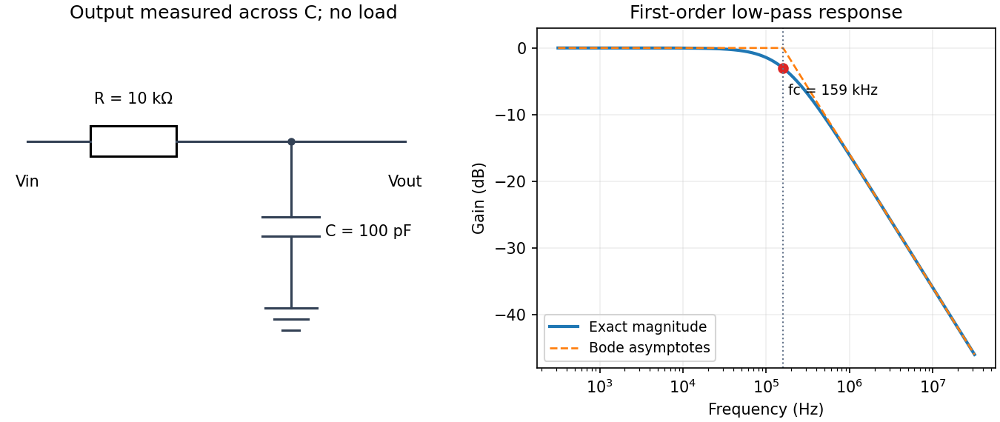

<h1 id="section-a/a5/solution">Solution</h1>

↑ **Parent:** [A5](../a5.md)

Use an unloaded [RC low-pass filter](../../../../../rc-low-pass-filter.md): a series [resistor](../../../../../resistor.md) between the source and the output node, with a [capacitor](../../../../../capacitor.md) from that node to ground, and measure the output across the [capacitor](../../../../../capacitor.md). The components are ideal in this first-order model; “ideal” here does not mean a brick-wall [frequency](../../../../../frequency.md) response.

The [time constant](../../../../../time-constant.md) is $\tau=RC$, hence

$$
\boxed{C=\frac{10^{-6}}{10^4}=10^{-10}\,\mathrm F=100\,\mathrm{pF}.}
$$

The capacitive [electrical impedance](../../../../../electrical-impedance.md) gives the [transfer function](../../../../../transfer-function.md) $H(i\omega)=1/(1+i\omega RC)$, so

$$
|H|=\frac1{\sqrt{1+(f/f_c)^2}},\qquad \boxed{f_c=\frac1{2\pi RC}=1.59\times10^5\,\mathrm{Hz}.}
$$

On the magnitude [Bode plot](../../../../../bode-plot.md), $20\log_{10}|H|=-10\log_{10}[1+(f/f_c)^2]$. The gain approaches $0\,\mathrm{dB}$ for $f\ll f_c$, is $-3.01\,\mathrm{dB}$ at $f_c$, and falls with slope $-20\,\mathrm{dB}$ per decade for $f\gg f_c$. These results assume negligible source resistance beyond the specified $R$ and a sufficiently large load impedance.

**[Figure 1](#section-a/a5/image-unloaded-rc-low-pass-circuit-and-its-first-order-bode-magnitude). Unloaded RC low-pass circuit and its first-order Bode magnitude**.

## ↑ Ancestors (14)

1. [A5](../a5.md)
2. [Section A](../../section-a.md)
3. [Paper 1](../../../paper-1-split.md)
4. [2018](../../../split.md)
5. [Past exam of the physics A course of the University of Cambridge](../../../../split.md)
6. [Physics A course of the University of Cambridge](../../../../../physics-a-course-of-the-university-of-cambridge.md)
7. [Physics course of the year 2 of the natural sciences course of the University of Cambridge](../../../../../physics-course-of-the-year-2-of-the-natural-sciences-course-of-the-university-of-cambridge.md)
8. [Year 2 of the natural sciences course of the University of Cambridge](../../../../../year-2-of-the-natural-sciences-course-of-the-university-of-cambridge.md)
9. [Year of the natural sciences course of the University of Cambridge](../../../../../year-of-the-natural-sciences-course-of-the-university-of-cambridge.md)
10. [Natural sciences course of the University of Cambridge](../../../../../natural-sciences-course-of-the-university-of-cambridge.md)
11. [Course of the University of Cambridge](../../../../../course-of-the-university-of-cambridge.md)
12. [University of Cambridge](../../../../../university-of-cambridge-split.md)
13. [List of universities](../../../../../list-of-universities.md)
14. [Codex Wiki](../../../../../split.md)
