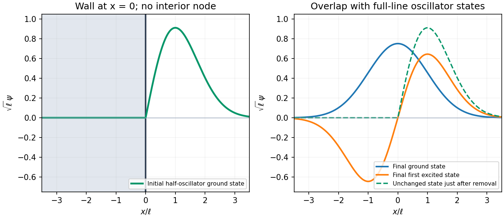

<h1 id="section-b/b7/c/solution">Solution</h1>

↑ **Parent:** [C](../c.md)

The infinite wall imposes $\boxed{\Psi(0)=0}$, and the [wavefunction](../../../../../../wave-function-split.md) vanishes for $x<0$. The even full-oscillator [ground state](../../../../../../ground-state.md) fails this [boundary condition](../../../../../../boundary-condition.md); the lowest admissible state is the positive-half restriction of the odd first excited state. Multiplying by $\sqrt2$ restores normalization because half its [probability](../../../../../../probability.md) originally lay on either side.

With $\ell=\sqrt{\hbar/(m\omega)}$, the [half-harmonic oscillator](../../../../../../half-harmonic-oscillator.md) [ground state](../../../../../../ground-state.md) is

$$
\boxed{\Psi_h(x)=\begin{cases}\displaystyle\frac{2x}{\pi^{1/4}\ell^{3/2}}e^{-x^2/(2\ell^2)},&x\geq0,\\0,&x<0,\end{cases}\qquad E_h=\frac32\hbar\omega.}
$$

It rises from zero at the wall, reaches its wave-amplitude maximum at $x=\ell$, and decays to zero as $x\to\infty$. It is positive throughout the interior of the allowed region, with no interior node, as required for its [ground state](../../../../../../ground-state.md). The wall need not make the [derivative](../../../../../../derivative.md) continuous with the forbidden half-line.

**[Figure 2](#section-b/b7/c/image-half-oscillator-ground-state-and-the-full-oscillator-states-after-removing-the-wall). Half-oscillator ground state and the full-oscillator states after removing the wall**.

## ↑ Ancestors (15)

1. [C](../c.md)
2. [B7](../../b7.md)
3. [Section B](../../../section-b.md)
4. [Paper 1](../../../../paper-1-split.md)
5. [2018](../../../../split.md)
6. [Past exam of the physics A course of the University of Cambridge](../../../../../split.md)
7. [Physics A course of the University of Cambridge](../../../../../../physics-a-course-of-the-university-of-cambridge.md)
8. [Physics course of the year 2 of the natural sciences course of the University of Cambridge](../../../../../../physics-course-of-the-year-2-of-the-natural-sciences-course-of-the-university-of-cambridge.md)
9. [Year 2 of the natural sciences course of the University of Cambridge](../../../../../../year-2-of-the-natural-sciences-course-of-the-university-of-cambridge.md)
10. [Year of the natural sciences course of the University of Cambridge](../../../../../../year-of-the-natural-sciences-course-of-the-university-of-cambridge.md)
11. [Natural sciences course of the University of Cambridge](../../../../../../natural-sciences-course-of-the-university-of-cambridge.md)
12. [Course of the University of Cambridge](../../../../../../course-of-the-university-of-cambridge.md)
13. [University of Cambridge](../../../../../../university-of-cambridge-split.md)
14. [List of universities](../../../../../../list-of-universities.md)
15. [Codex Wiki](../../../../../../split.md)
