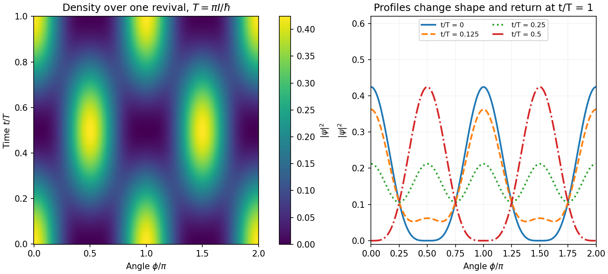

<h1 id="section-b/b8/d/solution">Solution</h1>

↑ **Parent:** [D](../d.md)

Taking the modulus squared gives the [three-mode revival of a planar quantum rotor](../../../../../../three-mode-revival-of-a-planar-quantum-rotor.md):

$$
\boxed{\rho(\phi,t)=\frac1{3\pi}[1+\cos^22\phi+2\cos2\phi\cos(\Omega t)],\qquad \Omega=\frac{2\hbar}{I}.}
$$

The angular density has period $\pi$, while both the state and its density revive after $\boxed{T=2\pi/\Omega=\pi I/\hbar}$. Its [integral](../../../../../../integral-split.md) over $0\leq\phi<2\pi$ is one because $\int\cos2\phi\,d\phi=0$ and $\int\cos^22\phi\,d\phi=\pi$.

At $t=0$, the density is $4\cos^4\phi/(3\pi)$, with maxima at $0,\pi$ and zeros at $\pi/2,3\pi/2$. At $t=T/2$ it becomes $4\sin^4\phi/(3\pi)$, interchanging those maxima and zeros. At $t=T/4$ and $3T/4$, it is $[1+\cos^22\phi]/(3\pi)$, with four equal maxima along the coordinate axes and positive minima halfway between them. At $t=T$ the original profile returns.

**[Figure 3](#section-b/b8/d/image-angle-time-probability-density-and-snapshots-over-one-planar-rotor-revival). Angle-time probability density and snapshots over one planar-rotor revival**.

The changing profile is [interference](../../../../../../interference-wave-propagation.md) between the stationary $m=0$ mode and the degenerate counter-rotating $m=\pm2$ modes. It does not translate rigidly around the circle; the standing-wave weights alternate between two orientations.

## ↑ Ancestors (15)

1. [D](../d.md)
2. [B8](../../b8.md)
3. [Section B](../../../section-b.md)
4. [Paper 1](../../../../paper-1-split.md)
5. [2018](../../../../split.md)
6. [Past exam of the physics A course of the University of Cambridge](../../../../../split.md)
7. [Physics A course of the University of Cambridge](../../../../../../physics-a-course-of-the-university-of-cambridge.md)
8. [Physics course of the year 2 of the natural sciences course of the University of Cambridge](../../../../../../physics-course-of-the-year-2-of-the-natural-sciences-course-of-the-university-of-cambridge.md)
9. [Year 2 of the natural sciences course of the University of Cambridge](../../../../../../year-2-of-the-natural-sciences-course-of-the-university-of-cambridge.md)
10. [Year of the natural sciences course of the University of Cambridge](../../../../../../year-of-the-natural-sciences-course-of-the-university-of-cambridge.md)
11. [Natural sciences course of the University of Cambridge](../../../../../../natural-sciences-course-of-the-university-of-cambridge.md)
12. [Course of the University of Cambridge](../../../../../../course-of-the-university-of-cambridge.md)
13. [University of Cambridge](../../../../../../university-of-cambridge-split.md)
14. [List of universities](../../../../../../list-of-universities.md)
15. [Codex Wiki](../../../../../../split.md)
