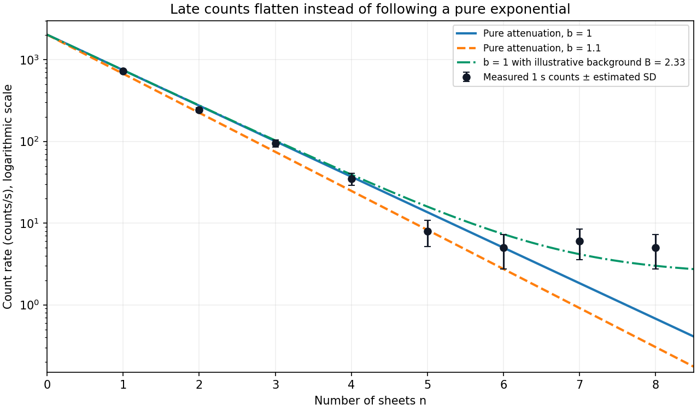

<h1 id="section-d/d12/b/solution">Solution</h1>

↑ **Parent:** [B](../b.md)

An exponential count rate appears as a straight line on a semilogarithmic plot:

$$
\log N(n)=\log N_0-bn.
$$

The early points decrease by roughly a factor $e$ per added sheet. Keeping the supplied $N_0$ fixed, a simple unweighted straight-line estimate from the first four logarithms is

$$
\widehat b_{\log}=\frac{\sum_{n=1}^{4}n\log(N_0/y_n)}{\sum_{n=1}^{4}n^2}\simeq1.02,
$$

so the early trend is consistent with $b$ near one. This logarithmic estimate is illustrative; the final statistical comparison should use the count uncertainties rather than treating the logarithms as equally precise.

**[Figure 5](#section-d/d12/b/image-attenuation-data-early-exponential-behavior-and-a-late-background-contribution). Attenuation data: early exponential behavior and a late background contribution**.

The pure exponential gives a useful approximate description through **about the first four or five sheets**. The first four observations are the clean high-count range; the fifth remains compatible with $b=1$ within its counting scatter. At $n=6,7,8$ the measurements are roughly constant at a few counts per second, so a single straight line no longer describes the whole pattern. Agreement of the sixth point with one exponential prediction by itself does not remove the systematic late flattening. There is no sharply determined physical cutoff from eight noisy measurements; the range used for a formal test should be stated explicitly.

## ↑ Ancestors (15)

1. [B](../b.md)
2. [D12](../../d12.md)
3. [Section D](../../../section-d.md)
4. [Paper 1](../../../../paper-1-split.md)
5. [2018](../../../../split.md)
6. [Past exam of the physics A course of the University of Cambridge](../../../../../split.md)
7. [Physics A course of the University of Cambridge](../../../../../../physics-a-course-of-the-university-of-cambridge.md)
8. [Physics course of the year 2 of the natural sciences course of the University of Cambridge](../../../../../../physics-course-of-the-year-2-of-the-natural-sciences-course-of-the-university-of-cambridge.md)
9. [Year 2 of the natural sciences course of the University of Cambridge](../../../../../../year-2-of-the-natural-sciences-course-of-the-university-of-cambridge.md)
10. [Year of the natural sciences course of the University of Cambridge](../../../../../../year-of-the-natural-sciences-course-of-the-university-of-cambridge.md)
11. [Natural sciences course of the University of Cambridge](../../../../../../natural-sciences-course-of-the-university-of-cambridge.md)
12. [Course of the University of Cambridge](../../../../../../course-of-the-university-of-cambridge.md)
13. [University of Cambridge](../../../../../../university-of-cambridge-split.md)
14. [List of universities](../../../../../../list-of-universities.md)
15. [Codex Wiki](../../../../../../split.md)
