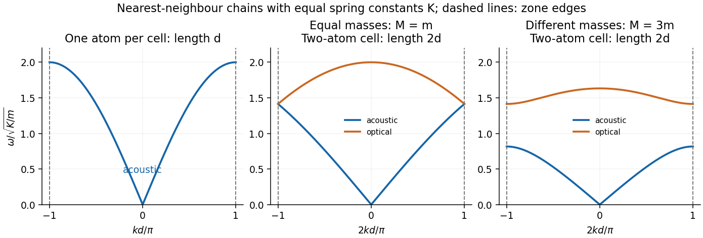
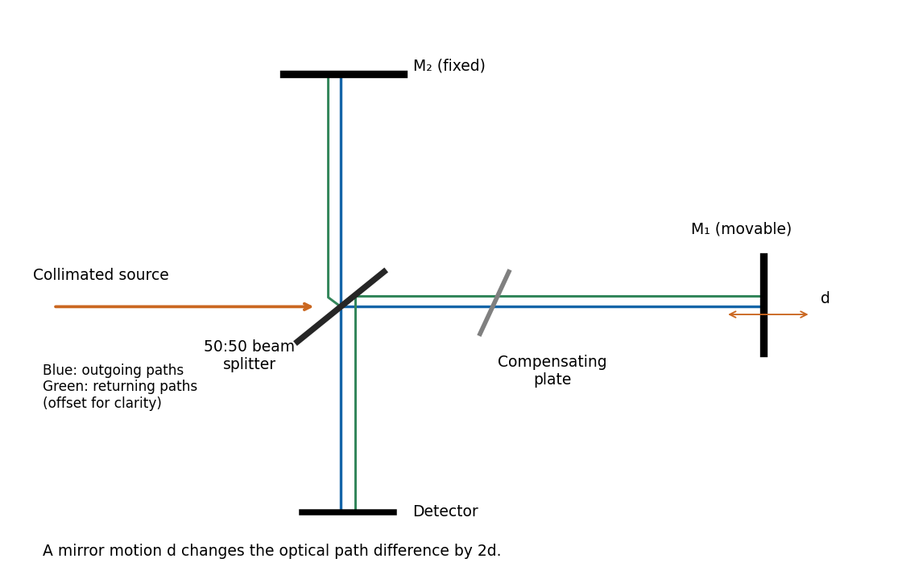
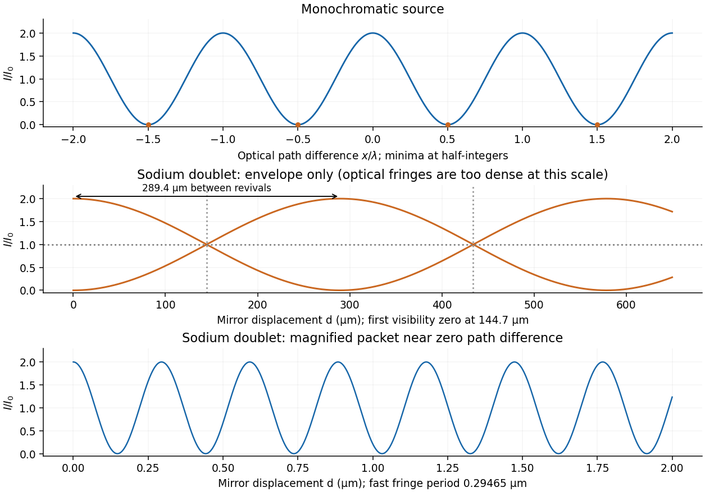
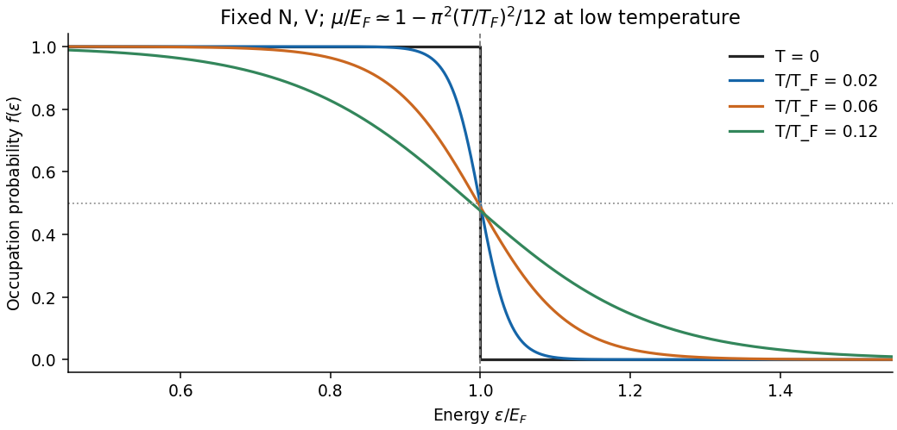

# Paper 2

↑ **Parent:** [2018](../2018.md)

[Original paper, released PDF pages 93–100](https://www.whatdotheyknow.com/request/natural_science_tripos_physics_e/response/2127325/attach/3/FOI%202022%20639%20Sullivan%20materials.pdf?cookie_passthrough=1#page=93)

**Table of contents**

- [Section A](#section-a)
  - [A1](#section-a/a1)
    - [Solution](#section-a/a1/solution)
  - [A2](#section-a/a2)
    - [Solution](#section-a/a2/solution)
  - [A3](#section-a/a3)
    - [Solution](#section-a/a3/solution)
  - [A4](#section-a/a4)
    - [Solution](#section-a/a4/solution)
  - [A5](#section-a/a5)
    - [Solution](#section-a/a5/solution)
- [Section B](#section-b)
  - [B6](#section-b/b6)
    - [a](#section-b/b6/a)
      - [Solution](#section-b/b6/a/solution)
    - [b](#section-b/b6/b)
      - [Solution](#section-b/b6/b/solution)
    - [c](#section-b/b6/c)
      - [Solution](#section-b/b6/c/solution)
    - [d](#section-b/b6/d)
      - [Solution](#section-b/b6/d/solution)
    - [e](#section-b/b6/e)
      - [Solution](#section-b/b6/e/solution)
  - [B7](#section-b/b7)
    - [a](#section-b/b7/a)
      - [Solution](#section-b/b7/a/solution)
    - [b](#section-b/b7/b)
      - [Solution](#section-b/b7/b/solution)
    - [c](#section-b/b7/c)
      - [Solution](#section-b/b7/c/solution)
    - [d](#section-b/b7/d)
      - [Solution](#section-b/b7/d/solution)
    - [e](#section-b/b7/e)
      - [Solution](#section-b/b7/e/solution)
  - [B8](#section-b/b8)
    - [a](#section-b/b8/a)
      - [Solution](#section-b/b8/a/solution)
    - [b](#section-b/b8/b)
      - [Solution](#section-b/b8/b/solution)
    - [c](#section-b/b8/c)
      - [Solution](#section-b/b8/c/solution)
    - [d](#section-b/b8/d)
      - [Solution](#section-b/b8/d/solution)
    - [e](#section-b/b8/e)
      - [Solution](#section-b/b8/e/solution)
  - [B9](#section-b/b9)
    - [a](#section-b/b9/a)
      - [Solution](#section-b/b9/a/solution)
    - [b](#section-b/b9/b)
      - [Solution](#section-b/b9/b/solution)
    - [c](#section-b/b9/c)
      - [Solution](#section-b/b9/c/solution)
    - [d](#section-b/b9/d)
      - [Solution](#section-b/b9/d/solution)
    - [e](#section-b/b9/e)
      - [i](#section-b/b9/e/i)
        - [Solution](#section-b/b9/e/i/solution)
      - [ii](#section-b/b9/e/ii)
        - [Solution](#section-b/b9/e/ii/solution)
      - [iii](#section-b/b9/e/iii)
        - [Solution](#section-b/b9/e/iii/solution)
- [Section C](#section-c)
  - [C10](#section-c/c10)
    - [a](#section-c/c10/a)
      - [Solution](#section-c/c10/a/solution)
    - [b](#section-c/c10/b)
      - [Solution](#section-c/c10/b/solution)
    - [c](#section-c/c10/c)
      - [Solution](#section-c/c10/c/solution)
    - [d](#section-c/c10/d)
      - [Solution](#section-c/c10/d/solution)
    - [e](#section-c/c10/e)
      - [Solution](#section-c/c10/e/solution)
  - [C11](#section-c/c11)
    - [a](#section-c/c11/a)
      - [Solution](#section-c/c11/a/solution)
    - [b](#section-c/c11/b)
      - [Solution](#section-c/c11/b/solution)
    - [c](#section-c/c11/c)
      - [Solution](#section-c/c11/c/solution)
    - [d](#section-c/c11/d)
      - [Solution](#section-c/c11/d/solution)
- [Section D](#section-d)
  - [D12](#section-d/d12)
    - [Solution](#section-d/d12/solution)
  - [D13](#section-d/d13)
    - [a](#section-d/d13/a)
      - [Solution](#section-d/d13/a/solution)
    - [b](#section-d/d13/b)
      - [Solution](#section-d/d13/b/solution)
    - [c](#section-d/d13/c)
      - [Solution](#section-d/d13/c/solution)

## Section A

↑ **Parent:** [Paper 2](paper-2.md)

<h3 id="section-a/a1">A1</h3>

↑ **Parent:** [Section A](#section-a)

<h4 id="section-a/a1/solution">Solution</h4>

↑ **Parent:** [A1](#section-a/a1)

For a [photon](../../quantum-mechanics.md#photon), $E=hc/\lambda$. Using [Planck constant](../../quantum-mechanics.md#planck-constant) $h=6.62607015\times10^{-34}\,\mathrm{J\,s}$, [speed of light](../../special-relativity.md#speed-of-light) $c=2.99792458\times10^8\,\mathrm{m\,s^{-1}}$ and $1\,\mathrm{eV}=1.602176634\times10^{-19}\,\mathrm J$ gives

$$
\lambda=\frac{hc}{2.5\,\mathrm{eV}}=4.96\times10^{-7}\,\mathrm m.
$$

The [Rayleigh criterion](../../point-spread-function.md#rayleigh-criterion) for a circular [aperture](../../optics.md#aperture) of diameter $D$ is $\theta_R=1.22\lambda/D$, set by the first zero of its [Airy disk](../../point-spread-function.md#airy-disk). Thus the ideal [diffraction-limited resolution](../../point-spread-function.md#diffraction-limited-resolution) is

$$
\boxed{\theta_R=2.52\times10^{-7}\,\mathrm{rad}},\qquad
\boxed{s=R\theta_R=5.04\times10^{10}\,\mathrm m}.
$$

The conversion to transverse separation uses the [small-angle approximation](../../geometry-and-topology.md#small-angle-approximation). An order-of-magnitude estimate $\lambda/D$ instead gives $2.07\times10^{-7}\,\mathrm{rad}$ and $4.13\times10^{10}\,\mathrm m$; the distinction is the chosen resolution criterion. These are [aperture](../../optics.md#aperture) limits, before instrumental aberrations and detector sampling.

<h3 id="section-a/a2">A2</h3>

↑ **Parent:** [Section A](#section-a)

<h4 id="section-a/a2/solution">Solution</h4>

↑ **Parent:** [A2](#section-a/a2)

Both the incoming and outgoing spherical [wavefronts](../../physical-optics.md#wavefront) contribute to the path excess. At [aperture](../../optics.md#aperture) radius $u$, with axial distances $s$ before and $r$ after the [aperture](../../optics.md#aperture),

$$
\Delta\ell=\sqrt{s^2+u^2}+\sqrt{r^2+u^2}-(s+r)
\simeq\frac{u^2}{2}\left(\frac1s+\frac1r\right).
$$

The outer edge of the $n$th [Fresnel half-period zone](../../physical-optics.md#fresnel-half-period-zone) has $\Delta\ell=n\lambda/2$. Hence

$$
u_n^2=\frac{n\lambda sr}{s+r},\qquad
u_2=\sqrt{\frac{2(400\times10^{-9})(0.5)(0.5)}{1.0}}.
$$

Therefore **the outer radius is** $\boxed{u_2=4.47\times10^{-4}\,\mathrm m=0.447\,\mathrm{mm}}$. The [paraxial approximation](../../partial-differential-equation.md#paraxial-approximation) is excellent because $u_2\ll s,r$. Treating the illumination as a [plane wave](../../wave-function.md#plane-wave) would incorrectly omit the source-side path curvature.

<h3 id="section-a/a3">A3</h3>

↑ **Parent:** [Section A](#section-a)

<h4 id="section-a/a3/solution">Solution</h4>

↑ **Parent:** [A3](#section-a/a3)

At normal incidence between lossless media with real positive [acoustic impedances](../../elasticity-physics.md#acoustic-impedance) $Z_1,Z_2$, continuity of pressure and normal particle [velocity](../../classical-mechanics.md#velocity) gives the pressure transmission amplitude $t_p=2Z_2/(Z_1+Z_2)$. Since the mean [acoustic intensity](../../continuum-mechanics.md#acoustic-energy-flux) is $|p|^2/(2Z)$, the fraction of incident [energy](../../energy.md) transmitted is

$$
\mathcal T=\frac{Z_1}{Z_2}|t_p|^2=\frac{4Z_1Z_2}{(Z_1+Z_2)^2},\qquad
\mathcal R=\left(\frac{Z_2-Z_1}{Z_2+Z_1}\right)^2=1-\mathcal T.
$$

This is [acoustic reflection and transmission at an interface](../../wave-equation.md#acoustic-reflection-and-transmission-at-an-interface). With the supplied [acoustic impedances](../../elasticity-physics.md#acoustic-impedance),

$$
\boxed{\mathcal T_{\rm air\to body}=9.81\times10^{-4}=0.0981\%},\qquad
\boxed{\mathcal T_{\rm water\to body}=0.99767=99.77\%}.
$$

A thin water-based gel layer excludes air gaps and approximately matches the body's [acoustic impedance](../../elasticity-physics.md#acoustic-impedance). About $99.90\%$ of incident [energy](../../energy.md) would otherwise reflect at the air-body interface. The coupling is also needed on the return journey, so it strongly improves the detectable echo. These figures concern interface transmission, before absorption within tissue; the gel is approximated by the stated water value.

<h3 id="section-a/a4">A4</h3>

↑ **Parent:** [Section A](#section-a)

<h4 id="section-a/a4/solution">Solution</h4>

↑ **Parent:** [A4](#section-a/a4)

Take nearest-neighbour separation $d$, a common [spring constant](../../elasticity-physics.md#spring-constant) $K$, and one scalar displacement per atom. For a monatomic chain, the [harmonic approximation near a potential minimum](../../bloch-s-theorem.md#harmonic-approximation-near-a-potential-minimum), [Newton's second law](../../force.md#newton-s-second-law) and a [normal mode](../../wave-equation.md#normal-mode) give

$$
m\ddot u_j=K(u_{j+1}+u_{j-1}-2u_j),\qquad
u_j=u_0e^{i(kjd-\omega t)},\qquad
\boxed{\omega=2\sqrt{K/m}\,|\sin(kd/2)|}.
$$

The [monatomic-chain dispersion relation](../../quantum-ideal-gas-statistics.md#monatomic-chain-dispersion-relation) has one [acoustic phonon branch](../../quantum-ideal-gas-statistics.md#acoustic-phonon-branch), with $\omega\simeq d\sqrt{K/m}|k|$ near the origin. The first [Brillouin zone](../../bloch-s-theorem.md#brillouin-zone) ends at $\boxed{k=\pm\pi/d}$, where $\omega=2\sqrt{K/m}$ and the [group velocity](../../dispersion-relation.md#group-velocity) vanishes.

For alternating [masses](../../classical-mechanics.md#mass) $m,M$, choose a two-atom cell of length $2d$. The coupled [normal modes](../../wave-equation.md#normal-mode) give the [diatomic-chain dispersion relation with equal springs](../../quantum-ideal-gas-statistics.md#diatomic-chain-dispersion-relation-with-equal-springs),

$$
\boxed{\omega_\pm^2=K\left(\frac1m+\frac1M\right)\pm K\sqrt{\left(\frac1m+\frac1M\right)^2-\frac4{mM}\sin^2(kd)}}.
$$

The first [Brillouin zone](../../bloch-s-theorem.md#brillouin-zone) now ends at $\boxed{k=\pm\pi/(2d)}$. The minus branch is the [acoustic phonon branch](../../quantum-ideal-gas-statistics.md#acoustic-phonon-branch); its two atoms move together at long [wavelength](../../wave-equation.md#wavelength). The plus branch is the [optical phonon branch](../../quantum-ideal-gas-statistics.md#optical-phonon-branch); at $k=0$ the atoms move oppositely with a stationary centre of [mass](../../classical-mechanics.md#mass) and $\omega_+^2=2K(1/m+1/M)$. For $M>m$ the edge frequencies are $\sqrt{2K/M}$ and $\sqrt{2K/m}$, with a gap between them.

If $M=m$, the two branches reduce to $2\sqrt{K/m}|\sin(kd/2)|$ and $2\sqrt{K/m}|\cos(kd/2)|$, touching at $\sqrt{2K/m}$. This is [zone folding in an equal-mass diatomic chain](../../bloch-s-theorem.md#zone-folding-in-an-equal-mass-diatomic-chain): identical sites actually have a [primitive unit cell](../../quantum-scattering.md#primitive-unit-cell) of length $d$. A doubled cell folds the monatomic branch but opens no gap. Equal masses alone do not specify all possible spring models; the sketches assume equal nearest-neighbour [spring constants](../../elasticity-physics.md#spring-constant).

**[Figure 1](#section-a/a4/image-monatomic-and-two-atom-chain-dispersion-relations-with-explicitly-chosen-cell-lengths-and-zone-edges). Monatomic and two-atom-chain dispersion relations, with explicitly chosen cell lengths and zone edges**.

<h3 id="section-a/a5">A5</h3>

↑ **Parent:** [Section A](#section-a)

<h4 id="section-a/a5/solution">Solution</h4>

↑ **Parent:** [A5](#section-a/a5)

Under the one-carrier [Drude model](../../electric-charge.md#drude-model), the magnitude of the [Hall coefficient](../../relativistic-electromagnetism.md#hall-coefficient) gives an effective [carrier density](../../electric-charge.md#carrier-density)

$$
n_H=\frac1{e|R_H|}=2.60\times10^{28}\,\mathrm{m^{-3}}.
$$

Convert the material [mass density](../../fluid-mechanics.md#density) to $1850\,\mathrm{kg\,m^{-3}}$ and its [molar mass](../../chemistry.md#molar-mass) to $0.009\,\mathrm{kg\,mol^{-1}}$. The atomic [number density](../../statistical-physics.md#number-density) is

$$
n_{\rm at}=\frac{1850}{0.009}N_A=1.238\times10^{29}\,\mathrm{m^{-3}},\qquad
\boxed{\frac{n_H}{n_{\rm at}}=0.210\ \text{effective carriers per atom}}.
$$

Here $N_A=6.02214076\times10^{23}\,\mathrm{mol^{-1}}$ is the [Avogadro constant](../../physics.md#avogadro-constant). The positive [Hall coefficient](../../relativistic-electromagnetism.md#hall-coefficient) gives a hole-like response in a one-carrier interpretation. The [Hall carrier count versus valence](../../relativistic-electromagnetism.md#hall-carrier-count-versus-valence) distinction matters: [beryllium](../../chemical-substance.md#beryllium) has two [valence electrons](../../chemical-bond.md#valence-electron), but the result is neither two free [electrons](../../physics.md#electron) nor a literal fractional atom donating charge. Its [energy bands](../../bloch-s-theorem.md#energy-band) and [Fermi surface](../../fermi-liquid.md#fermi-surface) invalidate the simple isotropic one-carrier inference. Electron-like and hole-like contributions with different [charge carrier mobilities](../../electric-charge.md#charge-carrier-mobility) can yield this sign and effective count.

## Section B

↑ **Parent:** [Paper 2](paper-2.md)

<h3 id="section-b/b6">B6</h3>

↑ **Parent:** [Section B](#section-b)

<h4 id="section-b/b6/a">a</h4>

↑ **Parent:** [B6](#section-b/b6)

<h5 id="section-b/b6/a/solution">Solution</h5>

↑ **Parent:** [A](#section-b/b6/a)

Substituting $x=Ae^{pt}$ into the [damped harmonic oscillator](../../analysis.md#damped-harmonic-oscillator) equation gives

$$
p^2+\gamma p+\omega_0^2=0,\qquad p_\pm=-\frac\gamma2\pm\sqrt{\frac{\gamma^2}{4}-\omega_0^2}.
$$

For nonnegative [viscous damping](../../wave-equation.md#viscous-damping), the cases are

$$
\boxed{\begin{aligned}
\gamma>2\omega_0 &: \quad x=C_+e^{p_+t}+C_-e^{p_-t} &&\text{overdamping},\\
\gamma=2\omega_0 &: \quad x=(C_1+C_2t)e^{-\omega_0t} &&\text{critical damping},\\
0\leq\gamma<2\omega_0 &: \quad x=e^{-\gamma t/2}[C_1\cos\omega_dt+C_2\sin\omega_dt] &&\text{underdamping},
\end{aligned}}\qquad \omega_d=\sqrt{\omega_0^2-\gamma^2/4}.
$$

The PDF's request to express these conditions in terms of $\gamma/m$ is dimensionally inconsistent with its definition $\gamma=b/m$: $\gamma$ already has units $\mathrm{s^{-1}}$. With the unnormalised equation $m\ddot x+b\dot x+kx=0$, the equivalent comparisons are $b/m\gtrless2\omega_0$, or $b^2\gtrless4mk$. Also $\omega_0$ is the undamped natural [angular frequency](../../lagrangian-mechanics.md#angular-frequency), not in general the driven displacement peak.

<h4 id="section-b/b6/b">b</h4>

↑ **Parent:** [B6](#section-b/b6)

<h5 id="section-b/b6/b/solution">Solution</h5>

↑ **Parent:** [B](#section-b/b6/b)

For the steady response of a [forced harmonic oscillator](../../analysis.md#forced-harmonic-oscillator), write $x=\operatorname{Re}(Ae^{i\omega t})$ and use the same [complex amplitude](../../wave.md#complex-amplitude) convention for the driving [force](../../force.md). Substitution gives

$$
[-\omega^2+i\gamma\omega+\omega_0^2]A=F_0/m,\qquad
\boxed{A=R(\omega)F_0,\quad R(\omega)=\frac1{m(\omega_0^2-\omega^2+i\gamma\omega)}}.
$$

Thus the response magnitude and displacement [phase](../../wave.md#phase-waves) relative to the [force](../../force.md) are

$$
|R|=\frac1{m\sqrt{(\omega_0^2-\omega^2)^2+\gamma^2\omega^2}},\qquad
\phi=-\operatorname{atan2}(\gamma\omega,\omega_0^2-\omega^2).
$$

The [phase](../../wave.md#phase-waves) goes from $0$ at low [frequency](../../wave.md#frequency), through $-\pi/2$ at $\omega_0$, towards $-\pi$ at high [frequency](../../wave.md#frequency). The static magnitude is $1/(m\omega_0^2)=1/k$, while the high-frequency magnitude is approximately $1/(m\omega^2)$.

Define the [quality factor](../../dynamical-systems.md#q-factor) by $Q=\omega_0/\gamma$. If $Q>1/\sqrt2$, the displacement peak occurs at $\omega_r=\sqrt{\omega_0^2-\gamma^2/2}$; for $Q\leq1/\sqrt2$ the magnitude decreases monotonically from its static value. For $Q\gg1$ there is a tall narrow peak close to $\omega_0$, of height approximately $Q/k$ and width approximately $\gamma$. At very small $Q$ the resonant peak disappears and the response is broad. The plotted functions are normalized as $k|R|$, at fixed $m,k$.

**[Figure 2](#section-b/b6/b/image-normalized-amplitude-and-phase-of-a-driven-oscillator-at-three-quality-factors). Normalized amplitude and phase of a driven oscillator at three quality factors**.

<h4 id="section-b/b6/c">c</h4>

↑ **Parent:** [B6](#section-b/b6)

<h5 id="section-b/b6/c/solution">Solution</h5>

↑ **Parent:** [C](#section-b/b6/c)

The original diagram is a [series RLC circuit](../../electrical-circuit.md#series-rlc-circuit), so the same [electric current](../../electric-charge.md#electric-current) $i=\dot q$ passes through all three elements. Choose capacitor [electric charge](../../electric-charge.md) $q$ positive on the plate into which positive $i$ enters. [Kirchhoff's voltage law](../../random-walk.md#kirchhoff-cycle-law) gives

$$
V(t)=V_L+V_R+V_C=L\frac{di}{dt}+Ri+\frac qC=L\ddot q+R\dot q+\frac qC.
$$

Dividing by [inductance](../../electromagnetism.md#inductance) $L$ gives

$$
\boxed{\ddot q+\frac RL\dot q+\frac1{LC}q=\frac{V(t)}L}.
$$

The correspondence to the [forced harmonic oscillator](../../analysis.md#forced-harmonic-oscillator) is $m\leftrightarrow L$, $b\leftrightarrow R$, $k\leftrightarrow1/C$, and $x\leftrightarrow q$. The stored [energy](../../energy.md) is $L i^2/2+q^2/(2C)$; its balance is $\dot E=Vi-Ri^2$, confirming the damping sign.

<h4 id="section-b/b6/d">d</h4>

↑ **Parent:** [B6](#section-b/b6)

<h5 id="section-b/b6/d/solution">Solution</h5>

↑ **Parent:** [D](#section-b/b6/d)

The capacitor-charge [complex amplitude](../../wave.md#complex-amplitude) is

$$
q_0=\frac{V_0/L}{1/(LC)-\omega^2+i(R/L)\omega}.
$$

For fixed driving-voltage [amplitude](../../wave.md#wave-amplitude), maximizing $|q_0|$ minimizes

$$
D(\omega)=\left(\omega_0^2-\omega^2\right)^2+\gamma^2\omega^2,\qquad
\omega_0^2=\frac1{LC},\quad\gamma=\frac RL.
$$

Differentiate:

$$
\frac{dD}{d\omega}=2\omega[-2(\omega_0^2-\omega^2)+\gamma^2].
$$

The positive-frequency minimum therefore has

$$
\boxed{\omega_{\rm res}=\sqrt{\frac1{LC}-\frac{R^2}{2L^2}}},\qquad
R^2<\frac{2L}{C}.
$$

This is the [resonance](../../dynamical-systems.md#resonance) of charge, or capacitor voltage. If the stated inequality fails, their maximum is at zero [frequency](../../wave.md#frequency), and no positive displacement-resonance peak exists. The [electric current](../../electric-charge.md#electric-current) has the additional factor $\omega$, and instead peaks exactly at $\omega_0=1/\sqrt{LC}$ for every $R>0$.

<h4 id="section-b/b6/e">e</h4>

↑ **Parent:** [B6](#section-b/b6)

<h5 id="section-b/b6/e/solution">Solution</h5>

↑ **Parent:** [E](#section-b/b6/e)

The precise [bandwidth](../../electrical-engineering.md#bandwidth-signal-processing) depends on the output: this is the distinction between [displacement and current bandwidths of a series RLC circuit](../../electrical-circuit.md#displacement-and-current-bandwidths-of-a-series-rlc-circuit). For current output, or voltage across the [resistor](../../electric-charge.md#resistor), the [electrical impedance](../../electrical-circuit.md#electrical-impedance) gives

$$
|i|^2=\frac{|V_0|^2}{R^2+(\omega L-1/(\omega C))^2}.
$$

The half-power points satisfy $|\omega L-1/(\omega C)|=R$. Their positive roots are

$$
\omega_\pm=\frac{\sqrt{R^2+4L/C}\pm R}{2L},\qquad
\boxed{\Delta\omega=\omega_+-\omega_-=R/L},\qquad
\boxed{\Delta f=R/(2\pi L)}.
$$

Changing [capacitance](../../electromagnetism.md#capacitance) shifts the centre without changing this absolute width. For the charge response in part (d), the exact half-height points instead obey

$$
\omega_\pm^2=\omega_0^2-\gamma^2/2\pm\gamma\sqrt{\omega_0^2-\gamma^2/4};
$$

when both exist their separation only approaches $\gamma=R/L$ at large [quality factor](../../dynamical-systems.md#q-factor). Therefore the printed capacitance-independence claim is exact for current or resistor-voltage output and an approximation for the preceding charge resonance.

For a narrow [band-pass filter](../../electrical-engineering.md#band-pass-filter), use current or resistor-voltage output and make $R/L$ small, counting source, load and inductor losses in the total [electrical resistance](../../electric-charge.md#electrical-resistance). Increase $Q=\sqrt{L/C}/R$; if a specified centre [frequency](../../wave.md#frequency) is to remain fixed, adjust $C$ with $L$ to keep $LC$ fixed. Capacitor-voltage output alone is not a band-pass response because it has a nonzero DC limit.

<h3 id="section-b/b7">B7</h3>

↑ **Parent:** [Section B](#section-b)

<h4 id="section-b/b7/a">a</h4>

↑ **Parent:** [B7](#section-b/b7)

<h5 id="section-b/b7/a/solution">Solution</h5>

↑ **Parent:** [A](#section-b/b7/a)

In [Fraunhofer diffraction](../../physical-optics.md#fraunhofer-diffraction), the relative propagation [phase](../../wave.md#phase-waves) across the [aperture](../../optics.md#aperture) is linear in [aperture](../../optics.md#aperture) coordinates. If $b$ is its largest transverse size, the neglected quadratic path term must be small: for an observer at distance $R$,

$$
\boxed{\frac{b^2}{\lambda R}\ll1}.
$$

For a finite-distance point source a distance $s$ away, also require $b^2/(\lambda s)\ll1$ if the illumination is to be treated as a [plane wave](../../wave-function.md#plane-wave). Numerical factors depend on whether $b$ is a radius or full width and on the permitted [phase](../../wave.md#phase-waves) error; the condition expresses a small [Fresnel number](../../physical-optics.md#fresnel-number).

One can place both source and screen sufficiently far away, or collimate a point source with a [lens](../../geometrical-optics.md#lens-optics) and observe the [aperture](../../optics.md#aperture) in the back focal plane of a second [lens](../../geometrical-optics.md#lens-optics). In the latter arrangement rays of each outgoing direction focus at one point, with $X\simeq f\theta_x$; the lens removes the need for a physically distant screen. A laser beam approximately uniform across the [aperture](../../optics.md#aperture) can supply the incident [plane wave](../../wave-function.md#plane-wave). The sketches distinguish an actual far field from its focal-plane equivalent.

**[Figure 3](#section-b/b7/a/image-far-field-diffraction-geometry-and-the-lens-arrangement-that-produces-the-same-angular-pattern). Far-field diffraction geometry and the lens arrangement that produces the same angular pattern**.

<h4 id="section-b/b7/b">b</h4>

↑ **Parent:** [B7](#section-b/b7)

<h5 id="section-b/b7/b/solution">Solution</h5>

↑ **Parent:** [B](#section-b/b7/b)

Let the [aperture](../../optics.md#aperture) occupy the $z=0$ plane, with coordinates $(x,y)$ and opening $\Sigma$. Write $\psi_\Sigma(x,y)$ for the incident scalar [complex amplitude](../../wave.md#complex-amplitude) and $h(x,y)$ for its dimensionless amplitude transmission, including any imposed [phase](../../wave.md#phase-waves). The observation point has transverse coordinates $(X,Y)$, corresponding to the PDF's $(x_0,y_0)$, and axial distance $R$. Also $k=2\pi/\lambda$ is the [wavenumber](../../wave-equation.md#wavenumber) and $i^2=-1$.

The [Huygens-Fresnel principle](../../physical-optics.md#huygens-fresnel-principle) expresses the propagated field, up to common prefactors and an approximately constant obliquity factor, as

$$
\psi_P\propto\iint_\Sigma \psi_\Sigma h\,\frac{e^{ikr}}r\,dx\,dy,\qquad
r=\sqrt{R^2+(X-x)^2+(Y-y)^2}.
$$

In the [paraxial approximation](../../partial-differential-equation.md#paraxial-approximation), expand the path as

$$
r\simeq R+\frac{X^2+Y^2}{2R}-\frac{Xx+Yy}{R}+\frac{x^2+y^2}{2R}.
$$

The last term is negligible in the [Fraunhofer diffraction](../../physical-optics.md#fraunhofer-diffraction) limit, while the first two terms and $1/r\simeq1/R$ are common across the [aperture](../../optics.md#aperture). Factoring them out leaves

$$
\boxed{\psi_P\propto\iint_\Sigma\psi_\Sigma(x,y)h(x,y)e^{-ik(Xx+Yy)/R}\,dx\,dy}.
$$

It is the two-dimensional [Fourier transform](../../fourier-transform.md) of the transmitted [aperture](../../optics.md#aperture) field, evaluated at transverse [wavevector](../../elasticity-physics.md#wavevector) $(kX/R,kY/R)$. For appreciable observation angles the corresponding exact directional components are used rather than $X/R,Y/R$.

<h4 id="section-b/b7/c">c</h4>

↑ **Parent:** [B7](#section-b/b7)

<h5 id="section-b/b7/c/solution">Solution</h5>

↑ **Parent:** [C](#section-b/b7/c)

Represent equal narrow slits at $x=\pm D/2$ by two contributions with equal [complex amplitudes](../../wave.md#complex-amplitude). In a direction $\theta$ the path difference is $D\sin\theta$, so

$$
\psi(\theta)\propto e^{iqD/2}+e^{-iqD/2}=2\cos(qD/2),\qquad q=\frac{2\pi}{\lambda}\sin\theta.
$$

Therefore [double-slit interference](../../physical-optics.md#double-slit-interference) gives

$$
\boxed{I(\theta)\propto\cos^2\!\left(\frac{\pi D\sin\theta}{\lambda}\right)}.
$$

The bright [interference fringes](../../physical-optics.md#interference-fringe) satisfy $D\sin\theta=m\lambda$, with a central maximum. In the small-angle region,

$$
\boxed{\Delta\theta\simeq\lambda/D=4.00\times10^{-3}\,\mathrm{rad}=4.00\,\mathrm{mrad}}.
$$

Dark fringes lie halfway between bright ones. Exactly, spacing is uniform in $\sin\theta$, not in $\theta$ at large angles. The first panel of the pattern figure below shows the narrow-slit result.

<h4 id="section-b/b7/d">d</h4>

↑ **Parent:** [B7](#section-b/b7)

<h5 id="section-b/b7/d/solution">Solution</h5>

↑ **Parent:** [D](#section-b/b7/d)

A relative [phase](../../wave.md#phase-waves) $\pi$ changes the sign of one slit field. Their sum becomes

$$
\psi(\theta)\propto e^{iqD/2}-e^{-iqD/2}=2i\sin(qD/2),\qquad
\boxed{I(\theta)\propto\sin^2\!\left(\frac{\pi D\sin\theta}{\lambda}\right)}.
$$

The central [interference fringe](../../physical-optics.md#interference-fringe) is now dark. The maxima move to $D\sin\theta=(m+1/2)\lambda$, while the minima occur at $D\sin\theta=m\lambda$. Thus the pattern shifts by half a fringe, $2.00\,\mathrm{mrad}$ near the axis, but **its angular fringe separation remains** $\boxed{4.00\,\mathrm{mrad}}$. This assumes the glass changes [phase](../../wave.md#phase-waves) uniformly and introduces negligible absorption or beam deflection.

<h4 id="section-b/b7/e">e</h4>

↑ **Parent:** [B7](#section-b/b7)

<h5 id="section-b/b7/e/solution">Solution</h5>

↑ **Parent:** [E](#section-b/b7/e)

For a rectangular slit centred at $x_c$, the one-dimensional [Fraunhofer diffraction](../../physical-optics.md#fraunhofer-diffraction) integral is

$$
\int_{x_c-a/2}^{x_c+a/2}e^{-iqx}\,dx
=a\operatorname{sinc}(qa/2)e^{-iqx_c},\qquad \operatorname{sinc}z=\frac{\sin z}{z}.
$$

The two equal [apertures](../../optics.md#aperture) have centres at $\pm D/2$; the glass subtracts their fields. Therefore

$$
\psi\propto a\operatorname{sinc}(qa/2)\left(e^{iqD/2}-e^{-iqD/2}\right),\qquad
\boxed{I\propto\sin^2(qD/2)\operatorname{sinc}^2(qa/2)}.
$$

This is [phase-reversed double-slit diffraction](../../physical-optics.md#phase-reversed-double-slit-diffraction): the narrow-slit [interference](../../physical-optics.md#interference-wave-propagation) factor is multiplied by the [single-slit diffraction](../../physical-optics.md#single-slit-diffraction) envelope. In the limit $a\to0$, the normalized envelope tends to one, recovering part (d).

The [interference](../../physical-optics.md#interference-wave-propagation) minima and envelope minima obey, respectively,

$$
\boxed{\sin\theta_m=m\lambda/D=0.004m},\quad m\in\mathbb Z;\qquad
\boxed{\sin\theta_n=n\lambda/a=0.020n},\quad n\in\mathbb Z\setminus\{0\}.
$$

Near the axis these are $\theta_m\simeq4m\,\mathrm{mrad}$ and envelope zeros $\theta_n\simeq20n\,\mathrm{mrad}$. Here $D/a=5$, so every envelope zero already coincides with an [interference](../../physical-optics.md#interference-wave-propagation) minimum. The envelope strongly reduces the outer fringes; its central value is nonzero, but the total intensity still vanishes at $\theta=0$ because the two fields cancel. The sketch uses the small-angle coordinate; the equations above specify the exact angular zeros.

**[Figure 4](#section-b/b7/e/image-unshifted-and-phase-reversed-narrow-slit-fringes-and-the-phase-reversed-finite-width-pattern-with-its-envelope). Unshifted and phase-reversed narrow-slit fringes, and the phase-reversed finite-width pattern with its envelope**.

<h3 id="section-b/b8">B8</h3>

↑ **Parent:** [Section B](#section-b)

<h4 id="section-b/b8/a">a</h4>

↑ **Parent:** [B8](#section-b/b8)

<h5 id="section-b/b8/a/solution">Solution</h5>

↑ **Parent:** [A](#section-b/b8/a)

In [division of amplitude](../../physical-optics.md#division-of-amplitude), one incident beam is split into two or more parts at a partially reflecting interface; they follow distinct paths and are recombined. The [Michelson interferometer](../../physical-optics.md#michelson-interferometer) and [thin-film interference](../../physical-optics.md#thin-film-interference) use this principle. In [division of wavefront](../../physical-optics.md#division-of-wavefront), spatially distinct parts of the same [wavefront](../../physical-optics.md#wavefront) are selected and allowed to overlap, as in [double-slit interference](../../physical-optics.md#double-slit-interference). Both require adequate [optical coherence](../../physical-optics.md#optical-coherence); [wavefront](../../physical-optics.md#wavefront) division particularly exposes the need for [spatial optical coherence](../../physical-optics.md#spatial-optical-coherence) between the selected regions.

<h4 id="section-b/b8/b">b</h4>

↑ **Parent:** [B8](#section-b/b8)

<h5 id="section-b/b8/b/solution">Solution</h5>

↑ **Parent:** [B](#section-b/b8/b)

The beam splitter sends transmitted and reflected portions into perpendicular arms. Each mirror returns its beam to the splitter, where the two returning fields recombine towards the detector. A collimating [lens](../../geometrical-optics.md#lens-optics) provides approximately plane illumination. A compensating plate of the same glass thickness as the beam splitter can equalise the dispersive glass paths, which matters especially for broadband light.

**[Figure 5](#section-b/b8/b/image-michelson-interferometer-with-a-movable-mirror-detector-beam-splitter-and-compensating-plate). Michelson interferometer with a movable mirror, detector, beam splitter and compensating plate**.

If the arm lengths are $\ell_1,\ell_2$, the geometric [optical path difference](../../physical-optics.md#optical-path-difference) in air is $x=2(\ell_1-\ell_2)$, up to a chosen constant and any additional material paths. Moving one mirror by $d$ changes $x$ by $2d$. Fixed reflection [phases](../../wave.md#phase-waves) can be absorbed into the reference position of a bright or dark fringe.

<h4 id="section-b/b8/c">c</h4>

↑ **Parent:** [B8](#section-b/b8)

<h5 id="section-b/b8/c/solution">Solution</h5>

↑ **Parent:** [C](#section-b/b8/c)

Take the two interfering [complex amplitudes](../../wave.md#complex-amplitude) to have equal intensities $I_0/2$ and relative [phase](../../wave.md#phase-waves) $kx$. The [interference](../../physical-optics.md#interference-wave-propagation) cross term then gives

$$
I=\frac{I_0}{2}+\frac{I_0}{2}+2\sqrt{\frac{I_0}{2}\frac{I_0}{2}}\cos(kx)
=\boxed{I_0[1+\operatorname{Re}(e^{ikx})]}.
$$

Thus the mean intensity is $I_0$, the maximum is $2I_0$, and the minima are

$$
\boxed{x=(m+\tfrac12)\lambda},\qquad m\in\mathbb Z.
$$

The [optical path difference](../../physical-optics.md#optical-path-difference) period is $\lambda$ and the mirror-displacement period is $\lambda/2$. The assumed equal intensities refer to the two fields at the chosen output, with matching [polarization of waves](../../wave.md#polarization-waves) and full [optical coherence](../../physical-optics.md#optical-coherence). They set the normalization; they should not additionally be interpreted as all incident light entering that output port. A physical lossless [Michelson interferometer](../../physical-optics.md#michelson-interferometer) has a complementary second output.

<h4 id="section-b/b8/d">d</h4>

↑ **Parent:** [B8](#section-b/b8)

<h5 id="section-b/b8/d/solution">Solution</h5>

↑ **Parent:** [D](#section-b/b8/d)

The two [sodium](../../chemical-substance.md#sodium) lines are distinct optical [frequencies](../../wave.md#frequency), so their rapidly oscillating mutual cross terms average to zero at the detector. Assuming equal line strengths and negligible individual linewidths, add their separate [interferograms](../../physical-optics.md#interferogram). Write $\bar k=(k_1+k_2)/2$ and $\Delta k=|k_1-k_2|$. With $I_0$ the total mean output intensity,

$$
I(x)=I_0\left[1+\frac12(\cos k_1x+\cos k_2x)\right]
=I_0[1+\cos(\bar kx)\cos(\Delta kx/2)].
$$

For mirror displacement $d=x/2$ this becomes

$$
\boxed{I(d)=I_0[1+\cos(2\bar kd)\cos(\Delta kd)]},\qquad
\mathcal V(d)=|\cos(\Delta kd)|.
$$

This is [spectral doublet from Michelson visibility revivals](../../physical-optics.md#spectral-doublet-from-michelson-visibility-revivals). Since $\Delta\lambda\ll\bar\lambda$, $\Delta k\simeq2\pi\Delta\lambda/\bar\lambda^2$. Numerically,

$$
\boxed{\Delta d_{\rm fringe}\simeq\bar\lambda/2=294.65\,\mathrm{nm}},\qquad
\boxed{\Delta d_{\rm revival}=\pi/\Delta k\simeq0.2894\,\mathrm{mm}}.
$$

The first [interference visibility](../../physical-optics.md#interferometric-visibility) zero occurs at $\boxed{d=0.1447\,\mathrm{mm}}$, with further zeros at odd multiples of that distance. Visibility is restored at integer multiples of $0.2894\,\mathrm{mm}$. The _signed_ envelope has period $0.5788\,\mathrm{mm}$: alternate high-visibility packets have opposite fringe [phase](../../wave.md#phase-waves). Unequal line strengths leave a nonzero minimum visibility, and finite linewidths introduce a further decaying envelope; the wavelength data alone specify neither effect.

**[Figure 6](#section-b/b8/d/image-monochromatic-michelson-fringes-and-the-fast-fringe-and-visibility-scales-of-a-sodium-doublet). Monochromatic Michelson fringes and the fast-fringe and visibility scales of a sodium doublet**.

<h4 id="section-b/b8/e">e</h4>

↑ **Parent:** [B8](#section-b/b8)

<h5 id="section-b/b8/e/solution">Solution</h5>

↑ **Parent:** [E](#section-b/b8/e)

For mutually incoherent spectral components, the detected intensities add. If $S(\nu)$ describes the mean output spectral intensity, the [interferogram](../../physical-optics.md#interferogram) is

$$
I(x)=\int_0^\infty S(\nu)\,d\nu+\int_0^\infty S(\nu)\cos(2\pi\nu x/c)\,d\nu.
$$

Subtract the constant background, scan the mirror with a calibrated displacement, and take the [Fourier transform](../../fourier-transform.md) with respect to delay $\tau=x/c=2d/c$. This is [Fourier transform spectroscopy](../../optical-instrument.md#fourier-transform-spectroscopy). The transform recovers the spectrum subject to detector response, finite scan length and any window function. Sampling the displacement finely enough to resolve the shortest optical fringes avoids aliasing.

Using the usual reciprocal-maximum-delay resolution estimate, $\delta\nu\simeq c/x_{\max}$, and $|\delta\nu|\simeq c\delta\lambda/\lambda^2$, gives

$$
x_{\max}\simeq\frac{\lambda^2}{\delta\lambda}=2.50\times10^{-2}\,\mathrm m,
\qquad
\boxed{d_{\max}=x_{\max}/2\simeq1.25\times10^{-2}\,\mathrm m=12.5\,\mathrm{mm}}.
$$

The mirror displacement is measured from zero [optical path difference](../../physical-optics.md#optical-path-difference). This [delay-range resolution in Fourier transform spectroscopy](../../optical-instrument.md#delay-range-resolution-in-fourier-transform-spectroscopy) is a conventional estimate: a specified window and resolution definition introduce a numerical factor. For example, a symmetric rectangular delay window has its first instrumental zero at $\delta\nu=1/(2\tau_{\max})$, which would give $6.25\,\mathrm{mm}$ under that particular criterion. The paper does not specify a line-profile criterion; the standard $12.5\,\mathrm{mm}$ estimate states its convention explicitly.

<h3 id="section-b/b9">B9</h3>

↑ **Parent:** [Section B](#section-b)

<h4 id="section-b/b9/a">a</h4>

↑ **Parent:** [B9](#section-b/b9)

<h5 id="section-b/b9/a/solution">Solution</h5>

↑ **Parent:** [A](#section-b/b9/a)

The symbol $\rho$ here is [linear mass density](../../fluid-mechanics.md#linear-mass-density), with units $\mathrm{kg\,m^{-1}}$. A short element $[x,x+\delta x]$ has transverse [force](../../force.md)

$$
F_y=T\sin\theta(x+\delta x)-T\sin\theta(x)
\simeq T[\Psi_x(x+\delta x,t)-\Psi_x(x,t)],
$$

because small slopes give $\sin\theta\simeq\tan\theta=\Psi_x$. Its [mass](../../classical-mechanics.md#mass) is $\rho\delta x$. Applying [Newton's second law](../../force.md#newton-s-second-law), dividing by $\delta x$, and taking the limit gives the [wave equation on a string](../../wave-equation.md#wave-equation-on-a-string),

$$
\rho\Psi_{tt}=T\Psi_{xx},\qquad
\boxed{\Psi_{tt}=v^2\Psi_{xx},\quad v=\sqrt{T/\rho}}.
$$

The derivation assumes constant positive [tension](../../force.md#tension), small transverse displacements and slopes, a flexible string with negligible bending stiffness, and negligible [damping](../../wave-equation.md#damping). Variations of [tension](../../force.md#tension) due to the motion enter beyond the linear approximation.

<h4 id="section-b/b9/b">b</h4>

↑ **Parent:** [B9](#section-b/b9)

<h5 id="section-b/b9/b/solution">Solution</h5>

↑ **Parent:** [B](#section-b/b9/b)

A characteristic [wave impedance](../../electromagnetic-wave.md#wave-impedance) relates an effort-like quantity to its conjugate flow-like quantity in a single travelling wave: for a mechanical wave these are [force](../../force.md) and [velocity](../../classical-mechanics.md#velocity), and their product is [power](../../energy.md#power). The sign depends on the propagation and [force](../../force.md) conventions. Use the transverse [force](../../force.md) transmitted towards increasing $x$, $F=-T\Psi_x$. A rightgoing [travelling wave](../../analysis.md#travelling-wave) $\Psi=f(x-vt)$ has transverse [velocity](../../classical-mechanics.md#velocity) $u=\Psi_t=-v\Psi_x$, so

$$
\boxed{Z=F/u=T/v=\sqrt{T\rho}},\qquad [Z]=\mathrm{kg\,s^{-1}}.
$$

This is the positive [characteristic impedance of a stretched string](../../wave-equation.md#characteristic-impedance-of-a-stretched-string). A leftgoing component has $F/u=-Z$ with the same [force](../../force.md) orientation. Its units differ from pressure-based [acoustic impedance](../../elasticity-physics.md#acoustic-impedance) because it uses [force](../../force.md), rather than [force](../../force.md) per area.

<h4 id="section-b/b9/c">c</h4>

↑ **Parent:** [B9](#section-b/b9)

<h5 id="section-b/b9/c/solution">Solution</h5>

↑ **Parent:** [C](#section-b/b9/c)

For a rightgoing harmonic [travelling wave](../../analysis.md#travelling-wave) in the lossless string, its [force](../../force.md) and transverse-velocity [complex amplitudes](../../wave.md#complex-amplitude) satisfy $F=Zu$ with real $Z=\sqrt{T\rho}$. Thus the supplied mean-power expression gives

$$
\boxed{\langle P\rangle=\frac12Z|u|^2=\frac{|F|^2}{2Z}}
=\boxed{\frac12\sqrt{T\rho}\,\omega^2|A|^2},
$$

where $A$ is the displacement [complex amplitude](../../wave.md#complex-amplitude) and $u=-i\omega A$ for convention $e^{i(kx-\omega t)}$. The same result follows directly from instantaneous string [power](../../energy.md#power) $P=-T\Psi_x\Psi_t$ averaged over a cycle. The amplitudes here are peak amplitudes; with [root mean square](../../analysis.md#root-mean-square) [force](../../force.md) or velocity the factor $1/2$ is absent. If reflections return to the driver, its net mean input is still $\operatorname{Re}(Fu^*)/2$, but its input [mechanical impedance](../../classical-mechanics.md#mechanical-impedance) need not equal the travelling-wave value $Z$.

<h4 id="section-b/b9/d">d</h4>

↑ **Parent:** [B9](#section-b/b9)

<h5 id="section-b/b9/d/solution">Solution</h5>

↑ **Parent:** [D](#section-b/b9/d)

At an ordinary point or a massless join, the string is continuous, so

$$
\boxed{\Psi(x_0^-,t)=\Psi(x_0^+,t)}.
$$

With no concentrated transverse [force](../../force.md) or point [mass](../../classical-mechanics.md#mass), transverse [force](../../force.md) balance requires

$$
\boxed{T_1\Psi_x(x_0^-,t)=T_2\Psi_x(x_0^+,t)}.
$$

For the common [tension](../../force.md#tension) in this problem, the slope $\partial\Psi/\partial x$ is therefore continuous as well. A jump in [linear mass density](../../fluid-mechanics.md#linear-mass-density) changes [wave speed](../../wave-equation.md#wave-speed), but introduces no finite inertial [force](../../force.md) at a zero-length join. A point [mass](../../classical-mechanics.md#mass), external support [force](../../force.md), or unequal tensions would require modified [boundary conditions](../../differential-equation.md#boundary-condition).

<h4 id="section-b/b9/e">e</h4>

↑ **Parent:** [B9](#section-b/b9)

<h5 id="section-b/b9/e/i">i</h5>

↑ **Parent:** [E](#section-b/b9/e)

<h6 id="section-b/b9/e/i/solution">Solution</h6>

↑ **Parent:** [I](#section-b/b9/e/i)

Place the join at $x=0$, with an incident wave travelling from medium 1 towards medium 2. Write

$$
\Psi_1=(Ae^{ik_1x}+Be^{-ik_1x})e^{-i\omega t},\qquad
\Psi_2=Ce^{ik_2x}e^{-i\omega t},\quad k_j=\omega/v_j.
$$

Continuity of displacement and slope gives $A+B=C$ and $k_1(A-B)=k_2C$. Hence [reflection at a density step on a string](../../wave-equation.md#reflection-at-a-density-step-on-a-string) gives

$$
\boxed{r=\frac BA=\frac{k_1-k_2}{k_1+k_2}=\frac{Z_1-Z_2}{Z_1+Z_2}
=\frac{\sqrt{\rho_1}-\sqrt{\rho_2}}{\sqrt{\rho_1}+\sqrt{\rho_2}}},\qquad
\frac CA=\frac{2Z_1}{Z_1+Z_2}.
$$

For $\boxed{\rho_2>\rho_1}$, $r<0$: the reflected transverse displacement has a [phase](../../wave.md#phase-waves) reversal of $\pi$. For $\rho_2<\rho_1$, $r>0$ and there is no displacement-phase reversal. The transmitted displacement has no [phase](../../wave.md#phase-waves) reversal for positive real [mechanical impedances](../../classical-mechanics.md#mechanical-impedance).

<h5 id="section-b/b9/e/ii">ii</h5>

↑ **Parent:** [E](#section-b/b9/e)

<h6 id="section-b/b9/e/ii/solution">Solution</h6>

↑ **Parent:** [Ii](#section-b/b9/e/ii)

The reflected and transmitted mean-power fractions are

$$
\mathcal R=\left(\frac{Z_1-Z_2}{Z_1+Z_2}\right)^2,\qquad
\mathcal T=\frac{Z_2}{Z_1}\left(\frac{2Z_1}{Z_1+Z_2}\right)^2
=\frac{4Z_1Z_2}{(Z_1+Z_2)^2},\quad \mathcal R+\mathcal T=1.
$$

For strictly positive finite [linear mass densities](../../fluid-mechanics.md#linear-mass-density), $\mathcal T>0$; a finite density step cannot produce exact total reflection. The ideal limits are

$$
\boxed{\rho_2/\rho_1\to\infty:\ r\to-1,\ \mathcal R\to1},\qquad
\boxed{\rho_2/\rho_1\to0:\ r\to+1,\ \mathcal R\to1}.
$$

The first behaves as a fixed end; the second as a free end. In the free-end limit the transmitted displacement tends to $2A$, but its [mechanical impedance](../../classical-mechanics.md#mechanical-impedance) tends to zero, so it carries vanishing [power](../../energy.md#power). Thus total reflected _[energy](../../energy.md)_ does not require a vanishing boundary displacement. “Entirely reflected” at a merely large density contrast is an approximation.

<h5 id="section-b/b9/e/iii">iii</h5>

↑ **Parent:** [E](#section-b/b9/e)

<h6 id="section-b/b9/e/iii/solution">Solution</h6>

↑ **Parent:** [Iii](#section-b/b9/e/iii)

There is no reflected wave when the characteristic [mechanical impedances](../../classical-mechanics.md#mechanical-impedance) match:

$$
\boxed{Z_1=Z_2\quad\Longleftrightarrow\quad\rho_1=\rho_2}
$$

for the same [tension](../../force.md#tension). Then $r=0$, $C/A=1$ and $\mathcal T=1$. If tensions were independently adjustable, the general condition would be $T_1\rho_1=T_2\rho_2$, together with transverse-force matching; equality of densities alone would no longer be the universal criterion.

## Section C

↑ **Parent:** [Paper 2](paper-2.md)

<h3 id="section-c/c10">C10</h3>

↑ **Parent:** [Section C](#section-c)

<h4 id="section-c/c10/a">a</h4>

↑ **Parent:** [C10](#section-c/c10)

<h5 id="section-c/c10/a/solution">Solution</h5>

↑ **Parent:** [A](#section-c/c10/a)

Use the quantum [free electron model](../../physics.md#free-electron-model): conduction [electrons](../../physics.md#electron) move as independent particles in a three-dimensional box of [volume](../../geometry-and-topology.md#volume) $V$, with a uniform positive background replacing the ionic lattice potential. Neglect the detailed periodic potential and explicit electron-electron interactions; the interior one-electron [dispersion relation](../../dispersion-relation.md) is $\epsilon=\hbar^2k^2/(2m_e)$. The boundary confines the particles, and its detailed shape does not affect the bulk state count in a sufficiently large sample.

The [electrons](../../physics.md#electron) are spin-$1/2$ [fermions](../../tensor-product-of-quantum-systems.md#fermion): each spatial [quantum state](../../quantum-system.md#quantum-state) accommodates two opposite spin states, with occupations given by the [Fermi-Dirac distribution](../../quantum-ideal-gas-statistics.md#fermi-dirac-distribution) and the [Pauli exclusion principle](../../tensor-product-of-quantum-systems.md#pauli-exclusion-principle). A fixed number $N$ of conduction [electrons](../../physics.md#electron) and thermal [equilibrium](../../dynamical-systems.md#equilibrium-point-of-a-dynamical-system) are assumed. Collisions can be represented by a phenomenological [momentum relaxation time](../../electric-charge.md#momentum-relaxation-time) for transport, but are unnecessary for the equilibrium state counting here. These assumptions distinguish the quantum model from a classical Maxwell-Boltzmann [electron](../../physics.md#electron) gas.

<h4 id="section-c/c10/b">b</h4>

↑ **Parent:** [C10](#section-c/c10)

<h5 id="section-c/c10/b/solution">Solution</h5>

↑ **Parent:** [B](#section-c/c10/b)

Impose periodic [boundary conditions](../../differential-equation.md#boundary-condition) on a large cubic box. The allowed [wavevectors](../../elasticity-physics.md#wavevector) occupy a lattice of cell volume $(2\pi)^3/V$ in [wavevector](../../elasticity-physics.md#wavevector) space. Including the two spin states, the number of states with magnitude at most $k$ is

$$
\mathcal N(k)=2\frac{V}{(2\pi)^3}\frac{4\pi k^3}{3}=\frac{Vk^3}{3\pi^2}.
$$

Using $k=\sqrt{2m_e\epsilon}/\hbar$ and differentiating gives the total, spin-summed [three-dimensional free-electron density of states](../../quantum-ideal-gas-statistics.md#three-dimensional-free-electron-density-of-states),

$$
\boxed{g(\epsilon)=\frac{V}{2\pi^2}\left(\frac{2m_e}{\hbar^2}\right)^{3/2}\sqrt\epsilon},\qquad \epsilon\geq0.
$$

It counts states per unit [energy](../../energy.md); divide by $V$ for states per unit [volume](../../geometry-and-topology.md#volume) per unit [energy](../../energy.md). At zero [temperature](../../temperature.md), the [Fermi-Dirac distribution](../../quantum-ideal-gas-statistics.md#fermi-dirac-distribution) fills all states up to the [Fermi energy](../../quantum-ideal-gas-statistics.md#fermi-energy), giving

$$
N=\int_0^{E_F}g(\epsilon)\,d\epsilon
=\frac{V}{3\pi^2}\left(\frac{2m_eE_F}{\hbar^2}\right)^{3/2}.
$$

Writing $n=N/V$ gives

$$
\boxed{k_F=(3\pi^2n)^{1/3}},\qquad
\boxed{E_F=\frac{\hbar^2}{2m_e}(3\pi^2n)^{2/3}},\qquad
\boxed{g(E_F)=\frac{3N}{2E_F}}.
$$

The [energy](../../energy.md) zero is the bottom of the free-electron band. The [electron Fermi temperature](../../quantum-ideal-gas-statistics.md#electron-fermi-temperature) is $T_F=E_F/k_B$.

<h4 id="section-c/c10/c">c</h4>

↑ **Parent:** [C10](#section-c/c10)

<h5 id="section-c/c10/c/solution">Solution</h5>

↑ **Parent:** [C](#section-c/c10/c)

The occupation probability of an individual one-electron state is the [Fermi-Dirac distribution](../../quantum-ideal-gas-statistics.md#fermi-dirac-distribution),

$$
\boxed{f(\epsilon,T)=\frac1{e^{(\epsilon-\mu(T))/(k_BT)}+1}}.
$$

At $T=0$, it is a step: one below $E_F$ and zero above it. Heating rounds the step over an [energy](../../energy.md) range of order a few $k_BT$, creating empty states below and occupied states above the [chemical potential](../../chemical-potential.md). At every positive [temperature](../../temperature.md), $f(\mu,T)=1/2$.

For fixed $N,V$ in the three-dimensional [free electron model](../../physics.md#free-electron-model), the [chemical potential](../../chemical-potential.md) is determined by $N=\int g(\epsilon)f(\epsilon,T)d\epsilon$; it is not exactly constant. In the degenerate regime $T\ll T_F$, the [Sommerfeld expansion](../../quantum-ideal-gas-statistics.md#sommerfeld-expansion) gives

$$
\mu(T)=E_F\left[1-\frac{\pi^2}{12}\left(\frac{T}{T_F}\right)^2+\cdots\right].
$$

It is therefore reasonable in a simple low-temperature sketch to set $\mu\simeq E_F$, provided this approximation is stated. The figure includes the leading small shift. At much higher [temperature](../../temperature.md) the fixed-$E_F$ approximation fails and the distribution approaches the classical dilute limit. The plotted occupation is $f$, rather than the [energy](../../energy.md) distribution $g f$.

**[Figure 7](#section-c/c10/c/image-thermal-rounding-of-fermi-dirac-occupations-at-fixed-particle-number-with-the-leading-chemical-potential-shift). Thermal rounding of Fermi-Dirac occupations at fixed particle number, with the leading chemical-potential shift**.

<h4 id="section-c/c10/d">d</h4>

↑ **Parent:** [C10](#section-c/c10)

<h5 id="section-c/c10/d/solution">Solution</h5>

↑ **Parent:** [D](#section-c/c10/d)

Only a shell of [energy](../../energy.md) width of order $k_BT$ near the [Fermi energy](../../quantum-ideal-gas-statistics.md#fermi-energy) can change occupation: much lower states are blocked by the [Pauli exclusion principle](../../tensor-product-of-quantum-systems.md#pauli-exclusion-principle). The [thermal-shell estimate of electronic heat capacity](../../heat.md#thermal-shell-estimate-of-electronic-heat-capacity) counts

$$
N_{\rm act}\sim g(E_F)k_BT=\frac32N\frac{T}{T_F}.
$$

To recover the rough coefficient requested in the paper, assign each of these active particles an excitation [energy](../../energy.md) of order $3k_BT/2$. Then

$$
\Delta U\sim\frac32N_{\rm act}k_BT=\frac94Nk_B\frac{T^2}{T_F},\qquad
\boxed{C_V^{\rm el}\sim\frac92Nk_B\frac{T}{T_F}}.
$$

The differentiation matters: the active shell itself widens as [temperature](../../temperature.md) rises. This argument explains the small linear-in-$T$ [electronic heat capacity](../../heat.md#electronic-heat-capacity); its shell width and average excitation [energy](../../energy.md) are heuristic, so it does not establish a precise numerical prefactor.

A controlled calculation from the [Fermi-Dirac distribution](../../quantum-ideal-gas-statistics.md#fermi-dirac-distribution) gives a nearby but different result. At fixed particle number, the [Sommerfeld expansion](../../quantum-ideal-gas-statistics.md#sommerfeld-expansion) yields

$$
U(T)=\frac35NE_F+\frac{\pi^2}{4}N\frac{(k_BT)^2}{E_F}+O(T^4),\qquad
\boxed{C_V^{\rm el}=\frac{\pi^2}{2}Nk_B\frac{T}{T_F}+O((T/T_F)^3Nk_B)}.
$$

Thus $9/2$ is a rough estimate of the exact free-electron coefficient $\pi^2/2\simeq4.935$, not an exact consequence of the stated [density of states](../../quantum-ideal-gas-statistics.md#density-of-states). Both require $T\ll T_F$.

<h4 id="section-c/c10/e">e</h4>

↑ **Parent:** [C10](#section-c/c10)

<h5 id="section-c/c10/e/solution">Solution</h5>

↑ **Parent:** [E](#section-c/c10/e)

Assume [sodium](../../chemical-substance.md#sodium) supplies one conduction [electron](../../physics.md#electron) per atom. The supplied [Fermi energy](../../quantum-ideal-gas-statistics.md#fermi-energy) gives

$$
T_F=\frac{3.24(1.602176634\times10^{-19})}{1.380649\times10^{-23}}
=3.760\times10^4\,\mathrm K,\qquad T/T_F=7.98\times10^{-3}.
$$

The gas is strongly degenerate at room [temperature](../../temperature.md). For one [mole](../../physics.md#mole-unit), $N=N_A$ and $N_Ak_B=R=8.31446\,\mathrm{J\,mol^{-1}\,K^{-1}}$. Using the requested estimate,

$$
\boxed{C_{V,\mathrm m}^{\rm el}\simeq\frac92R\frac{300}{T_F}=0.299\,\mathrm{J\,mol^{-1}\,K^{-1}}}.
$$

The supplied [mass density](../../fluid-mechanics.md#density) determines the answer per unit [volume](../../geometry-and-topology.md#volume): $N/V=(970/0.023)N_A=2.54\times10^{28}\,\mathrm{m^{-3}}$. Therefore

$$
\boxed{c_V^{\rm el}\simeq1.26\times10^4\,\mathrm{J\,m^{-3}\,K^{-1}}},\qquad
\boxed{c_{V,\rm mass}^{\rm el}\simeq13.0\,\mathrm{J\,kg^{-1}\,K^{-1}}}.
$$

The density is not needed for the [molar heat capacity](../../heat.md#molar-heat-capacity) once $E_F$ is supplied. Using the precise [Sommerfeld expansion](../../quantum-ideal-gas-statistics.md#sommerfeld-expansion) coefficient instead gives $0.327\,\mathrm{J\,mol^{-1}\,K^{-1}}$.

Either electronic estimate is only about $1\%$ of the stated measured total. Most of the total [heat capacity](../../heat.md#heat-capacity) comes from lattice [phonons](../../quantum-ideal-gas-statistics.md#phonon), whose high-temperature [Dulong-Petit law](../../heat.md#dulong-petit-law) limit is $3R=24.94\,\mathrm{J\,mol^{-1}\,K^{-1}}$. The remaining difference from $28\,\mathrm{J\,mol^{-1}\,K^{-1}}$ need not be electronic: anharmonic lattice effects and the difference between [heat capacity at constant pressure](../../enthalpy.md#heat-capacity-at-constant-pressure) and [heat capacity at constant volume](../../heat.md#heat-capacity-at-constant-volume) also contribute. The paper does not specify the measurement constraint, so the two totals should not be equated exactly.

<h3 id="section-c/c11">C11</h3>

↑ **Parent:** [Section C](#section-c)

<h4 id="section-c/c11/a">a</h4>

↑ **Parent:** [C11](#section-c/c11)

<h5 id="section-c/c11/a/solution">Solution</h5>

↑ **Parent:** [A](#section-c/c11/a)

A [Bloch state](../../bloch-s-theorem.md#bloch-state) in a crystal experiences a periodic lattice potential. Its band [dispersion relation](../../dispersion-relation.md) $\epsilon(k)$ encodes the lattice response, so an [effective mass](../../bloch-s-theorem.md#band-effective-mass) allows a wavepacket's acceleration under a weak applied [force](../../force.md) to be described without explicitly following the microscopic periodic [forces](../../force.md).

In one dimension the wavepacket [group velocity](../../dispersion-relation.md#group-velocity) and semiclassical equation for [crystal momentum](../../bloch-s-theorem.md#crystal-momentum) are

$$
v_g=\frac1\hbar\frac{d\epsilon}{dk},\qquad \hbar\dot k=F.
$$

Differentiating the first equation with respect to time gives

$$
a=\frac1\hbar\frac{d^2\epsilon}{dk^2}\dot k
=\frac{F}{\hbar^2}\frac{d^2\epsilon}{dk^2}.
$$

Defining $F=m^*a$ yields

$$
\boxed{m^*=\hbar^2\left(\frac{d^2\epsilon}{dk^2}\right)^{-1}}.
$$

This [band effective mass](../../bloch-s-theorem.md#band-effective-mass) is controlled by [band curvature](../../bloch-s-theorem.md#band-curvature), not the slope. A band minimum has positive $m^*$; a band maximum has negative [electron](../../physics.md#electron) $m^*$ and is often more conveniently described with positive-mass [electron holes](../../quantum-mechanics.md#electron-hole). In three dimensions the inverse [effective mass](../../bloch-s-theorem.md#band-effective-mass) is generally a tensor, $(m^{*-1})_{ij}=\hbar^{-2}\partial_{k_i}\partial_{k_j}\epsilon$. The scalar formula assumes motion along a specified direction in an isolated band, weak fields and negligible interband transitions; the bare [electron](../../physics.md#electron) [mass](../../classical-mechanics.md#mass) has not physically changed.

<h4 id="section-c/c11/b">b</h4>

↑ **Parent:** [C11](#section-c/c11)

<h5 id="section-c/c11/b/solution">Solution</h5>

↑ **Parent:** [B](#section-c/c11/b)

Let $e>0$ denote the [elementary charge](../../electric-charge.md#elementary-charge), so an [electron](../../physics.md#electron)'s charge is $-e$. In the relaxation-time [Drude model](../../electric-charge.md#drude-model) with positive transport [effective mass](../../bloch-s-theorem.md#band-effective-mass),

$$
m^*\frac{d\mathbf v_d}{dt}=-e\mathbf E-\frac{m^*\mathbf v_d}{\tau}.
$$

The steady [drift velocity](../../electric-charge.md#drift-velocity) is $\mathbf v_d=-e\tau\mathbf E/m^*=-\mu\mathbf E$, defining positive [electron mobility](../../electric-charge.md#electron-mobility) $\mu=e\tau/m^*$. The [current density](../../electric-charge.md#current-density) is opposite to the [electron](../../physics.md#electron) drift:

$$
\mathbf J=-ne\mathbf v_d=ne\mu\mathbf E.
$$

By the definition of [electrical conductivity](../../electric-charge.md#electrical-conductivity), $\mathbf J=\sigma\mathbf E$, so

$$
\boxed{\sigma=ne\mu}.
$$

Its units are $(\mathrm{m^{-3}})(\mathrm C)(\mathrm{m^2\,V^{-1}\,s^{-1}})=\mathrm{S\,m^{-1}}$. The mobility definition alone establishes the result in the scalar linear-response regime; the relaxation-time equation supplies a microscopic approximation for $\mu$.

<h4 id="section-c/c11/c">c</h4>

↑ **Parent:** [C11](#section-c/c11)

<h5 id="section-c/c11/c/solution">Solution</h5>

↑ **Parent:** [C](#section-c/c11/c)

Interpret “3 mm wire” as a circular wire of diameter $3\,\mathrm{mm}$, and take the current density as uniform. One conduction [electron](../../physics.md#electron) per atom gives

$$
n=\frac{8940}{0.0635}N_A=8.48\times10^{28}\,\mathrm{m^{-3}},\qquad
A=\pi(1.5\times10^{-3})^2=7.07\times10^{-6}\,\mathrm{m^2}.
$$

Using $I=neA|v_d|$, the [drift velocity](../../electric-charge.md#drift-velocity) corresponding to a current magnitude of $13\,\mathrm A$ is

$$
\boxed{|v_d|=\frac{13}{neA}=1.35\times10^{-4}\,\mathrm{m\,s^{-1}}}.
$$

It points opposite to conventional [electric current](../../electric-charge.md#electric-current). A simple distance scale over the $1/50=0.020\,\mathrm s$ cycle is $\boxed{|v_d|/f=2.71\,\mathrm{\mu m}}$, but this treats the magnitude as constant. For sinusoidal mains, [alternating-current drift excursion](../../electric-charge.md#alternating-current-drift-excursion) gives zero net displacement after a full cycle.

If $13\,\mathrm A$ is the usual [root mean square](../../analysis.md#root-mean-square) current, $v_{\rm pk}=\sqrt2|v_d|$ and the displacement amplitude and total absolute drift distance per cycle are

$$
\boxed{x_{\rm pk}=\frac{\sqrt2|v_d|}{2\pi f}=0.609\,\mathrm{\mu m}},\qquad
\boxed{s_{\rm cycle}=4x_{\rm pk}=2.44\,\mathrm{\mu m}}.
$$

If $13\,\mathrm A$ instead denotes peak current, these become $0.431\,\mathrm{\mu m}$ and $1.72\,\mathrm{\mu m}$. The paper does not state peak versus RMS; the characteristic drift is the boxed $1.35\times10^{-4}\,\mathrm{m\,s^{-1}}$ on whichever current convention is chosen. It also does not explicitly say diameter; taking $3\,\mathrm{mm}$ as the radius would reduce all these velocities and drift distances by four. None of these distances is the microscopic path travelled at roughly the [Fermi velocity](../../quantum-ideal-gas-statistics.md#fermi-velocity) between scattering events; that path cannot be obtained from the supplied current alone.

<h4 id="section-c/c11/d">d</h4>

↑ **Parent:** [C11](#section-c/c11)

<h5 id="section-c/c11/d/solution">Solution</h5>

↑ **Parent:** [D](#section-c/c11/d)

In a normal [metal](../../chemical-substance.md#metal), the [electrical resistivity](../../electric-charge.md#electrical-resistivity) can often be approximated using [Matthiessen's rule](../../electric-charge.md#matthiessen-s-rule),

$$
\rho_{\rm el}(T)\simeq\rho_{\rm residual}+\rho_{\rm phonon}(T).
$$

Static impurities, defects and grain boundaries scatter conduction [electrons](../../physics.md#electron) even as $T\to0$, giving the [residual resistivity](../../electric-charge.md#residual-resistivity). Thermal lattice [phonons](../../quantum-ideal-gas-statistics.md#phonon) add a temperature-dependent contribution through [electron-phonon scattering](../../quantum-ideal-gas-statistics.md#electron-phonon-scattering). In a clean three-dimensional acoustic model, [small-angle electron-phonon transport at low temperature](../../quantum-ideal-gas-statistics.md#small-angle-electron-phonon-transport-at-low-temperature) gives $\rho_{\rm phonon}\propto T^5$ at low $T$; once thermal [phonon](../../quantum-ideal-gas-statistics.md#phonon) populations are approximately classical, the resistivity is approximately linear in $T$. An electron-electron contribution proportional to $T^2$ can be relevant in some low-temperature ranges.

**[Figure 8](#section-c/c11/d/image-schematic-normal-metal-resistivity-with-residual-low-temperature-phonon-and-approximately-linear-high-temperature-regimes). Schematic normal-metal resistivity with residual, low-temperature phonon and approximately linear high-temperature regimes**.

[Carbon](../../chemical-substance.md#carbon) in mild steel, together with associated disorder, strain and microstructural changes, adds scattering and generally raises the [residual resistivity](../../electric-charge.md#residual-resistivity) relative to purer [iron](../../chemical-substance.md#iron). Thus a dilute alloy may have a similar broad phonon-dependent rise but a larger baseline. The sketch is a generic phonon-plus-disorder model, not measured [iron](../../chemical-substance.md#iron) data. [Iron](../../chemical-substance.md#iron)'s magnetic scattering and [phase](../../wave.md#phase-waves) changes, and real steel's phases and processing history, can add structure; the simple sum is approximate rather than an exact material law. **The expected explanation is greater [electron](../../physics.md#electron) scattering from the added [carbon](../../chemical-substance.md#carbon) and resulting disorder.**

## Section D

↑ **Parent:** [Paper 2](paper-2.md)

<h3 id="section-d/d12">D12</h3>

↑ **Parent:** [Section D](#section-d)

<h4 id="section-d/d12/solution">Solution</h4>

↑ **Parent:** [D12](#section-d/d12)

**Doping changes the mobile carrier population by introducing controlled impurity levels.** In an [intrinsic semiconductor](../../semiconductor.md#intrinsic-semiconductor), the filled [valence band](../../quantum-mechanics.md#valence-band) is separated from the nearly empty [conduction band](../../quantum-mechanics.md#conduction-band) by a [band gap](../../bloch-s-theorem.md#band-gap) $E_g$. Thermal excitation produces an electron-hole pair, so the [electron](../../physics.md#electron) and hole [number densities](../../statistical-physics.md#number-density) obey $n=p=n_i$. A [electron hole](../../quantum-mechanics.md#electron-hole) represents a missing valence-band [electron](../../physics.md#electron) and behaves as a mobile positive [charge carrier](../../electric-charge.md#charge-carrier). For nondegenerate bands in thermal [equilibrium](../../dynamical-systems.md#equilibrium-point-of-a-dynamical-system),

$$
n=N_Ce^{-(E_C-E_F)/(k_BT)},\qquad
p=N_Ve^{-(E_F-E_V)/(k_BT)},\qquad
np=N_CN_Ve^{-E_g/(k_BT)}=n_i^2.
$$

Here $N_C,N_V$ are the [effective density of states](../../semiconductor.md#effective-density-of-states), $E_C,E_V$ the band edges, and $E_F$ denotes the [chemical potential](../../chemical-potential.md), conventionally called the [Fermi level](../../quantum-ideal-gas-statistics.md#fermi-level). The [semiconductor mass-action law](../../semiconductor.md#semiconductor-mass-action-law) holds in this nondegenerate equilibrium regime.

In a tetrahedrally bonded elemental [semiconductor](../../semiconductor.md) such as [silicon](../../chemical-substance.md#silicon), a substitutional group-V atom has an extra outer [electron](../../physics.md#electron) relative to the host. It is a [donor impurity](../../semiconductor.md#donor-impurity): a shallow level just below $E_C$ can ionise, releasing an [electron](../../physics.md#electron) to the [conduction band](../../quantum-mechanics.md#conduction-band) and leaving a fixed positively charged donor. The resulting [n-type semiconductor](../../semiconductor.md#n-type-semiconductor) has [electrons](../../physics.md#electron) as majority carriers and holes as [minority carriers](../../semiconductor.md#minority-carrier). Conversely a group-III substitution supplies one fewer bonding [electron](../../physics.md#electron). An [acceptor impurity](../../semiconductor.md#acceptor-impurity) can take an [electron](../../physics.md#electron) from the [valence band](../../quantum-mechanics.md#valence-band), leaving a mobile [electron hole](../../quantum-mechanics.md#electron-hole) and a fixed negative acceptor; the resulting [p-type semiconductor](../../semiconductor.md#p-type-semiconductor) has holes as majority carriers.

The impurity state is shallow because the [electron](../../physics.md#electron) or hole responds to a screened Coulomb potential and an [effective mass](../../bloch-s-theorem.md#band-effective-mass), rather than the bare atomic potential. A simple hydrogenic donor estimate is

$$
E_C-E_D\simeq\frac{m^*}{m_e}\frac{13.6\,\mathrm{eV}}{\epsilon_r^2},
$$

where $\epsilon_r$ is the relative [permittivity](../../permittivity.md). This is a useful scaling model, with real band anisotropy and central-cell effects omitted. Dopants are fixed in the lattice; their ionisation changes mobile carrier numbers without making a uniformly doped bulk sample carry a large net [electric charge](../../electric-charge.md).

The [charge neutrality](../../electric-charge.md#charge-neutrality) condition is

$$
n+N_A^-=p+N_D^+.
$$

When shallow dopants are almost fully ionised and $N_D-N_A\gg n_i$, an n-type region has $n\simeq N_D-N_A$ and $p\simeq n_i^2/n$. A p-type region similarly has $p\simeq N_A-N_D$ and $n\simeq n_i^2/p$. Thus compensation by the opposite impurity type reduces the majority-carrier density; the total dopant concentration is not generally the mobile [carrier density](../../electric-charge.md#carrier-density). At sufficiently high impurity density the [degenerate semiconductor](../../semiconductor.md#degenerate-semiconductor) regime requires the full [Fermi-Dirac distribution](../../quantum-ideal-gas-statistics.md#fermi-dirac-distribution) and these exponential approximations fail.

There are three useful [temperature](../../temperature.md) regimes. At low [temperature](../../temperature.md), [dopant freeze-out](../../semiconductor.md#dopant-freeze-out) leaves many shallow levels un-ionised. In the extrinsic regime, the dopants are largely ionised and set the majority-carrier density. At high enough [temperature](../../temperature.md), intrinsic pair creation dominates and $n,p$ approach $n_i$. The [Fermi level](../../quantum-ideal-gas-statistics.md#fermi-level) moves towards the [conduction band](../../quantum-mechanics.md#conduction-band) with donor doping and towards the [valence band](../../quantum-mechanics.md#valence-band) with acceptor doping. The [electrical conductivity](../../electric-charge.md#electrical-conductivity) is

$$
\boxed{\sigma=e(n\mu_e+p\mu_h)}.
$$

Doping therefore controls conductivity and its carrier type, but ionised impurities also scatter carriers and can reduce [charge carrier mobility](../../electric-charge.md#charge-carrier-mobility). [Carrier density](../../electric-charge.md#carrier-density) and mobility must both be considered.

**A p-n junction forms when p-type and n-type regions are joined within a semiconductor.** Initially the concentration gradients drive [diffusion current](../../electric-charge.md#diffusion-current): [electrons](../../physics.md#electron) diffuse from the n region to the p region and holes in the opposite direction. Recombination removes mobile majority carriers near the join, exposing fixed positive donors on the n side and fixed negative acceptors on the p side. This forms a [depletion region](../../semiconductor.md#depletion-region) and an [electric field](../../electric-field.md) directed from n to p. Its [drift current](../../electric-charge.md#drift-current) opposes diffusion. At equilibrium the net current vanishes and the [Fermi level](../../quantum-ideal-gas-statistics.md#fermi-level) is uniform, although the band edges vary spatially through [band bending](../../semiconductor.md#band-bending).

For an abrupt nondegenerate junction with fully ionised dopants, its [built-in potential](../../semiconductor.md#built-in-potential) is

$$
\boxed{V_{\rm bi}=\frac{k_BT}{e}\ln\frac{N_AN_D}{n_i^2}}.
$$

Under the [depletion approximation](../../semiconductor.md#depletion-approximation), the space-charge densities are $-eN_A$ on a p-side width $w_p$ and $+eN_D$ on an n-side width $w_n$. Integrating [Poisson equation](../../partial-differential-equation.md#poisson-s-equation) and imposing zero field outside gives $N_Aw_p=N_Dw_n$ and

$$
W=w_p+w_n=\sqrt{\frac{2\epsilon_sV_{\rm bi}}e\left(\frac1{N_A}+\frac1{N_D}\right)}.
$$

Most of the depletion width therefore extends into the more lightly doped side. The schematic shows the impurity levels before contact and the resulting space charge and potential after contact; there is no externally extractable equilibrium battery voltage from the built-in field alone.

**[Figure 9](#section-d/d12/image-shallow-donor-and-acceptor-levels-and-charge-field-and-potential-in-an-equilibrium-abrupt-p-n-junction). Shallow donor and acceptor levels, and charge, field and potential in an equilibrium abrupt p-n junction**.

A forward bias, with p positive relative to n, reduces the barrier from $V_{\rm bi}$ towards $V_{\rm bi}-V$ and injects [minority carriers](../../semiconductor.md#minority-carrier) across the junction. In the ideal low-injection, diffusion-controlled regime this produces the [Shockley diode equation](../../electrical-circuit.md#shockley-diode-equation), $I=I_s[e^{eV/(k_BT)}-1]$. Reverse bias increases the barrier and the [depletion region](../../semiconductor.md#depletion-region); only a small thermally generated minority-carrier current flows before breakdown. Reverse-biased depletion regions also give a voltage-dependent [junction capacitance](../../semiconductor.md#junction-capacitance). Real devices have recombination, leakage, series resistance and breakdown mechanisms beyond the ideal law. **Controlled doping creates majority and minority carriers, and their junction produces a depletion barrier that makes rectification possible.**

<h3 id="section-d/d13">D13</h3>

↑ **Parent:** [Section D](#section-d)

<h4 id="section-d/d13/a">a</h4>

↑ **Parent:** [D13](#section-d/d13)

<h5 id="section-d/d13/a/solution">Solution</h5>

↑ **Parent:** [A](#section-d/d13/a)

The [convolution](../../fourier-analysis.md#convolution) of two [aperture](../../optics.md#aperture) functions in one dimension is

$$
(f*g)(x)=\int_{-\infty}^{\infty}f(u)g(x-u)\,du.
$$

With [Fourier transform](../../fourier-transform.md) convention $\widehat f(q)=\int f(x)e^{-iqx}dx$, the [convolution theorem](../../fourier-analysis.md#convolution-theorem) states

$$
\boxed{\widehat{f*g}(q)=\widehat f(q)\widehat g(q)},\qquad
\boxed{\widehat{fg}(q)=\frac1{2\pi}(\widehat f*\widehat g)(q)}.
$$

The first identity follows by substituting the convolution integral, putting $v=x-u$, and separating the resulting double integral into $\int f(u)e^{-iqu}du$ times $\int g(v)e^{-iqv}dv$. For an absolutely integrable pair the interchange is justified by absolute convergence; finite optical [apertures](../../optics.md#aperture) satisfy suitable integrability assumptions.

In [Fraunhofer diffraction](../../physical-optics.md#fraunhofer-diffraction), the observed field is the [Fourier transform](../../fourier-transform.md) of the _transmitted complex [aperture](../../optics.md#aperture) field_. For two identical slits, let $g(x)$ be one slit and use a pair of [Dirac delta](../../distribution-theory.md#dirac-delta-function) distributions to locate the centres:

$$
t(x)=g*[\delta(x-D/2)+\delta(x+D/2)].
$$

Consequently $\widehat t(q)=2\widehat g(q)\cos(qD/2)$. For a rectangular slit, $\widehat g=a\operatorname{sinc}(qa/2)$, giving a [single-slit diffraction](../../physical-optics.md#single-slit-diffraction) envelope times the [double-slit interference](../../physical-optics.md#double-slit-interference) factor in intensity. A $\pi$ [phase](../../wave.md#phase-waves) reversal replaces the plus between the deltas by a minus, giving $\sin(qD/2)$ instead, as in B7.

More generally, an $N$-slit array is a single-aperture function convolved with a finite comb. Its field contains the factor

$$
\sum_{j=0}^{N-1}e^{-iqjD}=e^{-iq(N-1)D/2}\frac{\sin(NqD/2)}{\sin(qD/2)}.
$$

This separates the narrow [diffraction grating](../../physical-optics.md#diffraction-grating) maxima from the individual-aperture envelope. The same reasoning holds in two transverse dimensions. Multiplying an existing [aperture](../../optics.md#aperture) by an additional finite mask instead convolves their field transforms and can broaden features. These are operations on complex fields: intensity is the squared modulus of the final field and cannot generally be substituted into the field-level [convolution theorem](../../fourier-analysis.md#convolution-theorem).

<h4 id="section-d/d13/b">b</h4>

↑ **Parent:** [D13](#section-d/d13)

<h5 id="section-d/d13/b/solution">Solution</h5>

↑ **Parent:** [B](#section-d/d13/b)

In [thin-film interference](../../physical-optics.md#thin-film-interference), coherent beams reflected at the two faces of a transparent film overlap. Let the film have [refractive index](../../electromagnetic-wave.md#refractive-index) $n_f$, thickness $t$, and internal ray angle $\theta_f$, determined by [Snell's law](../../partial-differential-equation.md#snell-s-law). For vacuum [wavelength](../../wave-equation.md#wavelength) $\lambda_0$, the propagation part of the relative [phase](../../wave.md#phase-waves) is

$$
\boxed{\delta_{\rm prop}=\frac{4\pi n_ft\cos\theta_f}{\lambda_0}}.
$$

Although the internal round-trip ray length is $2t/\cos\theta_f$, the two emergent rays must be compared on the same outgoing [wavefront](../../physical-optics.md#wavefront). Subtracting their external lateral path contribution gives the effective [optical path difference](../../physical-optics.md#optical-path-difference) $2n_ft\cos\theta_f$, explaining the cosine rather than its reciprocal.

Reflection also changes [phase](../../wave.md#phase-waves). At normal incidence in lossless positive-index media, the electric-field [Fresnel equations](../../electromagnetic-wave.md#fresnel-equations) give $r_{ij}=(n_i-n_j)/(n_i+n_j)$: reflection towards higher index reverses sign, whereas reflection towards lower index does not. If the two interfering reflections differ by one such [phase](../../wave.md#phase-waves) reversal, their total relative [phase](../../wave.md#phase-waves) is $\delta_{\rm prop}+\pi$ modulo $2\pi$. Then reflected maxima and minima obey

$$
\boxed{2n_ft\cos\theta_f=(m+\tfrac12)\lambda_0\quad\text{maxima}},\qquad
\boxed{2n_ft\cos\theta_f=m\lambda_0\quad\text{minima}}.
$$

If there are zero or two reversals, the conditions interchange. These bright/dark conditions assume overlapping beams with adequate [temporal optical coherence](../../physical-optics.md#temporal-optical-coherence); complete cancellation further requires equal amplitudes. In transmitted light, a lossless complete film has complementary intensity variations because reflected plus transmitted [power](../../energy.md#power) is conserved.

For multiple internal reflections at normal incidence, summing the geometric series gives the exact film reflection amplitude

$$
r_{\rm film}=\frac{r_{01}+r_{12}e^{2i\beta}}{1+r_{01}r_{12}e^{2i\beta}},\qquad
\beta=\frac{2\pi n_ft}{\lambda_0},\qquad \mathcal R=|r_{\rm film}|^2.
$$

This includes both the amplitude mismatch and repeated-beam interference. A normal-incidence antireflection coating on substrate index $n_s>n_0$ can cancel reflection at one wavelength when $n_f=\sqrt{n_0n_s}$ and $t=\lambda_0/(4n_f)$: both interface reflections reverse sign and the film's round-trip propagation adds $\pi$, with equal interface amplitudes. A varying thickness or angle selects different maxima for different wavelengths, producing the colours of transparent films in white light. Broad bandwidth and large incidence angles generally prevent perfect cancellation across all wavelengths.

<h4 id="section-d/d13/c">c</h4>

↑ **Parent:** [D13](#section-d/d13)

<h5 id="section-d/d13/c/solution">Solution</h5>

↑ **Parent:** [C](#section-d/d13/c)

A [dispersion relation](../../dispersion-relation.md) specifies the allowed [angular frequency](../../lagrangian-mechanics.md#angular-frequency) $\omega(k)$ of a [wavevector](../../elasticity-physics.md#wavevector) $k$. A single harmonic wave $A\cos(kx-\omega t)$ has constant-phase surfaces moving at the [phase velocity](../../dispersion-relation.md#phase-velocity),

$$
\boxed{v_p=\omega/k}.
$$

For two nearby components, use the identity

$$
\cos(k_1x-\omega_1t)+\cos(k_2x-\omega_2t)
=2\cos\!\left(\frac{\Delta k\,x-\Delta\omega\,t}{2}\right)
\cos(\bar kx-\bar\omega t).
$$

The slowly varying envelope moves at $\Delta\omega/\Delta k$. Taking a narrowband limit gives the [group velocity](../../dispersion-relation.md#group-velocity),

$$
\boxed{v_g=\frac{d\omega}{dk}=v_p+k\frac{dv_p}{dk}}.
$$

More generally, expand $\omega(k)$ around the central [wavevector](../../elasticity-physics.md#wavevector) of a wavepacket. The linear term translates its envelope at $v_g$; the quadratic and higher terms produce [group velocity dispersion](../../dispersion-relation.md#group-velocity-dispersion) and packet distortion. This interpretation needs a sufficiently narrow spectrum and weak enough absorption and distortion for an identifiable envelope to persist.

For light in a transparent material, $k=n(\omega)\omega/c$, so

$$
\boxed{v_p=\frac cn},\qquad
\boxed{v_g=\frac{c}{n+\omega\,dn/d\omega}
=\frac{c}{n-\lambda_0\,dn/d\lambda_0}}.
$$

The derivative is evaluated at the wavepacket's central [frequency](../../wave.md#frequency) and $\lambda_0$ is the vacuum [wavelength](../../wave-equation.md#wavelength). In a nondispersive medium with constant $n$, the two velocities coincide and a packet can propagate without dispersion. In normal optical dispersion $dn/d\lambda_0<0$, the displayed model gives $v_g<v_p$.

The two velocities can differ even without material dispersion: a waveguide mode with $\omega^2=\omega_c^2+c^2k^2$ has $v_p=\omega/k>c$ and $v_g=c^2k/\omega<c$, with $v_pv_g=c^2$. The [phase velocity](../../dispersion-relation.md#phase-velocity) is not a signal speed. Near strongly absorbing resonances an anomalous derivative can also make the [group velocity](../../dispersion-relation.md#group-velocity) exceed $c$ or become negative; reshaping then prevents its simple identification with information transport. Relativistic causality constrains the signal front, not the speed of an arbitrary moving [phase](../../wave.md#phase-waves) or distorted intensity maximum.

## ↑ Ancestors (11)

1. [2018](../2018.md)
2. [Past exam of the physics A course of the University of Cambridge](../../past-exam-of-the-physics-a-course-of-the-university-of-cambridge.md)
3. [Physics A course of the University of Cambridge](../../university-of-cambridge.md#physics-a-course-of-the-university-of-cambridge)
4. [Physics course of the year 2 of the natural sciences course of the University of Cambridge](../../university-of-cambridge.md#physics-course-of-the-year-2-of-the-natural-sciences-course-of-the-university-of-cambridge)
5. [Year 2 of the natural sciences course of the University of Cambridge](../../university-of-cambridge.md#year-2-of-the-natural-sciences-course-of-the-university-of-cambridge)
6. [Year of the natural sciences course of the University of Cambridge](../../university-of-cambridge.md#year-of-the-natural-sciences-course-of-the-university-of-cambridge)
7. [Natural sciences course of the University of Cambridge](../../university-of-cambridge.md#natural-sciences-course-of-the-university-of-cambridge)
8. [Course of the University of Cambridge](../../university-of-cambridge.md#course-of-the-university-of-cambridge)
9. [University of Cambridge](../../university-of-cambridge.md)
10. [List of universities](../../README.md#list-of-universities)
11. [Codex Wiki](../../README.md)
