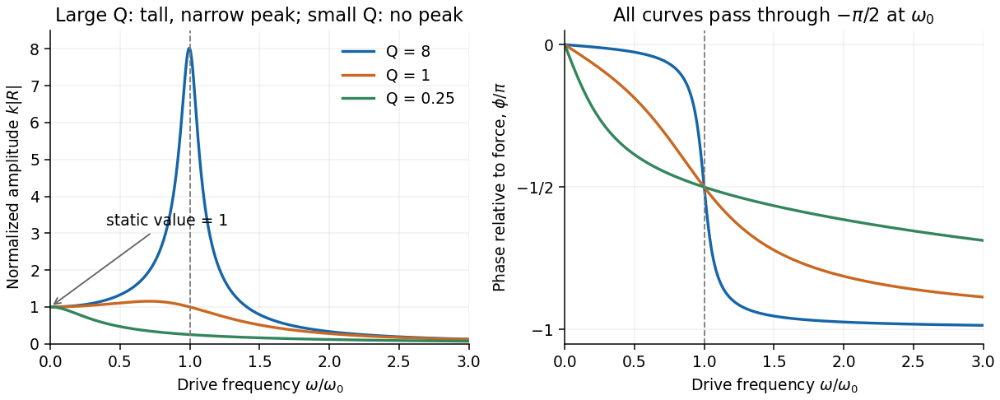

<h1 id="section-b/b6/b/solution">Solution</h1>

↑ **Parent:** [B](../b.md)

For the steady response of a [forced harmonic oscillator](../../../../../../forced-harmonic-oscillator.md), write $x=\operatorname{Re}(Ae^{i\omega t})$ and use the same [complex amplitude](../../../../../../complex-amplitude.md) convention for the driving [force](../../../../../../force-split.md). Substitution gives

$$
[-\omega^2+i\gamma\omega+\omega_0^2]A=F_0/m,\qquad
\boxed{A=R(\omega)F_0,\quad R(\omega)=\frac1{m(\omega_0^2-\omega^2+i\gamma\omega)}}.
$$

Thus the response magnitude and displacement [phase](../../../../../../phase-waves.md) relative to the [force](../../../../../../force-split.md) are

$$
|R|=\frac1{m\sqrt{(\omega_0^2-\omega^2)^2+\gamma^2\omega^2}},\qquad
\phi=-\operatorname{atan2}(\gamma\omega,\omega_0^2-\omega^2).
$$

The [phase](../../../../../../phase-waves.md) goes from $0$ at low [frequency](../../../../../../frequency.md), through $-\pi/2$ at $\omega_0$, towards $-\pi$ at high [frequency](../../../../../../frequency.md). The static magnitude is $1/(m\omega_0^2)=1/k$, while the high-frequency magnitude is approximately $1/(m\omega^2)$.

Define the [quality factor](../../../../../../q-factor.md) by $Q=\omega_0/\gamma$. If $Q>1/\sqrt2$, the displacement peak occurs at $\omega_r=\sqrt{\omega_0^2-\gamma^2/2}$; for $Q\leq1/\sqrt2$ the magnitude decreases monotonically from its static value. For $Q\gg1$ there is a tall narrow peak close to $\omega_0$, of height approximately $Q/k$ and width approximately $\gamma$. At very small $Q$ the resonant peak disappears and the response is broad. The plotted functions are normalized as $k|R|$, at fixed $m,k$.

**[Figure 2](#section-b/b6/b/image-normalized-amplitude-and-phase-of-a-driven-oscillator-at-three-quality-factors). Normalized amplitude and phase of a driven oscillator at three quality factors**.

## ↑ Ancestors (15)

1. [B](../b.md)
2. [B6](../../b6.md)
3. [Section B](../../../section-b.md)
4. [Paper 2](../../../../paper-2-split.md)
5. [2018](../../../../split.md)
6. [Past exam of the physics A course of the University of Cambridge](../../../../../split.md)
7. [Physics A course of the University of Cambridge](../../../../../../physics-a-course-of-the-university-of-cambridge.md)
8. [Physics course of the year 2 of the natural sciences course of the University of Cambridge](../../../../../../physics-course-of-the-year-2-of-the-natural-sciences-course-of-the-university-of-cambridge.md)
9. [Year 2 of the natural sciences course of the University of Cambridge](../../../../../../year-2-of-the-natural-sciences-course-of-the-university-of-cambridge.md)
10. [Year of the natural sciences course of the University of Cambridge](../../../../../../year-of-the-natural-sciences-course-of-the-university-of-cambridge.md)
11. [Natural sciences course of the University of Cambridge](../../../../../../natural-sciences-course-of-the-university-of-cambridge.md)
12. [Course of the University of Cambridge](../../../../../../course-of-the-university-of-cambridge.md)
13. [University of Cambridge](../../../../../../university-of-cambridge-split.md)
14. [List of universities](../../../../../../list-of-universities.md)
15. [Codex Wiki](../../../../../../split.md)
