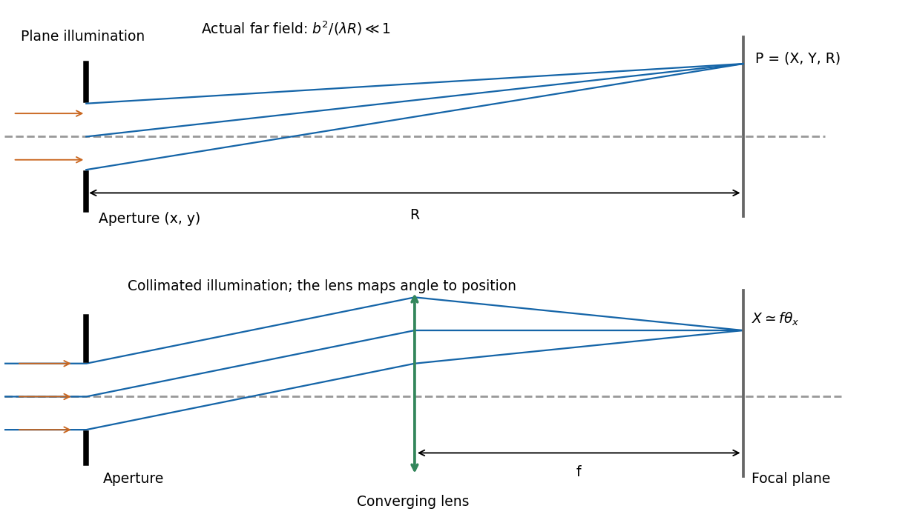

<h1 id="section-b/b7/a/solution">Solution</h1>

↑ **Parent:** [A](../a.md)

In [Fraunhofer diffraction](../../../../../../fraunhofer-diffraction.md), the relative propagation [phase](../../../../../../phase-waves.md) across the [aperture](../../../../../../aperture.md) is linear in [aperture](../../../../../../aperture.md) coordinates. If $b$ is its largest transverse size, the neglected quadratic path term must be small: for an observer at distance $R$,

$$
\boxed{\frac{b^2}{\lambda R}\ll1}.
$$

For a finite-distance point source a distance $s$ away, also require $b^2/(\lambda s)\ll1$ if the illumination is to be treated as a [plane wave](../../../../../../plane-wave.md). Numerical factors depend on whether $b$ is a radius or full width and on the permitted [phase](../../../../../../phase-waves.md) error; the condition expresses a small [Fresnel number](../../../../../../fresnel-number.md).

One can place both source and screen sufficiently far away, or collimate a point source with a [lens](../../../../../../lens-optics.md) and observe the [aperture](../../../../../../aperture.md) in the back focal plane of a second [lens](../../../../../../lens-optics.md). In the latter arrangement rays of each outgoing direction focus at one point, with $X\simeq f\theta_x$; the lens removes the need for a physically distant screen. A laser beam approximately uniform across the [aperture](../../../../../../aperture.md) can supply the incident [plane wave](../../../../../../plane-wave.md). The sketches distinguish an actual far field from its focal-plane equivalent.

**[Figure 3](#section-b/b7/a/image-far-field-diffraction-geometry-and-the-lens-arrangement-that-produces-the-same-angular-pattern). Far-field diffraction geometry and the lens arrangement that produces the same angular pattern**.

## ↑ Ancestors (15)

1. [A](../a.md)
2. [B7](../../b7.md)
3. [Section B](../../../section-b.md)
4. [Paper 2](../../../../paper-2-split.md)
5. [2018](../../../../split.md)
6. [Past exam of the physics A course of the University of Cambridge](../../../../../split.md)
7. [Physics A course of the University of Cambridge](../../../../../../physics-a-course-of-the-university-of-cambridge.md)
8. [Physics course of the year 2 of the natural sciences course of the University of Cambridge](../../../../../../physics-course-of-the-year-2-of-the-natural-sciences-course-of-the-university-of-cambridge.md)
9. [Year 2 of the natural sciences course of the University of Cambridge](../../../../../../year-2-of-the-natural-sciences-course-of-the-university-of-cambridge.md)
10. [Year of the natural sciences course of the University of Cambridge](../../../../../../year-of-the-natural-sciences-course-of-the-university-of-cambridge.md)
11. [Natural sciences course of the University of Cambridge](../../../../../../natural-sciences-course-of-the-university-of-cambridge.md)
12. [Course of the University of Cambridge](../../../../../../course-of-the-university-of-cambridge.md)
13. [University of Cambridge](../../../../../../university-of-cambridge-split.md)
14. [List of universities](../../../../../../list-of-universities.md)
15. [Codex Wiki](../../../../../../split.md)
