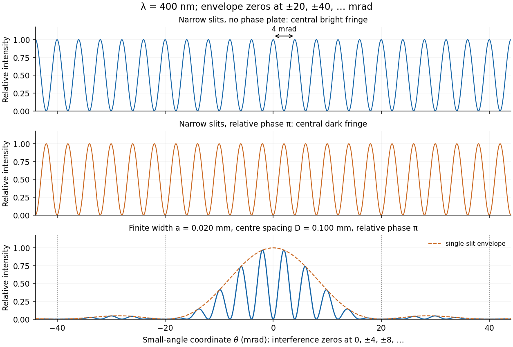

<h1 id="section-b/b7/e/solution">Solution</h1>

↑ **Parent:** [E](../e.md)

For a rectangular slit centred at $x_c$, the one-dimensional [Fraunhofer diffraction](../../../../../../fraunhofer-diffraction.md) integral is

$$
\int_{x_c-a/2}^{x_c+a/2}e^{-iqx}\,dx
=a\operatorname{sinc}(qa/2)e^{-iqx_c},\qquad \operatorname{sinc}z=\frac{\sin z}{z}.
$$

The two equal [apertures](../../../../../../aperture.md) have centres at $\pm D/2$; the glass subtracts their fields. Therefore

$$
\psi\propto a\operatorname{sinc}(qa/2)\left(e^{iqD/2}-e^{-iqD/2}\right),\qquad
\boxed{I\propto\sin^2(qD/2)\operatorname{sinc}^2(qa/2)}.
$$

This is [phase-reversed double-slit diffraction](../../../../../../phase-reversed-double-slit-diffraction.md): the narrow-slit [interference](../../../../../../interference-wave-propagation.md) factor is multiplied by the [single-slit diffraction](../../../../../../single-slit-diffraction.md) envelope. In the limit $a\to0$, the normalized envelope tends to one, recovering part (d).

The [interference](../../../../../../interference-wave-propagation.md) minima and envelope minima obey, respectively,

$$
\boxed{\sin\theta_m=m\lambda/D=0.004m},\quad m\in\mathbb Z;\qquad
\boxed{\sin\theta_n=n\lambda/a=0.020n},\quad n\in\mathbb Z\setminus\{0\}.
$$

Near the axis these are $\theta_m\simeq4m\,\mathrm{mrad}$ and envelope zeros $\theta_n\simeq20n\,\mathrm{mrad}$. Here $D/a=5$, so every envelope zero already coincides with an [interference](../../../../../../interference-wave-propagation.md) minimum. The envelope strongly reduces the outer fringes; its central value is nonzero, but the total intensity still vanishes at $\theta=0$ because the two fields cancel. The sketch uses the small-angle coordinate; the equations above specify the exact angular zeros.

**[Figure 4](#section-b/b7/e/image-unshifted-and-phase-reversed-narrow-slit-fringes-and-the-phase-reversed-finite-width-pattern-with-its-envelope). Unshifted and phase-reversed narrow-slit fringes, and the phase-reversed finite-width pattern with its envelope**.

## ↑ Ancestors (15)

1. [E](../e.md)
2. [B7](../../b7.md)
3. [Section B](../../../section-b.md)
4. [Paper 2](../../../../paper-2-split.md)
5. [2018](../../../../split.md)
6. [Past exam of the physics A course of the University of Cambridge](../../../../../split.md)
7. [Physics A course of the University of Cambridge](../../../../../../physics-a-course-of-the-university-of-cambridge.md)
8. [Physics course of the year 2 of the natural sciences course of the University of Cambridge](../../../../../../physics-course-of-the-year-2-of-the-natural-sciences-course-of-the-university-of-cambridge.md)
9. [Year 2 of the natural sciences course of the University of Cambridge](../../../../../../year-2-of-the-natural-sciences-course-of-the-university-of-cambridge.md)
10. [Year of the natural sciences course of the University of Cambridge](../../../../../../year-of-the-natural-sciences-course-of-the-university-of-cambridge.md)
11. [Natural sciences course of the University of Cambridge](../../../../../../natural-sciences-course-of-the-university-of-cambridge.md)
12. [Course of the University of Cambridge](../../../../../../course-of-the-university-of-cambridge.md)
13. [University of Cambridge](../../../../../../university-of-cambridge-split.md)
14. [List of universities](../../../../../../list-of-universities.md)
15. [Codex Wiki](../../../../../../split.md)
