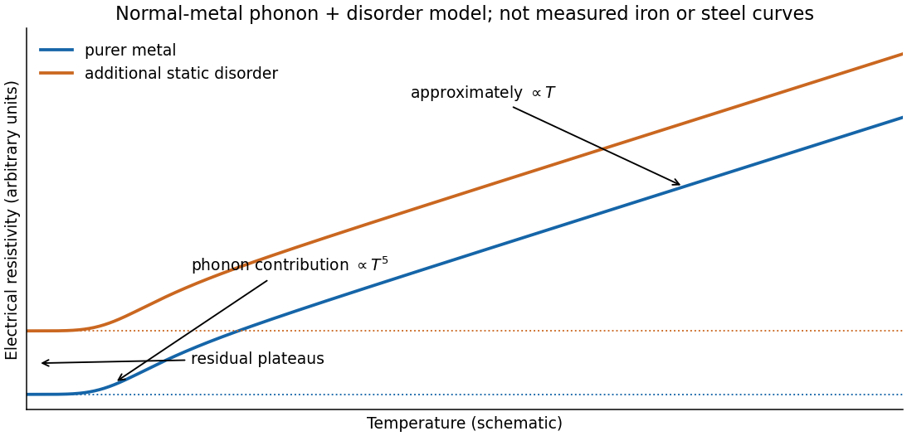

<h1 id="section-c/c11/d/solution">Solution</h1>

↑ **Parent:** [D](../d.md)

In a normal [metal](../../../../../../metal.md), the [electrical resistivity](../../../../../../electrical-resistivity.md) can often be approximated using [Matthiessen's rule](../../../../../../matthiessen-s-rule.md),

$$
\rho_{\rm el}(T)\simeq\rho_{\rm residual}+\rho_{\rm phonon}(T).
$$

Static impurities, defects and grain boundaries scatter conduction [electrons](../../../../../../electron.md) even as $T\to0$, giving the [residual resistivity](../../../../../../residual-resistivity.md). Thermal lattice [phonons](../../../../../../phonon.md) add a temperature-dependent contribution through [electron-phonon scattering](../../../../../../electron-phonon-scattering.md). In a clean three-dimensional acoustic model, [small-angle electron-phonon transport at low temperature](../../../../../../small-angle-electron-phonon-transport-at-low-temperature.md) gives $\rho_{\rm phonon}\propto T^5$ at low $T$; once thermal [phonon](../../../../../../phonon.md) populations are approximately classical, the resistivity is approximately linear in $T$. An electron-electron contribution proportional to $T^2$ can be relevant in some low-temperature ranges.

**[Figure 8](#section-c/c11/d/image-schematic-normal-metal-resistivity-with-residual-low-temperature-phonon-and-approximately-linear-high-temperature-regimes). Schematic normal-metal resistivity with residual, low-temperature phonon and approximately linear high-temperature regimes**.

[Carbon](../../../../../../carbon.md) in mild steel, together with associated disorder, strain and microstructural changes, adds scattering and generally raises the [residual resistivity](../../../../../../residual-resistivity.md) relative to purer [iron](../../../../../../iron.md). Thus a dilute alloy may have a similar broad phonon-dependent rise but a larger baseline. The sketch is a generic phonon-plus-disorder model, not measured [iron](../../../../../../iron.md) data. [Iron](../../../../../../iron.md)'s magnetic scattering and [phase](../../../../../../phase-waves.md) changes, and real steel's phases and processing history, can add structure; the simple sum is approximate rather than an exact material law. **The expected explanation is greater [electron](../../../../../../electron.md) scattering from the added [carbon](../../../../../../carbon.md) and resulting disorder.**

## ↑ Ancestors (15)

1. [D](../d.md)
2. [C11](../../c11.md)
3. [Section C](../../../section-c.md)
4. [Paper 2](../../../../paper-2-split.md)
5. [2018](../../../../split.md)
6. [Past exam of the physics A course of the University of Cambridge](../../../../../split.md)
7. [Physics A course of the University of Cambridge](../../../../../../physics-a-course-of-the-university-of-cambridge.md)
8. [Physics course of the year 2 of the natural sciences course of the University of Cambridge](../../../../../../physics-course-of-the-year-2-of-the-natural-sciences-course-of-the-university-of-cambridge.md)
9. [Year 2 of the natural sciences course of the University of Cambridge](../../../../../../year-2-of-the-natural-sciences-course-of-the-university-of-cambridge.md)
10. [Year of the natural sciences course of the University of Cambridge](../../../../../../year-of-the-natural-sciences-course-of-the-university-of-cambridge.md)
11. [Natural sciences course of the University of Cambridge](../../../../../../natural-sciences-course-of-the-university-of-cambridge.md)
12. [Course of the University of Cambridge](../../../../../../course-of-the-university-of-cambridge.md)
13. [University of Cambridge](../../../../../../university-of-cambridge-split.md)
14. [List of universities](../../../../../../list-of-universities.md)
15. [Codex Wiki](../../../../../../split.md)
