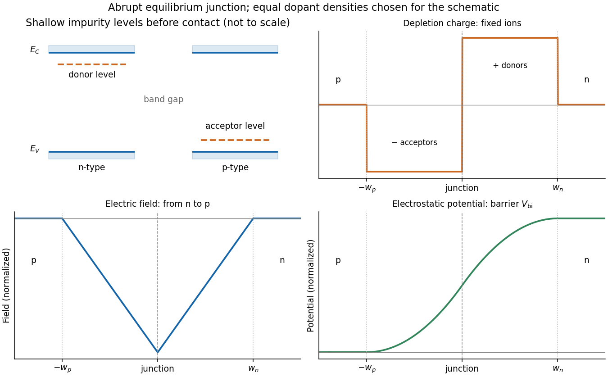

<h1 id="section-d/d12/solution">Solution</h1>

↑ **Parent:** [D12](../d12.md)

**Doping changes the mobile carrier population by introducing controlled impurity levels.** In an [intrinsic semiconductor](../../../../../intrinsic-semiconductor.md), the filled [valence band](../../../../../valence-band.md) is separated from the nearly empty [conduction band](../../../../../conduction-band.md) by a [band gap](../../../../../band-gap.md) $E_g$. Thermal excitation produces an electron-hole pair, so the [electron](../../../../../electron.md) and hole [number densities](../../../../../number-density.md) obey $n=p=n_i$. A [electron hole](../../../../../electron-hole.md) represents a missing valence-band [electron](../../../../../electron.md) and behaves as a mobile positive [charge carrier](../../../../../charge-carrier.md). For nondegenerate bands in thermal [equilibrium](../../../../../equilibrium-point-of-a-dynamical-system.md),

$$
n=N_Ce^{-(E_C-E_F)/(k_BT)},\qquad
p=N_Ve^{-(E_F-E_V)/(k_BT)},\qquad
np=N_CN_Ve^{-E_g/(k_BT)}=n_i^2.
$$

Here $N_C,N_V$ are the [effective density of states](../../../../../effective-density-of-states.md), $E_C,E_V$ the band edges, and $E_F$ denotes the [chemical potential](../../../../../chemical-potential-split.md), conventionally called the [Fermi level](../../../../../fermi-level.md). The [semiconductor mass-action law](../../../../../semiconductor-mass-action-law.md) holds in this nondegenerate equilibrium regime.

In a tetrahedrally bonded elemental [semiconductor](../../../../../semiconductor-split.md) such as [silicon](../../../../../silicon.md), a substitutional group-V atom has an extra outer [electron](../../../../../electron.md) relative to the host. It is a [donor impurity](../../../../../donor-impurity.md): a shallow level just below $E_C$ can ionise, releasing an [electron](../../../../../electron.md) to the [conduction band](../../../../../conduction-band.md) and leaving a fixed positively charged donor. The resulting [n-type semiconductor](../../../../../n-type-semiconductor.md) has [electrons](../../../../../electron.md) as majority carriers and holes as [minority carriers](../../../../../minority-carrier.md). Conversely a group-III substitution supplies one fewer bonding [electron](../../../../../electron.md). An [acceptor impurity](../../../../../acceptor-impurity.md) can take an [electron](../../../../../electron.md) from the [valence band](../../../../../valence-band.md), leaving a mobile [electron hole](../../../../../electron-hole.md) and a fixed negative acceptor; the resulting [p-type semiconductor](../../../../../p-type-semiconductor.md) has holes as majority carriers.

The impurity state is shallow because the [electron](../../../../../electron.md) or hole responds to a screened Coulomb potential and an [effective mass](../../../../../band-effective-mass.md), rather than the bare atomic potential. A simple hydrogenic donor estimate is

$$
E_C-E_D\simeq\frac{m^*}{m_e}\frac{13.6\,\mathrm{eV}}{\epsilon_r^2},
$$

where $\epsilon_r$ is the relative [permittivity](../../../../../permittivity-split.md). This is a useful scaling model, with real band anisotropy and central-cell effects omitted. Dopants are fixed in the lattice; their ionisation changes mobile carrier numbers without making a uniformly doped bulk sample carry a large net [electric charge](../../../../../electric-charge-split.md).

The [charge neutrality](../../../../../charge-neutrality.md) condition is

$$
n+N_A^-=p+N_D^+.
$$

When shallow dopants are almost fully ionised and $N_D-N_A\gg n_i$, an n-type region has $n\simeq N_D-N_A$ and $p\simeq n_i^2/n$. A p-type region similarly has $p\simeq N_A-N_D$ and $n\simeq n_i^2/p$. Thus compensation by the opposite impurity type reduces the majority-carrier density; the total dopant concentration is not generally the mobile [carrier density](../../../../../carrier-density.md). At sufficiently high impurity density the [degenerate semiconductor](../../../../../degenerate-semiconductor.md) regime requires the full [Fermi-Dirac distribution](../../../../../fermi-dirac-distribution.md) and these exponential approximations fail.

There are three useful [temperature](../../../../../temperature-split.md) regimes. At low [temperature](../../../../../temperature-split.md), [dopant freeze-out](../../../../../dopant-freeze-out.md) leaves many shallow levels un-ionised. In the extrinsic regime, the dopants are largely ionised and set the majority-carrier density. At high enough [temperature](../../../../../temperature-split.md), intrinsic pair creation dominates and $n,p$ approach $n_i$. The [Fermi level](../../../../../fermi-level.md) moves towards the [conduction band](../../../../../conduction-band.md) with donor doping and towards the [valence band](../../../../../valence-band.md) with acceptor doping. The [electrical conductivity](../../../../../electrical-conductivity.md) is

$$
\boxed{\sigma=e(n\mu_e+p\mu_h)}.
$$

Doping therefore controls conductivity and its carrier type, but ionised impurities also scatter carriers and can reduce [charge carrier mobility](../../../../../charge-carrier-mobility.md). [Carrier density](../../../../../carrier-density.md) and mobility must both be considered.

**A p-n junction forms when p-type and n-type regions are joined within a semiconductor.** Initially the concentration gradients drive [diffusion current](../../../../../diffusion-current.md): [electrons](../../../../../electron.md) diffuse from the n region to the p region and holes in the opposite direction. Recombination removes mobile majority carriers near the join, exposing fixed positive donors on the n side and fixed negative acceptors on the p side. This forms a [depletion region](../../../../../depletion-region.md) and an [electric field](../../../../../electric-field-split.md) directed from n to p. Its [drift current](../../../../../drift-current.md) opposes diffusion. At equilibrium the net current vanishes and the [Fermi level](../../../../../fermi-level.md) is uniform, although the band edges vary spatially through [band bending](../../../../../band-bending.md).

For an abrupt nondegenerate junction with fully ionised dopants, its [built-in potential](../../../../../built-in-potential.md) is

$$
\boxed{V_{\rm bi}=\frac{k_BT}{e}\ln\frac{N_AN_D}{n_i^2}}.
$$

Under the [depletion approximation](../../../../../depletion-approximation.md), the space-charge densities are $-eN_A$ on a p-side width $w_p$ and $+eN_D$ on an n-side width $w_n$. Integrating [Poisson equation](../../../../../poisson-s-equation.md) and imposing zero field outside gives $N_Aw_p=N_Dw_n$ and

$$
W=w_p+w_n=\sqrt{\frac{2\epsilon_sV_{\rm bi}}e\left(\frac1{N_A}+\frac1{N_D}\right)}.
$$

Most of the depletion width therefore extends into the more lightly doped side. The schematic shows the impurity levels before contact and the resulting space charge and potential after contact; there is no externally extractable equilibrium battery voltage from the built-in field alone.

**[Figure 9](#section-d/d12/image-shallow-donor-and-acceptor-levels-and-charge-field-and-potential-in-an-equilibrium-abrupt-p-n-junction). Shallow donor and acceptor levels, and charge, field and potential in an equilibrium abrupt p-n junction**.

A forward bias, with p positive relative to n, reduces the barrier from $V_{\rm bi}$ towards $V_{\rm bi}-V$ and injects [minority carriers](../../../../../minority-carrier.md) across the junction. In the ideal low-injection, diffusion-controlled regime this produces the [Shockley diode equation](../../../../../shockley-diode-equation.md), $I=I_s[e^{eV/(k_BT)}-1]$. Reverse bias increases the barrier and the [depletion region](../../../../../depletion-region.md); only a small thermally generated minority-carrier current flows before breakdown. Reverse-biased depletion regions also give a voltage-dependent [junction capacitance](../../../../../junction-capacitance.md). Real devices have recombination, leakage, series resistance and breakdown mechanisms beyond the ideal law. **Controlled doping creates majority and minority carriers, and their junction produces a depletion barrier that makes rectification possible.**

## ↑ Ancestors (14)

1. [D12](../d12.md)
2. [Section D](../../section-d.md)
3. [Paper 2](../../../paper-2-split.md)
4. [2018](../../../split.md)
5. [Past exam of the physics A course of the University of Cambridge](../../../../split.md)
6. [Physics A course of the University of Cambridge](../../../../../physics-a-course-of-the-university-of-cambridge.md)
7. [Physics course of the year 2 of the natural sciences course of the University of Cambridge](../../../../../physics-course-of-the-year-2-of-the-natural-sciences-course-of-the-university-of-cambridge.md)
8. [Year 2 of the natural sciences course of the University of Cambridge](../../../../../year-2-of-the-natural-sciences-course-of-the-university-of-cambridge.md)
9. [Year of the natural sciences course of the University of Cambridge](../../../../../year-of-the-natural-sciences-course-of-the-university-of-cambridge.md)
10. [Natural sciences course of the University of Cambridge](../../../../../natural-sciences-course-of-the-university-of-cambridge.md)
11. [Course of the University of Cambridge](../../../../../course-of-the-university-of-cambridge.md)
12. [University of Cambridge](../../../../../university-of-cambridge-split.md)
13. [List of universities](../../../../../list-of-universities.md)
14. [Codex Wiki](../../../../../split.md)
