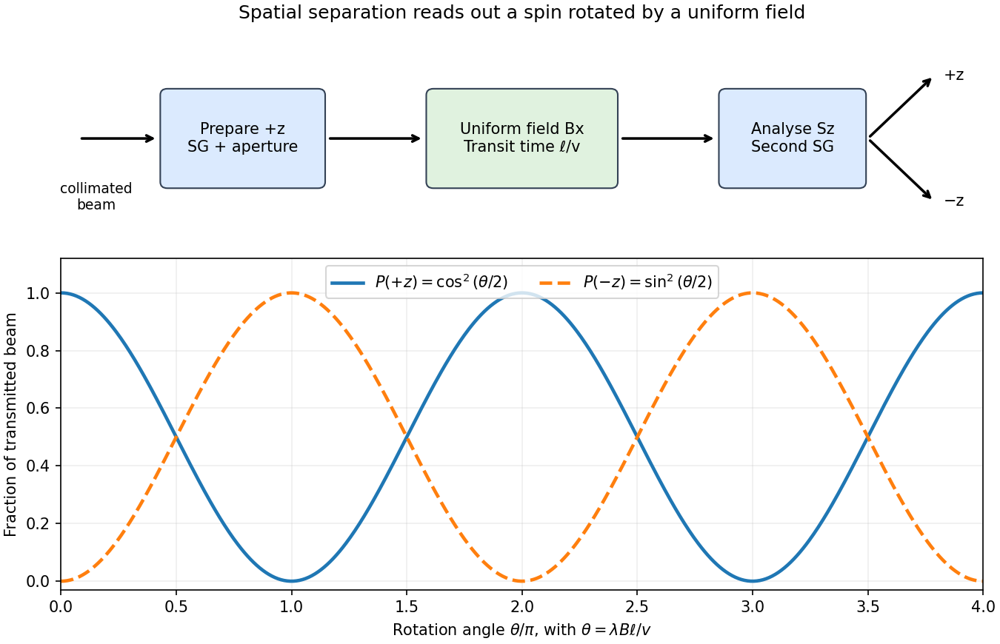
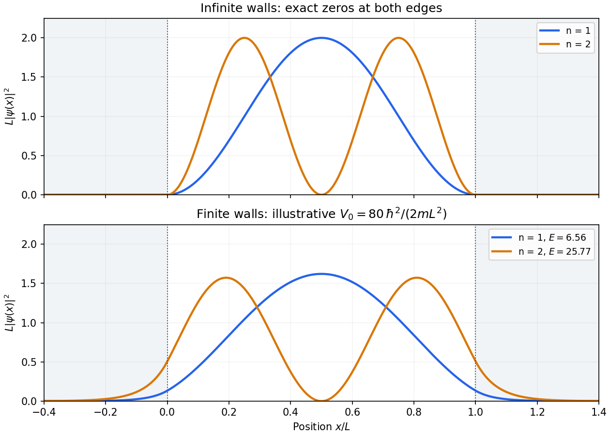
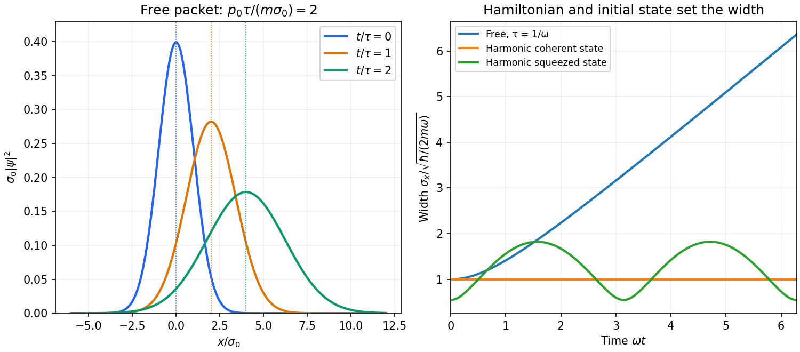
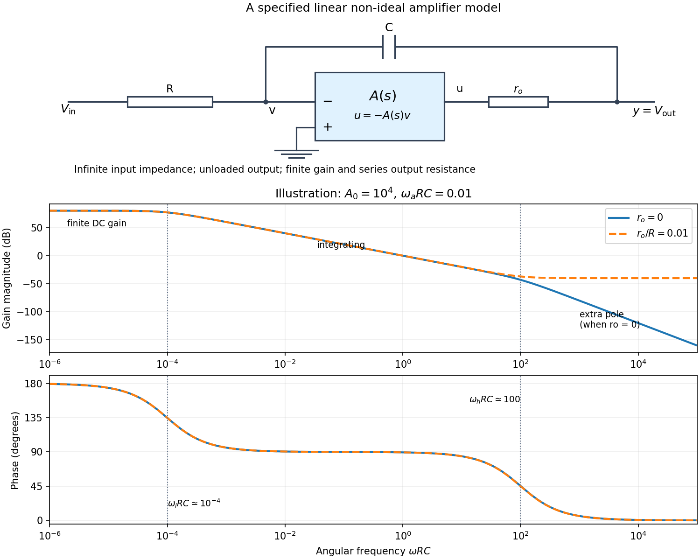

# Paper 1

↑ **Parent:** [2019](../2019.md)

[Original paper, released PDF pages 112–118](https://www.whatdotheyknow.com/request/natural_science_tripos_physics_e/response/2127325/attach/3/FOI%202022%20639%20Sullivan%20materials.pdf?cookie_passthrough=1#page=112)

**Table of contents**

- [Section A](#section-a)
  - [1](#section-a/1)
    - [Solution](#section-a/1/solution)
  - [2](#section-a/2)
    - [Solution](#section-a/2/solution)
  - [3](#section-a/3)
    - [Solution](#section-a/3/solution)
  - [4](#section-a/4)
    - [Solution](#section-a/4/solution)
  - [5](#section-a/5)
    - [Solution](#section-a/5/solution)
- [Section B](#section-b)
  - [B6](#section-b/b6)
    - [a](#section-b/b6/a)
      - [Solution](#section-b/b6/a/solution)
    - [b](#section-b/b6/b)
      - [Solution](#section-b/b6/b/solution)
    - [c](#section-b/b6/c)
      - [Solution](#section-b/b6/c/solution)
    - [d](#section-b/b6/d)
      - [Solution](#section-b/b6/d/solution)
  - [B7](#section-b/b7)
    - [a](#section-b/b7/a)
      - [Solution](#section-b/b7/a/solution)
    - [b](#section-b/b7/b)
      - [Solution](#section-b/b7/b/solution)
    - [c](#section-b/b7/c)
      - [Solution](#section-b/b7/c/solution)
    - [d](#section-b/b7/d)
      - [Solution](#section-b/b7/d/solution)
  - [B8](#section-b/b8)
    - [a](#section-b/b8/a)
      - [Solution](#section-b/b8/a/solution)
    - [b](#section-b/b8/b)
      - [Solution](#section-b/b8/b/solution)
    - [c](#section-b/b8/c)
      - [Solution](#section-b/b8/c/solution)
    - [d](#section-b/b8/d)
      - [Solution](#section-b/b8/d/solution)
  - [B9](#section-b/b9)
    - [a](#section-b/b9/a)
      - [Solution](#section-b/b9/a/solution)
    - [b](#section-b/b9/b)
      - [Solution](#section-b/b9/b/solution)
    - [c](#section-b/b9/c)
      - [Solution](#section-b/b9/c/solution)
    - [d](#section-b/b9/d)
      - [Solution](#section-b/b9/d/solution)
- [Section C](#section-c)
  - [C10](#section-c/c10)
    - [Solution](#section-c/c10/solution)
  - [C11](#section-c/c11)
    - [a](#section-c/c11/a)
      - [Solution](#section-c/c11/a/solution)
    - [b](#section-c/c11/b)
      - [Solution](#section-c/c11/b/solution)
    - [c](#section-c/c11/c)
      - [Solution](#section-c/c11/c/solution)
- [Section D](#section-d)
  - [D12](#section-d/d12)
    - [a](#section-d/d12/a)
      - [Solution](#section-d/d12/a/solution)
    - [b](#section-d/d12/b)
      - [Solution](#section-d/d12/b/solution)
    - [c](#section-d/d12/c)
      - [Solution](#section-d/d12/c/solution)
    - [d](#section-d/d12/d)
      - [Solution](#section-d/d12/d/solution)
    - [e](#section-d/d12/e)
      - [Solution](#section-d/d12/e/solution)
  - [D13](#section-d/d13)
    - [a](#section-d/d13/a)
      - [Solution](#section-d/d13/a/solution)
    - [b](#section-d/d13/b)
      - [Solution](#section-d/d13/b/solution)
    - [c](#section-d/d13/c)
      - [Solution](#section-d/d13/c/solution)

## Section A

↑ **Parent:** [Paper 1](paper-1.md)

<h3 id="section-a/1">1</h3>

↑ **Parent:** [Section A](#section-a)

<h4 id="section-a/1/solution">Solution</h4>

↑ **Parent:** [1](#section-a/1)

Write $L=10^{-9}\,\mathrm m$ and use the [Heisenberg uncertainty relation](../../quantum-theory.md#heisenberg-uncertainty-relation) separately in the three Cartesian directions. Since a [position](../../classical-mechanics.md#position) coordinate is confined to an interval of length $L$, [Popoviciu's inequality on variances](../../variance.md#popoviciu-s-inequality-on-variances) gives $\Delta x_i\leq L/2$. Consequently $\Delta p_i\geq\hbar/L$, and the [expectation value](../../quantum-system.md#expectation-value) of the [kinetic energy](../../energy.md#kinetic-energy) obeys

$$
\langle K\rangle=\sum_{i=1}^3\frac{(\Delta p_i)^2+\langle p_i\rangle^2}{2m_e}\geq\frac{3\hbar^2}{2m_eL^2}=1.83\times10^{-20}\,\mathrm J.
$$

Thus an uncertainty-based lower estimate is $\boxed{K\gtrsim0.11\,\mathrm{eV}}$. This [confinement energy bound from position support](../../quantum-theory.md#confinement-energy-bound-from-position-support) is not sharp: the exact [ground-state energy](../../quantum-mechanics.md#ground-state-energy) for a cubical [infinite square well](../../quantum-mechanics.md#infinite-square-well) is $3\pi^2\hbar^2/(2m_eL^2)=1.13\,\mathrm{eV}$. The [Heisenberg uncertainty principle](../../quantum-theory.md#heisenberg-uncertainty-relation) establishes the confinement scale $\hbar^2/(m_eL^2)$; identifying a box size with an approximate [position](../../classical-mechanics.md#position) [standard deviation](../../variance.md#standard-deviation) changes its numerical coefficient.

<h3 id="section-a/2">2</h3>

↑ **Parent:** [Section A](#section-a)

<h4 id="section-a/2/solution">Solution</h4>

↑ **Parent:** [2](#section-a/2)

The rotational [kinetic energy](../../energy.md#kinetic-energy) is $K=L^2/(2I)$. For a three-dimensional [linear rigid rotor](../../molecule.md#linear-rigid-rotor), [angular momentum operator](../../angular-momentum-operator.md) replaces the squared magnitude by $\hbar^2l(l+1)$, where $l=0,1,2,\ldots$. Hence

$$
E_l=\frac{\hbar^2}{2I}l(l+1),\qquad \frac{\hbar^2}{I}=1.1121\times10^{-21}\,\mathrm J=6.941\times10^{-3}\,\mathrm{eV}.
$$

The three lowest distinct [energy levels](../../quantum-mechanics.md#energy-level) are therefore

$$
\boxed{E_0=0,\qquad E_1=6.94\times10^{-3}\,\mathrm{eV},\qquad E_2=2.08\times10^{-2}\,\mathrm{eV}.}
$$

Their magnetic [quantum degeneracy](../../quantum-mechanics.md#degenerate-energy-levels) values are $1,3,5$. A single moment of inertia specifies this [rigid rotor](../../molecule.md#rigid-rotor) model; an arbitrary asymmetric body would require its other principal moments.

<h3 id="section-a/3">3</h3>

↑ **Parent:** [Section A](#section-a)

<h4 id="section-a/3/solution">Solution</h4>

↑ **Parent:** [3](#section-a/3)

Inside the barrier, the stationary [Schrödinger equation](../../mathematical-physics.md#schrodinger-equation) gives an exponentially decaying [wavefunction](../../wave-function.md) with inverse penetration length

$$
\kappa=\frac{\sqrt{2m_e(V_0-E)}}\hbar=7.245\times10^9\,\mathrm{m}^{-1}.
$$

The [amplitude](../../wave.md#wave-amplitude) falls approximately as $e^{-\kappa a}$, so the leading exponential estimate for the [transmission probability](../../quantum-scattering.md#transmission-probability) is

$$
\boxed{T\sim e^{-2\kappa a}=e^{-14.49}=5.09\times10^{-7}.}
$$

For comparison, [wavefunction matching at a finite potential step](../../mathematical-physics.md#wavefunction-matching-at-a-finite-potential-step) at both edges gives the [rectangular-barrier tunnelling probability](../../quantum-mechanics.md#rectangular-barrier-tunnelling-probability)

$$
T=\left[1+\frac{V_0^2\sinh^2(\kappa a)}{4E(V_0-E)}\right]^{-1}=1.30\times10^{-6}.
$$

The difference is the interface prefactor: for an opaque barrier it is $16E(V_0-E)/V_0^2=2.56$. Both give a transmission of order $10^{-6}$; the first is the requested exponential estimate.

<h3 id="section-a/4">4</h3>

↑ **Parent:** [Section A](#section-a)

<h4 id="section-a/4/solution">Solution</h4>

↑ **Parent:** [4](#section-a/4)

[Ohm's law](../../electric-charge.md#ohm-s-law) gives the mean [electric current](../../electric-charge.md#electric-current)

$$
\boxed{I=\frac VR=10^{-12}\,\mathrm A=1\,\mathrm{pA}.}
$$

For an estimate, assume the [shot noise counting model](../../electrical-engineering.md#shot-noise-counting-model): electron transfers are independent, so the number recorded in an interval $\tau=1\,\mathrm s$ has a [Poisson distribution](../../discrete-probability-distribution.md#poisson-distribution) with [expectation value](../../quantum-system.md#expectation-value) $\mu=I\tau/e=6.2415\times10^6$ and [variance](../../variance.md) $\mu$. One measurement has relative [standard deviation](../../variance.md#standard-deviation) $1/\sqrt\mu=4.00\times10^{-4}$. Averaging $M$ independent intervals reduces this to $1/\sqrt{M\mu}$, so

$$
M\geq\frac{1}{\mu(10^{-5})^2}=1602.18,\qquad \boxed{M=1603\text{ one-second measurements},}
$$

about $27$ minutes in total.

This is a one-[standard deviation](../../variance.md#standard-deviation), [shot noise](../../electrical-engineering.md#shot-noise) estimate. A resistance and mean [voltage](../../random-walk.md#voltage) alone do not specify the actual current fluctuations: a real [resistor](../../electric-charge.md#resistor) also has [Johnson-Nyquist noise](../../electrical-engineering.md#thermal-electrical-noise), and electron-transfer correlations can change the [shot noise](../../electrical-engineering.md#shot-noise). Its [temperature](../../temperature.md), measurement [bandwidth](../../electrical-engineering.md#bandwidth-signal-processing) and [noise](../../electrical-engineering.md#noise-signal-processing) model would be needed for an unconditional acquisition time.

<h3 id="section-a/5">5</h3>

↑ **Parent:** [Section A](#section-a)

<h4 id="section-a/5/solution">Solution</h4>

↑ **Parent:** [5](#section-a/5)

For independent small uncertainties interpreted as [standard deviations](../../variance.md#standard-deviation), [propagation of uncertainty](../../wave-equation.md#propagation-of-uncertainty) gives

$$
\sigma_N^2=(\sin\alpha)^2\sigma_n^2+(n\cos\alpha)^2\sigma_\alpha^2,\qquad \left(\frac{\sigma_N}{N}\right)^2=\left(\frac{\sigma_n}{n}\right)^2+\cot^2\alpha\,\sigma_\alpha^2.
$$

The angular uncertainty is in radians. Since $\sigma_n/n=0.075/1.35=1/18$, the allowed angular contribution to the fractional uncertainty of the [numerical aperture](../../point-spread-function.md#numerical-aperture) is only $\sqrt{0.06^2-(1/18)^2}$. Therefore

$$
\boxed{\sigma_\alpha\leq\tan60^\circ\sqrt{0.06^2-(1/18)^2}=0.0393\,\mathrm{rad}\simeq2.25^\circ.}
$$

The uncertainty in the [refractive index](../../electromagnetic-wave.md#refractive-index) already contributes $5.56\%$. If the quoted errors instead mean strict worst-case bounds, first-order absolute errors must be added rather than added in quadrature; that convention would require $|\delta\alpha|\lesssim\tan60^\circ(0.06-1/18)=0.441^\circ$. The $2.25^\circ$ result uses the usual independent statistical-error convention.

## Section B

↑ **Parent:** [Paper 1](paper-1.md)

<h3 id="section-b/b6">B6</h3>

↑ **Parent:** [Section B](#section-b)

<h4 id="section-b/b6/a">a</h4>

↑ **Parent:** [B6](#section-b/b6)

<h5 id="section-b/b6/a/solution">Solution</h5>

↑ **Parent:** [A](#section-b/b6/a)

Write $S_i=(\hbar/2)\sigma_i$, with $\sigma_i$ the [Pauli matrices](../../algebra.md#pauli-matrices). Direct multiplication gives $\sigma_x^2=\sigma_y^2=\sigma_z^2=I$, and hence

$$
\boxed{S_x^2+S_y^2+S_z^2=\frac34\hbar^2I.}
$$

For the products in the other order,

$$
\sigma_x\sigma_y=\begin{pmatrix}i&0\\0&-i\end{pmatrix}=i\sigma_z,\qquad \sigma_y\sigma_x=\begin{pmatrix}-i&0\\0&i\end{pmatrix}=-i\sigma_z.
$$

Their difference gives the [angular momentum commutation relations](../../angular-momentum-operator.md#angular-momentum-commutation-relations)

$$
\boxed{[S_x,S_y]=\frac{\hbar^2}{4}(2i\sigma_z)=i\hbar S_z.}
$$

The first identity corresponds to the [spin one-half](../../angular-momentum-operator.md#spin-one-half) value $s(s+1)\hbar^2$ with $s=1/2$.

<h4 id="section-b/b6/b">b</h4>

↑ **Parent:** [B6](#section-b/b6)

<h5 id="section-b/b6/b/solution">Solution</h5>

↑ **Parent:** [B](#section-b/b6/b)

In the $S_z$ [eigenbasis](../../linear-operator-theory.md#eigenbasis), let a candidate [eigenvector](../../linear-operator-theory.md#eigenvector) be $(a,b)^{\mathsf T}$. The [eigenvalue equation](../../linear-operator-theory.md#eigenvalue-equation) is $b=(2s_x/\hbar)a$ and $a=(2s_x/\hbar)b$, so a nonzero vector requires $(2s_x/\hbar)^2=1$. Choosing normalized phases gives

$$
\boxed{|+x\rangle=\frac{|+z\rangle+|-z\rangle}{\sqrt2}=\frac1{\sqrt2}\begin{pmatrix}1\\1\end{pmatrix},\quad s_x=\frac\hbar2,}
$$

$$
\boxed{|-x\rangle=\frac{|+z\rangle-|-z\rangle}{\sqrt2}=\frac1{\sqrt2}\begin{pmatrix}1\\-1\end{pmatrix},\quad s_x=-\frac\hbar2.}
$$

The two [spin eigenstates](../../angular-momentum-operator.md#spin-eigenstate) are [orthogonal](../../inner-product.md#orthogonal-vectors), as required for distinct [eigenvalues](../../linear-operator-theory.md#eigenvalue) of a [self-adjoint operator](../../linear-operator-theory.md#self-adjoint-operator).

<h4 id="section-b/b6/c">c</h4>

↑ **Parent:** [B6](#section-b/b6)

<h5 id="section-b/b6/c/solution">Solution</h5>

↑ **Parent:** [C](#section-b/b6/c)

Put $\Omega=\lambda B$, including its sign. The initial vector is the $+\hbar/2$ [eigenstate](../../energy-eigenvalue.md#eigenstate) of $S_z$; it is not an [energy eigenstate](../../energy-eigenvalue.md#energy-eigenstate) of $H=\Omega S_x$. In terms of the [spin eigenstates](../../angular-momentum-operator.md#spin-eigenstate) found above, $|+z\rangle=(|+x\rangle+|-x\rangle)/\sqrt2$. Each [energy eigenstate](../../energy-eigenvalue.md#energy-eigenstate) acquires its own [unitary time evolution](../../quantum-system.md#unitary-time-evolution) phase:

$$
|\psi(t)\rangle=\frac{e^{-i\Omega t/2}|+x\rangle+e^{i\Omega t/2}|-x\rangle}{\sqrt2}=\boxed{\begin{pmatrix}\cos(\Omega t/2)\\-i\sin(\Omega t/2)\end{pmatrix}.}
$$

Equivalently, $e^{-iHt/\hbar}=I\cos(\Omega t/2)-i\sigma_x\sin(\Omega t/2)$ follows from $\sigma_x^2=I$. The [Born rule](../../wave-function.md#born-rule) gives

$$
\boxed{P(S_z=+\hbar/2;t)=|\langle+z|\psi(t)\rangle|^2=\cos^2(\Omega t/2).}
$$

The [expectation value](../../quantum-system.md#expectation-value) of the [spin angular momentum](../../angular-momentum-operator.md#spin) is $(\hbar/2)(0,-\sin\Omega t,\cos\Omega t)$, a rotation around the $x$ axis. Its direction follows the specified sign of the [Hamiltonian](../../quantum-system.md#hamiltonian-quantum-mechanics); changing the magnetic coupling sign reverses the precession.

<h4 id="section-b/b6/d">d</h4>

↑ **Parent:** [B6](#section-b/b6)

<h5 id="section-b/b6/d/solution">Solution</h5>

↑ **Parent:** [D](#section-b/b6/d)

A [Stern-Gerlach experiment](../../angular-momentum-operator.md#stern-gerlach-experiment) uses an oven and slits to produce a collimated [atomic beam](../../physics.md#atomic-beam), conventionally of neutral [silver](../../chemical-substance.md#silver) atoms, and sends it through an inhomogeneous [magnetic field](../../magnetic-field.md) onto a position-sensitive detector. The unpaired outer electron supplies the effective [spin one-half](../../angular-momentum-operator.md#spin-one-half) [magnetic dipole moment](../../electromagnetism.md#magnetic-dipole-moment); neutral atoms avoid the ordinary Lorentz deflection of a charged beam. For an analysing direction $z$, the spatial gradient produces a force approximately $F_z=\mu_z\partial_zB_z$. The resulting separated beam positions measure the allowed projections of [angular momentum](../../momentum.md#angular-momentum). A [spin one-half](../../angular-momentum-operator.md#spin-one-half) beam gives two branches, rather than the continuous distribution expected from classical dipoles with arbitrary orientations. A uniform [magnetic field](../../magnetic-field.md) can rotate a [spin](../../angular-momentum-operator.md#spin) but does not itself provide this spatial separation.

To measure the rotation, first use a $z$-directed [Stern-Gerlach experiment](../../angular-momentum-operator.md#stern-gerlach-experiment) and an aperture to transmit only the $+z$ branch. Pass this prepared [spin eigenstate](../../angular-momentum-operator.md#spin-eigenstate) through a region of approximately uniform field in the $x$ direction, then use a second $z$ analyser to separate and count the two populations. For a field region of length $\ell$ and beam speed $v$, the precession angle is $\theta=\lambda B\ell/v$, and the predicted fractions are

$$
\boxed{P_+=\cos^2(\theta/2),\qquad P_-=\sin^2(\theta/2).}
$$

Varying $B$ or the transit time gives complementary oscillations, demonstrating coherent [Larmor precession](../../angular-momentum-operator.md#larmor-precession). Velocity selection and a sufficiently uniform rotation field keep different particles from accumulating different phases and washing out the contrast. Detection should compare the branch fractions after allowing for losses and analyser efficiency.

**[Figure 1](#section-b/b6/d/image-preparing-a-spin-rotating-it-in-a-transverse-field-and-analysing-its-final-projection). Preparing a spin, rotating it in a transverse field and analysing its final projection**.

<h3 id="section-b/b7">B7</h3>

↑ **Parent:** [Section B](#section-b)

<h4 id="section-b/b7/a">a</h4>

↑ **Parent:** [B7](#section-b/b7)

<h5 id="section-b/b7/a/solution">Solution</h5>

↑ **Parent:** [A](#section-b/b7/a)

Use the nonrelativistic [Coulomb potential energy](../../electrostatics.md#coulomb-potential-energy) $V=-Ze^2/(4\pi\epsilon_0r)$, with the nucleus treated as fixed. Since the [wavefunction](../../wave-function.md) has zero [orbital angular momentum](../../quantum-mechanics.md#orbital-angular-momentum), its [Laplacian](../../multivariable-calculus.md#laplacian) is

$$
\nabla^2\psi=\frac1{r^2}\frac{d}{dr}\left(r^2\frac{d\psi}{dr}\right)=\left(\beta^2-\frac{2\beta}{r}\right)\psi.
$$

Substituting into the time-independent [Schrödinger equation](../../mathematical-physics.md#schrodinger-equation) gives

$$
\frac{H\psi}{\psi}=-\frac{\hbar^2\beta^2}{2m_e}+\frac1r\left(\frac{\hbar^2\beta}{m_e}-\frac{Ze^2}{4\pi\epsilon_0}\right).
$$

For a constant [energy eigenvalue](../../energy-eigenvalue.md), the coefficient of $1/r$ must vanish. Therefore $\boxed{\beta=Z/a_0}$, where $a_0$ is the [Bohr radius](../../mathematical-physics.md#bohr-radius). [Wavefunction normalization](../../wave-function.md#wavefunction-normalization) then requires

$$
1=4\pi|\alpha|^2\int_0^\infty r^2e^{-2\beta r}\,dr=\frac{\pi|\alpha|^2}{\beta^3}.
$$

Choosing the irrelevant overall phase so that $\alpha$ is real and positive gives $\boxed{\alpha^2=\beta^3/\pi}$. The remaining constant term is the [hydrogen ground-state energy](../../mathematical-physics.md#hydrogen-ground-state-energy)

$$
\boxed{E=-\frac{\hbar^2\beta^2}{2m_e}=-\frac{m_eZ^2e^4}{2(4\pi\epsilon_0)^2\hbar^2}\simeq-13.6Z^2\,\mathrm{eV}.}
$$

Replacing $m_e$ by the electron-nucleus [reduced mass](../../classical-mechanics.md#reduced-mass) gives the usual finite-nuclear-mass refinement.

<h4 id="section-b/b7/b">b</h4>

↑ **Parent:** [B7](#section-b/b7)

<h5 id="section-b/b7/b/solution">Solution</h5>

↑ **Parent:** [B](#section-b/b7/b)

The normalized [radial probability density](../../wave-function.md#radial-probability-density) gives

$$
\left\langle\frac1r\right\rangle=4\beta^3\int_0^\infty re^{-2\beta r}\,dr=\beta.
$$

Consequently the [expectation value](../../quantum-system.md#expectation-value) of the [potential energy](../../energy.md#potential-energy) is

$$
\langle V\rangle=-\frac{Ze^2\beta}{4\pi\epsilon_0}=-\frac{\hbar^2\beta^2}{m_e}=\boxed{2E}.
$$

Here the last equality uses $Ze^2/(4\pi\epsilon_0)=\hbar^2\beta/m_e$. Since this is an [energy eigenstate](../../energy-eigenvalue.md#energy-eigenstate), $E=\langle T\rangle+\langle V\rangle$, and so $\boxed{\langle T\rangle=-E}$. The [kinetic energy](../../energy.md#kinetic-energy) is positive because $E<0$, in agreement with the [virial theorem](../../classical-mechanics.md#virial-theorem) for a [Coulomb potential](../../electrostatics.md#coulomb-potential-energy).

<h4 id="section-b/b7/c">c</h4>

↑ **Parent:** [B7](#section-b/b7)

<h5 id="section-b/b7/c/solution">Solution</h5>

↑ **Parent:** [C](#section-b/b7/c)

The [probability](../../probability-theory.md#probability) of finding the electron in a spherical shell is $P(r)\,dr=4\pi r^2|\psi(r)|^2dr$, so

$$
P(r)=4\beta^3r^2e^{-2\beta r}.
$$

This [radial probability density](../../wave-function.md#radial-probability-density), rather than the density per unit volume, determines the most probable radius. Its [expectation value](../../quantum-system.md#expectation-value) is

$$
\langle r\rangle=4\beta^3\int_0^\infty r^3e^{-2\beta r}\,dr=\boxed{\frac{3}{2\beta}=\frac{3a_0}{2Z}.}
$$

For its interior maximum, differentiate $\log P=\text{constant}+2\log r-2\beta r$. The stationary condition $2/r-2\beta=0$ gives

$$
\boxed{r_{\mathrm{mode}}=\frac1\beta=\frac{a_0}{Z}.}
$$

The density per unit volume $|\psi|^2$ is instead largest at the nucleus; including the spherical-shell volume factor is essential to the requested radial [mode](../../probability-and-statistics.md#mode-statistics).

<h4 id="section-b/b7/d">d</h4>

↑ **Parent:** [B7](#section-b/b7)

<h5 id="section-b/b7/d/solution">Solution</h5>

↑ **Parent:** [D](#section-b/b7/d)

The nuclear [beta decay](../../physics.md#beta-decay) is fast compared with the electronic orbital timescale. In the [sudden approximation](../../quantum-mechanics.md#sudden-approximation), the electronic [wavefunction](../../wave-function.md) does not have time to change during the increase from $Z_i=1$ to $Z_f=2$. The subsequent [probability](../../probability-theory.md#probability) of a particular daughter [energy eigenstate](../../energy-eigenvalue.md#energy-eigenstate) is therefore its squared overlap with the initial state.

For the final $1s$ state, write $\beta_i=1/a_0$ and $\beta_f=2/a_0$. The [sudden hydrogenic charge change](../../quantum-mechanics.md#sudden-hydrogenic-charge-change) gives the [amplitude](../../wave.md#wave-amplitude)

$$
A_{1s}=\int\psi_f^*\psi_i\,d^3r=4(\beta_i\beta_f)^{3/2}\int_0^\infty r^2e^{-(\beta_i+\beta_f)r}\,dr=\frac{8(\beta_i\beta_f)^{3/2}}{(\beta_i+\beta_f)^3}=\frac{16\sqrt2}{27}.
$$

Thus

$$
\boxed{P_{1s}=|A_{1s}|^2=\frac{512}{729}\simeq0.702.}
$$

The final $2p$ states have [spherical harmonics](../../analysis.md#spherical-harmonic) $Y_{1m}$, whereas the initial state is proportional to $Y_{00}$. Their angular overlap $\int Y_{1m}^*Y_{00}\,d\Omega$ vanishes by [orthogonality](../../inner-product.md#orthogonal-vectors). Accordingly $\boxed{P_{2p}=0}$ in the ideal spherically symmetric sudden-change model. Nuclear recoil or interactions with the emitted particles can produce small corrections. This is an overlap [selection rule](../../atomic-physics.md#selection-rule) for a sudden change, not a photon-induced [electric dipole transition](../../quantum-mechanics.md#electric-dipole-transition).

<h3 id="section-b/b8">B8</h3>

↑ **Parent:** [Section B](#section-b)

<h4 id="section-b/b8/a">a</h4>

↑ **Parent:** [B8](#section-b/b8)

<h5 id="section-b/b8/a/solution">Solution</h5>

↑ **Parent:** [A](#section-b/b8/a)

The infinite walls impose $\psi(0)=\psi(L)=0$, and the interior time-independent [Schrödinger equation](../../mathematical-physics.md#schrodinger-equation) is $\psi''+k^2\psi=0$ with $E=\hbar^2k^2/(2m)$. Its general solution is $A\sin kx+B\cos kx$. The first [boundary condition](../../differential-equation.md#boundary-condition) gives $B=0$, and the second gives $kL=n\pi$. A nonzero normalizable state needs $n=1,2,\ldots$; $n=0$ would give the zero function.

[Wavefunction normalization](../../wave-function.md#wavefunction-normalization), $\int_0^L\sin^2(n\pi x/L)\,dx=L/2$, gives the [infinite square well](../../quantum-mechanics.md#infinite-square-well) states and their [energy eigenvalues](../../energy-eigenvalue.md):

$$
\boxed{\psi_n(x)=\sqrt{\frac2L}\sin\frac{n\pi x}L\quad(0<x<L),\qquad E_n=\frac{n^2\pi^2\hbar^2}{2mL^2}.}
$$

The [wavefunctions](../../wave-function.md) vanish outside the well, and their full time dependence is $\psi_n(x)e^{-iE_nt/\hbar}$.

<h4 id="section-b/b8/b">b</h4>

↑ **Parent:** [B8](#section-b/b8)

<h5 id="section-b/b8/b/solution">Solution</h5>

↑ **Parent:** [B](#section-b/b8/b)

The first two [probability densities](../../wave-function.md#probability-density) are

$$
\boxed{\rho_1(x)=\frac2L\sin^2\frac{\pi x}L,\qquad \rho_2(x)=\frac2L\sin^2\frac{2\pi x}L.}
$$

Both vanish at the walls. The [ground state](../../quantum-mechanics.md#ground-state) has one maximum at $L/2$ and no interior node. The first excited state has a node at $L/2$ and equal maxima at $L/4$ and $3L/4$.

For a [finite square well](../../quantum-mechanics.md#finite-square-well) whose exterior potential is $V_0>E_n$, the exterior [wavefunction](../../wave-function.md) decays as $e^{-\kappa d}$, where $\kappa=\sqrt{2m(V_0-E_n)}/\hbar$ and $d$ is distance from the relevant edge. [Wavefunction matching at a finite potential step](../../mathematical-physics.md#wavefunction-matching-at-a-finite-potential-step) makes the [wavefunction](../../wave-function.md) and, for constant [mass](../../classical-mechanics.md#mass), its first derivative continuous. Thus the [probability density](../../wave-function.md#probability-density) is nonzero at the edges and has evanescent tails outside, the interior wavelength increases, and the [energy levels](../../quantum-mechanics.md#energy-level) are lower than for infinite walls at the same positions. Reflection symmetry still gives an even [ground state](../../quantum-mechanics.md#ground-state) and odd first excited state about the center, when both are bound. A shallow well may not support that excited bound state at all.

**[Figure 2](#section-b/b8/b/image-lowest-box-state-densities-and-their-evanescent-tails-for-one-finite-depth-example). Lowest box-state densities and their evanescent tails for one finite-depth example**.

<h4 id="section-b/b8/c">c</h4>

↑ **Parent:** [B8](#section-b/b8)

<h5 id="section-b/b8/c/solution">Solution</h5>

↑ **Parent:** [C](#section-b/b8/c)

Choose the two real [energy eigenstates](../../energy-eigenvalue.md#energy-eigenstate) in part (a) and take their coefficients to be in phase initially. A different initial relative phase only shifts the oscillation in time. The normalized [quantum superposition](../../quantum-system.md#quantum-superposition) is

$$
\Psi(x,t)=\frac{\psi_1(x)e^{-iE_1t/\hbar}+\psi_2(x)e^{-iE_2t/\hbar}}{\sqrt2}.
$$

[Orthogonality](../../inner-product.md#orthogonal-vectors) removes the cross terms in the [energy](../../energy.md) [expectation value](../../quantum-system.md#expectation-value), so

$$
\boxed{\langle E\rangle=\frac{E_1+E_2}{2}=\frac{5\pi^2\hbar^2}{4mL^2}.}
$$

For [position](../../classical-mechanics.md#position), the diagonal [matrix elements](../../vector-space.md#matrix-element) equal $L/2$ by reflection symmetry, but the off-diagonal element is nonzero. Using the product-to-sum identity and $\int_0^Lx\cos(j\pi x/L)\,dx=L^2[(-1)^j-1]/(j^2\pi^2)$ gives

$$
x_{12}=\frac2L\int_0^Lx\sin\frac{\pi x}L\sin\frac{2\pi x}L\,dx=-\frac{16L}{9\pi^2}.
$$

Therefore the [equal superposition of the first two box states](../../quantum-mechanics.md#equal-superposition-of-the-first-two-box-states) has

$$
\boxed{\langle x\rangle=\frac L2-\frac{16L}{9\pi^2}\cos\Omega t,\quad \Omega=\frac{E_2-E_1}{\hbar}=\frac{3\pi^2\hbar}{2mL^2}.}
$$

The [amplitude](../../wave.md#wave-amplitude) is $\boxed{16L/(9\pi^2)\simeq0.1801L}$, and the ordinary [frequency](../../wave.md#frequency) is $\boxed{f=\Omega/(2\pi)=3h/(8mL^2)}$. The motion of the mean [position](../../classical-mechanics.md#position) is an interference effect between distinct energies, while their populations, and hence the mean [energy](../../energy.md), remain fixed.

<h4 id="section-b/b8/d">d</h4>

↑ **Parent:** [B8](#section-b/b8)

<h5 id="section-b/b8/d/solution">Solution</h5>

↑ **Parent:** [D](#section-b/b8/d)

The [boundary force in an infinite square well](../../quantum-mechanics.md#boundary-force-in-an-infinite-square-well) is obtained from the kinetic [momentum](../../momentum.md) flux at each wall. With $C_1=\hbar^2\pi^2/(2mL^3)=E_1/L$, the derivatives of the state in part (c) are

$$
\Psi'(0,t)=\frac{\pi}{L^{3/2}}(e^{-iE_1t/\hbar}+2e^{-iE_2t/\hbar}),\quad \Psi'(L,t)=\frac{\pi}{L^{3/2}}(-e^{-iE_1t/\hbar}+2e^{-iE_2t/\hbar}).
$$

The outward force magnitudes are $P_j=(\hbar^2/2m)|\Psi'(x_j,t)|^2$. Taking positive force to mean rightwards, the forces exerted by the particle on the walls are

$$
\boxed{F_{\mathrm{left}}=-C_1(5+4\cos\Omega t),\qquad F_{\mathrm{right}}=C_1(5-4\cos\Omega t).}
$$

Both point outwards at all times, but their magnitudes oscillate out of phase. This force formula follows directly by differentiating the mean particle [momentum](../../momentum.md) and integrating the interior [Schrödinger equation](../../mathematical-physics.md#schrodinger-equation) by parts: $d\langle p\rangle/dt=(\hbar^2/2m)(|\Psi'(0)|^2-|\Psi'(L)|^2)$. As a check, the net force on the particle is $8C_1\cos\Omega t=m\,d^2\langle x\rangle/dt^2$, the opposite of the net force on the two walls.

A classical particle of [energy](../../energy.md) $E=\langle E\rangle$ transfers [momentum](../../momentum.md) $2mv$ in each collision with a particular wall, and returns to that wall after $2L/v$. Its mean outward force on that wall is

$$
\boxed{\overline P_{\mathrm{classical}}=\frac{2mv}{2L/v}=\frac{2E}{L}=5C_1=\overline P_{\mathrm{quantum}}.}
$$

Thus the time averages agree separately at each wall, although the classical force consists of collision impulses and the quantum expectation varies continuously. Constant mean [energy](../../energy.md) alone does not make the instantaneous quantum wall forces constant; their unequal instantaneous values supply the oscillation of $\langle x\rangle$.

<h3 id="section-b/b9">B9</h3>

↑ **Parent:** [Section B](#section-b)

<h4 id="section-b/b9/a">a</h4>

↑ **Parent:** [B9](#section-b/b9)

<h5 id="section-b/b9/a/solution">Solution</h5>

↑ **Parent:** [A](#section-b/b9/a)

Let $c=\sqrt{m\omega/(2\hbar)}$ and $d=1/\sqrt{2m\hbar\omega}$, so $a=cx+idp$ and $a^\dagger=cx-idp$. The [canonical commutation relation](../../quantum-mechanics.md#canonical-commutation-relation) $[x,p]=i\hbar$ gives

$$
a^\dagger a=c^2x^2+d^2p^2+icd[x,p]=\frac{m\omega x^2}{2\hbar}+\frac{p^2}{2m\hbar\omega}-\frac12.
$$

Hence $\boxed{H=\hbar\omega(a^\dagger a+1/2)}$. Similarly,

$$
[a,a^\dagger]=-2icd[x,p]=\boxed{1}.
$$

Using the product rule for a [commutator](../../lie-algebra.md#commutator), $[AB,C]=A[B,C]+[A,C]B$, gives

$$
\boxed{[H,a]=-\hbar\omega a,\qquad [H,a^\dagger]=\hbar\omega a^\dagger.}
$$

Thus $a^\dagger a$ is the [number operator](../../quantum-harmonic-oscillator.md#number-operator), while $a$ and $a^\dagger$ are the [annihilation operator](../../quantum-harmonic-oscillator.md#annihilation-operator) and [creation operator](../../quantum-harmonic-oscillator.md#creation-operator).

<h4 id="section-b/b9/b">b</h4>

↑ **Parent:** [B9](#section-b/b9)

<h5 id="section-b/b9/b/solution">Solution</h5>

↑ **Parent:** [B](#section-b/b9/b)

The [commutators](../../lie-algebra.md#commutator) imply

$$
H(a|n\rangle)=(E_n-\hbar\omega)a|n\rangle,\qquad H(a^\dagger|n\rangle)=(E_n+\hbar\omega)a^\dagger|n\rangle.
$$

Thus any nonzero resulting vector is the adjacent [energy eigenstate](../../energy-eigenvalue.md#energy-eigenstate). Since $a^\dagger a|n\rangle=n|n\rangle$ and $aa^\dagger=a^\dagger a+1$, their squared norms are

$$
\|a|n\rangle\|^2=n,\qquad \|a^\dagger|n\rangle\|^2=n+1.
$$

Choosing consistent phases for the [eigenstates](../../energy-eigenvalue.md#eigenstate) yields

$$
\boxed{a|n\rangle=\sqrt n\,|n-1\rangle\quad(n\geq1),\qquad a^\dagger|n\rangle=\sqrt{n+1}\,|n+1\rangle,\qquad a|0\rangle=0.}
$$

The vanishing last expression terminates the lowering sequence at the [ground state](../../quantum-mechanics.md#ground-state), rather than introducing a negative-energy oscillator state.

<h4 id="section-b/b9/c">c</h4>

↑ **Parent:** [B9](#section-b/b9)

<h5 id="section-b/b9/c/solution">Solution</h5>

↑ **Parent:** [C](#section-b/b9/c)

In the [position](../../classical-mechanics.md#position) representation $p=-i\hbar\,d/dx$, so $a\psi_0=0$ becomes

$$
\left(\frac{d}{dx}+\frac{m\omega}{\hbar}x\right)\psi_0=0.
$$

Integrating and using the [Gaussian integral](../../integral.md#gaussian-integral) for [wavefunction normalization](../../wave-function.md#wavefunction-normalization) gives

$$
\boxed{\psi_0(x)=\left(\frac{m\omega}{\pi\hbar}\right)^{1/4}\exp\left(-\frac{m\omega x^2}{2\hbar}\right).}
$$

The [creation operator](../../quantum-harmonic-oscillator.md#creation-operator) gives $|1\rangle=a^\dagger|0\rangle$, and therefore

$$
\boxed{\psi_1(x)=\sqrt{\frac{2m\omega}{\hbar}}\,x\psi_0(x).}
$$

Its [norm](../../normed-vector-space.md#norm) is one since $\int x^2|\psi_0|^2dx=\hbar/(2m\omega)$. Moreover $\psi_0$ is even and $\psi_1$ is odd, so the overlap integrand $\psi_0^*\psi_1$ is odd and integrable. Integration over the whole real line gives $\boxed{\langle0|1\rangle=0}$, establishing [orthogonality](../../inner-product.md#orthogonal-vectors).

<h4 id="section-b/b9/d">d</h4>

↑ **Parent:** [B9](#section-b/b9)

<h5 id="section-b/b9/d/solution">Solution</h5>

↑ **Parent:** [D](#section-b/b9/d)

Inverting the definitions of the [creation operator](../../quantum-harmonic-oscillator.md#creation-operator) and [annihilation operator](../../quantum-harmonic-oscillator.md#annihilation-operator) gives $x=\sqrt{\hbar/(2m\omega)}(a+a^\dagger)$. Their actions and the [orthogonality](../../inner-product.md#orthogonal-vectors) of the oscillator [energy eigenstates](../../energy-eigenvalue.md#energy-eigenstate) give

$$
\langle n_2|x|n_1\rangle=\sqrt{\frac{\hbar}{2m\omega}}\left[\sqrt{n_1}\,\delta_{n_2,n_1-1}+\sqrt{n_1+1}\,\delta_{n_2,n_1+1}\right].
$$

Thus the [electric dipole transition](../../quantum-mechanics.md#electric-dipole-transition) [selection rule](../../atomic-physics.md#selection-rule) is

$$
\boxed{n_2=n_1\pm1,}
$$

with the lower alternative absent for $n_1=0$. The field exchanges one oscillator quantum in first-order dipole coupling. For a long weak monochromatic drive, its [frequency](../../wave.md#frequency) must also be resonant with the level separation, here $\omega$, to give a substantial transition [probability](../../probability-theory.md#probability). Higher-order multiphoton processes are beyond the stated single-position-[matrix element](../../vector-space.md#matrix-element) approximation.

## Section C

↑ **Parent:** [Paper 1](paper-1.md)

<h3 id="section-c/c10">C10</h3>

↑ **Parent:** [Section C](#section-c)

<h4 id="section-c/c10/solution">Solution</h4>

↑ **Parent:** [C10](#section-c/c10)

A localized quantum particle is described by a [wave packet](../../dispersion-relation.md#wave-packet): a coherent [quantum superposition](../../quantum-system.md#quantum-superposition) of [momentum](../../momentum.md) components, rather than a single delocalized [plane wave](../../wave-function.md#plane-wave). The [Born rule](../../wave-function.md#born-rule) assigns the [position](../../classical-mechanics.md#position) [probability density](../../wave-function.md#probability-density) $|\psi(x,t)|^2$. A useful normalized initial [Gaussian wave packet](../../wave-function.md#gaussian-wave-packet) is

$$
\psi(x,0)=(2\pi\sigma_0^2)^{-1/4}\exp\left[-\frac{(x-x_0)^2}{4\sigma_0^2}+\frac{ip_0(x-x_0)}\hbar\right].
$$

Its mean [position](../../classical-mechanics.md#position) and [momentum](../../momentum.md) are $x_0$ and $p_0$, and its [standard deviations](../../variance.md#standard-deviation) satisfy $\sigma_x(0)=\sigma_0$, $\sigma_p=\hbar/(2\sigma_0)$. This unchirped initial state saturates the [Heisenberg uncertainty relation](../../quantum-theory.md#heisenberg-uncertainty-relation).

For a [free particle](../../quantum-mechanics.md#free-particle), the momentum-space [Schrödinger equation](../../mathematical-physics.md#schrodinger-equation) multiplies each [amplitude](../../wave.md#wave-amplitude) by $e^{-ip^2t/(2m\hbar)}$. The inverse [Fourier transform](../../fourier-transform.md) is a [Gaussian integral](../../integral.md#gaussian-integral), giving the [free Gaussian wave packet evolution](../../wave-function.md#free-gaussian-wave-packet-evolution)

$$
\psi(x,t)=\frac{(2\pi\sigma_0^2)^{-1/4}}{\sqrt{1+i\eta}}\exp\left[-\frac{(x-x_0-p_0t/m)^2}{4\sigma_0^2(1+i\eta)}+\frac{ip_0(x-x_0)}\hbar-\frac{ip_0^2t}{2m\hbar}\right],\qquad \eta=\frac{\hbar t}{2m\sigma_0^2}.
$$

One way to obtain this expression explicitly is to write the initial [momentum](../../momentum.md) [amplitude](../../wave.md#wave-amplitude) as proportional to $\exp[-\sigma_0^2(p-p_0)^2/\hbar^2-ipx_0/\hbar]$, multiply by the free evolution phase and complete the square in $p$. Taking the modulus squared removes the position-dependent phase and leaves

$$
\boxed{|\psi(x,t)|^2=\frac{1}{\sqrt{2\pi}\sigma_x(t)}\exp\left[-\frac{(x-x_c(t))^2}{2\sigma_x(t)^2}\right],\quad x_c(t)=x_0+\frac{p_0t}{m},\quad \sigma_x(t)=\sigma_0\sqrt{1+\left(\frac{t}{\tau}\right)^2},\quad \tau=\frac{2m\sigma_0^2}{\hbar}.}
$$

The [expectation value](../../quantum-system.md#expectation-value) follows uniform classical motion while the density spreads. A narrower initial packet needs a wider [momentum](../../momentum.md) distribution and therefore spreads more rapidly. At long times its width grows linearly with $|t|$; its [variance](../../variance.md) grows quadratically, unlike the linear [variance](../../variance.md) growth of ordinary [diffusion](../../thermodynamics.md#diffusion). The [probability continuity equation](../../wave-function.md#probability-continuity-equation) preserves total [probability](../../probability-theory.md#probability) despite the decreasing peak height. The mean [momentum](../../momentum.md) and the mean [energy](../../energy.md) $(p_0^2+\sigma_p^2)/(2m)$ remain constant, since the [momentum](../../momentum.md) populations do not change.

The same result has a wave interpretation. For a free nonrelativistic particle $\omega(k)=\hbar k^2/(2m)$, so the [group velocity](../../dispersion-relation.md#group-velocity) is $d\omega/dk=\hbar k/m$, equal to $p_0/m$ at the packet center. The curvature $d^2\omega/dk^2=\hbar/m$ makes different [momentum](../../momentum.md) components travel with different [group velocities](../../dispersion-relation.md#group-velocity), producing dispersion. The [phase velocity](../../dispersion-relation.md#phase-velocity) is $\omega/k=\hbar k/(2m)$ for this [energy](../../energy.md) convention and does not describe the motion of the envelope. The evolving quadratic spatial phase is essential to the spreading; a density snapshot alone does not specify the full [quantum state](../../quantum-system.md#quantum-state).

A freely spreading [Gaussian wave packet](../../wave-function.md#gaussian-wave-packet) remains a pure Gaussian state but develops position-momentum correlations. Its symmetrized [covariance](../../variance.md#covariance) is $C_{xp}=\langle\{x-\langle x\rangle,p-\langle p\rangle\}\rangle/2=t\sigma_p^2/m$. Consequently

$$
\sigma_x\sigma_p=\frac\hbar2\sqrt{1+\eta^2},\qquad \boxed{\sigma_x^2\sigma_p^2-C_{xp}^2=\frac{\hbar^2}{4}.}
$$

Equality in the [Robertson-Schrödinger uncertainty relation](../../quantum-theory.md#robertson-schrodinger-uncertainty-relation) survives at every time, whereas the simpler product $\sigma_x\sigma_p$ equals $\hbar/2$ only initially. A [chirped Gaussian wave packet](../../quantum-theory.md#chirped-gaussian-wave-packet) can already have $C_{xp}(0)\ne0$. More generally, $x(t)=x(0)+p(0)t/m$ gives $\sigma_x(t)^2=\sigma_x(0)^2+2tC_{xp}(0)/m+t^2\sigma_p(0)^2/m^2$. A sufficiently negative initial [covariance](../../variance.md#covariance) permits initial contraction before subsequent spreading.

**[Figure 3](#section-c/c10/image-free-gaussian-spreading-constant-coherent-state-width-and-the-breathing-width-of-a-squeezed-state). Free Gaussian spreading, constant coherent-state width and the breathing width of a squeezed state**.

A [potential energy](../../energy.md#potential-energy) changes this behavior. A quadratic potential preserves the Gaussian form because the evolution of [position](../../classical-mechanics.md#position) and [momentum](../../momentum.md) is linear. For a [quantum harmonic oscillator](../../quantum-harmonic-oscillator.md), the [Gaussian covariance in a harmonic potential](../../wave-function.md#gaussian-covariance-in-a-harmonic-potential) is

$$
\sigma_x(t)^2=\sigma_x(0)^2\cos^2\omega t+\frac{\sigma_p(0)^2}{m^2\omega^2}\sin^2\omega t+\frac{2C_{xp}(0)}{m\omega}\sin\omega t\cos\omega t.
$$

A [coherent state](../../quantum-theory.md#coherent-state) has $\sigma_x^2=\hbar/(2m\omega)$, $\sigma_p^2=m\hbar\omega/2$ and zero centered [covariance](../../variance.md#covariance). Its width is constant, and its center follows $x_c(t)=x_0\cos\omega t+p_0\sin\omega t/(m\omega)$. In oscillator notation its [coherent state](../../quantum-theory.md#coherent-state) label rotates as $\alpha(t)=\alpha(0)e^{-i\omega t}$, apart from the common ground-energy phase of the [state vector](../../dynamical-systems.md#state-vector). A [squeezed coherent state](../../quantum-harmonic-oscillator.md#squeezed-coherent-state) generally has a width that breathes at $2\omega$. Thus being Gaussian does not imply either free spreading or constant width; the [Hamiltonian operator](../../quantum-system.md#hamiltonian-quantum-mechanics) and initial [covariance](../../variance.md#covariance) determine the result.

For a general nonquadratic potential, different parts of the packet experience different nonlinear forces, and an initially Gaussian profile need not remain Gaussian. [Ehrenfest theorem](../../quantum-mechanics.md#ehrenfest-theorem) gives the exact relations $d\langle x\rangle/dt=\langle p\rangle/m$ and $d\langle p\rangle/dt=-\langle V'(x)\rangle$. Replacing the last mean by $-V'(\langle x\rangle)$ is exact for a quadratic potential and approximate for a packet narrow compared with the scale on which the force varies. This connects packet motion to the [correspondence principle](../../quantum-mechanics.md#correspondence-principle) without treating a [quantum state](../../quantum-system.md#quantum-state) as a definite classical path. Scattering can split a packet into reflected and transmitted components, while confinement can produce oscillations and interference between discrete [energy eigenstates](../../energy-eigenvalue.md#energy-eigenstate). Their relative phases evolve even when their populations remain constant. Localization, spreading and coherent motion all follow from the same linear [unitary time evolution](../../quantum-system.md#unitary-time-evolution).

<h3 id="section-c/c11">C11</h3>

↑ **Parent:** [Section C](#section-c)

<h4 id="section-c/c11/a">a</h4>

↑ **Parent:** [C11](#section-c/c11)

<h5 id="section-c/c11/a/solution">Solution</h5>

↑ **Parent:** [A](#section-c/c11/a)

The [orbital angular momentum](../../quantum-mechanics.md#orbital-angular-momentum) of a particle is the operator $\mathbf L=\mathbf r\times\mathbf p$, with $\mathbf p=-i\hbar\nabla$ in the [position](../../classical-mechanics.md#position) representation. Its [angular momentum commutation relations](../../angular-momentum-operator.md#angular-momentum-commutation-relations) are

$$
[L_i,L_j]=i\hbar\epsilon_{ijk}L_k,\qquad [L^2,L_i]=0.
$$

Thus one may specify $L^2$ and one component, conventionally $L_z$, simultaneously. One generally cannot assign sharp values to all three components, because they do not commute. The common angular [eigenfunctions](../../linear-operator-theory.md#eigenfunction) are the [spherical harmonics](../../analysis.md#spherical-harmonic):

$$
\boxed{L^2Y_l^m=\hbar^2l(l+1)Y_l^m,\qquad L_zY_l^m=\hbar mY_l^m,\qquad l=0,1,2,\ldots,\quad m=-l,\ldots,l.}
$$

For a scalar orbital [wavefunction](../../wave-function.md), single-valuedness in the azimuthal angle gives integer $m$, and regularity on the sphere and termination of the ladder give integer $l\geq|m|$. Half-integer angular momenta describe intrinsic [spin](../../angular-momentum-operator.md#spin) rather than scalar orbital motion.

The [ladder operators](../../semisimple-lie-algebra.md#ladder-operator) $L_\pm=L_x\pm iL_y$ obey $[L_z,L_\pm]=\pm\hbar L_\pm$. Their normalized action is

$$
L_\pm|l,m\rangle=\hbar\sqrt{l(l+1)-m(m\pm1)}\,|l,m\pm1\rangle.
$$

The coefficient vanishes at the top or bottom of the multiplet. Its squared magnitude follows from $L_\mp L_\pm=L^2-L_z^2\mp\hbar L_z$, and positivity of the resulting [norm](../../normed-vector-space.md#norm) constrains the allowed $m$ values.

For a [central potential](../../energy.md#central-potential), the [Hamiltonian](../../quantum-system.md#hamiltonian-quantum-mechanics) commutes with $L^2$ and every component of $\mathbf L$. Stationary states can be separated as $R_{nl}(r)Y_l^m(\theta,\phi)$, and rotational symmetry makes the [energy](../../energy.md) independent of $m$, giving a $2l+1$ [quantum degeneracy](../../quantum-mechanics.md#degenerate-energy-levels) at fixed radial label and $l$. Additional degeneracy between distinct $l$ values requires additional structure, as in the [Coulomb potential](../../electrostatics.md#coulomb-potential-energy). The [parity](../../quantum-mechanics.md#parity) of $Y_l^m$ is $(-1)^l$. These results organize atomic orbitals and their [selection rules](../../atomic-physics.md#selection-rule). They describe quantized rotation and symmetry, without assigning the electron a classical orbit or a simultaneously definite three-component [angular momentum](../../momentum.md#angular-momentum) vector.

<h4 id="section-c/c11/b">b</h4>

↑ **Parent:** [C11](#section-c/c11)

<h5 id="section-c/c11/b/solution">Solution</h5>

↑ **Parent:** [B](#section-c/c11/b)

In the [Schrödinger picture](../../quantum-system.md#schrodinger-picture), a time-independent [Hamiltonian](../../quantum-system.md#hamiltonian-quantum-mechanics) gives $|\psi_S(t)\rangle=U(t)|\psi(0)\rangle$, where $U=e^{-iHt/\hbar}$. The [Heisenberg picture](../../quantum-system.md#heisenberg-picture) transfers this evolution to each [observable](../../quantum-system.md#observable):

$$
A_H(t)=U^\dagger(t)A_S(t)U(t),\qquad |\psi_H\rangle=|\psi(0)\rangle.
$$

Both pictures give the same [probabilities](../../probability-theory.md#probability) and [expectation values](../../quantum-system.md#expectation-value). Differentiating yields the [Heisenberg equation of motion](../../quantum-system.md#heisenberg-equation-of-motion)

$$
\boxed{\frac{dA_H}{dt}=\frac{i}{\hbar}[H_H,A_H]+U^\dagger\frac{\partial A_S}{\partial t}U.}
$$

The last term is an explicit change of the measured operator. If it is absent and $[H,A]=0$, the [observable](../../quantum-system.md#observable) is conserved.

The corresponding classical equation is $dA/dt=\{A,H\}_{\mathrm{PB}}+\partial A/\partial t$. The [correspondence principle](../../quantum-mechanics.md#correspondence-principle) relates the [Poisson bracket](../../hamiltonian-mechanics.md#poisson-bracket) to $[A,H]/(i\hbar)$, with suitable operator ordering and a [classical limit](../../quantum-mechanics.md#classical-limit). For $H=p^2/(2m)+V(x)$, the [canonical commutation relation](../../quantum-mechanics.md#canonical-commutation-relation) gives

$$
\dot x_H=\frac{p_H}{m},\qquad \dot p_H=-V'(x_H).
$$

Taking means gives [Ehrenfest theorem](../../quantum-mechanics.md#ehrenfest-theorem). Its second equation contains $-\langle V'(x)\rangle$, which need not equal $-V'(\langle x\rangle)$. A narrow [wave packet](../../dispersion-relation.md#wave-packet) in a slowly varying force field can follow the classical equations approximately; a quadratic potential makes the equality exact for the means.

For a [quantum harmonic oscillator](../../quantum-harmonic-oscillator.md), direct solution gives $x_H(t)=x_H(0)\cos\omega t+p_H(0)\sin\omega t/(m\omega)$ and $p_H(t)=p_H(0)\cos\omega t-m\omega x_H(0)\sin\omega t$. These have the classical form as operator identities. A [coherent state](../../quantum-theory.md#coherent-state) supplies a localized center moving on the classical orbit, whereas an [energy eigenstate](../../energy-eigenvalue.md#energy-eigenstate) has stationary density and $\langle x\rangle=0$, even at large excitation. Thus large quantum numbers alone do not create a localized classical trajectory. Classical behavior also concerns state preparation, relative fluctuations and the resolution of the measurements.

<h4 id="section-c/c11/c">c</h4>

↑ **Parent:** [C11](#section-c/c11)

<h5 id="section-c/c11/c/solution">Solution</h5>

↑ **Parent:** [C](#section-c/c11/c)

An [observable](../../quantum-system.md#observable) is represented by a [self-adjoint operator](../../linear-operator-theory.md#self-adjoint-operator). For an ideal [projective measurement](../../quantum-measurement.md#projective-measurement), let $P_a$ be its spectral projector for outcome $a$. The [Born rule](../../wave-function.md#born-rule) gives $p(a)=\langle\psi|P_a|\psi\rangle$, or $p(a)=\operatorname{tr}(\rho P_a)$ for a [density matrix](../../density-matrix.md) $\rho$. Conditional on obtaining $a$, the [Lüders rule](../../quantum-measurement.md#luders-rule) gives

$$
\boxed{|\psi\rangle\longmapsto\frac{P_a|\psi\rangle}{\sqrt{p(a)}},\qquad \rho\longmapsto\frac{P_a\rho P_a}{p(a)}.}
$$

For a degenerate outcome this projects onto the whole associated [eigenspace](../../linear-operator-theory.md#eigenspace), rather than arbitrarily selecting a vector within it. An immediate repeated ideal measurement returns the same outcome, provided there is no intervening evolution or disturbance.

Commuting finite-dimensional [observables](../../quantum-system.md#observable) admit a common [orthonormal eigenbasis](../../linear-operator-theory.md#orthonormal-eigenbasis); their projectors commute and ideal joint measurements are compatible. Noncommuting [observables](../../quantum-system.md#observable) generally have no complete common [eigenbasis](../../linear-operator-theory.md#eigenbasis), and measurement order can affect the subsequent statistics. Particular common [eigenvectors](../../linear-operator-theory.md#eigenvector) can nevertheless exist, so a nonzero [commutator](../../lie-algebra.md#commutator) does not mean that every state has a nonzero uncertainty in both quantities.

For a quantitative constraint, apply the [Cauchy-Schwarz inequality](../../probability-and-statistics.md#cauchy-schwarz-inequality) to $(A-\langle A\rangle)|\psi\rangle$ and $(B-\langle B\rangle)|\psi\rangle$. The imaginary part of their [inner product](../../inner-product.md) is $\langle[A,B]\rangle/(2i)$, giving the [Robertson uncertainty principle](../../quantum-theory.md#robertson-uncertainty-principle)

$$
\boxed{\Delta A\,\Delta B\geq\frac12|\langle[A,B]\rangle|.}
$$

The [canonical commutation relation](../../quantum-mechanics.md#canonical-commutation-relation) $[x,p]=i\hbar$ gives $\Delta x\,\Delta p\geq\hbar/2$. Retaining the real part of the same [inner product](../../inner-product.md) gives the stronger [Robertson-Schrödinger uncertainty relation](../../quantum-theory.md#robertson-schrodinger-uncertainty-relation), including a [covariance](../../variance.md#covariance) term. These are constraints on the preparation of a [quantum state](../../quantum-system.md#quantum-state), not simply statements about a poorly calibrated instrument.

A sequential [spin one-half](../../angular-momentum-operator.md#spin-one-half) example makes the change in statistics explicit. Prepare $|+z\rangle$. An immediate $S_z$ measurement is certainly positive. If an $S_x$ measurement is inserted first, its outcomes each have [probability](../../probability-theory.md#probability) $1/2$ and leave states $|\pm x\rangle$. Each then yields either $S_z$ result with [probability](../../probability-theory.md#probability) $1/2$, so the final positive fraction is $1/2$. The change reflects projection onto incompatible [spin eigenstates](../../angular-momentum-operator.md#spin-eigenstate), even with ideal measuring apparatus. The theory of [measurement in quantum mechanics](../../quantum-measurement.md) allows more general state-update rules, but the operator description and the [Born rule](../../wave-function.md#born-rule) still constrain their [probabilities](../../probability-theory.md#probability).

## Section D

↑ **Parent:** [Paper 1](paper-1.md)

<h3 id="section-d/d12">D12</h3>

↑ **Parent:** [Section D](#section-d)

<h4 id="section-d/d12/a">a</h4>

↑ **Parent:** [D12](#section-d/d12)

<h5 id="section-d/d12/a/solution">Solution</h5>

↑ **Parent:** [A](#section-d/d12/a)

An [ideal operational amplifier](../../electrical-circuit.md#ideal-operational-amplifier) has infinite differential [open-loop gain](../../electrical-circuit.md#open-loop-gain), infinite [input impedance](../../electrical-circuit.md#input-impedance), zero [output impedance](../../electrical-circuit.md#output-impedance), unlimited [bandwidth](../../electrical-engineering.md#bandwidth-signal-processing) and [slew rate](../../electrical-circuit.md#slew-rate), and zero [input offset voltage](../../electrical-circuit.md#input-offset-voltage), [input bias current](../../electrical-circuit.md#input-bias-current) and intrinsic [noise](../../electrical-engineering.md#noise-signal-processing). The idealized model has no finite output-swing or output-current limit.

The usual circuit rules are

$$
\boxed{i_+=i_-=0,\qquad v_+=v_-\ \text{under stable, unsaturated negative feedback}.}
$$

The first follows from infinite [input impedance](../../electrical-circuit.md#input-impedance). The second follows because a finite output requires $v_+-v_-=v_o/A\to0$ as the [open-loop gain](../../electrical-circuit.md#open-loop-gain) tends to infinity. It is a virtual equality of potentials, not a conducting connection between the inputs. It cannot be imposed for open-loop operation or after an amplifier reaches its supply rails.

<h4 id="section-d/d12/b">b</h4>

↑ **Parent:** [D12](#section-d/d12)

<h5 id="section-d/d12/b/solution">Solution</h5>

↑ **Parent:** [B](#section-d/d12/b)

Let $v$ be the inverting-input potential. The non-inverting input is grounded, so the [ideal operational amplifier](../../electrical-circuit.md#ideal-operational-amplifier) rules give $v=0$ and no input current. [Kirchhoff's current law](../../random-walk.md#kirchhoff-node-law) at that node therefore gives

$$
\frac{V_{\mathrm{in}}-v}{R}=C\frac{d(v-V_{\mathrm{out}})}{dt}=-C\frac{dV_{\mathrm{out}}}{dt}.
$$

Integrating from an initial time $t_0$,

$$
\boxed{V_{\mathrm{out}}(t)=V_{\mathrm{out}}(t_0)-\frac1{RC}\int_{t_0}^tV_{\mathrm{in}}(u)\,du.}
$$

This [op amp integrator](../../electrical-circuit.md#op-amp-integrator) performs inverted time integration; the initial [voltage](../../random-walk.md#voltage) across the [capacitor](../../electromagnetism.md#capacitor) supplies the integration constant. For zero initial conditions its [transfer function](../../control-theory.md#transfer-function) is $H(s)=-1/(sRC)$. In sinusoidal steady state, with the convention $e^{i\omega t}$,

$$
\boxed{H(i\omega)=-\frac1{i\omega RC}=\frac{i}{\omega RC},\qquad |H|=\frac1{\omega RC},\qquad \arg H=+90^\circ.}
$$

For example, a cosine input produces a negative sine output after its constant component is set. The additional inversion makes the phase $+90^\circ$ modulo $360^\circ$, rather than the $-90^\circ$ of non-inverting integration.

<h4 id="section-d/d12/c">c</h4>

↑ **Parent:** [D12](#section-d/d12)

<h5 id="section-d/d12/c/solution">Solution</h5>

↑ **Parent:** [C](#section-d/d12/c)

Any direct-current component of the input produces an output ramp. The [input offset voltage](../../electrical-circuit.md#input-offset-voltage) and [input bias currents](../../electrical-circuit.md#input-bias-current) of a real [operational amplifier](../../electrical-circuit.md#operational-amplifier) therefore charge the feedback [capacitor](../../electromagnetism.md#capacitor) until the output saturates. Even the desired signal can exceed the available output swing when integrated for too long. Initial [capacitor](../../electromagnetism.md#capacitor) charge also introduces an unknown integration constant.

Place a large [resistor](../../electric-charge.md#resistor) $R_f$ in parallel with the feedback [capacitor](../../electromagnetism.md#capacitor). The idealized [transfer function](../../control-theory.md#transfer-function) then becomes

$$
\boxed{H(s)=-\frac{R_f/R}{1+sR_fC}.}
$$

Its finite direct-current gain $-R_f/R$ supplies a return path and bounds the response to a small offset; it approximates $-1/(sRC)$ when $\omega R_fC\gg1$. The chosen gain must still keep offsets within the output range. A reset switch across the [capacitor](../../electromagnetism.md#capacitor) can set the initial charge, while low-offset amplifiers, bias compensation and input offset adjustment reduce drift. Useful integration also requires frequencies below the amplifier's own response limit.

<h4 id="section-d/d12/d">d</h4>

↑ **Parent:** [D12](#section-d/d12)

<h5 id="section-d/d12/d/solution">Solution</h5>

↑ **Parent:** [D](#section-d/d12/d)

A real [operational amplifier](../../electrical-circuit.md#operational-amplifier) has large but finite, frequency-dependent [open-loop gain](../../electrical-circuit.md#open-loop-gain); the gain falls and its phase changes at higher frequencies. Finite [bandwidth](../../electrical-engineering.md#bandwidth-signal-processing) and [slew rate](../../electrical-circuit.md#slew-rate) constrain small-signal and large-signal responses respectively. There are also finite [input impedance](../../electrical-circuit.md#input-impedance) and [output impedance](../../electrical-circuit.md#output-impedance), nonzero [input bias currents](../../electrical-circuit.md#input-bias-current) and [input offset voltage](../../electrical-circuit.md#input-offset-voltage), and internally generated [noise](../../electrical-engineering.md#noise-signal-processing). Offset and bias can drift with [temperature](../../temperature.md).

The output is limited by the supply voltages and output-current capability, and the inputs have a permitted common-mode range. Rejection of common-mode and supply changes is finite. Consequently $v_+-v_-$ need not vanish exactly, and neither the virtual-ground approximation nor linear gain formulas apply after saturation. For the calculation below the stipulated infinite [input impedance](../../electrical-circuit.md#input-impedance) removes the input loading currents, while finite gain and optionally finite output resistance are retained.

<h4 id="section-d/d12/e">e</h4>

↑ **Parent:** [D12](#section-d/d12)

<h5 id="section-d/d12/e/solution">Solution</h5>

↑ **Parent:** [E](#section-d/d12/e)

A non-ideal amplifier is not specified by infinite [input impedance](../../electrical-circuit.md#input-impedance) alone: its [open-loop gain](../../electrical-circuit.md#open-loop-gain) and [output impedance](../../electrical-circuit.md#output-impedance) must also be modeled. Take its internal controlled output to be $u=-A(s)v$, where $v$ is the inverting-input potential, and place a resistance $r_o$ between $u$ and the actual output $y=V_{\mathrm{out}}$. The non-inverting input remains grounded; assume no external load. This gives an explicit [finite-gain operational-amplifier integrator](../../electrical-circuit.md#finite-gain-operational-amplifier-integrator) model.

**[Figure 4](#section-d/d12/e/image-non-ideal-integrator-model-and-its-gain-and-phase-for-a-specified-dominant-pole-amplifier). Non-ideal integrator model and its gain and phase for a specified dominant-pole amplifier**.

Writing [Kirchhoff's current law](../../random-walk.md#kirchhoff-node-law) at the input and output nodes gives

$$
\frac{V_{\mathrm{in}}-v}{R}=sC(v-y),\qquad \frac{u-y}{r_o}=sC(y-v),\qquad u=-A(s)v.
$$

The second equation gives $y=(sCr_o-A)v/(1+sCr_o)$. Substitution in the first gives the general [transfer function](../../control-theory.md#transfer-function)

$$
\boxed{H(s)=\frac{V_{\mathrm{out}}}{V_{\mathrm{in}}}=\frac{sCr_o-A(s)}{1+sC\{r_o+R[1+A(s)]\}}.}
$$

For sinusoidal [phasors](../../wave.md#phasor), set $s=i\omega$. The numerator and denominator are complex, so the magnitude gives the [amplitude](../../wave.md#wave-amplitude) ratio and their arguments give the relative phase.

The simplest model takes $r_o=0$ and a constant finite gain $A_0>0$. It gives

$$
H(i\omega)=-\frac{A_0}{1+i\omega RC(1+A_0)},\qquad |H|=\frac{A_0}{\sqrt{1+\omega^2R^2C^2(1+A_0)^2}},\qquad \arg H=\pi-\tan^{-1}[\omega RC(1+A_0)].
$$

Thus below $\omega_l=[(1+A_0)RC]^{-1}$ the amplifier has gain magnitude $A_0$ and inversion. Above that [frequency](../../wave.md#frequency) it approaches an integrator with magnitude $A_0/[(1+A_0)\omega RC]\simeq1/(\omega RC)$ and phase $+90^\circ$. Constant finite gain by itself predicts no further high-frequency turnover.

For a more realistic sketch, use the standard dominant-pole [open-loop gain](../../electrical-circuit.md#open-loop-gain) $A(s)=A_0/(1+s/\omega_a)$, still with $r_o=0$. Then

$$
\boxed{H(s)=\frac{-A_0}{1+bs+cs^2},\quad b=\omega_a^{-1}+(1+A_0)RC,\quad c=RC/\omega_a.}
$$

The exact [frequency](../../wave.md#frequency) response is

$$
|H(i\omega)|=\frac{A_0}{\sqrt{(1-c\omega^2)^2+b^2\omega^2}},\qquad \phi(\omega)=\pi-\operatorname{atan2}(b\omega,1-c\omega^2).
$$

Assuming $A_0\gg1$ and $A_0\omega_aRC\gg1$, the turnover frequencies are well separated: $\omega_l\simeq1/(A_0RC)$ and $\omega_h\simeq A_0\omega_a$, the approximate unity-gain angular [frequency](../../wave.md#frequency) of the amplifier. The regimes are

$$
\boxed{\begin{array}{c|c|c}
\text{frequency}&|H|&\text{phase}\\ \hline
\omega\ll\omega_l&A_0&180^\circ\\
\omega_l\ll\omega\ll\omega_h&(\omega RC)^{-1}&90^\circ\\
\omega\gg\omega_h&A_0\omega_a/(\omega^2RC)&0^\circ
\end{array}}
$$

with magnitude slopes $0,-20,-40\,\mathrm{dB}$ per decade and smooth phase transitions. This is the solid curve in the figure; $180^\circ$ and $-180^\circ$ denote the same phase.

If finite $r_o$ is retained and $A(i\omega)\to0$, the general expression instead approaches $r_o/(R+r_o)$ at very high [frequency](../../wave.md#frequency): the [capacitor](../../electromagnetism.md#capacitor) couples the input to the output through a passive [voltage](../../random-walk.md#voltage) divider. The dashed curve illustrates that eventual feedthrough. Other amplifier poles or an external load would alter the response again. No particular values of $A_0,\omega_a,r_o$ are given in the paper, so the numerical sketch is illustrative and the general expression states the model dependence explicitly.

<h3 id="section-d/d13">D13</h3>

↑ **Parent:** [Section D](#section-d)

<h4 id="section-d/d13/a">a</h4>

↑ **Parent:** [D13](#section-d/d13)

<h5 id="section-d/d13/a/solution">Solution</h5>

↑ **Parent:** [A](#section-d/d13/a)

A [chi-squared test](../../statistical-inference.md#chi-squared-test) compares squared deviations with the size expected from the assumed random errors. For independent observations with a [normal distribution](../../probability-distribution.md#normal-distribution) $y_i$ with known [standard deviations](../../variance.md#standard-deviation) $\sigma_i$ and predictions $\mu_i(\theta)$, use

$$
Q=\sum_{i=1}^{N}\frac{[y_i-\mu_i(\widehat\theta)]^2}{\sigma_i^2}.
$$

For a correct fixed model, the standardized independent residuals are unit-variance [normal distributions](../../probability-distribution.md#normal-distribution), so $Q$ has a [chi-squared distribution](../../probability-distribution.md#chi-squared-distribution) with $\nu=N$. Fitting $p$ independent linear parameters removes $p$ residual directions, giving $\nu=N-p$. This distribution is exact for a full-rank linear model with known errors with a [normal distribution](../../probability-distribution.md#normal-distribution); it is an approximation for many nonlinear fits. With known correlated errors with a [multivariate normal distribution](../../probability-and-statistics.md#multivariate-normal-distribution), replace the sum by $Q=\mathbf r^{\mathsf T}\Sigma^{-1}\mathbf r$, where $\Sigma$ is the [covariance matrix](../../variance.md#covariance-matrix) and its rank and fitted constraints determine the available [statistical degrees of freedom](../../statistical-inference.md#statistical-degrees-of-freedom).

Under the [null hypothesis](../../statistical-hypothesis-test.md#null-hypothesis), $\mathbb E Q=\nu$ and $\operatorname{Var}Q=2\nu$. The reduced statistic $Q/\nu$ should therefore be near one, with [standard deviation](../../variance.md#standard-deviation) $\sqrt{2/\nu}$, rather than equal to one exactly. An upper-tail [p-value](../../statistical-hypothesis-test.md#p-value) is

$$
\boxed{p=\Pr(\chi_\nu^2\geq Q_{\mathrm{obs}}).}
$$

Compare it with a significance threshold chosen in advance. A small value indicates tension with the model together with its error assumptions; it can arise from a wrong mean model, underestimated uncertainties or neglected correlations. An unusually small statistic can suggest overestimated uncertainties, correlations or overfitting. A [p-value](../../statistical-hypothesis-test.md#p-value) is not the [probability](../../probability-theory.md#probability) that the model is true, and failure to reject is not proof of the model.

For counts in categories, the Pearson form is $Q=\sum_{j=1}^k(O_j-E_j)^2/E_j$. Its [chi-squared distribution](../../probability-distribution.md#chi-squared-distribution) is an asymptotic approximation requiring adequate expected counts. For a fixed-total multinomial sample there is one normalization constraint, so the usual [statistical degrees of freedom](../../statistical-inference.md#statistical-degrees-of-freedom) are $k-1-p$ after fitting $p$ other parameters. Independent Poisson bins instead start with $k$ [statistical degrees of freedom](../../statistical-inference.md#statistical-degrees-of-freedom) before parameters are fitted. Sparse counts require an appropriate count [likelihood](../../maximum-likelihood-estimation.md#likelihood-function) or a calibrated exact or simulation-based test; plugging tiny expected counts into the asymptotic formula is unreliable. The error model, binning, fitted parameters and chosen test must therefore be reported with the result.

<h4 id="section-d/d13/b">b</h4>

↑ **Parent:** [D13](#section-d/d13)

<h5 id="section-d/d13/b/solution">Solution</h5>

↑ **Parent:** [B](#section-d/d13/b)

[Temperature](../../temperature.md) changes affect measurements through several routes. [Thermal expansion](../../thermodynamics.md#thermal-expansion) changes lengths and alignments; temperature-dependent resistance and [refractive index](../../electromagnetic-wave.md#refractive-index) change electrical and optical calibrations; [temperature](../../temperature.md) differences between dissimilar junctions generate [Seebeck effect](../../thermoelectric-effect.md#seebeck-effect) voltages. These slow environmental changes are distinct from unavoidable equilibrium [thermal fluctuations](../../statistical-physics.md#thermal-fluctuation) and [Johnson-Nyquist noise](../../electrical-engineering.md#thermal-electrical-noise). A useful strategy identifies the coupling to the measured signal before choosing a remedy.

Reduce environmental coupling by enclosing the apparatus against drafts, using thermal insulation and radiation shields, isolating heat sources, and minimizing dissipated power. A vacuum enclosure suppresses [convection](../../convection.md) but leaves [thermal conduction](../../heat.md#thermal-conduction) and [thermal radiation](../../electromagnetic-radiation.md#thermal-radiation) paths to control. A large [heat capacity](../../heat.md#heat-capacity) reduces rapid [temperature](../../temperature.md) excursions. In a simple thermal model with [heat capacity](../../heat.md#heat-capacity) $C_T$ and [thermal conductance](../../heat.md#thermal-conductance) $G_T$ to a reservoir, the [relaxation time](../../markov-chain.md#relaxation-time) is $C_T/G_T$, so adequate settling time is necessary after changing the apparatus. A [temperature](../../temperature.md) sensor close to the sensitive element and stable [negative feedback](../../signal-transduction.md#negative-feedback) heating or cooling can regulate its [temperature](../../temperature.md); poorly placed sensors or excessive feedback gain can leave gradients or cause oscillations.

Electrical [thermal noise](../../electrical-engineering.md#thermal-noise) has the classical low-frequency one-sided [voltage](../../random-walk.md#voltage) [power spectral density](../../electrical-engineering.md#power-spectral-density)

$$
S_V(f)=4k_BTR,\qquad \boxed{V_{\mathrm{rms}}=\sqrt{4k_BTRB}}
$$

for a [resistor](../../electric-charge.md#resistor) measured over a flat [bandwidth](../../electrical-engineering.md#bandwidth-signal-processing) $B$ without significant loading. More generally replace $B$ by the [effective noise bandwidth](../../electrical-engineering.md#effective-noise-bandwidth). Lower [temperature](../../temperature.md) or narrower [bandwidth](../../electrical-engineering.md#bandwidth-signal-processing) reduces the [noise](../../electrical-engineering.md#noise-signal-processing), and resistance choices must account for source loading and the amplifier's own [voltage](../../random-walk.md#voltage) and current [noise](../../electrical-engineering.md#noise-signal-processing). A [lock-in amplifier](../../electrical-circuit.md#lock-in-amplifier) uses modulation and narrowband detection to reject much low-frequency drift and out-of-band [noise](../../electrical-engineering.md#noise-signal-processing), while [thermal noise](../../electrical-engineering.md#thermal-noise) inside the accepted band remains. [Temperature](../../temperature.md) stabilization does not remove equilibrium fluctuations.

Use a matched reference or differential bridge to reject common environmental changes. Keep junctions isothermal and choose matched materials to reduce thermoelectric offsets. For a resistance measurement, reversing a small test current separates a stable offset from the wanted [voltage](../../random-walk.md#voltage):

$$
V(+I)=IR+V_{\mathrm{th}},\qquad V(-I)=-IR+V_{\mathrm{th}},\qquad \boxed{R=\frac{V(+I)-V(-I)}{2I}.}
$$

Reversal must be fast enough that the offset stays approximately fixed, with enough settling time and sufficiently little self-heating. Recording the sample [temperature](../../temperature.md) permits a measured calibration slope $dS/dT$ to correct a signal to a reference [temperature](../../temperature.md); the correction's calibration and [thermometer](../../temperature.md#thermometer) uncertainties must be propagated. Independent [white noise](../../time-series.md#white-noise) fluctuations decrease under averaging, whereas correlated [temperature](../../temperature.md) drift may not decrease as the inverse square root of the number of readings. [Temperature](../../temperature.md) records and repeated reference measurements help distinguish the two.

<h4 id="section-d/d13/c">c</h4>

↑ **Parent:** [D13](#section-d/d13)

<h5 id="section-d/d13/c/solution">Solution</h5>

↑ **Parent:** [C](#section-d/d13/c)

Digital acquisition converts a continuous [voltage](../../random-walk.md#voltage) signal into timed numerical samples. A practical chain is a suitably buffered and amplified sensor signal, an analogue [anti-aliasing filter](../../fourier-analysis.md#anti-aliasing-filter), a sampling or sample-and-hold stage, an [analog-to-digital converter](../../electrical-engineering.md#analog-to-digital-converter), and a clocked data-storage system. Choose the gain so that the interesting variation uses the available input range without clipping. Finite [input impedance](../../electrical-circuit.md#input-impedance) can load a sensor, so an appropriate buffer or [operational amplifier](../../electrical-circuit.md#operational-amplifier) may be needed.

Sampling makes time discrete. If the conditioned signal is confined below [frequency](../../wave.md#frequency) $f_{\max}$, choose a [sampling rate](../../wave-equation.md#sampling-rate) $f_s>2f_{\max}$, allowing a transition band for the physical filter. The [Nyquist–Shannon sampling theorem](../../fourier-analysis.md#nyquist-shannon-sampling-theorem) permits ideal reconstruction of a suitably [bandlimited function](../../fourier-transform.md#bandlimited-function) from exact samples. Without filtering, components separated by integer multiples of $f_s$ have identical samples; in particular real sinusoids at $f$ and $f_s-f$ can be indistinguishable. This [aliasing](../../fourier-analysis.md#aliasing) cannot generally be undone by later digital filtering. Oversampling can ease filter design, but does not replace the requirement to suppress unwanted high-frequency content before sampling.

[Amplitude](../../wave.md#wave-amplitude) [quantization](../../computer-science.md#quantization-signal-processing) is separate from sampling. A uniform $b$-[bit](../../information-theory.md#bit) converter covering [voltage](../../random-walk.md#voltage) span $V_{\mathrm{span}}$ has step $q\simeq V_{\mathrm{span}}/2^b$. Rounding an in-range input gives the [uniform-quantization error bound](../../computer-science.md#uniform-quantization-error-bound) $|\epsilon|\leq q/2$. If the rounding errors can additionally be modeled as uniform and uncorrelated, their [standard deviation](../../variance.md#standard-deviation) is $q/\sqrt{12}$. This statistical estimate is not a guarantee for a constant input or a coherent periodic signal. More bits increase resolution, but accuracy also depends on voltage-reference calibration, offset, gain error, nonlinearity and electronic [noise](../../electrical-engineering.md#noise-signal-processing). Out-of-range signals clip and invalidate the rounding bound.

Clock quality matters too. Timing jitter $\delta t$ gives a [voltage](../../random-walk.md#voltage) error approximately $(dV/dt)\delta t$; for a sinusoid its scale grows with $2\pi fV_p\sigma_t$. A clock calibration error biases measured frequencies and time intervals. Simultaneous multichannel signals need known relative timing, and the sampling and analogue settling times must be appropriate to the signal [bandwidth](../../electrical-engineering.md#bandwidth-signal-processing).

For $n_c$ channels the raw recording rate is approximately $n_cf_sb$ bits per second, before overhead, so storage and sustained transfer speed must prevent missing data. Store units, channel identities, timestamps, [sampling rate](../../wave-equation.md#sampling-rate), input ranges and calibration information along with the readings. Preserve the original samples when applying digital filters or other processing. Averaging can improve precision for independent fluctuating errors, but cannot restore aliased frequencies, clipped peaks or a fixed rounding bias. Digital recording makes reproducible analysis and transmission possible when its sampling, [amplitude](../../wave.md#wave-amplitude) and timing limitations are all controlled.

## ↑ Ancestors (11)

1. [2019](../2019.md)
2. [Past exam of the physics A course of the University of Cambridge](../../past-exam-of-the-physics-a-course-of-the-university-of-cambridge.md)
3. [Physics A course of the University of Cambridge](../../university-of-cambridge.md#physics-a-course-of-the-university-of-cambridge)
4. [Physics course of the year 2 of the natural sciences course of the University of Cambridge](../../university-of-cambridge.md#physics-course-of-the-year-2-of-the-natural-sciences-course-of-the-university-of-cambridge)
5. [Year 2 of the natural sciences course of the University of Cambridge](../../university-of-cambridge.md#year-2-of-the-natural-sciences-course-of-the-university-of-cambridge)
6. [Year of the natural sciences course of the University of Cambridge](../../university-of-cambridge.md#year-of-the-natural-sciences-course-of-the-university-of-cambridge)
7. [Natural sciences course of the University of Cambridge](../../university-of-cambridge.md#natural-sciences-course-of-the-university-of-cambridge)
8. [Course of the University of Cambridge](../../university-of-cambridge.md#course-of-the-university-of-cambridge)
9. [University of Cambridge](../../university-of-cambridge.md)
10. [List of universities](../../README.md#list-of-universities)
11. [Codex Wiki](../../README.md)
