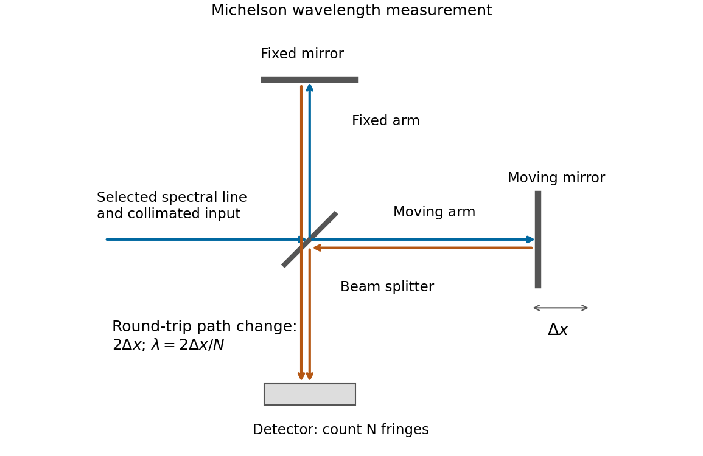
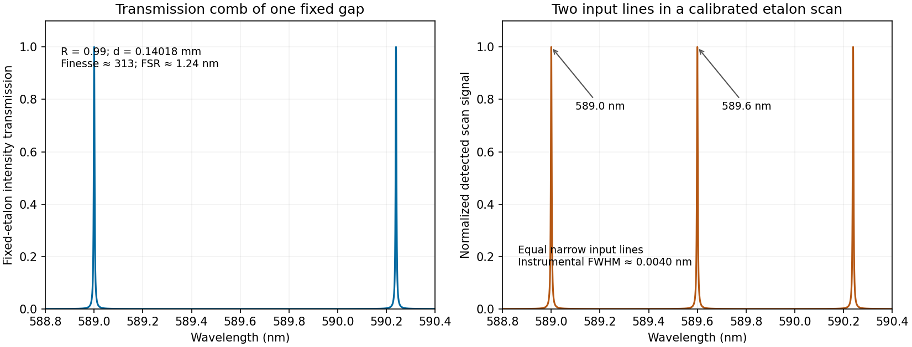

# Paper 2

↑ **Parent:** [2019](../2019.md)

[Original paper, released PDF pages 119–127](https://www.whatdotheyknow.com/request/natural_science_tripos_physics_e/response/2127325/attach/3/FOI%202022%20639%20Sullivan%20materials.pdf?cookie_passthrough=1#page=119)

**Table of contents**

- [Section A](#section-a)
  - [1](#section-a/1)
    - [Solution](#section-a/1/solution)
  - [2](#section-a/2)
    - [Solution](#section-a/2/solution)
  - [3](#section-a/3)
    - [Solution](#section-a/3/solution)
  - [4](#section-a/4)
    - [Solution](#section-a/4/solution)
  - [5](#section-a/5)
    - [Solution](#section-a/5/solution)
- [Section B](#section-b)
  - [B6](#section-b/b6)
    - [a](#section-b/b6/a)
      - [Solution](#section-b/b6/a/solution)
    - [b](#section-b/b6/b)
      - [Solution](#section-b/b6/b/solution)
    - [c](#section-b/b6/c)
      - [Solution](#section-b/b6/c/solution)
    - [d](#section-b/b6/d)
      - [Solution](#section-b/b6/d/solution)
  - [B7](#section-b/b7)
    - [a](#section-b/b7/a)
      - [Solution](#section-b/b7/a/solution)
    - [b](#section-b/b7/b)
      - [Solution](#section-b/b7/b/solution)
    - [c](#section-b/b7/c)
      - [Solution](#section-b/b7/c/solution)
    - [d](#section-b/b7/d)
      - [Solution](#section-b/b7/d/solution)
    - [e](#section-b/b7/e)
      - [Solution](#section-b/b7/e/solution)
  - [B8](#section-b/b8)
    - [a](#section-b/b8/a)
      - [Solution](#section-b/b8/a/solution)
    - [b](#section-b/b8/b)
      - [Solution](#section-b/b8/b/solution)
    - [c](#section-b/b8/c)
      - [Solution](#section-b/b8/c/solution)
    - [d](#section-b/b8/d)
      - [Solution](#section-b/b8/d/solution)
  - [B9](#section-b/b9)
    - [a](#section-b/b9/a)
      - [Solution](#section-b/b9/a/solution)
    - [b](#section-b/b9/b)
      - [Solution](#section-b/b9/b/solution)
    - [c](#section-b/b9/c)
      - [Solution](#section-b/b9/c/solution)
    - [d](#section-b/b9/d)
      - [Solution](#section-b/b9/d/solution)
    - [e](#section-b/b9/e)
      - [Solution](#section-b/b9/e/solution)
    - [f](#section-b/b9/f)
      - [Solution](#section-b/b9/f/solution)
- [Section C](#section-c)
  - [C10](#section-c/c10)
    - [a](#section-c/c10/a)
      - [Solution](#section-c/c10/a/solution)
    - [b](#section-c/c10/b)
      - [Solution](#section-c/c10/b/solution)
    - [c](#section-c/c10/c)
      - [Solution](#section-c/c10/c/solution)
    - [d](#section-c/c10/d)
      - [Solution](#section-c/c10/d/solution)
    - [e](#section-c/c10/e)
      - [Solution](#section-c/c10/e/solution)
  - [C11](#section-c/c11)
    - [a](#section-c/c11/a)
      - [Solution](#section-c/c11/a/solution)
    - [b](#section-c/c11/b)
      - [Solution](#section-c/c11/b/solution)
    - [c](#section-c/c11/c)
      - [Solution](#section-c/c11/c/solution)
    - [d](#section-c/c11/d)
      - [Solution](#section-c/c11/d/solution)
- [Section D](#section-d)
  - [D12](#section-d/d12)
    - [Solution](#section-d/d12/solution)
  - [D13](#section-d/d13)
    - [a](#section-d/d13/a)
      - [Solution](#section-d/d13/a/solution)
    - [b](#section-d/d13/b)
      - [Solution](#section-d/d13/b/solution)
    - [c](#section-d/d13/c)
      - [Solution](#section-d/d13/c/solution)

## Section A

↑ **Parent:** [Paper 2](paper-2.md)

<h3 id="section-a/1">1</h3>

↑ **Parent:** [Section A](#section-a)

<h4 id="section-a/1/solution">Solution</h4>

↑ **Parent:** [1](#section-a/1)

Build a narrow-band [wave packet](../../dispersion-relation.md#wave-packet) from [plane waves](../../wave-function.md#plane-wave) with [wavenumbers](../../wave-equation.md#wavenumber) close to $k_0$:

$$
\psi(x,t)=\int A(k)e^{i[kx-\omega(k)t]}\,dk.
$$

The [Taylor expansion](../../calculus.md#taylor-expansion) of the [dispersion relation](../../dispersion-relation.md) is $\omega(k)\simeq\omega_0+\omega'_0(k-k_0)$, where $\omega'_0=(d\omega/dk)_{k_0}$. Put $\kappa=k-k_0$ to obtain

$$
\psi(x,t)\simeq e^{i(k_0x-\omega_0t)}
\int A(k_0+\kappa)e^{i\kappa(x-\omega'_0t)}\,d\kappa
=e^{i(k_0x-\omega_0t)}f(x-\omega'_0t).
$$

The carrier's [wave phase](../../wave.md#phase-waves) travels at the [phase velocity](../../dispersion-relation.md#phase-velocity) $\omega_0/k_0$, while the envelope has constant shape at constant $x-\omega'_0t$. Its [group velocity](../../dispersion-relation.md#group-velocity) is therefore

$$
\boxed{v_g=\left.\frac{d\omega}{dk}\right|_{k_0}.}
$$

The approximation neglects higher derivatives of the [dispersion relation](../../dispersion-relation.md). Those derivatives cause the [wave packet](../../dispersion-relation.md#wave-packet) to spread or distort over sufficiently long propagation times; the result describes the local envelope speed of a sufficiently narrow band.

<h3 id="section-a/2">2</h3>

↑ **Parent:** [Section A](#section-a)

<h4 id="section-a/2/solution">Solution</h4>

↑ **Parent:** [2](#section-a/2)

Assume a massless junction and common [tension](../../force.md#tension) $T$. The [characteristic impedance of a stretched string](../../wave-equation.md#characteristic-impedance-of-a-stretched-string) is $Z_j=\sqrt{T\mu_j}$, where $\mu_j$ is its [linear mass density](../../fluid-mechanics.md#linear-mass-density). The displacement [reflection coefficient](../../partial-differential-equation.md#reflection-coefficient) is $r=(Z_1-Z_2)/(Z_1+Z_2)$, so the reflected fraction of [power](../../energy.md#power) is

$$
\mathcal R=|r|^2=\left(\frac{1-z}{1+z}\right)^2,\qquad z=\frac{Z_2}{Z_1}=\sqrt{\frac{\mu_2}{\mu_1}}.
$$

Set $\mathcal R=1/2$. The positive solutions are $z=3\pm2\sqrt2$, which are reciprocals. Thus the [string density ratio for prescribed reflected power](../../wave-equation.md#string-density-ratio-for-prescribed-reflected-power) is

$$
\boxed{\frac{\mu_{\rm heavy}}{\mu_{\rm light}}=(3+2\sqrt2)^2=17+12\sqrt2\simeq34.0.}
$$

The impedance ratio is about $5.83$, rather than the required density ratio. Reversing which string is on the incident side changes the reflected displacement sign but not the reflected [power](../../energy.md#power) fraction.

<h3 id="section-a/3">3</h3>

↑ **Parent:** [Section A](#section-a)

<h4 id="section-a/3/solution">Solution</h4>

↑ **Parent:** [3](#section-a/3)

A [Michelson interferometer](../../physical-optics.md#michelson-interferometer) splits a collimated beam at a partially reflecting [beam splitter](../../optical-instrument.md#beam-splitter). Two mutually perpendicular arms reflect from mirrors and recombine at the same [beam splitter](../../optical-instrument.md#beam-splitter); the superposed returning beams produce [interference fringes](../../physical-optics.md#interference-fringe) at the detector. Translate one mirror along its arm while holding the other fixed.

**[Figure 1](#section-a/3/image-original-michelson-geometry-for-measuring-wavelength-by-counting-fringes-while-one-mirror-moves). Original Michelson geometry for measuring wavelength by counting fringes while one mirror moves**.

If that mirror moves a measured distance $\Delta x$, the round-trip [optical path difference](../../physical-optics.md#optical-path-difference) changes by $2\Delta x$ in air, approximated as [vacuum](../../physics.md#vacuum). Every change of one [wavelength](../../wave-equation.md#wavelength) moves one complete bright-dark-bright fringe cycle past a fixed detector point. Count $N$ such cycles to obtain

$$
\Delta\phi=\frac{2\pi}{\lambda}(2\Delta x)=2\pi N,\qquad
\boxed{\lambda=\frac{2\Delta x}{N}.}
$$

Use a [spectral line](../../stellar-astrophysics.md#spectral-line) selected with a suitable [optical filter](../../optical-instrument.md#optical-filter), and count many [interference fringes](../../physical-optics.md#interference-fringe) to reduce the fractional uncertainty of the distance and count. Keep the two arms within the source's [optical coherence length](../../physical-optics.md#optical-coherence-length) and maintain overlap and alignment. If the [vacuum](../../physics.md#vacuum) [wavelength](../../wave-equation.md#wavelength) is required for an arm filled with air of known [refractive index](../../electromagnetic-wave.md#refractive-index) $n$, the corrected relation is $\lambda_0=2n\Delta x/N$ at stable $n$.

<h3 id="section-a/4">4</h3>

↑ **Parent:** [Section A](#section-a)

<h4 id="section-a/4/solution">Solution</h4>

↑ **Parent:** [4](#section-a/4)

Take an abrupt equilibrium [p-n junction](../../semiconductor.md#p-n-junction) with the p side at $x<0$ and the n side at $x>0$. In the quasi-neutral bulk, [electron holes](../../quantum-mechanics.md#electron-hole) are the majority carriers on the p side and [electrons](../../physics.md#electron) are the majority carriers on the n side. With ionized dopant densities $N_A,N_D$ and nondegenerate statistics,

$$
p_{p}\simeq N_A,\quad n_{p}\simeq n_i^2/N_A,\qquad
n_{n}\simeq N_D,\quad p_{n}\simeq n_i^2/N_D,
$$

where $n_i$ is the [intrinsic carrier concentration](../../semiconductor.md#intrinsic-carrier-concentration). The [semiconductor mass-action law](../../semiconductor.md#semiconductor-mass-action-law) $np=n_i^2$ applies at equilibrium. Both mobile populations are small in the [depletion region](../../semiconductor.md#depletion-region) compared with the dopant densities.

The [charge and carrier density of an abrupt p-n junction](../../semiconductor.md#charge-and-carrier-density-of-an-abrupt-p-n-junction) must distinguish mobile populations from net charge. Diffusion leaves negatively charged ionized [acceptor impurities](../../semiconductor.md#acceptor-impurity) on the p side and positively charged ionized [donor impurities](../../semiconductor.md#donor-impurity) on the n side. Under the [depletion approximation](../../semiconductor.md#depletion-approximation),

$$
\boxed{\rho(x)=\begin{cases}
-eN_A,&-x_p<x<0,\\
+eN_D,&0<x<x_n,\\
0,&x<-x_p\text{ or }x>x_n,
\end{cases}\qquad N_Ax_p=N_Dx_n.}
$$

The neutral bulks have large carrier densities but nearly zero net [charge density](../../electric-charge.md#charge-density). The [electric field](../../electric-field.md) points from the positive donor region toward the negative acceptor region, balancing diffusion at equilibrium.

**[Figure 2](#section-a/4/image-illustrative-equilibrium-carrier-densities-and-depletion-approximation-net-charge-for-a-symmetric-abrupt-p-n-junction). Illustrative equilibrium carrier densities and depletion-approximation net charge for a symmetric abrupt p-n junction**.

The figure uses equal dopant densities only to show a simple symmetric sketch. Generally the more lightly doped side has the wider depleted interval. The carrier profiles are smooth, whereas the step-shaped net [charge density](../../electric-charge.md#charge-density) is the ideal [depletion approximation](../../semiconductor.md#depletion-approximation).

<h3 id="section-a/5">5</h3>

↑ **Parent:** [Section A](#section-a)

<h4 id="section-a/5/solution">Solution</h4>

↑ **Parent:** [5](#section-a/5)

Treat [sodium](../../chemical-substance.md#sodium) as monovalent, with one mobile [electron](../../physics.md#electron) per atom. Its [mass density](../../fluid-mechanics.md#density) is $\rho_m=0.97\,\mathrm{g\,cm^{-3}}=970\,\mathrm{kg\,m^{-3}}$, and its molar [mass](../../classical-mechanics.md#mass) is $M=0.023\,\mathrm{kg\,mol^{-1}}$. Using the [Avogadro constant](../../physics.md#avogadro-constant),

$$
n=\frac{\rho_mN_A}{M}=\frac{970}{0.023}(6.022\times10^{23})\,\mathrm{m^{-3}}
\simeq2.54\times10^{28}\,\mathrm{m^{-3}}.
$$

The [electron mobility](../../electric-charge.md#electron-mobility) $\mu=e\tau/m_e$ relates the magnitude of [drift velocity](../../electric-charge.md#drift-velocity) to [electric field](../../electric-field.md). The [Drude model](../../electric-charge.md#drude-model) then gives

$$
\boxed{\sigma=ne\mu=(2.54\times10^{28})(1.602\times10^{-19})(5.2\times10^{-3})
\simeq2.1\times10^7\,\mathrm{S\,m^{-1}}.}
$$

Using $m_e=9.109\times10^{-31}\,\mathrm{kg}$,

$$
\boxed{\tau=\frac{m_e\mu}{e}\simeq2.96\times10^{-14}\,\mathrm s\simeq3.0\times10^{-14}\,\mathrm s.}
$$

The inferred time is the [momentum relaxation time](../../electric-charge.md#momentum-relaxation-time). Identifying it with the mean time between collisions is the intended simple isotropic [Drude model](../../electric-charge.md#drude-model) assumption; small-angle scattering need not relax directed [momentum](../../momentum.md) in a single event.

## Section B

↑ **Parent:** [Paper 2](paper-2.md)

<h3 id="section-b/b6">B6</h3>

↑ **Parent:** [Section B](#section-b)

<h4 id="section-b/b6/a">a</h4>

↑ **Parent:** [B6](#section-b/b6)

<h5 id="section-b/b6/a/solution">Solution</h5>

↑ **Parent:** [A](#section-b/b6/a)

Draw the [Fabry–Pérot etalon](../../optical-instrument.md#fabry-perot-etalon) with parallel mirrors and an incident beam making internal angle $\theta$ with their normal. Every emerging transmitted contribution has undergone one more internal round trip than its predecessor.

**[Figure 3](#section-b/b6/a/image-successive-transmitted-paths-and-a-common-outgoing-wavefront-for-a-tilted-beam-in-an-air-gap-etalon). Successive transmitted paths and a common outgoing wavefront for a tilted beam in an air-gap etalon**.

The extra internal path is $2d/\cos\theta$, but successive contributions leave at laterally separated points, a distance $2d\tan\theta$ apart. Comparing their phases on the same outgoing [wavefront](../../physical-optics.md#wavefront) subtracts the path projection $2d\tan\theta\sin\theta$. Their net [optical path difference](../../physical-optics.md#optical-path-difference) in air is

$$
\Delta=\frac{2d}{\cos\theta}-2d\tan\theta\sin\theta=2d\cos\theta.
$$

Hence, in the reflection-phase convention implicit in the supplied transmission formula,

$$
\boxed{\delta=\frac{2\pi\Delta}{\lambda}=\frac{4\pi d\cos\theta}{\lambda}.}
$$

For a gap of [refractive index](../../electromagnetic-wave.md#refractive-index) $n$, replace $d$ by $nd$ and use the [vacuum](../../physics.md#vacuum) [wavelength](../../wave-equation.md#wavelength). Coating reflection phases can add a round-trip offset; the expression above assumes that offset is absorbed in the resonance order, or is zero modulo $2\pi$ as in the stated ideal model.

<h4 id="section-b/b6/b">b</h4>

↑ **Parent:** [B6](#section-b/b6)

<h5 id="section-b/b6/b/solution">Solution</h5>

↑ **Parent:** [B](#section-b/b6/b)

Write $C_R=4R/(1-R)^2$, keeping this coefficient distinct from the [finesse](../../optical-instrument.md#finesse) $\mathcal F$. The transmission has maxima at $\delta=2\pi m$. At a displacement $\epsilon$ from a maximum, its ratio to peak transmission is $[1+C_R\sin^2(\epsilon/2)]^{-1}$. Half maximum therefore requires

$$
\sin^2(\delta_{1/2}/2)=\frac{(1-R)^2}{4R},\qquad
\boxed{\delta_{1/2}=2\arcsin\!\left(\frac{1-R}{2\sqrt R}\right).}
$$

This is the half-width in [wave phase](../../wave.md#phase-waves); the [full width at half maximum](../../analysis.md#full-width-at-half-maximum) is $2\delta_{1/2}$. Successive resonances are $2\pi$ apart, so the exact ideal-model result is

$$
\boxed{\mathcal F=\frac{\pi}{2\arcsin[(1-R)/(2\sqrt R)]}.}
$$

For narrow peaks, $(1-R)/(2\sqrt R)\ll1$, the [small-angle approximation](../../geometry-and-topology.md#small-angle-approximation) to the inverse sine gives

$$
\delta_{1/2}\simeq\frac{1-R}{\sqrt R},\qquad
\boxed{\mathcal F\simeq\frac{\pi\sqrt R}{1-R}.}
$$

Thus the formula requested in the paper is the high-reflectivity approximation, not an exact identity at arbitrary $R$. Ordinary half-maximum peaks exist only when $(1-R)/(2\sqrt R)\leq1$, or $R\geq3-2\sqrt2$; below that threshold the transmission minimum never reaches half the peak. The prefactor $T^2/(1-R)^2$ cancels from this relative-width calculation.

<h4 id="section-b/b6/c">c</h4>

↑ **Parent:** [B6](#section-b/b6)

<h5 id="section-b/b6/c/solution">Solution</h5>

↑ **Parent:** [C](#section-b/b6/c)

Let $\lambda_1=589.0\,\mathrm{nm}$, $\lambda_2=589.6\,\mathrm{nm}$ and $\Delta\lambda=0.6\,\mathrm{nm}$. Requiring the separation to be at least $100$ times the measured [full width at half maximum](../../analysis.md#full-width-at-half-maximum) means a width no larger than $0.006\,\mathrm{nm}$, or a resolving [power](../../energy.md#power) of approximately $589.3/0.006\simeq9.8\times10^4$.

The [etalon resolving power and order overlap](../../optical-instrument.md#etalon-resolving-power-and-order-overlap) constraints are particularly clear in [frequency](../../wave.md#frequency). Put $\Delta\nu=c|1/\lambda_1-1/\lambda_2|$. At [normal incidence](../../optics.md#normal-incidence), the [free spectral range](../../physical-optics.md#free-spectral-range) is $\nu_{\rm FSR}=c/(2d)$ and the instrumental width is $\delta\nu=\nu_{\rm FSR}/\mathcal F$. Thus

$$
\delta\nu\leq\frac{\Delta\nu}{100}
\quad\Longrightarrow\quad
\boxed{d\mathcal F\geq\frac{50\lambda_1\lambda_2}{\Delta\lambda}=2.89\times10^{-2}\,\mathrm m.}
$$

Avoiding ambiguity between the doublet and adjacent interference orders requires a [free spectral range](../../physical-optics.md#free-spectral-range) exceeding the doublet separation:

$$
\boxed{d<\frac{\lambda_1\lambda_2}{2\Delta\lambda}=2.89\times10^{-4}\,\mathrm m=0.289\,\mathrm{mm}.}
$$

Together these give

$$
\boxed{\frac{0.0289\,\mathrm m}{\mathcal F}\leq d<0.289\,\mathrm{mm},\qquad \mathcal F>100.}
$$

Using the narrow-peak [finesse](../../optical-instrument.md#finesse) from the previous part, $\pi\sqrt R/(1-R)>100$ gives $\boxed{R\gtrsim0.9691}$, with a practical margin above that limiting value. At the exact limit, the gap between orders vanishes, so equality is not a sensible operating point.

One feasible ideal design is $R=0.99$, $\mathcal F\simeq313$, and $d=0.14018\,\mathrm{mm}$. It has an approximate [wavelength](../../wave-equation.md#wavelength) [free spectral range](../../physical-optics.md#free-spectral-range) of $1.24\,\mathrm{nm}$ and instrumental width $0.0040\,\mathrm{nm}$ near the doublet. The doublet spacing is about $151$ widths. Even the spacing to the nearest replica of the other line exceeds $100$ widths in this example. If that latter separation is also required in general, impose the stronger condition $\min(\Delta\nu,\nu_{\rm FSR}-\Delta\nu)\geq100\nu_{\rm FSR}/\mathcal F$, rather than just the two basic inequalities.

Such mirror reflectivities and submillimetre gaps are plausible for a high-quality [Fabry–Pérot etalon](../../optical-instrument.md#fabry-perot-etalon). Flatness, parallelism, coating loss, angular spread, mechanical stability and source width limit the achieved [finesse](../../optical-instrument.md#finesse). A [wavelength](../../wave-equation.md#wavelength) width of $0.004\,\mathrm{nm}$ corresponds to a gap variation of order $d\delta\lambda/\lambda\simeq1\,\mathrm{nm}$, so the ideal coating-limited estimate demands stringent uniformity. The paper expressly excludes intrinsic source broadening.

**[Figure 4](#section-b/b6/c/image-calculated-etalon-transmission-comb-and-a-scanned-doublet-spectrum-for-an-illustrative-design-meeting-the-width-and-order-constraints). Calculated etalon transmission comb and a scanned doublet spectrum for an illustrative design meeting the width and order constraints**.

The first panel is the fixed etalon's transmission versus [wavelength](../../wave-equation.md#wavelength), a comb of resonances. It does not by itself have one peak at each sodium line. The second panel shows the two peaks obtained by scanning the etalon phase or gap and calibrating the scan to [wavelength](../../wave-equation.md#wavelength). A fixed-gap output spectrum is instead the incident spectrum multiplied by the transmission function. This distinction is needed to interpret a doublet measurement correctly.

<h4 id="section-b/b6/d">d</h4>

↑ **Parent:** [B6](#section-b/b6)

<h5 id="section-b/b6/d/solution">Solution</h5>

↑ **Parent:** [D](#section-b/b6/d)

A high-[finesse](../../optical-instrument.md#finesse) [Fabry–Pérot etalon](../../optical-instrument.md#fabry-perot-etalon) obtains very narrow transmission peaks by summing many coherent round trips, allowing high resolving [power](../../energy.md#power) with a compact optical path. It can transmit a substantial fraction of resonant [light](../../optics.md#light) when coating absorption is small, and works well for precise relative line separations and narrow-line measurements. A [diffraction grating](../../physical-optics.md#diffraction-grating) may require many illuminated grooves to achieve the same resolving [power](../../energy.md#power).

The etalon's [free spectral range](../../physical-optics.md#free-spectral-range) is limited, and repeated orders cause ambiguity across a broad [optical spectrum](../../optics.md#optical-spectrum). It commonly needs scanning and an order-selecting [optical filter](../../optical-instrument.md#optical-filter) or another dispersive element. Mirror alignment, flatness and illumination angle strongly affect peak positions and widths, and absorption lowers throughput. A [diffraction grating](../../physical-optics.md#diffraction-grating) instead separates a broad range of [wavelengths](../../wave-equation.md#wavelength) spatially for simultaneous detection, although grating orders can also overlap. The preferred instrument depends on whether narrow-band precision or broad spectral coverage is the priority.

<h3 id="section-b/b7">B7</h3>

↑ **Parent:** [Section B](#section-b)

<h4 id="section-b/b7/a">a</h4>

↑ **Parent:** [B7](#section-b/b7)

<h5 id="section-b/b7/a/solution">Solution</h5>

↑ **Parent:** [A](#section-b/b7/a)

Here $x(t)$ is displacement from equilibrium, in metres; $m>0$ is the oscillating [mass](../../classical-mechanics.md#mass), in kilograms; $b\geq0$ is the coefficient of linear viscous [damping](../../wave-equation.md#damping), in $\mathrm{kg\,s^{-1}}$; and $k>0$ is the spring constant, in $\mathrm{N\,m^{-1}}$. The terms $m\ddot x$, $b\dot x$ and $kx$ are respectively the inertial term, the opposing velocity-dependent damping term and the opposing displacement-dependent restoring term when moved to the [force](../../force.md) side of [Newton's second law](../../force.md#newton-s-second-law).

$F_0$ is a possibly complex driving-force [complex amplitude](../../wave.md#complex-amplitude), measured in newtons. $\omega$ is the driving [angular frequency](../../lagrangian-mechanics.md#angular-frequency) in $\mathrm{rad\,s^{-1}}$, and taking the real part of $F_0e^{i\omega t}$ gives the physical sinusoidal [force](../../force.md). Its [frequency](../../wave.md#frequency) in hertz is $f=\omega/(2\pi)$. The natural undamped [angular frequency](../../lagrangian-mechanics.md#angular-frequency) and damping rate are

$$
\boxed{\omega_0=\sqrt{k/m},\qquad\gamma=b/(2m).}
$$

This [damped harmonic oscillator](../../analysis.md#damped-harmonic-oscillator) model assumes a linear restoring [force](../../force.md) and a linear, instantaneous viscous damping law.

<h4 id="section-b/b7/b">b</h4>

↑ **Parent:** [B7](#section-b/b7)

<h5 id="section-b/b7/b/solution">Solution</h5>

↑ **Parent:** [B](#section-b/b7/b)

Set the drive to zero and try $x=e^{st}$. The [characteristic equation](../../linear-ordinary-differential-equation.md#characteristic-equation-of-a-constant-coefficient-differential-equation) is

$$
ms^2+bs+k=0,\qquad s_\pm=-\gamma\pm\sqrt{\gamma^2-\omega_0^2},
\quad\gamma=\frac b{2m},\quad\omega_0^2=\frac km.
$$

For [underdamping](../../wave-equation.md#underdamping), $\boxed{b^2<4mk}$, the roots are $-\gamma\pm i\omega_d$, with $\omega_d=\sqrt{\omega_0^2-\gamma^2}$. The displacement oscillates with an exponentially decaying envelope:

$$
x=e^{-\gamma t}[C\cos(\omega_dt)+D\sin(\omega_dt)].
$$

For [critical damping](../../wave-equation.md#critical-damping), $\boxed{b^2=4mk}$, there is a repeated root $-\omega_0$, giving $x=(C+Dt)e^{-\omega_0t}$. The motion is nonoscillatory and is the limiting case between oscillatory and overdamped response.

For [overdamping](../../wave-equation.md#overdamping), $\boxed{b^2>4mk}$, the roots are distinct negative real numbers and $x=C e^{s_+t}+D e^{s_-t}$. Both components decay without sustained oscillation; strong damping gives a particularly slow late-time relaxation. Constants $C,D$ depend on the initial conditions. A nonoscillatory solution can cross equilibrium once for some initial data, so “nonoscillatory” does not mean monotone for every possible initial condition.

<h4 id="section-b/b7/c">c</h4>

↑ **Parent:** [B7](#section-b/b7)

<h5 id="section-b/b7/c/solution">Solution</h5>

↑ **Parent:** [C](#section-b/b7/c)

Let the initial conditions be $x(0)=0$ and $\dot x(0^+)=v_0>0$. The [velocity-impulse response of a damped oscillator](../../analysis.md#velocity-impulse-response-of-a-damped-oscillator) is

$$
\boxed{x(t)=\begin{cases}
\dfrac{v_0}{\omega_d}e^{-\gamma t}\sin(\omega_dt),&\gamma<\omega_0,\\
v_0t e^{-\omega_0t},&\gamma=\omega_0,\\
\dfrac{v_0}{s}e^{-\gamma t}\sinh(st),&\gamma>\omega_0,\quad s=\sqrt{\gamma^2-\omega_0^2}.
\end{cases}}
$$

All curves start at the origin with the same positive slope $v_0$. [Underdamping](../../wave-equation.md#underdamping) gives a decaying sequence of positive and negative lobes. [Critical damping](../../wave-equation.md#critical-damping) gives one positive lobe followed by return to zero. [Overdamping](../../wave-equation.md#overdamping) also remains positive for these initial data, but has a longer tail. The initial impulse changes [velocity](../../classical-mechanics.md#velocity) abruptly, not displacement.

**[Figure 5](#section-b/b7/c/image-calculated-displacement-after-the-same-initial-velocity-impulse-for-underdamped-critically-damped-and-overdamped-oscillators). Calculated displacement after the same initial velocity impulse for underdamped, critically damped and overdamped oscillators**.

<h4 id="section-b/b7/d">d</h4>

↑ **Parent:** [B7](#section-b/b7)

<h5 id="section-b/b7/d/solution">Solution</h5>

↑ **Parent:** [D](#section-b/b7/d)

For [underdamping](../../wave-equation.md#underdamping), the general response is a free transient plus a particular driven response. Use the paper's $e^{i\omega t}$ convention. The steady displacement [complex amplitude](../../wave.md#complex-amplitude) is

$$
x_0=\frac{F_0}{k-m\omega^2+ib\omega}.
$$

Thus

$$
\boxed{x(t)=e^{-\gamma t}[C\cos(\omega_dt)+D\sin(\omega_dt)]
+\operatorname{Re}\!\left[\frac{F_0e^{i\omega t}}{k-m\omega^2+ib\omega}\right].}
$$

Here $\gamma=b/(2m)$, $\omega_d=\sqrt{k/m-\gamma^2}$ and the real constants $C,D$ enforce the initial conditions. For a real positive $F_0$, the steady term is $|x_0|\cos(\omega t-\phi)$, where

$$
|x_0|=\frac{F_0}{\sqrt{(k-m\omega^2)^2+b^2\omega^2}},\qquad
\phi=\operatorname{atan2}(b\omega,k-m\omega^2).
$$

For light [damping](../../wave-equation.md#damping), $\omega_d\simeq\omega_0$ and the transient decays slowly compared with an oscillation. The two-argument phase convention makes the displacement lag evolve from approximately zero below resonance through $\pi/2$ near $\omega_0$ to approximately $\pi$ far above it.

<h4 id="section-b/b7/e">e</h4>

↑ **Parent:** [B7](#section-b/b7)

<h5 id="section-b/b7/e/solution">Solution</h5>

↑ **Parent:** [E](#section-b/b7/e)

The response is quasistatic at low [frequency](../../wave.md#frequency), resonantly enhanced when the spring and inertia nearly cancel, and suppressed as $1/\omega^2$ at high [frequency](../../wave.md#frequency). The original graph gives approximate readings $x_s=|x_0(0)|\simeq0.10\,\mathrm{mm}$, $x_p\simeq1.0\,\mathrm{mm}$ and $f_r\simeq150\,\mathrm{Hz}$. These are graph estimates, not exact supplied measurements.

Use [oscillator parameters from static and resonant displacement](../../analysis.md#oscillator-parameters-from-static-and-resonant-displacement). The static spring constant is

$$
\boxed{k\simeq\frac{0.9\,\mathrm N}{1.0\times10^{-4}\,\mathrm m}=9.0\times10^3\,\mathrm{N\,m^{-1}}.}
$$

For light [damping](../../wave-equation.md#damping), $\omega_0\simeq\omega_r=2\pi(150)\simeq9.42\times10^2\,\mathrm{s^{-1}}$, giving

$$
\boxed{m\simeq\frac{k}{\omega_0^2}\simeq1.0\times10^{-2}\,\mathrm{kg}=10\,\mathrm g.}
$$

Near resonance, $x_p\simeq F_0/(b\omega_0)$, so

$$
\boxed{b\simeq\frac{0.9}{(9.42\times10^2)(1.0\times10^{-3})}
\simeq0.95\,\mathrm{kg\,s^{-1}},\qquad Q=\frac{m\omega_0}{b}\simeq10.}
$$

Independently, the resonance enhancement $x_p/x_s\simeq10$ estimates the same [quality factor](../../dynamical-systems.md#q-factor). The half-power displacement level is $x_p/\sqrt2\simeq0.71\,\mathrm{mm}$; its intersections are approximately $142$ and $157\,\mathrm{Hz}$, giving bandwidth $\Delta f\simeq15\,\mathrm{Hz}$ and $Q\simeq f_0/\Delta f\simeq10$.

The exact displacement-peak [frequency](../../wave.md#frequency) is $\omega_r^2=\omega_0^2-b^2/(2m^2)$. At $Q\simeq10$ its difference from $\omega_0$ is only about $0.25\%$, well below the precision justified by this printed curve. Greater numerical precision for the inferred parameters would be misleading.

<h3 id="section-b/b8">B8</h3>

↑ **Parent:** [Section B](#section-b)

<h4 id="section-b/b8/a">a</h4>

↑ **Parent:** [B8](#section-b/b8)

<h5 id="section-b/b8/a/solution">Solution</h5>

↑ **Parent:** [A](#section-b/b8/a)

In [Fresnel diffraction](../../physical-optics.md#fresnel-diffraction), the propagation [wave phase](../../wave.md#phase-waves) varies quadratically across the aperture and that curvature must be retained. For a transverse scale $w$ at propagation distance $L$, its size is of order $\pi w^2/(\lambda L)$. In [Fraunhofer diffraction](../../physical-optics.md#fraunhofer-diffraction), that quadratic term is negligible, approximately $w^2/(\lambda L)\ll1$, while the linear phase encoding the observation angle remains. A lens can also form the far-field angular pattern in its [focal plane](../../optical-instrument.md#focal-plane).

For a normally incident [plane wave](../../wave-function.md#plane-wave) and aperture transmission $h(x,y)$, the far-field [complex amplitude](../../wave.md#complex-amplitude) is its [Fourier transform](../../fourier-transform.md):

$$
\psi(q_x,q_y)\propto\iint h(x,y)e^{-i(q_xx+q_yy)}\,dx\,dy,
\qquad q_x=\frac{2\pi}{\lambda}\sin\theta_x.
$$

The detected [light intensity](../../wave.md#light-intensity) is proportional to $|\psi|^2$. For identical parallel slits, write the transmission as a sum of shifted copies of one slit. The [Fourier shift theorem](../../fourier-transform.md#fourier-shift-theorem) gives one single-slit transform multiplied by the sum of positional [phase factors](../../wave.md#phase-factor):

$$
\psi(q)\propto a\operatorname{sinc}(qa/2)\sum_j e^{-iqx_j},\qquad
\operatorname{sinc}u=\frac{\sin u}{u}.
$$

The [single-slit diffraction](../../physical-optics.md#single-slit-diffraction) envelope sets the broad scale, while coherent interference between slit centres produces the finer array pattern. One sums [complex amplitudes](../../wave.md#complex-amplitude) before squaring, rather than adding independent slit intensities.

<h4 id="section-b/b8/b">b</h4>

↑ **Parent:** [B8](#section-b/b8)

<h5 id="section-b/b8/b/solution">Solution</h5>

↑ **Parent:** [B](#section-b/b8/b)

Put the slit centres at $x_j=\pm D/2,\pm3D/2$. Each slit has the same width $a$ and illumination. Its contribution to the [Fraunhofer diffraction](../../physical-optics.md#fraunhofer-diffraction) [complex amplitude](../../wave.md#complex-amplitude) is

$$
\int_{x_j-a/2}^{x_j+a/2}e^{-iqx}\,dx
=a\operatorname{sinc}(qa/2)e^{-iqx_j}.
$$

The four [phase factors](../../wave.md#phase-factor) pair into cosines:

$$
\sum_j e^{-iqx_j}=e^{iqD/2}+e^{-iqD/2}+e^{3iqD/2}+e^{-3iqD/2}
=2\cos(qD/2)+2\cos(3qD/2).
$$

Therefore the [four-slit Fraunhofer diffraction](../../physical-optics.md#four-slit-fraunhofer-diffraction) field is

$$
\boxed{\psi(q)\propto2a[\cos(qD/2)+\cos(3qD/2)]\operatorname{sinc}(qa/2),\qquad
q=\frac{2\pi\sin\theta}{\lambda}.}
$$

The common factor $2a$ can be absorbed in the proportionality constant, giving the requested form. In particular $\psi(0)\propto4a$, as expected from four equal in-phase slits. Normalizing by the central intensity gives

$$
\boxed{\frac{I(q)}{I(0)}=\operatorname{sinc}^2(qa/2)\cos^2(qD/2)\cos^2(qD).}
$$

The last form follows from $\cos x+\cos3x=2\cos2x\cos x$ and avoids apparent singularities in the usual sine-ratio array formula.

<h4 id="section-b/b8/c">c</h4>

↑ **Parent:** [B8](#section-b/b8)

<h5 id="section-b/b8/c/solution">Solution</h5>

↑ **Parent:** [C](#section-b/b8/c)

Let $X$ be horizontal position on the screen, $L=0.50\,\mathrm m$, and use $\sin\theta=X/\sqrt{L^2+X^2}$. The plotted interval is $-50\,\mathrm{mm}\leq X\leq50\,\mathrm{mm}$. With $a=10\,\mu\mathrm m$, $D=20\,\mu\mathrm m$ and $\lambda=0.500\,\mu\mathrm m$, the [four-slit Fraunhofer diffraction](../../physical-optics.md#four-slit-fraunhofer-diffraction) intensity is the previous normalized expression evaluated at this angle. The total aperture width is $3D+a=70\,\mu\mathrm m$, giving a [Fresnel number](../../physical-optics.md#fresnel-number) of order $0.020$, consistent with the far-field approximation.

Nominal principal array directions satisfy $D\sin\theta_m=m\lambda$. Their screen positions are

$$
X_m=\frac{L(m\lambda/D)}{\sqrt{1-(m\lambda/D)^2}}.
$$

Thus the visible nonzero orders are near $\boxed{X=\pm12.50\,\mathrm{mm}\ (m=\pm1),\quad X=\pm37.61\,\mathrm{mm}\ (m=\pm3)}$, in addition to the central maximum. The even nonzero orders are [missing diffraction orders](../../physical-optics.md#missing-diffraction-order): at $m=2$ the first envelope zero occurs at $X=\pm25.03\,\mathrm{mm}$. The next envelope zero and $m=4$ direction lie at about $\pm50.25\,\mathrm{mm}$, just beyond the screen edges.

At the nominal first and third array directions, $I/I(0)=4/\pi^2\simeq0.405$ and $4/(9\pi^2)\simeq0.0450$, respectively. The closest central minima satisfy $D\sin\theta=\pm\lambda/4$, hence $\boxed{X\simeq\pm3.125\,\mathrm{mm}}$. Two small subsidiary array maxima occur between adjacent principal directions. The single-slit envelope slightly shifts the true off-axis maxima relative to the nominal principal array angles.

**[Figure 6](#section-b/b8/c/image-calculated-four-slit-intensity-across-the-specified-screen-with-principal-array-directions-and-missing-orders-marked). Calculated four-slit intensity across the specified screen, with principal array directions and missing orders marked**.

<h4 id="section-b/b8/d">d</h4>

↑ **Parent:** [B8](#section-b/b8)

<h5 id="section-b/b8/d/solution">Solution</h5>

↑ **Parent:** [D](#section-b/b8/d)

Model the two openings as identical axis-aligned rectangles of width $w$ in $x$, height $h$ in $y$, and centre separation $s$ along $x$. Their [Fraunhofer diffraction](../../physical-optics.md#fraunhofer-diffraction) field has the form

$$
\psi(q_x,q_y)\propto2wh\operatorname{sinc}(q_xw/2)\operatorname{sinc}(q_yh/2)\cos(q_xs/2).
$$

The original image shows first broad envelope zeros near $q_x=\pm5\,\mu\mathrm m^{-1}$ and $q_y=\pm1\,\mu\mathrm m^{-1}$. The horizontal interference period is about $\Delta q_x=2.5\,\mu\mathrm m^{-1}$; the first interference minima near $\pm1.25\,\mu\mathrm m^{-1}$ distinguish that fine scale from the envelope. The [rectangular-aperture dimensions from diffraction zeros](../../physical-optics.md#rectangular-aperture-dimensions-from-diffraction-zeros) are therefore

$$
\boxed{w\simeq\frac{2\pi}{5}\,\mu\mathrm m=1.26\,\mu\mathrm m,\qquad
h\simeq\frac{2\pi}{1}\,\mu\mathrm m=6.28\,\mu\mathrm m,\qquad
s\simeq\frac{2\pi}{2.5}\,\mu\mathrm m=2.51\,\mu\mathrm m.}
$$

The edge-to-edge gap is $s-w\simeq1.26\,\mu\mathrm m$. The long direction is vertical. These dimensions also explain the suppressed alternate principal array maxima: $s/w\simeq2$.

**[Figure 7](#section-b/b8/d/image-inferred-pair-of-rectangular-openings-quantitatively-labelled-using-the-original-angular-spatial-wavenumber-axes). Inferred pair of rectangular openings, quantitatively labelled using the original angular-spatial-wavenumber axes**.

The factors $2\pi$ are required by the stated $q=2\pi\sin\theta/\lambda$ convention; treating the plotted coordinates as cycles per micrometre would give different dimensions. The finite printed figure supports approximate dimensions. An overall translation and inversion of the aperture pair leave its Fourier intensity unchanged, so their absolute placement is not recoverable; the diagram chooses a convenient centred representative.

<h3 id="section-b/b9">B9</h3>

↑ **Parent:** [Section B](#section-b)

<h4 id="section-b/b9/a">a</h4>

↑ **Parent:** [B9](#section-b/b9)

<h5 id="section-b/b9/a/solution">Solution</h5>

↑ **Parent:** [A](#section-b/b9/a)

A [waveguide](../../wave.md#waveguide) confines the transverse structure of a wave while permitting propagation along a chosen route. It can deliver [energy](../../energy.md) to a distant receiver without the same geometric spreading as an unguided beam, protect a signal from unwanted coupling, and select transverse [normal modes](../../wave-equation.md#normal-mode). It also makes propagation paths and coupling to devices more controllable. Confinement does not eliminate [wave absorption](../../wave.md#wave-absorption) or scattering loss, and it can introduce [wave dispersion](../../dispersion-relation.md#wave-dispersion) and [cutoff frequencies of a membrane waveguide](../../wave-equation.md#cutoff-frequency-of-a-membrane-waveguide) or corresponding cutoffs for other wave types.

Two examples are an [optical fiber](../../optical-instrument.md#optical-fiber), which guides [light](../../optics.md#light) by its core-and-cladding [refractive index](../../electromagnetic-wave.md#refractive-index) structure, and a hollow [electromagnetic waveguide](../../electromagnetic-wave.md#electromagnetic-waveguide) used to carry microwaves between a source and an antenna. A duct for [acoustic waves](../../fluid-mechanics.md#acoustic-wave) is a further example. Each uses different material and [boundary conditions](../../differential-equation.md#boundary-condition), but the common idea is controlled transverse confinement.

<h4 id="section-b/b9/b">b</h4>

↑ **Parent:** [B9](#section-b/b9)

<h5 id="section-b/b9/b/solution">Solution</h5>

↑ **Parent:** [B](#section-b/b9/b)

For the trial displacement $z=\sin(qy)e^{i(kx-\omega t)}$, direct differentiation gives

$$
\frac{\partial^2z}{\partial x^2}=-k^2z,\qquad
\frac{\partial^2z}{\partial y^2}=-q^2z,\qquad
\frac{\partial^2z}{\partial t^2}=-\omega^2z.
$$

The two-dimensional [wave equation](../../wave-equation.md) is therefore satisfied if

$$
\boxed{\omega^2=\frac T\sigma(k^2+q^2)=c_m^2(k^2+q^2),\qquad c_m=\sqrt{T/\sigma}.}
$$

Here $k$ is the longitudinal [wavenumber](../../wave-equation.md#wavenumber), $q$ the transverse [wavenumber](../../wave-equation.md#wavenumber), and $c_m$ the speed of an unconstrained membrane wave. The physical displacement is the real part, multiplied by an arbitrary displacement amplitude. $T$ has units $\mathrm{N\,m^{-1}}$ and $\sigma$ is [surface mass density](../../fluid-mechanics.md#projected-surface-mass-density) in $\mathrm{kg\,m^{-2}}$, so $T/\sigma$ has units $\mathrm{m^2\,s^{-2}}$ as required.

<h4 id="section-b/b9/c">c</h4>

↑ **Parent:** [B9](#section-b/b9)

<h5 id="section-b/b9/c/solution">Solution</h5>

↑ **Parent:** [C](#section-b/b9/c)

The fixed edge at $y=0$ is automatically satisfied by $\sin(qy)$. At $y=a$, the displacement must vanish at every $x,t$, so $\sin(qa)=0$. Thus the allowed transverse [normal modes](../../wave-equation.md#normal-mode) have

$$
\boxed{q_n=\frac{n\pi}{a},\qquad n=1,2,3,\ldots.}
$$

The case $n=0$ gives zero displacement for this sine solution and is not a physical propagating mode. Negative $n$ only reverses the amplitude sign and does not create a distinct transverse mode. This discrete transverse spectrum is a consequence of the [Dirichlet boundary conditions](../../differential-equation.md#dirichlet-boundary-condition), rather than quantization of the longitudinal [wavenumber](../../wave-equation.md#wavenumber) in an indefinitely long guide.

<h4 id="section-b/b9/d">d</h4>

↑ **Parent:** [B9](#section-b/b9)

<h5 id="section-b/b9/d/solution">Solution</h5>

↑ **Parent:** [D](#section-b/b9/d)

For the $n$th transverse mode, substitute $q_n=n\pi/a$ into the [membrane waveguide](../../wave-equation.md#membrane-waveguide) [dispersion relation](../../dispersion-relation.md):

$$
k^2=\frac{\sigma\omega^2}{T}-\left(\frac{n\pi}{a}\right)^2.
$$

Longitudinal propagation requires real nonzero $k$, hence

$$
\boxed{\omega>\omega_{c,n}=\frac{n\pi}{a}\sqrt{\frac T\sigma}.}
$$

Below the [cutoff frequency of a membrane waveguide](../../wave-equation.md#cutoff-frequency-of-a-membrane-waveguide), $k=i\kappa$, with $\kappa=\sqrt{(n\pi/a)^2-\sigma\omega^2/T}$, and a bounded excitation decays as $e^{-\kappa x}$ rather than carrying a travelling wave along an infinite guide. At equality $k=0$, the displacement has no longitudinal phase advance and the [group velocity](../../dispersion-relation.md#group-velocity) is zero; it is a cutoff oscillation, not a propagating mode carrying finite longitudinal [power](../../energy.md#power).

<h4 id="section-b/b9/e">e</h4>

↑ **Parent:** [B9](#section-b/b9)

<h5 id="section-b/b9/e/solution">Solution</h5>

↑ **Parent:** [E](#section-b/b9/e)

For positive [angular frequency](../../lagrangian-mechanics.md#angular-frequency), the first three branches are

$$
\boxed{\omega_n(k)=c_m\sqrt{k^2+(n\pi/a)^2},\qquad n=1,2,3.}
$$

Each branch is even in $k$, has minimum $\omega_n(0)=n\pi c_m/a$, and starts with zero slope. At large $|k|$, all approach the straight asymptote $\omega=c_m|k|$. Their [group velocities](../../dispersion-relation.md#group-velocity) are $v_{g,n}=c_m^2k/\omega_n$, whereas their longitudinal [phase velocities](../../dispersion-relation.md#phase-velocity) are $v_{p,n}=\omega_n/k$ for $k\ne0$, giving $v_{p,n}v_{g,n}=c_m^2$.

**[Figure 8](#section-b/b9/e/image-three-lowest-membrane-waveguide-dispersion-branches-with-their-cutoffs-and-common-large-wavenumber-asymptote). Three lowest membrane-waveguide dispersion branches, with their cutoffs and common large-wavenumber asymptote**.

<h4 id="section-b/b9/f">f</h4>

↑ **Parent:** [B9](#section-b/b9)

<h5 id="section-b/b9/f/solution">Solution</h5>

↑ **Parent:** [F](#section-b/b9/f)

Resistance to bending adds a restoring contribution that grows more rapidly with spatial curvature than the tension contribution. Short-[wavelength](../../wave-equation.md#wavelength) modes are therefore stiffened especially strongly, raising their [frequencies](../../wave.md#frequency) and changing the large-[wavenumber](../../wave-equation.md#wavenumber) behaviour.

For example, a thin plate of [flexural rigidity](../../elasticity-physics.md#bending-stiffness) $D_b$ has $\sigma z_{tt}=T\nabla^2z-D_b\nabla^4z$. When its edge conditions admit the same sine transverse mode, [bending stiffness in a membrane waveguide](../../wave-equation.md#bending-stiffness-in-a-membrane-waveguide) gives

$$
\omega_n^2=\frac T\sigma(k^2+q_n^2)+\frac{D_b}\sigma(k^2+q_n^2)^2.
$$

Thus the cutoffs increase, and bending-dominated propagation has $\omega\propto k^2$ at large $|k|$, rather than approaching $c_m|k|$. Its [phase velocity](../../dispersion-relation.md#phase-velocity) and [group velocity](../../dispersion-relation.md#group-velocity) then grow with $|k|$. If “rigidly fixed” means a genuinely clamped plate edge, the slope must also vanish and the mode shapes change; the qualitative stiffening and stronger [wave dispersion](../../dispersion-relation.md#wave-dispersion) remain, but simple $q_n=n\pi/a$ need not remain exact.

## Section C

↑ **Parent:** [Paper 2](paper-2.md)

<h3 id="section-c/c10">C10</h3>

↑ **Parent:** [Section C](#section-c)

<h4 id="section-c/c10/a">a</h4>

↑ **Parent:** [C10](#section-c/c10)

<h5 id="section-c/c10/a/solution">Solution</h5>

↑ **Parent:** [A](#section-c/c10/a)

A [Bravais lattice](../../quantum-scattering.md#bravais-lattice) is the set of positions generated by integer combinations of independent primitive translation vectors, $\mathbf R=n_1\mathbf a_1+n_2\mathbf a_2+n_3\mathbf a_3$. Every lattice point has the same translational environment. A crystal may additionally have a basis of several atoms attached to each lattice point; those atoms are not automatically separate points of its [Bravais lattice](../../quantum-scattering.md#bravais-lattice).

A [unit cell](../../quantum-scattering.md#unit-cell) is a region whose translated copies fill the crystal without gaps or overlaps. It can be chosen for convenient symmetry, and a conventional cell may contain several lattice points. A [primitive unit cell](../../quantum-scattering.md#primitive-unit-cell) is a smallest such repeating cell, containing exactly one lattice point when boundary sharing is counted. Its shape is not unique, but its [volume](../../geometry-and-topology.md#volume) $\Omega=|\mathbf a_1\cdot(\mathbf a_2\times\mathbf a_3)|$ is fixed for a given lattice. For a monatomic Bravais crystal, each primitive cell contains one atom.

<h4 id="section-c/c10/b">b</h4>

↑ **Parent:** [C10](#section-c/c10)

<h5 id="section-c/c10/b/solution">Solution</h5>

↑ **Parent:** [B](#section-c/c10/b)

Interpret the sphere as an atom of [iron](../../chemical-substance.md#iron), and assume neighbouring atoms touch without overlap. Its radius is $r=0.124\,\mathrm{nm}=1.24\times10^{-10}\,\mathrm m$, and its [mass](../../classical-mechanics.md#mass) is $m_{\rm Fe}=56u\simeq9.30\times10^{-26}\,\mathrm{kg}$, using atomic mass unit $u=1.66054\times10^{-27}\,\mathrm{kg}$.

In the [face-centered cubic lattice](../../quantum-scattering.md#face-centered-cubic-lattice), atoms touch along a face diagonal: $\sqrt2a_F=4r$, so $a_F=2\sqrt2r=0.3507\,\mathrm{nm}$. Four atoms occupy a conventional cube. The [hard-sphere atomic volume in cubic lattices](../../quantum-scattering.md#hard-sphere-atomic-volume-in-cubic-lattices) therefore gives

$$
\boxed{\Omega_F=\frac{a_F^3}{4}=4\sqrt2r^3=1.08\times10^{-29}\,\mathrm{m^3},\qquad
\rho_F=\frac{56u}{\Omega_F}=8.62\times10^3\,\mathrm{kg\,m^{-3}}.}
$$

In the [body-centered cubic lattice](../../quantum-scattering.md#body-centered-cubic-lattice), atoms touch along the body diagonal: $\sqrt3a_B=4r$, so $a_B=4r/\sqrt3=0.2864\,\mathrm{nm}$. There are two atoms per conventional cube, giving

$$
\boxed{\Omega_B=\frac{a_B^3}{2}=\frac{32r^3}{3\sqrt3}=1.17\times10^{-29}\,\mathrm{m^3},\qquad
\rho_B=7.92\times10^3\,\mathrm{kg\,m^{-3}}.}
$$

These are [primitive unit cell](../../quantum-scattering.md#primitive-unit-cell) volumes, not the volumes of the conventional cubes or of the atomic spheres. The denser FCC contact packing gives the higher [mass density](../../fluid-mechanics.md#density) in this fixed-radius model. Actual hot phases have temperature-dependent dimensions and bonding, so these numbers should not be treated as exact experimental phase densities.

<h4 id="section-c/c10/c">c</h4>

↑ **Parent:** [C10](#section-c/c10)

<h5 id="section-c/c10/c/solution">Solution</h5>

↑ **Parent:** [C](#section-c/c10/c)

The [reciprocal lattice](../../quantum-scattering.md#reciprocal-lattice) is the set of [wavevectors](../../elasticity-physics.md#wavevector) $\mathbf G$ satisfying $e^{i\mathbf G\cdot\mathbf R}=1$ for every direct [Bravais lattice](../../quantum-scattering.md#bravais-lattice) translation $\mathbf R$. Equivalently, $\mathbf G\cdot\mathbf R$ is an integer multiple of $2\pi$. It describes the spatial periodicities that can produce coherent [Bragg scattering](../../quantum-scattering.md#bragg-scattering).

For direct primitive vectors $\mathbf a_i$ and oriented cell volume $\Omega=\mathbf a_1\cdot(\mathbf a_2\times\mathbf a_3)$, the primitive reciprocal vectors are

$$
\boxed{\mathbf b_1=2\pi\frac{\mathbf a_2\times\mathbf a_3}{\Omega},\qquad
\mathbf b_2=2\pi\frac{\mathbf a_3\times\mathbf a_1}{\Omega},\qquad
\mathbf b_3=2\pi\frac{\mathbf a_1\times\mathbf a_2}{\Omega}.}
$$

They obey $\mathbf a_i\cdot\mathbf b_j=2\pi\delta_{ij}$, and every reciprocal vector is an integer combination of them. Their units are inverse length. The reciprocal primitive cell volume is $(2\pi)^3/|\Omega|$, so expanding a direct lattice contracts its reciprocal scale.

<h4 id="section-c/c10/d">d</h4>

↑ **Parent:** [C10](#section-c/c10)

<h5 id="section-c/c10/d/solution">Solution</h5>

↑ **Parent:** [D](#section-c/c10/d)

The direct [body-centered cubic lattice](../../quantum-scattering.md#body-centered-cubic-lattice) has a face-centred cubic [reciprocal lattice](../../quantum-scattering.md#reciprocal-lattice), whereas the direct [face-centered cubic lattice](../../quantum-scattering.md#face-centered-cubic-lattice) has a body-centred cubic [reciprocal lattice](../../quantum-scattering.md#reciprocal-lattice). Thus the [reciprocal lattice change in a structural phase transition](../../quantum-scattering.md#reciprocal-lattice-change-in-a-structural-phase-transition) reverses the two cubic types: the reciprocal lattice changes from FCC to BCC when the real material changes from BCC to FCC. If the direct conventional side is $a$, the reciprocal conventional side is $4\pi/a$ in either case, with the appropriate phase-specific $a$.

Within one phase, ordinary [thermal expansion](../../thermodynamics.md#thermal-expansion) increases direct spacings and decreases reciprocal spacings. At the structural [phase transition](../../critical-phenomenon.md#phase-transition), reciprocal points acquire the new symmetry and allowed positions. A first-order transformation may show both phases simultaneously and may create differently oriented domains; it need not continuously preserve one perfect reciprocal array throughout.

Using the fixed-radius estimates from part (b), $\Omega_F/\Omega_B\simeq0.919$, so the reciprocal primitive cell volume would increase by about $8.9\%$. That comparison belongs to the ideal contact model. The question supplies neither the actual [thermal expansion](../../thermodynamics.md#thermal-expansion) nor a crystallographic orientation relationship, so it does not determine a unique trajectory of individual reciprocal points during the transition.

<h4 id="section-c/c10/e">e</h4>

↑ **Parent:** [C10](#section-c/c10)

<h5 id="section-c/c10/e/solution">Solution</h5>

↑ **Parent:** [E](#section-c/c10/e)

Use temperature-dependent [X-ray diffraction](../../quantum-scattering.md#x-ray-diffraction), with the crystal in a controlled heating stage and a detector measuring diffracted directions. A reflection occurs when the scattering [wavevector](../../elasticity-physics.md#wavevector) matches a [reciprocal lattice](../../quantum-scattering.md#reciprocal-lattice) vector, or equivalently when [Bragg's law](../../quantum-scattering.md#bragg-s-law) $2d_{hkl}\sin\theta=\lambda$ is satisfied. Record peak positions and intensities while heating to infer changes in lattice spacings and structure.

A monatomic conventional BCC cell has nonzero [crystal basis structure factor](../../quantum-scattering.md#crystal-basis-structure-factor) only when $h+k+l$ is even. For FCC the indices must be all even or all odd. The change in reflection selection and peak positions therefore distinguishes the phases. For instance, BCC starts with a $(110)$ family whereas FCC starts with $(111)$, when indexed in their own conventional cells.

The transformation can create multiple orientation variants, grains, strain and phase coexistence. A reciprocal point that formerly satisfied the diffraction geometry may disappear or move off a fixed detector; a loss of one spot alone does not identify the new phase. [Thermal expansion](../../thermodynamics.md#thermal-expansion) shifts peaks, thermal motion weakens coherent intensities, and hot iron may oxidize without a protective atmosphere.

After transformation, scan crystal angle and scattering angle or use an area detector to locate the new reflections. If single-crystal order has been lost, [powder X-ray diffraction](../../quantum-scattering.md#powder-x-ray-diffraction) or a sufficiently broad orientation survey collects rings or many grain reflections instead of relying on the original alignment. Index several new peaks using the FCC selection rule and fit their common lattice parameter; this probes the new structure even when the original crystal orientation is no longer usable.

<h3 id="section-c/c11">C11</h3>

↑ **Parent:** [Section C](#section-c)

<h4 id="section-c/c11/a">a</h4>

↑ **Parent:** [C11](#section-c/c11)

<h5 id="section-c/c11/a/solution">Solution</h5>

↑ **Parent:** [A](#section-c/c11/a)

The quantum [free electron model](../../physics.md#free-electron-model) treats conduction [electrons](../../physics.md#electron) as independent particles moving in an approximately constant potential, with parabolic [dispersion relation](../../dispersion-relation.md) $E=\hbar^2k^2/(2m)$. [Fermi-Dirac statistics](../../tensor-product-of-quantum-systems.md#fermi-dirac-statistics) successfully explains important features such as a [Fermi energy](../../quantum-ideal-gas-statistics.md#fermi-energy) and a small [electronic heat capacity](../../heat.md#electronic-heat-capacity), but a constant potential gives no [band gaps](../../bloch-s-theorem.md#band-gap) and cannot by itself explain why different band fillings produce metals, [semiconductors](../../semiconductor.md) and band insulators. It also misses lattice-dependent [effective masses](../../bloch-s-theorem.md#band-effective-mass), detailed directional responses and the topology of real [Fermi surfaces](../../fermi-liquid.md#fermi-surface). Scattering and finite [electrical resistivity](../../electric-charge.md#electrical-resistivity) require additional physics.

The [nearly-free electron model](../../bloch-s-theorem.md#nearly-free-electron-model) introduces a weak periodic lattice potential. [Bloch's theorem](../../bloch-s-theorem.md) replaces individual free [plane waves](../../wave-function.md#plane-wave) by [Bloch states](../../bloch-s-theorem.md#bloch-state), and Fourier components of the potential mix plane waves whose [wavevectors](../../elasticity-physics.md#wavevector) differ by a [reciprocal lattice](../../quantum-scattering.md#reciprocal-lattice) vector. Near degeneracy at a [Brillouin zone](../../bloch-s-theorem.md#brillouin-zone) boundary, this coupling opens a [band gap](../../bloch-s-theorem.md#band-gap); for a two-wave crossing its size is $2|V_G|$. Away from the crossing, energies remain close to free-particle values. Band curvature produces [band effective masses](../../bloch-s-theorem.md#band-effective-mass), and [band filling](../../bloch-s-theorem.md#band-filling) determines whether the [Fermi energy](../../quantum-ideal-gas-statistics.md#fermi-energy) lies inside an allowed band or a gap.

The improvement is the inclusion of lattice periodicity, rather than a switch from classical to quantum statistics: the quantum [free electron model](../../physics.md#free-electron-model) already uses [Fermi-Dirac statistics](../../tensor-product-of-quantum-systems.md#fermi-dirac-statistics). The strong delta barriers in the later numerical example are treated exactly by the [Kronig-Penney model](../../bloch-s-theorem.md#kronig-penney-model), rather than by assuming that their strength is perturbatively small.

<h4 id="section-c/c11/b">b</h4>

↑ **Parent:** [C11](#section-c/c11)

<h5 id="section-c/c11/b/solution">Solution</h5>

↑ **Parent:** [B](#section-c/c11/b)

A [Bloch state](../../bloch-s-theorem.md#bloch-state) on the loop has $\psi(x)=u(x)e^{i\phi x}$, with $u(x+a)=u(x)$. Its circumference is $L=Na$, so $u(x+Na)=u(x)$. Single-valuedness after one complete circuit requires the [periodic boundary condition](../../differential-equation.md#periodic-boundary-conditions)

$$
\psi(x+Na)=\psi(x),\qquad e^{i\phi Na}=1.
$$

Therefore

$$
\boxed{\phi=\frac{2\pi n}{Na},\qquad n\in\mathbb Z.}
$$

The allowed Bloch [wavevectors](../../elasticity-physics.md#wavevector) are spaced by $2\pi/(Na)$. Values of $\phi$ differing by $2\pi/a$ label the same [crystal momentum](../../bloch-s-theorem.md#crystal-momentum) modulo a [reciprocal lattice](../../quantum-scattering.md#reciprocal-lattice) vector, so there are $N$ inequivalent choices in one [Brillouin zone](../../bloch-s-theorem.md#brillouin-zone). In this notation $\phi$ is the Bloch [wavenumber](../../wave-equation.md#wavenumber), not a dimensionless phase; $\phi a$ is dimensionless. Spin gives additional states but does not alter this condition.

<h4 id="section-c/c11/c">c</h4>

↑ **Parent:** [C11](#section-c/c11)

<h5 id="section-c/c11/c/solution">Solution</h5>

↑ **Parent:** [C](#section-c/c11/c)

Between delta barriers, $V=0$ and the [Schrödinger equation](../../mathematical-physics.md#schrodinger-equation) gives $\psi''+k^2\psi=0$, with $k^2=2mE/\hbar^2$ for positive [energy](../../energy.md). Write the state and derivative as a two-component vector $\mathbf v=(\psi,\psi')^T$. Free propagation across one interval of length $a$ is

$$
\mathbf v(a^-)=P\mathbf v(0^+),\qquad
P=\begin{pmatrix}\cos ka&\sin ka/k\\-k\sin ka&\cos ka\end{pmatrix}.
$$

The wavefunction is continuous at a delta barrier, while its derivative jumps by $g\psi$, with $g=2m\alpha/\hbar^2$. Thus the barrier matrix is

$$
D=\begin{pmatrix}1&0\\g&1\end{pmatrix},\qquad
\mathbf v(a^+)=M\mathbf v(0^+),\quad M=DP.
$$

[Bloch's theorem](../../bloch-s-theorem.md) requires $\mathbf v(a^+)=e^{i\phi a}\mathbf v(0^+)$. Both $D$ and $P$ have determinant one, so the two eigenvalues of $M$ are $e^{i\phi a}$ and $e^{-i\phi a}$. Taking its trace gives

$$
2\cos(\phi a)=\operatorname{tr}M=2\cos ka+\frac gk\sin ka.
$$

Therefore the [Floquet discriminant of the delta-comb Kronig-Penney model](../../bloch-s-theorem.md#floquet-discriminant-of-the-delta-comb-kronig-penney-model) yields

$$
\boxed{\cos(\phi a)=\cos(ka)+\frac{m\alpha}{\hbar^2k}\sin(ka).}
$$

This trace argument is the one-cell transfer method for the [Kronig-Penney model](../../bloch-s-theorem.md#kronig-penney-model). The loop imposes the additional discrete values of $\phi$ derived in part (b). Real $\phi$ requires the right-hand side to lie in $[-1,1]$, giving allowed [energy bands](../../bloch-s-theorem.md#energy-band); values outside this range are [band gaps](../../bloch-s-theorem.md#band-gap). The strength $\alpha$ has units of [energy](../../energy.md) times length, because a [Dirac delta distribution](../../distribution-theory.md#dirac-delta-function) has units of inverse length.

<h4 id="section-c/c11/d">d</h4>

↑ **Parent:** [C11](#section-c/c11)

<h5 id="section-c/c11/d/solution">Solution</h5>

↑ **Parent:** [D](#section-c/c11/d)

With length measured in units of $a=1$, plot the real function

$$
f(k)=\cos k+10\frac{\sin k}{k},\qquad f(0)=11.
$$

Only the portions with $|f(k)|\leq1$ can equal $\cos\phi$, so the strip between the horizontal lines $+1$ and $-1$ identifies allowed [energy bands](../../bloch-s-theorem.md#energy-band). The [band edges of a repulsive delta-comb potential](../../bloch-s-theorem.md#band-edges-of-a-repulsive-delta-comb-potential) have the following approximate first intervals:

$$
\boxed{\begin{aligned}
2.6277&\leq k\leq\pi,\\
5.3073&\leq k\leq2\pi,\\
8.0671&\leq k\leq3\pi,\\
10.9087&\leq k\leq4\pi.
\end{aligned}}
$$

Each interval corresponds to [energy](../../energy.md) $E=\hbar^2k^2/(2m)$; the intervening intervals are forbidden. The exact upper endpoints follow from $f(j\pi)=(-1)^j$. The lower endpoints solve $f(k)=(-1)^{j-1}$ inside $((j-1)\pi,j\pi)$. The divergence suggested by $\sin k/k$ at the origin is removable, and $f(0)=11>1$, so there is no zero-energy state in the repulsive model.

**[Figure 9](#section-c/c11/d/image-calculated-delta-comb-discriminant-for-barrier-strength-10-with-allowed-bands-marked-by-the-strip-between-minus-one-and-plus-one). Calculated delta-comb discriminant for barrier strength 10, with allowed bands marked by the strip between minus one and plus one**.

The periodic barriers produce separated [energy bands](../../bloch-s-theorem.md#energy-band) and [band gaps](../../bloch-s-theorem.md#band-gap), unlike the continuous free-particle spectrum. A finite $N$-atom loop has discrete states within these bands. Whether the material conducts still depends on [band filling](../../bloch-s-theorem.md#band-filling): one [electron](../../physics.md#electron) per primitive cell half-fills a spin-degenerate band, while two [electrons](../../physics.md#electron) per cell can fill the first band and place the [Fermi energy](../../quantum-ideal-gas-statistics.md#fermi-energy) in a gap. Band gaps alone do not establish that every filling is insulating. At high $k$, the perturbing term $10\sin k/k$ becomes relatively small and the spectrum approaches free-electron behaviour in relative terms.

## Section D

↑ **Parent:** [Paper 2](paper-2.md)

<h3 id="section-d/d12">D12</h3>

↑ **Parent:** [Section D](#section-d)

<h4 id="section-d/d12/solution">Solution</h4>

↑ **Parent:** [D12](#section-d/d12)

A [wave](../../wave.md) propagates an organized disturbance through space. What oscillates depends on the medium: displacement in a string or solid, pressure and density in a fluid, [electric fields](../../electric-field.md) and [magnetic fields](../../magnetic-field.md) in an [electromagnetic wave](../../electromagnetic-wave.md), or a quantum [wavefunction](../../wave-function.md). The propagation law follows from the restoring mechanism, inertia and relevant [boundary conditions](../../differential-equation.md#boundary-condition). A common linear equation is $u_{tt}=c^2\nabla^2u$, whose [plane waves](../../wave-function.md#plane-wave) obey $\omega=c|\mathbf k|$. The resulting [phase velocity](../../dispersion-relation.md#phase-velocity) and [group velocity](../../dispersion-relation.md#group-velocity) coincide, so a narrow [wave packet](../../dispersion-relation.md#wave-packet) can travel without dispersive spreading. More generally the material supplies a [dispersion relation](../../dispersion-relation.md) $\omega(\mathbf k)$; the envelope velocity is $\nabla_{\mathbf k}\omega$, while constant phase surfaces move at the corresponding [phase velocity](../../dispersion-relation.md#phase-velocity).

Mechanical waves make the balance of restoring [force](../../force.md) and inertia particularly visible. A flexible stretched string has $c=\sqrt{T/\mu}$: greater [tension](../../force.md#tension) stiffens the string, whereas greater [linear mass density](../../fluid-mechanics.md#linear-mass-density) slows its transverse motion. Small-amplitude [acoustic waves](../../fluid-mechanics.md#acoustic-wave) in a uniform fluid are longitudinal, with $c_s=\sqrt{K_s/\rho}$, where $K_s$ is the adiabatic [bulk modulus](../../elasticity-physics.md#bulk-modulus). For an [ideal gas](../../ideal-gas.md), $c_s=\sqrt{\gamma p/\rho}$. Pressure changes in rapid sound oscillations are approximately adiabatic because little heat crosses a [wavelength](../../wave-equation.md#wavelength) in one period. Fluids do not support ordinary bulk shear waves, whereas an elastic solid supports both longitudinal and transverse waves. In an isotropic solid their speeds are $c_L=\sqrt{(K+4G/3)/\rho}$ and $c_T=\sqrt{G/\rho}$, where $G$ is the [shear modulus](../../elasticity-physics.md#shear-modulus).

A material can be dispersive even when its equilibrium properties are uniform. In a liquid with a free surface, [gravity](../../physics.md#gravity) and [surface tension](../../surface-tension.md) act as restoring mechanisms. A simple inviscid [capillary-gravity wave](../../surface-tension.md#gravity-capillary-wave) has

$$
\omega^2=\left(gk+\frac{\gamma_s}{\rho}k^3\right)\tanh(kh),
$$

where $h$ is depth and $\gamma_s$ is [surface tension](../../surface-tension.md). Long shallow gravity waves have approximately constant speed $\sqrt{gh}$; deep-water gravity waves have $\omega=\sqrt{gk}$ and [group velocity](../../dispersion-relation.md#group-velocity) half their [phase velocity](../../dispersion-relation.md#phase-velocity). Short capillary waves have a different dispersion dominated by [surface tension](../../surface-tension.md). Bending stiffness similarly changes short-wavelength propagation in a string or plate, giving a contribution proportional to $k^4$ in $\omega^2$. Different restoring mechanisms can therefore control different [wavelength](../../wave-equation.md#wavelength) ranges of the same medium.

[Electromagnetic waves](../../electromagnetic-wave.md) propagate in [vacuum](../../physics.md#vacuum) without material displacement, because [Maxwell equations](../../maxwell-equations.md) couple changing electric and magnetic fields. They are transverse and travel at $c=1/\sqrt{\epsilon_0\mu_0}$. In a simple transparent isotropic material, the phase speed is $1/\sqrt{\epsilon\mu}=c/n$, where $n$ is the [refractive index](../../electromagnetic-wave.md#refractive-index). Real material polarization depends on [frequency](../../wave.md#frequency). A [Lorentz oscillator model](../../permittivity.md#lorentz-oscillator-model) for bound charges explains why [permittivity](../../permittivity.md) and [refractive index](../../electromagnetic-wave.md#refractive-index) become strongly [frequency](../../wave.md#frequency) dependent near material resonances, accompanied by absorption. In a birefringent medium, different field polarizations have different propagation constants, permitting [wave plates](../../maxwell-equations.md#waveplate) and mode-dependent delays. A [electrical conductor](../../electric-charge.md#electrical-conductor) additionally supports dissipative currents; its complex [wavenumber](../../wave-equation.md#wavenumber) gives attenuation and, for a good conductor, a [skin depth](../../electric-charge.md#skin-depth) approximately $\sqrt{2/(\mu\sigma\omega)}$. [Energy](../../energy.md) removed from the wave becomes heat rather than disappearing.

At an interface, [frequency](../../wave.md#frequency) is conserved for stationary media, and tangential [wave phase](../../wave.md#phase-waves) must match. These conditions give [Snell's law](../../partial-differential-equation.md#snell-s-law) for refraction and constrain reflected and transmitted directions. Amplitudes follow from continuity of the appropriate fields or mechanical forces. On strings the relevant [mechanical impedance](../../classical-mechanics.md#mechanical-impedance) is $\sqrt{T\mu}$; for sound it is related to $\rho c_s$, and for electromagnetic waves to $\sqrt{\mu/\epsilon}$. A mismatch gives [wave reflection](../../wave.md#wave-reflection), and a lossless boundary conserves the total incident, reflected and transmitted [power](../../energy.md#power). Multiple reflections can reinforce or cancel, as in a [Fabry–Pérot etalon](../../optical-instrument.md#fabry-perot-etalon). Total internal reflection and other boundary conditions confine waves in [waveguides](../../wave.md#waveguide). Transverse modes then become discrete, and even an otherwise nondispersive material develops longitudinal cutoffs and [wave dispersion](../../dispersion-relation.md#wave-dispersion). A membrane strip, for example, obeys $\omega_n^2=c_m^2[k^2+(n\pi/a)^2]$.

Propagation also involves transport and loss. The [Poynting vector](../../electromagnetic-wave.md#poynting-vector) gives electromagnetic [energy flux](../../mathematical-physics.md#energy-flux); mechanical [energy](../../energy.md) transport is [force](../../force.md) or pressure times velocity, averaged over a cycle. [Wave absorption](../../wave.md#wave-absorption), viscosity, [electrical resistance](../../electric-charge.md#electrical-resistance) and imperfect boundaries dissipate [energy](../../energy.md). Scattering redistributes [energy](../../energy.md) into other directions and modes, while geometric spreading reduces local intensity without necessarily dissipating anything. These mechanisms should be distinguished when interpreting a decreasing measured amplitude. In strongly absorbing or rapidly varying dispersive regimes, the derivative called [group velocity](../../dispersion-relation.md#group-velocity) is not automatically the speed of a sharp signal front; pulse reshaping and the medium's causal response must be considered.

Finally, quantum [matter waves](../../wave-function.md#matter-wave) illustrate how the same propagation mathematics can describe a different physical quantity. For a free nonrelativistic particle, $\omega=\hbar k^2/(2m)$, so the [group velocity](../../dispersion-relation.md#group-velocity) $\hbar k/m$ equals its particle velocity and differs from the phase speed $\hbar k/(2m)$. In a periodic crystal, [Bloch's theorem](../../bloch-s-theorem.md) replaces the free dispersion by [energy bands](../../bloch-s-theorem.md#energy-band). Their slope controls wave-packet velocity, $v_g=\hbar^{-1}dE/dk$, and their curvature gives [band effective mass](../../bloch-s-theorem.md#band-effective-mass). Thus mechanical confinement, material response and microscopic periodicity all reshape propagation through their allowed modes and dispersion, while the physical interpretation of the wave and its transported quantities remains essential.

<h3 id="section-d/d13">D13</h3>

↑ **Parent:** [Section D](#section-d)

<h4 id="section-d/d13/a">a</h4>

↑ **Parent:** [D13](#section-d/d13)

<h5 id="section-d/d13/a/solution">Solution</h5>

↑ **Parent:** [A](#section-d/d13/a)

The [Hall effect](../../relativistic-electromagnetism.md#hall-effect) is a transverse electric response to a magnetic [force](../../force.md) on moving [charge carriers](../../electric-charge.md#charge-carrier). Take conventional [current density](../../electric-charge.md#current-density) $\mathbf J=J_x\widehat{\mathbf x}$ and [magnetic field](../../magnetic-field.md) $\mathbf B=B_z\widehat{\mathbf z}$ in a conducting slab. For one carrier type of [number density](../../statistical-physics.md#number-density) $n$ and signed [electric charge](../../electric-charge.md) $q$, the [drift velocity](../../electric-charge.md#drift-velocity) is $\mathbf v_d=\mathbf J/(nq)$. Carriers initially deflect sideways until a Hall [electric field](../../electric-field.md) balances the magnetic [Lorentz force](../../relativistic-electromagnetism.md#lorentz-force):

$$
q(\mathbf E_H+\mathbf v_d\times\mathbf B)=0,\qquad
E_y=\frac{J_xB_z}{nq}.
$$

The [Hall coefficient](../../relativistic-electromagnetism.md#hall-coefficient) is therefore

$$
\boxed{R_H=\frac{E_y}{J_xB_z}=\frac1{nq}.}
$$

For [electrons](../../physics.md#electron) it is $-1/(ne)$, whereas a simple hole-dominated conductor gives $+1/(pe)$. The sign reveals the effective carrier sign; the magnitude estimates their density in the one-carrier approximation.

For width $w$ along $y$ and thickness $t$ along $z$, $I=J_xwt$. Define the signed [Hall voltage](../../relativistic-electromagnetism.md#hall-voltage) by $V_H=E_yw$, namely the electric potential at the lower-$y$ edge minus that at the higher-$y$ edge. Then

$$
\boxed{V_H=\frac{IB_z}{nqt},\qquad n=\frac{|IB_z|}{e t|V_H|}\quad(|q|=e).}
$$

This explicit contact convention fixes the voltage sign. A [Hall bar](../../relativistic-electromagnetism.md#hall-bar) with longitudinal and transverse contacts measures both [electrical resistivity](../../electric-charge.md#electrical-resistivity) and the Hall response. Reverse the field and take the part of the transverse voltage odd in $B_z$ to suppress longitudinal-voltage pickup from misaligned contacts; reversing current provides another useful check.

A Hall measurement is useful for carrier identification, semiconductor doping measurements and magnetic-field sensing. Combining a one-carrier $R_H$ with [electrical conductivity](../../electric-charge.md#electrical-conductivity) gives a mobility magnitude $\mu=\sigma|R_H|$. However, mixed [electron](../../physics.md#electron) and hole conduction is not described by a single density: in weak fields,

$$
R_H=\frac{p\mu_h^2-n\mu_e^2}{e(p\mu_h+n\mu_e)^2}.
$$

The response weights mobilities differently from ordinary conductivity. Complicated [energy bands](../../bloch-s-theorem.md#energy-band), anisotropic [Fermi surfaces](../../fermi-liquid.md#fermi-surface) and multiple bands can likewise change the simple interpretation in metals; a positive Hall coefficient does not mean that the material contains positively charged fundamental [electrons](../../physics.md#electron).

<h4 id="section-d/d13/b">b</h4>

↑ **Parent:** [D13](#section-d/d13)

<h5 id="section-d/d13/b/solution">Solution</h5>

↑ **Parent:** [B](#section-d/d13/b)

[Semiconductor doping](../../semiconductor.md#semiconductor-doping) introduces controlled impurities to alter equilibrium carrier populations and [electrical conductivity](../../electric-charge.md#electrical-conductivity). In an [intrinsic semiconductor](../../semiconductor.md#intrinsic-semiconductor), thermally excited [electrons](../../physics.md#electron) in the [conduction band](../../quantum-mechanics.md#conduction-band) and [electron holes](../../quantum-mechanics.md#electron-hole) in the [valence band](../../quantum-mechanics.md#valence-band) have equal densities $n=p=n_i$. A shallow [donor impurity](../../semiconductor.md#donor-impurity), such as phosphorus in silicon, supplies an [electron](../../physics.md#electron) from an impurity level just below the conduction-band edge. Once ionized it is positively charged, and the material is n type. An [acceptor impurity](../../semiconductor.md#acceptor-impurity), such as boron in silicon, accepts a valence [electron](../../physics.md#electron) into a level just above the valence-band edge, leaving a mobile hole and a negatively charged ionized impurity; the material is p type.

With dopant densities $N_D,N_A$, charge neutrality requires

$$
p+N_D^+=n+N_A^-.
$$

For fully ionized, nondegenerate dopants at equilibrium, the [semiconductor mass-action law](../../semiconductor.md#semiconductor-mass-action-law) gives $np=n_i^2$. In a substantially n-type sample, $N_D-N_A\gg n_i$, so

$$
\boxed{n\simeq N_D-N_A,\qquad p\simeq\frac{n_i^2}{N_D-N_A}.}
$$

The corresponding p-type result is $p\simeq N_A-N_D$ and $n\simeq n_i^2/(N_A-N_D)$. The majority population grows while the minority population decreases; adding donors does not simply add equal numbers of free [electrons](../../physics.md#electron) and holes.

The [Fermi energy](../../quantum-ideal-gas-statistics.md#fermi-energy) shifts toward the conduction band for n-type material and toward the valence band for p-type material. In the nondegenerate approximation,

$$
n=N_Ce^{-(E_C-E_F)/(k_BT)},\qquad p=N_Ve^{-(E_F-E_V)/(k_BT)},
$$

where $N_C,N_V$ are effective band-edge state densities. At very low [temperature](../../temperature.md), dopants may not be ionized and carrier freeze-out occurs. At intermediate temperatures, ionized dopants dominate the carrier density; at sufficiently high [temperature](../../temperature.md), intrinsic excitation can dominate. Heavy doping can produce degenerate carrier statistics, invalidating these Boltzmann expressions.

The [electrical conductivity](../../electric-charge.md#electrical-conductivity) is $\boxed{\sigma=e(n\mu_e+p\mu_h)}$. Doping usually raises the majority carrier density, but ionized impurity scattering can lower mobility, so conductivity need not scale indefinitely with dopant concentration. Joining p-type and n-type regions creates a [p-n junction](../../semiconductor.md#p-n-junction), with a [depletion region](../../semiconductor.md#depletion-region) and built-in [electric field](../../electric-field.md) established by carrier diffusion and compensating drift. The fixed ionized dopants, not an absence of all charge, account for the depleted region's net [charge density](../../electric-charge.md#charge-density).

<h4 id="section-d/d13/c">c</h4>

↑ **Parent:** [D13](#section-d/d13)

<h5 id="section-d/d13/c/solution">Solution</h5>

↑ **Parent:** [C](#section-d/d13/c)

In a [metal](../../chemical-substance.md#metal), mobile [electrons](../../physics.md#electron) transport heat as well as electric charge. A [temperature](../../temperature.md) gradient creates an imbalance between carriers arriving from warmer and colder regions. The resulting [heat current](../../heat.md#heat-current) obeys [Fourier's law](../../heat.md#fourier-s-law) $\mathbf j_Q=-\kappa\nabla T$ for an isotropic material, where [thermal conductivity](../../heat.md#thermal-conductivity) $\kappa$ has units $\mathrm{W\,m^{-1}\,K^{-1}}$. For a bar of area $A$ carrying steady heat flow $P$, $P=-\kappa A\,dT/dx$ when parasitic losses are negligible.

A kinetic estimate for the electronic contribution is

$$
\kappa_e\simeq\frac13 C_ev_F\ell_\kappa=\frac13C_ev_F^2\tau_\kappa,
$$

where $C_e$ is the [electronic heat capacity](../../heat.md#electronic-heat-capacity) per volume, $v_F$ the [Fermi velocity](../../quantum-ideal-gas-statistics.md#fermi-velocity), and $\ell_\kappa=v_F\tau_\kappa$ the heat-transport mean free path. [Fermi-Dirac statistics](../../tensor-product-of-quantum-systems.md#fermi-dirac-statistics) and the [Pauli exclusion principle](../../tensor-product-of-quantum-systems.md#pauli-exclusion-principle) restrict thermal rearrangements to states near the [Fermi surface](../../fermi-liquid.md#fermi-surface), rather than allowing every [electron](../../physics.md#electron) to contribute a classical heat capacity. A degenerate parabolic band gives

$$
C_e=\frac{\pi^2nk_B^2T}{2E_F},\qquad
\boxed{\kappa_e=\frac{\pi^2nk_B^2T\tau_\kappa}{3m}.}
$$

Using the [Drude model](../../electric-charge.md#drude-model) form $\sigma=ne^2\tau_\sigma/m$ for electrical transport, the relation between [thermal and electrical relaxation times in metals](../../heat.md#thermal-and-electrical-relaxation-times-in-metals) becomes

$$
\frac{\kappa_e}{\sigma T}=\frac{\pi^2}{3}\left(\frac{k_B}{e}\right)^2\frac{\tau_\kappa}{\tau_\sigma}.
$$

For scattering that relaxes heat and charge currents similarly, $\tau_\kappa\simeq\tau_\sigma$ and the [Wiedemann-Franz law](../../heat.md#wiedemann-franz-law) follows:

$$
\boxed{\frac{\kappa_e}{\sigma T}\simeq L_0,\qquad
L_0=\frac{\pi^2k_B^2}{3e^2}\simeq2.44\times10^{-8}\,\mathrm{W\,\Omega\,K^{-2}}.}
$$

Thus good electrical conductors are usually good thermal conductors. The correct quantum [Lorenz number](../../heat.md#lorenz-number) differs from a naive classical electron-gas estimate.

Scattering from impurities, boundaries and [phonons](../../quantum-ideal-gas-statistics.md#phonon) limits the heat-transport path. In an impurity-dominated low-temperature regime with approximately constant relaxation time, $\kappa_e$ is approximately proportional to $T$. Where phonon-limited [electrical resistivity](../../electric-charge.md#electrical-resistivity) is proportional to $T$ and the Wiedemann-Franz approximation is applicable, $\kappa_e$ can be roughly [temperature](../../temperature.md) independent. Inelastic processes can relax heat and charge currents differently, so the Lorenz ratio is not universal at all temperatures. Lattice [phonons](../../quantum-ideal-gas-statistics.md#phonon) add a separate positive thermal contribution; the measured total is $\kappa=\kappa_e+\kappa_{\rm ph}$, and the electronic Wiedemann-Franz expression should not be applied blindly to that total.

## ↑ Ancestors (11)

1. [2019](../2019.md)
2. [Past exam of the physics A course of the University of Cambridge](../../past-exam-of-the-physics-a-course-of-the-university-of-cambridge.md)
3. [Physics A course of the University of Cambridge](../../university-of-cambridge.md#physics-a-course-of-the-university-of-cambridge)
4. [Physics course of the year 2 of the natural sciences course of the University of Cambridge](../../university-of-cambridge.md#physics-course-of-the-year-2-of-the-natural-sciences-course-of-the-university-of-cambridge)
5. [Year 2 of the natural sciences course of the University of Cambridge](../../university-of-cambridge.md#year-2-of-the-natural-sciences-course-of-the-university-of-cambridge)
6. [Year of the natural sciences course of the University of Cambridge](../../university-of-cambridge.md#year-of-the-natural-sciences-course-of-the-university-of-cambridge)
7. [Natural sciences course of the University of Cambridge](../../university-of-cambridge.md#natural-sciences-course-of-the-university-of-cambridge)
8. [Course of the University of Cambridge](../../university-of-cambridge.md#course-of-the-university-of-cambridge)
9. [University of Cambridge](../../university-of-cambridge.md)
10. [List of universities](../../README.md#list-of-universities)
11. [Codex Wiki](../../README.md)
