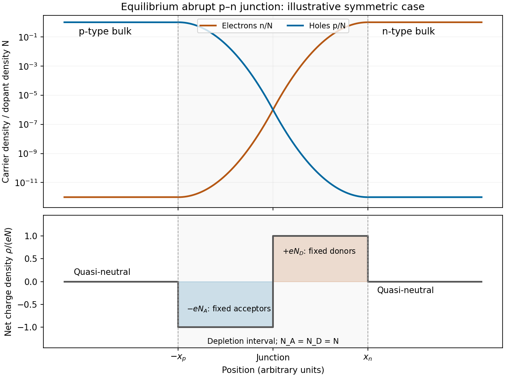

<h1 id="section-a/4/solution">Solution</h1>

↑ **Parent:** [4](../4.md)

Take an abrupt equilibrium [p-n junction](../../../../../p-n-junction.md) with the p side at $x<0$ and the n side at $x>0$. In the quasi-neutral bulk, [electron holes](../../../../../electron-hole.md) are the majority carriers on the p side and [electrons](../../../../../electron.md) are the majority carriers on the n side. With ionized dopant densities $N_A,N_D$ and nondegenerate statistics,

$$
p_{p}\simeq N_A,\quad n_{p}\simeq n_i^2/N_A,\qquad
n_{n}\simeq N_D,\quad p_{n}\simeq n_i^2/N_D,
$$

where $n_i$ is the [intrinsic carrier concentration](../../../../../intrinsic-carrier-concentration.md). The [semiconductor mass-action law](../../../../../semiconductor-mass-action-law.md) $np=n_i^2$ applies at equilibrium. Both mobile populations are small in the [depletion region](../../../../../depletion-region.md) compared with the dopant densities.

The [charge and carrier density of an abrupt p-n junction](../../../../../charge-and-carrier-density-of-an-abrupt-p-n-junction.md) must distinguish mobile populations from net charge. Diffusion leaves negatively charged ionized [acceptor impurities](../../../../../acceptor-impurity.md) on the p side and positively charged ionized [donor impurities](../../../../../donor-impurity.md) on the n side. Under the [depletion approximation](../../../../../depletion-approximation.md),

$$
\boxed{\rho(x)=\begin{cases}
-eN_A,&-x_p<x<0,\\
+eN_D,&0<x<x_n,\\
0,&x<-x_p\text{ or }x>x_n,
\end{cases}\qquad N_Ax_p=N_Dx_n.}
$$

The neutral bulks have large carrier densities but nearly zero net [charge density](../../../../../charge-density.md). The [electric field](../../../../../electric-field-split.md) points from the positive donor region toward the negative acceptor region, balancing diffusion at equilibrium.

**[Figure 2](#section-a/4/image-illustrative-equilibrium-carrier-densities-and-depletion-approximation-net-charge-for-a-symmetric-abrupt-p-n-junction). Illustrative equilibrium carrier densities and depletion-approximation net charge for a symmetric abrupt p-n junction**.

The figure uses equal dopant densities only to show a simple symmetric sketch. Generally the more lightly doped side has the wider depleted interval. The carrier profiles are smooth, whereas the step-shaped net [charge density](../../../../../charge-density.md) is the ideal [depletion approximation](../../../../../depletion-approximation.md).

## ↑ Ancestors (14)

1. [4](../4.md)
2. [Section A](../../section-a.md)
3. [Paper 2](../../../paper-2-split.md)
4. [2019](../../../split.md)
5. [Past exam of the physics A course of the University of Cambridge](../../../../split.md)
6. [Physics A course of the University of Cambridge](../../../../../physics-a-course-of-the-university-of-cambridge.md)
7. [Physics course of the year 2 of the natural sciences course of the University of Cambridge](../../../../../physics-course-of-the-year-2-of-the-natural-sciences-course-of-the-university-of-cambridge.md)
8. [Year 2 of the natural sciences course of the University of Cambridge](../../../../../year-2-of-the-natural-sciences-course-of-the-university-of-cambridge.md)
9. [Year of the natural sciences course of the University of Cambridge](../../../../../year-of-the-natural-sciences-course-of-the-university-of-cambridge.md)
10. [Natural sciences course of the University of Cambridge](../../../../../natural-sciences-course-of-the-university-of-cambridge.md)
11. [Course of the University of Cambridge](../../../../../course-of-the-university-of-cambridge.md)
12. [University of Cambridge](../../../../../university-of-cambridge-split.md)
13. [List of universities](../../../../../list-of-universities.md)
14. [Codex Wiki](../../../../../split.md)
