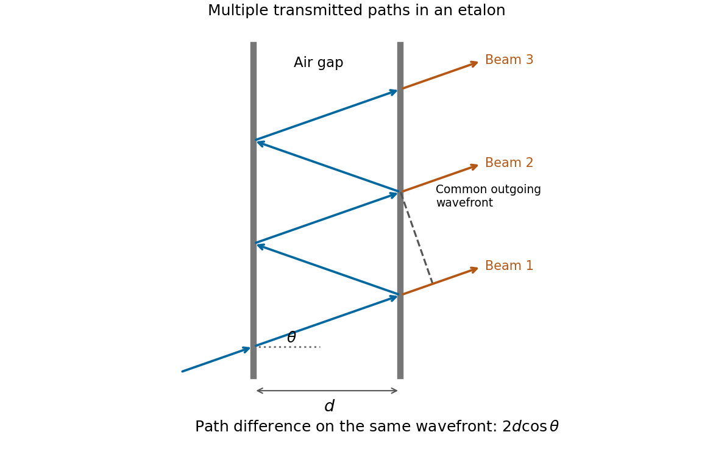

<h1 id="section-b/b6/a/solution">Solution</h1>

↑ **Parent:** [A](../a.md)

Draw the [Fabry–Pérot etalon](../../../../../../fabry-perot-etalon.md) with parallel mirrors and an incident beam making internal angle $\theta$ with their normal. Every emerging transmitted contribution has undergone one more internal round trip than its predecessor.

**[Figure 3](#section-b/b6/a/image-successive-transmitted-paths-and-a-common-outgoing-wavefront-for-a-tilted-beam-in-an-air-gap-etalon). Successive transmitted paths and a common outgoing wavefront for a tilted beam in an air-gap etalon**.

The extra internal path is $2d/\cos\theta$, but successive contributions leave at laterally separated points, a distance $2d\tan\theta$ apart. Comparing their phases on the same outgoing [wavefront](../../../../../../wavefront.md) subtracts the path projection $2d\tan\theta\sin\theta$. Their net [optical path difference](../../../../../../optical-path-difference.md) in air is

$$
\Delta=\frac{2d}{\cos\theta}-2d\tan\theta\sin\theta=2d\cos\theta.
$$

Hence, in the reflection-phase convention implicit in the supplied transmission formula,

$$
\boxed{\delta=\frac{2\pi\Delta}{\lambda}=\frac{4\pi d\cos\theta}{\lambda}.}
$$

For a gap of [refractive index](../../../../../../refractive-index.md) $n$, replace $d$ by $nd$ and use the [vacuum](../../../../../../vacuum.md) [wavelength](../../../../../../wavelength.md). Coating reflection phases can add a round-trip offset; the expression above assumes that offset is absorbed in the resonance order, or is zero modulo $2\pi$ as in the stated ideal model.

## ↑ Ancestors (15)

1. [A](../a.md)
2. [B6](../../b6.md)
3. [Section B](../../../section-b.md)
4. [Paper 2](../../../../paper-2-split.md)
5. [2019](../../../../split.md)
6. [Past exam of the physics A course of the University of Cambridge](../../../../../split.md)
7. [Physics A course of the University of Cambridge](../../../../../../physics-a-course-of-the-university-of-cambridge.md)
8. [Physics course of the year 2 of the natural sciences course of the University of Cambridge](../../../../../../physics-course-of-the-year-2-of-the-natural-sciences-course-of-the-university-of-cambridge.md)
9. [Year 2 of the natural sciences course of the University of Cambridge](../../../../../../year-2-of-the-natural-sciences-course-of-the-university-of-cambridge.md)
10. [Year of the natural sciences course of the University of Cambridge](../../../../../../year-of-the-natural-sciences-course-of-the-university-of-cambridge.md)
11. [Natural sciences course of the University of Cambridge](../../../../../../natural-sciences-course-of-the-university-of-cambridge.md)
12. [Course of the University of Cambridge](../../../../../../course-of-the-university-of-cambridge.md)
13. [University of Cambridge](../../../../../../university-of-cambridge-split.md)
14. [List of universities](../../../../../../list-of-universities.md)
15. [Codex Wiki](../../../../../../split.md)
