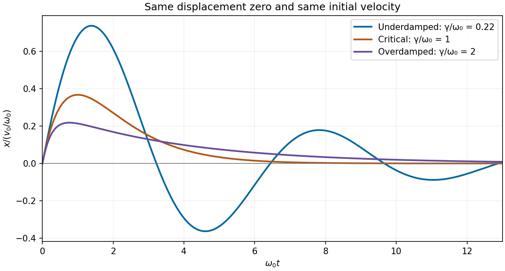

<h1 id="section-b/b7/c/solution">Solution</h1>

↑ **Parent:** [C](../c.md)

Let the initial conditions be $x(0)=0$ and $\dot x(0^+)=v_0>0$. The [velocity-impulse response of a damped oscillator](../../../../../../velocity-impulse-response-of-a-damped-oscillator.md) is

$$
\boxed{x(t)=\begin{cases}
\dfrac{v_0}{\omega_d}e^{-\gamma t}\sin(\omega_dt),&\gamma<\omega_0,\\
v_0t e^{-\omega_0t},&\gamma=\omega_0,\\
\dfrac{v_0}{s}e^{-\gamma t}\sinh(st),&\gamma>\omega_0,\quad s=\sqrt{\gamma^2-\omega_0^2}.
\end{cases}}
$$

All curves start at the origin with the same positive slope $v_0$. [Underdamping](../../../../../../underdamping.md) gives a decaying sequence of positive and negative lobes. [Critical damping](../../../../../../critical-damping.md) gives one positive lobe followed by return to zero. [Overdamping](../../../../../../overdamping.md) also remains positive for these initial data, but has a longer tail. The initial impulse changes [velocity](../../../../../../velocity.md) abruptly, not displacement.

**[Figure 5](#section-b/b7/c/image-calculated-displacement-after-the-same-initial-velocity-impulse-for-underdamped-critically-damped-and-overdamped-oscillators). Calculated displacement after the same initial velocity impulse for underdamped, critically damped and overdamped oscillators**.

## ↑ Ancestors (15)

1. [C](../c.md)
2. [B7](../../b7.md)
3. [Section B](../../../section-b.md)
4. [Paper 2](../../../../paper-2-split.md)
5. [2019](../../../../split.md)
6. [Past exam of the physics A course of the University of Cambridge](../../../../../split.md)
7. [Physics A course of the University of Cambridge](../../../../../../physics-a-course-of-the-university-of-cambridge.md)
8. [Physics course of the year 2 of the natural sciences course of the University of Cambridge](../../../../../../physics-course-of-the-year-2-of-the-natural-sciences-course-of-the-university-of-cambridge.md)
9. [Year 2 of the natural sciences course of the University of Cambridge](../../../../../../year-2-of-the-natural-sciences-course-of-the-university-of-cambridge.md)
10. [Year of the natural sciences course of the University of Cambridge](../../../../../../year-of-the-natural-sciences-course-of-the-university-of-cambridge.md)
11. [Natural sciences course of the University of Cambridge](../../../../../../natural-sciences-course-of-the-university-of-cambridge.md)
12. [Course of the University of Cambridge](../../../../../../course-of-the-university-of-cambridge.md)
13. [University of Cambridge](../../../../../../university-of-cambridge-split.md)
14. [List of universities](../../../../../../list-of-universities.md)
15. [Codex Wiki](../../../../../../split.md)
