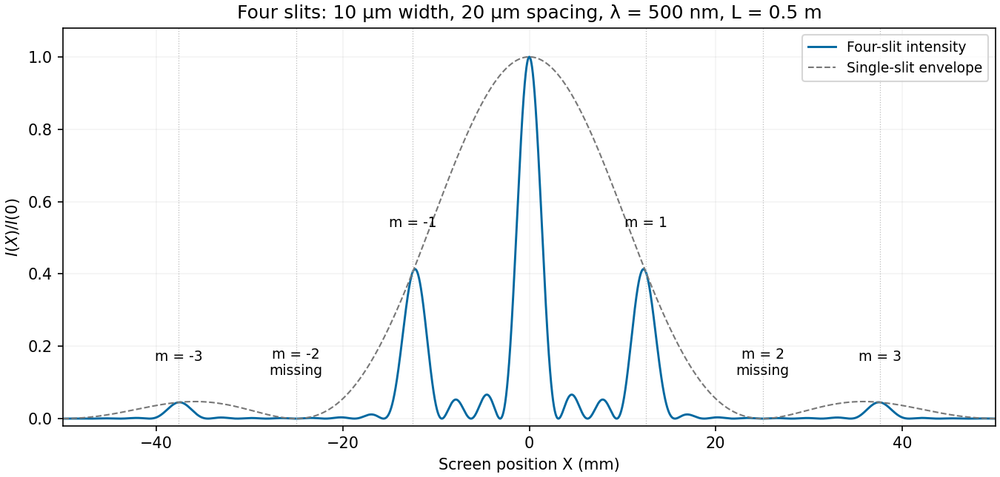

<h1 id="section-b/b8/c/solution">Solution</h1>

↑ **Parent:** [C](../c.md)

Let $X$ be horizontal position on the screen, $L=0.50\,\mathrm m$, and use $\sin\theta=X/\sqrt{L^2+X^2}$. The plotted interval is $-50\,\mathrm{mm}\leq X\leq50\,\mathrm{mm}$. With $a=10\,\mu\mathrm m$, $D=20\,\mu\mathrm m$ and $\lambda=0.500\,\mu\mathrm m$, the [four-slit Fraunhofer diffraction](../../../../../../four-slit-fraunhofer-diffraction.md) intensity is the previous normalized expression evaluated at this angle. The total aperture width is $3D+a=70\,\mu\mathrm m$, giving a [Fresnel number](../../../../../../fresnel-number.md) of order $0.020$, consistent with the far-field approximation.

Nominal principal array directions satisfy $D\sin\theta_m=m\lambda$. Their screen positions are

$$
X_m=\frac{L(m\lambda/D)}{\sqrt{1-(m\lambda/D)^2}}.
$$

Thus the visible nonzero orders are near $\boxed{X=\pm12.50\,\mathrm{mm}\ (m=\pm1),\quad X=\pm37.61\,\mathrm{mm}\ (m=\pm3)}$, in addition to the central maximum. The even nonzero orders are [missing diffraction orders](../../../../../../missing-diffraction-order.md): at $m=2$ the first envelope zero occurs at $X=\pm25.03\,\mathrm{mm}$. The next envelope zero and $m=4$ direction lie at about $\pm50.25\,\mathrm{mm}$, just beyond the screen edges.

At the nominal first and third array directions, $I/I(0)=4/\pi^2\simeq0.405$ and $4/(9\pi^2)\simeq0.0450$, respectively. The closest central minima satisfy $D\sin\theta=\pm\lambda/4$, hence $\boxed{X\simeq\pm3.125\,\mathrm{mm}}$. Two small subsidiary array maxima occur between adjacent principal directions. The single-slit envelope slightly shifts the true off-axis maxima relative to the nominal principal array angles.

**[Figure 6](#section-b/b8/c/image-calculated-four-slit-intensity-across-the-specified-screen-with-principal-array-directions-and-missing-orders-marked). Calculated four-slit intensity across the specified screen, with principal array directions and missing orders marked**.

## ↑ Ancestors (15)

1. [C](../c.md)
2. [B8](../../b8.md)
3. [Section B](../../../section-b.md)
4. [Paper 2](../../../../paper-2-split.md)
5. [2019](../../../../split.md)
6. [Past exam of the physics A course of the University of Cambridge](../../../../../split.md)
7. [Physics A course of the University of Cambridge](../../../../../../physics-a-course-of-the-university-of-cambridge.md)
8. [Physics course of the year 2 of the natural sciences course of the University of Cambridge](../../../../../../physics-course-of-the-year-2-of-the-natural-sciences-course-of-the-university-of-cambridge.md)
9. [Year 2 of the natural sciences course of the University of Cambridge](../../../../../../year-2-of-the-natural-sciences-course-of-the-university-of-cambridge.md)
10. [Year of the natural sciences course of the University of Cambridge](../../../../../../year-of-the-natural-sciences-course-of-the-university-of-cambridge.md)
11. [Natural sciences course of the University of Cambridge](../../../../../../natural-sciences-course-of-the-university-of-cambridge.md)
12. [Course of the University of Cambridge](../../../../../../course-of-the-university-of-cambridge.md)
13. [University of Cambridge](../../../../../../university-of-cambridge-split.md)
14. [List of universities](../../../../../../list-of-universities.md)
15. [Codex Wiki](../../../../../../split.md)
