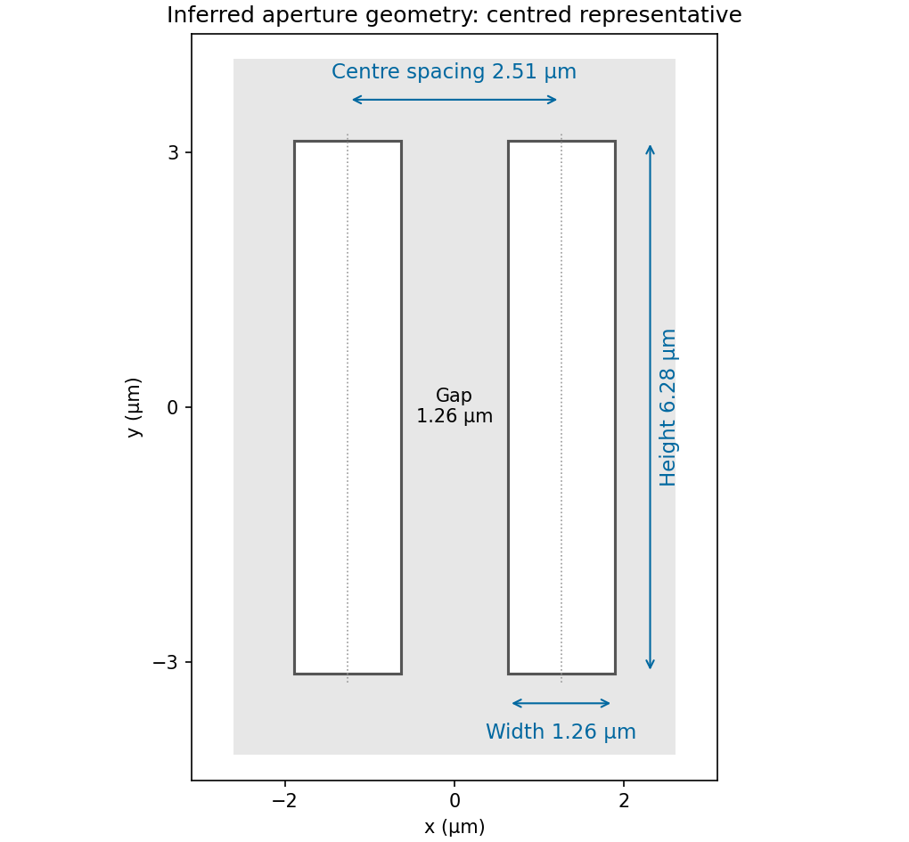

<h1 id="section-b/b8/d/solution">Solution</h1>

↑ **Parent:** [D](../d.md)

Model the two openings as identical axis-aligned rectangles of width $w$ in $x$, height $h$ in $y$, and centre separation $s$ along $x$. Their [Fraunhofer diffraction](../../../../../../fraunhofer-diffraction.md) field has the form

$$
\psi(q_x,q_y)\propto2wh\operatorname{sinc}(q_xw/2)\operatorname{sinc}(q_yh/2)\cos(q_xs/2).
$$

The original image shows first broad envelope zeros near $q_x=\pm5\,\mu\mathrm m^{-1}$ and $q_y=\pm1\,\mu\mathrm m^{-1}$. The horizontal interference period is about $\Delta q_x=2.5\,\mu\mathrm m^{-1}$; the first interference minima near $\pm1.25\,\mu\mathrm m^{-1}$ distinguish that fine scale from the envelope. The [rectangular-aperture dimensions from diffraction zeros](../../../../../../rectangular-aperture-dimensions-from-diffraction-zeros.md) are therefore

$$
\boxed{w\simeq\frac{2\pi}{5}\,\mu\mathrm m=1.26\,\mu\mathrm m,\qquad
h\simeq\frac{2\pi}{1}\,\mu\mathrm m=6.28\,\mu\mathrm m,\qquad
s\simeq\frac{2\pi}{2.5}\,\mu\mathrm m=2.51\,\mu\mathrm m.}
$$

The edge-to-edge gap is $s-w\simeq1.26\,\mu\mathrm m$. The long direction is vertical. These dimensions also explain the suppressed alternate principal array maxima: $s/w\simeq2$.

**[Figure 7](#section-b/b8/d/image-inferred-pair-of-rectangular-openings-quantitatively-labelled-using-the-original-angular-spatial-wavenumber-axes). Inferred pair of rectangular openings, quantitatively labelled using the original angular-spatial-wavenumber axes**.

The factors $2\pi$ are required by the stated $q=2\pi\sin\theta/\lambda$ convention; treating the plotted coordinates as cycles per micrometre would give different dimensions. The finite printed figure supports approximate dimensions. An overall translation and inversion of the aperture pair leave its Fourier intensity unchanged, so their absolute placement is not recoverable; the diagram chooses a convenient centred representative.

## ↑ Ancestors (15)

1. [D](../d.md)
2. [B8](../../b8.md)
3. [Section B](../../../section-b.md)
4. [Paper 2](../../../../paper-2-split.md)
5. [2019](../../../../split.md)
6. [Past exam of the physics A course of the University of Cambridge](../../../../../split.md)
7. [Physics A course of the University of Cambridge](../../../../../../physics-a-course-of-the-university-of-cambridge.md)
8. [Physics course of the year 2 of the natural sciences course of the University of Cambridge](../../../../../../physics-course-of-the-year-2-of-the-natural-sciences-course-of-the-university-of-cambridge.md)
9. [Year 2 of the natural sciences course of the University of Cambridge](../../../../../../year-2-of-the-natural-sciences-course-of-the-university-of-cambridge.md)
10. [Year of the natural sciences course of the University of Cambridge](../../../../../../year-of-the-natural-sciences-course-of-the-university-of-cambridge.md)
11. [Natural sciences course of the University of Cambridge](../../../../../../natural-sciences-course-of-the-university-of-cambridge.md)
12. [Course of the University of Cambridge](../../../../../../course-of-the-university-of-cambridge.md)
13. [University of Cambridge](../../../../../../university-of-cambridge-split.md)
14. [List of universities](../../../../../../list-of-universities.md)
15. [Codex Wiki](../../../../../../split.md)
