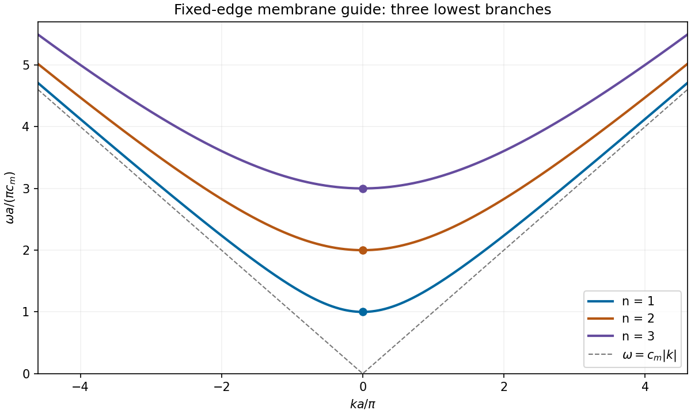

<h1 id="section-b/b9/e/solution">Solution</h1>

↑ **Parent:** [E](../e.md)

For positive [angular frequency](../../../../../../angular-frequency.md), the first three branches are

$$
\boxed{\omega_n(k)=c_m\sqrt{k^2+(n\pi/a)^2},\qquad n=1,2,3.}
$$

Each branch is even in $k$, has minimum $\omega_n(0)=n\pi c_m/a$, and starts with zero slope. At large $|k|$, all approach the straight asymptote $\omega=c_m|k|$. Their [group velocities](../../../../../../group-velocity.md) are $v_{g,n}=c_m^2k/\omega_n$, whereas their longitudinal [phase velocities](../../../../../../phase-velocity.md) are $v_{p,n}=\omega_n/k$ for $k\ne0$, giving $v_{p,n}v_{g,n}=c_m^2$.

**[Figure 8](#section-b/b9/e/image-three-lowest-membrane-waveguide-dispersion-branches-with-their-cutoffs-and-common-large-wavenumber-asymptote). Three lowest membrane-waveguide dispersion branches, with their cutoffs and common large-wavenumber asymptote**.

## ↑ Ancestors (15)

1. [E](../e.md)
2. [B9](../../b9.md)
3. [Section B](../../../section-b.md)
4. [Paper 2](../../../../paper-2-split.md)
5. [2019](../../../../split.md)
6. [Past exam of the physics A course of the University of Cambridge](../../../../../split.md)
7. [Physics A course of the University of Cambridge](../../../../../../physics-a-course-of-the-university-of-cambridge.md)
8. [Physics course of the year 2 of the natural sciences course of the University of Cambridge](../../../../../../physics-course-of-the-year-2-of-the-natural-sciences-course-of-the-university-of-cambridge.md)
9. [Year 2 of the natural sciences course of the University of Cambridge](../../../../../../year-2-of-the-natural-sciences-course-of-the-university-of-cambridge.md)
10. [Year of the natural sciences course of the University of Cambridge](../../../../../../year-of-the-natural-sciences-course-of-the-university-of-cambridge.md)
11. [Natural sciences course of the University of Cambridge](../../../../../../natural-sciences-course-of-the-university-of-cambridge.md)
12. [Course of the University of Cambridge](../../../../../../course-of-the-university-of-cambridge.md)
13. [University of Cambridge](../../../../../../university-of-cambridge-split.md)
14. [List of universities](../../../../../../list-of-universities.md)
15. [Codex Wiki](../../../../../../split.md)
