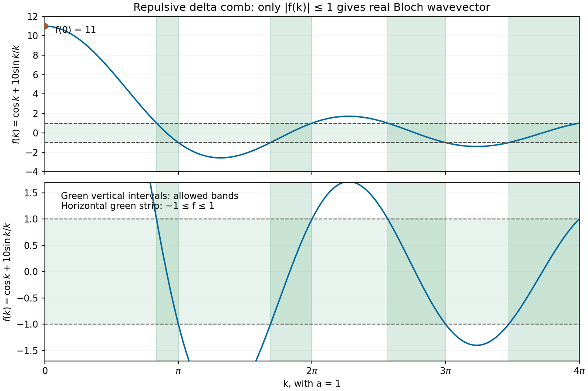

<h1 id="section-c/c11/d/solution">Solution</h1>

↑ **Parent:** [D](../d.md)

With length measured in units of $a=1$, plot the real function

$$
f(k)=\cos k+10\frac{\sin k}{k},\qquad f(0)=11.
$$

Only the portions with $|f(k)|\leq1$ can equal $\cos\phi$, so the strip between the horizontal lines $+1$ and $-1$ identifies allowed [energy bands](../../../../../../energy-band.md). The [band edges of a repulsive delta-comb potential](../../../../../../band-edges-of-a-repulsive-delta-comb-potential.md) have the following approximate first intervals:

$$
\boxed{\begin{aligned}
2.6277&\leq k\leq\pi,\\
5.3073&\leq k\leq2\pi,\\
8.0671&\leq k\leq3\pi,\\
10.9087&\leq k\leq4\pi.
\end{aligned}}
$$

Each interval corresponds to [energy](../../../../../../energy-split.md) $E=\hbar^2k^2/(2m)$; the intervening intervals are forbidden. The exact upper endpoints follow from $f(j\pi)=(-1)^j$. The lower endpoints solve $f(k)=(-1)^{j-1}$ inside $((j-1)\pi,j\pi)$. The divergence suggested by $\sin k/k$ at the origin is removable, and $f(0)=11>1$, so there is no zero-energy state in the repulsive model.

**[Figure 9](#section-c/c11/d/image-calculated-delta-comb-discriminant-for-barrier-strength-10-with-allowed-bands-marked-by-the-strip-between-minus-one-and-plus-one). Calculated delta-comb discriminant for barrier strength 10, with allowed bands marked by the strip between minus one and plus one**.

The periodic barriers produce separated [energy bands](../../../../../../energy-band.md) and [band gaps](../../../../../../band-gap.md), unlike the continuous free-particle spectrum. A finite $N$-atom loop has discrete states within these bands. Whether the material conducts still depends on [band filling](../../../../../../band-filling.md): one [electron](../../../../../../electron.md) per primitive cell half-fills a spin-degenerate band, while two [electrons](../../../../../../electron.md) per cell can fill the first band and place the [Fermi energy](../../../../../../fermi-energy.md) in a gap. Band gaps alone do not establish that every filling is insulating. At high $k$, the perturbing term $10\sin k/k$ becomes relatively small and the spectrum approaches free-electron behaviour in relative terms.

## ↑ Ancestors (15)

1. [D](../d.md)
2. [C11](../../c11.md)
3. [Section C](../../../section-c.md)
4. [Paper 2](../../../../paper-2-split.md)
5. [2019](../../../../split.md)
6. [Past exam of the physics A course of the University of Cambridge](../../../../../split.md)
7. [Physics A course of the University of Cambridge](../../../../../../physics-a-course-of-the-university-of-cambridge.md)
8. [Physics course of the year 2 of the natural sciences course of the University of Cambridge](../../../../../../physics-course-of-the-year-2-of-the-natural-sciences-course-of-the-university-of-cambridge.md)
9. [Year 2 of the natural sciences course of the University of Cambridge](../../../../../../year-2-of-the-natural-sciences-course-of-the-university-of-cambridge.md)
10. [Year of the natural sciences course of the University of Cambridge](../../../../../../year-of-the-natural-sciences-course-of-the-university-of-cambridge.md)
11. [Natural sciences course of the University of Cambridge](../../../../../../natural-sciences-course-of-the-university-of-cambridge.md)
12. [Course of the University of Cambridge](../../../../../../course-of-the-university-of-cambridge.md)
13. [University of Cambridge](../../../../../../university-of-cambridge-split.md)
14. [List of universities](../../../../../../list-of-universities.md)
15. [Codex Wiki](../../../../../../split.md)
